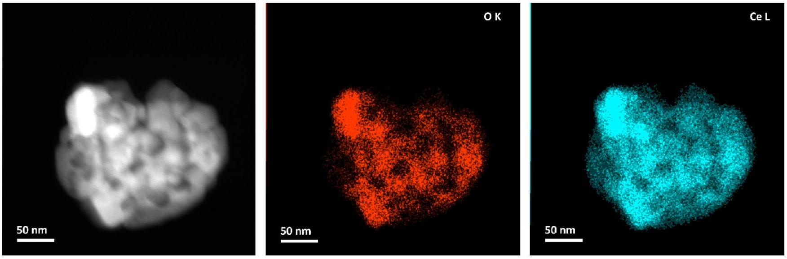
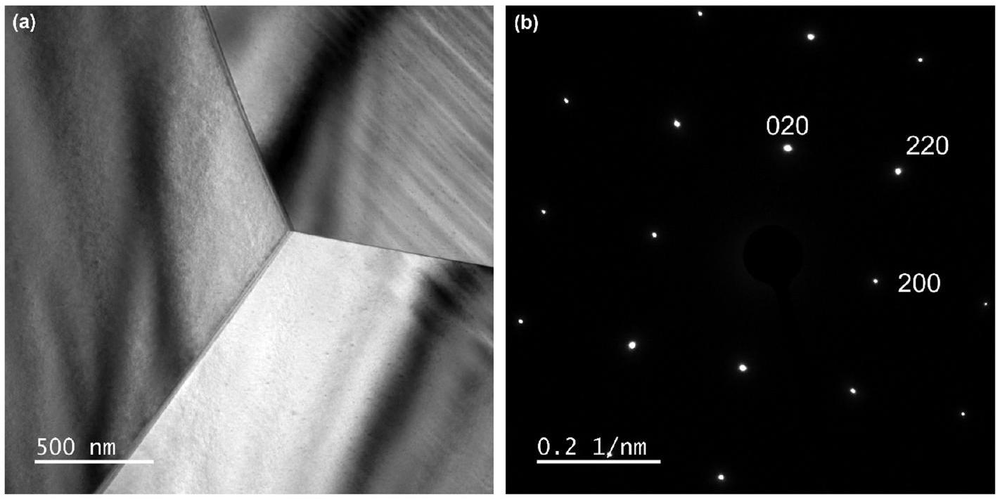
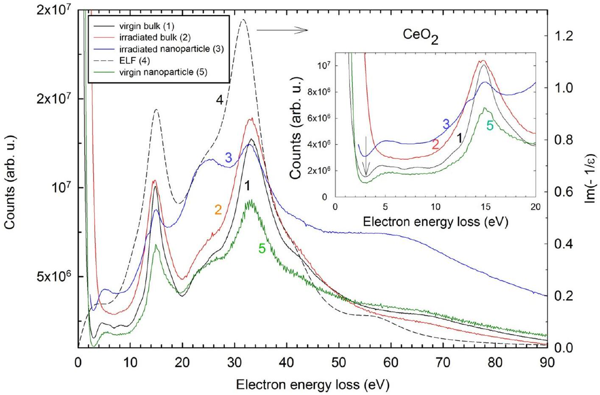
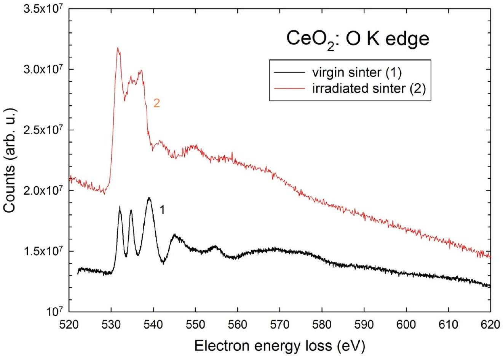
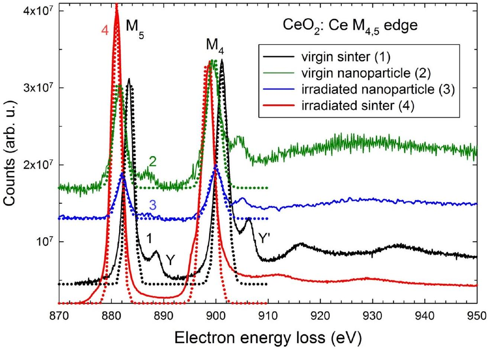

# Electron energy loss spectroscopy study of ceria sinters and nanoparticles irradiated with swift heavy ions 

Cite as: J. Appl. Phys. 139, 125901 (2026); doi: 10.1063/5.0311054 Submitted: 6 November 2025 • Accepted: 4 March 2026 • Published Online: 26 March 2026

Jean-Marc Costantini, ${ }^{1, \mathrm{a})}$ ® Joël Ribis, ${ }^{1, ~(\mathrm{D})}$ Gaëlle Gutierrez, ${ }^{2}$ Maik Lang, ${ }^{3}$ ® and Kazuhiro Yasuda ${ }^{4}$ ®

AFFILIATIONS ${ }^{1}$ Service de Recherche en Matériaux et procédés Avancés, Université Paris-Saclay, CEA, Gif-sur-Yvette 91191, France ${ }^{2}$ Service de recherche en Corrosion et Comportement des Matériaux, Université Paris-Saclay, CEA, SRMP, Gif-sur-Yvette 91191, France ${ }^{3}$ Department of Nuclear Engineering, University of Tennessee, Knoxville, Tennessee 37956, USA ${ }^{4}$ Department of Applied Quantum Physics and Nuclear Engineering, Kyushu University, 744 Motooka, Nishi-ku, Fukuoka 819-0395, Japan

${ }^{\text {a }}$ Author to whom correspondence should be addressed: jean-marc.costantini@cea.fr

#### Abstract

The electronic energy loss spectra of ceria $\left(\mathrm{CeO}_{2}\right)$ irradiated with swift heavy ions ( 27 MeV Xe and 946 MeV Au ) in the electronic slowing down regime were measured for bulk sintered samples and nanoparticles by using a double Cs-corrected transmission electron microscope. The low-loss region as well as the core-loss region, including the oxygen K-edge and cerium $\mathrm{M}_{4,5}$ white lines, were recorded. No strong lattice disorder was found in the low-loss peaks for both types of samples showing the same bulk oxygen plasmon loss peak at about 15 eV. However, there is a clear evidence of cerium reduction to the trivalent oxidation state after irradiation for the sintered samples as shown by the K-edge shape of oxygen and decrease of the Ce $\mathrm{M}_{4} / \mathrm{M}_{5}$ intensity ratio. A similar change of the $\mathrm{M}_{4} / \mathrm{M}_{5}$ intensity ratio was observed for the irradiated nanoparticles with respect to the virgin sample owing to the high energy input inside the nanograin. The effect of radiation damage on electron energy loss spectroscopy data is analyzed for both types of samples and irradiation conditions.

© 2026 Author(s). All article content, except where otherwise noted, is licensed under a Creative Commons Attribution (CC BY) license (https://creativecommons.org/licenses/by/4.0/). https://doi.org/10.1063/5.0311054

## I. INTRODUCTION

Cerium dioxide or ceria $\left(\mathrm{CeO}_{2}\right)$ is widely considered as a surrogate of stoichiometric uranium dioxide ( $\mathrm{UO}_{2.0}$ ) and plutonium dioxide $\left(\mathrm{PuO}_{2.0}\right)$ sharing the same cubic fluorite structure and similar point defect energetics. ${ }^{1}$ The cubic fluorite structure can be maintained up to a large oxygen deficiency in $\mathrm{CeO}_{2-\mathrm{x}}$ up to the melting point (2293 °C). ${ }^{2,3}$ Trivalent cerium ions (Ce III) can be induced at room temperature by charge compensation of the oxygen vacancies induced by trivalent rare-earth doping such as gadolinium. ${ }^{4}$

Radiation effects in ceria under charged particle irradiation were extensively studied for both polycrystalline and single crystalline samples by using different experimental methods such as x-ray diffraction (XRD), ${ }^{5}$ transmission electron microscopy (TEM) ${ }^{6}$ and scanning TEM (STEM), ${ }^{7}$ x-ray absorption spectroscopy (XAS), ${ }^{8}$ x-ray photoelectron spectroscopy (XPS), ${ }^{8,9}$ Raman spectroscopy, ${ }^{10,11}$ UV-visible diffuse reflectance spectroscopy, ${ }^{12,13}$ and cathodoluminescence (CL) spectroscopy. ${ }^{14}$ Ceria is a radiationresistant material like $\mathrm{UO}_{2}$, which are both non-amorphizable under swift heavy ion irradiation even for very high stopping power values. ${ }^{15}$ Nevertheless, the reduction in tetravalent cerium (Ce IV) with an empty 4f shell in $\mathrm{CeO}_{2.0}$ to the trivalent state with the $4 \mathrm{f}^{1}$ configuration in $\mathrm{CeO}_{2-\mathrm{x}}$ was evidenced for electron- and ionirradiated polycrystalline samples and single crystals on the basis of optical absorption spectra, ${ }^{12}$ electron paramagnetic resonance (EPR) spectra, ${ }^{16}$ CL spectra, ${ }^{14}$ XAS, ${ }^{17}$ as well as XPS spectra. ${ }^{8,9}$

Electron energy loss spectroscopy (EELS) studies were conducted on bulk samples ${ }^{18-20}$ as well as nanocrystalline forms of
ceria. ${ }^{21-23}$ Particularly, the reduction of Ce IV to Ce III was evidenced by EELS data from the branching ratio of $\mathrm{M}_{4}-\mathrm{M}_{5}$ white lines, ${ }^{20,22}$ which is depending on the particle size. ${ }^{21}$ However, very few studies have used EELS to follow the local order in electron-irradiated ceria. ${ }^{20,24}$ These results have highlighted the role of grain boundaries (GBs) on the radiation damage of nanostructured ceria, ${ }^{24}$ yet no EELS data are available in the literature for the case of ion irradiations, to the best of our knowledge.

We recently published low-loss TEM/EELS data of unirradiated sintered ceria ${ }^{25}$ showing a good agreement with the literature REELS data. ${ }^{26}$ In this study, we applied TEM-STEM/EELS in order to follow the evolution of local order in ceria nanoparticles as compared to the bulk sintered samples after swift heavy ion irradiation. For this purpose, the Oxygen K-edge and the Cerium $\mathrm{M}_{4,5}$ white lines were recorded for pristine and ion-irradiated samples. The results of the low-loss range are analyzed and discussed with reference to the electronic structure and optical spectroscopy data of pristine and irradiated $\mathrm{CeO}_{2-\mathrm{x}}$. Even though there are several studies showing Ce III formation in ion-irradiated ceria, ${ }^{8,9}$ yet, no study using STEM/EELS was carried out on nanoparticles irradiated with swift heavy ions as compared to the coarse-grained ceramics.

## II. EXPERIMENTAL PROCEDURES

Coarse-grained polycrystalline ceria samples with grain sizes of about $10 \mu \mathrm{~m}$ were prepared by sintering of powders at high temperature. ${ }^{27}$ Nanoparticles in sizes of about 150 nm obtained by ball milling were also used (Fig. 1).

The irradiation of the sintered sample was carried out at the JANNUS-Saclay facility (France) with 27 MeV ${ }^{131} \mathrm{Xe}$ ions to a fluence of $3 \times 10^{14} \mathrm{~cm}^{-2}$. Nanoparticles were irradiated with $946 \mathrm{MeV}{ }^{196} \mathrm{Au}$ ions at the GSI Helmholtz Center (Darmstadt, Germany) to a fluence of $1 \times 10^{12} \mathrm{~cm}^{-2}$. The characteristics of each ion irradiation experiment such as stopping power and projected range are computed with the SRIM-2013 code ${ }^{28}$ (Table I).

TEM and STEM examinations and EDS (energy dispersive spectroscopy) measurements were carried out on an FIB lamellae of the bulk samples with a double Cs-corrected NEOARM JEOL transmission electron microscope operated at 200 kV and equipped with a GATAN Imaging Filter (GIF) and two Centurio JEOL EDS detectors. The EELS data were recorded in the TEM mode for the sintered samples and STEM mode for the nanoparticles on the (100) planes with a slit size of 5 mm. For the TEM and STEM modes, the convergence angle was of 1.5 and 24 mrad, respectively, while the collection angle was of 25 and 110 mrad, respectively. The energy resolution was $0.7-1.0 \mathrm{eV}$ corresponding to the zeroloss peak full width at half-maximum (FWHM) and spatial resolution of 1 nm. Energy loss spectra were collected in the 0-1200 eV range for a dispersion ranging from 0.05 to 0.30 eV per channel. The low-loss region with the main peaks at about 15, 35, and 65 eV was recorded for pristine and ion-irradiated samples, as well as the K-edge of Oxygen (540 eV) and $\mathrm{N}_{4,5}(130 \mathrm{eV}), \mathrm{M}_{4,5}(900 \mathrm{eV})$, and $\mathrm{M}_{23}(1200 \mathrm{eV})$ edges of Cerium.

For the sintered specimens, the thickness was estimated as $0.67 \mathrm{t} / \lambda$, with $\lambda$ being the mean free path, while for nanoparticles the thickness was estimated as $1.32 \mathrm{t} / \lambda$. The background was extracted by using a power-law function. Plural scattering was deconvoluted. However, this procedure has no noticeable effect on the signal. Several spectra were recorded in the STEM mode at different beam spots in the thinner parts of the nanoparticles. STEM/ EDS mapping was carried out to analyze the chemical composition of the nanocrystalline grains. Although the beam current was not directly measured, it is estimated to be on the order of a few pA. The exposure time for data collection of a few seconds was short enough to avoid any beam current effects.

## III. RESULTS

The EDS analysis confirms the $\mathrm{CeO}_{2}$ stoichiometry with low contents of Si, Co, and Cu impurities in the nanoparticle (Fig. 1). The TEM image of the pristine sintered sample shows a coarse-

FIG. 1. TEM image (left) and EDS/STEM mapping of Ce (L-edge, middle, blue) and O (K-edge, right, red) atoms for a spherical ceria nanoparticle in size of 150 nm produced by ball milling.

TABLE I. Characteristics of the ion irradiations in $\mathrm{CeO}_{2}$ (mass density $=7.215 \mathrm{~g}$ $\mathrm{cm}^{-3}$ ) computed with SRIM-2013 code: ${ }^{28}$ ion energy (E), nuclear energy loss $\left(\mathrm{S}_{\mathrm{n}}\right)$ electronic energy loss $\left(\mathrm{S}_{\mathrm{e}}\right)$, and mean projected range $\left(\mathrm{R}_{\mathrm{p}}\right)$.
| Ion | E | $\mathrm{S}_{\mathrm{n}}$ | $\mathrm{S}_{\mathrm{e}}$ |  |  |
| :--- | :--- | :--- | :--- | :--- | :--- |
|  | (MeV) | $\left(\mathrm{MeV} \mu \mathrm{m}^{-1}\right)$ | $\left(\mathrm{MeV} \mu \mathrm{m}^{-1}\right)$ | $\left(\mathrm{S}_{\mathrm{e}} / \mathrm{S}_{\mathrm{n}}\right)$ | $\mathrm{R}_{\mathrm{p}}(\mu \mathrm{m})$ |
| ${ }^{131} \mathrm{Xe}$ | 27 | 0.53 | 11.2 | 21 | $3.66 \pm 0.48$ |
| ${ }^{196} \mathrm{Au}$ | 946 | 0.088 | 44.5 | 505 | $29.77 \pm 1.09$ |

grained microstructure [Fig. 2(a)].The electron diffraction pattern corresponds to the cubic fluorite structure [Fig. 2(b)]. No structural modification was evidenced in the irradiated sintered sample in agreement with the literature data. ${ }^{15}$ The low-loss region of EELS spectra is shown for the pristine and irradiated samples (sintered and nanoparticles) in Fig. 3. Seven peaks are recorded for the pristine sintered sample (Table II). There is an energy loss onset at approximately 3 eV (marked with an arrow in the inset showing the low-loss spectra up to 90 eV, Fig. 3) for the pristine sinter and nanoparticles and also for the irradiated nanoparticles. This threshold is not apparent in the irradiated sintered sample, which shows a distinct broadening of the zero-loss elastic peak.

There is an additional broad peak at around 5 eV for the pristine sinter and irradiated nanoparticles. The oxygen valence plasmon peak near 15 eV is detectable for all samples. The spectrum of the irradiated sinter is spread between 0 and 15 eV without any clear features. The second main loss peak is shifted for all samples to 33 eV by about 1 eV relative to the energy loss function (ELF) data as deduced from REELS measurements. ${ }^{26}$ The peak shoulder at around 25 eV increases for the irradiated nanoparticle; however, there might be a contribution from the carbon film beneath this shoulder. There is some inhomogeneity in the low-loss spectra of nanoparticle samples due to their anisotropy with either spherical or elongated shapes. The positions of all peaks are summarized in Table II together with the ELF data given by Pauly et al (Fig. 4). ${ }^{26}$

The spectra at the oxygen K-edge are shown for the pristine and irradiated sinters in Fig. 3. The positions of the three most prominent peaks of the O K-edge are given in Table III with different intensities and widths. The K-edge for both pristine and irradiated nanoparticles was too low in intensity to be accurately extracted from the scattering background. The spectra of the cerium $\mathrm{M}_{4}-\mathrm{M}_{5}$ white lines are shown for both pristine and irradiated sintered and nanocrystalline samples in Fig. 5. For the irradiated sinter, there is a small shift of these loss peaks to lower energies by about 2.5 eV with respect to the pristine sample spectrum and the Y and Y' satellite peaks vanish after irradiation. The other two peaks above 910 eV are spread out and also clearly shifted to lower energy losses. The spectra for the nanoparticles are much less intense with a higher scattering background, and the white lines are slightly shifted to lower energy loss by about 2 eV with respect to the sinter spectra. The higher energy loss peaks are flattened out in the irradiated sinter and in the nanocrystalline samples in either pristine or irradiated state. No in-beam evolutions of the $\mathrm{M}_{4} / \mathrm{M}_{5}$ ratio were observed during the short time exposures. The $\mathrm{M}_{4},{ }_{5}$ edges are fitted with two Gaussian profiles (Fig. 5). The ratio of $\mathrm{M}_{4} / \mathrm{M}_{5}$ peak intensities corrected for the background levels is obtained for both the pristine and irradiated samples as recommended by Kennedy et al. ${ }^{29}$ The $\mathrm{M}_{4} / \mathrm{M}_{5}$ intensity ratios and the FWHM deduced from the standard deviations are reported in Table IV. A clear decrease in the $\mathrm{M}_{4} / \mathrm{M}_{5}$ peak intensity is seen for both the sintered sample and nanoparticle after irradiation. The FWHM of these peaks is about $2-3 \mathrm{eV}$, and no clear changes are seen with either sample type or irradiation condition.

FIG. 2. TEM image of the sintered specimen (a) with its associated diffraction pattern (b).

FIG. 3. Low-loss region of the EELS data for the virgin and irradiated samples (left scale, solid lines): virgin bulk (1, black), irradiated bulk (2, red), virgin nanoparticle (5, green), and irradiated nanoparticle (3, blue).The ELF data are also plotted (4, right scale, dashed black line). ${ }^{26}$ Inset: spectra in the 0-20 eV range: the peak of the 0-2p shell contribution in the bulk-plasmon of $\mathrm{CeO}_{2}$ is recorded near 15 eV.

## IV. DISCUSSION

Apart from the standard chemical analysis, EELS spectra yield a wealth of information on the electronic transitions in the loss-loss region as well as on the local order in the edges of the constitutive chemical elements due to the various inelastic interactions of electrons with the material. ${ }^{30-32}$ The contribution of the low-loss region (below around 100 eV) gives access to the modifications of electronic density and bandgap energy, ${ }^{33}$ as well changes in the electronic transitions. ${ }^{32}$ The contribution of edges in the core-loss region provides information on the formation of atomic defects, for instance, in the oxygen sublattice of oxides. ${ }^{9,34}$ Changes in the cationic oxidation state can also be deduced from chemical shifts ${ }^{35}$ or white-line ratios of the $\mathrm{L}_{2,3}$ or $\mathrm{M}_{4,5}$ edges. ${ }^{20,23,34,36-38}$

TABLE II. Peak positions in the low-loss region with the Energy Loss Function (ELF) data as deduced from the REELS spectrum of $\mathrm{CeO}_{2}$. ${ }^{26}$
| Virgin sinter | 5.15 | 11 | 14.80 | 25 | 33.20 | 41 | 65 |
| :--- | :--- | :--- | :--- | :--- | :--- | :--- | :--- |
| Irradiated sinter |  |  | 14.65 |  | 33.40 |  |  |
| Virgin nanoparticle | 5.40 |  | 14.85 | 25.50 |  |  |  |
| Irradiated nanoparticle | 5.15 | 13.40 | 15.05 | 25.85 | 32.75 |  |  |
| ELF | 4.55 | 11 | 15.1 | 24.7 | 32.1 | 41.3 | 57.5 |

In the present case, EELS data may be compared to the XAS data since the final state is the same as for x-ray photon excitation with a core hole left in the O-1s shell and Ce-3d shell for the O K-edge and Ce $\mathrm{M}_{4,5}$ edges, respectively, and subsequent scattering of the emitted photoelectrons. ${ }^{30,32,39}$ However, the difference between these experimental techniques lies in the probed depth since XAS is more sensitive to the surface than the TEM-EELS in the transmission mode. Moreover, a secondary electron cascade is produced by the energetic primary electron beam in EELS with multiple electronic excitations, whereas single excitations are produced by the primary x-ray beam in XAS. Hereafter, the irradiation-induced evolution of the low-loss region and of the oxygen K-edge and cerium $\mathrm{M}_{4}$, ${ }_{5}$ edges are separately discussed. A more qualitative analysis of the oxygen K-edge is performed instead of using more complex quantitative ELNES and EXELFS calculations. ${ }^{39}$

## A. Low-loss region

The threshold energy loss of about 3 eV can be assigned to the 2p-4f gap (marked with an arrow in the inset of Fig. 3) in agreement with a value of about 3.2 eV reported previously from optical absorption spectra, ${ }^{16}$ as well in UPS, ${ }^{40}$ and in HREELS. ${ }^{18,19}$ The broad peak around 5 eV can be assigned to 2 p $\rightarrow 5$ d electronic transitions. ${ }^{16,40}$ This is also consistent with the ELF data with a mode at $4.55 \mathrm{eV},{ }^{26}$ and the HREELS measurements giving two loss

FIG. 4. Oxygen K-edge for the virgin (1, black) and ion-irradiated (2, red) sintered samples. The changes in the spectrum after ion irradiation and shape of peaks correspond to the reduction of tetravalent cerium cations to the trivalent oxidation state in the sintered sample.

peaks at 4.4 and 7.4 eV. ${ }^{18}$ The sintered and nanocrystalline samples show these peaks in their pristine state, and they remain detectable after ion irradiation in the nanomaterial. However, the zero-loss peak and transitions above 5 eV are flattened out for the irradiated sinter, in contrast to the nanoparticle still showing this broad loss peak at about 5 eV. For the irradiated sinter, the peak at 5 eV might be a convolution of various electronic transitions to the 5d excited states that are likely split by defects such as oxygen vacancies in the Ce nearest neighbor (NN) coordination shell.

Such a splitting of 5d levels was previously observed in optical absorption spectra of swift heavy ion-irradiated polycrystalline ceria ${ }^{11}$ and CL spectra for energetic electron irradiations $(\geq 400 \mathrm{keV})$ of sintered samples. ${ }^{14}$ This was assigned to a symmetry lowering around the Ce cations arising from nearby oxygen

TABLE III. Peak positions (in eV) for the oxygen K-edge.
| Virgin sinter | 532.05 | 534.75 | 538.90 | 545.15 | 555.25 |
| :--- | :--- | :--- | :--- | :--- | :--- |
| Irradiated sinter | 531.55 | 534.7 | 537.10 | 541.30 | 548.95 |
| XAS $\mathrm{CeO}_{2}(110)^{19}$ | 530 | 532.5 | 537 | 543 | 553 |
| XAS $\mathrm{Ce}_{2} \mathrm{O}_{3}{ }^{19}$ | 532 | 535 | 537.5 | 542 | 550 |
| EELS $\mathrm{CeO}_{2}{ }^{20}$ | 529.3 | 532.0 | 536.2 |  |  |
| EELS $\mathrm{Ce}_{2} \mathrm{O}_{3}{ }^{20}$ | 531 | 533.7 | 536.2 |  |  |

vacancies. This is consistent with the XAS data at the Ce K-edge showing a decrease in the Ce-O coordination number after 200 MeV Xe ion irradiation of sintered samples for a stopping power similar to this study $\left(\mathrm{S}_{\mathrm{e}}=27.5 \mathrm{MeV} \mu \mathrm{m}^{-1}\right) .^{8}$ The analysis of EXAFS data revealed that the Ce-O coordination number decreases from 8 in the pristine cubic fluorite structure to an asymptotic value of 6.3 as a function of fluence up to $1 \times 10^{14} \mathrm{~cm}^{-2}$.

No significant changes in the O-2p shell contribution in the bulk-plasmon peak of ceria near 15 eV (only by ±0.2 eV much smaller than the energy resolution) are recorded for the sintered and nanocrystalline sample before and after ion irradiation (Table II). This shows that no clear changes in atomic density and/ or bandgap energy have occurred as a result of irradiation. This follows the simple Drude's model analysis according to Eq. (1) with a shift of the plasmon energy $\left(\mathrm{E}_{\mathrm{p}}\right)$ by the bandgap energy $\left(\mathrm{E}_{\mathrm{G}}\right)$ for insulators and semiconductors: ${ }^{30,32,41,42}$

$$
\mathrm{E}_{\mathrm{p}}=\hbar \omega_{\mathrm{p}}=\left(\mathrm{E}_{\mathrm{G}}^{2}+\frac{\hbar^{2} \mathrm{ne}^{2}}{\varepsilon_{0} \varepsilon_{\mathrm{r}} \mathrm{~m}^{*}}\right)^{\frac{1}{2}},
$$

where n is the electron density; $\varepsilon_{0}$ and $\varepsilon_{\mathrm{r}}$ are the dielectric constant of free space and relative dielectric constant of the material, respectively; and e and $\mathrm{m}^{\star}$ are the electron charge and average effective mass, respectively. ${ }^{25}$ This is consistent with the fact that the

FIG. 5. Cerium $\mathrm{M}_{4}-\mathrm{M}_{5}$ white lines for virgin and ion-irradiated samples: virgin sinter (1, black line), virgin nanoparticle (2, green solid line), irradiated sinter (4, red solid line), and irradiated nanoparticle (3, blue solid line). The dotted lines are the fitted spectra with two Gaussian profiles. A similar decrease in the $\mathrm{M}_{4} / \mathrm{M}_{5}$ intensity ratio is observed for both the sintered sample and nanoparticle after ion irradiation (Table IV). This suggests the formation of Ce III in agreement with the evolution of oxygen K-edge for the coarse-grained sample (Fig. 4).

2p → 4f transitions near 3 eV and 2p → 5d transitions near 5 eV are not changed whatsoever. Yet, a smearing of these features is evidenced for the irradiated sinter, in agreement with the increase in Urbach tail deduced from the diffuse reflectance spectra for similar swift heavy ion irradiations. ${ }^{13}$

A value of the O-2p shell contribution in the bulk-plasmon energy of $\mathrm{E}_{\mathrm{p}}=14.72 \mathrm{eV}$ can be calculated with Eq. (1) by using a bandgap energy of $\mathrm{E}_{\mathrm{G}}=5.5 \mathrm{eV}$, ${ }^{16,40}$ mass density of $7.215 \mathrm{~g} \mathrm{~cm}^{-3}$, $\varepsilon_{\mathrm{r}}=23, \mathrm{~m}^{\star}=1.1 \mathrm{~m}_{0}$, eight oxygen atoms per unit cell, and two electrons per oxygen atom. The shoulder at 41 eV may correspond to a Ce-5d plasmon excitation. A value of $\mathrm{E}_{\mathrm{p}}=41.18 \mathrm{eV}$ is obtained by using four electrons per cerium atom with four cerium atoms per unit cell, and $\mathrm{m}^{\star}=0.15 \mathrm{~m}_{0}$ for electrons in the 5d shell. The difference in electron effective mass derives from the difference in electronic band curvature at the center of the first Brillouin zone ( $\Gamma$ point) for the valence band and conduction band. Electrons are likely more mobile in the Ce-5d wave functions of the conduction band than in the O-2p wave functions of the valence band.

The intermediate loss peaks near 25 and 33 eV are challenging to assess in this simple approach. A possible contribution of the

TABLE IV. Peak positions (in eV) for the cerium $\mathrm{M}_{4}-\mathrm{M}_{5}$ white lines and the Y-Y' satellites, FWHM of the $\mathrm{M}_{4}-\mathrm{M}_{5}$ white lines $\left(\mathrm{W}_{4}, \mathrm{~W}_{5}\right)$, energy loss difference $(\delta \mathrm{E})$ (in eV) between $\mathrm{M}_{4}-\mathrm{M}_{5}$ white lines, and ratio of $\mathrm{M}_{4}$ and $\mathrm{M}_{5}$ peak intensities after fitting with two Gaussian profiles corrected for the background levels.
| Peaks | $\mathrm{M}_{5}$ | $\mathrm{W}_{5}$ | Y | $\mathrm{M}_{4}$ | $\mathrm{W}_{4}$ | Y' | δE | $\mathrm{M}_{4} / \mathrm{M}_{5}$ |  |  |
| :--- | :--- | :--- | :--- | :--- | :--- | :--- | :--- | :--- | :--- | :--- |
| Virgin sinter | 883.5 | 1.77 | 887.0 | 901.2 | 2.35 | 905.3 | 17.7 | 1.107 | 916.1 | 935.4 |
| irradiated sinter | 881.0 | 2.00 |  | 898.5 | 2.83 |  | 17.5 | 0.861 | 911.1 | 927.6 |
| Virgin nanopowder | 881.5 | 2.35 | 887.1 | 899.5 | 2.83 | 904.5 | 18.0 | 1.200 |  |  |
| Irradiated nanopowder | 882.0 | 2.24 |  | 900.0 | 2.83 | 905.1 | 18.0 | 0.967 |  |  |
| EELS $\mathrm{CeO}_{2}{ }^{20}$ | 884.0 |  | 889.2 | 901.6 |  | 906.7 | 17.7 | 1.492 |  |  |
| EELS $\mathrm{Ce}_{2} \mathrm{O}_{3}{ }^{20}$ | 882.3 |  |  | 899.7 |  |  | 17.4 | 1.220 |  |  |

carbon bulk plasmon from the utilized carbon tape at $24 \mathrm{eV}^{30}$ renders this analysis even more difficult even though there is definitely an ELF mode at 24.7 eV deduced from the REELS data. ${ }^{26}$ Quite interestingly, there is also a growth of the shoulder of the oxygen plasmon loss peak at 13.4 eV of the irradiated nanocrystalline $\mathrm{CeO}_{2}$, instead of the 11.0 eV contribution found in the pristine samples and ELF data (Table II). This is a clear fingerprint of a modification of the electronic structure in the irradiated nanoparticle, which does not occur in the irradiated bulk sample. However, no structural changes are found in the nanoparticles. There might be an excitation of combined transverse and longitudinal plasmon modes in the nanoparticles, which could be related to anisotropy changes induced by the irradiation. However, this shoulder was not consistently observed in all irradiated nanoparticles, and additional experiments are needed to reach a final conclusion. The analysis of the $\mathrm{M}_{4} / \mathrm{M}_{5}$ ratio at different spots in the nanoparticles is under way and will be published later on.

## B. Core-loss region: oxygen K-edge and cerium $\mathbf{M}_{\mathbf{4}}-\mathbf{M}_{\mathbf{5}}$ white lines

The spectrum with the oxygen K-edge (Fig. 3) in the pristine sintered sample is in good agreement with XAS ${ }^{19}$ and EELS data of $\mathrm{CeO}_{2}{ }^{20}$ (Table II). The changes in the spectrum after ion irradiation and shape of peaks correspond to XAS ${ }^{19}$ and EELS spectra of $\mathrm{Ce}_{2} \mathrm{O}_{3}$, ${ }^{20}$ which was also reported in EELS spectra of 100 keV electron-irradiated $\mathrm{CeO}_{2}$. ${ }^{20}$ This confirms that swift heavy ion irradiation induces a reduction in tetravalent cerium cations to the trivalent oxidation state in the sintered samples.

There are indeed clear differences in the peak heights and scattering background of the $\mathrm{M}_{4}-\mathrm{M}_{5}$ white lines between the bulk and nanosized samples. However, the $\mathrm{M}_{4} / \mathrm{M}_{5}$ intensity ratios for both virgin samples are close values near 1.2 (Table IV). The clear decrease of this ratio by 0.246 for the sintered sample after ion irradiation suggests the formation of Ce III ${ }^{20,22}$ by considering the decrease in the $\mathrm{M}_{4} / \mathrm{M}_{5}$ intensity ratio by 0.272 from $\mathrm{CeO}_{2}$ (1.492) to $\mathrm{Ce}_{2} \mathrm{O}_{3}(1.220)^{20}$ (Table IV). This is in agreement with the evolution of the oxygen K-edge for the coarse-grained sample. For the nanoparticle, a similar decrease in this ratio by 0.233 is found (Table IV).

Moreover, the two Y and Y' satellite peaks have vanished for the sintered sample and are clearly decreased for the nanoparticle after irradiation (Fig. 5). These two satellite peaks are associated with electronic transitions of Ce IV, ${ }^{20}$ and the radiation-induced reduction explains this behavior. There is also a flattening out of the broad higher energy loss peaks for both samples after ion irradiation. The similar reduction in the nanoparticle is not consistent with results of Dutta et al. ${ }^{43}$ and Wu et al., ${ }^{21}$ claiming that reduction is enhanced at the grain boundaries of nanoparticles owing to the large surface/volume ratio.

The $\mathrm{M}_{4}, 5$ white lines representing 3d → 4f electronic transitions are actually very sensitive to the occupation number of the Ce-4f midgap level. ${ }^{29}$ The $\mathrm{M}_{4} / \mathrm{M}_{5}$ intensity ratio depends on the 4f shell occupancy. This edge corresponds to the $3 \mathrm{~d}^{10} 4 \mathrm{f}^{\mathrm{n}} \rightarrow 3 \mathrm{~d}^{9} 4 \mathrm{f}^{\mathrm{n}+1}$ transition, i.e., with $\mathrm{n}=0$ for Ce IV and $\mathrm{n}=1$ for Ce III. ${ }^{23}$ The observed line separation of about 18 eV corresponds to the spinorbit difference between the $\mathrm{j}=5 / 2$ and $\mathrm{j}=3 / 2$ levels for $\mathrm{M}_{5}$ and $\mathrm{M}_{4}$, respectively, and agrees with literature data $(18.5 \mathrm{eV})^{44}$ (Table III). However, the $\mathrm{M}_{4} / \mathrm{M}_{5}$ intensity ratios in the pristine samples are smaller than the reported value of about 1.45 by Garvie et al. for $\mathrm{CeO}_{2}$ (Table III). ${ }^{20}$ In theory, this ratio of the spin-orbit level populations should be of 3/2 exactly, with a small difference between the intensity ratio (1.4) and integrated line intensity ratio (1.3) for $\mathrm{n}=0$. ${ }^{29}$ In the present spectra, no significant changes to the FWHM are observed by ion irradiation, and values of about 2-3 eV are seen for both white lines (Table IV). These values are smaller than previously reported values of about 3 or 4 eV for $\mathrm{n}=0,{ }^{29}$ meaning that the transition probabilities are rather low but are not modified by irradiation. However, such analysis must include also the hybridization of 4f levels that are inherent to $\mathrm{CeO}_{2}$ and localized in $\mathrm{Ce}_{2} \mathrm{O}_{3}$. ${ }^{45}$

## C. Mechanism of radiation damage

Assuming a homogeneous irradiation, the energy density input by electronic excitations per unit volume of the nanoparticle is of $\quad \Delta \mathrm{E} / \Delta \mathrm{V}=\mathrm{S}_{\mathrm{e}} \quad \Phi=4.45 \times 10^{2} \mathrm{eV} \mathrm{nm}^{-3}, \quad$ where $\mathrm{S}_{\mathrm{e}}=44.5 \times 10^{3} \mathrm{eV} \mathrm{nm}^{-1}$ and $\Phi=1 \times 10^{12} \mathrm{~cm}^{-2}$. For the bulk sample, $\mathrm{S}_{\mathrm{e}}=11.2 \times 10^{3} \mathrm{eV} \mathrm{nm}^{-1}$ and $\Delta \mathrm{E} / \Delta \mathrm{V}=3.3 \times 10^{4} \mathrm{eV} \mathrm{nm}^{-3}$, where $\Phi=3 \times 10^{14} \mathrm{~cm}^{-2}$, i.e., about two orders of magnitude larger than for the nanoparticle. However, considering now the total electronic excitation input in the nanograin with a diameter $\mathrm{D}=150 \mathrm{~nm}$ is $\Delta \mathrm{E}=7.9 \times 10^{8} \mathrm{eV}$ for $\mathrm{V}=\pi \mathrm{D}^{3} / 6=1.8 \times 10^{6} \mathrm{~nm}^{3}$. Taking into account of four Ce atoms per unit cell of the cubic fluorite structure with lattice parameter of $\mathrm{a}=0.541 \mathrm{~nm}$, this gives a number of unit cells of $\mathrm{n}=1.1 \times 10^{7}$, a mean number of Ce atoms in the nanograin of $\mathrm{n}_{\mathrm{Ce}}=4.4 \times 10^{7}$, and a mean deposited energy per Ce atom of $\Delta \mathrm{E}=18 \mathrm{eV} \mathrm{at}^{-1}$.

Even though the energy density $\Delta \mathrm{E} / \Delta \mathrm{V}$ is lower for the nanoparticle than for the bulk sample, the total energy input $\Delta \mathrm{E}$ inside the nanograin is sufficiently high with respect to the 2p-5d bandgap energy of $\mathrm{E}_{\mathrm{G}}=5.5 \mathrm{eV}$. This induces a large number of ionizations and free electron-hole pairs with numbers on the order of $\mathrm{N} \sim \Delta \mathrm{E} / 3 \mathrm{E}_{\mathrm{G}} \sim 5 \times 10^{746}$ inside the nanoparticle. Trapping of free electrons on the Ce IV ions will induce reduction in the trivalent state. An equilibrium state can be obtained by trapping of the less mobile free holes onto the Ce III ions, as already devised for the optical absorption data of sintered samples irradiated with swift heavy ions. ${ }^{10}$ In the latter case, the prominent absorption band at 2.8 eV was actually assigned to the formation of Ce III ions.

In either case, the data show clearly that irradiation-induced reduction of cerium has occurred in both the coarse-grained sintered sample and the nanocrystalline material. This is in agreement with the Ce-3d XPS data of sintered samples after 200 MeV ion irradiation. ${ }^{8,9}$ The Ce III content was found to increase to saturation as a function of ion fluence up to $6 \times 10^{12} \mathrm{~cm}^{-2}$. This is also consistent with the EXAFS data at the Ce K-edge for the same irradiation conditions showing that the Ce-O coordination number decreases owing to oxygen vacancy formation in the Ce NN environment. ${ }^{8}$

The present results show that the formation of trivalent Ce ions and oxygen vacancies is closely correlated in the damage process. The CL bands for energetic electrons (between 400 and 1250 keV) have been assigned to $\left[\mathrm{Ce}_{\mathrm{Ce}}{ }^{\prime}-\mathrm{V}_{\mathrm{O}}^{\text {oo }}-\mathrm{Ce}_{\mathrm{Ce}}^{\mathrm{x}}\right]^{\mathrm{o}}$ and $\left[\mathrm{Ce}_{\mathrm{Ce}}^{\mathrm{x}}-\mathrm{V}_{\mathrm{O}}^{\mathrm{oo}}-\mathrm{Ce}_{\mathrm{Ce}}^{\mathrm{x}}\right]^{\mathrm{oo}}$ trimer
defects induced by combined elastic and inelastic processes. ${ }^{14}$ In the latter case, oxygen vacancies were indeed generated by elastic collisions. However, since the nuclear stopping power of the swift heavy ions is much lower than the electronic stopping power by at least one order of magnitude (Table I), it is very unlikely that large oxygen vacancy contents would be induced by nuclear collisions in such thin samples. Rather, Ce III formation is most likely induced by ionization as already evidenced by the UV-vis absorption data for swift heavy ion irradiations of sintered samples. ${ }^{10,13}$ Hence, the stabilization of this polaronic Ce III/Ce IV state induced by electronic excitations leads to the formation of charged oxygen vacancies.

## V. CONCLUSIONS

The radiation damage induced by swift heavy ions in a coarsegrained sintered sample and nanoparticles of ceria was studied by TEM-STEM/EELS measurements. In both cases, the energy loss onset at about 3 eV corresponds to the 2p-4f optical bandgap. Furthermore, the low-loss region reveals differences in the oxygen plasmon loss peak and electronic transitions above 5 eV between the two kinds of specimens. Yet, no striking evidence of a strong lattice disorder such as amorphization or modifications of the electronic structure appear from the low-loss peaks for both samples with the same bulk oxygen plasmon loss peak at about 15 eV. However, clear evidence of Ce IV reduction to Ce III is given by the change of the O K-edge shape for the sintered sample as well as the $\mathrm{M}_{4} / \mathrm{M}_{5}$ intensity ratio for the sintered sample and the nanoparticle owing to the large energy input by electronic excitations.

## ACKNOWLEDGMENTS

This work was supported by the cross-cutting basic research Program (RTA program) of the CEA Energy division. The authors are indebted to the JANNUS-Saclay staff for the Xe ion irradiation and the GSI staff for the Au ion irradiation. M.L. acknowledges support from the U.S. Department of Energy-National Nuclear Security Administration (DOE-NNSA) under Cooperative Agreement No. DE-NA-0004153 (Chicago/DOE Alliance Center, CDAC). The results presented here are based on a UMAT experiment, which was performed at the X0-beamline of the UNILAC at the GSI Helmholtzzentrum für Schwerionenforschung, Darmstadt (Germany) in the frame of FAIR Phase-0. This work received assistance from the "Agence Nationale de la Recherche" program GENESIS referenced as ANR-11-EQPX-0020 for the FIB equipment.

## AUTHOR DECLARATIONS

## Conflict of Interest

The authors have no conflicts to disclose.

## Author Contributions

Jean-Marc Costantini: Conceptualization (lead); Data curation (equal); Investigation (equal); Methodology (equal); Writing - original draft (lead); Writing - review \& editing (equal). Joël Ribis: Data curation (lead); Investigation (lead); Methodology (lead); Writing - review \& editing (equal). Gaëlle Gutierrez: Investigation (equal); Resources (equal). Maik Lang: Resources (equal); Writing - review \& editing (equal). Kazuhiro Yasuda: Resources (equal); Writing - review \& editing (equal).

## DATA AVAILABILITY

The data that support the findings of this study are available from the corresponding author upon reasonable request.

## REFERENCES

${ }^{\mathbf{1}}$ L. Shi, E. Vathonne, V. Oison, M. Freyss, and R. Hayn, "First-principles DFT + U investigation of charged states of defects and fission gas atoms in $\mathrm{CeO}_{2}$," Phys. Rev. B 94, 115132 (2016).
${ }^{\mathbf{2}}$ G. Adachi and N. Imanaka, "The binary rare earth oxides," Chem. Rev. 98, 1479 (1998).
${ }^{\mathbf{3}}$ M. Mogensen, N. M. Sammes, and G. A. Tompsett, "Physical, chemical and electrochemical properties of pure and doped ceria," Solid State Ionics 129, 63-94 (2000).
${ }^{\mathbf{4}}$ R. Schmitt, A. Nenning, O. Kraynis, R. Korobko, A. I. Frenkel, I. Lubomirsky, S. M. Haile, and J. L. M. Rupp, "A review of defect structure and chemistry in ceria and its solid solutions," Chem. Soc. Rev. 49, 554-592 (2020).
${ }^{\mathbf{5}}$ N. Ishikawa, Y. Chimi, O. Michikami, Y. Ohta, K. Ohhara, M. Lang, and R. Neumann, "Study of structural change in $\mathrm{CeO}_{2}$ irradiated with high-energy ions by means of X-ray diffraction," Nucl. Instrum. Methods Phys. Res., Sect. B 266, 3033 (2008).
${ }^{\mathbf{6}}$ T. Sonoda, M. Kinoshita, N. Ishikawa, M. Sataka, Y. Chimi, and A. Iwase, Nucl. Instrum. Methods Phys. Res., Sect. B 250, 254 (2006).
${ }^{\mathbf{7}}$ S. Takaki, K. Yasuda, T. Yamamoto, S. Matsumura, and N. Ishikawa, "Structure of ion tracks in ceria irradiated with high energy xenon ions, Prog. Nucl. Energy 92, 306 (2016).
${ }^{\mathbf{8}}$ H. Ohno, A. Iwase, D. Matsumura, Y. Nishihata, J. Mizuki, N. Ishikawa, Y. Baba, N. Hirao, T. Sonoda, and M. Kinoshita, "Study on effects of swift heavy ion irradiation in cerium dioxide using synchrotron radiation X-ray absorption spectroscopy," Nucl. Instrum. Methods Phys. Res., Sect. B 266, 3013 (2008).
${ }^{\mathbf{9}}$ A. Iwase, H. Ohno, N. Ishikawa, Y. Baba, N. Hirao, T. Sonoda, and M. Kinoshita, "Study on the behavior of oxygen atoms in swift heavy ion irradiated $\mathrm{CeO}_{2}$ by means of synchrotron radiation X-ray absorption spectroscopy," Nucl. Instrum. Methods Phys. Res., Sect. B 267, 969 (2009).
${ }^{\mathbf{1 0}}$ J. M. Costantini, S. Miro, G. Gutierrez, K. Yasuda, S. Takaki, N. Ishikawa, and M. Toulemonde, "Raman spectroscopy study of damage induced in cerium dioxide by swift heavy ion irradiations," J. Appl. Phys. 122, 205901 (2017).
${ }^{\mathbf{1 1}}$ J. T. Graham, Y. Zhang, and W. J. Weber, "Irradiation-induced defect formation and damage accumulation in single crystal $\mathrm{CeO}_{2}$," J. Nucl. Mater. 498, 400 (2018).
${ }^{\mathbf{1 2}}$ J.-M. Costantini, G. Lelong, M. Guillaumet, D. Gourier, S. Takaki, N. Ishikawa, H. Watanabe, and K. Yasuda, "Optical reflectivity of ion-irradiated cerium dioxide sinters," J. Appl. Phys. 126, 175902 (2019).
${ }^{\mathbf{1 3}}$ J.-M. Costantini, G. Gutierrez, G. Lelong, M. Guillaumet, P. Seo, and K. Yasuda, "Radiation damage of Ceria and Ceria-gadolinia mixed oxides: Effect of the Gd content and Ion stopping power," J. Nucl. Mater. 605, 155584 (2025).
${ }^{\mathbf{1 4}}$ J.-M. Costantini, P. Seo, K. Yasuda, A. K. M. Saiful Islam Bhuian, T. Ogawa, and D. Gourier, "Cathodoluminescence of cerium dioxide: Combined effects of the electron beam energy and sample temperature," J. Lumin. 226, 117379 (2020).
${ }^{\mathbf{1 5}}$ K. Yasuda, J. M. Costantini, and G. Baldinozzi, Radiation-Induced Effects on Materials Properties of Ceramics: Mechanical and Dimensional Properties in Comprehensive Nuclear Materials, 2nd ed. (Elsevier, 2020), pp. 153-185.
${ }^{\mathbf{1 6}}$ J. M. Costantini, S. Miro, N. Touati, L. Binet, G. Wallez, G. Lelong, M. Guillaumet, and W. J. Weber, "Defects induced in cerium dioxide single crystals by electron irradiation," J. Appl. Phys. 123, 025901 (2018).
${ }^{\mathbf{1 7}}$ C. L. Tracy, M. Lang, J. M. Pray, F. X. Zhang, D. Popov, C. Y. Park, C. Trautmann, M. Bender, D. Severin, V. A. Skuratov, and R. C. Ewing, "Redox
response of actinide materials to highly ionizing radiation," Nat. Commun. 6, 6133 (2015).
${ }^{\mathbf{1 8}}$ A. Pfau and K. D. Schierbaum, "The electronic structure of stoichiometric and reduced $\mathrm{CeO}_{2}$ surfaces: An XPS, UPS and HREELS study," Surf. Sci. 321, 71 (1994).
${ }^{\mathbf{1 9}}$ D. R. Mullins, S. H. Overbury, and D. R. Huntley, "Electron spectroscopy of single crystal and polycrystalline cerium oxide surfaces," Surf. Sci. 409, 307 (1998).
${ }^{\mathbf{2 0}}$ L. A. J. Garvie and P. R. Buseck, "Determination of $\mathrm{Ce}^{4+} / \mathrm{Ce}^{3+}$ in electron-beam-damaged $\mathrm{CeO}_{2}$ by electron energy-loss spectroscopy," J. Phys. Chem. Solids 60, 1943 (1999).
${ }^{\mathbf{2 1}}$ L. Wu, H. J. Wiesmann, A. R. Moodenbaugh, R. F. Klie, Y. Zhu, D. O. Welch, and M. Suenaga, "Oxidation state and lattice expansion of $\mathrm{CeO}_{2-x}$ nanoparticles as a function of particle size," Phys. Rev. B 69, 125415 (2004).
${ }^{\mathbf{2 2}}$ U. M. Graham, R. A. Khatri, A. Dozier, G. Jacobs, and B. H. Davis, "3D ridgevalley structure of a Pt-Ceria catalyst: HRTEM and EELS spectrum imaging," Catal. Lett. 132, 335 (2009).
${ }^{\mathbf{2 3}}$ R. Borja-Urby, O. A. González-Vargas, V. A. Suárez-Toriello, and G. Herrera-Pérez, "EELS post-processing and multiplet calculation for $\mathrm{Ce}^{4+}, \mathrm{Ce}^{3+}$ valency determination in nanomaterials," MRS Adv. 7, 1032 (2022).
${ }^{\mathbf{2 4}}$ J. P. Winterstein and C. B. Carter, "Electron-beam damage and point defects near grain boundaries in cerium oxide," J. Eur. Ceram. Soc. 34, 3007 (2014).
${ }^{\mathbf{2 5}}$ J.-M. Costantini and J. Ribis, "Analysis of plasmon loss peaks of oxides and semiconductors with the energy loss function," Materials 16, 7610 (2023).
${ }^{\mathbf{2 6}}$ N. Pauly, F. Yubero, J. P. Espinos, and S. Tougaard, "Optical properties and electronic transitions of zinc oxide, ferric oxide, cerium oxide, and samarium oxide in the ultraviolet and extreme ultraviolet," Appl. Opt. 56, 6611 (2017).
${ }^{\mathbf{2 7}}$ P. Seo, K. Yasuda, S. Matsumura, N. Ishikawa, G. Gutierrez, and J.-M. Costantini, "Microstructure evolution in 200 MeV Xe ion irradiated $\mathrm{CeO}_{2}$ doped with $\mathrm{Gd}_{2} \mathrm{O}_{3}$," J. Appl. Phys. 132, 235902 (2022).
${ }^{\mathbf{2 8}}$ J. P. Biersack and L. G. Haggmark, "A Monte-Carlo computer program for the transport of energetic ions in amorphous targets," Nucl. Instrum. Methods 174, 257 (1980), see www.srim.org.
${ }^{\mathbf{2 9}}$ E. Kennedy, C. Choi, and M. C. Scott, "Comparative analysis for meaningful interpretation of rare-earth oxide M4,5 energy loss edges," arXiv:2101.06794.
${ }^{\mathbf{3 0}}$ H. Raether, "Excitation of plasmons and interband transitions by electrons," in Springer Tracts in Physics (Springer, Berlin, 1979), Vol. 88, p. 53.
${ }^{\mathbf{3 1}}$ R. F. Egerton, "Electron energy-loss spectroscopy in the TEM," Rep. Prog. Phys. 72, 016502 (2009).
${ }^{\mathbf{3 2}}$ J. Fink, "Recent developments in energy-loss spectroscopy," Adv. Electron. Electron Phys. 75, 121 (1989).
${ }^{\mathbf{3 3}}$ M. Vos, S. W. King, and B. L. French, "Measurement of the band gap by reflection electron energy loss spectroscopy," J. Electron Spectrosc. Relat. Phenom. 212, 74 (2016).
${ }^{\mathbf{3 4}}$ Z. L. Wang, J. S. Yin, and Y. D. Jiang, "EELS analysis of cation valence states and oxygen vacancies in magnetic oxides," Micron 31, 571 (2000).
${ }^{\mathbf{3 5}}$ J. Wong, F. W. Lytle, R. P. Messmer, and D. H. Maylotte, "K-edge absorption spectra of selected vanadium compounds," Phys. Rev. B 30, 5596 (1984).
${ }^{\mathbf{3 6}}$ D. H. Pearson, C. C. Ahn, and B. Fulz, "White lines and d-electron occupancies for the 3d and 4d transition metals," Phys. Rev. B 47, 8471 (1993).
${ }^{\mathbf{3 7}}$ K. Kimoto, T. Sekiguchi, and T. Aoyama, "Chemical shift mapping of Si L and K edges using spatially resolved EELS and energy-filtering TEM," Microscopy 46, 369 (1997).
${ }^{\mathbf{3 8}}$ H. Tan, J. Verbeeck, A. Abakumov, and G. Van Tendeloo, "Oxidation state and chemical shift investigation in transition metal oxides by EELS," Ultramicroscopy 116, 24 (2012).
${ }^{\mathbf{3 9}}$ M. S. Moreno, K. Jorissen, and J. J. Rehr, "Practical aspects of electron energyloss spectroscopy (EELS) calculations using FEFF8," Micron 38, 1 (2007).
${ }^{\mathbf{4 0}}$ E. Wuilloud, B. Delley, D. Schneider, and Y. Baer, "Spectroscopic evidence for localized and extended $f$-symmetry states in $\mathrm{CeO}_{2}$," Phys. Rev. Lett. 53, 202 (1984).
${ }^{\mathbf{4 1}}$ I. Egri, "Plasmons in semiconductors and insulators: A simple formula," Solid State Commun. 44, 563 (1982).
${ }^{\mathbf{4 2}}$ I. Egri, "Trends in the plasmon dispersion of insulators and semiconductors," J. Phys. C: Solid State Phys. 18, 1191 (1985).
${ }^{\mathbf{4 3}}$ P. Dutta, S. Palm, M. S. Seehra, Y. Shi, E. M. Eyring, and R. D. Ernst, "Concentration of $\mathrm{Ce}^{3+}$ and oxygen vacancies in cerium oxide nanoparticles," Chem. Mater. 18, 5144 (2006).
${ }^{\mathbf{4 4}}$ T. Manoubi, C. Colliex, and P. Rez, "Quantitative electron energy loss spectroscopy on $M_{45}$ edges in rare earth oxides," J. Electron Spectrosc. Relat. Phenom. 50, 1 (1990).
${ }^{\mathbf{4 5}}$ H. C. Herper, O. Y. Vekilova, S. I. Simak, I. Di Marco, and O. Eriksson, "Localized versus itinerant character of 4f-states in cerium oxides," J. Phys.: Condens. Matter 32, 215502 (2020).
${ }^{\mathbf{4 6}}$ R. C. Alig and S. Bloom, "Electron-hole-pair creation energies in semiconductors," Phys. Rev. Lett. 35, 1522 (1975).

