# On the Transport and Wind Effect of Small Polarons in Ceria 

## Über den Transport und Windeffekt kleiner Polaronen in Ceroxid

Von der Fakultät für Mathematik, Informatik und Naturwissenschaften der RWTH Aachen University zur Erlangung des akademischen Grades eines Doktors der Naturwissenschaften genehmigte Dissertation
vorgelegt von

John P. Arnold M.Sc. aus Wuppertal

Berichter: Univ.-Prof. Dr. rer. nat. Manfred Martin
Univ.-Prof. Dr. rer. nat. Arne Lüchow

Tag der mündlichen Prüfung: 19.05.2025

Diese Dissertation ist auf den Internetseiten der Universitätsbibliothek verfügbar.

## Zusammenfassung

Kleine Polaronen sind faszinierende Quasiteilchen, die in einer Vielzahl von keramischen Halbleitern vorkommen. Sie bestehen aus einem lokalisierten Elektron oder Elektronenloch und einer stabilisierenden lokalen Strukturverzerrung. Ihre Bewegung erfolgt über einen Sprung-Mechanismus, bei dem lokale strukturelle Vibrationen den Ladungstransfer von einem Ort zum nächsten ermöglichen. Diese Dissertation präsentiert eine umfassende theoretische und computergestützte Untersuchung des Transports von kleinen Polaronen in reduziertem Ceroxid und dessen Einfluss auf die Ionenleitfähigkeit. Im ersten Schritt wird die Polaronsprung-Theorie in einer neuartigen, zugänglicheren Herleitung dargestellt. Die Theorie wird anschließend auf computergestützte Daten angewendet, um die Adiabazität und Versuchsfrequenz des Polaronensprungs in Ceroxid zu extrahieren. Es wird außerdem untersucht, wie die Beschreibung des Elektronenaustauschs und der -korrelation innerhalb der Dichtefunktionaltheorie (DFT) die Genauigkeit der Polaronenmodellierung beeinflusst. Die Untersuchung zeigt, wie Hybridfunktionale optimiert werden können, und demonstriert, dass mit Hubbard-augmentierten Funktionalen die Polaroneneigenschaften in Ceroxid korrekt beschrieben werden können. Zusätzliche DFT-Berechnungen präsentieren einen neuartigen Mechanismus, bei dem kleine Polaronen und Sauerstoffleerstellen in Ceroxid gekoppelte Polaron-Leerstellen-Sprünge ausführen. Aufbauend auf den Erkenntnissen der DFT-Berechnungen wurden mit Monte Carlo (MC) Simulationen die Onsager-Transportkoeffizienten extrahiert, die den elektronischen und ionischen Fluss in reduziertem Ceria beschreiben. Diese Koeffizienten ermöglichen die Erforschung des Polaron-Wind-Effekts, welcher den Einfluss des elektronischen Flusses auf die Ionenleitfähigkeit beschreibt. Durch die Verwendung unterschiedlicher MC-Modelle wird gezeigt, dass gekoppelte Polaron-Leerstellen-Sprünge wesentlich zum Polaron-Wind-Effekt beitragen. Während der MC-Simulationen treten unter bestimmten Bedingungen Phasentrennungen auf. Um diese zu vermeiden, wurde ein Phasendiagramm berechnet, das die Auswahl der Simulationsparameter leitet. Abschließend werden grundlegende Fragen zur Anwendung der MC-Methode zur Modellierung von Prozessen der irreversiblen Thermodynamik behandelt.

## Abstract

Small polarons are intriguing quasiparticles that are present in a wide variety of ceramic semiconductors. They comprise an electron or hole and a local structural deformation, leading to charge localization. Their movement follows a hopping mechanism, where local structural vibrations enable charge transfer from one site to the next. This thesis presents a comprehensive theoretical and computational study of small polaron transport in reduced ceria, and its impact on ionic conductivity. First, the polaron hopping theory is revisited and presented through a novel, more accessible derivation. The theory is then applied to computational data to extract the adiabaticity and attempt frequency of the polaron jump in ceria. Subsequent research investigates how different treatments of electron exchange and correlation within density functional theory (DFT) affect the accuracy of polaron modeling. The research shows how hybrid functionals can be optimized and demonstrates that Hubbard-augmented functionals can accurately describe polaron properties in ceria. Additional DFT calculations present a novel mechanism by which small polarons and oxygen vacancies in ceria perform coupled polaron-vacancy jumps. Building on the insights of the DFT calculations, Monte Carlo (MC) simulations were conducted to extract the Onsager transport coefficients for the electronic and ionic fluxes of reduced ceria. These coefficients enable exploration of the polaron wind effect, which describes the influence of the electronic flux on the ionic conductivity. By using different MC models, it is demonstrated that coupled polaron-vacancy jumps significantly contribute to the polaron wind effect. To prevent phase separation observed during MC simulations under certain conditions, a phase diagram is computed to guide the selection of simulation parameters. Lastly, fundamental questions regarding the application of the MC method to the modeling of irreversible thermodynamics are addressed.

## Eidesstattliche Erklärung

Ich, John P. Arnold,
erkläre hiermit, dass diese Dissertation und die darin dargelegten Inhalte die eigenen sind und selbstständig, als Ergebnis der eigenen originären Forschung, generiert wurden.

Hiermit erkläre ich an Eides statt

1. Diese Arbeit wurde vollständig oder größtenteils in der Phase als Doktorand dieser Fakultät und Universität angefertigt;
2. Sofern irgendein Bestandteil dieser Dissertation zuvor für einen akademischen Abschluss oder eine andere Qualifikation an dieser oder einer anderen Institution verwendet wurde, wurde dies klar angezeigt;
3. Wenn immer andere eigene- oder Veröffentlichungen Dritter herangezogen wurden, wurden diese klar benannt;
4. Wenn aus anderen eigenen- oder Veröffentlichungen Dritter zitiert wurde, wurde stets die Quelle hierfür angegeben. Diese Dissertation ist vollständig meine eigene Arbeit, mit der Ausnahme solcher Zitate;
5. Alle wesentlichen Quellen von Unterstützung wurden benannt;
6. Wenn immer ein Teil dieser Dissertation auf der Zusammenarbeit mit anderen basiert, wurde von mir klar gekennzeichnet, was von anderen und was von mir selbst erarbeitet wurde;
7. Teile dieser Arbeit wurden zuvor veröffentlicht (siehe Seite vii).

30.01.2025

The work presented in this thesis was carried out in the time between May 2018 and January 2025 at the Institute of Physical Chemistry, RWTH Aachen University, under the supervision of Prof. Dr. Manfred Martin.

Parts of this thesis include results that were gathered within research projects in cooperation with Norman Schier and Boris Schüpp. Their contributions are outlined in the respective chapters.

Computations within this work were performed with computing resources granted by RWTH Aachen University under projects rwth0329 and rwth0526.

Some results shown here were previously presented:

- J. P. Arnold, S. Grieshammer, M. Martin: The Polaron Migration, poster at Bunsen-Tagung 2019, Jena, Germany, 2019.
- J. P. Arnold, S. Grieshammer, M. Martin: KMC Simulation of the Onsager Transport Coefficients of reduced Ceria, poster at SSI-22, Pyeongchang, South Korea, 2019. (Rewarded with Best Poster Price.)
- J. P. Arnold, M. Martin: KMC Simulation of the Onsager Transport Coefficients of reduced Ceria, poster at Bunsen-Tagung 2021, Gießen, 2021.
- J. P. Arnold, M. Martin: Explaining the Interference between Electronic and Ionic Movement, A Case Study in Ceria, talk at SSI-23, Boston, USA, 2022.
- J. P. Arnold, M. Martin: Theoretical and Computational Description of the Polaron Migration in Ceria, talk at Bunsen-Kolloquium 2022, Aachen, 2022.
- J. P. Arnold, M. Martin: The Polaron Wind Effect, paper, submitted.
- J. P. Arnold, M. Martin: Applying MEHAM Theory: The search for the Master-Equation of Small Polaron Transitions in 3D Crystals, paper, in preparation.

To my beloved Ido

Wir müssen wissen.
Wir werden wissen.

- David Hilbert

## Acknowledgments

First and foremost, I would like to express my deepest gratitude to Prof. Dr. Manfred Martin for supervising my research. His guidance allowed me to deepen my scientific skills and develop my own research interests.

I am sincerely grateful to Prof. Dr. Arne Lüchow for his immediate willingness to review this thesis.

I also wish to thank those whom I was fortunate to supervise - Niklas Möller, Jordy Peulen, Fanny Sternfeld, Niklas Heiber, Boris Schüpp, and Norman Schier - for their valuable contributions to this work and other projects.

Special thanks go to Leonard Reuter and Judith Schütt for enlightening discussions, and to the entire work group of the Chair of Physical Chemistry 1 and of the Theoretical Chemistry Group. I greatly appreciated the insightful seminars and the warm social events that enriched my time in the institute.

Finally, I would like to thank my flat mate, Martin Groß, my friends, family, and partner, Idoaldo de Lima, for their continuous support and encouragement throughout this journey.

## Contents

Zusammenfassung ..... i
Abstract ..... iii
Acknowledgments ..... xiii
1 Background ..... 1
2 Evaluation of the Small Polaron Jump ..... 5
3 Optimizing Hybrid Functionals for Small Polarons ..... 21
4 The Polaron Wind Effect ..... 33
5 Reduced Ceria Phase Diagram from Monte Carlo Simulations ..... 51
6 Exploring Irreversible Thermodynamics on Toy Systems ..... 59
M Methods ..... 73
A Appendix ..... 81
Bibliography ..... 87

## 1

## Background

In this thesis, I have chosen to forgo a detailed repetition of foundational concepts. Instead, I will present a concise introduction to the specific subjects covered and refer to existing literature that delves into these topics in greater detail. Any theoretical content that goes beyond the scope of standard textbooks or that is of specific interest will be addressed within the respective chapters.

### 1.1 Defects and Transport in Solids

This thesis revolves around crystalline solids and the point defects contained within them. These defects are essential in facilitating the transport of both charge and matter within solids. Though different defects may exhibit various transport processes, they are typically characterized by a hopping mechanism, requiring a microscopic energetic barrier to be overcome. Lattice vibrations trigger these hopping events, and their frequency is usually taken as the attempt frequency for a given transport mechanism.

A succinct and informative summary of point defects is provided in a comment by de Souza and Harrington. ${ }^{[1]}$ For those seeking a detailed introduction to the
topic of transport phenomena in solids, Atomic Transport in Solids by Allnatt and Lidiard serves as an exhaustive resource. ${ }^{[2]}$

To represent defects in reaction equations and in figures, the Kröger-Vink notation will be used here. ${ }^{[3]}$

### 1.2 Small Polarons

Small polarons are electronic defects in solids which are composed of a localized charge and an accompanying local structural deformation. ${ }^{[4]}$ They move via a hopping mechanism, which will be extensively reviewed in Chapter 2. Their presence across a wide array of materials has spurred a wealth of recent studies, reflecting the significance of polarons in modern materials science. ${ }^{[5]}$

For a more comprehensive introduction to polaron transport in solids, readers may refer to Hopping Conduction in Solids by Böttger and Bryksin. ${ }^{[6]}$ Additionally, Emin provides an insightful introduction to small polarons in a Physics Today article. ${ }^{[4]}$

### 1.3 Reduced Ceria

Most of this thesis revolves around ceria $\mathrm{CeO}_{2}$, which is an ionic crystal with a cubic fluorite structure $(F m \overline{3} m)$. When exposed to a reducing atmosphere, oxygen is extracted from the material, giving rise to oxygen vacancies $\left(\mathrm{V}_{\mathrm{O}}^{\bullet \bullet}\right)$ and ionic conductivity (see Eq. 1.1). The remaining electrons fill empty Ce4f states in the conduction band $\left(\mathrm{h}_{\mathrm{cb}}^{\times}\right)$and localize at cerium sites. This leads to the formation of small polarons ( $\left\{\mathrm{e}_{\mathrm{Ce} 4 \mathrm{f}}^{\prime}+\right.$ lattice distortion $\}$ ) that enable electronic conduction.

$$
\mathrm{O}_{\mathrm{O}}^{\times}+\mathrm{h}_{\mathrm{cb}}^{\times} \rightleftharpoons \frac{1}{2} \mathrm{O}_{2(\mathrm{~g})}+\mathrm{V}_{\mathrm{O}}^{\bullet \bullet}+2\left\{\mathrm{e}_{\mathrm{Ce} 4 \mathrm{f}}^{\prime}+\text { lattice distortion }\right\}
$$

Reduction alters the composition of ceria, which can be expressed as the nonstoichiometry $\delta$ in $\mathrm{CeO}_{2-\delta}$. To preserve electroneutrality, the concentration of polarons $\left(c_{\mathrm{p}}\right)$ must be double that of the oxygen vacancies $\left(c_{\mathrm{v}}\right)$ :

$$
c_{\mathrm{p}}=2 c_{\mathrm{v}}, \quad c_{\mathrm{v}}=\frac{\delta}{V_{\mathrm{m}}}
$$

where $V_{\mathrm{m}}$ is the molar volume of ceria.
A comprehensive review by Schmitt et al. provides a detailed overview of the current state of research on ceria. ${ }^{[7]}$

### 1.4 Density Functional Theory

Density Functional Theory (DFT) is an atomic-scale ab initio method, commonly employed to investigate solids, specifically structural properties, and interactions and jump processes of defects within.

DFT is based on the premise that all ground state electronic properties of a system can be accurately described by its electronic density. ${ }^{[8]}$ In addition, it states that the density yielding the lowest energy accurately describes the ground state. In the Kohn-Sham formulation of DFT, a reference system with non-interacting electrons is introduced that reproduces the density of the real system. ${ }^{[9]}$ The accuracy of this method largely hinges on the exchange-correlation energy functional $E_{\mathrm{xc}}$, which accounts for electronic exchange (x) and correlation (c). Since $E_{\mathrm{xc}}$ cannot be determined exactly, various approximations have been developed. Chapter 3 will explore how $E_{\mathrm{xc}}$ can be optimized for accurately modeling small polarons.

A concise introduction to DFT in solids can be found in Computational Chemistry of Solid State Materials by Dronskowski. ${ }^{[10]}$

### 1.5 Monte Carlo

The Monte Carlo (MC) method employs random numbers to simulate statistical phenomena in nature, and in this work is used to describe thermodynamic and transport properties of crystalline solids.

For the thermodynamic aspect, the Metropolis MC (MMC) method ${ }^{[11]}$ is applied to determine configurations with the lowest free energy. Grieshammer et al. provide a detailed description of how the MMC algorithm can be employed in this context. ${ }^{[12]}$ On the transport side, a Kinetic MC (KMC) algorithm is used to track particle movement over time, predicting valuable kinetic properties like the Onsager transport coefficients and conductivities. Early works by Murch
outline the basic operation of the KMC algorithm, while studies by Grope et al. and Koettgen et al. demonstrate its application to tangible systems. ${ }^{[13-16]}$ As both MMC and KMC simulations are not ab initio methods, they require the input of microscopic data, specifically here, the defect-defect interaction energies, jump barriers, and attempt frequencies, as well as lattice structure information. For the most part, these parameters are obtained through DFT.

In this thesis, MC simulations are performed using the software Mocassin. ${ }^{[17]}$ Eisele's thesis offers an in-depth explanation of the underlying theory and inner workings of the software. ${ }^{[18]}$ Additionally, for those seeking a more foundational understanding of statistical thermodynamics, I recommend Statistische Thermodynamik by Findenegg and Hellweg. ${ }^{[19]}$ Their book renders this intricate subject matter highly accessible.

## 2

# Evaluation of the Small Polaron Jump 

### 2.1 Introduction

The transport of polarons in crystalline solids is well described in Marcus-EminHolstein-Austin-Mott (MEHAM) theory. ${ }^{[20-23]}$ However, the theory is frequently simplified to two overlapping parabolas, ${ }^{[24,25]}$ which obscures some of the assumptions and implications inherent in MEHAM theory, potentially leading to misunderstandings about the polaron hopping process. Furthermore, it introduces potential inaccuracies when computational data is evaluated, as will be discussed later in this chapter.

I believe that this simplification results from a disconnect between the derivation of MEHAM theory and its application. For this reason, it is instructive to revisit the derivation of the polaron hopping theory. In addition, I present in this chapter a simpler and novel variation compared to the existing literature. ${ }^{[21]}$ Subsequently, the theory will be used to evaluate computational data for the small polaron jump in ceria.

### 2.2 Derivation of Theory

The energy of a stable polaron in a crystalline system comprises two components: First, the localized charge induces a local structural distortion. The energy $V_{\text {struc }}\left(r_{1}, r_{2}, \cdots, r_{N}\right)$ required to displace neighboring ions $i$ can be described by a series of harmonic oscillators:

$$
V_{\mathrm{struc}}\left(r_{1}, r_{2}, \cdots, r_{N}\right) \equiv V_{\mathrm{struc}}=\sum_{i}^{N} \frac{1}{2} k_{i} r_{i}^{2},
$$

where $k_{i}$ represents the spring constant between the polaron's center and neighbor $i, r_{i}$ denotes the displacement of neighbor $i$, and $N$ signifies the number of neighbors. $r_{i}$ is of scalar value, because it is assumed that the neighbors move on a fixed linear trajectory. In addition, it is assumed that the center of mass stays in the center of the localization site. Second, the local distortion results in charge stabilization $V_{\mathrm{el}}$, which can be expressed as a series of linear functions:

$$
V_{\mathrm{el}}\left(r_{1}, r_{2}, \cdots, r_{N}\right) \equiv V_{\mathrm{el}}=-\sum_{i}^{N} A_{i} r_{i},
$$

where $A_{i}$ is a constant characterizing the coupling between the charge and the displacement of neighbor $i$. The localization energy $V_{\text {loc }}$ of the charge from the delocalized state is the sum of Eqs. 2.1 and 2.2:

$$
V_{\text {loc }}=V_{\text {struc }}+V_{\text {el }}
$$

As a visual guide, Fig. 2.1 shows a small polaron in a two-dimensional cubic lattice. Here, a charge is localized at one of the large atoms while the smaller surrounding atoms are displaced from their regular positions.

For the polaron jump, an additional neighboring site needs to be considered, and it is assumed that the polaron transition only involves these two sites (two-site model). Excluding the charge transfer reaction for now, the system can exist in two states: the charge is either at site 1 or 2. Consequently, the Hamiltonian in matrix form, $\mathbf{V}^{(\mathbf{0})}$, is expressed as:

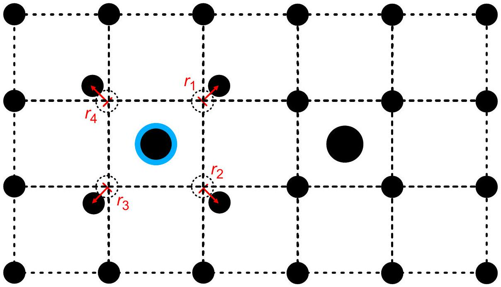
Figure 2.1: Two-dimensional lattice with small and large atoms. A charge (in blue) is localized at one of the large atoms, causing the neighboring small atoms to be displaced (indicated by red arrows) and thus forming a polaron. The crossing point of the dotted lines show the regular position of the small atoms. Dotted circles show the regular position of displaced atoms.

$$
\mathbf{V}^{(\mathbf{0})}=\left(\begin{array}{cc}
V_{1} & 0 \\
0 & V_{2}
\end{array}\right)
$$

where $V_{1}$ and $V_{2}$ represent the potential energy of the polaron when the charge is at site 1 or 2, respectively. Adapting the previous formulation (Eq. 2.3) to the two-site model, $V_{1}$ and $V_{2}$ can be expressed as follows:

$$
\begin{aligned}
& V_{1}=V_{\text {struc }, 1}+V_{\text {el }, 1}+V_{\text {struc }, 2} \\
& V_{2}=V_{\text {struc }, 2}+V_{\text {el }, 2}+V_{\text {struc } 1}
\end{aligned}
$$

Here, $V_{\text {struc,1 }}$ and $V_{\text {struc,2 }}$ represent the energy required to create local structural distortions around sites 1 and 2, respectively. $V_{\mathrm{el}, 1}$ and $V_{\mathrm{el}, 2}$ denote the stabilization energy when the charge is at site 1 or 2, respectively. $V_{1}$ and $V_{2}$ both include $V_{\text {struc,1 }}$ and $V_{\text {struc,2 }}$ because structural distortions can occur at both sides independently of the position of the localized charge.

If the two states are not orthogonal, coupling between them must be considered. Perturbation theory can describe this, introducing a first-order term $\mathbf{J}$ in the Hamiltonian: ${ }^{[26]}$

$$
\mathbf{V}=\mathbf{V}^{(\mathbf{0})}+\mathbf{J}=\left(\begin{array}{ll}
V_{1} & J \\
J & V_{2}
\end{array}\right)
$$

where V is the new Hamiltonian, and $J$ is the resonance integral between the two states and of scalar value.

The eigenvalues $V_{-}$and $V_{+}$of $\mathbf{V}$ are obtained through the diagonalization of $\mathbf{V}$ and expressed as: ${ }^{[26]}$

$$
V_{ \pm}=\frac{1}{2}\left(V_{1}+V_{2}\right) \pm \sqrt{\left(\frac{1}{2}\left(V_{1}-V_{2}\right)\right)^{2}+J^{2}}
$$

Here, $V_{-}$represents the ground state potential and $V_{+}$the excited state potential of the system. As will be shown in Sec. 2.3 $V_{-}$is a continuous function between the two states and thus allows for the charge to move from one site to the next. The following steps describe this transport process (see Fig. 2.2 for a visual representation):

1. Initially, the charge is fully localized at site 1 and stabilized by a local structure deformation around this site (see Fig. 2.2a). There is no deformation at site 2 . At this stage, $V_{-}$equals $V_{1}$ if the coupling between states 1 and 2 is small.
2. Through vibrations, the localization energy for the charge at the two sites is brought into coincidence. This makes it equally likely for the charge to be at either site. Fig. 2.2b shows this by placing equal charge density at both sites. The previously introduced potentials $V_{1}$ and $V_{2}$ are equal here but different from $V_{-}$and $V_{+}$due to the coupling.
3. Finally, the system relaxes into its new state with the charge fully localized at site 2 (see Fig. 2.2c).

$V_{ \pm}$is a multivariate function dependent on the displacement of the neighboring atoms of both sites:

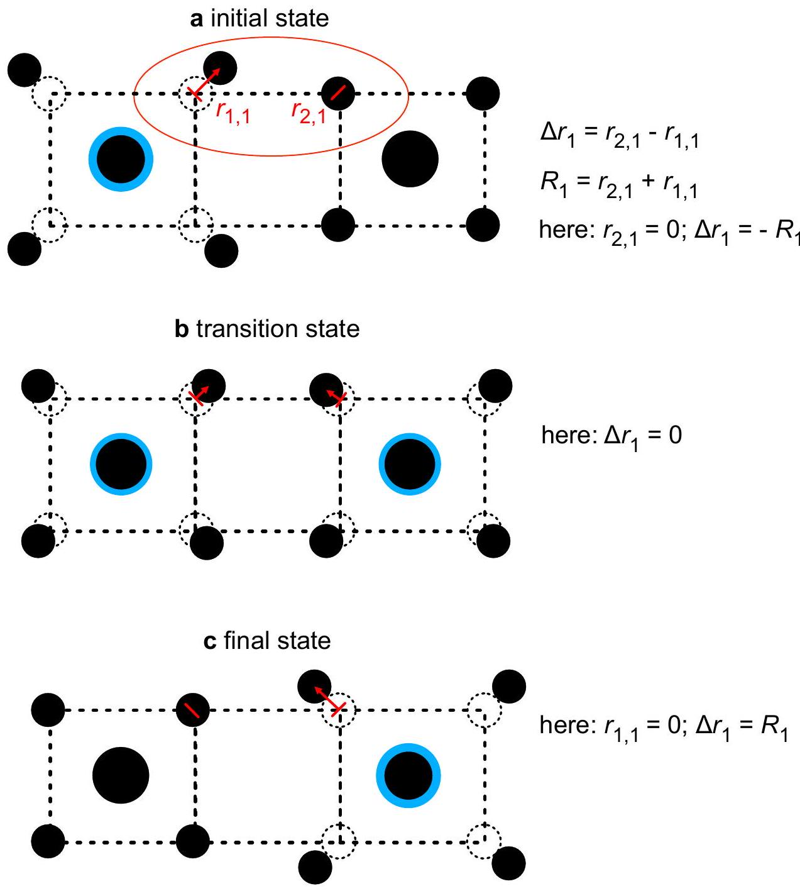
Figure 2.2: Scheme illustrating the polaron jump from one site to a neighboring site. Red arrows indicate the displacement of one small atom from each site. Red bars without arrows indicate no displacement of the small atoms. Other symbols correspond to Fig. 2.1. a represents the initial configuration, b denotes the transition point, and c shows the final configuration after the jump. The formalism of grouping neighbors around both sites into coordination pairs is also depicted by a red circle together with respective parameters (see text for details).

$$
V_{ \pm} \equiv V_{ \pm}\left(r_{1,1}, r_{1,2}, \cdots, r_{1, N}, r_{2,1}, r_{2,2}, \cdots, r_{2, N}\right)
$$

Here, $r_{1, i}$ and $r_{2, i}$ represent the displacements around sites 1 and 2, respectively. The second index $i$ indicates the neighboring atom. To obtain a single reaction coordinate, the relation between all $r_{1, i}$ and $r_{2, i}$ needs to be explored. For this purpose, I will make some simplifications here and use a crystalline system with the following characteristics:

1. The system contains two types of atoms, and the charge can only localize at one of them.
2. The sites where the charge can localize are far apart. Consequently, the local distortions around these sites do not affect each other.
3. The two considered sites for the polaron jump and their neighbors are symmetrically identical.
4. The displacements of neighbors from the two sites are inversely correlated. When the displacement of one neighbor around site 1 decreases, a corresponding neighbor of the same element and coordination shell around site 2 will show an increase in its displacement.
5. The displacements caused by the localized charge are limited to the first coordination shell around the center atom.

Figs. 2.1 and 2.2 offer fitting representations of this simple model. Due to characteristic 4, it is possible to group neighbors around the two sites into pairs, which I shall refer to as coordination pairs. For each coordination pair, two parameters can be defined (see Fig. 2.2): Firstly, the difference in displacement between the neighbors in one coordination pair $\Delta r_{i}$ and, secondly, the sum of the displacements of one coordination pair $R_{i}$.

$$
\Delta r_{i}=r_{2, i}-r_{1, i}, \quad R_{i}=r_{2, i}+r_{1, i}
$$

With this, the terms in Eq. 2.8 can be reformulated:

$$
V_{1}+V_{2}=\sum_{i} \frac{1}{2} k_{i}\left(R_{i}^{2}+\left(\Delta r_{i}\right)^{2}\right)-\sum_{i} A_{i} R_{i}
$$

$$
V_{1}-V_{2}=\sum_{i} A_{i} \Delta r_{i}
$$

Due to the described characteristics above, the number of individual variables can be reduced, as all neighboring atoms behave identically:

$$
\begin{gathered}
\sum_{i}^{N} \Delta r_{i}=N \Delta r \\
\sum_{i}^{N} R_{i}=N R, \sum_{i}^{N} R_{i}^{2}=N R^{2} \\
k_{i}=k, \quad A_{i}=A
\end{gathered}
$$

Additionally, it is assumed that the total amount of distortion remains constant during the jump process because the structural distortion is transferred from one site to the next:

$$
R=\text { const. }
$$

Equation 2.8 then becomes:

$$
V_{ \pm}(\Delta r)=\frac{1}{4} N k\left(\Delta r^{2}+R^{2}\right)-\frac{1}{2} A N R \pm \sqrt{\left(\frac{1}{2} A N \Delta r\right)^{2}+J^{2}}
$$

Jump energies are usually provided relative to the minimum energy. The polaron is at its minimum energy when only the neighbors of one site are displaced while the neighbors of the second site are in their regular position. Therefore, the minima of $V_{-}$should be located at $\Delta r=R$ and $\Delta r=-R$. To adhere to the convention, the potential is shifted by $V_{-}(R)$ :

$$
V_{ \pm}^{\prime}(\Delta r)=V_{ \pm}(\Delta r)-V_{-}(R)
$$

In order to deduce $R$, equation 2.17 is differentiated for $\Delta r$ :

$$
\frac{\partial V_{-}}{\partial \Delta r}=\frac{1}{2} N k \Delta r-\frac{\left(\frac{1}{2} N A\right)^{2} \Delta r}{\sqrt{\left(\frac{1}{2} N A \Delta r\right)^{2}+J^{2}}}=0
$$

Solutions for this expression are $\Delta r=0$, which is the transition point of the polaron jump, and, assuming $J$ is small, $\Delta r= \pm A / k$. Consequently, $R=A / k$.

The minimum energy $V_{-}(R)$ is then expressed by Eq. 2.20. Since $A$ and $k$ are positively defined, the absolute value function can be omitted.

$$
V_{-}(R)=-\sqrt{\left(\frac{N A^{2}}{2 k}\right)^{2}+J^{2}} \approx-\frac{N A^{2}}{2 k}
$$

This leads to the master equation (Eq. 2.21) that can be used to fit computational data. From this, $k, J$, and $A$ are obtained as fitting parameters.

$$
V_{ \pm}^{\prime}(\Delta r)=\frac{1}{4} N k(\Delta r)^{2}+\frac{N A^{2}}{4 k} \pm \sqrt{\left(\frac{1}{2} A N \Delta r\right)^{2}+J^{2}}
$$

In this formulation, the barrier for the polaron jump $E_{\text {jump }}$ is as follows:

$$
E_{\text {jump }}=\frac{N A^{2}}{4 k}-|J|
$$

In addition, the potentials $V_{1}$ and $V_{2}$ can be reformulated as:

$$
\begin{aligned}
& V_{1}^{\prime}(\Delta r)=\frac{1}{4} N k(\Delta r)^{2}-\frac{1}{2} A N \Delta r+\frac{N A^{2}}{4 k} \\
& V_{2}^{\prime}(\Delta r)=\frac{1}{4} N k(\Delta r)^{2}+\frac{1}{2} A N \Delta r+\frac{N A^{2}}{4 k}
\end{aligned}
$$

where $V_{1}^{\prime}(\Delta r)$ and $V_{2}^{\prime}(\Delta r)$ are the new potentials shifted in accordance with the previous discussion.

Eq. 2.21 aligns with the potential energy $V_{-}^{\mathrm{H}}(\Delta r)$ derived by Holstein, ${ }^{[21]}$ and extends it as a linear combination for the case with multiple neighbors:

$$
V_{-}^{\mathrm{H}}(\Delta r)=\frac{1}{4} k(\Delta r)^{2}-\sqrt{\left(\frac{1}{2} A \Delta r\right)^{2}+J^{2}}
$$

### 2.3 Applying MEHAM Theory

### 2.3.1 The Polaron Jump in Ceria

To evaluate the usefulness of Eq. 2.21, it needs to be fitted to the computational data of a real system. For this, I chose ceria because it resembles the simple crystalline system that was used during the derivation in various ways. Ceria comprises only two elements and electrons exclusively localize at cerium sites. ${ }^{[24,27,28]}$ Additionally, all cerium sites are symmetrically identical. However, unlike the simple system where sites that allow for localization are widely separated, in ceria, the cerium sites are in close proximity. This means that the local distortions around cerium sites will affect each other. This is made very clear when considering that two oxygen ions in the first coordination shell around two cerium ions are shared.

I utilized DFT calculations and modeled the small polaron by introducing an excess electron into the ceria cell (see Sec. M.1.2 in the Methods for details). Although the electron density is not directly controlled in these calculations, the electron localizes upon structural relaxation. Fig. 2.3a shows an excerpt of the ceria cell with the excess electron localized on the left cerium ion. The distances between this cerium ion and its surrounding oxygen ions are increased by $0.08 \AA$, with a standard deviation of $0.01 \AA$. Because the distortions are very minor, they are difficult to discern in the figure when this site is compared to the displayed neighboring cerium site. In addition, the distances between the left cerium ion and other coordinating cerium ions are decreased by $0.002 \AA$, with a standard deviation of $4 \cdot 10^{-4} \AA$. However, for the sake of simplicity, only the oxygen ion displacement is analyzed.

The polaron jump is modeled using the climbing image nudge elastic band (CI-NEB) method ${ }^{[29,30]}$ (see Sec. M.1.3 in the Methods for details). This allows the calculation of the transition point of the jump and additional intermediate images. The configuration of the transition point is shown in Fig. 2.3b. Most intriguingly, the density of the excess electron is equally distributed around both cerium sites here. Some electron density of opposite spin can also be seen on the connecting oxygen ions. The distances between both cerium ions and their coordinating oxygen ions are identical here. This leads to equal localization

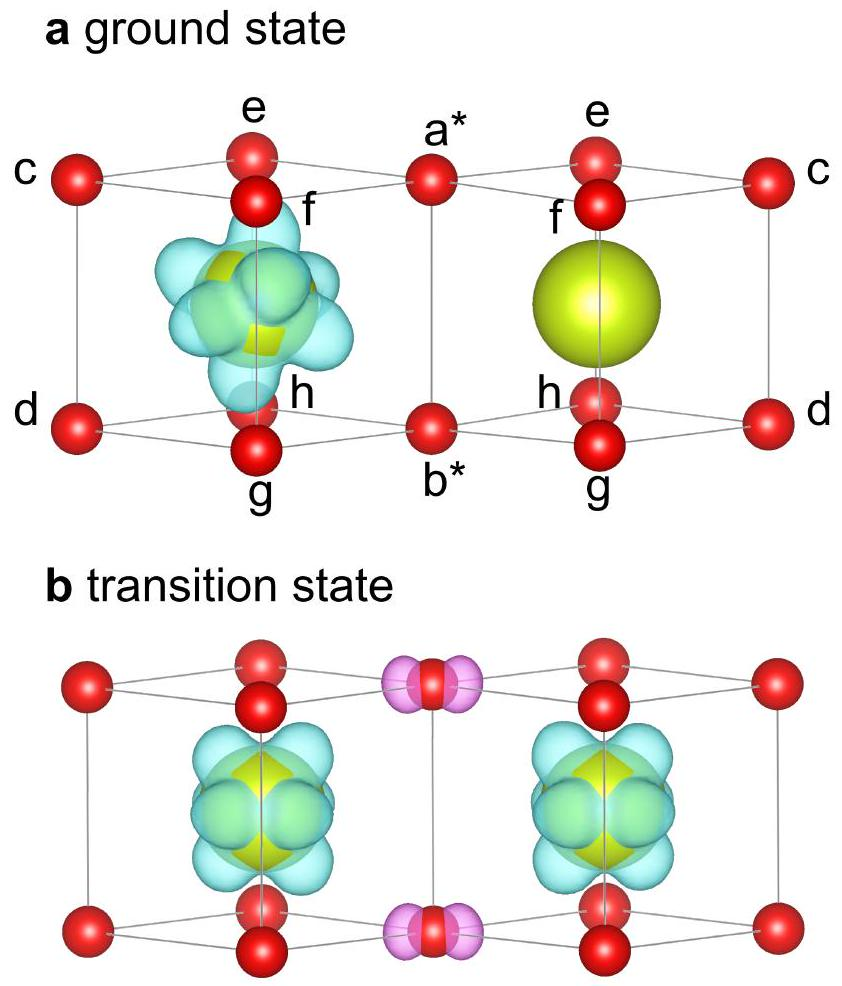
Figure 2.3: Excerpt of the 2x2x2 supercell from DFT calculations showing a small polaron in its ground state (a) on the left cerium site and in its transition state (b). Cerium and oxygen ions are represented by green and red spheres, respectively. The density of the excess electron is illustrated as blue and purple isosurfaces, with different colors corresponding to distinct spin states. Letters $(a-h)$ indicate the chosen coordination pairs for oxygen ions, as discussed in the text.

energies at either site for the electron, which manifests itself in the observed co-localization.

To apply Eq. 2.21, the oxygen ions surrounding the two cerium sites need to be grouped into coordination pairs (see Fig. 2.3a). The grouping is indicated by the letters $a$ through $h$. As mentioned before, two oxygen ions are shared by the two cerium ions and are therefore paired with themselves, which is indicated with asterisks ( $a^{*}$ and $b^{*}$ ). With this assignment, it is now possible to calculate eight $\Delta r_{i}$ values. Ideally, if the assumptions from the simple system used in the derivation hold true, these $\Delta r_{i}$ would all be identical. However, my calculations
revealed some deviations. For this reason, the reaction coordinate $\Delta r$ was chosen as the mean of all $\Delta r_{i}$. I will discuss these deviations in more detail later in this chapter (see Sec. 2.3.3).

Fig. 2.4 presents the energy profile from the computations alongside the fitted Eq. 2.21. $V_{-}^{\prime}$ represents the minimum energy of the polaron jump path and matches the computational data very well. $V_{+}^{\prime}$ is the excited polaron state, which shows the system's energy if the excess electron was to switch sites without any structural relaxation. Using the fitted parameters, Eqs. 2.23 and 2.24 are also graphed in the figure. $V_{1}^{\prime}$ and $V_{2}^{\prime}$ are two overlapping parabolas that align with $V_{+}^{\prime}$ and $V_{-}^{\prime}$ near the stable polaron configurations because the coupling is negligible in these areas. At the transition point, $V_{1}^{\prime}$ and $V_{2}^{\prime}$ are equal to each other, but deviate from $V_{-}^{\prime}$ as the jump barrier is lowered by $J$. Similarly, the difference between $V_{+}^{\prime}$ and the crossing point of $V_{1}^{\prime}$ and $V_{2}^{\prime}$ is $J$.

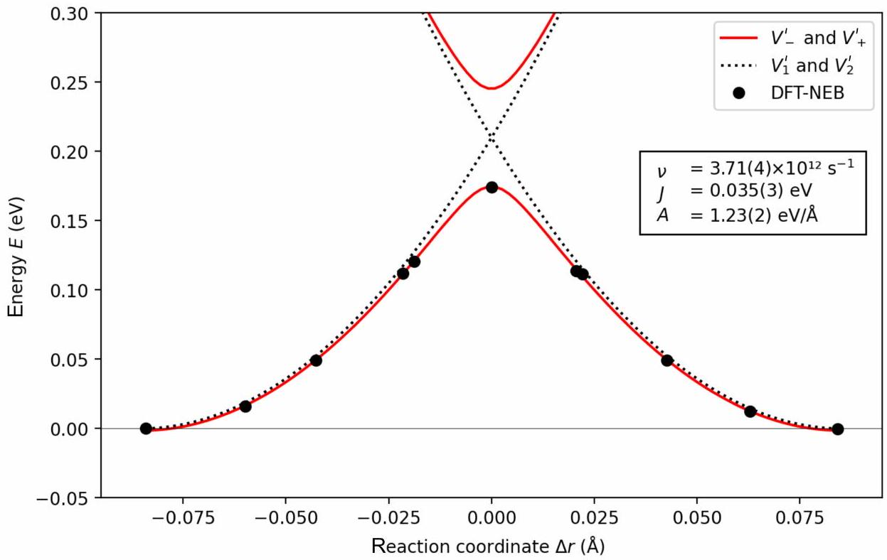
Figure 2.4: Computational data of the polaron jump (DFT-NEB) in ceria and fits from MEHAM theory.

The DFT results show a jump barrier of 0.17 eV. This value is close to results by Nakayama et al. (0.18 eV) ${ }^{[27]}$ and Sun et al. (0.23 eV), ${ }^{[28]}$ using the same exchange-correlation functional. A recent study by Castleton et al. provides a significantly lower jump barrier of 0.09 eV. ${ }^{[24]}$ However, they did not explain their discrepancy from the earlier studies. None of the mentioned studies used
the NEB method to model the jump path; instead, they interpolated between the initial and final stable polaron states. The intermediate images were then only electronically relaxed. The agreement between the NEB method and interpolation approach regarding the calculated jump barrier is fortunate but not guaranteed. Lindman et al. demonstrated in a computational study on the polaron jump in barium zirconate that significant deviations between the two methods can occur. ${ }^{[31]}$

From the fit of Eq. 2.21, the spring constant $k$ can be extracted, which allows, together with the mass of oxygen $m_{\mathrm{O}}$, the calculation of the spring's natural frequency $\nu$ :

$$
\nu=\frac{\sqrt{k / m_{\mathrm{O}}}}{2 \pi}
$$

In this case, a value of $\nu=3.71(4) \cdot 10^{12} \mathrm{~s}^{-1}$ is obtained, which is close to the Debye frequency $\left(10^{13} \mathrm{~s}^{-1}\right)$. Since the theory assumes that the motion of all oxygen ions is coupled, this frequency relates to the breathing mode vibration. Here, the distances between oxygen and cerium ions of one localization site evenly decrease while increasing at a neighboring site. As such, $\nu$ may be treated as the attempt frequency of the polaron jump.

Furthermore, a resonance integral of $J=35(3) \mathrm{meV}$ is extracted, which can be used to evaluate the jump's adiabaticity. In this context, adiabaticity refers to whether the ionic movement can be considered slow compared to the electronic adaptation. If the adiabaticity is low, the likelihood of non-adiabatic transitions increases, meaning the system may not necessarily follow $V_{-}^{\prime}$ upon reaching $\Delta r=0$ but may instead proceed to the excited state $V_{+}^{\prime}$ and follow this potential energy curve. Subsequently, the system will revert back towards $\Delta r=0$ and may perform another non-adiabatic transition back to $V_{-}^{\prime}$, returning to the initial configuration. However, the system may stay in $V_{+}^{\prime}$ and oscillate around the minima of $V_{+}^{\prime}$ until eventually relaxing to $V_{-}^{\prime}$ and either one of the two stable configurations. The adiabaticity $\eta$ is expressed by: ${ }^{[6]}$

$$
\eta=\frac{J^{2}}{h \nu \sqrt{E_{\mathrm{A}} k_{\mathrm{B}} T}}
$$

At high adiabaticity $(\eta>1)$, every jump attempt that reaches the transition state will be successfully completed. However, in the non-adiabatic regime
$(\eta \ll 1)$, the system will frequently revert to its initial state upon reaching the transition point. The transmission probability $\kappa$ quantifies this phenomenon and describes the likelihood of a successful polaron jump in case the transition state is reached: ${ }^{[6]}$

$$
\kappa=2 \int_{0}^{\infty} e^{-\varepsilon}\left(1-\exp \left(-\frac{\pi}{2} \eta / \sqrt{\varepsilon}\right)\right) /\left(2-\exp \left(-\frac{\pi}{2} \eta / \sqrt{\varepsilon}\right)\right) d \varepsilon
$$

For the polaron jump in ceria $\eta=0.59$ and $\kappa=0.8$ at 1273 K are found. This result means that in 20\% of cases where the transition point is reached, the system will relax back into its initial state due to non-adiabatic transitions. To put this into perspective, the value of $\kappa$ corresponds to an effective increase in the polaron jump barrier by 0.08 eV. The presence of non-adiabatic behavior might be surprising to some readers, as adiabaticity is generally a very good approximation. Discussing the detailed origins of this behavior is beyond the scope of this work. However, it should be noted that the region in which $V_{-}^{\prime}$ and $V_{+}^{\prime}$ significantly deviate from $V_{1}^{\prime}$ and $V_{2}^{\prime}$ spans only from $\Delta r=-2 \mathrm{pm}$ to $\Delta r=$ 2 pm, corresponding to very minimal ionic movement. In addition, the kinetic energy of the ions is highest at $\Delta r=0$. The transition probability reported by Plata et al. ${ }^{[32]}(\kappa=0.81)$ agrees with the presented result. However, their computational method differs from mine, and their jump barrier is substantially higher at $E_{\text {jump }}=0.40 \mathrm{eV}$.

### 2.3.2 Evaluation of Assumptions

In the derivation, it was assumed that all neighbors of each site exhibit identical behavior (Eq. 2.13). As mentioned before, this assumption is not entirely accurate for ceria. Fig. 2.5a displays the individual $\Delta r_{i}$ as a function of the reaction coordinate $\Delta r$, where the latter is the mean of the former. I grouped the coordination pairs into three sets according to their symmetry: $a^{*}$ and $b^{*}$, $c$ and $d$, and $e$ to $h$. Fig. 2.5a reveals that $c$ through $h$ exhibit similar behavior but are distinct from $a^{*}$ and $b^{*}$. This is to be expected, as the oxygen ions assigned to $a^{*}$ and $b^{*}$ connect the two central cerium ions. Nonetheless, all pairs display an approximately linear dependency on $\Delta r$, which explains why the fit from MEHAM theory remains applicable.

Fig. 2.5b tests the assumption made in Eq. 2.16 by showing the individual $R_{i}$ as a function of the reaction coordinate. The individual $R_{i}$ values do not remain constant during the polaron jump, but their mean value $\sum_{i}^{N} R_{i} / N$ does. Therefore, the assumption in Eq. 2.16 is still appropriate. Interestingly, the coordination pairs within the previously defined groups exhibit different behaviors, indicating that the jump is not entirely symmetric.

Lastly, the MEHAM fit produces $A=1.23(2) \mathrm{eV} / \AA$, which gives $N A^{2} / 2 k=$ 6.72 eV. In Eq. 2.20, it was assumed that the latter value is much greater than $J$, which is indeed the case here.

### 2.3.3 Comparison with other approaches

As mentioned in the introduction to this chapter, MEHAM theory is often utilized in a simplified manner. In this approach, computational data points near the two stable polaron states are fitted with two parabolas. These parabolas closely resemble $V_{1}^{\prime}$ and $V_{2}^{\prime}$ and allow the calculation of $\nu$ from their curvature, ${ }^{[25]}$ and $J$ from the energetic difference between the computed jump barrier and the crossing point of the parabolas. ${ }^{[24]}$ A problem with this approach arises when selecting which data points to include in the parabolic fits. A study by Castleton et al. ${ }^{[24]}$ shows that the curvature of the parabolas can vary greatly depending on the number of data points included, especially in cases with large $J$. The method presented in this work benefits from the ability to use all computational data points for the fit, which reduces arbitrariness.

Another issue is the common use of linearized paths for the polaron jump process. As mentioned previously, this approach might lead to jump barriers greater than those from the NEB method. ${ }^{[31]}$ However, even when the jump barrier between the linearized path and the NEB method is similar (as in the present case), the shape of the energy path may vary, which impacts the implied adiabaticity of the jump process.

One benefit of the linearized path approach, however, is that it provides a simple reaction coordinate, which is just the proportional degree between the initial and final states. In comparison, in the NEB approach the reaction coordinate needs to be derived from structural parameters. Here, the presented derivation of MEHAM theory aids in finding an appropriate reaction coordinate.

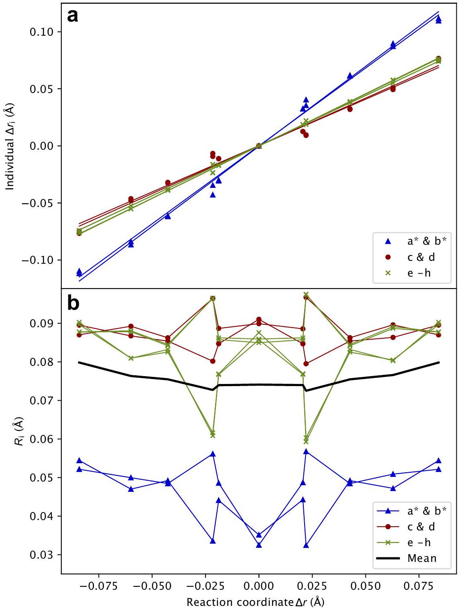
Figure 2.5: Evaluation of assumptions from the derivation of MEHAM theory. a $\Delta r_{i}$ as a function of $\Delta r$ for the chosen coordination pairs. The same color was assigned to coordination pairs with the same symmetry. Lines show linear fits. $\mathrm{b} \Delta R_{i}$ as a function of $\Delta r$ for the chosen coordination pairs. The black line shows the mean value. Lines connect data points for better visualization.

## 3

# Optimizing Hybrid Functionals for Small Polarons 

### 3.1 Introduction

In both the broader literature ${ }^{[27,33,34]}$ and in this work, DFT calculations employing the Perdew-Burke-Ernzerhof exchange-correlation functional augmented with an empirical Hubbard term $(\mathrm{PBE}+\mathrm{U})^{[35,36]}$ are used to examine small polarons in ceria. However, previous reports have shown significant deviations in polaron properties when comparing results from Hubbard-augmented functionals with those from more sophisticated hybrid functionals. ${ }^{[24,28]}$ For example, Sun et al. reported polaron jump barriers of 0.23 eV using PBE+U and 0.12 eV using the hybrid functional HSE06. I suspected that this deviation arises because the Hubbard term in PBE+U is calibrated specifically for this system, ${ }^{[37]}$ whereas standard parameters are used with hybrid functionals. Therefore, I conducted a variational study to optimize the parameters of hybrid functionals and to assess whether the polaron properties they predict align with those obtained from PBE+U calculations. This chapter presents the results of this research and a brief introduction to hybrid functionals.

### 3.2 Hybrid Functionals

The delocalization error is a significant problem associated with many exchangecorrelation functionals, such as the PBE approximation, ${ }^{[35]}$ specifically affecting localized charges such as small polarons. ${ }^{[38]}$ While the ad hoc inclusion of a Hubbard term counteracts this error, hybrid functionals offer a more advanced solution by integrating exact exchange from Hartree-Fock (HF) theory. One variant of hybrid functionals is the formulation by Heyd, Scuseria, and Ernzerhof (HSE), ${ }^{[39]}$ which is frequently employed in the study of ionic solids.

The HSE formalism constructs the exchange-correlation (XC) energy $\left(E_{\mathrm{xc}}^{\mathrm{HSE}}\right)$ by combining the short-range exchange from PBE $\left(E_{\mathrm{x}}^{\text {PBE,SR }}\right)$ with exact exchange ( $E_{\mathrm{x}}^{\mathrm{HF}, \mathrm{SR}}$ ). Meanwhile, the long-range exchange ( $E_{\mathrm{x}}^{\mathrm{PBE}, \mathrm{LR}}$ ) and the correlation energy $\left(E_{\mathrm{c}}^{\mathrm{PBE}}\right)$ continue to be calculated from PBE (see Eq. 3.1).

$$
E_{\mathrm{xc}}^{\mathrm{HSE}}=\alpha E_{\mathrm{x}}^{\mathrm{HF}, \mathrm{SR}}(\gamma)+(1-\alpha) E_{\mathrm{x}}^{\mathrm{PBE}, \mathrm{SR}}(\gamma)+E_{\mathrm{x}}^{\mathrm{PBE}, \mathrm{LR}}(\gamma)+E_{\mathrm{c}}^{\mathrm{PBE}}
$$

Here, $\gamma$ and $\alpha$ are mixing parameters, which determine the transition from short-range to long-range interactions and the proportion of exact exchange incorporated, respectively. The commonly adopted values for $\gamma$ and $\alpha$ are 0.20 and 0.25, respectively, yielding the aforementioned HSE06 functional. Although HSE06 accurately models the properties of many solids, it is critical to note that the respective mixing parameters are not grounded in a concrete theoretical basis. ${ }^{a}$

The chosen mixing parameters significantly influence the properties of small polarons, ${ }^{[24,42]}$ with the localization energy and the jump barrier being primary examples. Localization energy is defined as the energetic difference between the state in which an electron or hole is localized as a polaron and the state in which it is delocalized across the lattice. To demonstrate the dependence of polaronic properties on the mixing parameters in ceria, I conducted a series of DFT calculations utilizing HSE hybrid functionals with varying $\alpha$. Due to limited computational resources, $\gamma$ needed to stay constant at 0.20 and its impact could not be analyzed. The details on the computational procedure are given in the Methods section (see Sec. M.1.5). Figs. 3.1 and 3.2 show the localization

[^0]energy and jump barrier, respectively, as a function of $\alpha$ for different plane-wave basis set cutoff energies.

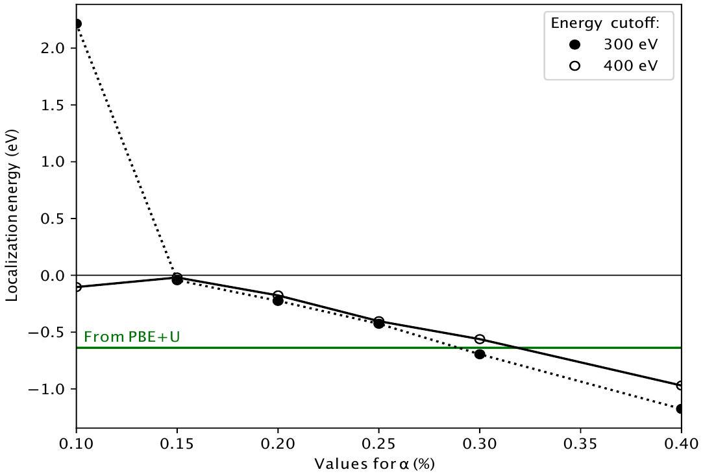
Figure 3.1: Polaron localization energies as a function of $\alpha$ with different planewave basis cutoff energies. The lines connect data points and are guides to the eye.

For $\alpha=0.15$ and above, there is a consistent trend towards stronger localization as $\alpha$ increases (see Fig. 3.1). Conversely, the polaron exhibits significant instability at an $\alpha$ value of 0.15 , reflected by marginal localization energies just below 0 eV. The observed trends align with expectations, as the exact exchange mitigates the delocalization error. In the case of $\alpha$ being further reduced to 0.10, the calculations fail to deliver conclusive results due to the instability of the polaronic state. The results for both cutoff energies are very close to each other, except for $\alpha=0.10$. When $\alpha$ is approximately 0.30 , the localization energy closely aligns with the results from the PBE+U calculations.

The jump barrier increases with increasing $\alpha$ (see Fig. 3.2). For $\alpha=0.20$, the jump barrier is zero, descending into negative values for smaller $\alpha$. At the highest $\alpha$ under consideration (0.40), the barrier reaches 0.44 eV. This trend can be observed because the polaron co-localizes at two sites when reaching the transition state (see Sec. 2.3.1). As a result, the electron is more delocalized here than at the polaron ground state, and the delocalization error causes a spurious energetic preference for the transition point compared to the ground
state. As before, both cutoff energies show similar results, except for $\alpha=0.10$. PBE+U jump barriers are reached with $\alpha=0.30$.

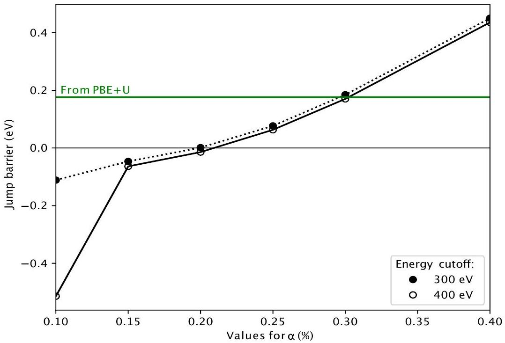
Figure 3.2: Polaron jump barriers as a function of $\alpha$ with different plane-wave basis cutoff energies. The lines connect the data points and are guides to the eye.

### 3.3 How to Find the Correct Functional

In a seminal study, Perdew et al. proposed that the total energy of a system with a fractional electron number is expressed by: ${ }^{[43]}$

$$
E(N+\omega)=(1-\omega) E(N)+\omega E(N+1)
$$

Here $E(N+\omega), E(N)$, and $E(N+1)$ are the total energies of the system with $N+\omega, N$, and $N+1$ electrons, where $0 \leq \omega \leq 1$. Consequently, the total energy behaves as a continuous piecewise linear function of the electron number, with derivative discontinuities appearing at integer electron numbers. An exact XC-functional should reproduce this piecewise linearity (PWL) and a graphical representation of this behavior is depicted in Fig. 3.3 (blue line).

DFT calculations employing the PBE functional deviate from PWL due to delocalization errors. ${ }^{[38]}$ This deviation manifests as a preference for partially occupied orbitals, leading to the concave behavior depicted in Fig. 3.3 (red line). On

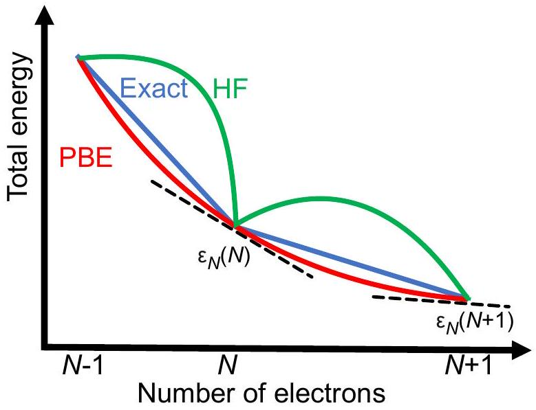
Figure 3.3: Total energy as a function of the fractional number of electrons. The exact XC-functional (blue) shows piecewise linearity. PBE (red) and HF (green) approximations show deviation. Tangents showing orbital energies are applied to the PBE curve. Scheme is based on Mori-Sánchez et al. ${ }^{[44]}$

the other hand, the HF approximation tends to overemphasize electron localization (see Fig. 3.3, green line). ${ }^{[44]}$ This difference between PBE and HF provides insight into why hybrid functionals often perform well: the contrasting biases of PBE and HF effectively counterbalance each other, resulting in a functional that more closely approximates the exact one. However, achieving this balance depends on identifying a suitable blend of PBE and HF.

Janak demonstrated that the Kohn-Sham orbital energy $\varepsilon_{N}$ is linked to the total energy in the following manner: ${ }^{[45]}$

$$
\frac{\partial E(N+\omega)}{\partial \omega}=\varepsilon_{N}(N+\omega)
$$

Eq. 3.3 in conjunction with Eq. 3.2 shows that the orbital energy must remain invariant with respect to its partial occupation for an exact XC-functional:

$$
\frac{\partial \varepsilon_{N}(N+\omega)}{\partial \omega}=0
$$

As a side note, Koopmans demonstrated in his theorem that, within the framework of Hartree-Fock theory, the negative ionization energy equates to the orbital energy of the highest occupied molecular orbital (HOMO). ${ }^{[46]}$ The extension of Koopmans' theorem to DFT resembles the idea expressed in Eq. 3.4.

Hence, adherence to Koopmans' theorem can be used as a check for the PWL condition. ${ }^{[47]}$ However, a different method will be used here and is discussed in the next section.

### 3.4 Applying the Piecewise Linearity Condition

According to Eq. 3.4, a hybrid functional that fulfills the PWL condition, should exhibit a polaron state whose energy is invariant to its occupation:

$$
\varepsilon_{\text {pol }}(N)=\varepsilon_{\text {pol }}(N+1)
$$

where $\varepsilon_{\text {pol }}(N)$ and $\varepsilon_{\text {pol }}(N+1)$ are the energies of the unoccupied and occupied polaron states, respectively. The ceria system with an unoccupied polaron state is obtained by using the fixed ionic configuration of the system with occupied polaron state and by performing an electronic relaxation without the excess electron (see Sec. M.1.5 in the Methods for details). This is possible because the filled polaron state is the highest occupied state. $\varepsilon_{\text {pol }}(N)$ and $\varepsilon_{\text {pol }}(N+1)$ can be obtained from the density of states (DOS) of the $N$ electron and $(N+1)$ electron systems, respectively. The DOS is shown in Fig. 3.4 and for clarity focused on the region at the O2p → Ce4f band gap, with states at and below the Fermi energy at 0 K highlighted in red. Fig. 3.4a displays the DOS for the $N$ electron system, revealing seven unoccupied polaron states within the O2p → Ce4f band gap. The appearance of multiple empty polaron states highlights that different shapes of polarons can be formed. ${ }^{[48]}$ However, the occupation of these polaron states is mutually exclusive - if one empty polaron state becomes occupied, the others are unavailable for further electrons. This results in only a single polaron state appearing within the band gap of the $(N+1)$ electron system, as shown in Fig. 3.4b.

Fig. 3.5 displays $\varepsilon_{\text {pol }}(N)$ and $\varepsilon_{\text {pol }}(N+1)$ as functions of different $\alpha$ values, colored in red and green respectively. The O2p → Ce4f band gaps, derived from the calculations for the $N$ and $(N+1)$ electron systems, are also presented. For better visual interpretation, the energies of the polaron states are lowered by 5 eV. Calculations were performed in small cubic supercells containing $2^{3}$ ceria unit cells (named 2×2×2 supercell). To correct for potential errors arising from the polaron interacting with its own image, finite size corrections (FSC) of the

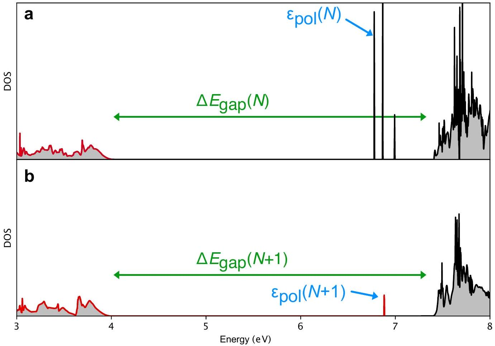
Figure 3.4: Density of states (DOS) of a ceria cell containing a polaron, with the plot centered on the O2p → Ce4f band gap. a represents the $N$ electron system with empty polaron states, and b depicts the $(N+1)$ electron system with a filled polaron state. Polaron states can be seen within the band gap. States at or below the Fermi energy at 0 K are accentuated in red. The calculations were performed for a 2x2x2 supercell with a 300 eV plane-wave basis cutoff energy and an $\alpha$ value of 0.25.

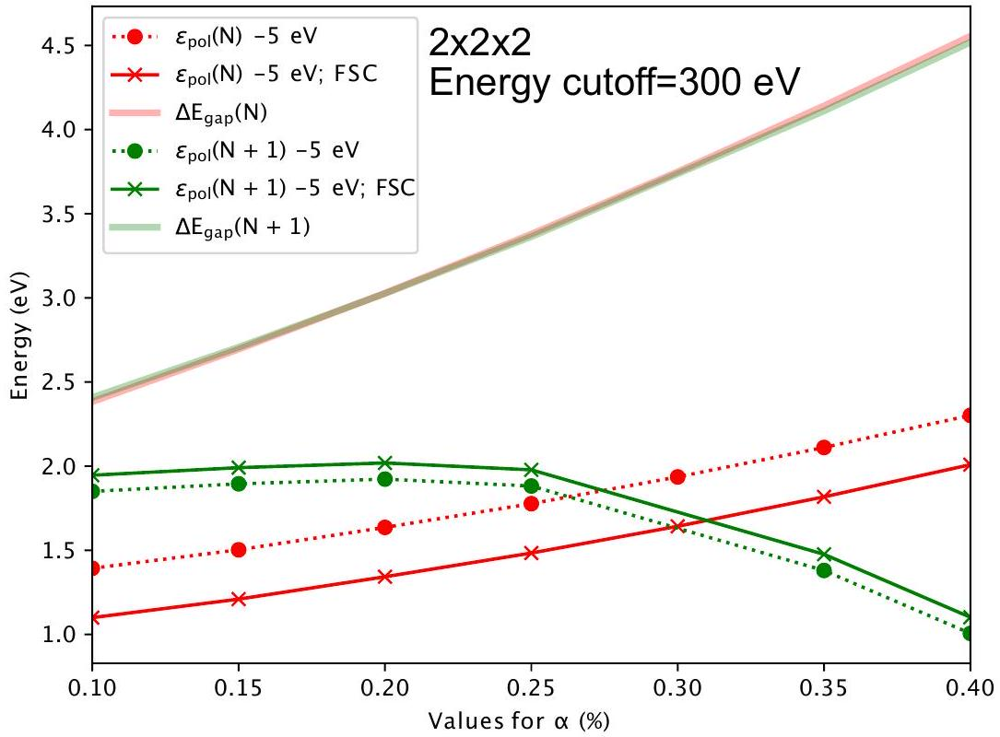
Figure 3.5: Analysis of the piecewise linearity condition for different hybrid functionals. The energy of empty and occupied polaron states are shown as green and red lines, respectively. Circles and dotted lines show uncorrected data and crosses and solid lines show data with finite size correction (FSC). Lines are linear interpolations between data points. Red and green thick lines show O2p → Ce4f band gap for the $N$ and $N+1$ electron system, respectively. Calculations were carried out with a 2x2x2 supercell and a plane-wave basis energy cutoff of 300 eV.

polaron state energies, as proposed by Falletta et al., have been performed and are included in the figure. ${ }^{[49]}$ Some calculations did not converge and could not be repeated due to time constraints, which accounts for the missing data points. At lower $\alpha$ values, $\varepsilon_{\text {pol }}(N+1)$ is greater than $\varepsilon_{\text {pol }}(N)$, reflecting the convex total energy curvature previously mentioned for the PBE functional (see Fig. 3.3). As $\alpha$ increases, $\varepsilon_{\text {pol }}(N)$ displays a steady increase, while $\varepsilon_{\text {pol }}(N+1)$ remains constant up to $\alpha=0.20$ and then starts decreasing. The intersection of the red and green lines signifies the satisfaction of the PWL condition, which is achieved at $\alpha=0.25$ in the absence of FSC (depicted by the red and green dotted lines). However, with the introduction of FSC, a higher $\alpha$ value ( $\alpha=0.31$ ) is necessary to fulfill the PWL condition (represented by the red and green solid lines). At higher $\alpha$ values, $\varepsilon_{\text {pol }}(N)$ exceeds $\varepsilon_{\text {pol }}(N+1)$ due to over-localization when an
excess amount of exact exchange is included. The band gap consistently expands with increasing $\alpha$, showing only minute variation between the systems with $N$ and $(N+1)$ electrons.

Given the relatively low plane-wave basis set cutoff energy of 300 eV initially used for calculations, I conducted additional tests with a higher cutoff of 400 eV to verify my results (see Fig. 3.6). The outcomes remain largely consistent, which indicates that higher cutoffs do not significantly alter the results. Furthermore, to mitigate any potential errors from the FSC method, calculations were repeated with larger cubic supercells containing $3^{3}$ ceria unit cells (named 3×3×3 supercell; refer to Fig. 3.7). In this instance, the optimal $\alpha$ value is 0.29, closely aligning with the previous FSC-corrected results.

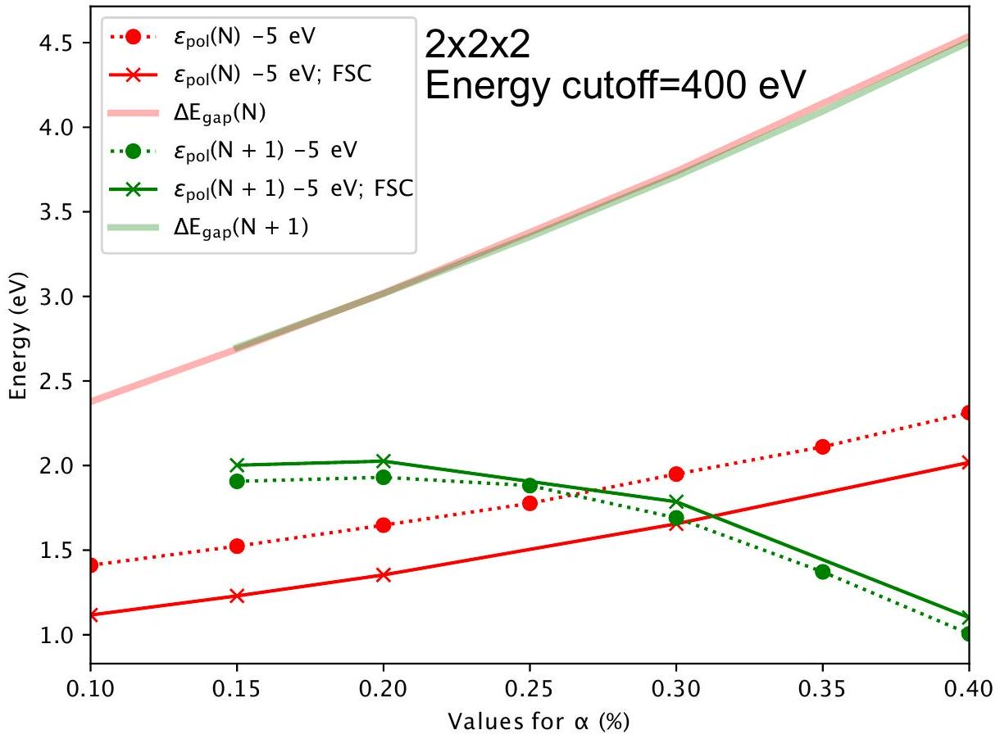
Figure 3.6: Piecewise linearity analysis from calculations utilizing a 2×2×2 supercell and a plane-wave basis cutoff energy of 400 eV. See Fig. 3.5 for more information.

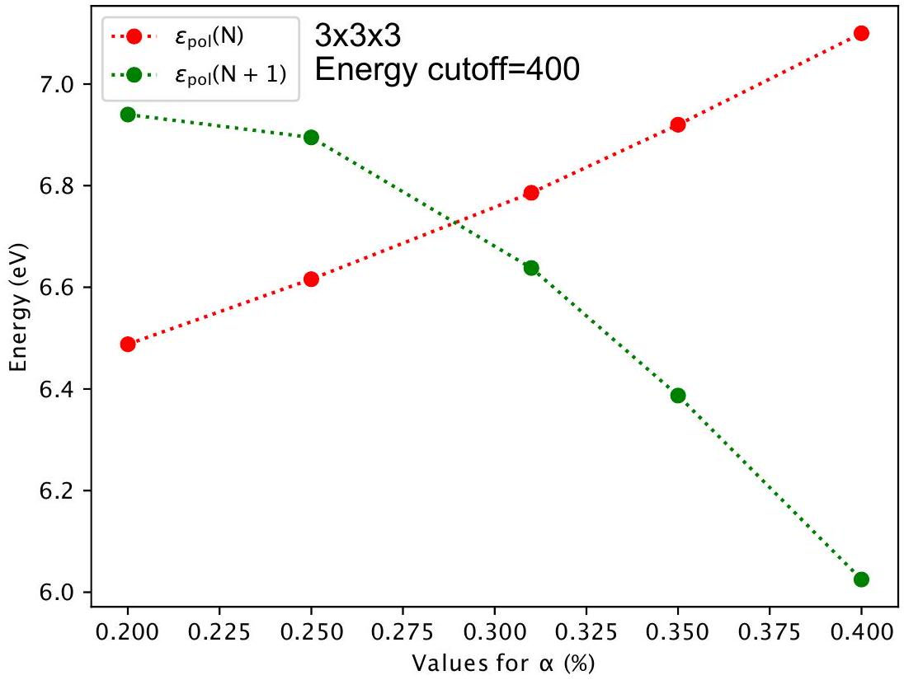
Figure 3.7: Piecewise linearity analysis from calculations utilizing a $3 \times 3 \times 3$ supercell and a plane-wave basis cutoff energy of 400 eV. See Fig. 3.5 for more information.

### 3.5 Discussion

Through the PWL condition, I determined an optimal mixing parameter $\alpha$ of 0.3 when $\gamma$ is set to 0.20. This outcome is exceptionally fortunate when viewed in light of the localization and jump energies that the PBE+U method produces (see Figs. 3.1 and 3.2). With the optimized parameters, the results generated by the HSE hybrid functional closely mirror those derived from the PBE+U functional. This finding confirms that with the chosen U-value, the PBE+U functional accurately describes the small polaron's key attributes within ceria. It is important to clarify that while this does not guarantee an exact depiction of all polaron properties, it provides a compelling justification for using less computationally expensive PBE+U functionals. These findings also underscore the crucial role of accurately chosen hybrid functionals in correctly portraying the properties of small polarons. Therefore, an overreliance on default parameters can lead to substantial deviations from physical properties. However, it is worth
noting that the optimized $\alpha$ value does not yield a hybrid functional that can faithfully describe all electronic properties. For instance, the O2p → Ce4f band gap at $\alpha=0.3$ is predicted to be 3.7 eV, while experiments on highly oriented crystalline ceria show a band gap at 3.3 eV. ${ }^{[50]}$

The effect of the mixing parameter $\alpha$ is opposite to that of $\gamma$. Castleton et al. showed that with decreasing $\gamma$, the polaron localization energy and the band gap rise. ${ }^{[24]}$ This behavior occurs because a decrease in $\gamma$ increases the distance over which the exact exchange is considered, thereby increasing the impact of HF.

The calculations highlight the significant impact of finite size errors on the energies of polaron states. Thus, it's crucial to apply appropriate finite size corrections when adjusting the mixing parameters of hybrid functionals.

Lastly, due to the computational costs associated with using hybrid functionals, I was limited to using a relatively sparse number of k-points for the calculations. Specifically, a 2x2x2 Monkhorst-Pack k-point mesh ${ }^{[51]}$ was employed for the 2x2x2 supercell, while a single k-point at the gamma point was utilized for the 3×3×3 supercell. Therefore, calculations with a higher number of k-points may produce more accurate results.

## 4

## The Polaron Wind Effect

### 4.1 Introduction

Climate change represents one of the most urgent challenges of our era, necessitating a transition towards cleaner, more sustainable technologies. Mixed ionic-electronic conducting (MIEC) oxides play a vital role in facilitating this shift. ${ }^{[52]}$ For instance, solid oxide electrolysis cells (SOECs) offer a clean alternative to traditional hydrogen production methods, such as steam reforming of natural gas. ${ }^{[53,54]}$ In this context, MIEC oxides serve as promising cathode materials. Reversing this process in solid oxide fuel cells enables the conversion of chemical to electrical energy. ${ }^{[55]}$ Another significant application of MIEC oxides is oxygen production through oxygen-permeable membranes, a process that requires far less energy than distillation. ${ }^{[56]}$ These membranes enable oxygen separation from air via ambipolar diffusion of oxygen ions and electrons. Recently, even more advanced materials, such as triple conductors that transport protons, electrons, and oxygen ions, have gained prominence. ${ }^{[57]}$

Understanding the inner workings of MIEC oxides is imperative for their further development, and this chapter aims to explore a very fundamental, yet rarely
discussed phenomenon: In materials with multiple mobile species, the flux of one species can be influenced by the flux of another. ${ }^{[58]}$ For example, metals experience electron wind effects, leading to an atom flux due to momentum transfer from electrons. ${ }^{[59]}$ Another instance is Manning's vacancy wind effect, where a flux of vacancies alters the mobility of atoms in an alloy. ${ }^{[60]}$ To generalize, I will use the term wind effect to express such phenomena in any material. Formal treatments of MIEC oxides often overlook wind effects, treating electronic and ionic fluxes independently, analogous to Kohlrausch's law of independent ionic motion in liquid electrolytes. ${ }^{[61]}$ However, experiments have identified the presence of wind effects in numerous materials, including $\mathrm{Co}_{1-\delta} \mathrm{O}, \mathrm{TiO}_{2-\delta}, \mathrm{Fe}_{3-\delta} \mathrm{O}_{4}$, $\mathrm{CeO}_{2-\delta}, \mathrm{BaCo}_{0.70} \mathrm{Fe}_{0.22} \mathrm{Nb}_{0.08} \mathrm{O}_{3-\delta}$ and $\mathrm{La}_{2} \mathrm{NiO}_{4} .^{[62-67]}$ In these formulas, $\delta$ represents the degree of non-stoichiometry. The impact of wind effects on material properties can be substantial. Experimental data from Park et al. reveal that wind effects can reduce the ionic conductivity in reduced ceria by up to 80\%. ${ }^{[63]}$ Overlooking wind effects may thus lead to inaccurate evaluations of material performance.

In an early theoretical work, Janek and Martin proposed an explanation for the origins of wind effects in transition metal oxides, notably CoO and $\mathrm{Cu}_{2} \mathrm{O}$. ${ }^{[68]}$ With a simplified model, they demonstrated that electrostatic interactions between small polarons and cation vacancies yield wind effects. Several lines of evidence bolster Janek and Martin's hypothesis and indicate its applicability to MIEC oxides in general:

1. For all MIEC oxides with experimental evidence for wind effects, the electronic conductivity is either completely or to a degree attributed to small polarons. ${ }^{[25,31,69-73]}$
2. Interactions between small polarons and ionic defects have been verified across various materials. ${ }^{[31,33,71,74,75]}$
3. Certain MIEC materials, notably $\alpha-\mathrm{Ag}_{2} \mathrm{Se}$ and $\beta-\mathrm{Cu}_{2} \mathrm{~S}$, which exhibit band conduction behavior, exhibit minimal wind effects. ${ }^{\text {[76-78] }}$

Given these indications, the ionic response to forces exerted on electrons in MIEC oxides will here be referred to as polaron wind effect.

While the polaron wind effect is sketched on the scientific canvas, its full portrait remains tantalizingly unfinished. Associative interactions lead small polarons and ionic defects to form defect complexes. However, the ability of these complexes to move as an entity is still unexplored. In Janek and Martin's model, a Born-Oppenheimer-like assumption is posited, suggesting that a small polaron can readily follow the jump of an associated ionic defect. Yet, this seems improbable as the jump rate difference between small polarons and ionic defects typically spans only one or two orders of magnitude. Instead, the movement of the complex might proceed via a two-step process, where one defect's jump precedes its associate's. Additionally, there might exist a singular-step mechanism wherein both defects participate in a coupled jump with a single jump barrier. However, the existence and predominance of this latter mechanism remain unexplored. Furthermore, prior research has focused on the dilute system. The behavior of the polaron wind effect at increased defect concentrations, where defect complexes are no longer isolated, is completely unknown. Given the critical importance of MIEC oxides and the profound influence of the polaron wind effect, addressing these questions and crafting a more refined explanatory model is essential.

As with the previous chapters, reduced ceria $\mathrm{CeO}_{2-\delta}$ will be used as a model system. To make the discussion in this chapter more approachable, oxygen vacancies will be treated as pseudoparticles with a relative charge number of +2. Previous research has identified associative interactions between small polarons and oxygen vacancies, which lead to the formation of polaron-vacancy complexes. ${ }^{[33,79]}$ These complexes can be categorized into two types: The small polaron may associate with the oxygen vacancy either in the first nearest neighbor position (1NN) or in the second nearest neighbor position (2NN). Both configurations exhibit similar formation energies of -0.14 eV and -0.19 eV, respectively. ${ }^{[33]}$

The modeling of coupled jump mechanisms of oxygen vacancies and small polarons with ab initio calculations forms the first part of this chapter. Subsequently, KMC simulations are used to determine macroscopic Onsager transport coefficients. This allows for a quantitative review of the polaron wind effect and the influence of defect interactions.

### 4.2 Coupled Polaron-Vacancy Jump Mechanism

To properly discuss coupled polaron-vacancy jumps, it is instructive to first review the structure of the polaron-vacancy complexes. One effective method involves separating the complex formation energy into a Coulombic component, where defects are considered as point charges, and a steric component, which results from local structural relaxations. With ceria's dielectric constant of 25, ${ }^{[12]}$ the 1NN and 2NN complexes display Coulombic stabilization of -0.48 eV and -0.25 eV, respectively. These values are notably higher than those obtained from DFT calculations (-0.14 eV and -0.19 eV, respectively). ${ }^{[33]}$ One might suggest that this discrepancy results from the use of the macroscopic dielectric constant. However, this reasoning does not clarify why 1NN and 2NN complexes from DFT calculations exhibit nearly equal stability, while their Coulombic analysis shows a significant difference. This finding implies that steric effects decrease the stability of the complexes, especially in the 1NN configuration. The underlying reason becomes clearer upon examining the structural distortions caused by the defects. In the case of a lone polaron (see Fig. 4.1a), oxygen ions around the central cerium ion are repelled, stabilizing the localized electron and increasing the volume of the cube formed by the coordinating oxygen ions. Black arrows in the figure represent the direction and magnitude of this highly symmetric distortion. Lone vacancies also show symmetric distortions, where surrounding oxygen ions are attracted towards them, and cerium ions are pushed away (see Fig. 4.1b). In the 1NN complex, the distortions significantly differ in shape compared to the lone defects (see Fig. 4.1c), with the most noticeable differences marked by red circles. Conversely, the 2NN complex largely maintains the distortions induced by the lone defects (see Fig. 4.1d). The only exception is the oxygen ion connecting the vacancy and the polaron, marked with a green circle. I believe that the distortion of this oxygen ion is energetically advantageous as it retains the distortion direction from the lone defects and increases the distortion magnitude. As a result, the electron localization is improved and smaller, destabilizing ion displacements are energetically counterbalanced. This analysis underscores the significant role steric contributions play in the stability of polaron-vacancy complexes.

The coupled polaron-vacancy jump mechanism entails the joint movement of a polaron and a vacancy. I calculated such mechanisms with density functional

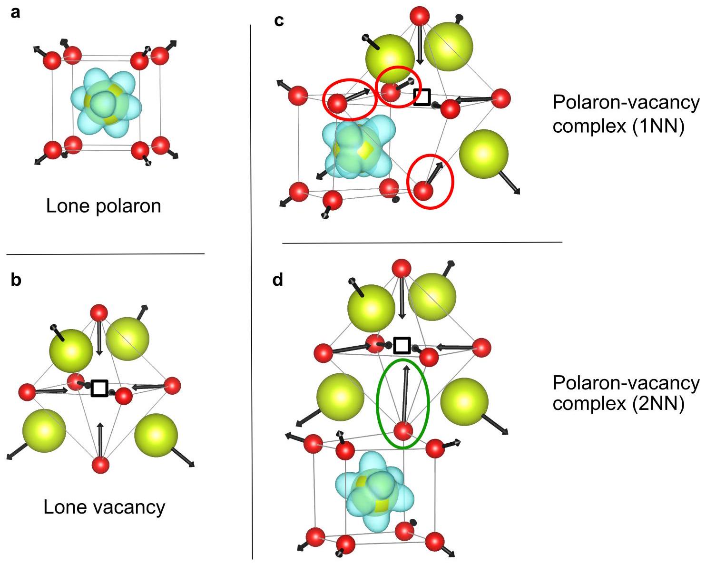
Figure 4.1: Lattice distortions caused by the lone polaron (a), the lone vacancy (b), and the polaron-vacancy complex in $1 \mathrm{NN}(\mathbf{c})$ and $2 \mathrm{NN}(\mathbf{d})$ configurations. The relaxed local structures were obtained with DFT calculations. Oxygen ions are shown in red and cerium ions in green. Oxygen vacancies are symbolized as black rectangles. The electron density of the polaron is shown in blue. Black arrows show the direction and magnitude of the displacements of the coordinating ions. For better visualization, the magnitude of the arrows has been multiplied by five. The relaxed local structures were obtained with DFT simulations. Red circles in c show unfavorable distortions for the structural stabilization of the polaron-vacancy associate. The green circle in d shows a favorable distortion.

theory paired with the climbing image nudged elastic band (CI-NEB) method (see Sec. M.1.6 in the Methods for further information). One such mechanism for a complex in 2NN configuration is shown in Fig. 4.2. The upper part (Fig. 4.2a) displays sections of the images from the CI-NEB calculations, while the lower part (Fig. 4.2b) presents the corresponding energy profile. The first image (Fig. 4.2a-i) shows the stable complex in 2NN configuration. Fig. 4.2a-ii illustrates the initial movement of one oxygen ion to about a quarter of its path, while the polaron stays at its initial position. In Fig. 4.2a-iii, the transition state of the coupled jump is shown, and a transition energy of 0.42 eV is observed. Here the oxygen ion is at its midway point and the polaron is already localized at its new position. In the following two images (Figs. 4.2a-iv and 4.2a-v) the system relaxes into its new stable configuration.

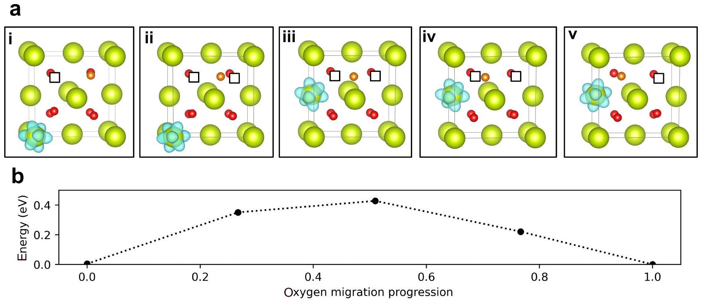
Figure 4.2: Structural (a) and energetic (b) analysis of the coupled polaronvacancy jump from DFT CI-NEB calculations. The transferring oxygen ion is shown in orange. Other objects shown have the meaning introduced in Fig. 4.1.

There is a shoulder on the left side of the energy diagram, due to the increased separation between oxygen vacancy and small polaron. For one, the charge of the vacancy is shifted away from the polaron, which lowers the Coulombic potential energy between the two defects. Secondly, as discussed before, the small polaron and oxygen vacancy have compatible local distortions in 2NN position, which allows for a strong association. These effects collectively destabilize the polaron
at its initial position as the oxygen vacancy shifts away. For the polaron to jump, both the initial and new site must offer the same localization energy for the electron (see Chapter 2 for details). This condition arises at a certain point between the second and third image, caused by the moving oxygen ion. Thus, the movement of the oxygen ion enables the electron transfer, indicating that the oxygen and polaron jumps are indeed coupled and can be considered a single-step process.

The polaron-vacancy complex has a variety of different jump geometries, in which the complex maintains its original configuration. In 1NN there is a single symmetrically unique jump geometry, as shown in 4.3a. The complex in 2NN configuration provides three possible jump geometries, labeled 2NN-1, 2NN-2, and 2NN-3, and visualized in 4.3b through 4.3d. Jump geometry 2NN-2 is the mechanism discussed before. Across all cases, I found very similar transition energies, with the 2NN-3 jump geometry exhibiting a slightly higher barrier of 0.46 eV compared to the 0.42 eV barrier of the others. These values are close to the jump energy of the lone oxygen vacancy (0.46 eV). ${ }^{[16]}$

For the three cases with lower jump energy, the polaron is close to the oxygen ion in its transition state (see Fig. A. 2 in the Appendix). This lowers the jump barrier of the oxygen ion as previously discovered by Nakayama et al. with stationary polarons. ${ }^{[27]}$ In the 2NN-3 jump geometry, however, the polaron remains at a greater distance.

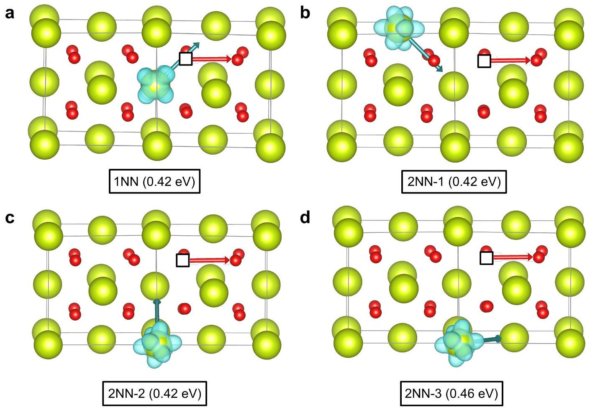
Figure 4.3: Analyzed coupled polaron-vacancy jumps and corresponding calculated jump energies. The arrows show the respective jump directions of the polaron (blue) and the oxygen vacancy (red). Other objects shown have the meaning introduced in Fig. 4.1. The jump energies were calculated with DFT and CI-NEB and are finite-size corrected.

### 4.3 Quantifying the Polaron Wind Effect

Within the framework of linear irreversible thermodynamics, the ionic and electronic fluxes, denoted by $\mathbf{j}_{\mathbf{i}}$ and $\mathbf{j}_{\mathbf{e}}$ respectively, are driven by two conjugate forces, $\mathbf{X}_{\mathbf{i}}$ and $\mathbf{X}_{\mathbf{e}}$, which act on the ions and electrons, respectively. ${ }^{[58]}$ I exclude here the flux of cerium ions, as their mobility is orders of magnitude smaller. ${ }^{[80]}$

$$
\begin{gathered}
\mathbf{j}_{\mathbf{i}}=L_{\mathrm{ii}} \mathbf{X}_{\mathbf{i}}+L_{\mathrm{ie}} \mathbf{X}_{\mathbf{e}} \\
\mathbf{j}_{\mathbf{e}}=L_{\mathrm{ee}} \mathbf{X}_{\mathbf{e}}+L_{\mathrm{ei}} \mathbf{X}_{\mathbf{i}}
\end{gathered}
$$

The quantities $L_{k m}(k, m=\mathrm{i}, \mathrm{e})$ represent the Onsager transport coefficients. As seen in Eq. 4.1, the ionic flux $\mathbf{j}_{\mathbf{i}}$ consists of two terms. The first term describes the ionic flux resulting from the force $\mathbf{X}_{\mathbf{i}}$ applied directly to the oxygen ions. The second term quantifies the polaron wind effect by means of the force on the electrons $\mathbf{X}_{\mathbf{i}}$ and the Onsager cross coefficient $L_{\mathrm{ie}}$. Similarly, the electronic flux $\mathbf{j}_{\mathbf{e}}$ in Eq. 4.2 includes a term describing the direct response to the applied force $\mathbf{X}_{\mathbf{e}}$ and a second term describing the ion wind effect on the electrons. According to the Onsager reciprocity theorem, the coefficients $L_{\mathrm{ie}}$ and $L_{\mathrm{ei}}$ should be identical to each other. ${ }^{[81]}$

When an electric field $E$ is applied to a homogeneous sample, the forces in Eqs. 4.1 and 4.2 are expressed as $\mathbf{X}_{\mathbf{i}}=-2 F \mathbf{E}$ and $\mathbf{X}_{\mathbf{k}}=z_{\mathrm{k}} F \mathbf{E}$ (where $k=\mathrm{i}$, e; $z_{\mathrm{i}}=-2 ; z_{\mathrm{e}}=-1$; and $F$ is the Faraday constant). The symmetry of the wind effects becomes even clearer when considering the partial current densities of ions and electrons, $\mathbf{i}_{\mathbf{i}}=-2 F \mathbf{j}_{\mathbf{i}}$ and $\mathbf{i}_{\mathbf{e}}=-F \mathbf{j}_{\mathbf{e}}$, respectively (see Eqs. 4.3 and 4.4). The impacts of the polaron wind effect on $\mathbf{i}_{\mathbf{i}}$ and of the ion wind effect on $\mathbf{i}_{\mathbf{e}}$ are now identical.

$$
\begin{aligned}
& \mathbf{i}_{\mathbf{i}}=L_{\mathrm{ii}} 4 F^{2} \mathbf{E}+L_{\mathrm{ie}} 2 F^{2} \mathbf{E} \\
& \mathbf{i}_{\mathbf{e}}=L_{\mathrm{ee}} F^{2} \mathbf{E}+L_{\mathrm{ei}} 2 F^{2} \mathbf{E}
\end{aligned}
$$

In order to calculate each of the four transport coefficients, the results of Chapter 2 and data from the literature are used to construct a KMC model. ${ }^{[12,16,82]}$ In this
model, both polarons and vacancies can migrate separately, form 1NN and 2NN complexes, perform coupled polaron-vacancy jumps, and dissociate from each other. In addition, polarons and vacancies repel other defects of the same type. For a full description of the model details, refer to Sec. M.2.1 in the Methods. In addition, the computation of Onsager coefficients requires the application of selective forces on either oxygen ions or electrons, which is descibed in detail in Sec. A. 1 in the Appendix. Fig. 4.4a gives an overview of the possible types of jumps.

Fig. 4.4b shows the simulated transport coefficients for different non-stoichiometries $\delta$ of $\mathrm{CeO}_{2-\delta}$ at a temperature of 1273 K . Both $L_{\mathrm{ee}}$ and $L_{\mathrm{ii}}$ are positive, whereas $L_{\mathrm{ii}}$ and $L_{\mathrm{ii}}$ are negative. For better visualization, Fig. 4.4b shows the negative values of $L_{\mathrm{ii}}$ and $L_{\mathrm{ii}}$. $L_{\mathrm{ee}}$ stands out as about two orders of magnitudes larger than the other Onsager coefficients. $L_{\mathrm{ie}}$ and $L_{\mathrm{ei}}$ are equal, and $L_{\mathrm{ii}}$ is slightly larger than those. In this double logarithmic plot, both diagonal coefficients $L_{\mathrm{ee}}$ and $L_{\mathrm{ii}}$ exhibit a linear dependence on the non-stoichiometry $\delta$ up to about $\delta=0.02$. For $L_{\mathrm{ee}}$ the slope is close to unity, which indicates that defect interactions exhibit almost no influence on the transport behavior of small polarons. The greater-than-one slope of $L_{\mathrm{ii}}$ implies that oxygen ions jump with increasing frequency as the defect concentration rises - a rather atypical phenomenon that is discussed later in this chapter. $L_{\mathrm{ie}}$ and $L_{\mathrm{ei}}$ show a weak curvature until $\delta=0.02$. All coefficients show strong curvatures at higher nonstoichiometries. $L_{\mathrm{ie}}$ and $L_{\mathrm{ei}}$ being identical shows that the simulations adhere to the Onsager reciprocity theorem.

To portray the transport properties in more practical terms, the Onsager coefficients can be translated into electronic and ionic conductivities, $\sigma_{\mathrm{i}}$ and $\sigma_{\mathrm{e}}$, respectively:

$$
\sigma_{\mathrm{i}}=L_{\mathrm{ii}} 4 F^{2}+L_{\mathrm{ie}} 2 F^{2}, \quad \sigma_{\mathrm{e}}=L_{\mathrm{ee}} F^{2}+L_{\mathrm{ei}} 2 F^{2}
$$

Both partial conductivities exhibit similar dependencies on the non-stoichiometry as the transport coefficients (see Fig. 4.4c). The simulated electronic conductivity is one and a half orders of magnitude larger than the simulated ionic conductivity, which indicates that ceria is mainly an electronic conductor.

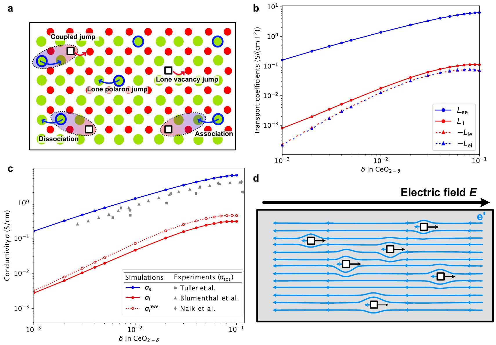
Figure 4.4: Schematic representation of the possible jump processes and results from KMC simulations. a 2D representation of the ceria structure and scheme of possible jump processes within the KMC model. Cerium and oxygen ions are shown as green and red circles, respectively, vacancies as black squares, polarons as blue circles and polaron-vacancy complexes as blue-red ovals. b Onsager transport coefficients calculated from KMC simulations at different non-stoichiometries $\delta$ at a temperature of 1273 K. Lines are guides to the eye. c Simulated conductivities at different non-stoichiometries. Also shown are the simulated ionic conductivities omitting the polaron wind effect. In addition, experimental total conductivities by Tuller et al. ${ }^{[69]}$, Blumenthal et al. ${ }^{[83]}$ und Naik et al. ${ }^{[84]}$ are included. The lines are guides to the eye. d Scheme showing how to understand the polaron wind effect. Vacancies are pulled by the external electric field in field direction (black arrows), and in the opposite direction by the polaron wind (blue arrows).

The influence of the polaron wind effect on the conductivities is encompassed in the second term in both equations in Eq. 4.5. Omitting this term yields the conductivities without the influence of wind effects (nwe = no wind effect):

$$
\sigma_{\mathrm{i}}^{\mathrm{nwe}}=L_{\mathrm{ii}} 4 F^{2}, \quad \sigma_{\mathrm{e}}^{\mathrm{nwe}}=L_{\mathrm{ee}} F^{2}
$$

The ionic conductivity without winds effects $\sigma_{\mathrm{i}}^{\text {nwe }}$ is about a factor two larger than $\sigma_{\mathrm{i}}$, because $L_{\mathrm{ie}}$ is negative and $L_{\mathrm{ii}}$ and $L_{\mathrm{ii}}$ are similar in value (see Fig. 4.4c). This highlights that the polaron wind effect has a significant influence on the ionic conductivity. However, the electronic conductivity with no wind effects $\sigma_{\mathrm{e}}^{\text {nwe }}$ is very similar to $\sigma_{\mathrm{e}}$, because $L_{\mathrm{ee}}$ is one to two orders of magnitudes larger than $L_{\mathrm{ii}}$. Thus, the ionic wind effect on the electronic conductivity is marginal and $\sigma_{\mathrm{e}}^{\mathrm{nwe}}$ excluded from the figure. I also included experimental total conductivities $\sigma_{\text {tot }}$ in Fig. 4.4c. ${ }^{[69,83,84]}$ The simulated electronic conductivity, which is approximately the total conductivity, aligns well with the reported ones.

To summarize these results, I illustrate the polaron wind effect in Fig. 4.4d. Here, oxygen vacancies are effectively pulled by the external electric field in field direction (black arrows). The polaron wind pulls the vacancies in the opposite field direction (blue arrows), reducing the ionic conductivity.

### 4.4 The Origin of the Polaron Wind Effect

The most interesting question concerns now the quantitative relation between the polaron wind effect and the various defect interactions. For this the attenuation factor $\eta$ is defined as follows:

$$
\eta=\frac{\sigma_{\mathrm{i}}}{\sigma_{\mathrm{i}}^{\mathrm{nwe}}}=1+\frac{L_{\mathrm{ie}}}{2 L_{\mathrm{ii}}}
$$

An $\eta$ value of one indicates the absence of a polaron wind effect, while values below one show a decrease of the ionic conductivity due to the polaron wind effect. I calculated $\eta$ for three different models (see Fig. 4.5a). Model 1 assumes no attractive interaction between small polarons and oxygen vacancies, while still considering repulsive interactions between defects of the same type. In Model 2, polarons and vacancies experience attractive interactions, but they
cannot perform coupled jumps. Finally, Model 3 represents the full model with all interactions and jumps, as shown in Fig. 4.4a.

In Model 1, no polaron wind effect is observed $(\eta \approx 1)$, which clearly shows that attractive polaron-vacancy interactions are necessary to produce wind effects.

In Model 2, a significant polaron wind effect can be observed as the attenuation factor decreases with increasing non-stoichiometry up to $\delta=0.02$, reducing the ionic conductivity by up to 11\%. Beyond that point, the attenuation factor increases again. The origin of the wind effect in Model 2 is related to a twostep mechanism in which the polaron pulls the oxygen vacancy in opposite field direction. Fig. 4.5b-i is instructive in explaining this behavior. Here, the potential energy landscape for a small polaron is illustrated across a series of ceria positions in electric field direction. In addition, one oxygen vacancy in the neighboring line of oxygen ions is included. For simplicity sake and to focus on the polaron-vacancy interaction, no other polarons are included in this picture. The energy landscape depicts a series of barriers that the small polaron needs to overcome to traverse the lattice. There is an overall energy gradient that stems from the applied electric field. The energy associated with complex formation appears as a well near the oxygen vacancy (highlighted in blue). However, the electric field's influence skews this well's bottom. This highlights the polarity of the complex, which leads to a preferred orientation to align with the electric field. In this figure, the most likely position for the polaron is therefore in 2NN position on the left site of the vacancy.

Starting from this configuration, let us consider the next step that the oxygen vacancy can do. Moving right (in field direction) would lead to the dissociation of the complex, which requires a significant amount of energy. Moving left (in opposite field direction) moves the vacancy towards the small polaron into 1NN position and keeps the complex intact. Although the oxygen vacancy moves in the latter case opposite to the force of the electric field, it is still more favorable than moving right. After the step of the vacancy to the left, the polaron will likely move before the oxygen vacancy moves again. To resume its most stable 2NN position, the polaron will take a step to the left as well, completing the two-step mechanism. At higher non-stoichiometries (see Fig. 4b-ii), the energy diagram becomes more complicated. In this case, the wells in the energy landscape created by the oxygen vacancies start to overlap. The small polaron is
then shared by multiple oxygen vacancies, and the polaron can jump from one vacancy to the next. Therefore, there is no longer a predominant orientation of the polaron-vacancy complexes, which leads the previously described two-step mechanism to occur equally likely in all directions. The polaron wind effect is thus lessened.

Model 3 exhibits a more pronounced polaron wind effect compared to Model 2, evidenced by a 39\% decrease in ionic conductivity at a non-stoichiometry of 0.02. This significant change from Model 2 to 3 is due to the polarons and oxygen vacancies now performing coupled jumps, i.e. polaron-vacancy complexes moving as an entity. During these coupled jumps, the charge transported is only half of that of a lone oxygen vacancy jump. Thus, force of the electric field on the former is half compared to that on the latter (as shown in Fig. 4.5c-i), which results in a reduction of ionic conductivity. At higher non-stoichiometries, coupled jumps become increasingly obstructed (as illustrated in Fig. 4.5c-ii), reducing the relative frequency of these jumps compared to lone oxygen vacancy jumps. Thus, the polaron wind effect decreases at increased non-stoichiometries.

Considering that experimental attenuation factors by Park et al. go as low as $0.2,^{[63]}$ the simulations suggest that coupled polaron-vacancy jumps play a major role in the polaron wind effect observed in ceria. The experimental values and my simulations also indicate the existence of more intricate coupled jumps. For instance, neutral polaron-vacancy complexes, comprising one oxygen vacancy and two polarons, may also perform such jumps. However, these are beyond the scope of this work.

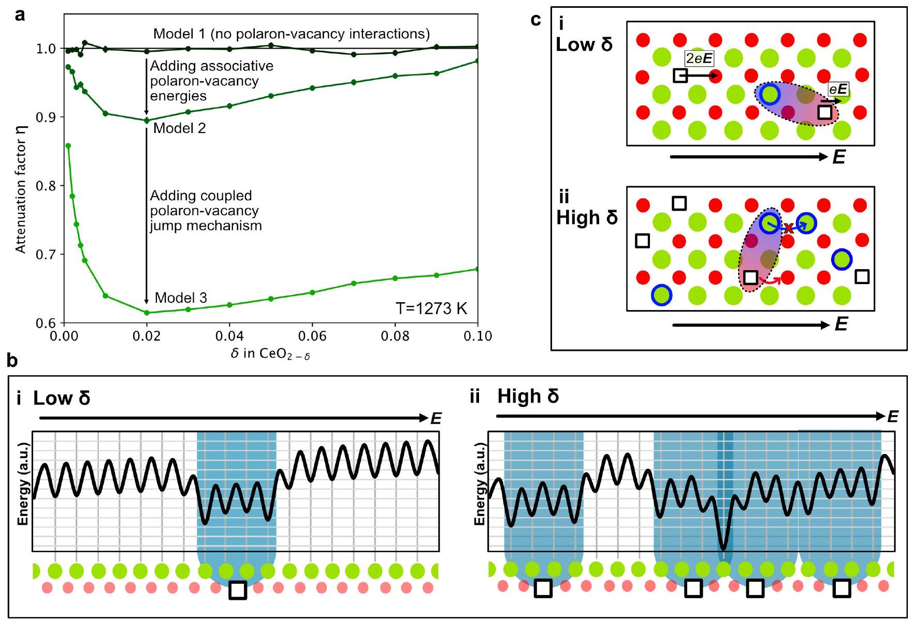
Figure 4.5: Analysis of the polaron wind effect. a Attenuation factor $\eta$ as a function of the non-stoichiometry at 1273 K for different KMC models (see text for details). Lines are guides to the eye. b Illustration of the small polaron energy landscape at low (i) and high (ii) non-stoichiometry. Landscape is an 1D excerpt of the ceria lattice with ceria and oxygen ion position parallel to the external electric field $E$. Energies of minima and maxima are based on DFT calculations. For better understanding, the electric field is depicted five times stronger than it was set in the KMC simulations. The blue region highlights the positions in which the small polaron and oxygen vacancy form complexes. The symbols are the same as in Fig. 4.4. c (i) Force exerted by an external electric field on a lone vacancy and on a polaron-vacancy-complex. (ii) Illustration showing that coupled polaron-vacancy jump can be blocked at higher non-stoichiometries.

### 4.5 Small Polaron Influences beyond the Polaron Wind Effect

In the previous section, I primarily focused on wind effects and the origins of the Onsager coefficients $L_{\text {ie }}$ and $L_{\text {ei }}$. However, small polarons affect the oxygen vacancy movement in other ways. Fig. 4.6 shows $L_{\mathrm{ii}}$ at different nonstoichiometries for the previously introduced Models 1, 2, and 3. I also included the case for a system without any interactions between defects, except for siteblocking - that is that one site cannot be occupied by two defects at the same time (Model no interactions). In this case, the $L_{\mathrm{ii}}$ coefficient increases linearly with increasing non-stoichiometry, because site-blocking is negligible at $\delta$-values below 0.1. In Models 1 and $2 L_{\mathrm{ii}}$ stays below the values of the noninteracting model and show saturation behavior at higher non-stoichiometries. These models reveal that the repulsive interaction between oxygen vacancies and the formation of immobile polaron-vacancy complexes reduce $L_{\mathrm{ii}}$.

In stark contrast, in Model 3 the $L_{\mathrm{ii}}$ coefficient rapidly exceeds that of the noninteracting model and shows saturation only at very high non-stoichiometries. This increase is due to the coupled polaron-vacancy jump mechanism. A closer look on a particular assumption in the KMC model shows why this may be the case: each possible jump has an associated unique vibrational mode that may trigger it. For instance, there are six vibrational modes that may trigger the jump of an oxygen ion into a neighboring vacant site corresponding to the vacancies six jump directions. However, each coupled polaron-vacancy jump possesses its own distinct vibrational mode. Therefore, vacancies within complexes are responsive not only to the vibrational modes of lone vacancy jumps but also to those of coupled jumps. This expanded range of responsive vibrational modes leads to more frequent jumps for vacancies in complexes compared to lone vacancies. As the non-stoichiometry increases, the proportion of vacancies within defect complexes also rises, enhancing this effect. Conversely, at higher nonstoichiometries, as previously discussed, the portion of coupled polaron-vacancy jumps diminishes, resulting in the saturation of $L_{\mathrm{ii}}$.

The effect of this phenomenon becomes clearer when analyzing the vacancy drift mobility $u_{\mathrm{v}}$ as defined in Eq. 4.8 (see Fig. 4.6).

$$
u_{\mathrm{v}}=\left(L_{\mathrm{ii}} 4 F^{2}+L_{\mathrm{ie}} 2 F^{2}\right) /\left(2 F c_{\mathrm{v}}\right)
$$

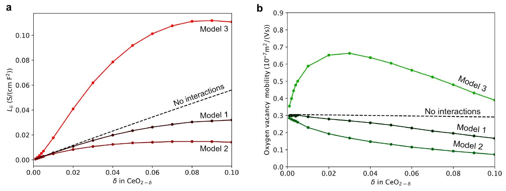
Figure 4.6: Onsager coefficient $L_{\mathrm{ii}}$ (a) and vacancy mobility (b) as a function of the non-stoichiometry at 1273 K for different KMC models (see text for details).

The vacancy mobilities of the non-interacting system, alongside Models 1 and 2, behave as anticipated. As more defects are introduced into the system, the vacancy mobility decreases due to defect interactions. In contrast, the mobility in Model 3 exhibits a sharp increase with rising non-stoichiometry, reaching a peak at $\delta=0.02$ and declining thereafter. The uniqueness of this behavior becomes evident when contextualized with rare-earth doped ceria compounds. ${ }^{[16]}$ Here, oxygen vacancies are introduced by doping and enable ionic conductivity in non-reducing atmospheres. However, unlike the trend observed in Model 3, vacancy mobility in doped ceria decreases progressively with an increase in defect concentration. The critical distinction in doped ceria is the formation of immobile complexes between oxygen vacancies and dopants, while in Model 3 for reduced ceria the polaron-vacancy complexes are mobile.

### 4.6 Summary and Outlook

In this chapter, I investigated the role of the polaron wind effect in MIEC oxides, using reduced ceria as a representative system. My findings firmly establish that the observed wind effects are triggered by attractive interactions between small polarons and oxygen vacancies. Most importantly, I present two mechanisms by which the polaron influences the movement of the vacancy:

1. In a two-step mechanism, the small polaron pulls the vacancy opposite to the direction of the externally applied electric field.
2. In a coupled single-step mechanism the vacancy and small polaron move jointly in field direction.

My research elucidates how the polaron wind effect considerably attenuates ionic conductivity and may serve as a catalyst for the reassessment of earlier data by those who might have overlooked its influence.

I recommend the following subsequent investigations. Firstly, the occurrence of coupled polaron-vacancy transitions should be observable in ab-initio metadynamics simulations, where the jumps can occur naturally without the constraints of the NEB method's springs. However, extended simulation times may be necessary. Secondly, the experiment conducted by Park et al. to analyze wind effects in reduced ceria should be replicated under illumination. ${ }^{[63]}$ Light could excite the localized electron trapped within the polaron-vacancy complex into the conduction band and thereby disband the polaron-vacancy complex. ${ }^{[85,86]}$ A decrease in the magnitude of $L_{\mathrm{ie}}$ when the illumination is turned on would strongly suggest that polarons indeed play a significant role in the wind effects of MIEC oxides. Moreover, if $L_{\mathrm{ii}}$ additionally decreases then this indicates that the prediction regarding the increased mobility of vacancies within a complex would be validated.

Lastly, my findings contribute to the broader field of polaron research, which has garnered substantial interest in recent years due to the prevalence of polarons in numerous materials. ${ }^{[5]}$ Specifically, the coupled movement of small polarons and oxygen vacancies may deepen the understanding of the catalytic behavior of ceria and other similar catalysts, where small polarons play a major role in surface reactions. ${ }^{[87,88]}$

## 5

## Reduced Ceria Phase Diagram from Monte Carlo Simulations

### 5.1 Introduction

Parts of the results presented here were gathered during a research internship with Boris Schüpp, whom I supervised. I conceptualized the ideas, performed calculations, conducted extended interpretations, and created figures. The following text was written entirely by me. Boris Schüpp contributed by performing calculations, providing initial interpretations, and creating figures.

During my investigation of the polaron wind effect in reduced ceria using the KMC method (see Chapter 4), I observed an unusual phenomenon. Specifically, at high defect concentrations coupled with low temperatures, the ionic and electronic conductivities deviated from the anticipated trends. A more meticulous examination revealed that under these conditions, defects began to agglomerate, resulting in the formation of distinct regions with high and low defect concentrations. To focus on a homogeneous system in my analysis of the polaron wind effect, avoiding these phase separations was crucial. To achieve this, it became
necessary to analyze the phase composition as a function of non-stoichiometry $\delta$ and temperature $T$ and to create a phase diagram. Fortunately, lattice configurations can be modeled with computationally inexpensive MMC simulations in which the free energy of the system is minimized by swapping random particles within the simulation cell. The MMC model is the same as the KMC Model 3 from Chapter 4, which is described in detail in Sec. M.2.1. However, no jump mechanisms need to be considered.

### 5.2 Assessing Homogeneity

Simulations were conducted using cubic supercells consisting of $16^{3}$ ceria unit cells and were varied in non-stoichiometry and temperature (see Sec. M.2.3 in the Methods for details). After minimization of the free energy, each of the simulation cells was subdivided into cubic segments comprising $2^{3}$ unit cells. Then the polaron occupation $x_{\text {pol }}$ (see Eq. 5.1) was calculated for each segment.

$$
x_{\mathrm{Pol}}=\frac{n_{\mathrm{Pol}}}{n_{\mathrm{Ce}}}
$$

Here, $n_{\text {Pol }}$ and $n_{\text {Ce }}$ are the number of polarons and cerium sites in one segment, respectively. Analyzing the oxygen vacancy distribution is redundant here, because an inhomogeneous distribution of polarons already excludes a given $\delta-T$ configuration from analysis with KMC simulations. Fig. 5.1 shows a schematic representation of the segmentation method.

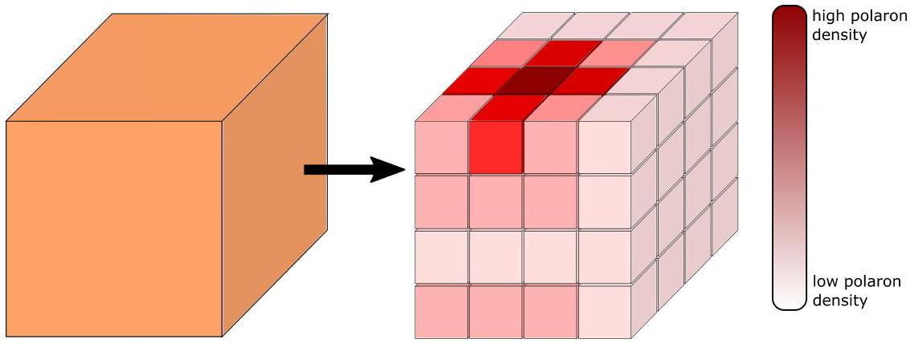
Figure 5.1: Scheme of the technique used to analyze the defect distribution within the ceria lattice.

The phase separation can be most clearly demonstrated by visualizing crosssections of the simulation cell, with segments color-coded according to $x_{\text {pol }}$.

Fig. 5.2 presents a selection of cross-sections from simulation cells at different non-stoichiometries at 1000 K. At lower non-stoichiometries ( $\delta=0.010$ and 0.025), the simulation cells appear homogeneous, with all sections displaying similar polaron occupancies. Starting at $\delta=0.05$, phases of low and high defect concentrations become distinguishable. The low-defect phase is more prevalent than the high-defect phase at this non-stoichiometry; however, this relationship is reversed at $\delta=0.125$. At higher non-stoichiometries $(\delta=0.160)$, the simulation cell uniformly exhibits a high-defect phase.

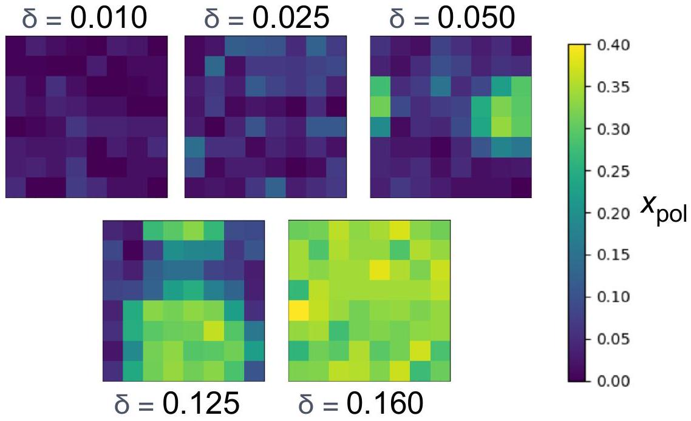
Figure 5.2: Selected cross-sections of reduced ceria simulation cells after performing MMC simulations at 1000 K. Each segment is color-coded according to the occupancy of polarons $x_{\text {Pol }}$.

### 5.3 Generating a Phase Diagram

By visual inspection of all cross-sections of each simulation cell, the presence or absence of phase separation was assessed. This analysis enabled the generation of a $T-\delta$ phase diagram featuring the phases $\alpha$ and $\alpha^{\prime}$, which represent the low and high defect phases, respectively (see Fig. 5.3).

At temperatures of 900 K and below, phase separation is observed at very low non-stoichiometries $(\delta \leq 0.021)$, resulting in a very narrow single $\alpha$ phase region under these conditions. As the temperature increases, the single-phase region broadens, i.e. higher non-stoichiometries can be used without encountering phase separation. However, even at 1300 K phase separations can be observed

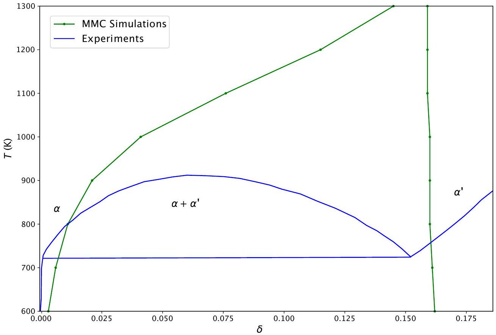
Figure 5.3: Generated phase diagram from MMC simulations (blue) and experimental phase diagram (green). ${ }^{[89]} \alpha$ and $\alpha^{\prime}$ are the low and high defect concentration phases, respectively.

at high non-stoichiometries of $\delta=0.145$. A single $\alpha^{\prime}$ phase is only observed at very high non-stoichiometries. Interestingly, the phase boundary between the two-phase $\left(\alpha+\alpha^{\prime}\right)$ and single $\alpha^{\prime}$ phase region exhibits negligible temperature dependence, effectively represented by a vertical line at $\delta=0.16$.

Fig. 5.3 also includes the experimental phase diagram by Ricken et al. ${ }^{[89]}$ While the phase boundary line between the single $\alpha$ phase and two-phase region from the simulations show qualitative agreement with that from experiments at low non-stoichiometries, strong deviations can be seen beyond $\delta=0.021$. The simulations fail to replicate the convex two-phase region from the experimental phase diagram. This raises the question of whether the $\alpha^{\prime}$ phase from MC simulations accurately represents that of experiments. Considering that the defect interaction parameters used in the simulations were obtained from isolated defect pairs, ${ }^{[90]}$ this seems rather unlikely. Therefore, KMC simulations within the $\alpha^{\prime}$ phase were not conducted.

Furthermore, the discrepancies between the simulated and experimental phase diagrams might also be influenced by thermal and chemical expansion in the experiments which are not accounted for in the simulations. More specifically, the chemical expansion reaches 1.1\% at $\delta=0.15^{[91]}$ and the thermal expansion coefficient is $10.5-13.5 \mathrm{~K}^{-1}$ for 350-1100 K. ${ }^{[92]}$ In contrast, the used defect interactions were simulated within cells which had lattice parameters from 0 K and without defects. ${ }^{[90]}$ Grieshammer showed that the lattice parameter has a significant influence on simulated defect interactions in doped ceria. ${ }^{[93]}$

### 5.4 Metastable States

Some MMC simulations initially settled into metastable states. Such situations arise when the system's conditions potentially allow phase separation, but the MMC algorithm fails to navigate the system to such a state.

In accordance with classical nucleation theory, phase separation from a metastable state takes place via nucleation. ${ }^{[94]}$ Here, a small nucleus of phase $\alpha^{\prime}$ must form, and it is from this nucleus that phase separation can propagate. While the MMC simulation is not a kinetic method, nucleation is still essential and achieved by the random swapping of particles within the simulation cell. However, this procedure can be challenging for the algorithm, especially when the nucleation energy is extraordinarily high, resulting in the premature dissolution of the nucleus before it can spread. The nucleation and the subsequent phase separation are thus largely subject to chance.

The randomness intrinsic to the process becomes evident when the lattice energy evolution is compared among different simulation runs with the same $\delta$ and $T$ (see Fig. 5.4). In all runs, the systems initially relax into a state with similar lattice energies. After varying amounts of additional simulation steps, some of the runs show a further reduction in lattice energy. In these runs, phase separation can be observed. Notably, for some runs, the metastable state is kept throughout the entire simulation runtime. To circumvent this issue, simulation cells were pre-relaxed at 300 K before running at the designated temperatures.

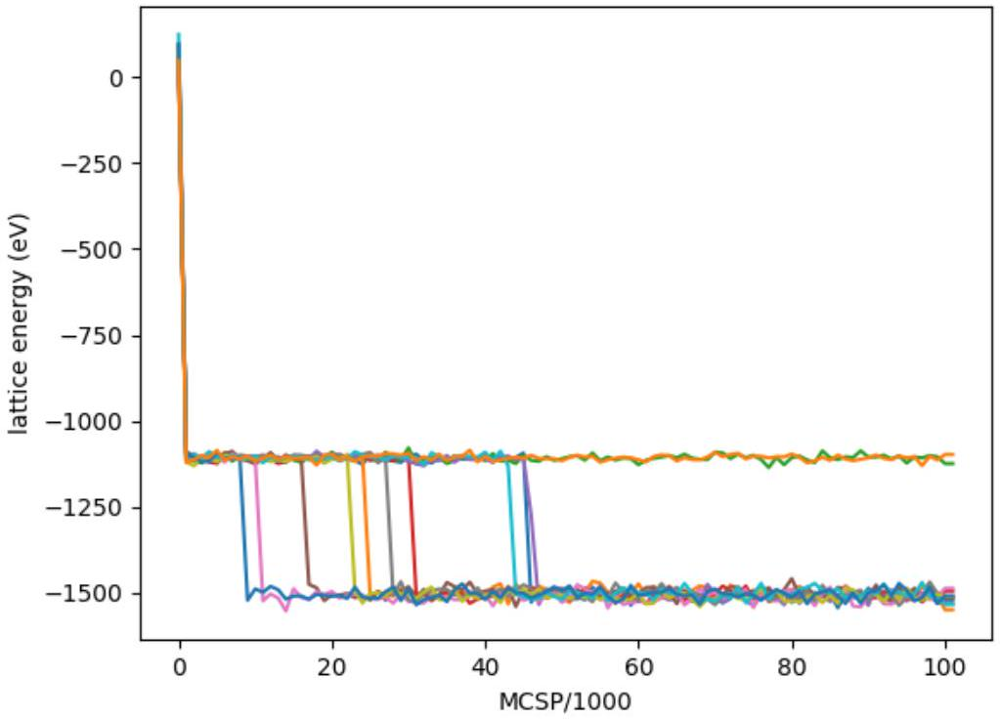
Figure 5.4: Lattice energy evolution for simulations at $\delta=0.095$ and 1000 K . Different colors indicate different simulation runs. MCSP is short for Monte Carlo Steps per Particle, where a Monte Carlo Step is the successful swap of two particles.

### 5.5 Phase Separation in Lattice Energy Trends

Signs of phase separation should also be observable when the lattice energy is graphed as a function of non-stoichiometry. Fig. 5.5a offers a schematic to aid in understanding. Here the lattice energy shows breaks in the trends at two non-stoichiometries, which take the form of derivative discontinuities in the ideal case. These result from a change in the process by which the lattice energy changes (see Fig. 5.5b). At low non-stoichiometries, the composition of the $\alpha$ phase changes as $\delta$ rises. Following the first break in the trend, the second phase $\left(\alpha^{\prime}\right)$ begins to form. During this stage, the compositions of the $\alpha$ and $\alpha^{\prime}$ phase remain constant, though the ratio between these phases shifts as the defect count rises. At the second break, the $\alpha$ phase is completely consumed, and the $\alpha^{\prime}$ phase starts to change in composition. Note that the linear trends depicted in the energy diagram of Fig. 5.5a were chosen for simplicity and do not reflect realistic trends.

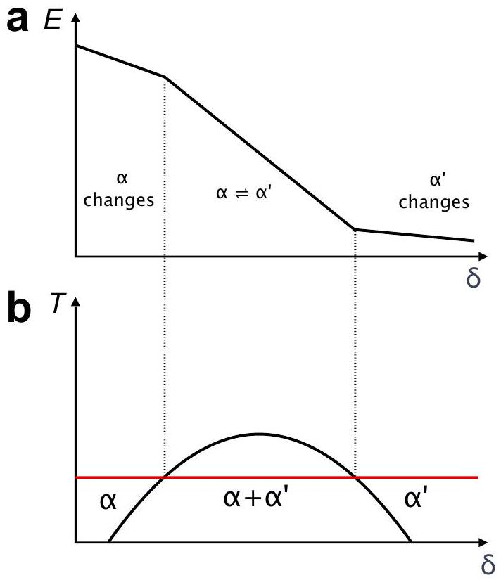
Figure 5.5: Scheme showing the lattice energy $E$ as a function of nonstoichiometry $\delta(\mathbf{a})$ and a corresponding example phase diagram (b). The red line shows the temperature $T$ for which the lattice energy trend is shown. $\alpha$ and $\alpha^{\prime}$ are different phases.

When the simulated lattice energies are plotted as a function of non-stoichiometry, a continuous decrease is observed for all temperatures (see Fig. 5.6). This trend results from an increase in the number of polaron-vacancy complexes with rising non-stoichiometry (see Chapter 4 for more details about these complexes). The anticipated breaks in the lattice energy trends are indeed observed. These are most clearly seen at temperatures of 800 K, 900 K and 1000 K. For instance, at 1000 K the breaks in the trend are seen at $\delta=0.04$ and $\delta=0.17$. Notably, while there is an abrupt change in slope at low non-stoichiometries, it is gentle at high non-stoichiometries. At higher temperatures, fluctuations can be observed. Specifically, these occur at non-stoichiometries of 0.076, 0.112, and 0.146 when temperatures are 1100 K, 1200 K, and 1300 K, respectively. I hypothesize that these fluctuations hint at the presence of metastable states, which may occur even in pre-relaxed lattices. At 1400 K, only one abrupt break in the lattice energy trend can be observed. However, the resolution at this point is not fine enough to properly analyze this behavior.

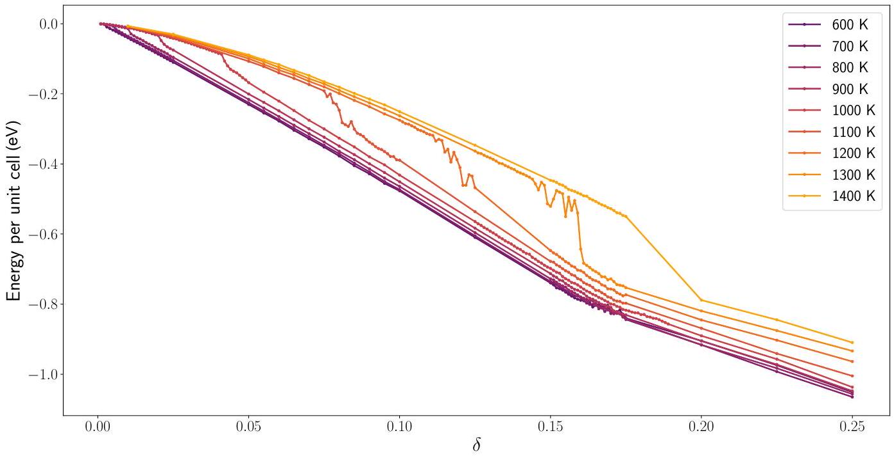
Figure 5.6: Energy per unit cell of reduced ceria as a function of nonstoichiometry $\delta$ at various temperatures.

## 6

## Exploring Irreversible Thermodynamics on Toy Systems

### 6.1 Introduction

Parts of the results presented here were gathered in a research internship with Norman Schier, whom I supervised. ${ }^{[95]}$ I conceptualized the ideas, conducted extended interpretations, and created figures. The following text was written entirely by me. Norman Schier contributed by performing calculations, providing initial interpretations, and creating figures.

During my research, I found myself intrigued by several fundamental questions that called for a deeper investigation:

- Is the validity of the Nernst-Einstein relation reduced by interactions between mobile and immobile particles?
- The polaron wind effect (see Chapter 4) showed that attractions between mobile particles in different sublattices lead to wind effects. Is this also the case when particles repel each other?

- Is the activation energy of the conductivity always close to the highest jump barrier that needs to be surmounted to traverse the material?

Answering these questions helps in illuminating the relationship between the microscopic energies, e.g. defect interactions and jump barriers, and macroscopic properties, such as the Onsager transport coefficients. In order to do so, specific model systems tailored to these questions are used, which in some part are toy systems.

### 6.2 When does the Nernst-Einstein relation fail?

The Nernst-Einstein (N-E) relation (Eq. 6.1) provides a bridge between the self-diffusion coefficient $D^{*}$ and the mobility $u$ of a given mobile particle:

$$
u=\frac{q D^{*}}{k_{\mathrm{B}} T}
$$

where $q$ is the charge of the particle, $k_{\mathrm{B}}$ is the Boltzmann constant and $T$ is the thermodynamic temperature. Essentially, this equation suggests that studying the Brownian motion of a given particle provides the same level of insight as analyzing the particle's flux when an electric field is exerted on it. A significant limitation of the N-E relation is that it assumes the independent motion of particles in a homogeneous solution. I was interested in whether immobile particles of one species distributed randomly in a solution would influence the validity of the N-E relation for mobile particles of a different species.

To probe this, KMC simulations are conducted with yttria-doped ceria as a model system. Ceria is a favorable choice due to its cubic structure and abundance of previous research. ${ }^{[7,16]}$ Doping results in mobile oxygen vacancies, with the composition described by $\mathrm{Ce}_{1-x} \mathrm{Y}_{x} \mathrm{O}_{2-x / 2}$, where $x$ is the doping degree. The oxygen vacancies repel each other, and yttrium dopants and oxygen vacancies attract each other. The interaction parameters are taken from the literature ${ }^{[16]}$ and are presented in Sec. M.2.4 together with all other simulation settings. For the following analysis and discussion, oxygen vacancies will be treated as pseudo particles with an effective charge of $q_{\mathrm{v}}=2 e$, where $e$ is the elemental charge. Dopants have an effective charge of $q_{\mathrm{d}}=-1 e$, i.e. the difference in valency of cerium and yttrium ions. As such the effective charge of the regular occupa-
tions are set to zero. Within the simulations, yttrium dopants are immobile and randomly distributed.

To analyze if the N-E relation holds in this system, the oxygen vacancy mobility is simulated in two ways: First, a linear response (LR) method is used in which an electric field E is applied:

$$
u_{\mathrm{v}}^{\mathrm{LR}}=\frac{1}{\mathbf{E}^{2} t N_{\mathrm{v}}} \sum_{m} \boldsymbol{\Delta} \mathbf{x}_{\mathrm{v}}^{(m)} \cdot \mathbf{E}
$$

where $\boldsymbol{\Delta} \mathbf{x}_{\mathrm{v}}^{(m)}$ is the field-driven displacement of the $m$ th oxygen vacancies after time $t$, and $N_{\mathrm{v}}$ is the number of vacancies. Second, the mobility is calculated from the mean-square displacement (MSD) and the N-E relation. Here, no external forces are applied to the system.

$$
u_{\mathrm{v}}^{\mathrm{MSD}}=\frac{q_{\mathrm{v}}}{6 t N_{\mathrm{v}} k_{\mathrm{B}} T} \sum_{m}\left(\boldsymbol{\Delta r}_{\mathrm{v}}^{(m)}\right)^{2}
$$

where $\boldsymbol{\Delta} \mathbf{r}_{\mathrm{v}}^{(m)}$ is the undirected random displacement of the $m$ th oxygen vacancy from its original position after $t$.

In addition, two distinct models were used: in Model $A$ interactions among vacancies and between vacancies and dopants are included. In model $B$ only interactions between dopants and vacancies are present. Each model is evaluated under varying degrees of doping. This way it can be shown if deviations from the N-E relation can be solely attributed to the interaction between oxygen vacancies or if the dopants also have an impact. Fig. 6.1 presents the results from Model $A$. Here, the mobilities from the $L R$ approach as well as those derived from the MSD approach decrease with increasing dopant numbers. This can be ascribed to trapping and blocking caused by the dopants. ${ }^{[16]}$ Interestingly, the vacancy mobility from the LR and the MSD approach differ by a nearly constant value across all doping degrees.

The difference between the $L R$ and $M S D$ approach is most clearly visualized by the haven ratio of the vacancies $H_{\mathrm{R}, \mathrm{v}}$, which is calculated from the mobilities as follows: ${ }^{[96]}$

$$
H_{\mathrm{R}, \mathrm{v}}=\frac{u_{\mathrm{v}}^{\mathrm{MSD}}}{u_{\mathrm{v}}^{\mathrm{LR}}}
$$

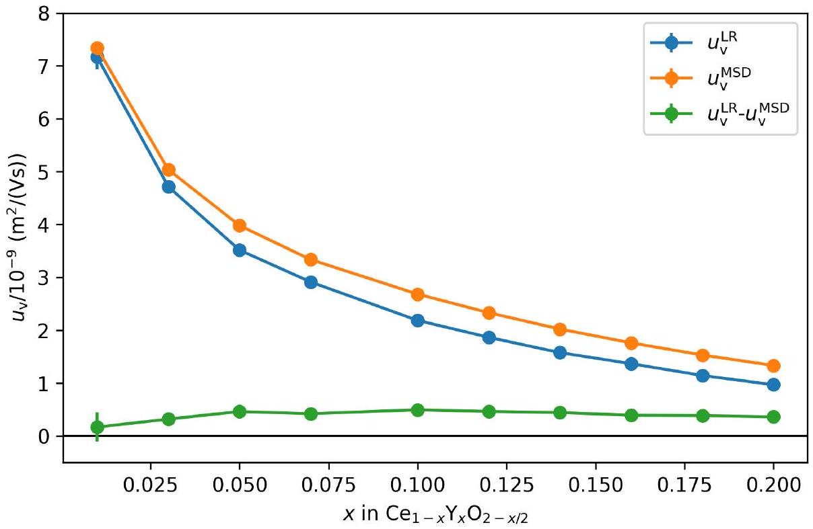
Figure 6.1: Vacancy mobility $u_{\mathrm{v}}$ in doped ceria as a function of doping degree from the $L R$ and $M S D$ approach and the difference between the two. Results are from Model A. $T=1000 \mathrm{~K}$. Lines connect data points and are guides to the eye.

Fig. 6.2 shows the haven ratio for the analyzed doping degrees. As the number of defects increase, the haven ratio is continuously lowered. While $H_{\mathrm{R}, \mathrm{v}}$ is close to unity at low doping degrees of $x=0.05$, it is only 0.73 at $x=0.20$.

Deactivating the vacancy-vacancy interactions in Model $B$ (see Fig. 6.3) reveals a trend analogous to the previous model, with mobilities decreasing in response to increasing doping degrees. However, in this model the two approaches give nearly identical results, with slight deviations possibly stemming from site-blocking of the vacancies - that is that only one vacancy can occupy any given anion site. From this it follows that the interactions between dopants and vacancies do not invalidate the N-E relation. Rather dopants act as a slowing agent. To draw an analogy with liquid solutions, the dopants effectively heighten the viscosity of the solution, subsequently slowing down the motion of particles therein. It can also be observed that the mobilities in Model $B$ are lower than those of Model $A$. This is because the trapping of vacancies by dopants is limited by the vacancy-vacancy repulsion. A dopant in Model $A$ can only trap a very limited number of vacancies until further association with ad-

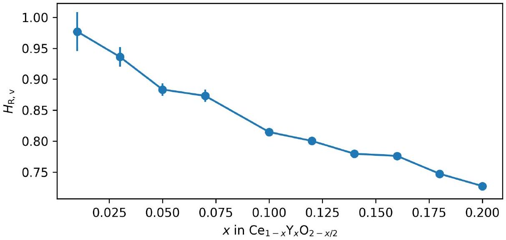
Figure 6.2: Haven ratio of oxygen vacancies from Model $A$ at different doping degrees. Line connects data points and is a guide to the eye.

ditional vacancies is counterbalanced by the repulsion of the already associated vacancies. Obviously this is not the case for Model $B$ and a greater number of vacancies can be trapped here.

### 6.2.1 Explaining the Simulations

Allnatt provides a generalized, many-body link between the undirected random motion of particles and their transport properties in an isotropic system: ${ }^{[97]}$

$$
\frac{\sum_{m, n}\left\langle\Delta \mathbf{r}_{i}^{(m)} \cdot \Delta \mathbf{r}_{j}^{(n)}\right\rangle}{6 t}=L_{i j} V k_{\mathrm{B}} T
$$

where $\Delta \mathbf{r}_{i}^{(m)}$ and $\Delta \mathbf{r}_{j}^{(n)}$ are the displacements of particles $m$ and $n$ of type $i$ and $j$, respectively, after time $t . V$ is the volume. Triangular brackets show the mean over independent simulations. This expression also holds true for $i=j . L_{i j}$ is the corresponding Onsager coefficient, which is defined by the flux equation:

$$
\mathbf{j}_{i}=\sum_{k} L_{i k} \mathbf{X}_{k}
$$

here $\mathbf{j}_{i}$ is the flux of particles of type $i$ and $\mathbf{X}_{k}$ is the force exerted on particles of type $k$. For the homogeneous yttium doped ceria system, the forces stemming from an applied electric field are as follows: $\mathbf{X}_{\mathrm{v}}=q_{\mathrm{v}} E$ for oxygen vacancies, $\mathbf{X}_{\mathrm{d}}=q_{\mathrm{d}} E$ for yttrium dopants, $\mathbf{X}_{\mathrm{O}}=0$ for oxygen ions, and $\mathbf{X}_{\mathrm{Ce}}=0$

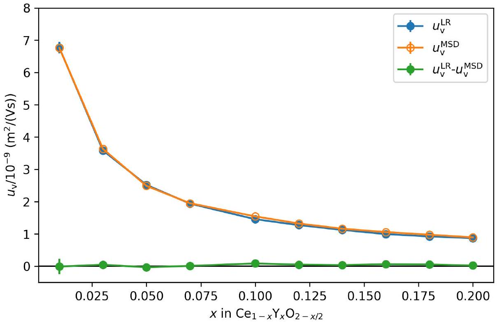
Figure 6.3: Analogous depiction as in Fig. 6.1 with results from Model $B$, which excludes interactions between oxygen vacancies. $T=1000 \mathrm{~K}$. Lines connect data points and are guides to the eye.

cerium ions. The Onsager coefficients are then related to the vacancy mobility as expressed in Eq. 6.7:

$$
\mathbf{j}_{\mathrm{v}}=u_{\mathrm{v}} \frac{N_{\mathrm{v}}}{V} \mathbf{E}=\left(L_{\mathrm{vv}} q_{\mathrm{v}}+L_{\mathrm{vd}} q_{\mathrm{d}}\right) \mathbf{E} \Rightarrow u_{\mathrm{v}}=\frac{L_{\mathrm{vv}} q_{\mathrm{v}}+L_{\mathrm{vd}} q_{\mathrm{d}}}{N_{\mathrm{v}} / V}
$$

Expanding Eq. 6.7 with Eq. 6.5 allows the formulation of the many-body relation between the mobility of the vacancies and their undirected random motion:

$$
\begin{aligned}
u_{\mathrm{v}}=\frac{V}{N_{\mathrm{v}} 6 t k_{\mathrm{B}} T} & \left(q_{\mathrm{v}} \sum_{m}\left\langle\left(\Delta \mathbf{r}_{\mathrm{v}}^{(m)}\right)^{2}\right\rangle+\right. \\
& \left.q_{\mathrm{v}} \sum_{\substack{m, n \\
(m \neq n)}}\left\langle\Delta \mathbf{r}_{\mathrm{v}}^{(m)} \cdot \Delta \mathbf{r}_{\mathrm{v}}^{(n)}\right\rangle+q_{\mathrm{d}} \sum_{m, n}\left\langle\Delta \mathbf{r}_{\mathrm{v}}^{(m)} \cdot \Delta \mathbf{r}_{\mathrm{d}}^{(n)}\right\rangle\right)
\end{aligned}
$$

The indices $m$ and $n$ serve to distinguish between separate particles, while $\boldsymbol{\Delta} \mathbf{r}_{\mathrm{v}}$ and $\boldsymbol{\Delta} \mathbf{r}_{\mathrm{d}}$ represent the undirected random displacement of vacancies and dopants respectively. A comparison of this expression with Eq. 6.3 elucidates
the results from the simulations. The second term within the outer parentheses reflects the correlation in movement among different oxygen vacancies and the third term shows the correlation between the movement of vacancies and dopants. These two terms differentiate Eq. 6.8 from Eq. 6.3. The latter term is always zero, because the dopants are immobile, and therefore does not affect the validity of the N-E relation. The difference between the $M S D$ and $L R$ approach, therefore, only stems from the vacancy-vacancy correlation, as observed in the simulation.

Since the difference in mobility between the MSD and $L R$ approach is nearly constant (see Fig. 6.1), the second term within the outer parentheses in Eq. 6.8 must be constant, too. This is an interesting result, as one would assume that the correlation in movement increases as the oxygen vacancy concentration rises. Further research is needed to analyze this tantalizing phenomenon.

### 6.3 When are the Onsager cross-coefficients not zero?

In Chapter 4 it was shown that attractions between oxygen vacancies and small polarons in reduced ceria lead to non-zero Onsager cross-coefficients: $L_{\text {ie }}=$ $L_{\text {ei }} \neq 0$ for the ionic (i) and electronic (e) flux, respectively.

I was curious if non-zero cross-coefficients could also be observed when particles from different sublattices repel each other. Moreover, I wondered if attractive and repulsive interactions of equal magnitude yield the same Onsager crosscoefficients.

To explore this, a toy system $A B_{2}$ consisting of fictional elements $A$ and $B$ was constructed and analyzed with KMC simulations. $A$ and $B$ are each situated in their own sublattice, with the overarching structure resembling that of fluorite. The charge number for $A$ and $B$ is set to +2 and -1, respectively. Vacancies $\mathrm{v}_{\mathrm{A}}^{\prime \prime}$ and $\mathrm{v}_{\mathrm{B}}^{\bullet}$ were introduced into the $A$ and $B$ sublattices, respectively. To maintain charge neutrality the relation $2 c_{\mathrm{v}}^{\mathrm{A}}=c_{\mathrm{v}}^{\mathrm{B}}$ was kept, where $c_{\mathrm{v}}^{\mathrm{A}}$ and $c_{\mathrm{v}}^{\mathrm{B}}$ are the concentrations of $\mathrm{v}_{\mathrm{A}}^{\prime \prime}$ and $\mathrm{v}_{\mathrm{B}}^{\bullet}$, respectively. The vacancies in both sublattices are mobile and move via thermally activated jump processes with barriers of 0.2 eV in the diluted case. Repulsive interactions of 0.5 eV between vacancies of the same type prevent the aggregation of defects. Nearest-neighbor interactions between $\mathrm{v}_{\mathrm{A}}^{\prime \prime}$ and $\mathrm{v}_{\mathrm{B}}^{\bullet}$ were varied and the Onsager coefficients calculated for each
setup. Further details and a summary of the model and simulation parameters are provided in the Methods section (see Sec. M.2.4) The procedure to simulate Onsager coefficients is discussed in the Appendix (see Sec. A.1).

For this system the transport equation when an external electric field is applied, is given as follows:

$$
\binom{\mathbf{i}_{\mathrm{A}}}{\mathbf{i}_{\mathrm{B}}}=\left(\begin{array}{ll}
L_{\mathrm{AA}} & L_{\mathrm{AB}} \\
L_{\mathrm{BA}} & L_{\mathrm{BB}}
\end{array}\right)\binom{q_{\mathrm{A}} \mathbf{E}}{q_{\mathrm{B}} \mathbf{E}} \circ\binom{q_{\mathrm{A}}}{q_{\mathrm{B}}}
$$

Here $\mathbf{i}_{k}$ and $q_{k}$ are the current densities and charges, respectively, of elements $A$ $(k=\mathrm{A})$ and $B(k=\mathrm{B})$, and " ∘ " denotes the element-wise product.

The results are presented in Fig. 6.5. All Onsager coefficients are positive for all interaction energies between $\mathrm{v}_{\mathrm{A}}^{\prime \prime}$ and $\mathrm{v}_{\mathrm{B}}^{\bullet}$. The diagonal-coefficients $L_{\mathrm{AA}}$ and $L_{\mathrm{BB}}$ are one to two orders of magnitude larger than the cross-coefficients $L_{\mathrm{AB}}$ and $L_{\mathrm{BA}} . L_{\mathrm{AA}}$ and $L_{\mathrm{BB}}$ deviate from each other, due to a different number of defects in the $A$ and $B$ sublattice. The cross-coefficients are identical in the margin of error and agree with the Onsager reciprocal relation. ${ }^{[81]}$

For both repulsive and attractive interactions between $\mathrm{v}_{\mathrm{A}}^{\prime \prime}$ and $\mathrm{v}_{\mathrm{B}}^{\bullet}$, the diagonalcoefficients lower with rising absolute interaction energy. This is to be expected, because interaction energies increase the jump barriers when $\mathrm{v}_{\mathrm{A}}^{\prime \prime}$ and $\mathrm{v}_{\mathrm{B}}^{\bullet}$ try to dissociate from each other (in case of attractive interactions) or when they block each others path (in case of repulsive interactions). The reverse case is observed for the cross-coefficients, which increase with rising absolute interaction energies. The cross-coefficients indicate a correlation in movement and the simulations show that these correlations are indeed present with repulsive interactions. Interestingly, the cross-coefficients are larger when attractive interactions are present than when repulsive interactions of the same magnitude are. The reason for this is likely linked to the duration for which two vacancies in the $A$ and $B$ sublattice stay in contact with each other. With attractive interactions, two respective vacancies will likely influence each others motion over a series of successive jumps as they follow each other. In contrast, with repulsive interactions, two vacancies will likely only come into contact once before moving away from each other. As a side note, the cross-coefficients are positive in this model because $A$ and $B$ particles move in opposite directions under an electric field.

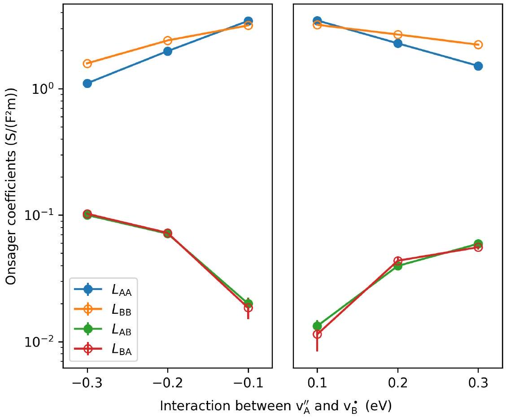
Figure 6.4: Onsager cross coefficients of $A$ and $B$ as a function of interaction energies between $\mathrm{v}_{\mathrm{A}}^{\prime \prime}$ and $\mathrm{v}_{\mathrm{B}}^{\bullet}$. Lines connect data points and are guides to the eye.

In contrast, for oxygen ions and small polarons in reduced ceria (see Chapter 4), they move in the same direction, resulting in negative cross-coefficients.

The non-zero Onsager cross-coefficients lead to wind effects between the fluxes of $A$ and $B$. As presented in Chapter 4, the impact of wind effects can be expressed as an attenuation of the conductivity:

$$
\binom{\eta_{\mathrm{A}}}{\eta_{\mathrm{B}}}=\binom{\sigma_{\mathrm{A}} / \sigma_{\mathrm{A}}^{\text {nwe }}}{\sigma_{\mathrm{B}} / \sigma_{\mathrm{B}}^{\text {nwe }}}
$$

where

$$
\binom{\sigma_{\mathrm{A}}}{\sigma_{\mathrm{B}}}=\binom{q_{\mathrm{A}}^{2} L_{\mathrm{AA}}+q_{\mathrm{A}} q_{\mathrm{B}} L_{\mathrm{AB}}}{q_{\mathrm{A}} q_{\mathrm{B}} L_{\mathrm{BA}}+q_{\mathrm{B}}^{2} L_{\mathrm{BB}}} \text { and }\binom{\sigma_{\mathrm{A}}^{\text {nwe }}}{\sigma_{\mathrm{B}}^{\mathrm{nwe}}}=\binom{q_{\mathrm{A}}^{2} L_{\mathrm{AA}}}{q_{\mathrm{B}}^{2} L_{\mathrm{BB}}}
$$

Here $\eta_{k}$ is the attenuation factor, $\sigma_{k}$ is the conductivity, and $\sigma_{k}^{\text {nwe }}$ is the conductivity without wind effects for elements $A(k=\mathrm{A})$ and $B(k=\mathrm{B})$. Eq. 6.10 can be reformulated as:

$$
\eta_{\mathrm{A}}=1-\frac{L_{\mathrm{AB}}}{2 L_{\mathrm{AA}}}, \quad \eta_{\mathrm{B}}=1-\frac{2 L_{\mathrm{BA}}}{L_{\mathrm{BB}}}
$$

The obtained attenuation factors are presented in Fig. 6.4 as a function of interaction strength between $\mathrm{v}_{\mathrm{A}}^{\prime \prime}$ and $\mathrm{v}_{\mathrm{B}}^{\bullet}$.

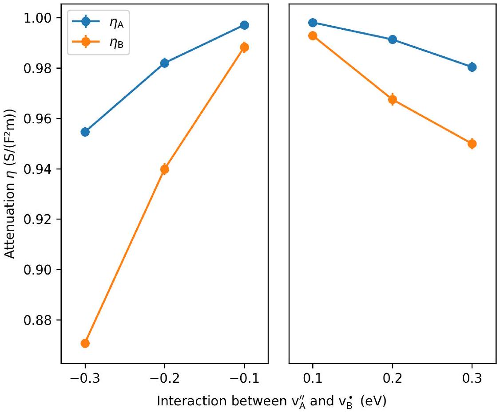
Figure 6.5: Attenuation factors of the conductivities of $A$ and $B$ as a function of interaction energies between $\mathrm{v}_{\mathrm{A}}^{\prime \prime}$ and $\mathrm{v}_{\mathrm{B}}^{\bullet}$. Lines connect data points and are guides to the eye.

A continuous reduction of the ionic conductivities of $A$ and $B$ due to wind effects can be observed with increasing interaction magnitude. $\eta_{\mathrm{B}}$ is consistently lower than $\eta_{\mathrm{A}}$, due to the charge difference between $A$ and $B$, as can be seen in Eq. 6.11. There is a steeper slope observed with attractive interactions than with repulsive ones. This occurs due to the opposing scaling behavior of the cross- and diagonal-coefficients with regards to the interaction energies. The simulations
suggest that short range interactions, as they are present in this toy system, do not lead to strong wind effects. Even with strong attractive interactions of -0.3 eV the conductivity of $B$ is only attenuated to 87 \% by wind effects. All other attenuation factors are at or above 0.95.

### 6.4 What determines the Activation Energy?

The activation energy of the conductivity is a complex average of the microscopic jump barriers that are encountered during the transport of the respective particles. My goal here is to shed light on this intricate relationship. In the realm of chemical reactions, the concept of a rate-determining step is often employed, wherein the rate of the entire reaction closely mirrors this critical step. Transferring this notion to the atomic transport in solids suggests that the activation energy aligns closely with the highest barrier that must be surmounted for a particle to traverse the material.

To examine this hypothesis, I designed a one-dimensional toy system, in which the unit cell has a single high barrier $E_{\text {jump, h }}=0.5 \mathrm{eV}$ and a various number of small barriers with the energy $E_{\text {jump, } \mathrm{s}}$ (see Fig. 6.6). In one series of simulations $E_{\text {jump,s }}$ was set to 0.3 eV and in a separate set of simulations to 0.4 eV. The ratio $x$ between small to large barriers (see Eq. 6.12) was then varied and the activation energy computed for each ratio.

$$
x=\frac{n_{\mathrm{s}}}{n_{\mathrm{h}}}
$$

Here, $n_{\mathrm{s}}$ and $n_{\mathrm{h}}$ represent the number of small and large barriers along the one-dimensional path, respectively. More details about the simulation setup are presented in the Methods (see Sec. M.2.4). This toy system is different from the random barrier model, where barrier heights are randomly chosen from a given distribution, allowing particles to percolate along paths with low barriers. ${ }^{[98]}$ In contrast, the one-dimensional model requires particles to necessarily overcome a high barrier.

Fig. 6.7 shows the activation energy of the conductivity of mobile particles in the one-dimensional model as a function of $x$. Here, $x$ is varied between 1 (alteration between the small and large barrier) and 19 (many more small barriers than large barriers). As the number of small jump barriers increases,

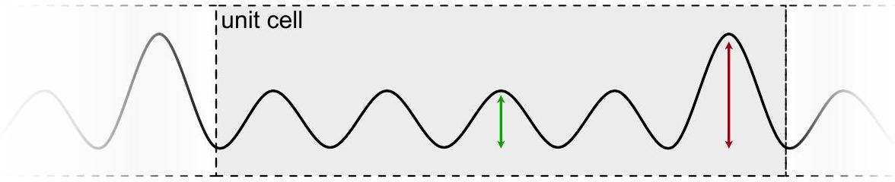
Figure 6.6: 1D Model with multiple small barriers and a single large barrier within each unit cell. Green and red arrows indicate the jump barriers $E_{\text {jump,s }}$ and $E_{\text {jump, } \mathrm{h}}$, respectively. Dotted lines encapsulates unit cells.

the activation energy decreases continuously. The trend resembles a reciprocal function, with the slope depending on the value of $E_{\text {jump, s }}$. The data show that large barriers have a disproportionate impact on the activation energy. However, it is evident that the activation energy does not depend solely on the highest barrier, indicating that the analogy with chemical reactions involving rate-determining steps is not fully applicable.

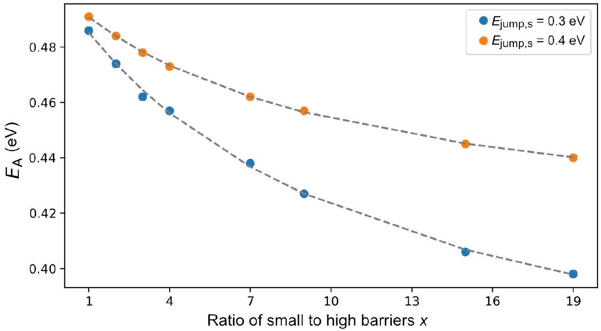
Figure 6.7: Activation energy of a mobile particle in a one-dimensional model as a function of the ratio of small to high barriers (0.5 eV). Small barriers are either 0.3 eV (shown in blue) or 0.4 eV (shown in orange). Dotted gray lines are reciprocal functions and guides to the eye.

The transferability of this one-dimensional problem to real-world systems may understandably raise doubts. A particle might sidestep higher barriers by opt-
ing for a different path, making the occurrence of numerous small barriers interspersed with occasional large ones appear improbable. However, some materials, like acceptor-doped ceria, ${ }^{[16]}$ exhibit this behavior. In these materials, dopants trap nearby oxygen vacancies, which must overcome high barriers to move freely again. Once free, they face lower barriers until trapped once more. A different example is barium zirconate, where dopants can form nanoscale percolation pathways, that facilitate high proton mobility. ${ }^{[99]}$ Within these pathways, protons face a series of small barriers, but need to overcome a large barrier at the pathways terminus. In this situation as well, a series of small barriers precedes a significantly higher one.

There is a further implication of the presented results: the applicability of the Arrhenius equation is tied to the presence of a singular dominant microscopic barrier. If the influence of minor barriers is substantial on the transport properties, then the activation energy becomes temperature dependent and the data will show a curvature in the Arrhenius plot. This effect is clearly observed when the one-dimensional model is plotted accordingly (see Fig. 6.8a). In this plot, the data are normalized to the values at $T=500 \mathrm{~K}$, which makes it easier to observe curvatures, especially at high $x$-values. To quantify these curvatures, activation energies were extracted from the low-temperature $(\leq 1000 \mathrm{~K})$ and high-temperature ( $\geq 1000 \mathrm{~K}$ ) region, and are shown as a function of $x$ in Fig. 6.8b. As before, the activation energy lowers with increasing $x$ in either case. However, activation energies from the high-temperature region are higher than those from the low-temperature region, and the difference between them enlarges with rising $x$. This confirms that the curvature in the Arrhenius plot intensifies when a greater number of small barriers is included.

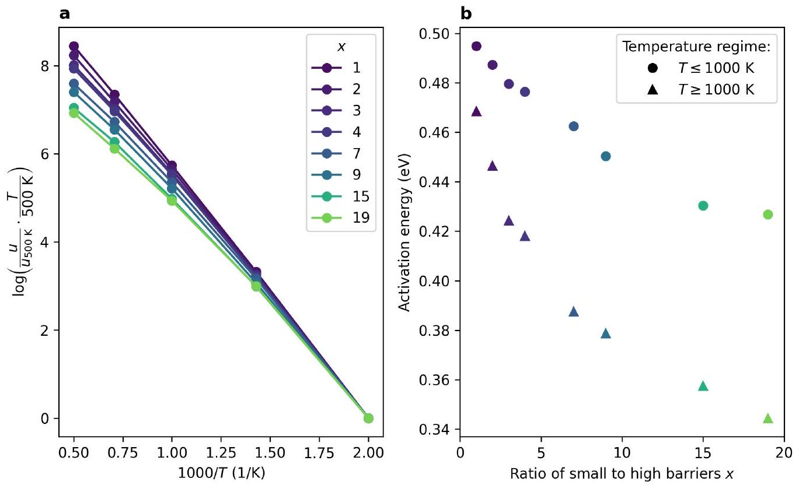
Figure 6.8: a Normalized Arrhenius plot for the 1D model with varying ratio of small to high barriers $x$ (see text for details). $u$ is the mobility of the mobile particles and $T$ is the temperature. $E_{\text {jump, } \mathrm{s}}$ and $E_{\text {jump, h }}$ are set to 0.3 eV and 0.5 eV, respectively. Lines connect data points and are guides to the eye. b Activation energies when data from the low-temperature ( $\leq 1000$ K) or hightemperature ( $\geq 1000 \mathrm{~K}$ ) regime are used. Shown for varying $x$.

## M

## Methods

## M. 1 Density Functional Theory

## M.1.1 Default Settings

All density functional theory (DFT) calculations analyzing the ceria system employed the following default settings. Deviations from these default settings are stated in the respective subsections. I used the Vienna Ab initio Simulation Package (VASP), version 5.4.4. ${ }^{[100,101]}$ For the exchange-correlation functional the generalized gradient approximation was used, specifically in the Perdew, Burke and Ernzerhof (PBE) formulation. ${ }^{[40]}$ As previous studies, ${ }^{[27,33,34]}$ the PBE functionals were adjusted with a Hubbard U-parameter of $U_{\text {eff }}=5 \mathrm{eV}$, which was introduced for the 4f-orbitals of cerium in the simplified rotational invariant approach. ${ }^{[36]}$ To handle the valence wave functions, the projector augmented-wave method was adopted. ${ }^{[102]}$ Here, the $5 \mathrm{~s}^{2} 5 \mathrm{p}^{6} 6 \mathrm{~s}^{2} 5 \mathrm{~d}^{1} 4 \mathrm{f}^{1}$ and $2 \mathrm{~s}^{2} 2 \mathrm{p}^{4}$ electrons of the cerium and oxygen atoms were treated as valence electrons, respectively. The plane-wave-basis cutoff energy was set to 500 eV. The lattice parameter of the unit cell was fixed to $5.499 \AA$, in line with previous calculations. ${ }^{[33]}$ If not otherwise stated, the position of the atomic cores were allowed
to relax. The convergence criteria were set to $10^{-5} \mathrm{eV}$ and $10^{-2} \mathrm{eV} \AA^{-1}$ for the electronic and core relaxation, respectively.

Supercells, which consist of multiple ceria unit cells, were employed in the calculations. I used smaller cubic supercells with $2^{3}$ unit cells ( $2 \times 2 \times 2$ supercells) and larger supercells with $3^{3}$ unit cells (3×3×3 supercells). For the 2×2×2 supercells, a $3 \times 3 \times 3$ Monkhorst-Pack k-point mesh was used, and for the $3 \times 3 \times 3$ supercells, a 2x2x2 Monkhorst-Pack k-point mesh was utilized. ${ }^{[51]}$ Upon introducing small polarons and oxygen vacancies into lattices, the total number of electrons was adjusted to represent the charge of those defects. VASP introduces a compensatory jellium background charge to offset the lattice charge.

To explore the minimum energy paths of jump processes, I utilized the climbingimage nudge elastic band (CI-NEB) method. ${ }^{[29,30]}$ Here, one or more intermediate lattice configurations, termed images, are initially produced with linear interpolation between the jumps's initial and final states. Afterwards, these structures are permitted to relax, with artificial springs ensuring each image remains spaced from its neighbors.

## M.1.2 Small Polaron Formation

To model the small polaron formation in ceria, an additional electron was introduced to the supercell. Concurrently, to foster electron localization, a deliberate distortion was applied to the local structure surrounding a given cerium ion. Specifically, this entailed:

- Increasing the distance between the cerium ion and its eight adjacent oxygen ions by $0.19 \AA$, introduced with a random variation in the range of $\pm 0.02 \AA$. This randomness aimed at breaking symmetry, thus enhancing the likelihood of reliable electron localization.
- Decreasing the distance between the central cerium ion and the twelve neighboring cerium ions by $0.009 \AA$, with a variation of $\pm 0.005 \AA$.

Meredig et al. indicated potential pitfalls while working with the Hubbard correction: ${ }^{[103]}$ The localization forced by the U-term can sometimes lead to metastable polarons due to the electron's ability to occupy various cerium forbitals. Because each of the f-orbitals are differently shaped, the structure
accommodates the electron localization in some f-orbitals better than in others. ${ }^{[48]}$ This results in different localization energies. I adopted the ramping approach for the U-term, as recommended by Meredig et al. ${ }^{[103]}$ and outlined by Grieshammer et al. ${ }^{[33]}$ The steps are as follows:

1. A polaron is created as described before.
2. The structure is fixed, the U-Term is set to zero and the system is electronically relaxed.
3. The U-term is increased by 0.25 and the system is again electronically relaxed, while keeping the structure fixed.
4. Step 3 is repeated until the desired U-term is reached.
5. Ideally, the polaron should now be in the most stable state.

By applying this technique, and conducting rigorous structural and energy checks, I ensured that the polarons are in their ground state.

## M.1.3 Small Polaron Jump

The polaron jump in Chapter 2 was analyzed using the CI-NEB method in a 2x2x2 supercell. To capture a comprehensive jump path, I conducted a series of subsequent NEB simulations. Here, intermediate images from preceding runs served as the foundations for subsequent calculations. Notably, using larger 3×3×3 simulation cells yielded jump barriers variations no greater than 0.001 eV (see Sec. A. 2 in the Appendix).

## M.1.4 Small Polaron Localization Energy

For the localization energies presented in Chapter 3, the delocalized state needed to be calculated. For this an electron is introduced into a cell without any initial distortions. The electron is then unable to localize which leaves it delocalized across the lattice. The difference in energy of the polaron and the delocalized state yields the localization energy.

## M.1.5 Hybrid Functionals

Hybrid exchange-correlation functionals used in Chapter 3 were deployed in the Heyd-Scuseria-Ernzerhof (HSE) formalism. The ionic structure was pre-relaxed using the PBE+U functional and then held constant while relaxing only the electronic structure with the HSE functional. Calculations in a 2×2×2 supercell used a 2x2x2 Monkhorst-Pack k-point mesh and a single k-point at the gamma point for the larger 3×3×3 supercells. The plane-wave basis cutoff energies were set to either 300 eV or 400 eV (see main text). The mixing parameters $\alpha$ was varied, while $\gamma$ was fixed to 0.2.

The energies of the polaron states were taken from the Density of States (DOS) of these calculations. Due to computational limitations, a greater number of k-points, which is the usual procedure for DOS calculations, could not be used. For the unoccupied polaron state energies, the system containing the polaronic distortions was used, but an excess electron was not included.

For the finite size correction of the unoccupied and filled polaron state energies, I used the method and code provided by Falletta et al. ${ }^{[49]}$. The settings for the input files are shown in table M.1.

Table M.1: Settings for the finite size correction method by Falletta et al. ${ }^{[49]}$
| Parameter | Value |
| :--- | :--- |
| $E_{\text {cutoff }}$ | 22 Ry or 29 Ry |
| direction | z |
| sigma | 1 Bohr |
| $\varepsilon_{0}$ | 23 |
| $\varepsilon_{\text {inf }}$ | 6 |
| alignment | Yes |

The values for the static and high-frequency dielectric constant, $\varepsilon_{0}$ and $\varepsilon_{\text {inf }}$, respectively, are taken from the literature. ${ }^{[104,105]}$ The plane-wave energy $E_{\text {cutoff }}$ was set according to the DFT calculations. The other parameters sigma, direction, and alignment were guessed, but did not alter the results upon variation. In addition, it was necessary to calculate the charge density of the ceria bulk
without any defects, which was done with the same settings as described in M.1.5.

## M.1.6 Coupled Polaron-Vacancy Jump

Modeling the coupled polaron-vacancy jump was done by first creating lattices in which a small polaron and an oxygen vacancy are located. The procedure to create a polaron followed the method described in Sec. M.1.2. Due to the vacancy's double positive charge and the polaron's single negative charge, the lattice was singly positively charged.

In total, two configuration were calculated in which the polaron and vacancy are in nearest neighborhood position, and five in which the polaron is in nextnearest neighborhood position to the vacancy. These were used as initial and final states of the coupled polaron-vacancy jump. Three intermediate images were produced for the 2x2x2 supercell. Unfortunately, increasing the number of images did not lead to converging calculations.

To correct for finite-size errors, calculations were repeated with $3 \times 3 \times 3$ supercells and single-image CI-NEB calculations.

## M. 2 Monte Carlo

Monte Carlo (MC) simulations were carried out with the program Mocassin. ${ }^{[17]}$ For KMC simulations, the applied electric field is always $10^{7} \mathrm{~V} / \mathrm{m}$, as in previous studies. ${ }^{[15]}$

## M.2.1 The Reduced Ceria System

The reduced ceria system within the MC simulations is constructed as follows: The lattice parameter is identical to the DFT calculations and set to $5.499 \AA$. Cubic supercells with $16^{3}$ ceria unit cells were used for all simulations. The pair interactions used in the simulations are taken from the literature ${ }^{[90]}$ and are shown in Tab. M.2.

The attempt frequency for the lone polaron jump was set to $3.71 \cdot 10^{12} \mathrm{~Hz}$ (see Chapter 2). For the lone vacancy jump attempt frequency the literature value of $1.47 \cdot 10^{12} \mathrm{~Hz}$ was used. ${ }^{[82]}$ This value was also used for the coupled

Table M.2: Pair interactions utilized in the Monte Carlo simulation of reduced ceria. '3NNa' and '3NNb' denote the defect energies for two vacancies in the third nearest neighborhood, in the absence and presence of a cerium ion inbetween the vacancies, respectively. Data is taken from Grieshammer et al. ${ }^{[90]}$
| Defect pair and neighborhood position | Distance $(\AA)$ | Energy (eV) |
| :--- | :--- | :--- |
| $\mathrm{V}_{\mathrm{O}}^{\bullet \bullet}-\mathrm{V}_{\mathrm{O}}^{\bullet \bullet}$ |  |  |
| 1NN | 2.7 | 0.90 |
| 2NN | 3.9 | 0.33 |
| 3NNa | 4.8 | 0.32 |
| 3 NNb | 4.8 | 0.46 |
| 4NN | 5.5 | 0.34 |
| 5NN | 6.1 | 0.06 |
| Polaron - $\mathrm{V}_{\mathrm{O}}^{\bullet \bullet}$ |  |  |
| 1NN | 2.4 | -0.14 |
| 2NN | 4.6 | -0.19 |
| 3NN | 6.0 | -0.03 |
| Polaron - Polaron |  |  |
| 1NN | 3.9 | 0.10 |
| 2NN | 5.5 | 0.04 |

polaron-vacancy jumps. The jump energy of the lone polaron jump was set to 0.17 eV (see Chapter 2). The jump energy of the lone oxygen vacancy was set to 0.46 eV, as found by Koettgen et al. ${ }^{[16]}$ The jump energies of polarons and oxygen vacancies is reduced when they are in 1NN and move past each other. ${ }^{[27]}$ The polaron jump energy is reduced by 0.025 eV for every vacancy that it passes during its transition. Analogously, the oxygen vacancy jump energy is reduced by 0.04 eV for every polaron that it passes.

## M.2.2 Calculation of Onsager Coefficients in reduced Ceria

Onsager coefficients in reduced ceria from Chapter 4 were generated with KMC simulations. The Onsager coefficients can be obtained by measuring the ionic and electronic flux and by selectively applying the electric field to either the oxygen ions or electrons. Sec. A. 1 in the Appendix gives a derivation of this method. Defects within the simulation cell are distributed at random initially. Pre-runs of 100 jumps per particle ${ }^{\mathrm{a}}$ were conducted to optimize the free energy of the system. Afterwards, results were gathered during 100,000 jumps per particle for simulations at 1273 K. For all other temperatures (see Sec. A. 2 in the Appendix) only 10,000 jumps per particles were conducted. In all cases, results were averaged over ten simulation runs.

## M.2.3 Creation of Phase Diagram of reduced Ceria

The ceria phase diagram showed in Chapter 5 was generated with MMC simulations. A temperature range of 600 K to 1400 K was analyzed with steps of 100 K . Each simulation cell was pre-relaxed at 300 K. $\delta$ was varied between 0.001 and 0.25 with higher resolution close to the occurrence of phase separation. Each data point is from a single simulation.

## M.2.4 Models to explore Irreversible Thermodynamics

## Y-Doped Cerium

The results presented in Sec. 6.2 were obtained with KMC simulations of yttrium doped ceria. Where applicable, the chosen energy and jump parameters follow those presented in Sec. M.2.1. Attractive interactions between oxygen vacancies and yttrium ions were set to -0.26 eV and -0.05 eV in nearest and next nearest neighborhood position, respectively, in accordance to literature values. ${ }^{[16]}$ The doping degree was set to 1\% and the temperature was set to 1000 K. Cubic supercells with $15^{3}$ unit cells were used. Pre-runs of 100 jumps per particle were conducted and followed by 1000 jumps per particle for the generation of results. Results were averaged over 12 simulation runs.

[^1]
## Fluorite $A B_{2}$ System

The $A B_{2}$ system used in Sec. 6.3 has the fluorite structure, where $A$ occupies the cation sites and $B$ the anion sites. The charge numbers of $A$ and $B$ were set to 2 and -1, respectively. Into each sublattice, 10\% vacancies were introduces. Repulsive interactions of 0.5 eV between vacancies of the same type were included. The interactions between vacancies of the $A$ and $B$ sublattice were varied and are given in the main text. Jump energies for isolated vacancies were set to 0.2 eV. The jump attempt frequencies of both vacancy types were set to $10^{13} \mathrm{~Hz}$. The cubic unit cell lattice had a lattice parameter of $5.499 \AA$. Cubic supercells containing $10^{3}$ unit cells were used. Simulations were carried for 10,000 jumps per particle with a pre-run of 100 jumps per particle. Results were averaged over 12 simulation runs.

## One-dimensional System with varying numbers of small and high barriers

The results presented in Sec. 6.4 were generated with KMC simulation of a onedimensional system containing a varying ratio of small to high barriers. Each data point was generated with 1,200 linear paths containing 10 high barriers and a constant number of small barriers in-between. The number of small barriers was varied across simulations. Five percent of the available sites were occupied by mobile species. The jump length was set to $1 \AA$, and the attempt frequency to $10^{13} \mathrm{~Hz}$. Simulations were performed with 10,000 jumps per particle.

## M. 3 Additional tools

3D-images of the ceria cells were created with VESTA. ${ }^{[106]}$ For structure analysis I used my in-house Python package crystally. ${ }^{[107]}$

## A

## Appendix

## A. 1 How to Compute the Onsager Transport Coefficients

The Onsager transport coefficients for an isotropic system with two mobile species $k$ and $m$ are defined as follows:

$$
\begin{aligned}
& \mathbf{j}_{k}=L_{k k} \mathbf{X}_{k}+L_{k m} \mathbf{X}_{m} \\
& \mathbf{j}_{m}=L_{m k} \mathbf{X}_{k}+L_{m m} \mathbf{X}_{m}
\end{aligned}
$$

Here $\mathbf{j}_{k}$ and $\mathbf{j}_{m}$ are the fluxes of $m$ and $k$, respectively, and $\mathbf{X}_{k}$ and $\mathbf{X}_{m}$ are the forces acting on $m$ and $k$, respectively.

By setting the force $\mathbf{X}_{m}$ to zero and applying a force $\mathbf{X}_{k}, L_{k k}$ and $L_{m k}$ are obtained by measuring the resulting fluxes of $k$ and $m$, respectively:

$$
\begin{aligned}
L_{k k} & =\left(\frac{\mathbf{j}_{k} \mathbf{X}_{k}}{\mathbf{X}_{k}^{2}}\right)_{\mathbf{X}_{m}=0} \\
L_{\mathrm{mk}} & =\left(\frac{\mathbf{j}_{m} \mathbf{X}_{k}}{\mathbf{X}_{k}^{2}}\right)_{\mathbf{X}_{m}=0}
\end{aligned}
$$

Analogously, the coefficients $L_{m m}$ and $L_{k m}$ can be obtained by setting $\mathbf{X}_{k}$ to zero and applying $\mathbf{X}_{m}$ and measuring the fluxes of $m$ and $k$, respectively.

In Mocassin the forces are realized through an electric field E. Chemical potentials can be neglected, as the periodic boundary condition allows for a homogeneous distribution of particles at all times. In order to make the electric field selective for one species, the charge of the other species is set to zero. This does not alter the interactions between particles, because these are defined irrespective of the species charge. As an example, setting the charge of $m\left(q_{m}\right)$ to zero and measuring the fluxes of $k$ and $m$ yields the first set of Onsager coefficients:

$$
\begin{aligned}
& L_{k k}=\left(\frac{\mathbf{j}_{k} \mathbf{E}}{q_{k} \mathbf{E}^{2}}\right)_{q_{m}=0} \\
& L_{m k}=\left(\frac{\mathbf{j}_{m} \mathbf{E}}{q_{k} \mathbf{E}^{2}}\right)_{q_{m}=0}
\end{aligned}
$$

where $q_{k}$ is the charge of species $k$. Correspondingly, the second set of coefficients $L_{m m}$ and $L_{k m}$ are obtained by setting $q_{k}$ to zero and measuring the fluxes of $m$ and $k$, respectively.

## A. 2 Additional Data for Coupled Polaron-Vacancy Transition

Figs. A. 1 and A. 2 show, respectively, the energy path and the transition state for the coupled polaron-vacancy jumps in ceria that were analyzed in Chapter 4. The transition points of the 1NN, 2NN-1, and 2NN-2 mechanism are identical, each having the same jump barrier. In contrast, the 2NN-3 mechanism exhibits a different transition point and jump barrier.

In the 1NN mechanism, the polaron remains at its original position upon reaching the transition point and moves only afterwards. The left shoulder in the energy diagrams of the 2NN-1 and 2NN-2 mechanism differ from each other, possibly due to finite-size errors affecting the 2NN-1 mechanism. In contrast, the 2NN-2 mechanism is more compact (see Fig. 4.3 in Chapter 4) and thus suffers less from finite-size errors. Unfortunately, due to time constraints, I was unable to perform a detailed analysis of the jump paths in supercells larger than those used, which contained $2^{3}$ ceria unit cells.

To correct for finite size errors of the jump barrier, additional climbing-image nudge elastic band calculations with a single image were performed in cubic supercells containing $3^{3}$ ceria unit cells. The finite size correction method suggested by Makov and Payne was applied, ${ }^{[108]}$ as done in previous ceria studies. ${ }^{[12]}$ Here, the transition energy as a function of the inverse cell volume is linearly interpolated to infinitely large cell volumes. Fig. A. 3 presents the data accordingly for the coupled polaron-vacancy jumps, as well as for the lone polaron jump. The jump barrier of the 2NN-3 jump geometry shows a stronger dependence on the supercell size than the other coupled jump geometries. The jump barrier of the lone polaron shows no finite-size errors.

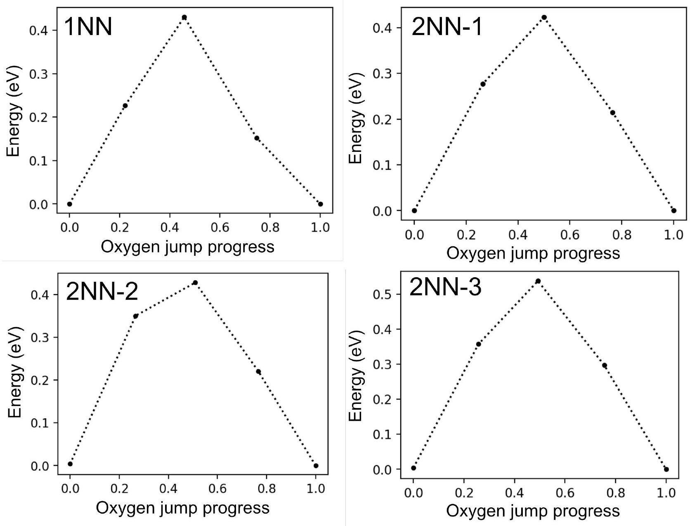
Figure A.1: Energy path for the coupled polaron-vacancy jump geometries with 2×2×2 supercells.

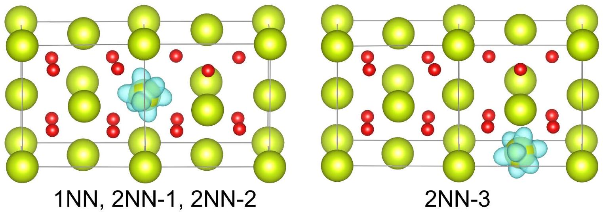
Figure A.2: Transition state configuration for the coupled polaron-vacancy jump geometries. Excerpts from the 3×3×3 supercell.

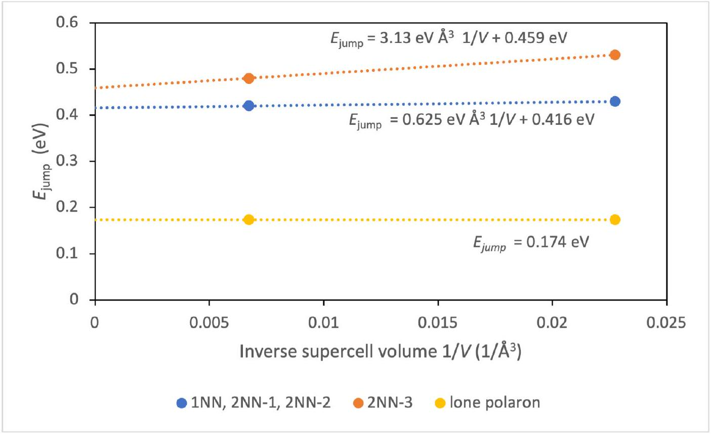
Figure A.3: Finite-size analysis for the jump barrier of the coupled polaronvacancy jumps and the lone polaron jump.

## A. 3 Temperature Dependence of Onsager Coefficients in reduced Ceria

The Onsager coefficients in reduced ceria analyzed in Chapter 4 show temperature dependence, which follow Arrhenius behavior. Fig. A. 4 shows the corresponding plot for Model 3 (see main text for details). In addition, the temperature dependence of the attenuation factor $\eta$ is also presented.

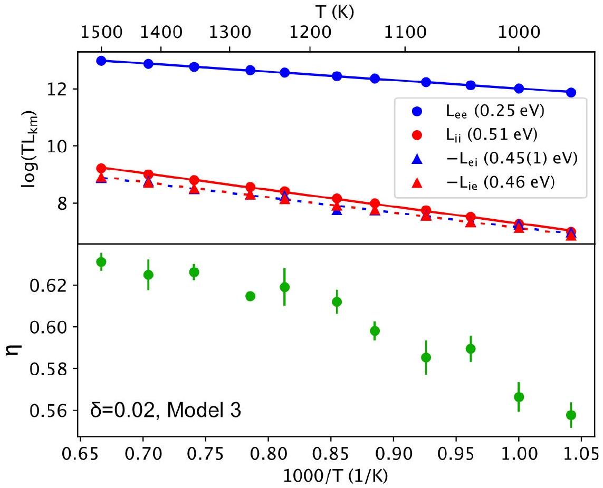
Figure A.4: Temperature dependence of the Onsager transport coefficients (top) and of $\eta$ (bottom) at $\delta=0.02$ for Model 3. The lines are linear Arrhenius fits. Numbers in parenthesis show the activation energy.

## A. 4 Experimental Inconsistencies in the Total Activation Energy of Reduced Ceria

Looking at early experimental studies on reduced ceria reveals that the authors of different studies assumed different temperature dependencies of the total conductivity $\sigma_{\text {tot }}$ :

Blumenthal et al.. ${ }^{[83,109]}$

$$
\sigma_{\mathrm{tot}}=A \exp \left(\frac{E_{\mathrm{A}}}{k_{\mathrm{B}} T}\right)
$$

Naik et al.: ${ }^{[84]}$

$$
\sigma_{\mathrm{tot}}=\frac{A}{T^{3 / 2}} \exp \left(\frac{E_{\mathrm{A}}}{k_{\mathrm{B}} T}\right)
$$

Tuller et al.. ${ }^{[69]}$

$$
\sigma_{\mathrm{tot}}=\frac{A}{T} \exp \left(\frac{E_{\mathrm{A}}}{k_{\mathrm{B}} T}\right)
$$

where $A$ is a constant, $T$ is the thermodynamic temperature, $E_{\mathrm{A}}$ is the activation energy and $k_{\mathrm{B}}$ is the Boltzmann constant.

Reevaluation of the data provided in the studies with Eq. A. 9 shows that the activation energies of the different experimental studies agree well with each other (see Fig. A.5).

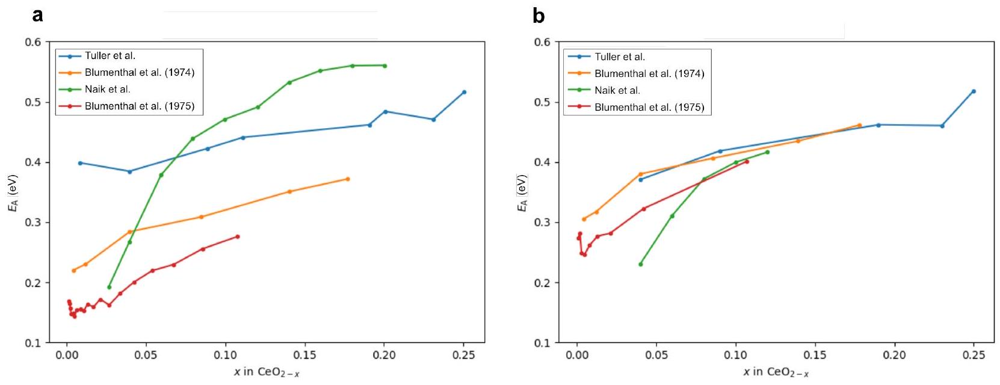
Figure A.5: a Activation energy of total conductivity for different nonstoichiometries $x$ directly provided by Tuller et al. ${ }^{[69]}$, Blumenthal et al. ${ }^{[83,109]}$ and Naik et al. ${ }^{[84]}$ b Reevaluation of data provided in the literature using Eq. A.9.

## Bibliography

1. R. de Souza and G. Harrington. Nat. Mater., 2023 22(7), 794-797.
2. A. R. Allnatt and A. B. Lidiard. Atomic Transport in Solids. Cambridge University Press, 1993.
3. F. A. Kröger and H. J. Vink. Solid State Phys., 1956 3, 307-435.
4. D. Emin. Physics Today, 1982 35(6), 34-40.
5. C. Franchini, M. Reticcioli, M. Setvin, and U. Diebold. Nat. Rev. Mater., 2021 6, 560-586.
6. Harald Böttger and Valerij V. Bryksin. Hopping Conduction in Solids. De Gruyter, Berlin, Boston, 1985.
7. R. Schmitt, A. Nenning, O. Kraynis, R. Korobko, A. I. Frenkel, I. Lubomirsky, S. M. Haile, and J. L. M. Rupp. Chem. Soc. Rev., 2020 49(2), 554-592.
8. P. Hohenberg and W. Kohn. Phys. Rev., 1964 136(3B), B864-B871.
9. W. Kohn and L. J. Sham. Phys. Rev., 1965 140(4A), A1133-A1138.
10. R. Dronskowski. Computational Chemistry of Solid State Materials. John Wiley \& Sons, Ltd, 2005.
11. N. Metropolis, A. W. Rosenbluth, M. N. Rosenbluth, A. H. Teller, and E. Teller. J. Chem. Phys., 1953 21(6), 1087-1092.
12. S. Grieshammer, B. O. H. Grope, J. Koettgen, and M. Martin. Phys. Chem. Chem. Phys., 2014 16(21), 9974-9986.
13. G. E. Murch. Am. J. Phys., 1979 47(1), 78-80.
14. G. E. Murch. Am. J. Phys., 1979 47(11), 958-960.
15. B. Grope, T. Zacherle, M. Nakayama, and M. Martin. Solid State Ion., 2012 225, 476-483.
16. J. Koettgen, S. Grieshammer, P. Hein, B. O. H. Grope, M. Nakayama, and M. Martin. Phys. Chem. Chem. Phys., 2018 20(21), 14291-14321.
17. S. Eisele and S. Grieshammer. J. Comput. Chem., 2020 41(31), 2663-2677.
18. S. Eisele. Development and Application of a Generic Monte Carlo Simulation Framework for Defect Transport in Crystalline Solid Electrolytes. Dissertation, RWTH Aachen University, 2021.
19. T. Hellweg and G. Findenegg. Statistische Thermodynamik. Springer Spektrum Berlin, Heidelberg, 2015.
20. R. A. Marcus. Rev. Mod. Phys., 1993 65(3), 599-610.
21. T. Holstein. Ann. Phys., 2000 281(1-2), 725-773.
22. D. Emin and T. Holstein. Ann. Phys., 1969 53(3), 439-520.
23. I. G. Austin and N. F. Mott. Adv. Phys., 1969 18(71), 41-102.
24. C. W. M. Castleton, A. Lee, and J. Kullgren. J. Phys. Chem. C, 2019 123(9), 5164-5175.
25. J. J. Carey, J. A. Quirk, and K. P. McKenna. J. Phys. Chem. C, 2021 125(22), 12441-12450.
26. C. Cohen-Tannoudji, B. Diu, and F. Laloë. Quantum Mechanics, Volume 1. Wiley, Hoboken, 1991.
27. M. Nakayama, H. Ohshima, M. Nogami, and M. Martin. Phys. Chem. Chem. Phys., 2012 14(17), 6079-6084.

28. L. Sun, X. Huang, L. Wang, and A. Janotti. Phys. Rev. B, 2017 95(24), 245101.
29. G. Henkelman, B. P. Uberuaga, and H. Jónsson. J. Chem. Phys., 2000 113(22), 9901-9904.
30. D. Sheppard, P. Xiao, W. Chemelewski, D. D. Johnson, and G. Henkelman. Chem. Phys., 2012 136(7), 074103.
31. A. Lindman, P. Erhart, and G. Wahnström. Phys. Rev. B, 201694 (7), 075204.
32. J. J. Plata, A. M. Márquez, and J. F. Sanz. J. Phys. Chem. C, 2013 117(28), 14502-14509.
33. S. Grieshammer, M. Nakayama, and M. Martin. Phys. Chem. Chem. Phys., 2016 18(5), 3804-3811.
34. G. E. Murgida, V. Ferrari, M. V. Ganduglia-Pirovano, and A. M. Llois. Phys. Rev. B, 2014 90(11), 115120.
35. J. P. Perdew, K. Burke, and M. Ernzerhof. Phys. Rev. Lett., 1996 77(18), 3865-3869.
36. S. L. Dudarev, G. A. Botton, S. Y. Savrasov, C. J. Humphreys, and A. P. Sutton. Phys. Rev. B, 1998 57(3), 1505-1509.
37. P. P. Dholabhai, J. B. Adams, P. Crozier, and R. Sharma. J. Chem. Phys., 2010132 (9), 094104.
38. A. J. Cohen, P. Mori-Sánchez, and W. Yang. Science, 2008 321(5890), 792-794.
39. J. Heyd, G. E. Scuseria, and M. Ernzerhof. J. Chem. Phys., 2003 118(18), 8207-8215.
40. J. P. Perdew, M. Ernzerhof, and K. Burke. J. Chem. Phys., 1996 105(22), 9982-9987.
41. J. L. F. Da Silva, M. V. Ganduglia-Pirovano, J. Sauer, V. Bayer, and G. Kresse. Phys. Rev. B, 2007 75(4), 045121.

42. K. E. Kweon, G. S. Hwang, J. Kim, S. Kim, and S. Kim. Phys. Chem. Chem. Phys., 2015 17(1), 256-260.
43. J. P. Perdew, R. G. Parr, M. Levy, and J. L. J. Balduz. Phys. Rev. Lett., 1982 49(23), 1681-1694.
44. P. Mori-Sánchez, A. J. Cohen, and W. Yang. J. Chem. Phys., 2006 125(20), 201102.
45. J. F. Janak. Phys. Rev. B, 1978 18(12), 7165-7168.
46. T. Koopmans. Physica, 1934 1(1-6), 104-113.
47. A. R. Elmaslmane, M. B. Watkins, and K. P. McKenna. J. Chem. Theory Comput., 2018 14(7), 3740-3751.
48. J. P. Allen and G. W. Watson. Phys. Chem. Chem. Phys., 2014 16(39), 21016-21031.
49. S. Falletta, J. Wiktor, and A. Pasquarello. Phys. Rev. B, 2020 102(4), 041115.
50. S. Guo, H. Arwin, S. N. Jacobsen, K. Järrendahl, and U. Helmersson. J. Appl. Phys., 1995 77(10), 5369-5376.
51. H. J. Monkhorst and J. D. Pack. Phys. Rev. B, 1976 13(12), 5188-5192.
52. G. Chen, A. Feldhoff, A. Weidenkaff, C. Li, S. Liu, X. Zhu, J. Sunarso, K. Huang, X.-Y. Wu, A. F. Ghoniem, W. Yang, J. Xue, H. Wang, Z. Shao, J. H. Duffy, K. S. Brinkman, X. Tan, Y. Zhang, H. Jiang, R. Costa, K. A. Friedrich, and R. Kriegel. Adv. Funct. Mater., 2022 32(6), 2105702.
53. K. Kamlungsua, P.-C. Su, and S. H. Chan. Fuel Cells, 2020 20(6), 644-649.
54. A. Hauch, R. Küngas, P. Blennow, A. B. Hansen, J. B. Hansen, B. V. Mathiesen, and M. B. Mogensen. Science, 2020 370(6513), eaba6118.
55. C. Sun, R. Hui, and J. Roller. J. Solid State Electrochem., 2010 14(7), 1125-1144.

56. A. Arratibel Plazaola, A. Cruellas Labella, Y. Liu, N. Badiola Porras, D. A. Pacheco Tanaka, M. van Sint Annaland, and F. Gallucci. Processes, 2019 7(3), 128.
57. M. Papac, V. Stevanović, A. Zakutayev, and R. O'Hayre. Nat. Mater., 2021 20(3), 301-313.
58. R. E. Howard and A. B. Lidiard. Rep. Prog. Phys., 1964 27(161), 161-240.
59. Ho, P. S. and T. Kwok. Rep. Prog. Phys., 1989 52, 301-348.
60. J. R. Manning. Can. J. Phys., 1968 46(23), 2633-2643.
61. F. Kohlrausch. Ann. Phys., 1876 6(9), 233-275.
62. M. Martin and H.-I. Yoo. Radiat. Eff. Defects, 1991 119-121(2), 735-740.
63. W.-S. Park, I. Yang, and H.-I. Yoo. ECS Trans., 2008 13(26), 327-336.
64. D.-K. Lee and H.-I. Yoo. Phys. Rev. Lett., 2006 97(25), 255901.
65. J.-O. Hong and H.-I. Yoo. J. Mater. Res., 2002 17(5), 1213-1219.
66. T. Lee and H.-I. Yoo. Solid State Ion., 2013 241, 5-11.
67. H.-S. Kim and H.-I. Yoo. Phys. Chem. Chem. Phys., 2014 16(31), 16595-16605.
68. J. Janek and M. Martin. Ber. Bunsenges. Phys. Chem, 1994 98(5), 665-673.
69. H. L. Tuller and A. S. Nowick. J. Phys. Chem. Solids, 1977 38(8), 859-867.
70. L. Degiorgi, P. Wachter, and and D. Ihle. Phys. Rev. B, 1987 35(17), 9259-9264.
71. F. Lange and M. Martin. Ber. Bunsenges. Phys. Chem, 1997 101(2), 176-184.
72. V. A. Cherepanov, A. R. Gilev, and E. A. Kiselev. Pure Appl. Chem., 2019 91(6), 911-922.

73. J. Zhang, H. Zhao, Y. Li, N. Xu, W. Ding, X. Lu, and F. Li. Int. J. Hydrog. Energy, 2010 35(2), 814-820.
74. E. Shoko, M. F. Smith, and R. H. McKenzie. J. Phys. Condens. Matter, 201022 (22), 223201.
75. S. Shen, X. Jiang, Y. Zheng, X.-X. Xue, Y. Feng, J. Zeng, and K.-Q. Chen. Phys. Chem. Chem. Phys., 2023 25(10), 7519-7526.
76. S. Miyatani. Solid State Commun., 1981 38(4), 257-259.
77. A. K. Shukla, H. N. Vasan, and C. N. R. Rao. Proc. R. Soc. A, 1981 376(1767), 619-633.
78. G. B. Abdullaev, Z. A. Aliyarova, E. H. Zamanova, and G. A. Asadov. Phys. Status Solidi B, 1968 26(1), 65-68.
79. B. Wang, X. Xi, and A. N. Cormack. Chem. Mater., 2014 26(12), 3687-3692.
80. S. Beschnitt, T. Zacherle, and R. A. de Souza. J. Phys. Chem. C, 2015 119(49), 27307-27315.
81. L. Onsager. Phys. Rev., 1931 37(4), 405-426.
82. J. Koettgen, T. Zacherle, S. Grieshammer, and M. Martin. Phys. Chem. Chem. Phys., 2017 19(15), 9957-9973.
83. R. N. Blumenthal and R. K. Sharma. J. Solid State Chem., 1975 13(4), 360-364.
84. I. K. Naik and T. Y. Tien. J. Phys. Chem. Solids, 1978 39(3), 311-315.
85. J. S. Pelli Cresi, L. Di Mario, D. Catone, F. Martelli, A. Paladini, S. Turchini, S. D'Addato, P. Luches, and P. O'Keeffe. J. Phys. Chem. Lett., 2020 11(14), 5686-5691.
86. D. Emin. Phys. Rev. B, 1993 48(18), 13691-13702.
87. Y.-Q. Su, I. A. W. Filot, J.-X. Liu, I. Tranca, and E. J. M. Hensen. Chem. Mater., 2016 28(16), 5652-5658.

88. D. Zhang, Z.-K. Han, G. E. Murgida, M. V. Ganduglia-Pirovano, and Y. Gao. Phys. Rev. Lett., 2019 122(9), 096101.
89. M. Ricken, J. Nölting, and I. Riess. J. Solid State Chem., 1984 54(1), 88-99.
90. S. Grieshammer. J. Phys. Chem. C, 2017 121(28), 15078-15084.
91. S. Hull, S. T. Norberg, I. Ahmed, S. G. Eriksson, D. Marrocchelli, and P. A. Madden. J. Solid State Chem., 2009 182(10), 2815-2821.
92. R. Körner, M. Ricken, J. Nölting, and I. Riess. J. Solid State Chem., 1989 78(1), 136-147.
93. S. Grieshammer. Phys. Chem. Chem. Phys., 2018 20(30), 19792-19799.
94. D. W. Oxtoby. Accounts Chem. Res., 1998 31(2), 91-97.
95. N. Schier. Untersuchung fundamentaler Fragestellungen in der KMC Theorie. Forschungsbericht, RWTH Aachen University, Aachen, 2022.
96. G. E. Murch. Solid State Ion., 1982 7(3), 177-198.
97. A. R. Allnatt. Journal of Physics C: Solid State Physics, 1982 15(27), 5605-5613.
98. T. B. Schrøder and J. C. Dyre. Physical Chemistry Chemical Physics, 2002 4(14), 3173-3178.
99. F. M. Draber, C. Ader, J. P. Arnold, S. Eisele, S. Grieshammer, S. Yamaguchi, and M. Martin. Nat. Mater., 2020 19(3), 338-346.
100. G. Kresse and J. Furthmüller. Phys. Rev. B, 1996 54(16), 11169-11186.
101. G. Kresse and D. Joubert. Phys. Rev. B, 1999 59(3), 1758-1775.
102. P. E. Blochl. Phys. Rev. B, 1994 50(24), 17953-17979.
103. B. Meredig, A. Thompson, H. A. Hansen, C. Wolverton, and A. van de Walle. Phys. Rev. B, 2010 82(19), 195128.

104. N. I. Santha, M. T. Sebastian, P. Mohanan, N. M. Alford, K. Sarma, R. C. Pullar, S. Kamba, A. Pashkin, P. Samukhina, and J. Petzelt. J. Am. Ceram. Soc., 2004 87(7), 1233-1237.
105. T. Yamamoto, H. Momida, T. Hamada, T. Uda, and T. Ohno. Thin Solid Films, 2005 486(1-2), 136-140.
106. K. Momma and F. Izumi. J. Appl. Crystallogr., 2008 41(3), 653-658.
107. J. P. Arnold. crystally. 2023. Zenodo, DOI: 10.5281/zenodo.7533912.
108. G. Makov and M. C. Payne. Phys. Rev. B, 1995 51(7), 4014-4022.
109. R. N. Blumenthal and R. L. Hofmaier. ECS J. Solid State Sci. Technol., 1974 121(1), 126-131.

[^0]:    ${ }^{\mathrm{a}}$ While a study by Perdew et al. ${ }^{[40]}$ is sometimes cited as a justification for $\alpha=0.25,{ }^{[41]}$ their argument for this value is empirical and based on the atomization energies of molecules.

[^1]:    ${ }^{\mathrm{a}}$ A particle in this context means defects as well as regular ions.

