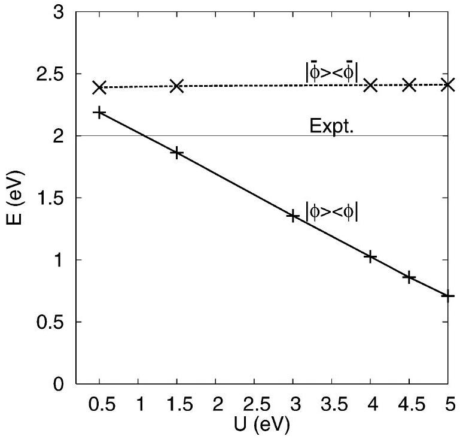
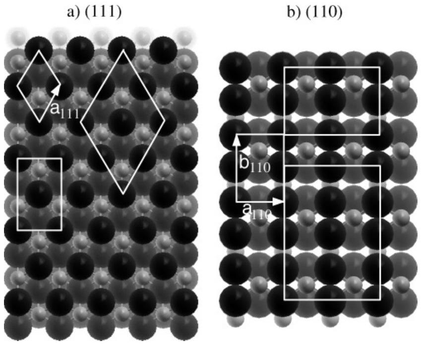
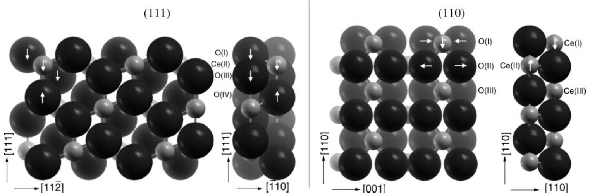
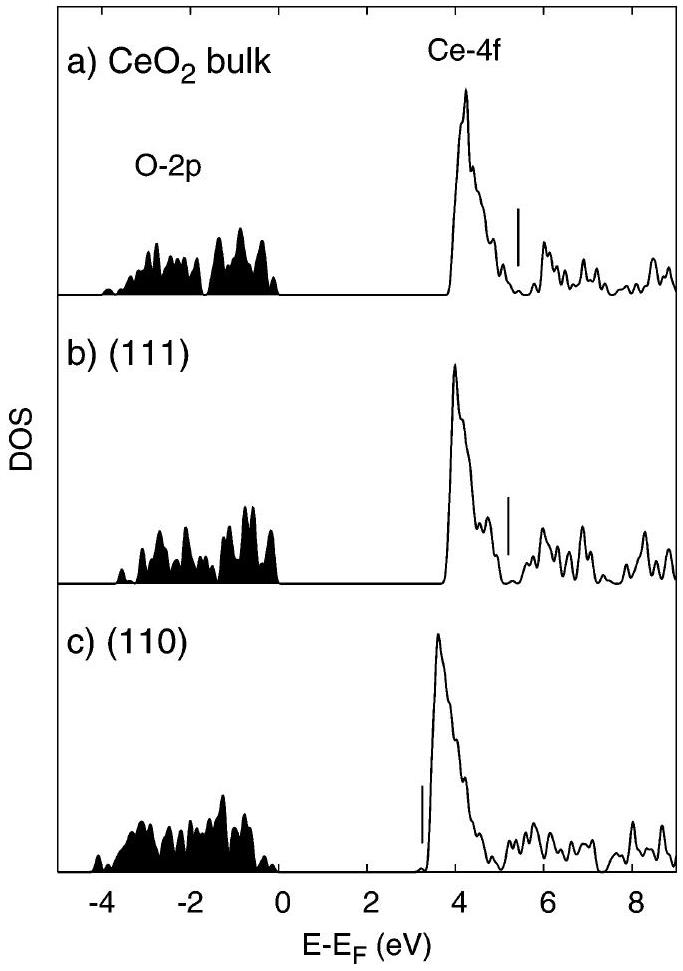
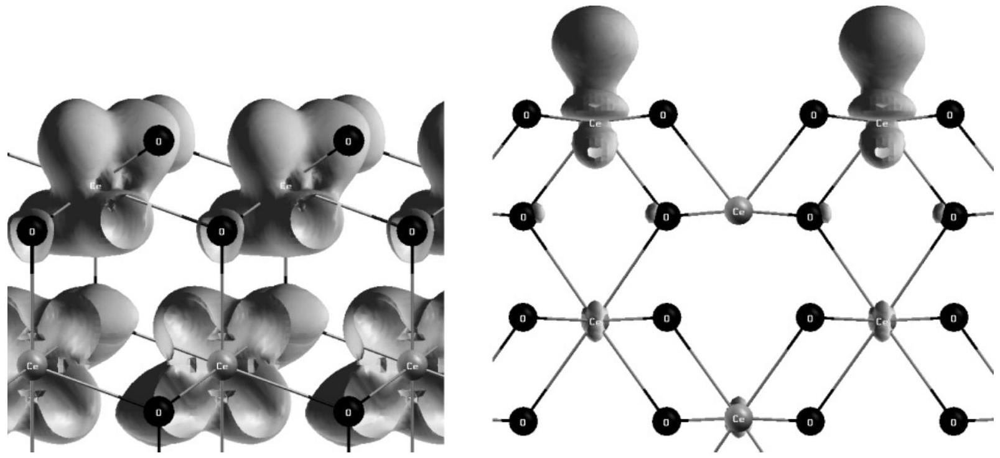
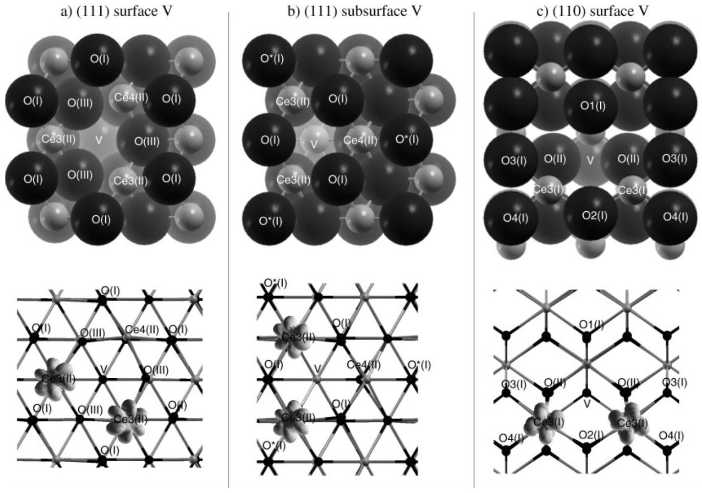
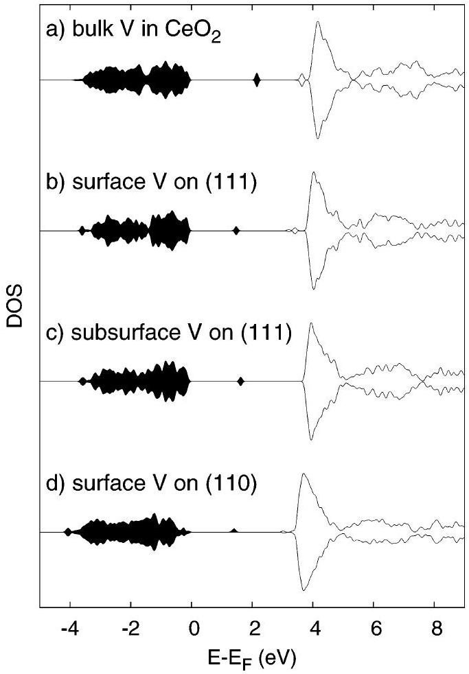

# Electronic and Atomistic Structures of Clean and Reduced Ceria Surfaces 

Stefano Fabris, ${ }^{*, \dagger}$ Gianpaolo Vicario, ${ }^{\ddagger}$ Gabriele Balducci, ${ }^{\ddagger}$ Stefano de Gironcoli, ${ }^{\dagger}$ and Stefano Baroni ${ }^{\dagger}$ INFM-CNR DEMOCRITOS National Simulation Center and SISSA-Scuola Internazionale Superiore di Studi Avanzati, Via Beirut 2-4, I-34014 Trieste, Italy, and Chemistry Department and Center of Excellence for Nanostructured Materials, Università di Trieste, Via Giorgieri 1, 34127 Trieste, Italy

Received: March 7, 2005; In Final Form: October 13, 2005

#### Abstract

The atomistic and electronic structures of oxygen vacancies on the (111) and (110) surfaces of ceria are studied by means of periodic density functional calculations. The removal of a neutral surface oxygen atom leaves back two excess electrons that are shown to localize on two cerium ions neighboring the defect. The resulting change of valency of these Ce ions $\left(\mathrm{Ce}^{4+} \rightarrow \mathrm{Ce}^{3+}\right)$ originates from populating tightly bound Ce 4f states and is modeled by adding a Hubbard $U$ term to the traditional energy functionals. The calculated atomistic and electronic structures of the defect-free and reduced surfaces are shown to agree with spectroscopic and microscopic measurements. The preferential defect segregation and the different chemical reactivity of the (111) and (110) surfaces are discussed in terms of energetics and features in the electronic structure.

## I. Introduction

Ceria-based catalysts are presently used to abate pollutants from combustion exhausts and are believed to be key materials in the future hydrogen production technology. ${ }^{1-3}$ The role of the oxide substrate in traditional catalysts is passive, in that it merely provides a resistant support for the chemically active noble metals. Supports based on the reducible oxide ceria $\left(\mathrm{CeO}_{2}\right)$, instead, participate actively in surface chemical reactions (typically oxidations and reductions) by easily releasing oxygen on demand at the reaction sites, acting therefore effectively as an oxygen buffer. ${ }^{4}$ The improvement in the conversion efficiency thus achieved is traced back to the presence of surface oxygen vacancies. ${ }^{1}$ Their formation, i.e., the release of oxygen from the lattice, entails an excess of two electrons per vacancy, which localize into the f-states of $\mathrm{Ce}^{4+}$ ions, reducing them to $\mathrm{Ce}^{3+}$. ${ }^{1,4,5}$ Knowing the local structure, clustering properties, and mobility of these defects is therefore of paramount importance for understanding their role in binding catalytic species and in enhancing both the reactivity of supported noble metals and the oxygen storage capacity. ${ }^{2,6,7}$

Microscopy techniques demonstrate that oxygen vacancies are present on the most stable (111) and (110) surfaces of ceria, either isolated or aggregated in extended defect clusters. ${ }^{8-12}$ However, the resolution of these analyses cannot address the atomistic details of the defect structures. Spectroscopic techniques do show that oxygen defects strongly modify the electronic structure (i.e., change of valency of the cerium ions upon reduction), but they lack spatial resolution. ${ }^{13-15}$ Theoretical modeling can provide new insight into both the atomistic and electronic structures of reduced ceria surfaces.

Traditional approaches, based on either empirical potentials or standard implementations of the Hartree-Fock ${ }^{16}$ (HF) or density functional ${ }^{17-19}$ theories (DFT), have so far failed to provide a proper account of the multiple valency character of

[^0]Ce, i.e., the change of valency $\mathrm{Ce}^{4+} \rightarrow \mathrm{Ce}^{3+}$ of the Ce ions upon reduction. The change of formal valency of Ce is determined by electron localization effects which break the symmetry of geometrically equivalent Ce ions. The main drawback of previous DFT calculations of reduced ceria was to miss such broken-symmetry solutions, therefore describing reduced ceria as a band conductor. The addition of a Hubbard- $U$ term in the density functional substantially penalizes the metallic solution stabilizing the physical, insulating one. The resulting level of theory-usually denoted as LDA+U (or GGA+U, $\mathrm{DFT}+U$, in brief)-provides a unified modeling framework for pure $\left(\mathrm{CeO}_{2}\right.$ and $\left.\mathrm{Ce}_{2} \mathrm{O}_{3}\right)$ and defective $\left(\mathrm{CeO}_{2-x}\right)$ ceria structures. ${ }^{20}$ This approach is now applied to the study of crystalline defects segregated to ceria surfaces.

Defect-free ceria surfaces have been studied by classical interatomic potentials ${ }^{21-26}$ and by ab initio methods in the HF approximation ${ }^{16}$ or within DFT. ${ }^{27,28}$ All these calculations predict the higher stability of the (111) surface with respect to other low-index surfaces, such as the (110) or the polar (001) one. The previous ab initio analysis ${ }^{28}$ of the reduced (111) and (110) surfaces predicts that the electrons compensating for the oxygen vacancies would not be localized on the neighboring Ce atoms only but would rather be spread over the outermost three atomic layers. This study also indicates that the most stable site for the formation of a surface vacancy is in the topmost atomic layer for the (110) surface, while it would be in the atomic O layer underneath the surface for (111). We show that calculations based on the DFT+U method provide a different picture for the same reduced ceria surfaces. Nolan et al. ${ }^{29}$ have recently applied the DFT+U method to the study of the pure (111) and (110) surfaces and of the reduced (001) surface. In general, this method is known to rely on the choice of a set of localized orbitals, which is to some extend arbitrary, and on a specific value for the parameter $U$. Both factors can in principle deteriorate the ab initio character of DFT calculations.

To reduce the level of arbitrariness and to enhance the predictive power of the calculations we find that by identifying the localized orbitals which define the Hubbard- $U$ term with
the Wannier-Boys functions ${ }^{30,31}$ resulting from the Ce-4f bands, the dependence of the calculated energies on the value of the parameter $U$ is effectively eliminated. In this context, the role of the Hubbard- $U$ term is to drive the calculation directly to the lowest-energy insulating electronic solution. A specific value of $U$ can be empirically adjusted to improve the agreement of this insulating electronic solution with spectroscopic measurements. Alternatively, we show that the same good agreement with experiments can be obtained by calculating $U$ selfconsistently with a linear-response approach. This has the advantage of recovering the ab initio character of the calculations.

Our computational method is briefly described in section II. The energetics and the structural and electronic properties of the clean surfaces are presented and discussed in section III. The modifications induced by surface defects, such as oxygen vacancies, are described in section IV. Results are finally summarized in the concluding section V.

## II. Computational Method

Our ab initio calculations are based on DFT within either the LDA or the GGA approximations, the latter using the Perdew-Burke-Ernzerhof (PBE) exchange-correlation energy functional. ${ }^{32}$ The resulting Kohn-Sham equations (including spin polarization) were solved using the plane-wave pseudopotential approach, as implemented in the PWscf/QuantumESPRESSO computer package. ${ }^{33}$ Ultrasoft pseudopotentials ${ }^{34}$ allowed us to limit the kinetic-energy cutoff for the plane-wave basis set to 30 Ry. Inclusion of the nonlinear core correction in the pseudopotentials used in refs 20 and 35 results in defective ceria to be always described as a metal at the LDA/GGA level, in agreement with all-electron DFT calculations. ${ }^{36,37}$ This inclusion has little effect on the structural properties but modifies the calculated energetics. As an example, the vacancy formation energies in bulk calculated with the present pseudopotentials are 5.55 eV (GGA + U) and 6.74 eV (LDA+U), the GGA+U result being in good agreement with other GGA and GGA $+U$ values reported in the literature (4.7-5.4 eV). ${ }^{28,29}$
A. The DFT+U Method for Ceria. The addition of a Hubbard- $U$ term to the LDA (or GGA) energy functional stabilizes the physical, insulating, ground state with respect to the metallic one. In our scheme, the Hubbard- $U$ term reads ${ }^{38}$

$$
E_{U}=\frac{U}{2} \sum_{\mathbf{R}, \sigma} \operatorname{Tr}\left[\mathbf{n}^{\mathbf{R} \sigma}\left(\mathbf{1}-\mathbf{n}^{\mathbf{R} \sigma}\right)\right]
$$

where the n values are $M \times M$ matrixes ( $M$ being the degeneracy of the localized atomic orbital, $M=7$ in the case of f orbitals), projections of the one-electron density matrix, $\hat{\rho}$, over the manifold of 4f orbitals localized at lattice site $\mathbf{R},\left\{\phi_{m \mathbf{R}}^{\sigma}\right\}$

$$
\phi_{m \mathbf{R}}{ }^{\sigma}|\hat{\rho}| \phi_{m^{\prime} \mathbf{R}}^{\sigma^{\prime}}=n_{m m^{\prime}}^{\mathbf{R} \sigma} \delta_{\sigma \sigma^{\prime}}
$$

In the above equations $m$ and $\sigma$ are orbital and spin angular momentum quantum numbers, respectively. To simplify the notation, the spin label will be omitted in the following.

The main effect of the Hubbard- $U$ term is to split the band resulting from the localized atomic-like orbitals into a lowenergy component of occupied states and a high-energy, unoccupied, component. If the low-energy component does not hybridize with states originating from other atomic orbitals, then the corresponding occupation numbers are equal to 1, and the Hubbard- $U$ term-though responsible for the splitting of the

Figure 1. GGA+U energy of reduction calculated with the atomiclike functions $\phi(+)$ and with the Wannier-Boys functions $\bar{\phi}(\times)$. The thin solid line marks the experimental value.

bands-does not contribute to the total energy of the system which results therefore to be independent of $U$.

In any actual implementation of the $\mathrm{DFT}+U$ energy functional, eq 1, however, the values of the n matrixes depend on the choice of the localized orbitals, $\left\{\phi_{m \mathbf{R}}\right\}$, which define them through eq 2. In the specific case of ceria, the $\phi$ values would be identified with atomic Ce-4f orbitals. As these orbitals are not orthogonal to the valence, O-2p like, states, the Ce-4f occupancies calculated though eq 2 are nonzero even in $\mathrm{CeO}_{2}$, where the nominal valency of all the Ce atoms is +4. Similarly, the Ce-4f occupancies in $\mathrm{Ce}_{2} \mathrm{O}_{3}$ are larger than 1.

The type and extension of the localized functions used to define the occupancies entering in the DFT+U functional affect the calculated results, and their optimal choice is currently subject of debate. ${ }^{39,40}$ As an example, the energy of reduction $\left(\mathrm{CeO}_{2} \rightarrow \frac{1}{2} \mathrm{Ce}_{2} \mathrm{O}_{3}+\frac{1}{4} \mathrm{O}_{2}\right.$, Figure 1) calculated with the atomic Ce-4f projector $\phi$ and with the self-consistent value of $U=4.5$ eV (see following sections) is in poor agreement with the available experimental data. ${ }^{41}$ It is evident that the energies strongly depend on the parameter $U$ and that a better agreement could only be obtained with very small values of this parameter, at the cost of shifting the position of the gap state at higher energies away from the experimentally measured values. The problem appears to be related to the amount of correlated charge (the occupations calculated with the given set of localized functions) that ought to be treated with the Hubbard model. In the following we show how a different choice of the projector functions used to calculate the occupancies can maintain the success of the DFT+U method in the band structure without spoiling the computed energetics.

1. Choosing the Projector. Instead of using the atomic orbitals $\phi$, the localized functions which enter the definition of the Hubbard- $U$ term, eq 1, can be determined self-consistently so as to describe exactly the localized states in the band structure. To this end, we introduce a subspace alignment procedure which yields a set of localized orbitals comprising the localized Wannier-Boys functions ${ }^{30,31}$ that result from Ce-4f bands (or the lower split-off component, in the case of reduced ceria). By construction, these states will be orthogonal to all the valence states.

Let us start with a given set of Ce-4f atomic orbitals ${ }^{42}\left\{\phi_{m \mathbf{R}}\right\}$ and let us consider the set of Bloch states, $\left\{\psi_{n \mathbf{k}}\right\}$-obtained from
a DFT+U calculation-whose orbital energies lie in a range comprising the Ce-4f band(s), while excluding the valence bands: $E_{\mathrm{V}}<\epsilon_{\mathrm{nk}}<E_{\text {max }}$, where $E_{\mathrm{V}}$ is the upper valence band edge and $E_{\text {max }}$ is larger than the energy of the Ce-4f localized states. We then define a new set of localized orbitals

$$
\bar{\phi}_{n \mathbf{R}}=\sum_{n^{\prime} \mathbf{k}} \mathrm{e}^{-i \mathbf{k} \cdot \mathbf{R}} C_{n n^{\prime}}{ }^{\mathbf{k}} \psi_{n^{\prime} \mathbf{k}}
$$

$(n \leq M)$, such that the overlap between the $\bar{\phi}$ and the $\phi$ orbitals is maximum. The matrix of the transformation coefficients, $C_{n n^{\prime}}{ }^{\mathbf{k}}$, can be calculated using a subspace alignment procedure based on a singular value decomposition technique, as explained in ref 43. The localized orbitals thus obtained are by construction orthogonal to all the valence states, for they are linear combinations of Bloch states orthogonal to the valence ones. They also have similar properties as Ce-4f like maximally localized Wannier functions. ${ }^{30}$ They can therefore be used as atomic-like orbitals to build a modified Hubbard- $U$ term, eq 1, which vanishes when the split-off Ce-4f bands are either empty or completely filled. This procedure can in principle be iterated until the localized orbitals generated from eq 3 coincide with those which enter the definition of the Hubbard- $U$ term, eq 1, used for the band-structure calculation. In practice, in the present case of ceria, just one iteration is sufficient to achieve convergence.

By using this refined projector along with the self-consistent value of $U$ (see the following section), the resulting DFT+U energetics are in much better agreement with experiment (Figure 1). In addition, we notice that these results are effectively insensitive on the precise $U$ value.
2. Setting the Value of $\boldsymbol{U}$. Even though a suitable choice of the projector functions makes the energy independent of $U$, the value of this parameter is still important since it determines the position of the f-states with respect to the other energy levels. One possibility often employed in the literature is to empirically adjust this parameter to fit some material properties, as done in ref 29. In our calculations we choose not to adjust empirically this parameter but to calculate it self-consistently following the linear-response approach of Cococcioni and de Gironcoli. ${ }^{38}$ This method allows one to evaluate $U$ from a suitable generalized susceptibility, $\chi$, defined as the variation of the occupation number of the localized states, $n_{4 \mathrm{f}}$, with respect to the strength, $\alpha$, of a field that couples specifically to the Ce-4f electrons $\left(E_{\alpha}\left[n(\mathbf{r}), n_{4 \mathrm{f}}\right]=E_{\mathrm{DFT}}[n(\mathbf{r})]+\alpha n_{4 \mathrm{f}}\right): \chi=\partial n_{4 \mathrm{f}} / \partial \alpha$. The resulting value for $U$ obtained with the present pseudopotentials was 5.3 eV for LDA and 4.5 eV for GGA, as calculated in bulk $\mathrm{Ce}_{2} \mathrm{O}_{3}$. The calculated parameter $U$ shifts the filled gap states of reduced bulk ceria to $\approx 2.1 \mathrm{eV}$ (in both LDA $+U$ and GGA $+U$ ) above the top of the valence band, in good agreement with experimental photoemission spectroscopy. ${ }^{5,13-15}$

This implementation of the $\mathrm{DFT}+U$ method allows for an accurate prediction of the structural properties of bulk ceria compounds. ${ }^{20}$ For instance, the predicted values for the lattice parameter are $5.38 \AA$ for $\mathrm{CeO}_{2}$ and $3.84 \AA$ for $\mathrm{Ce}_{2} \mathrm{O}_{3}$ in $\mathrm{LDA}+U$ (5.48 and $3.94 \AA$ in GGA+U, respectively), to be compared with the experimental values of 5.41 for $\mathrm{CeO}_{2}$ and $3.89 \AA$ for $\mathrm{Ce}_{2} \mathrm{O}_{3}$. ${ }^{44,45}$ Importantly, this method is able to model the process of electron localization in the Ce-4f states, which breaks the symmetry of the compensating charge, thus leading to the $\mathrm{Ce}^{4+}$ ↔ $\mathrm{Ce}^{3+}$ valency transition in reduced ceria. Moreover, the complete electron localization on Ce sites increases the ionic radius of the $\mathrm{Ce}^{3+}$ ions with respect to that of the $\mathrm{Ce}^{4+}$, a fact that has important consequences on the local atomistic structure around ceria defects.

Figure 2. Top view of the (a) (111) and (b) (110) surfaces. Large and small circles denote O and Ce atoms, respectively. White lines mark the edges of the supercells used to model pure and defective surfaces. The surface lattice vectors identifying the surface primitive unit cells are also shown.

TABLE 1: Atomic Displacements (see arrows in Figure 3) following the Relaxation of the Outermost Atoms in the $(\mathbf{1} \times \mathbf{1})$ (111) and (110) Supercells with Different Numbers of Layers (L) ${ }^{\boldsymbol{a}}$
| (111) |  |  |  |  |  |  |
| :--- | :--- | :--- | :--- | :--- | :--- | :--- |
|  | $\mathrm{LDA}+U$ |  |  | GGA $+U$ |  |  |
|  | 9 L | 15 L | 21 L | 9 L | 15 L | 21 L |
| O(I) | 0.08 | 0.09 | 0.08 | 0.02 | 0.02 | 0.03 |
| Ce(II) | 0.04 | 0.05 | 0.04 | 0.01 | 0.01 | 0.01 |
| O(III) | 0.04 | 0.05 | 0.04 | 0.01 | 0.01 | 0.01 |
| O(IV) | <0.01 | <0.01 | <0.01 | 0.02 | 0.02 | 0.02 |
| Ce(V) |  | <0.01 | <0.01 |  | <0.01 | <0.01 |
| $E_{\text {surf }}$ | 1.028 | 1.015 | 1.020 | 0.719 | 0.718 | 0.720 |
| (110) |  |  |  |  |  |  |
|  | $\mathrm{LDA}+U$ |  |  | GGA $+U$ |  |  |
|  | 6 L | 7 L | 9 L | 6 L | 7 L | 9 L |
| O(I) | 0.07 | 0.07 | 0.07 | 0.08 | 0.08 | 0.08 |
| Ce(I) | 0.13 | 0.11 | 0.11 | 0.10 | 0.10 | 0.12 |
| O(II) | 0.01 | 0.03 | 0.03 | 0.01 | 0.01 | 0.01 |
| Ce(II) | 0.11 | 0.11 | 0.12 | 0.07 | 0.06 | 0.08 |
| O(III) |  | 0.02 | 0.02 |  | <0.01 | 0.02 |
| Ce(II) |  | 0.01 | 0.02 |  | 0.02 | <0.01 |
| $E_{\text {surf }}$ | 1.411 | 1.405 | 1.404 | 1.062 | 1.058 | 1.057 |

${ }^{a}$ Values are in Å for distances and in $\mathrm{J} / \mathrm{m}^{2}$ for surface energies. Atoms are labeled as in Figure 3.
B. Periodic Supercells. Ceria surfaces were modeled with orthorhombic and hexagonal supercells containing up to 72 atoms at the equilibrium bulk lattice parameters of $\mathrm{CeO}_{2}$. The sets of supercells for the (111) and (110) orientations are displayed in Figure 2. The primitive $(1 \times 1)$ unit cells were used to investigate the defect-free (111) and (110) surfaces. The supercells thickness along the surface-normal direction was chosen large enough so as to obtain well converged results: calculations with nine layers for the (111) surface and six for the (110) one resulted in surface energies and atomic relaxations converged to better than 0.01 \% and 0.07 \%, respectively (see Table 1). Only the subsurface defect on the (111) surface was modeled with a 12 layer thick supercell. The vacuum regions separating two slabs were also chosen so as to ensure convergence: $10.9 \AA$ for the (111) and $9.6 \AA$ for the (110) yielded convergence in the total energy to better than 4 meV/ce. The

Figure 3. Side views of the relaxed structure of the defect-free (111) and (110) ceria surfaces: large and small circles represent O and Ce atoms, respectively. The atomic displacements following the relaxation are schematically indicated by arrows, and the corresponding values are included in Table 1.

$k$-point meshes employed in the calculations were generated with the Monckhorst and Pack scheme ${ }^{46}(4 \times 4 \times 1$ for the $(1 \times 1)$ (111) surface and 4 × 2 × 1 for the ( 1 × 1) (110) surface). The absolute convergence in the total energy with these samplings was better than 0.5 meV/ce. The equilibrium geometries were obtained by minimizing the energy until the Hellmann-Feynman forces were smaller than 0.025 eV/Å.

The study of the reduced surfaces required supercells with larger surface area. For the (111) surface, vacancy concentrations of 0.5 and 0.25 monolayers (ML) were considered. These were modeled with $(\sqrt{3} \times 1)$ and $(2 \times 2)$ supercells leading to minimum vacancy-vacancy distances of $a_{111}=3.81 \AA$ and $2 a_{111}$, respectively (LDA values). For the (110) surface, vacancy concentrations of 0.25 and 0.125 ML were modeled by using the (2 × 1) and (2 × 2) supercells. In these cases the minimum vacancy-vacancy distances were $b_{110}=5.39 \AA$ and $2 a_{110}=$ $7.63 \AA$, respectively (LDA values). The calculations were performed by creating a vacancy in the relaxed defect-free supercells with nine and six layers for the (111) and (110) cases, respectively. In all the defective supercells, the atoms in the lower half of the slab were constrained to their bulk positions, while those in the upper half (containing the defect) were allowed to relax.

Calculations of the (111) and (110) reduced surfaces modeled with the small $(\sqrt{3} \times 1)$ and $(2 \times 1)$ supercells provide a description of electron localization equivalent to the one that will be discussed for the $(2 \times 2)$ supercells. But the smaller supercells feature important coverage effects on the surface structure and energetics (the energy lowers when reducing the coverage). This is not surprising especially for the $(\sqrt{3} \times 1)$ supercell of the reduced (111) surface, where all the topmost Ce ions are reduced to $\mathrm{Ce}^{3+}$. To be closer to the observed experimental conditions, in this work we concentrate on oxygen defects isolated on the (111) and (110) surfaces modeled with the (2 × 2) supercells.

## III. Defect-Free Surfaces

A. The (111) Surface. The (111) surface is displayed in Figure 3, where large and small circles represent O and Ce atoms, respectively. The surface is formed by a stacking sequence of stoichiometric O-Ce-O trilayers. The surface structure is dense and highly packed, with the outermost O and Ce atoms being 3-fold and 7-fold coordinated, respectively, therefore not too different from the bulk coordination values (4-fold and 8-fold). As a result, the surface relaxations from the bulklike cleaved atomic positions are small, less than 0.08 Å (see Table 1). The principal effect of the relaxation is to

Figure 4. GGA + U density of electronic states (DOS) for the $\mathrm{CeO}_{2}$ (a) bulk phase, (b) the (111) surface, and (c) the (110) surface. Occupied states are indicated by shaded areas, and the energies are plotted with respect to the top for the valence band. The lowest conduction band unoccupied state is marked by vertical lines.

reduce the distance between the external O-Ce-O trilayer and the one underneath, the surface therefore displays an inward contraction with the overall effect of reducing the inner Ce-O bonds perpendicular to the surface by 2\% in LDA+U and by $0.4 \%$ in GGA $+U$. The calculated surface energy ( $E_{\text {surf }}=\left(E_{\text {slab }}\right.$ - $E_{\text {bulk }}$ )/ $A$, where $A$ is the total surface area) is very low, 1.02 and $0.72 \mathrm{~J} / \mathrm{m}^{2}$ in LDA $+U$ and GGA $+U$, respectively. These values are in agreement with the recent literature reporting 1.0 $\mathrm{J} / \mathrm{m}^{2}$ for LDA ${ }^{27}$ and $0.6-0.7 \mathrm{~J} / \mathrm{m}^{2}$ for GGA. ${ }^{27-29}$ The surface electronic density of states (DOS) is compared to the DOS of $\mathrm{CeO}_{2}$ bulk in Figure 4. Energies are referred to the top of the valence band. The band gap is defined as the difference between the highest occupied state of the O-2p valence band and the lowest unoccupied conduction state (following ref 47 we do not consider the Ce-4f manifold as conduction states). Here, the components of both spins are identical; therefore only the total DOS is displayed. The sharp band centered at 4.5 eV is

Figure 5. Electron density corresponding to the empty states in the first 0.3 eV of the conduction band for (a) the (111) and (b) the (110) surfaces.

formed by fairly localized atomic-like Ce-4f empty orbitals. The GGA $+U$ band gap for the (111) surface is 0.2 eV smaller (0.3 eV in $\mathrm{LDA}+U$ ) than the bulk value, but overall, the comparison shows that the (111) surface is remarkably bulklike.
B. The (110) Surface. The structure of the (110) surface, shown in Figure 3, is formed by a stacking of stoichiometric $\mathrm{CeO}_{2}$ layers along the [110] direction, thus containing both Ce and O atoms. The outermost Ce and O atoms are 6 - and 3 -fold coordinated, respectively, giving this structure a much more open character than that of (111). Surface effects are then expected to be more pronounced. Actually, high-temperature annealing of this surface drives a (2 × 1) reconstruction, with (111) and (111) facets along the [110] direction. ${ }^{12}$ The atomic displacements from the unrelaxed atomic positions of the (110) surface (shown qualitatively by arrows in Figure 3 and included quantitatively in Table 1) are larger than those for the (111) surface. Cations relax along the [110] direction only, while anions relax only in the (110) plane. In this case, the displacements of the Ce atoms in the second layer are comparable in magnitude to those of the first layer. The third atomic layer is already unaffected by surface effects. The principal effect of the relaxation is to reduce the surface $\mathrm{Ce}-\mathrm{O}$ bond length by 2.0\% in LDA+U and by 1.7\% in GGA+U. Moreover, it also reduces the distance between the surface Ce and subsurface O by 5.0\% in LDA+U and 4.0\% in GGA+U. The calculated surface energy is $1.40 \mathrm{~J} / \mathrm{m}^{2}(\mathrm{LDA}+U)$ and $1.06 \mathrm{~J} / \mathrm{m}^{2}(\mathrm{GGA}+U)$, both values being higher than the corresponding energies of the (111) surface. Similarly to the (111) case, our results are in line with the recent literature reporting $1.35 \mathrm{~J} / \mathrm{m}^{2}$ (LDA ref 27) and $1.01-1.05 \mathrm{~J} / \mathrm{m}^{2}$ (GGA refs 27-29). Figure 4c displays the electronic DOS for the (110) surface which shows the same overall features of the $\mathrm{CeO}_{2}$ bulk DOS (Figure 4a). Significant surface states can be identified at the top of the valence band and at the bottom of the conduction band. As a result the GGA $+U$ band gap reduces by 2.17 eV (2.35 in $\mathrm{LDA}+U$ ) with respect to the $\mathrm{CeO}_{2}$ bulk value.

The electron density resulting from the empty states in the first 0.3 eV of the conduction band is displayed in parts a and b of Figure 5, for the (111) and (110) surfaces, respectively. This shows a major difference in the lowest conduction band unoccupied electronic states of the two surfaces: the lowest conduction band unoccupied states of the (110) surface are dangling bonds centered mainly on the outermost Ce atoms and pointing directly outward the surface (Figure 4b). These are related to the low coordination number of the Ce atoms in the (110) surface and have main Ce-d character. In the (111) case, Figure 4a, the lowest conduction band unoccupied states are distributed throughout the cell and therefore they are not surface states, as it is the case for (110). Preliminary calculations on the dissociation and adsorption of hydrogen on these surfaces show a clear correlation between the adsorption sites and these long-ranged dangling bonds, which are probably related to the higher chemical activity of the (110) surface with respect to (111). ${ }^{48}$

## IV. Reduced Surfaces

We now report on the results obtained for oxygen vacancies segregated at the (111) and (110) surfaces of ceria, at concentrations of 0.25 and 0.125 ML, respectively. These reduced surfaces were modeled with ( $2 \times 2$ ) supercells. In these configurations, vacancies are separated by more than $7.63 \AA$. A top view of the defective surfaces is displayed in Figure 6, where the vacancy is labeled by "V". The LDA/GGA+U calculations predict the same structural relaxations, differences being always smaller than $0.05 \AA$. Section IV.B reports the results for the $\mathrm{LDA}+U$ case.
A. Electronic Properties. Reduction strongly modifies the electronic structure of ceria surfaces. Figure 7 displays the DOS $(\mathrm{GGA}+U)$ of partially reduced $\mathrm{CeO}_{1.875}$ bulk ceria (panel a) and of the defective (111) and (110) surfaces (panels b-d), calculated with the projector functions $\phi$. DFT $+U$ calculations predict the defective surfaces to be insulating. Note that traditional LDA and GGA calculations end up in metallic solutions with the Fermi energy crossing the Ce-4f band, where the compensating electrons are distributed among the Ce and O atoms in the neighborhood of the defect. The Hubbard- $U$ term favors electron localization which modifies the formal Ce oxidation state from $\mathrm{Ce}^{4+}$ to $\mathrm{Ce}^{3+}$ and give rise to a fully occupied band of gap states at $\approx 1.4-2.1 \mathrm{eV}$ above the top of the valence band. The occupancy of the states $\bar{\phi}$ localized on each $\mathrm{Ce}^{3+}$ ion is 0.99 electrons, while that one of the same states localized on $\mathrm{Ce}^{4+}$ ions is less than 0.01 electrons. The excess electrons are always localized on two Ce atoms neighboring each oxygen vacancy, as shown by the charge density plot of the gap states displayed in the bottom panels of Figure 6. This electronic configuration appears to be very stable, as it is invariably attained even when the calculation is started from

Figure 6. Top view of the reduced (111) and (110) surfaces. The oxygen vacancy (V) is (a) on the (111) surface, (b) below the (111) surface, and (c) on the (110) surface. The bottom panels display the charge density of the gap state localized on the $\mathrm{Ce}^{3+}$ ions neighboring the vacancy.

Figure 7. Spin-resolved GGA $\pm U$ density of electronic states calculated with the projector functions $\bar{\phi}$ of supercells containing an oxygen vacancy (a) in the bulk, (b) on the (111) surface, (c) below the (111) surface, and (d) on the (110) surface.

other configurations with a different distribution of the $\mathrm{Ce}^{3+}$ ions or with a broken initial spin symmetry. The spin analysis shows that the reduced (111) surfaces are antiferromagnetic while the defective (110) surface is ferromagnetic, in agreement with previous GGA calculations. ${ }^{28}$ With respect to the defective bulk ceria, the position of the split-off filled Ce-4f band in the gap of the (111) and (110) defective surfaces is lowered by 0.6 and 0.7 eV (GGA+U), respectively (0.2 and 0.3 eV in LDA $+U$ ). The DOS of a (111) surface with subsurface O vacancies is displayed in Figure 7c, showing close similarities to that resulting from on-surface defects (Figure 7b). This comparison shows that subsurface vacancies can be hardly discriminated from on-surface ones on the basis of integrated electronic properties, such as the DOS.
B. Structural Properties. 1. The (111) Surface O Vacancy. The electron localization on two of the three surface Ce atoms neighboring the vacancy breaks the hexagonal symmetry of the (111) surface layer around the defect. The structural modifications induced by the defect follow the same general pattern identified for the defective bulk: ${ }^{20}$ (i) cations first neighbors to the vacancy relax away from the defect, $\mathrm{Ce}^{4+}$ further $(0.16 \AA)$ than $\mathrm{Ce}^{3+}(0.11 \AA)$; (ii) O atoms second neighbors to the defect, O(III), contract inward in the vacancy region: to a larger extent the two that are next neighbors to both a $\mathrm{Ce}^{3+}$ and a $\mathrm{Ce}^{4+}$ (0.18 Å), to a lesser extent the one that is next neighbor to two $\mathrm{Ce}^{3+}$ atoms ( $0.06 \AA$ ). This is an effect due to the larger ionic size of $\mathrm{Ce}^{3+}$ : the resulting stronger short-range repulsion therefore limits the inward contraction of O(III). The six surface atoms O(I) are third neighbors to the vacancy. All of them increase their surface height $(0.09 \AA)$ due to the relaxation of the underlying cations. The hexagon of O(I) atoms centered on the vacancy deforms so that the three O(I)-O(I) distances across a cation Ce3(II) or Ce4(II) increase $(0.21 \AA)$, the others decrease $(0.20 \AA)$. The resulting relaxed structure is compatible with scanning tunneling microscopy (STM) images of oxygen vacancies on the (111) surface. ${ }^{35}$
2. The (111) Subsurface O Vacancy. Yang et al. ${ }^{28}$ recently reported a greater stability (0.18 eV) of the oxygen vacancies when located on the third atomic layer of the (111) surface rather than on the outermost layer. We have therefore included also subsurface defects in our analysis of this surface by removing

TABLE 2: LDA+U and GGA+U Formation Energies (in eV) of an Oxygen Vacancy on the (111) and (110) Surfaces, on the Subsurface Position of the (111) Surface, and in Bulk, Calculated in the $(2 \times 2)$ Supercells with the Projector Functions $\phi$ and $\phi$
|  | GGA $+U$ |  | $\mathrm{LDA}+U$ |  |
| :--- | :--- | :--- | :--- | :--- |
|  | $\phi$ | $\bar{\phi}$ | $\phi$ | $\bar{\phi}$ |
| (111) surface | 2.15 | 4.95 | 2.92 | 6.10 |
| (111) subsurface | 1.89 | 4.81 | 2.95 | 6.25 |
| (110) surface | 1.57 | 4.42 | 2.33 | 5.50 |
| bulk | 2.58 | 5.55 | 3.45 | 6.74 |

an O atom from the third layer of the $(2 \times 2)$ supercell. This cell has a defect density equivalent to the $(\sqrt{3} \times 2)$ one used in ref 28. We concentrate here on the surface atoms only, since the positions of the atoms around the defect are modified according to the general pattern described above. The O(I) atoms second neighbors to the vacancy contract inward, decreasing their height by $0.05 \AA$ while the $\mathrm{O} *(\mathrm{I})$ third neighbors to the defect increase substantially their height by $0.19 \AA$. This suggests that, even though the defect is not on the surface, it can be associated to a characteristic triangular pattern formed by the higher O*(I) atoms, quite compatible with atomic force microscopy (AFM) and STM measurements. ${ }^{10,35}$
3. The (110) Surface O Vacancy. The defective (110) surface is displayed in Figure 6c. Note that each layer of the (110) surface is stoichiometric; therefore vacancies coordinate two surface $\mathrm{Ce}^{3+}$ and one subsurface $\mathrm{Ce}^{4+}$ ions. The former relax away from the vacancy by $0.17 \AA$, the latter by $0.20 \AA$. The second coordination shell around the vacancy is formed by the two surface atoms, O1(I) and O2(I), and by the two subsurface O(II) ones. All of them contract toward the vacancy, the latter by $0.16 \AA$. The local atomistic environment around the surface O1(I) and O2(I) atoms is different due to the alternating rows of cations: the relaxation of O2(I) and O1(I) along [110] is 0.08 and $0.21 \AA$, respectively. The O3(I) and O4(I) atoms on the O row next to the one containing the vacancy are pushed by the larger ionic size of the neighboring Ce3(I) ions. The former relax in the (110) plane by $0.18 \AA$, the latter by $0.02 \AA$.
C. Energetics. The energy for surface reduction (Table 2) is calculated in terms of the energy of molecular oxygen $E_{\mathrm{O}_{2}}$. ${ }^{49}$ $\Delta E_{\mathrm{r}}=E_{\mathrm{CeO}_{(2-\mathrm{x})}}+x / 2 E_{\mathrm{O}_{2}}(g)-E_{\mathrm{CeO}_{2}}$. The DFT+ $U$ energies for surface defect formation calculated in the $(2 \times 2)$ supercells with the standard projector functions $\phi$ are 2.15 eV (GGA $+U$ ) and 2.92 eV $(\mathrm{LDA}+U)$ for the defective (111) surface and 1.57 $\mathrm{eV}(\mathrm{GGA}+U)$ and $2.33 \mathrm{eV}(\mathrm{LDA}+U)$ for the defective (110) surface. Similarly to the case of the reduction energy (Figure 1), the vacancy formation energies calculated with the Wannier- Boys projector functions $\bar{\phi}$ are higher: $4.95 \mathrm{eV}(\mathrm{GGA}+U)$ and 6.10 (LDA $+U$ ) for the defective (111) surface and 4.42 eV $(\mathrm{GGA}+U)$ and $5.50 \mathrm{eV}(\mathrm{LDA}+U)$ for the defective (110) surface. We notice that the latter GGA $+U$ values are more in line with the experimental range of 4.7-5.0 eV. ${ }^{51}$

According to all these calculations, the formation energies calculated in the $(2 \times 2)$ supercells are smaller than those found in the bulk (see Table 2), thus confirming the driving force for defect segregation at surfaces. Also note that the smaller formation energies calculated for the (110) surface imply a preferential segregation of defects at this open surface.

On the contrary, the relative stability of surface/subsurface vacancies in the (111) slab depends on the approximation for the exchange and correlation potential. The subsurface position of the oxygen vacancy is more stable in the GGA+U approximation by 0.26 eV when calculated with the projector functions $\phi$ and by 0.14 eV when calculated with the projector functions $\bar{\phi}$. The latter value is in good agreement with the GGA result reported by Yang and co-workers (0.18 eV). ${ }^{28}$ Quite differently, the $\mathrm{LDA}+U$ calculations obtained with the Wannier-Boys projector functions $\bar{\phi}$ predict the surface position of the oxygen vacancy to be more stable by 0.15 eV. This energy difference calculated with the projector functions $\phi$ is only 0.03 eV, the surface vacancy being the most stable. These energy differences are small compared to the vacancy formation energy and are close to the error bar of the DFT+U method applied to surface science problems. We however notice that the latter LDA+U result seems to be in better agreement with highresolution STM images of reduced (111) surfaces ${ }^{35}$ where the two defects are present in equivalent proportions and, consequently, should have similar stabilities. The relative energy of defect formation in ceria is therefore a subtle case in which LDA and GGA give qualitatively different results.

## V. Conclusions

We have presented a set of DFT calculations capable to address the subtle electron-localization effects responsible for the change of the oxidation state of cerium atoms upon formation of a nearby oxygen vacancy. This has been achieved by using a variant of the $\mathrm{DFT}+U$ method in which the magnitude of the Hubbard repulsion energy, $U$, is calculated from first principles, and the localized orbitals entering the Hubbard- $U$ energy functional is determined self-consistently.

The electronic and structural properties of the defect-free (111) and (110) surfaces calculated with the DFT+ $U$ method are in good agreement with previous DFT results. ${ }^{27-29}$ The analysis of the charge density corresponding to the lowest conduction-band unoccupied electronic states for the (110) surface shows the presence of dangling bonds centered on the outermost Ce atoms pointing directly outward the surface. This feature is not observed on the (111) surface, whose electronic structure is very bulklike, in line with the lower chemical reactivity of this surface.

DFT+U calculations of the reduced (111) and (110) ceria surfaces predict that the excess electrons left back in the reduction process are always localized on two Ce atoms neighboring each oxygen vacancy. This is in contrast to standard DFT calculations, predicting the distribution of the excess electrons over the Ce and O sites of the outermost three layers. ${ }^{28}$ The calculated surface structures are compatible with STM and AFM analysis, ${ }^{10,35}$ and the electronic DOS of defective surfaces shows characteristic gap states in agreement with photoemission spectroscopy measurements. ${ }^{5,13-15}$

Oxygen vacancies tend to segregate on the (110) rather than on the (111) surface. For the (111) surface, the relative energy of surface/subsurface vacancy configuration involves small energy differences (compared to the vacancy formation energies) that depend on the level of approximation of the DFT functional and on the specific projection functions employed in the Hubbard $U$ term. GGA $+U$ calculations predict the preferential subsurface segregation of vacancies, in agreement with earlier GGA results, ${ }^{28}$ while LDA+U calculations predict the surface vacancy to be more stable.

Acknowledgment. Calculations have been made possible by the SISSA-CINECA scientific agreement and by the allocation of computer resources from INFM Progetto Calcolo Parallelo. Regione FVG, INSTM, MIUR-PRIN 2002, and FIRB 2001-Contract No. RBNE0155X7 are gratefully acknowledged. Graphics have been generated with the XCRYS-DEN computer program. ${ }^{52}$

## References and Notes

(1) Catalysis by Ceria and Related Materials; Trovarelli, A., Ed.; Imperial College Press: London, 2002.
(2) Deluga, G. A.; Salge, J. R.; Schmidt, L. D.; Verykios, X. E. Science 2004, 303, 993.
(3) Otsuka, K.; Ushiyama, T.; Yamanaka, I. Chem. Lett. 1993, 9, 1517.
(4) Trovarelli, A. Catal. Rev.-Sci. Eng. 1996, 38, 439.
(5) Mullins, D. R.; Radulovic, P. V.; Overbury, S. H. Surf. Sci. 1999, 429, 186.
(6) Fu, Q.; Saltsburg, H.; Flytzani-Stephanopoulos, M. Science 2003, 301, 935.
(7) Eck, S.; Castellarin-Cudia, C.; Surnev, S.; Prince, K. C.; Ramsey, M. G.; Netzer, F. P. Surf. Sci. 2003, 536, 166.
(8) Fukui, K.; Namai, Y.; Iwasawa, Y. Appl. Surf. Sci. 2002, 188, 252.
(9) Namai, Y.; Fukui, K.; Iwasawa, Y. Catal. Today 2003, 85, 79.
(10) Namai, Y.; Fukui, K.; Iwasawa, Y. J. Phys. Chem. B 2003, 107, 11666.
(11) Nörenberg, H.; Briggs, G. A. D. Phys. Rev. Lett. 1997, 79, 4222.
(12) Nörenberg, H.; Briggs, G. A. D. Surf. Sci. 1999, 435, 127.
(13) Pfau, A.; Schierbaum, K. D. Surf. Sci. 1994, 321, 71.
(14) Henderson, M. A.; Perkins, C. L.; Engelhard, M. H.; Thevuthasan, S.; Peden, C. H. F. Surf. Sci. 2003, 526, 1.
(15) Mullins, D. R.; Overbury, S. H.; Huntley, D. R. Surf. Sci. 1998, 409, 307.
(16) Gennard, S.; Corà, F.; Catlow, C. R. A. J. Phys. Chem. B 1999, 103, 10158.
(17) Skorodumova, N. V.; Ahuja, R.; Simak, S. I.; Abrikosov, I. A.; Johansson, B.; Lundqvist, B. I. Phys. Rev. B 2001, 64, 115108.
(18) Pickard, C.; Winkler, B.; Chen, R. K.; Payne, M. C.; Lee, M. H.; Lin, J. S.; White, J. A.; Milman, V.; Vanderbilt, D. Phys. Rev. Lett. 2000, 85, 5122.
(19) Conesa, J. C. J. Phys. Chem. B 2003, 107, 8840.
(20) Fabris, S.; de Gironcoli, S.; Baroni, S.; Vicario, G.; Balducci, G. Phys. Rev. B 2005, 71, 041102.
(21) Sayle, T. X. T.; Parker, S. C.; Catlow, C. R. A. Surf. Sci. 1994, 316, 329.
(22) Conesa, J. Surf. Sci. 1995, 339, 337.
(23) Balducci, G.; Kaŝpar, J.; Fornasiero, P.; Graziani, M.; Islam, M. S. J. Phys. Chem. B 1998, 102, 557.
(24) Vyas, S.; Grimes, R. W.; Gay, D. H.; Rohl, A. L. J. Chem. Soc., Faraday Trans. 1998, 94, 427.
(25) Baudin, M.; Wójcik, M.; Hermansson, K. Surf. Sci. 2000, 468, 51.
(26) Sayle, D. C.; Maicaneanu, S. A.; Watson, G. W. J. Am. Chem. Soc. 2002, 124, 11429.
(27) Skorodumova, N. V.; Baudin, M.; Hermansson, K. Phys. Rev. B 2004, 69, 075401.
(28) Yang, Z.; Woo, T. K.; Baudin, M.; Hermansson, K. J. Chem. Phys. 2004, 120, 7741.
(29) Nolan, M.; Grigoleit, S.; Sayle, D.; Parker, S. C.; Watson, G. W. Surf. Sci. 2005, 576, 217.
(30) Marzari, N.; Vanderbilt, D. Phys. Rev. B 1997, 56, 12847.
(31) Boys, S. F. Rev. Mod. Phys. 1960, 32, 253.
(32) Perdew, J.; Burke, K.; Ernzerhof, M. Phys. Rev. Lett. 1996, 77, 3865.
(33) Baroni, S.; Dal Corso, A.; de Gironcoli, S.; Giannozzi, P. http:// www.pwscf.org.
(34) Vanderbilt, D. Phys. Rev. B 1990, 41, 7892.
(35) Esch, F.; Fabris, S.; Zhou, L.; Montini, T.; Africh, C.; Fornasiero, P.; Comelli, G.; Rosei, R. Science 2005 309, 752.
(36) Kresse, G.; Blaha, P.; Da Silva J. L. F.; Ganduglia-Pirovano, M. V. Submitted.
(37) Fabris, S.; de Gironcoli, S.; Baroni, S.; Vicario, G.; Balducci, G. Submitted.
(38) Cococcioni, M.; de Gironcoli, S. Phys. Rev. B 2005, 71, 035105.
(39) Anisimov, V. I.; Kondakov, D. E.; Kozhevnikov, A. V.; Nekrasov, I. A.; Pchelkina, Z. V.; Aleen, J. W.; Mo, S.-K.; Kim, H. D.; Metcalf, P.; Suga, S.; Sekiyama, A.; Keller, G.; Leonov, I.; Ren, X.; Vollhardt, D. Phys. Rev. B 2005, 71, 125119.
(40) Pavarini, E.; Biermann, S.; Poteryaev, A.; Lichtenstein, A. I.; Georges, A.; Andersen, O. K. Phys. Rev. Lett. 2005, 92, 176403.
(41) CRC Handbook of Chemistry and Physics; Lide, D. R. Ed.; CRC Press: Boca Raton, FL, 1993.
(42) The set of Ce-4f atomic orbitals is determined by solving numerically the Schrödinger equation for the isolated Ce atom in the reference configuration [Xe] 4f ${ }^{1}$, 5d ${ }^{1}$, 6s ${ }^{2}$.
(43) Mead, C. Rev. Mod. Phys. 1992, 64, 51.
(44) Eyring, L. Handbook on the Physics and Chemistry of Rare Earths; Gschneider, K. A., Eyring, L., Eds.; North-Holland: Amsterdam, 1979; Vol. 3; Chapter 27.
(45) Wyckoff, R. W. G.; Wollan, E. O. Acta Crystallogr. 1953, 6, 741.
(46) Monckhorst, H. J.; Pack, J. D. Phys. Rev. B 1976, 13, 5188.
(47) Wuilloud, E.; Delley, B.; Schneider, W. D.; Baer, Y. Phys. Rev. Lett. 1984, 53, 202.
(48) Vicario, G.; Balducci, G.; Fabris, S.; de Gironcoli, S.; Baroni, S. Unpublished.
(49) Note that the binding energy of molecular oxygen is affected by well-known errors in DFT, both at the LDA and GGA levels (ref 49).
(50) Jones, R. O.; Gunnarsson, O. Rev. Mod. Phys. 1989, 61, 689.
(51) Chiang, Y.-M.; Lavik, E. B.; Blom, D. A. NanoStructured Mater. 1997, 9, 663.
(52) Kokalj, A. J. Mol. Graphics Modell. 1999, 17, 176. Code available from http://www.xcrysden.org/.

[^0]:    ${ }^{\dagger}$ INFM-CNR DEMOCRITOS National Simulation Center and SISSA-Scuola Internazionale Superiore di Studi Avanzati.
    ${ }^{\ddagger}$ Chemistry Department and Center of Excellence for Nanostructured Materials, Università di Trieste.

