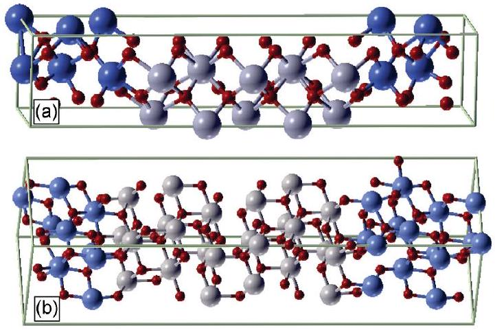
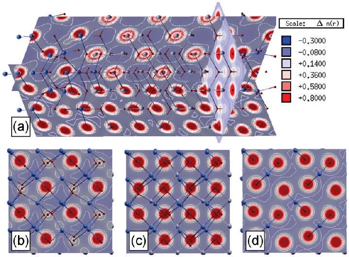
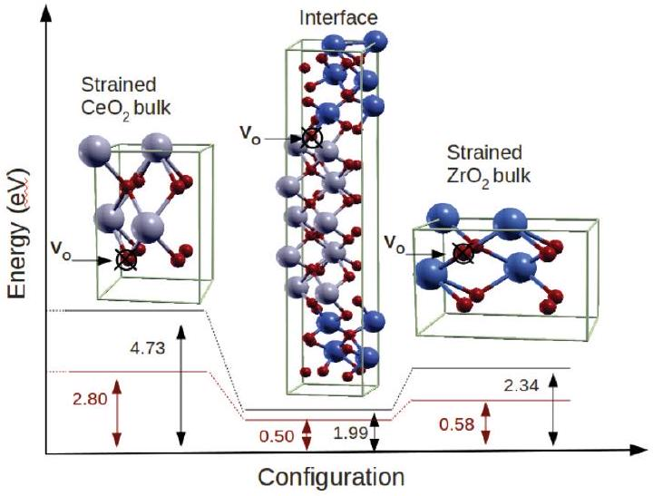
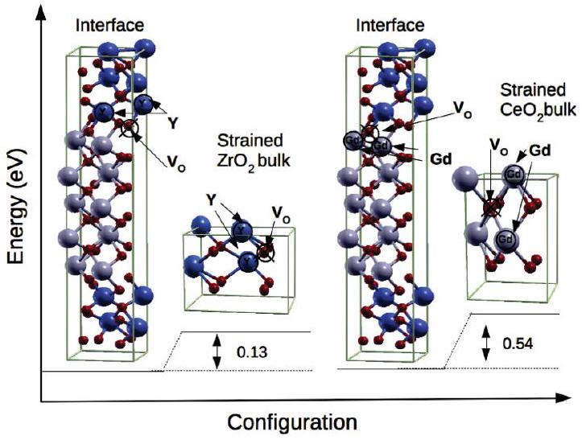
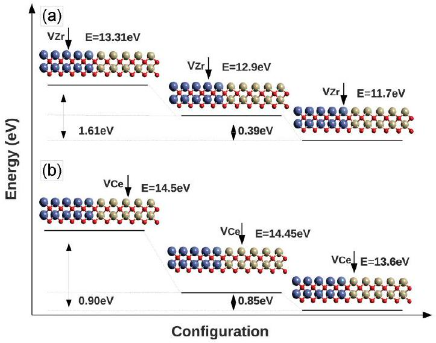

# Ab initio investigation of defect formation at $\mathbf{Z r O}_{\mathbf{2}}-\mathbf{C e O}_{\mathbf{2}}$ interfaces 

Marco Fronzi, ${ }^{1, *}$ Silvia Cereda, ${ }^{2}$ Yoshitaka Tateyama, ${ }^{1}$ Alessandro De Vita, ${ }^{2}$ and Enrico Traversa ${ }^{3, \dagger}$ ${ }^{1}$ International Center for Materials Nanoarchitectonics (MANA), National Institute for Materials Science (NIMS), Tsukuba, Japan ${ }^{2}$ Physics Department, King's College London, Strand, London, United Kingdom ${ }^{3}$ International Research Center for Renewable Energy, State Key Laboratory of Multiphase Flow in Power Engineering, Xian Jiaotong University, Xian, Shaanxi, China (Received 5 June 2012; revised manuscript received 16 July 2012; published 3 August 2012)

#### Abstract

The structural and electronic properties of low index (100) and (111) $\mathrm{ZrO}_{2}-\mathrm{CeO}_{2}$ interfaces are analyzed on the basis of density functional theory calculations. The formation energy and relative stability of substitutional defects, oxygen vacancies, and vacancy-dopant complexes are investigated for the (100) orientation. By comparing these results with the ones obtained in bulk structures, we provide a possible explanation for the higher experimental ionic conductivity measured at the interface.

DOI: 10.1103/PhysRevB.86.085407
PACS number(s): 68.35.Dv, 71.15.Mb

## I. INTRODUCTION

New electrolyte materials with high ion conductivity at intermediate to low temperatures are needed for reducing the cost and the widespread deployment of solid oxide fuel cell (SOFC) technology and for the development of miniaturized SOFC devices. ${ }^{1-4}$ Yttria-stabilized zirconia (YSZ) and doped cerium oxide are the most established electrolyte materials for SOFCs, since they show a significant thermally activated oxygen mobility when they crystallize in a fluorite structure. ${ }^{5,6}$ Another way to reduce the operating temperature is the fabrication of electrolytes in film form to reduce their ohmic resistance. Recently, the fabrication and characterization of highly conductive ionic thin-film electrolytes has taken a new direction, due to the observed enhancement of ionic conductivity in ionic hetero-structures. ${ }^{7,8}$ Major interest was raised by the huge increase of ionic conductivity reported by Garcia-Barriocanal et al. ${ }^{9}$ for a multilayered heterojunction made of $\mathrm{ZrO}_{2}-\mathrm{Y}_{2} \mathrm{O}_{3} / \mathrm{SrTiO}_{3}$. However, the nature of charge carriers has been questioned and hypothesized to be electronic rather than ionic. ${ }^{10}$ A significant enhancement of the ionic conductivity through the interface plane up to 2 orders of magnitude with respect to bulk materials has been reported for a junction formed by thin layers of YSZ and samarium-doped ceria, deposited on a MgO substrate with a buffer layer of $\mathrm{SrTiO}_{3}$ (STO). ${ }^{11}$ Furthermore, the influence of interfaces on the ionic conductivity of heterostructures made of cubic-stabilized zirconia and different insulating oxides has been investigated by Janek's group with the aim of correlating the interfacial ion conductivity in the multilayer with the interface microstructural properties. ${ }^{12,13}$ An enhancement of 2 orders of magnitude in the ionic conductivity was obtained for samples with incoherent interfaces, while coupling oxide materials with the same crystal structure but slightly different lattice parameters forming semicoherent interfaces led to a slight conductivity increase and reduction for tensile and compressive strains, respectively. From this scenario, it is clear that the increased conductivity has to be ascribed to the peculiar chemical or physical properties of the interfaces. Since the ion mobility in these lattice structures involves the presence of a number of intrinsic defects (oxygen vacancies), it is mandatory to investigate any physical or chemical process able to affect their concentration. Above all, the strain at the interface, induced by the lattice mismatch between the two materials, seems to play a key role in triggering the formation of a preferential migration channel for the ionic transport and in affecting the defect formation energy, as also pointed out by Botez et al. ${ }^{14}$

In this work we use ab initio calculations within the density functional theory (DFT) framework to investigate the structure of two $\mathrm{CeO}_{2}-\mathrm{ZrO}_{2}$ interfaces and how they affect the formation energies of intrinsic and extrinsic defects. In particular, we analyze $\mathrm{ZrO}_{2}-\mathrm{CeO}_{2}$ junctions built along the (100) direction, as in the experiments by Sanna et al., ${ }^{11}$ and along the (111) direction.

## II. METHODOLOGY

We used the plane-wave ultrasoft pseudopotentials method implemented in the quantum ESPRESSO package distribution, ${ }^{15}$ and a Perdew-Burke-Ernzerhof functional within the generalized gradient approximation to describe electronic exchange and correlation. ${ }^{16}$ We considered the electronic configurations $6 s^{2} 5 d^{1} 5 p^{6} 5 s^{2} 4 f^{1}$ and $5 s^{2} 4 d^{2} 4 p^{6} 4 s^{2}$ for the valence electrons of Ce and Zr, respectively, and $2 p^{4} 2 s^{2}$ for the oxygen atoms. The cutoff energy for the wave function was set to 24.0 Ry and for the charge density it was set to 200.0 Ry. The interface was built as an AB stacking along the $z$ direction, up to a total of 20 atomic layers for the (100) interface and 36 for the (111) one. We used a $\mathrm{ZrO}_{2}-\mathrm{CeO}_{2}(2 \times 2)$ surface cell, repeated in the $x y$ plane with periodic boundary conditions. The Brillouin-zone (BZ) integration was carried out on a $(2 \times 2 \times 1) k$-point mesh. Our computational framework has been extensively validated by several works available in the literature (see, e.g., Refs. 17-19).

## III. RESULTS

The growth of a multilayered film and the local crystal structure of the interface are determined by the relative thermodynamic stability of the various possible surfaces. In order to have insight into the interface structure, we give a brief description of the surface energy of the low index surfaces for $\mathrm{CeO}_{2}$ and $\mathrm{ZrO}_{2}$. In previous work, some of the present authors analyzed the thermodynamic stability of $\mathrm{CeO}_{2}$ surfaces, concluding that, under oxygen-rich conditions, the (111) surface is stabler than the (100) and (110) surfaces. ${ }^{20}$

TABLE I. Surface energies (in $\mathrm{eV} / \AA^{2}$ ) of $\mathrm{CeO}_{2}$ and $\mathrm{ZrO}_{2}$ for the (111) and (100) orientations under rich oxygen conditions calculated as described in Ref. 20.
| Config. | 100 | 111 |
| :--- | :--- | :--- |
| $\mathrm{ZrO}_{2}(\mathrm{eV})^{\mathrm{a}}$ | 0.189 | 0.073 |
| $\mathrm{CeO}_{2}(\mathrm{eV})^{\mathrm{b}}$ | 0.230 | 0.037 |

${ }^{\mathrm{a}}$ This work.
${ }^{\mathrm{b}}$ Ref. [ 20].

After calculating the surface energies of the (111) and the (100) surfaces for $\mathrm{ZrO}_{2}$ under oxygen-rich conditions (see Table I), the Wulff construction suggests that $\mathrm{ZrO}_{2}$ crystal nanoparticles host a mixture of these two surfaces. From this analysis we can assume that a growing film would preferentially have a (111) orientation for $\mathrm{CeO}_{2}$ and a mixture of (111) and (100) orientations for the $\mathrm{ZrO}_{2}$ phase. This might explain the experimental results of Pergolesi et al. ${ }^{21}$ which reveal different film growth modalities for the two compounds. In particular, the reflection high-energy electron diffraction analysis suggests a cluster growth for $\mathrm{CeO}_{2}$ layers and a "planar" (less clustered) growth for $\mathrm{ZrO}_{2} .{ }^{21}$

Following this analysis on the surface stability and assuming a perfect fluorite structure at the interfacial plane (as suggested by Refs. 22 and 23), we built model structures for the (100) and (111) $\mathrm{CeO}_{2}-\mathrm{ZrO}_{2}$ junctions. The optimized geometries for both systems are shown in Fig. 1. In the (100) interface the optimized lattice parameter of the surface cell is $5.34 \AA$, while the lattice parameter which would be readily obtained from the experimental room temperature Young modulus values of the two materials is $5.37 \AA .{ }^{24,25}$ Thus, the $\mathrm{ZrO}_{2}$ phase turns out to be expanded by ~3\% with respect to its equilibrium value ( $5.14 \AA$ according to our calculations), while the $\mathrm{CeO}_{2}$ is compressed by ~2\% with respect to its equilibrium value of $5.45 \AA$. In this interface structure the local distortion of both $\mathrm{CeO}_{2}$ and $\mathrm{ZrO}_{2}$ lattices is quite significant. The typical Ce-O distance for atoms at the junction ranges between 2.18 and $2.60 \AA$, to be compared with the $2.36 \AA$ value of the relaxed bulk. The $\mathrm{Zr}-\mathrm{O}$ distances range between 2.03 and $2.52 \AA$, to be compared with the $2.26 \AA$ value found in the relaxed structure. At the interface,

FIG. 1. (Color online) (a) Supercell of the (100) $\mathrm{ZrO}_{2}-\mathrm{CeO}_{2}$ interface. (b) Supercell of the (111) $\mathrm{ZrO}_{2}-\mathrm{CeO}_{2}$ interface. The large gray and blue spheres and the small red spheres represent Ce, Zr, and O atoms, respectively.

FIG. 2. (Color online) Charge density of the (100) $\mathrm{CeO}_{2}-\mathrm{ZrO}_{2}$ junction. The red areas indicate charge accumulation, while the blue areas indicate charge depletion. Panel (b) represents one of the two planes at the interface level where oxygen atoms lie. Panels (c) and (d) represent the planes where the oxygen atoms lie in the $\mathrm{CeO}_{2}$ and $\mathrm{ZrO}_{2}$ side of the junction, respectively.

the O-Ce-O and O-Zr-O angles are distorted to 118.3° and $133.3^{\circ}$, respectively, to be compared with the typical $109.5^{\circ}$ $\mathrm{O}-M-\mathrm{O}$ angle ( $M=\mathrm{Zr}$ and Ce$)$ of a perfect fluorite structure. For the (111) interface shown in Fig. 1(b) the lattice parameter is $5.33 \AA$. The $\mathrm{Ce}-\mathrm{O}$ bonds are between 2.26 and $2.37 \AA$, while the Zr-O distances assume values between 2.19 and $2.02 \AA$. The main difference between the two interfaces is related to the arrangements of the oxygen atoms. In particular, along the (100) interface plane, the planar alignment is broken and the four oxygen atoms in the $(2 \times 2)$ cell split into two different parallel planes. This distortion creates a positive charge region between adjacent oxygen atoms, as shown in Fig. 2, where the charge distribution of the oxygen layer is represented at three different positions along the (100) direction. The energy difference per $\mathrm{ZrO}_{2}-\mathrm{CeO}_{2}$ unit between the two interfaces is 0.13 eV, favoring the (111) orientation over the (100) one. Interestingly, even if the (111) interface is predicted here to be thermodynamically more stable than the (100) interface, from a technological point of view the (100) interface is much more relevant, being the preferential growth orientation triggered by the experimentally used substrates (STO buffered MgO single crystals). ${ }^{11}$

Starting from these junction structures, we investigated how the presence of a $\mathrm{ZrO}_{2} / \mathrm{CeO}_{2}$ interface affects the equilibrium of intrinsic (oxygen vacancies $\mathrm{V}_{\mathrm{O}}$ ) and extrinsic defects ( Gd and Y doping). First, we focused our attention on the possible effect of the epitaxial strain on the oxygen vacancy formation energy $\left(E_{\mathrm{V}_{\mathrm{O}}}\right)$ by comparing $E_{\mathrm{V}_{\mathrm{O}}}$ in relaxed $\mathrm{ZrO}_{2}$ and $\mathrm{CeO}_{2}$ bulk phases with their values in bulk structures tetragonally deformed to reproduce the interfacial strain. Since the charged state of the oxygen vacancy depends on the Fermi level energy (see Ref. 26), we considered both neutral and charged (+2) vacancies.

Due to the lattice mismatch, the two oxide phases preserve an in-plane strain (tensile for $\mathrm{ZrO}_{2}$ and compressive for $\mathrm{CeO}_{2}$ ) also at large distances from the junction level. At the same time a tetragonal deformation proportional to the Poisson ratio takes place along the direction perpendicular to the interface plane to partially preserve the volume of the original cubic fluorite

TABLE II. $E_{\mathrm{V}_{\mathrm{O}}}$ (in eV) for charged (neutral) vacancies in fully relaxed $\mathrm{CeO}_{2}$ and $\mathrm{ZrO}_{2}$ bulks and in epitaxially strained structures. $E_{\mathrm{V}_{\mathrm{O}}}$ is computed as described in Ref. 27 by $E_{\mathrm{V}_{\mathrm{O}}}\left(E_{\mathrm{F}}\right)=E_{\text {stoc }}^{\text {tot }}-$ $\left(E_{\mathrm{v}_{\mathrm{O}}^{\mathrm{t}}}^{\mathrm{tot}}+E_{\frac{1}{2} \mathrm{O}_{2}}\right)+q\left(E_{v}+E_{\mathrm{F}}\right)$, where $E_{v}$ is the chemical potential of electrons at the valence band maximum and $E_{F}$ is the Fermi energy. The values for charged vacancies are calculated by assuming $E_{\mathrm{F}}=0$.
| Structure | Relaxed bulk | Strained bulk |
| :--- | :--- | :--- |
| $\mathrm{ZrO}_{2}$ | 0.95 (4.23) | 0.58 (2.34) |
| $\mathrm{CeO}_{2}$ | 1.06 (3.62) | 2.80 (4.73) |

structure. As shown in Table II, our results reveal that the applied strain has an opposite effect on the formation energy in the two oxides, which depends on its sign. Namely, the compressive strain in the $\mathrm{CeO}_{2}$ phase increases the formation energy from 1.06 eV (charged vacancy) and 3.62 eV (neutral vacancy) in the fully relaxed bulk to 2.80 and 4.73 eV for the charged and neutral vacancies, respectively, in the compressed structure. In $\mathrm{ZrO}_{2}$ the tensile strain decreases $E_{\mathrm{V}_{\mathrm{O}}}$ from 0.95 eV (charged vacancy) and 4.23 eV (neutral vacancy) to 0.58 and 2.34 eV , respectively. The lowering of $E_{\mathrm{V}_{\mathrm{O}}}$ due to the presence of tensile strain is in agreement with the results reported in the literature for other transition-metal oxides (see, e.g., Ref. 28), and it seems to be related with a weakening of the metal-oxygens bond in the vicinity of the vacancy. This result suggests that the strain may play a key role in affecting the vacancy formation energy, strongly favoring the vacancy nucleation in the $\mathrm{ZrO}_{2}$ phase. The values of $E_{\mathrm{V}_{\mathrm{O}}}$ in strained bulk structures can be used to model vacancy formation in the regions of a junction which are sufficiently far from the interface plane. For this reason, in Fig. 3 we compared the formation energies for a vacancy located at the interface layer with the ones obtained in the strained bulk phases. We find that $E_{\mathrm{V}_{\mathrm{O}}}$ is ~0.08 eV (charged vacancy) and 0.4 eV (neutral vacancy) lower at the interface than in the $\mathrm{ZrO}_{2}$ phase. In the $\mathrm{CeO}_{2}$ interface vacancy formation is as much as 2.30 eV (charged vacancy) and 2.7 eV (neutral vacancy) lower than

FIG. 3. (Color online) Schematic representation of $E_{\mathrm{V}_{\mathrm{O}}}$ (in eV) at the interface and in strained $\mathrm{CeO}_{2}$ and $\mathrm{ZrO}_{2}$ bulk structures. The values for neutral vacancies are in black, and the ones for positive charged vacancies are in red. The positions of $\mathrm{V}_{\mathrm{O}}$ are indicated by arrows. The cells shown in the picture represent only a small portion of the real simulation cell used for the calculation.

TABLE III. Defect formation energy (in eV) in $\mathrm{CeO}_{2}-\mathrm{ZrO}_{2}$ (100) interface obtained by substituting Ce and Zr atoms with Gd and Y, respectively. The energy has been calculated by placing the dopant atoms at different distances from the interface (expressed in number of layers).
| Substitution | 1st layer | 2nd layer | 3rd laye |
| :--- | :--- | :--- | :--- |
| Y in $\mathrm{ZrO}_{2}$ | 1.22 | 1.34 | 1.42 |
| Gd in $\mathrm{CeO}_{2}$ | 0.47 | 0.56 | 1.07 |

that in the strained bulk regions far from the interfacial plane. These results suggest that the tetragonal strain associated with junction formation could generally stabilize oxygen vacancies on the interface plane.

To analyze the role played by dopant atomic species, we next introduced point defects in the (100) interface simulation slab by substituting a Zr (Ce) atom with a Y (Gd) atom in atomic layers located at different distances from the interface plane moving into the $\mathrm{ZrO}_{2}\left(\mathrm{CeO}_{2}\right)$ phase. Our results indicate that the dopant atoms again prefer to be located at the interface, with an energy gain of at least ~0.6 eV for Gd-doped $\mathrm{CeO}_{2}$ and ~0.2 eV for Y-doped $\mathrm{ZrO}_{2}$ (see Table III). This trend once more suggests a higher concentration of defects preferentially located at the interface plane of the junction than in bulklike regions.

We finally investigated what happens when intrinsic and extrinsic defects are combined to form an "oxygen-vacancy-doping-atoms" complex, by comparing the complex formation energy at the interface and in bulk phases. In particular, by adopting an overall charge neutrality assumption, we considered model systems in which two dopant atoms (Y in $\mathrm{ZrO}_{2}$ and Gd in $\mathrm{CeO}_{2}$ ) are associated with a single oxygen vacancy. The chosen vacancy-doping complex geometry corresponds to the most stable oxygen vacancy position in the vicinity of the doping atom we found among several possible configurations (see Fig. 4). Our results reveal that in the $\mathrm{CeO}_{2}$ phase, the

FIG. 4. (Color online) Schematic representation of the defect formation energy difference (in eV) for the $\mathrm{V}_{\mathrm{O}}-2 \mathrm{Y}$ complex in $\mathrm{ZrO}_{2}$ and for the $\mathrm{V}_{\mathrm{O}}-2 \mathrm{Gd}$ complex in $\mathrm{CeO}_{2}$. The $\mathrm{V}_{\mathrm{O}}, \mathrm{Y}$, and Gd positions are indicated by arrows.

interface $\mathrm{V}_{\mathrm{O}}-2 \mathrm{Gd}$ complex is significantly more stable (by ~0.54 eV) than in the strained bulk. A somewhat smaller effect in the same direction is predicted also for the $\mathrm{V}_{\mathrm{O}}-2 \mathrm{Y}$ complex in $\mathrm{ZrO}_{2}$, where the positive energy difference (~0.13 eV) still suggests a preferential location of the complex at the interfacial plane.

By combining these results with the charge neutrality requirement, it seems reasonable to conclude that a higher concentration of oxygen vacancies may be expected at the interface plane and its immediate vicinity in the experimental (100) interfaces. In turn, a higher oxygen vacancy concentration in the interfacial (100) plane, combined with the recent results of Ref. 29 which show how a strain similar to the one present at our interfaces (3\%) has a role in reducing the activation barriers for the oxygen vacancies' diffision, might contribute to enhance the ionic conductivity at $\mathrm{ZrO}_{2}-\mathrm{CeO}_{2}$ interfaces, as experimentally observed.

## IV. SUMMARY AND CONCLUSIONS

In summary, we have analyzed the geometry and energy of $\mathrm{ZrO}_{2}-\mathrm{CeO}_{2}$ (100) and (111) interfaces. We calculated the oxygen vacancy formation energy as a function of the distance from the interface, which revealed lowering of the energies at the interface with respect to the strained bulk structures. Further comparison of the energy of substitutional atoms in the region close to the interface and in bulklike areas suggests a significantly higher concentration of doping atoms and dopant-vacancy complexes at the interface. Taken together these results support the hypothesis that $\mathrm{ZrO}_{2} / \mathrm{CeO}_{2}$ interfaces enhance the concentration of defects, which can help rationalize the recently observed high conductivity in doped $\mathrm{ZrO}_{2}-\mathrm{CeO}_{2}$ interfaces.

## ACKNOWLEDGMENTS

M.F. thanks the Japanese Society for the Promotion of Science (JSPS) for support and acknowledges the support of the supercomputer center (T2K-Tsukuba and NIMS). This work was partly supported by the World Premier International (WPI) Research Center Initiative of MEXT, Japan. S.C. and A.D.V. acknowledge funding from the EU-FP7-NMP under Grant No. ADGLASS.

## APPENDIX

We performed some further test calculations on Zr and Ce isolated vacancies. In particular we computed the stability of $\mathrm{V}_{\mathrm{Zr}}$ and $\mathrm{V}_{\mathrm{Ce}}$ as a function of their distance from the interface layer (shown in Fig. 5). Our results indicate that both vacancies have a preferential position close to the interface. However, these results do not alter our general conclusions, as hypothesizing any presence of these very rare defects would imply a slightly higher density of oxygen vacancies at the interface, necessary to achieve local charge neutrality.

FIG. 5. (Color online) Schematic representation of $\mathrm{V}_{\mathrm{Zr}}$ and $\mathrm{V}_{\mathrm{Ce}}$ formation energies. Both relative and absolute values of formation energies (in eV) are indicated. The energy has been calculated by placing the vacancies at different distances (in number of layers) from the interface. The positions of the vacancies, relative to the interface, are indicated by arrows.

[^0]${ }^{18}$ M. Fronzi, S. Piccinin, B. Delley, E. Traversa, and C. Stampfl, PhysChemChemPhys 11, 9188 (2009).
${ }^{19}$ R. Wang, S. Wang, X. Wu1, M. Lan, and T. Song, Phys. Scr. 85, 035705 (2012).
${ }^{20}$ M. Fronzi, A. Soon, B. Delley, E. Traversa, and C. Stampfl, J. Chem. Phys. 131, 104701 (2009).
${ }^{21}$ D. Pergolesi, A. Tebano, E. Fabbri, S. Licoccia, G. Balestrino, and E. Traversa, ECS Trans. 35(1), 1125 (2011).
${ }^{22}$ L. Mazerolles, D. Michel, and M. J. Hÿtch, J. Eur. Ceram. Soc. 25, 1389 (2005).
${ }^{23}$ R. J. Gaboriaud, R. Boisson, and J. Grilhe, J. Phys. C: Solid State Phys. 8, 3499 (1975).
${ }^{24}$ E. Y. Fogaing, Y. Lorgouilloux, M. Huger, and C. P. Gault, J. Mater. Sci. 41, 7663 (2006).
${ }^{25}$ M. T. Jahromi and M. J. Tan, J. Achiev. Mater. Manuf. Eng. 4, 130 (2009).
${ }^{26}$ P. J. Shen, S. P. Jiang, K. P. Ong, W. Z. Ding, P. Mao, X. G. Lu, C. H. Li, and P. Wu, J. Alloys Compd. 506, 898 (2010).
${ }^{27}$ Y. Iwazaki, T. Suzuki, and S. Tsuneyuki, J. Appl. Phys. 108, 083705 (2010).
${ }^{28}$ A. Kushima, S. Yip, and B. Yildiz, Phys. Rev. B 82, 115435 (2010).
${ }^{29}$ A. Kushima and B. Yildz, J. Mater. Chem. 20, 4809 (2010).

[^0]:    *Corresponding author: marco.fronzi@gmail.com
    ${ }^{\dagger}$ Corresponding author: traversa.enrico@gmail.com
    ${ }^{1}$ E. D. Wachsman and K. T. Lee, Science 334, 935 (2011).
    ${ }^{2}$ D. Pergolesi, E. Fabbri, S. Sanna, A. D'Epifanio, E. Di Bartolomeo, A. Tebano, G. Balestrino, S. Licoccia, and E. Traversa, Nat. Mater. 9, 846 (2008).
    ${ }^{3}$ M. Tsuchiya, B. K. Lai, and S. Ramanathan, Nat. Nanotechnol. 6, 282 (2011).
    ${ }^{4}$ E. Fabbri, L. Bi, D. Pergolesi, and E. Traversa, Adv. Mater. 24, 195 (2012).
    ${ }^{5}$ S. P. S. Badwal, Solid State Ionics 52, 23 (1992).
    ${ }^{6}$ V. Esposito and E. Traversa, J. Am. Ceram. Soc. 91, 1037 (2008).
    ${ }^{7}$ X. Guo and J. Maier, Adv. Mater. 21, 2629 (2009).
    ${ }^{8}$ E. Fabbri, D. Pergolesi, and E. Traversa, Sci. Technol. Adv. Mater. 11, 054503 (2010).
    ${ }^{9}$ J. Garcia-Barriocanal, A. Rivera-Calzada, M. Varela, Z. Sefrioui, E. Iborra, C. Leon, S. J. Pennycook, and J. Santamaria, Science 321, 676 (2008).
    ${ }^{10}$ A. Cavallaro, M. Burriel, J. Roqueta, A. Apostolidis, A. Bernardi, A. Tarancòn, R. Srinivasan, S. N. Cook, H. L. Fraser, J. A. Kilner et al., Solid State Ionics 181, 592 (2010).
    ${ }^{11}$ S. Sanna, V. Esposito, A. Tebano, S. Licoccia, E. Traversa, and G. Balestrino, Small 6, 1863 (2010).
    ${ }^{12}$ A. Peters, C. Korte, D. Hesse, N. Zaharov, and J. Janek, Solid State Ionics 178, 67 (2007).
    ${ }^{13}$ N. Schichtel, C. Korte, D. Hesse, and J. Janek, PhysChemChemPhys 11, 3043 (2009).
    ${ }^{14}$ C. E. Botez, P. F. Miceli, and P. W. Stephens, Phys. Rev. B 66, 195413 (2002).
    ${ }^{15}$ P. Giannozzi, S. Baroni, N. Bonini, M. Calandra, R. Car, C. Cavazzoni, D. Ceresoli, G. L. Chiarotti, M. Cococcioni, and I. Dabo, J. Phys.: Condens. Matter 21, 395502 (2009).
    ${ }^{16}$ J. P. Perdew, K. Burke, and M. Ernzerhof, Phys. Rev. Lett. 77, 3865 (1996).
    ${ }^{17}$ F. Pietrucci, M. Bernasconi, A. Laio, and M. Parrinello, Phys. Rev. B 78, 094301 (2008).

