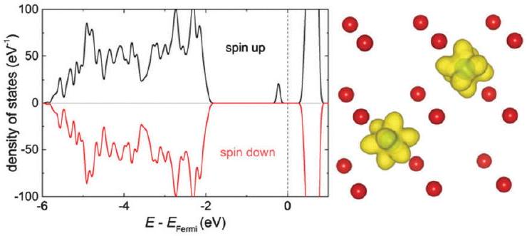
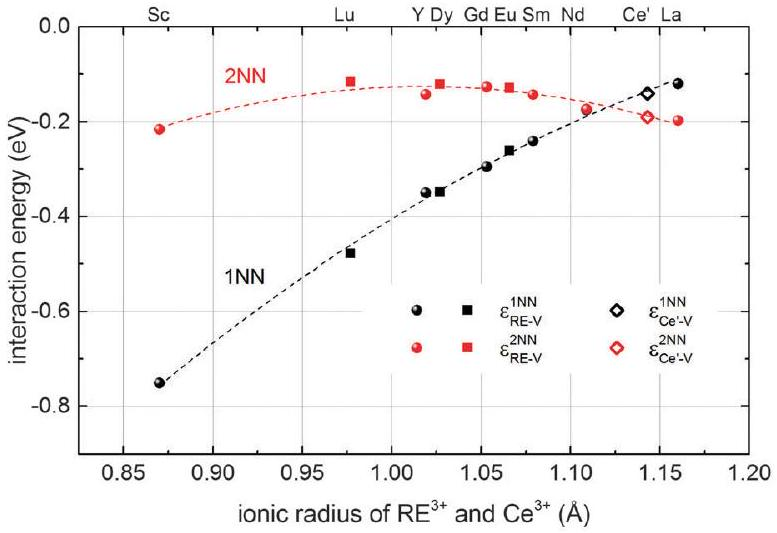
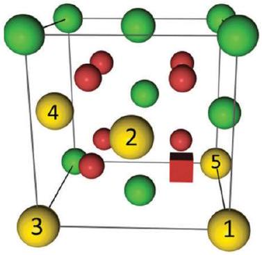
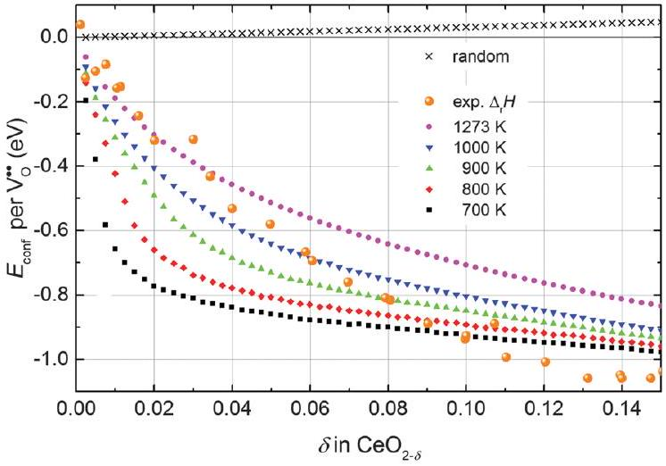
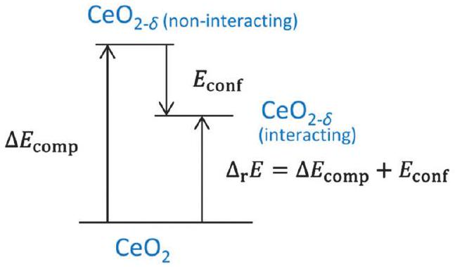
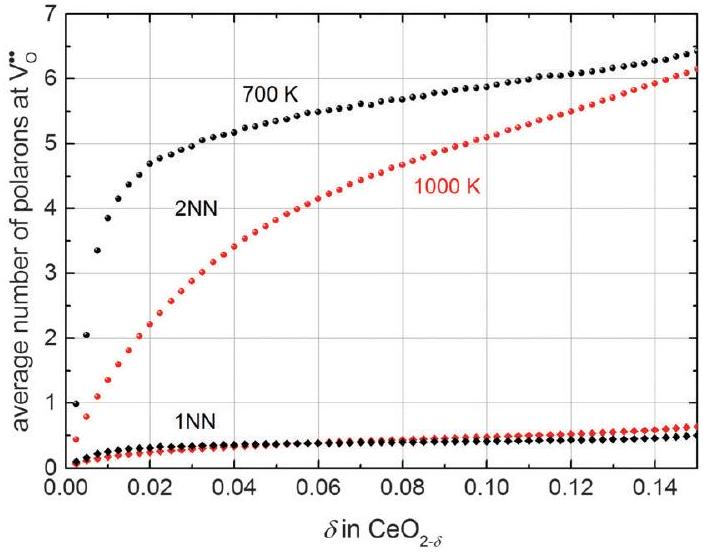
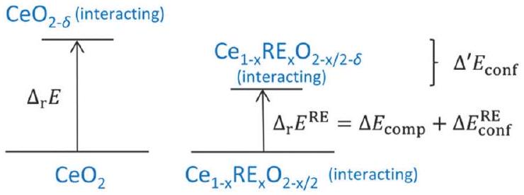
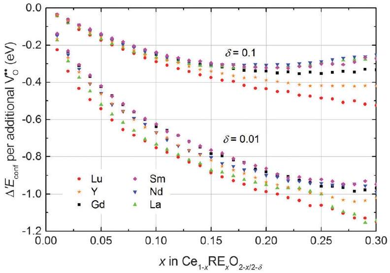
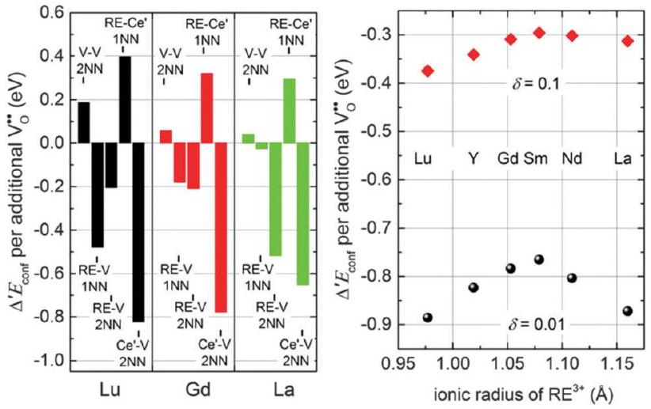
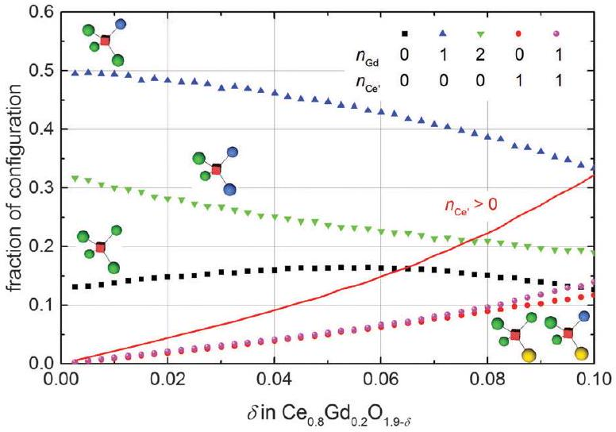

CrossMark
←click for updates

Cite this: Phys. Chem. Chem. Phys., 2016, 18, 3804

Received 7th December 2015, Accepted 7th January 2016

DOI: 10.1039/c5cp07537h
www.rsc.org/pccp

# Association of defects in doped non-stoichiometric ceria from first principles 

Steffen Grieshammer, ${ }^{\star \text { abcd }}$ Masanobu Nakayama ${ }^{\mathrm{e}}$ and Manfred Martin ${ }^{\text {abcd }}$

#### Abstract

We investigate the interaction and distribution of defects in doped non-stoichometric ceria $\mathrm{Ce}_{1-x} \mathrm{RE}_{x} \mathrm{O}_{2-x / 2-\delta}$ (with RE = Lu, Y, Gd, Sm, Nd, and La) by combining DFT+U calculations and Monte Carlo simulations. The concentrated solution of defects in ceria is described by the pair interactions of dopant ions, oxygen vacancies, and small polarons. The calculated interaction energies for polarons and oxygen vacancies are in agreement with experimental results and previously reported calculations. Simulations reveal that in thermodynamic equilibrium the configurational energy decreases with increasing non-stoichiometry as well as increasing dopant fraction similar to the observed behavior of the enthalpy of reduction in experiments. This effect is attributed to the attractive interaction of oxygen vacancies with polarons and dopant ions.

## I. Introduction

The production of clean and sustainable energy has gained increasing interest in the last decades due to issues of air pollution, climate change, and the depletion of natural resources. The growing utilization of energy from renewable sources calls for new efficient energy conversion options and storage capacities. These capacities can be provided by high temperature electrochemical devices like solid oxide fuel cells (SOFC), ${ }^{1}$ solid oxide electrolyser cells (SOEC), ${ }^{2}$ and recently introduced rechargeable oxygen batteries (ROB). ${ }^{3}$ The efficiency and commercial applicability of these devices strongly depends on the ionic conductivity of the used solid oxide electrolyte. Cerium oxide (ceria) doped with rare-earth oxide is one of the most promising materials for this application as it exhibits high oxygen ion conductivity at intermediate temperatures (773-973 K). ${ }^{1}$ The high ionic conductivity is caused by oxygen vacancies which are formed during the doping process: †

$$
\mathrm{RE}_{2} \mathrm{O}_{3} \xrightarrow{\mathrm{CeO}_{2}} 2 \mathrm{RE}_{\mathrm{Ce}}^{\prime}+\mathrm{V}_{\mathrm{O}}^{\bullet \bullet}+3 \mathrm{O}_{\mathrm{O}}^{\times}
$$

In addition, ceria is a well-known material in industrial catalysis and automotive exhaust purification where its high oxygen storage capacity is utilized, which exists due to easy reduction of $\mathrm{Ce}^{4+}$ ions

[^0]to $\mathrm{Ce}^{3+}$ ions. ${ }^{4,5}$ Under reducing conditions, ceria releases oxygen leading to the formation of oxygen vacancies and excess electrons. It is commonly accepted that the excess electrons localize in the f-orbitals of cerium ions forming small polarons: ${ }^{6,7}$
$$
2 \mathrm{Ce}_{\mathrm{Ce}}^{\times}+\mathrm{O}_{\mathrm{O}}^{\times} \rightleftharpoons 2 \mathrm{Ce}_{\mathrm{Ce}}^{\prime}+\frac{1}{2} \mathrm{O}_{2(\mathrm{~g})}+\mathrm{V}_{\mathrm{O}}^{\bullet \bullet}
$$
The formation of polarons enables electronic conduction in ceria by a polaron hopping process making the material a mixed ionicelectronic conductor. ${ }^{7}$ For oxygen storage applications the high reducibility of ceria is advantageous and the resulting mixed conduction makes ceria also suitable material for electrodes in SOFCs, SOECs, and ROBs. On the contrary, for an electrolyte the reduction of ceria leads to a leakage current, due to electronic conductivity, which lowers the efficiency of these devices.

Against this background, doped non-stoichiometric ceria is of special interest as doping and reduction have mutual effects: Experimental studies demonstrated that doping with rareearth oxides enhances the reducibility of ceria. ${ }^{8-14}$ In addition, Balducci et al. ${ }^{15}$ applied empirical pair potentials to simulate the impact of doping on the energy of reduction for ceria with different aliovalent dopants. For a homogeneous distribution of defects they reported a distinct decrease of the energy of reduction with increasing dopant fraction. The authors attributed this effect to the existence of oxygen vacancies introduced by doping, which help to relieve the elastic strain associated with the formation of large $\mathrm{Ce}^{3+}$ ions. Additionally, they pointed out the lattice expansion in the case of large dopants, which might also facilitate the formation of polarons.

Furthermore, Nakayama et al. ${ }^{16}$ suggested a concerted migration mechanism of polarons and oxygen vacancies leading to a decrease of the oxygen migration barrier by up to 0.17 eV according to density functional theory (DFT+U) calculations.

In our previous paper we could show, by combining DFT+U and Monte Carlo methods, that the interaction between oxygen vacancies and dopant cations leads to a non-random defect distribution, which strongly influences the ionic conductivity. ${ }^{17}$ In the present study we simulate the defect distribution in doped non-stoichiometric bulk ceria containing oxygen vacancies, dopant cations, and polarons and estimate its impact on the energy of reduction. We emphasize here that we do not determine explicit values for the energy of reduction but its change due to the interaction of various defects in a concentrated solid solution. In addition, we consider no further point defects, like cerium vacancies, as their concentrations were predicted to be comparatively small. ${ }^{18}$

The paper is structured as follows: In Section II we introduce the computational setup concerning DFT calculations and Monte Carlo simulations. In Section III and IV we present the results of our DFT calculations and the subsequent Monte Carlo simulations, respectively. In Section V we conclude with a short summary.

## II. Computational methods

DFT calculations
All calculations were performed by means of DFT+U within the generalized gradient approximation (GGA) according to Perdew, Burke and Ernzerhof ${ }^{19}$ (PBE) and the projector augmented wave ${ }^{20}$ (PAW) method as implemented in the Vienna Ab initio Simulation Package (VASP). ${ }^{21,22}$ The wavefunctions were expanded in a set of plane waves with an energy cut-off of 500 eV . For the 2 × 2 × 2 supercells of the ceria fluorite structure a $3 \times 3 \times 3$ Monkhorst-Pack ${ }^{23} k$-point mesh was applied. The convergence parameters for electronic and ionic relaxation were set to $10^{-4} \mathrm{eV}$ and $0.01 \mathrm{eV} \text{Å}^{-1}$, respectively. The $2 \mathrm{~s}^{2} 2 \mathrm{p}^{4}$ electrons of the oxygen atoms and the $5 \mathrm{~s}^{2} 5 \mathrm{p}^{6} 6 \mathrm{~s}^{2} 5 \mathrm{~d}^{1} 4 \mathrm{f}^{1}$ electrons of the cerium atoms were treated as valence electrons. A Hubbard $U$-parameter was introduced to account for the localization of strongly correlated electrons on cerium ions by the simplified rotationally invariant approach. ${ }^{24}$ A value of 5 eV for the 4f-orbitals of cerium was chosen according to earlier studies. ${ }^{17,25-29}$ In case of the dopants no $U$-parameter was necessary since the f-electrons were kept frozen in the core. ${ }^{28,29}$ The lattice parameter of the unit cell was fixed at $5.49 \text{Å}$ according to our previous calculations. ${ }^{17}$ For all defective cells the total number of electrons in the cell was adapted to reproduce the actual charge state of the different defects, e.g. $\left(\mathrm{Ce}_{32} \mathrm{O}_{63}\right)^{+}$for a $2 \times 2 \times 2$ supercell containing an oxygen vacancy $\left(\mathrm{V}_{\mathrm{O}}^{\bullet\bullet}\right)$ and a polaron $\left(\mathrm{Ce}_{\mathrm{Ce}}^{\prime}\right)$.

To create a polaron at a specific cerium site an initial magnetic moment was attributed to the respective cerium ion while it remained zero for all other ions. In addition, the $\mathrm{Ce}_{\mathrm{Ce}}^{\prime}-\mathrm{O}_{\mathrm{O}}^{\times}$distances were elongated while the $\mathrm{Ce}_{\mathrm{Ce}}^{\prime}-\mathrm{Ce}_{\mathrm{Ce}}^{\times}$ distances were shortened in the initial structure by about $0.11 \text{Å}$ and $0.05 \text{Å}$, respectively. This procedure guaranteed localization of the electron at the specific site and the ionic positions were relaxed afterwards.

Though the $U$-parameter is mandatory to achieve a localization of the electrons, ${ }^{16,30}$ its introduction leads to an arbitrary occupation of the f-orbitals which does not necessarily reflect the true electronic ground state. Consequently, standard DFT+U calculations for polarons might lead to considerable errors in the prediction of the ground state energy. ${ }^{31,32}$ An heuristic approach for the search of the true electronic ground state was introduced by Meredig et al. ${ }^{31}$ denoted as the 'ramping' method. In this study we adapted a simplified version of this method for every structure, based on the procedure by Crocombette et al.: ${ }^{33}$

First we performed an ionic relaxation with the full $U$-parameter (5 eV) to achieve a reasonable guess of the relaxed structure. Subsequently the ramping method was applied without further ionic relaxation starting with $U=0 \mathrm{eV}$ and increasing the value to $U=5 \mathrm{eV}$ stepwise by 0.25 eV . Thereby every self-consistent field cycle was started from the charge density and the set of wavefunctions of the previous cycle. Finally, the structure was relaxed once more with the full $U$-parameter starting from the latest charge density and set of wavefunctions.

The interaction energies were determined as described before ${ }^{17}$ from the energy difference of two cells, whereat one cell contained two defects in neighbouring positions, while the other cell contained the two defects in separated positions. By performing calculations for different sized supercells, the results were extrapolated to infinite dilution to correct finite size errors. ‡

## Metropolis Monte Carlo simulations

The defect distribution in the bulk of doped and undoped nonstoichiometric ceria was simulated according to the Metropolis Monte Carlo algorithm ${ }^{34}$ as it was successfully applied in our previous study for doped stoichiometric ceria. ${ }^{17}$ During the Monte Carlo simulation distinct lattice elements, i.e. ion or vacancy, within cation- or anion-sublattice are selected and permuted with a probability of $p=\min \left[\mathrm{e}^{-\frac{\Delta E}{k_{\mathrm{B}} \cdot T}}, 1\right]$, where $\Delta E$ is the change in energy due to the permutation. This step is repeated until the cation- and anion-sublattice are equilibrated and the energy averaged over 3000 consecutive steps does not change anymore.

In ceria the diffusivity of cations is orders of magnitude lower than the diffusivity of anions or polarons. Consequently, the thermodynamic equilibrium distribution for the dopants cannot be expected at intermediate temperatures. Therefore, a two-step simulation was performed to reproduce the experimental fabrication process, consisting of sintering at high temperature ( $>1500 \mathrm{~K}$ ) and subsequent cooling, in a generalized way:
(1) A stoichiometric ceria lattice with dopant ions and oxygen vacancies, according to eqn (1), is randomly generated; corresponding to doped ceria under strongly oxidizing conditions, i.e. the equilibrium in eqn (2) is completely on the left-hand side. The cation and anion distributions are equilibrated at high temperature ( $T_{1}=1500 \mathrm{~K}$ ) assuming that all defects are mobile

[^1]above this temperature which is roughly 2/3 of the melting temperature.
(2) The temperature is decreased to the final temperature $T_{2}$, which is in the range of the typical operation temperatures of a SOFC. Polarons and additional oxygen vacancies, corresponding to eqn (2) under reducing conditions, are introduced into the lattice. Subsequently, the distribution of polarons and all oxygen vacancies is equilibrated whereas the dopant distribution is kept fixed since the cation diffusion is slow at $T_{2}$. Nevertheless, interactions of rare-earth ions with other defects are still taken into account.

A pair interaction model was applied to calculate the change of energy ( $\Delta E$ ) in every Monte Carlo step employing the interaction energies obtained from DFT calculations. Assuming that the total energy of the crystal is the sum of pair interactions, it can be rewritten as:

$$
E=E_{\text {comp }}+E_{\text {conf }}=E_{\text {comp }}+\sum_{d, i, j \leq i} N_{i j}^{d} \varepsilon_{i j}^{d}
$$

Here, $E_{\text {comp }}$ is the energy of a lattice with non-interacting defects and thus this part depends only on the composition of the lattice. $E_{\text {conf }}$ is the configurational energy that depends on the distribution of the defects where $N_{i j}^{d}$ is the number of pair interactions of defects of type $i$ and $j$ in distance $d$ and $\varepsilon_{i j}^{d}$ is the corresponding interaction energy. Thus, the energy change $\Delta E$ in the Monte Carlo steps results from the difference of $E_{\text {conf }}$ before and after the permutation. The configurational energy obtained after the equilibration process corresponds to the energy difference between a system without defect interaction and a system with defect interaction in thermodynamic equilibrium. In particular, for doped non-stoichiometric ceria $E_{\text {conf }}$ is the change of the energy of reduction when shifting from non-interacting defects (oxygen vacancies, dopant ions, and polarons) to interacting defects.

In undoped non-stoichiometric ceria the configurational energy depends on three types of pair interactions: oxygen vacancy interaction (V-V), polaron-vacancy interaction $\left(\mathrm{Ce}^{\prime}-\mathrm{V}\right)$ and polaron interaction $\left(\mathrm{Ce}^{\prime}-\mathrm{Ce}^{\prime}\right)$. Three further types are introduced by doping: dopant-vacancy interaction (RE-V), dopant interaction (RE-RE) and dopant-polaron interaction (RE-Ce'). Interactions containing polarons are calculated in this study while all others are taken from our previous study. ${ }^{17}$ The interaction range was cut off at a distance of $5.5 \text{Å}$ as all interaction energies are small (<0.1 eV) beyond this distance. After equilibration of the lattice, using the Monte Carlo algorithm described above, properties like the configurational energy were averaged over $10^{6}$ Monte Carlo steps. Furthermore, each considered property was averaged over 100 independent simulations.

## III. DFT results

Interaction energies of $\mathrm{Ce}^{\prime}-\mathrm{Ce}^{\prime}$ and $\mathrm{RE}-\mathrm{Ce}^{\prime}(\mathrm{RE}=\mathrm{Y}, \mathrm{Gd}, \mathrm{Sm})$ were calculated for the nearest neighbour position (1NN) as farther interactions are negligible. An energy of 0.10 ± 0.01 eV was obtained for all interactions in agreement with the interaction energies of RE-RE pairs as reported in our previous study. ${ }^{17}$ After application of the ramping method every calculation

Fig. 1 Density of states for a pair of polarons in 1NN position calculated in a 2 × 2 × 2 supercell (left). The energy is given with respect to the Fermi energy. Charge density of f-electrons for the pair of polaron (right). Oxygen ions depicted in red, isosurfaces of constant charge density in yellow (created with VESTA ${ }^{35}$ ).

for the $\mathrm{Ce}^{\prime}-\mathrm{Ce}^{\prime}$ pair resulted in the ferromagnetic configuration with parallel spins (Fig. 1).

Interaction energies of $\mathrm{Ce}^{\prime}-\mathrm{V}$ pairs were calculated for the nearest neighbour and next nearest neighbour (2NN) position. For the 1NN position energies have already been reported in literature with values of -0.33 eV to -0.49 eV implying a strong attractive interaction. ${ }^{16,18}$ Indeed, calculation of the interaction energies in this study without ramping resulted in values of approximately -0.3 eV and -0.2 eV for the 1 NN and 2 NN position, respectively, indicating a preference of the 1NN position.

In contrast, application of the ramping method to all calculations yielded interaction energies of -0.14 eV for 1NN and -0.19 eV for 2NN. Consequently, the absolute value of the interaction energy in 1NN position without ramping is twice as large as the value with ramping. Furthermore, without ramping the 1NN position is clearly favourable compared to 2NN whereas after ramping 2NN is energetically preferred.

This result is in agreement with recent DFT+U calculations for the reduction of the bulk ${ }^{32}$ and the surface ${ }^{36}$ of ceria as well as the experimental observation of an ordering of the polarons in 2NN position of oxygen vacancies. ${ }^{37}$ It should be noted that in our study this result is only achieved including finite size correction.

The results obtained here for $\mathrm{Ce}^{\prime}-\mathrm{V}$ interactions fit nicely to the interpolated lines for RE-V interaction energies from our previous calculations ${ }^{17}$ concerning the dependence on the ionic radius of the RE ion as shown in Fig. 2. This result, along with the results for the $\mathrm{Ce}^{\prime}-\mathrm{Ce}^{\prime}$ and RE-Ce' interactions, reveals that polarons can be treated analogously to dopant ions concerning the interaction energies.

According to eqn (2) two polarons are generated for every oxygen vacancy to ensure charge neutrality. DFT+U calculations for various configurations of the neutral trimer $\left\{\mathrm{Ce}_{\mathrm{Ce}}^{\prime}, \mathrm{V}_{\mathrm{O}}^{\bullet \bullet}, \mathrm{Ce}_{\mathrm{Ce}}^{\prime}\right\}$ have been performed by Wang et al. ${ }^{32}$ applying the PBEsol functional and the ramping method. In their study a variation of 0.12 eV in the total energy depending on the position of the oxygen vacancy and the two polarons is reported and the lowest energy is found for a configuration with both polarons in 2NN position to the vacancy. Within the here applied pair interaction model there are five unique configurations for $\left\{\mathrm{Ce}_{\mathrm{Ce}}^{\prime}, \mathrm{V}_{\mathrm{O}}^{\bullet \bullet}, \mathrm{Ce}_{\mathrm{Ce}}^{\prime}\right\}$

Fig. 2 Interaction energies of a $\mathrm{Ce}^{\prime}-\mathrm{V}$ pair (diamonds) and of RE-V pairs (filled symbols) in ceria in 1NN (black) and 2NN (red) position depending on the ionic radius of the cation. ${ }^{38}$ RE-V interaction energies are taken from literature ${ }^{17}$ (spheres) or were calculated accordingly in this study (squares). The errors of the extrapolation to infinite dilution are within the size of the symbols. Dashed lines are guide to the eye.

Fig. 3 Illustration of configurations of polarons (yellow) around an oxygen vacancy (red cube) in ceria according to Table 1. Oxygen ions and cerium ions are represented by red and green balls, respectively.

with both polarons within the interaction range to the oxygen vacancy. The configurations are depicted in Fig. 3 and the corresponding numbers of interaction and the configurational energies, calculated from the respective interaction energies, are given in Table 1. The maximum variation of the energy is 0.20 eV and the most favourable configuration contains both polarons in 2NN position of the vacancy in agreement with the calculations by Wang et al. ${ }^{32}$ For the most stable configuration the calculated configurational energy is -0.38 eV, which is in remarkable agreement with the experimental value of -0.4 eV for the interaction energy of the neutral trimer reported by Bishop et al. ${ }^{39}$

Table 1 Number of pair interactions for unique configurations of the neutral trimer $\left\{\mathrm{Ce}_{\mathrm{Ce}}^{\prime}, \mathrm{V}_{\mathrm{O}}^{\bullet \bullet}, \mathrm{Ce}_{\mathrm{Ce}}^{\prime}\right\}$ and the corresponding configurational energies calculated by addition of the individual interaction energies
| Pair | $\mathrm{Ce}^{\prime}-\mathrm{V}$ 1NN | $\mathrm{Ce}^{\prime}-\mathrm{V} 2 \mathrm{NN}$ | $\mathrm{Ce}^{\prime}-\mathrm{Ce}^{\prime} 1 \mathrm{NN}$ | $E_{\text {conf }}(\mathrm{eV})$ |
| :--- | :--- | :--- | :--- | :--- |
| 1-2 | 2 | 0 | 1 | -0.18 |
| 2-3 | 1 | 1 | 1 | -0.23 |
| 3-4 | 0 | 2 | 1 | -0.28 |
| 1-3 | 1 | 1 | 0 | -0.33 |
| 3-5 | 0 | 2 | 0 | -0.38 |

## IV. Metropolis Monte Carlo results

## Non-stoichiometric ceria

Simulations of undoped non-stoichiometric ceria $\left(\mathrm{CeO}_{2-\delta}\right)$ were performed for a non-stoichiometry between $\delta=0.0025$ and $\delta=0.15$ corresponding to an experimental oxygen partial pressure of about $10^{-16}$ bar to $10^{-23}$ bar at 1073 K, respectively. ${ }^{40}$ The configurational energy (according to eqn (3)) per vacancy is negative for each investigated non-stoichiometry and its absolute value increases with increasing non-stoichiometry as depicted in Fig. 4 for different temperatures. This observation can be explained by the attractive interaction between polarons and oxygen vacancies leading to the formation of energetically favourable configurations. With increasing $\delta$ the formation of these configurations is statistically more probable and thus $E_{\text {conf }}$ per vacancy further decreases. With increasing temperature the defects distribute more randomly due to the increasing thermal energy and $E_{\text {conf }}$ gets less negative. In the random distribution $E_{\text {conf }}$ is almost zero with a slight increase for larger $\delta$ due to the repulsive interaction of oxygen vacancies. Consequently, the significant decrease of the energy can be observed only for the distribution of defects in thermodynamic equilibrium at finite temperatures. We emphasize that our simulations result in a physically meaningful distribution of multiple defects rather than distinct defect clusters, e.g. $\left\{\mathrm{Ce}_{\mathrm{Ce}}^{\prime}, \mathrm{V}_{\mathrm{O}}^{\bullet \bullet}, \mathrm{Ce}_{\mathrm{Ce}}^{\prime}\right\}$, as commonly assumed in literature. ${ }^{12,39}$

In experimental measurements the enthalpy of reduction is always determined including defect interactions and can be approximated by the energy of reduction. This value corresponds to the sum of the change of the compositional energy $\left(\Delta E_{\text {comp }}\right)$, due to the formation of non-interacting defects, and the configurational energy, due to the interaction of defects in thermodynamic equilibrium, as illustrated in Fig. 5. For isolated defects, i.e. $\delta \rightarrow 0$, the energy of reduction equals $\Delta E_{\text {comp }}$ whereas $E_{\text {conf }}$ reflects the change of the energy of reduction with increasing non-stoichiometry.§

Consequently, negative values of $E_{\text {conf }}$ imply a decrease of the energy of reduction compared to $\delta \rightarrow 0$. In Fig. 4 the change

Fig. 4 Configurational energy per oxygen vacancy for non-stoichiometric ceria depending on $\delta$ at different temperatures (filled symbols) and for the random distribution (black crosses). For comparison the change of the experimental enthalpy of reduction measured in a range of 1023 K to 1773 K referred to the value at $\delta \rightarrow 0(5 \mathrm{eV})$ is depicted (orange spheres). ${ }^{40-42}$

Fig. 5 Energy scheme for the reduction of ceria. $\Delta E_{\text {comp }}$ is the change of the compositional energy. $\Delta_{\mathrm{r}} E$ is the energy of reduction for a system of interacting defects. The difference between these energies is $E_{\text {conf }}$ as depicted in Fig. 4.

of the enthalpy of reduction from experimental measurements by Bevan and Kordis, ${ }^{41}$ Panlener et al., ${ }^{40}$ and Sørensen ${ }^{42}$ referred to the enthalpy for $\delta \rightarrow 0(5 \mathrm{eV})$ is depicted. These experimental values are in the same range as the simulated values of $E_{\text {conf }}$ indicating that the decrease of the enthalpy of reduction with increasing $\delta$ can be explained by the interaction of defects in thermodynamic equilibrium.

It should be noted that beyond $\delta=0.15$ the comparison of the simulated values to the experimental data is difficult due to phase transition of the fluorite structure to the type-C structure. ${ }^{41}$

To investigate the distribution of defects in more detail, the average number of polarons in 1NN and 2NN position of an oxygen vacancy extracted from simulations is given in Fig. 6. The number of polarons in 2NN position of an oxygen vacancy is approximately one order of magnitude larger than in 1NN position. This significant difference can be attributed to two effects: The number of cation sites in 2NN position (12) is larger compared to the number of sites in 1NN position (4) of an oxygen vacancy. In addition, the $\mathrm{Ce}^{\prime}-\mathrm{V}$ pair in 2NN position is energetically favourable with an interaction energy of -0.19 eV compared to the 1NN position with an energy of -0.14 eV.

This observation is in agreement with the experimental findings of Shoko et al. ${ }^{37}$ who reported a preference of polarons to occupy the 2NN position of oxygen vacancies obtained from crystallographic analysis of the phase $\mathrm{Ce}_{11} \mathrm{O}_{20}$.

## Doped non-stoichiometric ceria

Simulations of doped non-stoichiometric ceria $\mathrm{Ce}_{1-x} \mathrm{RE}_{x} \mathrm{O}_{2-x / 2-\delta}$ were performed for various dopants at 1000 K. The RE-Ce' interaction was explicitly calculated only for $\mathrm{RE}=\mathrm{Y}, \mathrm{Gd}$, and Sm and a value of 0.10 ± 0.01 eV was found for all dopants, which already has been observed for RE-RE interactions. ${ }^{17}$ Thus, additional simulations were performed for $\mathrm{RE}=\mathrm{Lu}, \mathrm{Nd}$, and La, assuming 0.1 eV for the RE-Ce' interaction. To estimate the impact of doping on the energy of reduction of ceria the change in the configurational energy ( $\Delta^{\prime} E_{\text {conf }}$ ) was calculated as the difference between $E_{\text {conf }}$ of the lattice $\mathrm{Ce}_{1-x} \mathrm{RE}_{x} \mathrm{O}_{2-x / 2-\delta}$

[^2]
Fig. 6 Average number of polarons in 1NN (diamonds) and 2NN (spheres) position of an oxygen vacancy at 700 K (black) and 1000 K (red).

(non-stoichiometric doped ceria) and the lattices $\mathrm{Ce}_{1-x} \mathrm{RE}_{x} \mathrm{O}_{2-x / 2}$ (doped ceria) and $\mathrm{CeO}_{2-\delta}$ (non-stoichiometric ceria):

$$
\Delta^{\prime} E_{\text {conf }}=E_{\text {conf }}\left(\mathrm{Ce}_{1-x} \mathrm{RE}_{x} \mathrm{O}_{2-x / 2-\delta}\right)-E_{\text {conf }}\left(\mathrm{Ce}_{1-x} \mathrm{RE}_{x} \mathrm{O}_{2-x / 2}\right)-E_{\text {conf }}\left(\mathrm{CeO}_{2-\delta}\right)
$$

The relation between $\Delta^{\prime} E_{\text {conf }}$ and the energies of reduction of doped and undoped ceria is illustrated in Fig. 7. The energy of reduction of undoped ceria is the sum of $\Delta E_{\text {comp }}$, due to the formation of non-interacting defects, and $E_{\text {conf }}$, due to the interaction of oxygen vacancies and polarons, as depicted in Fig. 5. The energy of reduction of doped ceria contains the same value of $\Delta E_{\text {comp }}$ and additionally the change of the configurational energy $\Delta E_{\text {conf }}^{\mathrm{RE}}$ due to the interaction of oxygen vacancies, polarons, and dopant ions compared to the interaction of oxygen vacancies and dopant ions in doped stoichiometric ceria.

The change in the configurational energy $\Delta^{\prime} E_{\text {conf }}$ due to doping is negative for all investigated dopant types and dopant fractions implying a decrease of the energy of reduction for doped ceria compared to undoped ceria as depicted in Fig. 8. The decrease can be explained by the attractive interaction of oxygen vacancies with both polarons and dopant ions leading to the formation of energetically favourable configurations.

Comparison of $\Delta^{\prime} E_{\text {conf }}$ for different dopants in Fig. 8 reveals that the influence of the dopant type is comparatively small, especially for small values of $x$. For a non-stoichiometry of

Fig. 7 Comparison of the energies of reduction for undoped and doped ceria. The left side corresponds to the right side in Fig. 5 depicting the energy of reduction of undoped ceria. The right side illustrates the energy of reduction of doped ceria as the sum of the change of the compositional energy and the change of the configurational energy. The difference between the energies of reduction is $\Delta^{\prime} E_{\text {conf }}$.

Fig. 8 Change of the configurational energy of non-stoichiometric ceria due to doping per oxygen vacancy formed by reduction. Error bars are within the size of the symbols.

$\delta=0.01$ and $x=0.15$ the change of the configurational energy is between -0.89 eV (for Lu) and -0.77 eV (for Sm). This observation can be explained by the fact that the decrease of the configurational energy is mainly due to the formation of $\mathrm{Ce}^{\prime}-\mathrm{V}$ pairs for which the interaction energy is independent of the dopant type. The appearing differences result from the diverse interactions between dopant ions and oxygen vacancies. For higher non-stoichiometry and larger dopant fractions this interaction becomes more important and the values of $\Delta^{\prime} E_{\text {conf }}$ show a wider spread.

To analyse the influence of different interactions in more detail, the contributions of the most important pair interactions to $\Delta^{\prime} E_{\text {conf }}$ are depicted in the left panel of Fig. 9 for Lu, Gd, and La with $\delta=0.01$ and $x=0.15$. For all dopants the formation of $\mathrm{Ce}^{\prime}-\mathrm{V}$ pairs in 2NN position leads to the largest decrease of the energy while the formation of $\mathrm{RE}-\mathrm{Ce}^{\prime}$ pairs in 1NN position leads to the largest increase of the energy.

The formation of RE-V pairs in either 1NN or 2NN position depends on the individual interaction energy of dopant and vacancy. For the 2NN position the interaction energy is approximately independent of the type of dopant, whereas the interaction

Fig. 9 Most important contributions to $\Delta^{\prime} E_{\text {conf }}$ per oxygen vacancy formed by reduction for doped ceria with $\mathrm{RE}=\mathrm{Lu}, \mathrm{Gd}$, and La for $\delta=0.01$ and $x=0.15$ (left). $\Delta^{\prime} E_{\text {conf }}$ per oxygen vacancy formed by reduction depending on the dopant ionic radius for $x=0.15$ (right).

in 1NN position weakens for increasing dopant radius (Fig. 2). Consequently, the contribution from RE-V interaction in 1NN position reduces with increasing dopant radius from Lu to Gd and La whereat the contribution from the 2NN position increases. These differences in the RE-V interactions lead to a dependence of $\Delta^{\prime} E_{\text {conf }}$ on the ionic radius as illustrated in the right panel of Fig. 9 where doping with La or Lu shows the largest impact on $\Delta^{\prime} E_{\text {conf }}$. At higher non-stoichiometry the effect for large dopants weakens considerably as more polarons compete with the dopant ions for the 2NN position.

The observation of decreasing energy of reduction for doped ceria is in agreement with experimental results suggesting increased reducibility of ceria through doping. ${ }^{8-14}$ For example, Wang et al. ${ }^{14}$ investigated the enthalpy of reduction of $\mathrm{Ce}_{1-x} \mathrm{Gd}_{x} \mathrm{O}_{2-x / 2}$ for $x=0.1$ and $x=0.2$ and found a decrease of 0.5 eV and 1 eV, respectively, compared to undoped ceria at low non-stoichiometry. These values are in the same range as the simulated $\Delta^{\prime} E_{\text {conf }}$ of -0.64 eV and -0.88 eV, respectively. For samarium doped ceria a decrease of the energy of reduction of about 1 eV was reported for both $x=0.1$ and $x=0.2$, however no further experimental data comparable to our simulations were found. ${ }^{13}$

Other influences like entropic contributions or the expansion of the lattice due to doping might also facilitate the reduction of ceria. ${ }^{15}$ However, the latter one has only impact for large dopants. In contrast, the interaction of defects in thermodynamic equilibrium has an impact for all dopants investigated in this study and the applied simulation model is appropriate to explain the decrease of enthalpy of reduction of ceria with increasing non-stoichiometry as well as increasing dopant fraction as found in experiments.

## Potential impact of non-stoichiometry on oxygen ion conductivity

Previous ab initio studies have pointed out that the migration energy of an oxygen ion jump in doped ceria depends on the cation configuration around the migrating ion, especially the occupation of the two cations at the migration edge along the migration path. ${ }^{16,17,25,43,44}$ Most rare-earth ions lead to an increase of the migration barrier due to their larger ionic radius compared to $\mathrm{Ce}^{4+}$. In contrast, Nakayama et al. ${ }^{16}$ suggested that the existence of a polaron at the migration edge might considerably lower the barrier due to the mobility of the polaron and an arising concerted migration mechanism. Based on $\mathrm{DFT}+U$ calculations they predicted a decrease of the migration barrier by 0.07 eV and 0.17 eV in case one or two polarons occupy the migration edge, respectively.

This concerted migration mechanism has a significant impact only if sufficient polarons are in 1NN position of the oxygen vacancies. In doped non-stoichiometric ceria the four cation positions next to an oxygen vacancy can be occupied by three different species, i.e. cerium ion, polaron, or dopant ion. The fraction of the most important configurations simulated for $\mathrm{Ce}_{0.8} \mathrm{Gd}_{0.2} \mathrm{O}_{1.9-\delta}$ at 1000 K is presented in Fig. 10. For every non-stoichiometry the oxygen vacancies with one dopant in 1NN position dominate, followed by vacancies with two dopants or

Fig. 10 Fraction of configurations in 1NN position of an oxygen vacancy with different number of cerium ions, polarons, and gadolinium ions. The fraction of all configurations not shown here is below 0.1 in the depicted range of $\delta$. The red solid line gives the sum of the fractions of oxygen vacancies with at least one polaron in 1NN position.

neither dopant nor polaron. Existence of polarons in 1NN position is less likely and the fraction of vacancies coordinated by more than one polaron is negligible. The red line in Fig. 10 depicts the fraction of oxygen vacancies coordinated by at least one polaron. A considerable abundance of these configurations (> 10\%) is observable only for a non-stoichiometry above 0.04 but for every simulated non-stoichiometry the coordination in 1NN position with dopant ions dominates over the coordination with polarons. Consequently, a significant influence of the concerted migration mechanism on the ionic conductivity is not expected.

## V. Conclusion

We combined DFT+U and Monte Carlo simulations to investigate the interaction of defects in doped and undoped non-stoichiometric ceria. The calculations reveal a preference of the polarons to locate in the next nearest neighbour position of oxygen vacancies as mentioned in literature. It is emphasized that this result is only achieved by including finite-size corrections and determination of the true ground state occupation of the f-orbitals by the ramping method. The calculated interaction energies between polarons and oxygen vacancies perfectly fit to the interpolated lines for RE-V interaction energies from our previous calculations. The calculated configurational energy of the most stable configuration for the neutral trimer $\left\{\mathrm{Ce}_{\mathrm{Ce}}^{\prime}, \mathrm{V}_{\mathrm{O}}^{\bullet \bullet}, \mathrm{Ce}_{\mathrm{Ce}}^{\prime}\right\}$ is in remarkable agreement with the reported experimental value.

Monte Carlo simulations of the concentrated solution of oxygen vacancies, dopant ions, and polarons in ceria reveal that the interaction between defects and their distribution in thermodynamic equilibrium leads to a decrease of the total energy compared to doped non-stoichiometric ceria with non-interacting defects. The magnitude of this energy change increases with increasing non-stoichiometry as well as increasing dopant fraction in accordance with experimental results. Hence, the applied simulation model is appropriate to explain the experimentally observed decrease of the enthalpy of reduction of ceria for higher non-stoichiometry and for doped ceria compared to undoped ceria.

The analysis of the defect distribution in doped non-stoichiometric ceria predicts a considerable fraction of oxygen vacancies with a polaron in nearest neighbour position only for a high non-stoichiometry. This implies that the influence of polarons on the migration of oxygen ions is negligible for small non-stoichiometry.

## Acknowledgements

S. G. gratefully acknowledges the financial support by the Japan Society for the Promotion of Science as part of a short-term fellowship for a stay at Nagoya Institute of Technology. Granting of computation time by the Jülich Aachen Research Alliance High Performance Computing (JARA-HPC) within the project jara0035 is acknowledged.

## Notes and references

1 B. C. H. Steele and A. Heinzel, Nature, 2001, 414, 345.
2 S. H. Jensen, P. H. Larsen and M. Mogensen, Int. J. Hydrogen Energy, 2007, 32, 3253.
3 J. B. Goodenough, J. Solid State Electrochem., 2012, 16, 2019.
4 H. Yao, J. Catal., 1984, 86, 254.
5 N. V. Skorodumova, S. I. Simak, B. I. Lundqvist, I. A. Abrikosov and B. Johansson, Phys. Rev. Lett., 2002, 89, 166601.
6 P. R. L. Keating, D. O. Scanlon, B. J. Morgan, N. M. Galea and G. W. Watson, J. Phys. Chem. C, 2012, 116, 2443.
7 H. Tuller and A. Nowick, J. Phys. Chem. Solids, 1977, 38, 859.
8 B. Steele and J. Floyd, Proc. Br. Ceram. Soc., 1971, 19, 524.
9 H. Inaba and H. Tagawa, Solid State Ionics, 1996, 83, 1.
10 S. Wang, J. Electrochem. Soc., 1997, 144, 4076.
11 B. Steele, Solid State Ionics, 2000, 134, 3.
12 S. R. Bishop, K. L. Duncan and E. D. Wachsman, Electrochim. Acta, 2009, 54, 1436.
13 T. Kobayashi, Solid State Ionics, 1999, 126, 349.
14 S. Wang, Solid State Ionics, 1998, 107, 73.
15 G. Balducci, M. S. Islam, J. Kašpar, P. Fornasiero and M. Graziani, Chem. Mater., 2003, 15, 3781.
16 M. Nakayama, H. Ohshima, M. Nogami and M. Martin, Phys. Chem. Chem. Phys., 2012, 14, 6079.
17 S. Grieshammer, B. O. H. Grope, J. Koettgen and M. Martin, Phys. Chem. Chem. Phys., 2014, 16, 9974.
18 T. Zacherle, A. Schriever, R. de Souza and M. Martin, Phys. Rev. B: Condens. Matter Mater. Phys., 2013, 87, 134104.
19 J. P. Perdew, K. Burke and M. Ernzerhof, Phys. Rev. Lett., 1997, 78, 3865.
20 P. E. Blöchl, Phys. Rev. B: Condens. Matter Mater. Phys., 1994, 50, 17953.
21 G. Kresse and J. Furthmüller, Phys. Rev. B: Condens. Matter Mater. Phys., 1996, 54, 11169.
22 G. Kresse, Phys. Rev. B: Condens. Matter Mater. Phys., 1999, 59, 1758.

23 H. J. Monkhorst and J. D. Pack, Phys. Rev. B: Solid State, 1976, 13, 5188.
24 S. L. Dudarev, S. Y. Savrasov, C. J. Humphreys and A. P. Sutton, Phys. Rev. B: Condens. Matter Mater. Phys., 1998, 57, 1505.
25 P. P. Dholabhai and J. B. Adams, J. Mater. Sci., 2012, 47, 7530.
26 D. Marrocchelli, S. R. Bishop, H. L. Tuller, G. W. Watson and B. Yildiz, Phys. Chem. Chem. Phys., 2012, 14, 12070.
27 S. Grieshammer, T. Zacherle and M. Martin, Phys. Chem. Chem. Phys., 2013, 15, 15935.
28 A. Ismail, J. Hooper, J. B. Giorgi and T. K. Woo, Phys. Chem. Chem. Phys., 2011, 13, 6116.
29 A. Ismail, J. B. Giorgi and T. K. Woo, J. Phys. Chem. C, 2012, 116, 704.
30 C. W. M. Castleton, J. Kullgren and K. Hermansson, J. Chem. Phys., 2007, 127, 244704.
31 B. Meredig, A. Thompson, H. A. Hansen, C. Wolverton and A. van de Walle, Phys. Rev. B: Condens. Matter Mater. Phys., 2010, 82, 195128.
32 B. Wang, X. Xi and A. N. Cormack, Chem. Mater., 2014, 26, 3687.
33 J.-P. Crocombette, Phys. Rev. B: Condens. Matter Mater. Phys., 2012, 85, 144101.
34 N. Metropolis, A. W. Rosenbluth, M. N. Rosenbluth, A. H. Teller and E. Teller, J. Chem. Phys., 1953, 21, 1087.
35 K. Momma and F. Izumi, J. Appl. Crystallogr., 2008, 41, 653.
36 M. Ganduglia-Pirovano, J. Da Silva and J. Sauer, Phys. Rev. Lett., 2009, 102, 26101.
37 E. Shoko, M. F. Smith and R. H. McKenzie, J. Phys.: Condens. Matter, 2010, 22, 223201.
38 R. D. Shannon, Acta Crystallogr., Sect. A: Cryst. Phys., Diffr., Theor. Gen. Crystallogr., 1976, 32, 751.
39 S. R. Bishop, K. L. Duncan and E. D. Wachsman, Acta Mater., 2009, 57, 3596.
40 R. Panlener, R. Blumenthal and J. Garnier, J. Phys. Chem. Solids, 1975, 36, 1213.
41 D. Bevan and J. Kordis, J. Inorg. Nucl. Chem., 1964, 26, 1509.
42 O. Sørensen, J. Solid State Chem., 1976, 18, 217.
43 D. Andersson, S. Simak, N. Skorodumova, I. Abrikosov and B. Johansson, Proc. Natl. Acad. Sci. U. S. A., 2006, 103, 3518.
44 M. Nakayama and M. Martin, Phys. Chem. Chem. Phys., 2009, 11, 3241.

[^0]:    ${ }^{a}$ Helmholtz-Institut Münster (IEK-12), Forschungszentrum Jülich GmbH, Corrensstraße 46, 48149 Münster, Germany.
    E-mail: steffen.grieshammer@rwth-aachen.de
    ${ }^{b}$ Institute of Physical Chemistry, RWTH Aachen University, Landoltweg 2, 52056 Aachen, Germany
    ${ }^{c}$ JARA-HPC, Forschungszentrum Jülich and RWTH Aachen University, Germany
    ${ }^{d}$ JARA-Energy, Forschungszentrum Jülich and RWTH Aachen University, Germany
    ${ }^{e}$ Department of Materials Science and Engineering, Nagoya Institute of Technology, Gokiso-cho, Showa-ku, Nagoya City, Aichi, 466-8555, Japan
    † Defect reactions are written in Kroeger-Vink notation.

[^1]:    ‡ For some extrapolations only two supercells were included in the fit. However, the linear dependence was shown in our previous paper. ${ }^{17}$

[^2]:    § We assume here that the change of the compositional energy per defect is independent of the non-stoichiometry.

