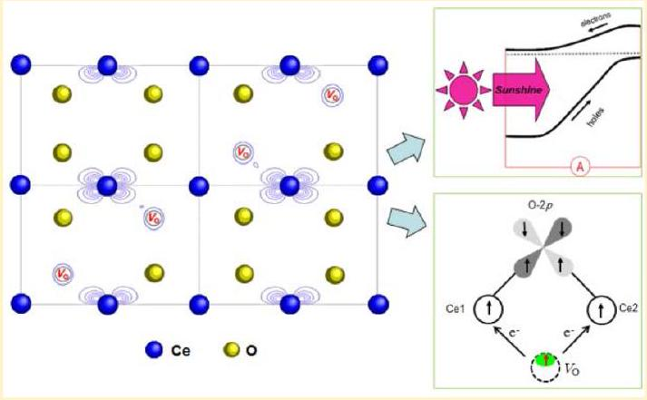
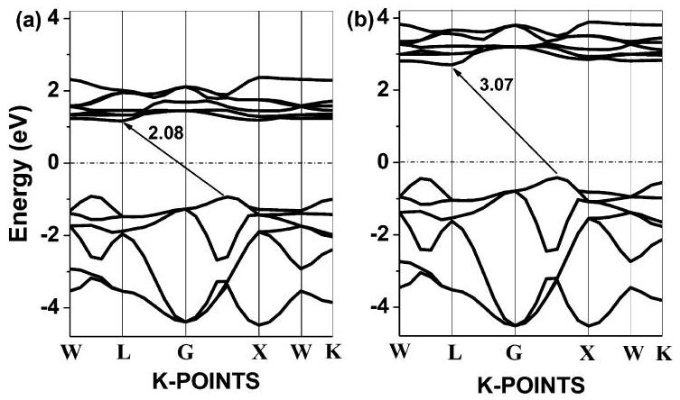
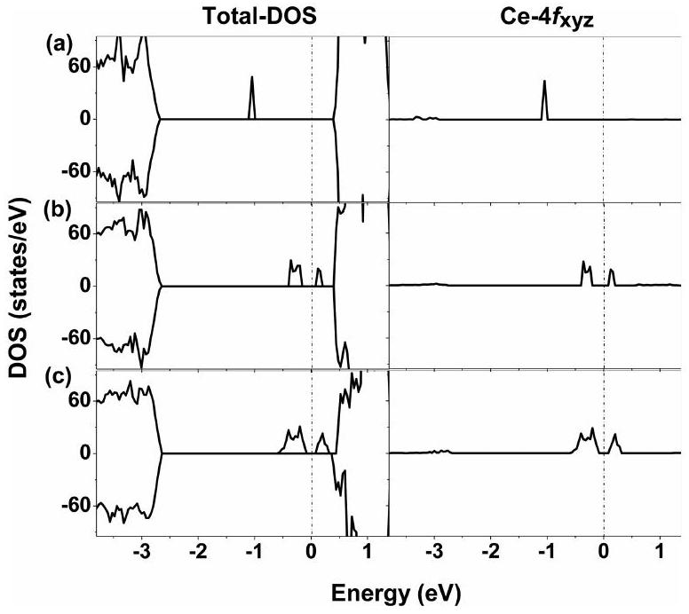
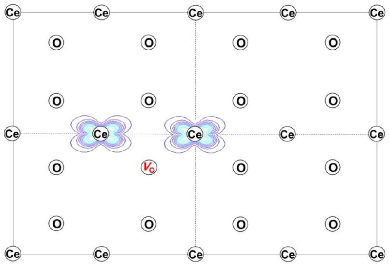
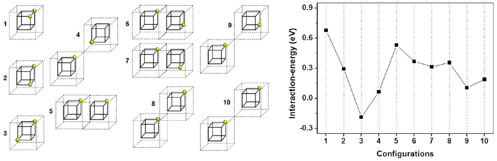
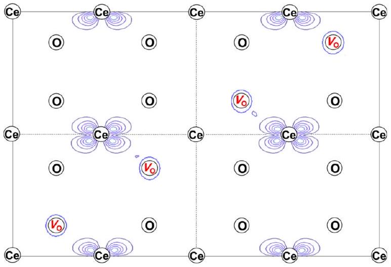
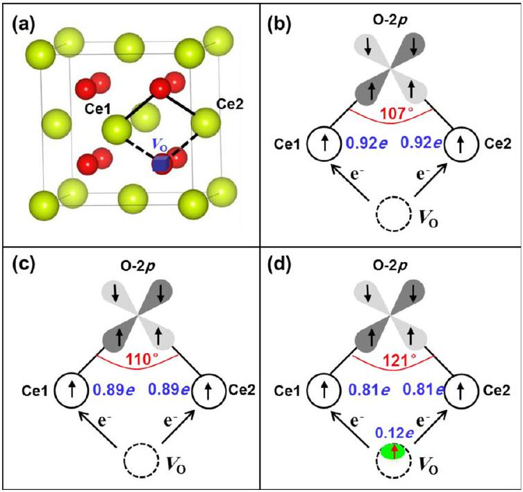
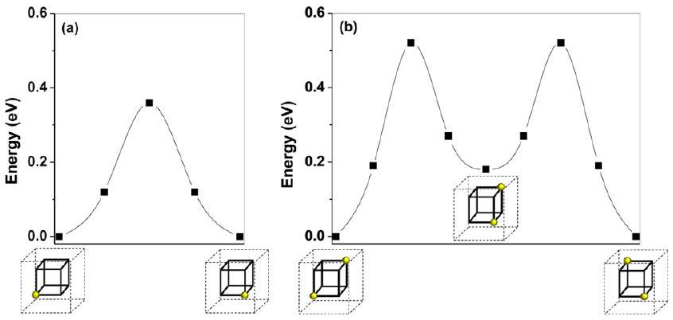
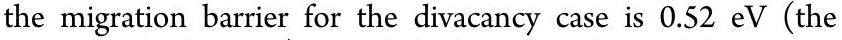

# Oxygen Vacancy Ordering and Electron Localization in $\mathbf{C e O}_{\mathbf{2}}$ : Hybrid Functional Study 

Xiaoping Han, ${ }^{\dagger}$ Noureddine Amrane, ${ }^{\dagger}$ Zongsheng Zhang, ${ }^{*, \ddagger}$ and Maamar Benkraouda ${ }^{*, \dagger}$ ${ }^{\dagger}$ Department of Physics, United Arab Emirates University, P.O. Box 15551, Al-Ain, U.A.E. ${ }^{\ddagger}$ College of International Education, North University of China, Taiyuan 030051, China

#### Abstract

Oxygen vacancies in bulk $\mathrm{CeO}_{2}$ have been investigated  using the Heyd-Scuseria-Ernzerhof (HSE) hybrid functional method. Results show that oxygen vacancies tend to linearly order in the $\langle 111\rangle$ direction of $\mathrm{CeO}_{2}$, yielding much more dispersive gap states with the weakened electron localization compared to the case of a single vacancy. Such vacancy ordering and electron localization give rise to a profound influence on material properties. First, the dispersive gap states are expected to act as stepping stones to facilitate the electron excitation from valence band to conduction band, contributing to extended optical absorption in the longer wavelengths and thus enhancing photovoltaic and photocatalytic functionalities. Also, the linear ordering of oxygen vacancies leads to the electron localization on Ce ions and oxygen vacancy sites, inducing the polarization of electrons on vacancy sites which effectively enhances stability of ferromagnetism. The fundamental understanding of these functional mechanisms is presented in detail. Additionally, the kinetic analysis of the oxygen-vacancy cluster has also been performed, and its high kinetic stability suggests its physical existence in bulk $\mathrm{CeO}_{2}$. The outcome of this work offers great promise for practical application of $\mathrm{CeO}_{2}$ in visible-light photocatalysis and photovoltaics as well as magneto-optic and spintronic devices.

## I. INTRODUCTION

Ceria $\left(\mathrm{CeO}_{2}\right)$ and its related compounds have been widely used for environmentally friendly power generation, hydrogen production technology, and catalytic conversion of toxic species in automobile exhausts ${ }^{1-3}$ and hence have become key materials for oxide-based devices. All these applications have been found to depend strongly on the formation of oxygen vacancies, which effectively change material properties and further influence the characteristics and reliability of $\mathrm{CeO}_{2}$ - based devices. For example, the role of $\mathrm{CeO}_{2}$ in catalysis is mainly due to the ability to easily store and release oxygen under reduction and oxidation conditions. ${ }^{4,5}$ Oxygen vacancies play a vital role in binding noble metals to $\mathrm{CeO}_{2}$ in catalysis, since the oxygen vacancies have become the potential adsorption sites of the noble-metal ions. ${ }^{6-8}$ In addition, $\mathrm{CeO}_{2}$ can be used as a good anionic conductor due to the existence of oxygen vacancies. ${ }^{9}$

Previously, many studies concentrated on an isolated vacancy or slight reduction in $\mathrm{CeO}_{2}$, ${ }^{10-17}$ while the high performances of $\mathrm{CeO}_{2}$ in many applications such as catalytic activities are well-known to rely on an efficient supply of oxygen vacancy. Actually, the multiple oxygen vacancies are easily introduced into the oxide during the course of growth, annealing, and redox reactions as well. Also, the heavy reduction in $\mathrm{CeO}_{2}$ can be anticipated since the oxide is often applied to such environments as highly reducing atmosphere or high-temperature conditions. Indeed, there have been some experimental investigations focusing on oxygen-vacancy structures at the reduced $\mathrm{CeO}_{2}(111)$ surfaces-the thermodynamically most stable surface. ${ }^{1}$ Early observations by scanning tunneling microscopy (STM) showed that the oxygen vacancies dominantly exist in the triangle form containing three oxygen vacancies. ${ }^{18}$ In contrast, Esch et al. ${ }^{6}$ used high-resolution STM to reveal that the linear clusters of oxygen vacancy are the dominant defects at the strongly reduced $\mathrm{CeO}_{2}(111)$ surface. Similar observations on $\mathrm{CeO}_{2}(111)$ surfaces were also obtained using atom-resolved noncontact atomic force microscopy by Namai et al. ${ }^{19}$ Another study ${ }^{20}$ using dynamic force microscopy on $\mathrm{CeO}_{2}(111)$ surface showed that high-concentration vacancies appeared at subsurface with a tendency of linear ordering. Regrettably, these literatures just confirmed the linear ordering/clustering of multiple oxygen vacancies, and little effort has been done to investigate in detail the effect of vacancy cluster on the material properties, such as the catalytic and conductive properties and the mobility of oxygen vacancies as well. However, another literature by Liu et al. ${ }^{21}$ showed that the presence of oxygen vacancy clustering in $\mathrm{CeO}_{2}$ nanorods facilitates the activation and transportation of active oxygen species, hence enhancing reducibility and activity. Also, there have been some explorations regarding the multiple oxygen vacancies in bulk $\mathrm{CeO}_{2}$ doped with rare earth elements. In a series of investigations on $\mathrm{CeO}_{2}$ doped with $\mathrm{Y}_{2} \mathrm{O}_{3}$ (2, 4, 6, 10,

Received: January 26, 2016
Revised: June 2, 2016
Published: June 6, 2016
and $15 \mathrm{~mol} \%)^{22}$ the vacancy pairs preferentially order along the $\langle 111\rangle$ directions, while the $(1 / 2)\langle 110\rangle$ pairs of oxygen vacancies appear to be preferred in $\mathrm{CeO}_{2}$ heavily doped with rare elements Sm, Y, Yb, Gd, and Dy (15 and 25 at. \%). ${ }^{23,24}$ These vacancy clusters, in spite of having different ordering directions, have been found to remarkably decrease the ionic conductivity of the system. Comparatively, it is of fundamental significance to understanding the effects of multiple oxygen vacancies on the undoped bulk structure in contrast to the surface or doped structures of $\mathrm{CeO}_{2}$. However, there is a notable lack of such investigations, which are desired for further progress toward $\mathrm{CeO}_{2}$-based devices since the distribution state of oxygen vacancies strongly influences the physical and chemical properties.
This work is dedicated to obtaining fundamental insight into the multiple oxygen vacancies in bulk $\mathrm{CeO}_{2}$ using hybrid functional method in the framework of density functional theory (DFT), aiming at self-consistent interpretation and prediction of the effects of vacancy clustering on the material properties. We find that the multiple oxygen vacancies tend to order in the 〈111〉direction, inducing remarkable change in electron localization in oxygen-deficient $\mathrm{CeO}_{2}$. This leads to a profound impact on material properties, especially enhancement in the ferromagnetism, and improvement in the photovoltaic and photocatalytic functionalities of the materials.

## II. METHOD

Theoretical explorations of $\mathrm{CeO}_{2}$ with oxygen vacancies are implemented in the Vienna Ab initio Simulation Package (VASP). ${ }^{25,26}$ The ion-electron interactions are described using the projector augmented wave (PAW) method. ${ }^{27,28}$ The planewave basis is generated with valence configurations of Ce$4 \mathrm{f}^{1} 5 \mathrm{~s}^{2} 5 \mathrm{p}^{6} 5 \mathrm{~d}^{1} 6 \mathrm{~s}^{2}$ and O-2s ${ }^{2} 2 \mathrm{p}^{4}$. The Brillouin-zone (BZ) integration is performed on Monkhorst-Pack k-points grids. Extensive tests are carried out to ensure convergence with respect to the number of k-points and energy cutoff. For the k-point integration, we employed a 8 × 8 × 8 mesh for the primitive cell of $\mathrm{CeO}_{2}$ and a 2 × 2 × 2 mesh for the 2 × 2 × 2 supercell. A plane-wave energy cutoff is set to be 400 eV for all calculations. All structures investigated were geometrically optimized until the total force on each ion was reduced to less than $0.02 \mathrm{eV} / \AA$ force.

We use the Heyd, Scuseria, and Enrzerhof (HSE) hybrid functional ${ }^{29}$ to consider the nonlocal effect in the exchange-correlation (XC) functionals, where the exchange portion of the energy is calculated using a screened Coulomb potential. With this functional, the exchange potential is divided into two parts: long range and short range. In short range, a portion of Hartree-Fock (HF) exchange is mixed with the general gradient approximation (GGA) of Perdew-Burke-Ernzerhof (PBE) functional, ${ }^{30}$ while the long-range part of the exchange potential is described by PBE functional alone. Testing calculations show that a screen parameter $w=0.1$ is suitable for the screened nonlocal exchange in the present work. The short-range mixing of 1/4 HF in the exchange functional is found to achieve excellent agreement with experimental data. Table 1 lists the calculated GGA and HSE results of lattice constant, energy gap, formation energy, and bulk modulus in pure $\mathrm{CeO}_{2}$. It is clear that the HSE functional produces the more accurate data with respect to the GGA. The calculated band structures (Figure 1) show that the HSE functional creates the striking improvement in the calculated band gap of 3.07 eV (2.08 eV for GGA), being in excellent agreement with

Table 1. Calculated Lattice Constant (a), Band Gap $\left(\boldsymbol{E}_{\mathbf{g}}\right)$, Formation Energy $\left(\boldsymbol{\Delta} \boldsymbol{E}_{\mathbf{f}}\right)$, and Bulk Modulus $\left(\boldsymbol{B}_{\mathbf{0}}\right)$ of $\mathbf{C e O}_{\mathbf{2}}$ in Comparison with Experimental Data
|  | $a(\AA)$ | $E_{\mathrm{g}}(\mathrm{eV})$ | $B_{0}(\mathrm{GPa})$ | $\Delta E_{\mathrm{f}}(\mathrm{eV})$ |
| :--- | :--- | :--- | :--- | :--- |
| GGA | 5.47 | 2.08 | 184 | -11.28 |
| HSE | 5.40 | 3.07 | 206 | -11.32 |
| expt | $5.41^{a}$ | $3.0^{b}$ | $204,{ }^{c} 236^{d}$ | $-11.29^{e}$ |

${ }^{a}$ Reference 31. ${ }^{b}$ Reference 32. ${ }^{c}$ Reference 33. ${ }^{d}$ Reference 34. ${ }^{e}$ Reference 35.

Figure 1. Calculated band structures for the primitive cell of $\mathrm{CeO}_{2}$ using GGA (a) and HSE (b). The dot-dashed lines at energy zero represent the Fermi level.

the experimental 3.0 eV. ${ }^{32}$ Therefore, the HSE method exhibits a more reliable theoretical description for $\mathrm{CeO}_{2}$, offering a solid basis for the investigation of oxygen-deficient systems.

## III. RESULTS AND DISCUSSION

For the explorations of oxygen-deficient phases, a 2 × 2 × 2 supercell $\left(\mathrm{Ce}_{32} \mathrm{O}_{64}\right)$ based on an $8 \mathrm{CeO}_{2}$ unit cell is employed. First, we investigate the case with a single vacancy, where an oxygen atom is removed from a 2 × 2 × 2 supercell. Its density of states (DOS) shows that there is a localized state within the band gap (Figure 2a), situated at 1.6 eV above the valence band maximum (VBM). This result is confirmed by the valence-band

Figure 2. Total DOS (left panel) and partial DOS (right panel) of $4 \mathrm{f}_{x y z}$ orbital of reduced Ce ions in $\mathrm{CeO}_{2}$ with the single oxygen vacancy (a), divacancy (b), and four linear vacancies (c) in the HSE scheme. The dot-dashed lines at energy zero represent the Fermi level.

photoemission on partially reduced systems, ${ }^{36-38}$ where a state within the energy gap between the VBM and the bottom of the unoccupied Ce 4f band appears at 1.2-1.5 eV away from the O-2p valence band edge. The analysis of partial density of states (PDOS) indicates that this localized state is mostly due to the $4 \mathrm{f}_{x y z}$ orbitals of two Ce ions neighboring to the oxygen vacancy (see the right panel of Figure 2a). The charge-density analysis of the gap state in Figure 2a also gets the same result, where one can find that the spatial distributions exhibit the $\mathrm{Ce}-4 \mathrm{f}_{x y z}$ character (Figure 3). Additionally, we also calculate the

Figure 3. Charge-density analysis of the gap state in Figure 2a. The (110) plane through two reduced Ce ions and oxygen vacancy is chosen.

electronic population at each Ce atomic site through integrating the total electronic charges inside a sphere centered on each Ce site with effective ionic radius ( $0.97 \AA$ for Ce ions). ${ }^{39,40}$ The comparison between the cases with and without oxygen vacancy reveals that the electron population of each of the above two Ce ions is $0.92 e$ more than that of virgin $\mathrm{CeO}_{2}$, while those of other Ce ions remain nearly unchanged. This means that two excess electrons left behind by oxygen removal mostly transfer to two neighboring $\mathrm{Ce}^{4+}$ ions that are reduced into $\mathrm{Ce}^{3+}$.
Having made clear the case with a single oxygen vacancy, let us examine two vacancies (divacancy) in $\mathrm{CeO}_{2}$. The various configurations with two vacancies (as shown in the left panel of Figure 4) are investigated first, and configuration 3 is found to be the most energetically stable. Further, the interaction energies between two oxygen vacancies for all above configurations have been calculated using the formula ${ }^{41}$

$$
E_{\mathrm{int}}=E\left(\mathrm{CeO}_{2}: 2 \mathrm{~V}_{\mathrm{O}}\right)+E\left(\mathrm{CeO}_{2}\right)-2 E\left(\mathrm{CeO}_{2}: 1 \mathrm{~V}_{\mathrm{O}}\right)
$$

where $E\left(\mathrm{CeO}_{2}: 1 \mathrm{~V}_{\mathrm{O}}\right)$ and $E\left(\mathrm{CeO}_{2}: 2 \mathrm{~V}_{\mathrm{O}}\right)$ mean the total energies of the structures with a single vacancy and divacancy, respectively, and $E\left(\mathrm{CeO}_{2}\right)$ represents that of virgin structure. As shown in the right panel of Figure 4, only in configuration 3 the interaction between two oxygen vacancies is attractive to each other while those in all other configurations are repulsive, exhibiting that two oxygen vacancies energetically tend to cluster along the $\langle 111\rangle$ direction in $\mathrm{CeO}_{2}$. The same result was given by Burbano et al., ${ }^{22}$ who found that the vacancy pairs preferentially align in the $\langle 111\rangle$ direction of $\mathrm{Y}_{2} \mathrm{O}_{3}$-doped $\mathrm{CeO}_{2}$. The indirect supports were also got from two experimental observations, where the $\langle 111\rangle$ vacancy pairs were found to be a common structural motif within oxygen-deficient fluorite phases $\mathrm{PrO}_{2-x}{ }^{42}$ and $\mathrm{TbO}_{2-x} .^{43}$ For high densities of vacancy, we investigated two divacancies in 2 × 2 × 2 supercell. The configuration with four vacancies lying along the $\langle 111\rangle$ direction (i.e., linear cluster) is found to be the most stable among all configurations tested. Such linear ordering of oxygen vacancies in bulk $\mathrm{CeO}_{2}$ is similar to the case of oxygen vacancies at the $\mathrm{CeO}_{2}(111)$ surface, ${ }^{6,20,44}$ where the linear vacancy cluster was found to be the dominant defect structures under strongly reducing conditions. Figures 2b and 2c show the DOSs for the cases of divacancy and linear cluster of four vacancies. Apparently, both of them have two gap states within the band gap, distinctively different from the case of a single vacancy. This indicates that the correlation of electrons originating from divacancy or linear cluster of four vacancies is strong enough to split the gap state. However, like the case of a single vacancy, these gap states are mostly due to the $4 \mathrm{f}_{x y z}$ orbitals of two Ce ions neighboring to each oxygen vacancy (see the right panel of Figures 2b,c). Also, two electrons left behind by each of vacancies are found to mostly transfer to two neighboring Ce ions, and the electronic-population analysis shows that each of them gains $0.89 e$ and $0.81 e$ for the cases of divacancy and four linear vacancies, respectively. This result is different from the observations of oxygen vacancies in $\mathrm{CeO}_{2}(111),^{45}$ where excess electrons were found to localize on Ce ions which are next-nearest neighbors to oxygen vacancy, revealing the different localization mechanism of excess electrons from oxygen vacancies in bulk and surface structures.

Figure 4. Interaction energies between two oxygen vacancies in $\mathrm{CeO}_{2}$ supercell. On the left, the schematic configurations are shown in the increasing order of vacancy-vacancy separations, with each cube corresponding to the unit cell of $\mathrm{CeO}_{2}$. Here only the oxygen vacancies are marked using yellow spheres.

However, there are still some noticeable points in the case of linear vacancy cluster. Although it is similar to the case of divacancy in that there are two gap states within the band gap, two states in the case of linear vacancy cluster become more dispersive (compare Figures 2c and 2b), meaning that the localization extent of the gap states becomes weaker. As shown above, in the case of linear vacancies, each reduced Ce ion gains $0.81 e$ from its neighboring vacancy, evidently less than those of the cases of single vacancy ( $0.92 e$ ) and divacancy ( $0.89 e$ ). Also, we examine the electronic populations on the sites of oxygen vacancies of all the above three cases using the Bader method ${ }^{46}$ and find that for the case of linear vacancy cluster 0.12 electrons remain at each of vacancy sites while almost no electrons are found at vacancy sites for the other two cases. To further characterize the localization behavior, the analysis of charge density analysis on the occupied (lower) gap state in Figure 2c has been performed, and the result is shown in Figure 5.

Figure 5. Charge-density analysis of the lower gap state in Figure 2c. The (110) plane through oxygen vacancy cluster is chosen, where only one of two reduced Ce ions is shown for each oxygen vacancy $\left(V_{\mathrm{O}}\right)$ since the other one is not in this plane.

Evidently, this gap state contains some electrons on each of vacancy sites, though most of the contributions are from the electrons occupying the Ce sites. Therefore, unlike the other two cases where the excess electrons just localize on Ce ions, the linear vacancy cluster weakens the electron localization and extends it to vacancy sites.
Accordingly, these noticeably different points have led to a profound impact on material properties. First, the weakened localization of the gap states is supposed to extend optical absorption of $\mathrm{CeO}_{2-x}$ into the long wavelength regions of solar irradiance. It is well-known that in order to enhance photovoltaic and photocatalytic functionalities, effort should be given to effectively reduce the band gap, so as to easily excite electrons from valence band to conduction band. Although the gap states in Figure 2c does not contribute to the narrowing of the band gap, they are still beneficial to a certain extent to the red-shift of optical absorption. Apparently, the two gap states (or intermediate bands) divide the band gap into three narrower subgaps, which makes it unnecessary for the valence electrons to be excited into conduction band in a single leap. These two intermediate bands will act as stepping stones to effectively relay excited valence electrons to the conduction band, as long as they are dispersive, not localized. One can see from Figure 2c that the two gap states are evidently dispersive, indicative of high carrier mobility. Their electron mobilities can be calculated using the equation ${ }^{47}$

$$
\mu=\frac{2 \sqrt{2 \pi} e C \hbar^{4}}{3\left(k_{\mathrm{B}} T\right)^{3 / 2} E_{\mathrm{d}}^{2} m^{* 5 / 2}}
$$

where $C$ is the elastic modulus, $E_{\mathrm{d}}$ is the deformation potential constant, $m^{*}$ is the effective mass, and $T$ is temperature in K (here 300 K is used). Other parameters $e, \hbar$, and $k_{\mathrm{B}}$ are electronic charge, reduced Planck constant, and Boltzmann constant, respectively. The calculated values for the lower and upper gap states in Figure 2c are 15.2 and $8.5 \mathrm{~cm}^{2} /(\mathrm{V} \mathrm{s})$, respectively (those in Figures 2a and 2b are at least one order smaller). Such high mobilities make electrons from the valence band easy to be further relayed into the conduction band. (In contrast, the flat or localized gap states in Figures 2a and 2b pin the electrons from the valence band, greatly limiting their role as stepping stones.) Furthermore, among three subgaps divided by two gap states, the middle and upper subgaps are much narrower than the lower one (as shown Figure 2c), which causes the excited valence electrons on the intermediated bands to easily jump to the conduction band. As a result, the wider lower subgap becomes the controlling factor for electron excitation. This lower subgap is 2.06 eV, which is 1.01 eV $(32.9 \%)$ narrower than the band gap of pure $\mathrm{CeO}_{2}$. Considering the above together, the existence of linear vacancy cluster in $\mathrm{CeO}_{2}$ is expected to induce the optical absorptions with longer wavelengths. These theoretical analyses account well for the enhanced visible light photocatalytic activities of the $\mathrm{CeO}_{2}$ found in the recent literature. ${ }^{48}$

Second, with the linear vacancy cluster, the electrons remained at the vacancy sites significantly influence the magnetic property of $\mathrm{CeO}_{2-x}$. The detailed examinations of ferromagnetic (FM) and antiferromagnetic (AFM) orderings show that the energy differences between FM and AFM orderings $[\Delta E=E(\mathrm{FM})-E(\mathrm{AFM})]$ are $-11,-13$, and -95 meV for the cases of a single vacancy, divacancy, and linear vacancy cluster, respectively, meaning that for all three cases the systems tend to be ferromagnetic. This gets supports from several experimental reports, ${ }^{49-51}$ where the ferromagnetism in undoped $\mathrm{CeO}_{2}$ was found to stem from oxygen vacancy. The same experimental phenomena were observed in $\mathrm{HfO}_{2} .{ }^{52,53}$ Evidently, the linear vacancy cluster greatly enhances the stability of ferromagnetism compared to a single vacancy or divacancy, attributed to its magnetic mechanism being different from the case of a single vacancy or divacancy. As shown above, when a vacancy is introduced through removing an oxygen atom, two excess electrons mostly transfer to the f orbitals of two neighboring Ce ions, changing them into two magnetic ions. These two ions are coupled by the superexchange interactions via their neighboring nonmagnetic ion (O ion), i.e., Ce4f-O2p-Ce4f interaction, as described in Goodenough-Kanamori-Anderson (GKA) rules. ${ }^{54-56}$ In Ce4f-O2p-Ce4f interactions for all three cases, the Ce-O-Ce angles are close to 90° not 180° ( $107^{\circ}, 110^{\circ}$, and 121° for the cases of a single vacancy, divacancy, and linear vacancy cluster, respectively), which leads to ferromagnetic ordering (see Figure 6). A similar idea was proposed for the FM in doped anatase $\mathrm{TiO}_{2} .^{57}$ According to the GKA rules, the superexchange interaction is closely associated with the electron occupancy of Ce ions, the orbital configuration of the net spin in Ce ions, and the Ce- O-Ce bond angle. Obviously, the Ce-O-Ce interactions have the same orbital of Ce ions $\left(\mathrm{Ce} 4 \mathrm{f}_{x y z}\right)$, the similar electron occupancy ( $0.92 e$ and $0.89 e$ ) on $\mathrm{Ce} 4 \mathrm{f}_{x y z}$ and the similar $\mathrm{Ce}-$ O-Ce bond angles (107° and 110°) for the cases of a single vacancy and divacancy, so it is not hard to understand why

Figure 6. Schematic for the magnetic mechanisms for the cases of a single vacancy, divacancy, and four linear vacancies. (a) $\mathrm{CeO}_{2}$ cell with an oxygen vacancy, where Ce and O atoms are represented by green and red spheres with oxygen vacancy $\left(V_{\mathrm{O}}\right)$ marked by a blue cube. Ce1 and Ce2 represent two reduced Ce ions. (b, c) Schematic for the superexchange interaction between two reduced Ce ions in the cases of a single vacancy and divacancy, respectively, where no electrons are left behind on the sites of oxygen vacancy. (d) Schematic for the superexchange interaction between two reduced Ce ions and for the polarization of the substantial electrons (represented by green shadow) on the site of oxygen vacancy by the neighboring $\mathrm{Ce}^{3+}$ ions in the case of linear vacancy cluster.

these two cases have the similar stability of ferromagnetism. In contrast, although the case of linear vacancy cluster has the same orbital $\left(4 \mathrm{f}_{x y z}\right)$ of Ce ions in the Ce-O-Ce interaction, its electron occupancy ( $0.81 e$ ) on $\mathrm{Ce} 4 \mathrm{f}_{x y z}$ evidently decreases and its Ce-O-Ce bond angle $\left(121^{\circ}\right)$ appears to move toward 180°, which is expected to weaken the FM stability based on the GKA rules. Instead, its FM stability is significantly enhanced. To better explain this abnormal point, let us recall its difference from the case of a single vacancy or divacancy: there are 0.12 electrons remaining at each of vacancy sites. Apparently, these electrons are inevitably polarized by the spin moment on neighboring $\mathrm{Ce}^{3+}$ ions, also inducing ferromagnetism (Figure 6d). Furthermore, the polarization is very strong in contrast with the superexchange interaction. Rough assessment of the above superexchange and polarization energies using the equations provided by refs 58 and 59 show that the latter is much (two orders) larger than the former. Therefore, though the superexchange interaction and the polarization cooperatively underlie the FM state in the case of linear vacancy cluster, it is the latter that is responsible for the substantially enhanced ferromagnetism. This is consistent with the coupling mechanism proposed for experimental observations of FM states in undoped ${ }^{50,60}$ and doped ${ }^{60-62} \mathrm{CeO}_{2}$ and $\mathrm{HfO}_{2}{ }^{52}$ as well.
As further supplementary investigations, the energy barriers for the migration of a single vacancy, divacancy, and linear vacancy cluster to their corresponding neighboring locations in $\mathrm{CeO}_{2}$ have been calculated using the nudged-elastic band (NEB) method. ${ }^{63}$ We choose minimum number of intermediate configurations (representing the shortest possible path for each case) to calculate the energy barriers between them. The calculated energy barriers for the cases of a single vacancy and divacancy, along with their corresponding configurations, are shown in Figure 7. The calculated migration barrier for the

Figure 7. Migration barriers of a single vacancy (a) and a vacancy cluster in the <111> direction (b) moving to a neighboring location. The schematic configurations are shown with each cube corresponding to the unit cell of $\mathrm{CeO}_{2}$. Here only oxygen vacancies are marked with yellow spheres.

single vacancy diffusion is 0.36 eV (Figure 7a), agreeing well with the experimental value of 0.40 eV. ${ }^{64}$ Figure 7b shows that
 same for both steps), much higher than that of the single vacancy. For calculating the migration barriers of the linear cluster of four vacancies, multiple steps will be involved, and the associated calculations are also very complicated. Only considering its first step of migration, the energy barrier is calculated to be remarkably higher than that of a single vacancy and of a divacancy, revealing the high kinetic stability of linear vacancy cluster. Therefore, such vacancy cluster is rather difficult to be removed kinetically once it forms in $\mathrm{CeO}_{2}$.

It is worth stressing that the theoretical confirmation of the existence of linear vacancy cluster in bulk $\mathrm{CeO}_{2}$ is of great significance to the applications of bulk $\mathrm{CeO}_{2}$ under strongly reducing atmospheres. It is well-known that in practical applications much attention is paid to the surface chemistry (especially catalytic activities) of $\mathrm{CeO}_{2}$, which is closely related to the oxygen vacancies at $\mathrm{CeO}_{2}$ surfaces. For example, the vacancy clusters at $\mathrm{CeO}_{2}(111)$ have been found to directly or indirectly bind catalytically active species (like Au, ${ }^{65,66} \mathrm{Pt}$, ${ }^{66}$ and $\mathrm{H}^{67}$ ) to $\mathrm{CeO}_{2}$, helpful to tailor the reactivity of ceria-based catalysts. Now the linear vacancy cluster has been found to profoundly influence the optical and magnetic properties of bulk $\mathrm{CeO}_{2}$. First, the wide band gap of $\mathrm{CeO}_{2}$ limits its use for electronic and optical applications. The appearance of the linear vacancy cluster induces dispersive intermediate bands within the band gap, which offers great promise for practical applications of $\mathrm{CeO}_{2}$ in photovoltaics and photocatalysis under the illumination of visible or even infrared light. On the other hand, the linear vacancy cluster enhances the ferromagnetism of $\mathrm{CeO}_{2}$, suggesting that $\mathrm{CeO}_{2}$ under strongly reducing conditions can be a candidate for magneto-optic or spintronic device applications. Undoubtedly, these will be essential toward widening the scope of practical applications of $\mathrm{CeO}_{2}$ in devices.

## IV. CONCLUSIONS

In summary, the oxygen-vacancy ordering and the associated electron localization in $\mathrm{CeO}_{2}$ have been successfully addressed by the hybrid functional method. The oxygen vacancies were found to tend to linearly order in $\langle 111\rangle$ direction of $\mathrm{CeO}_{2}$, inducing the dispersive gap states and the electron localization
on both Ce ions and oxygen vacancy sites. Such vacancy ordering and the associated electron localization give rise to the improvement in photovoltaic and photocatalytic functionalities and enhancement in ferromagnetism, well explaining some experimental results such as photocatalytic activities and magnetic properties of oxygen-deficient $\mathrm{CeO}_{2}$. The kinetic stability of the vacancy cluster was also discussed.

## ■ AUTHOR INFORMATION

Corresponding Authors
*E-mail maamar@uaeu.ac.ae; Tel +971 (0)3 7136742 (M.B.). *E-mail zhangzs@nuc.edu.cn; Tel +86 (0)351 3923939 (Z.Z.).
Notes
The authors declare no competing financial interest.

## ■ ACKNOWLEDGMENTS

This work was supported by United Arab Emirates University through the University Program for Advanced Research (No. 31S109-UPAR). Part of computing time was provided by North University of China.

## ■ REFERENCES

(1) Trovarelli, A. Catalysis by Ceria and Related Materials; Imperial College Press: London, UK, 2002.
(2) Park, S.; Vohs, J. M.; Gorte, R. J. Direct Oxidation of Hydrocarbons in a Solid-oxide Fuel Cell. Nature 2000, 404, 265-267.
(3) Deluga, G. A.; Salge, J. R.; Schmidt, L. D.; Verykios, X. E. Renewable Hydrogen from Ethanol by Autothermal Reforming. Science 2004, 303, 993-997.
(4) Skorodumova, N. V.; Simak, S. I.; Lundqvist, B. I.; Abrikosov, I. A.; Johansson, B. Quantum Origin of the Oxygen Storage Capability of Ceria. Phys. Rev. Lett. 2002, 89, 166601.
(5) Mikulova, J.; Rossignol, S.; Barbier, J., Jr.; Duprez, D.; Kappenstein, C. Characterizations of Platinum Catalysts Supported on Ce, Zr, Pr-oxides and Formation of Carbonate Species in Catalytic Wet Air Oxidation of Acetic Acid. Catal. Today 2007, 124, 185-190.
(6) Esch, F.; Fabris, S.; Zhou, L.; Montini, T.; Africh, C.; Fornasiero, P.; Comelli, G.; Rosei, R. Electron Localization Determines Defect Formation on Ceria Substrates. Science 2005, 309, 752-755.
(7) Fu, Q.; Saltsburg, H.; Flytzani-Stephanopoulos, M. Active Nonmetallic Au and Pt Species on Ceria-Based Water-Gas Shift Catalysts. Science 2003, 301, 935-938.
(8) Liu, Z. P.; Jenkins, S. J.; Kings, D. A. Origin and Activity of Oxidized Gold in Water-Gas-Shift Catalysis. Phys. Rev. Lett. 2005, 94, 196102.
(9) Steele, B. C. H.; Heinzel, A. Materials for Fuel-cell Technologies. Nature 2001, 414, 345-352.
(10) Arapan, S.; Simak, S. I.; Skorodumova, N. V. Volume-dependent Electron Localization in Ceria. Phys. Rev. B: Condens. Matter Mater. Phys. 2015, 91, 125108.
(11) Saini, H. S.; Singh, M.; Saini, G. S. S.; Kashyap, M. K. Effect of Oxygen Vacancy on Half Metallicity in Ni-doped $\mathrm{CeO}_{2}$ Diluted Magnetic Semiconductor. AIP Conf. Proc. 2014, 1661, 070011.
(12) Hu, Z.; Metiu, H. Effect of Dopants on the Energy of Oxygen-Vacancy Formation at the Surface of Ceria: Local or Global? J. Phys. Chem. C 2011, 115, 17898-17909.
(13) Dholabhai, P. P.; Adams, J. B.; Crozier, P.; Sharma, R. Oxygen Vacancy Migration in Ceria and Pr-doped Ceria: A DFT+U Study. J. Chem. Phys. 2010, 132, 094104.
(14) Andersson, D. A.; Simak, S. I.; Johansson, B.; Abrikosov, I. A.; Skorodumova, N. V. Modeling of $\mathrm{CeO}_{2}, \mathrm{Ce}_{2} \mathrm{O}_{3}$, and $\mathrm{CeO}_{2-\mathrm{x}}$ in the LDA+U Formalism. Phys. Rev. B: Condens. Matter Mater. Phys. 2007, 75, 035109.
(15) Huang, B.; Gillen, R.; Robertson, J. Study of $\mathrm{CeO}_{2}$ and Its Native Defects by Density Functional Theory with Repulsive Potential. J. Phys. Chem. C 2014, 118, 24248-24256.
(16) Herschend, B.; Baudin, M.; Hermansson, K. Oxygen Vacancy Formation for Transient Structures on the $\mathrm{CeO}_{2}(110)$ Surface at 300 and 750 K. J. Chem. Phys. 2007, 126, 234706.
(17) Fabris, S.; Vicario, G.; Balducci, G.; de Gironcoli, S.; Baroni, S. Electronic and Atomistic Structures of Clean and Reduced Ceria Surfaces. J. Phys. Chem. B 2005, 109, 22860-22867.
(18) Nörenberg, H.; Briggs, G. A. D. Defect Structure of Nonstoichiometric $\mathrm{CeO}_{2}(111)$ Surfaces Studied by Scanning Tunneling Microscopy. Phys. Rev. Lett. 1997, 79, 4222.
(19) Namai, Y.; Fukui, K. I.; Iwasawa, Y. Atom-Resolved Noncontact Atomic Force Microscopic Observations of $\mathrm{CeO}_{2}(111)$ Surfaces with Different Oxidation States: Surface Structure and Behavior of Surface Oxygen Atoms. J. Phys. Chem. B 2003, 107, 11666-11673.
(20) Torbrugge, S.; Reichling, M.; Ishiyama, A.; Morita, S.; Custance, O. Evidence of Subsurface Oxygen Vacancy Ordering on Reduced $\mathrm{CeO}_{2}(111)$. Phys. Rev. Lett. 2007, 99, 056101.
(21) Liu, X. W.; Zhou, K. B.; Wang, L.; Wang, B. U.; Li, Y. D. Oxygen Vacancy Clusters Promoting Reducibility and Activity of Ceria Nanorods. J. Am. Chem. Soc. 2009, 131, 3140-3141.
(22) Burbano, M.; Norberg, S. T.; Hull, S.; Eriksson, S. G.; Marrocchelli, D.; Madden, P. A.; Watson, G. W. Oxygen Vacancy Ordering and the Conductivity Maximum in $\mathrm{Y}_{2} \mathrm{O}_{3}$-Doped $\mathrm{CeO}_{2}$. Chem. Mater. 2012, 24, 222-229.
(23) Ou, D. R.; Mori, T.; Ye, F.; Zou, J.; Auchterlonie, G.; Drennan, J. Oxygen-Vacancy Ordering in Lanthanide-doped Ceria: Dopant-type Dependence and Structure Model. Phys. Rev. B: Condens. Matter Mater. Phys. 2008, 77, 024108.
(24) Ou, D. R.; Mori, T.; Ye, F.; Kobayashi, T. Oxygen Vacancy Ordering in Heavily Rare-Earth-Doped Ceria. Appl. Phys. Lett. 2006, 89, 171911.
(25) Kresse, G.; Hafner, J. Ab Initio Molecular Dynamics for Liquid Metals. Phys. Rev. B: Condens. Matter Mater. Phys. 1993, 47, 558.
(26) Kresse, G.; Hafner, J. Ab Initio Molecular-dynamics Simulation of the Liquid-Metal-Amorphous-Semiconductor Transition in Germanium. Phys. Rev. B: Condens. Matter Mater. Phys. 1994, 49, 14251.
(27) Blochl, P. E. Projector Augmented-Wave Method. Phys. Rev. B: Condens. Matter Mater. Phys. 1994, 50, 17953.
(28) Kresse, G.; Joubert, D. From Ultrasoft Pseudopotentials to the Projector Augmented-Wave Method. Phys. Rev. B: Condens. Matter Mater. Phys. 1999, 59, 1758.
(29) Heyd, S.; Scuseria, G. E.; Ernzerhof, M. Hybrid Functionals Based on a Screened Coulomb Potential. J. Chem. Phys. 2003, 118, 8207.
(30) Perdew, J. P.; Burke, K.; Ernzerhof, M. Generalized Gradient Approximation Made Simple. Phys. Rev. Lett. 1996, 77, 3865.
(31) Gschneider, K. A.; Eyring, L. Handbook on the Physics and Chemistry of Rare Earths; North-Holland: Amsterdam, Netherlands, 1979.
(32) Wuilloud, E.; Delley, B.; Schneider, W. D.; Baer, Y. Spectroscopic Evidence for Localized and Extended $f$-Symmetry States in $\mathrm{CeO}_{2}$. Phys. Rev. Lett. 1984, 53, 202.
(33) Nakajima, A.; Yoshihara, A.; Ishigame, M. Defect-induced Raman Spectra in Doped $\mathrm{CeO}_{2}$. Phys. Rev. B: Condens. Matter Mater. Phys. 1994, 50, 13297.
(34) Gerward, L.; Olsen, J. S. Powder Diffraction Analysis of Cerium Dioxide at High Pressure. Powder Diffr. 1993, 8, 127-129.
(35) Lide, D. R. CRC Handbook of Chemistry and Physics; CRC Press: London, UK, 1999.
(36) Henderson, M. A.; Perkins, C. L.; Engelhard, M. H.; Thevuthasan, S.; Peden, C. H. F. Redox Properties of Water on the Oxidized and Reduced Surfaces of $\mathrm{CeO}_{2}$ (111). Surf. Sci. 2003, 526, 1-18.
(37) Mullins, D. R.; Radulovic, P. V.; Overbury, S. H. Ordered Cerium Oxide Thin Films Grown on Ru(0001) and Ni(111). Surf. Sci. 1999, 429, 186-198.
(38) Pfau, A.; Schierbaum, K. D. The Electronic Structure of Stoichiometric and Reduced $\mathrm{CeO}_{2}$ Surfaces: An XPS, UPS and HREELS Study. Surf. Sci. 1994, 321, 71-80.
(39) Shannon, R. D.; Prewitt, C. T. Effective Ionic Radii in Oxides and Fluorides. Acta Crystallogr., Sect. B: Struct. Crystallogr. Cryst. Chem. 1969, 25, 925-946.
(40) Shannon, R. D. Revised Effective Ionic Radii and Systematic Studies of Interatomic Distances in Halides and Chalcogenides. Acta Crystallogr., Sect. A: Cryst. Phys., Diffr., Theor. Gen. Crystallogr. 1976, 32, 751-767.
(41) Buban, J. P.; Iddir, H.; Ogut, S. Structural and Electronic Properties of Oxygen Vacancies in Cubic and Antiferrodistortive Phases of $\mathrm{SrTiO}_{3}$. Phys. Rev. B: Condens. Matter Mater. Phys. 2004, 69, 180102.
(42) Schweda, E.; Bevan, D. J. M.; Eyring, L. On the $\mathrm{Pr}_{\mathrm{n}} \mathrm{O}_{2 \mathrm{n}-2}$ Series of Oxides and the Structure of $\mathrm{Pr}_{24} \mathrm{O}_{44}$ : An Investigation by Highresolution Electron Microscopy. J. Solid State Chem. 1991, 90, 109-125.
(43) Baenziger, N. C.; Eick, H. A.; Schuldt, H. S.; Eyring, L. Terbium Oxides. III. X-Ray Diffraction Studies of Several Stable Phases. J. Am. Chem. Soc. 1961, 83, 2219-2223.
(44) Zhang, C.; Michaelides, A.; King, D. A.; Jenkins, S. J. Oxygen Vacancy Clusters on Ceria: Decisive Role of Cerium $f$ Electrons. Phys. Rev. B: Condens. Matter Mater. Phys. 2009, 79, 075433.
(45) Ganduglia-Pirovano, M. V.; Da Silva, J. L. F.; Sauer, J. Density-Functional Calculations of the Structure of Near-Surface Oxygen Vacancies and Electron Localization on $\mathrm{CeO}_{2}(111)$. Phys. Rev. Lett. 2009, 102, 026101.
(46) Henkelman, G.; Arnaldsson, A.; Joansson, H. A Fast and Robust Algorithm for Bader Decomposition of Charge Density. Comput. Mater. Sci. 2006, 36, 354-360.
(47) Xi, J.; Long, M.; Tang, L.; Wang, D.; Shuai, Z. First-Principles Prediction of Charge Mobility in Carbon and Organic Nanomaterials. Nanoscale 2012, 4, 4348-4369.
(48) Khan, M. M.; Ansari, S. A.; Pradhan, D.; Han, D. H.; Lee, J.; Cho, M. H. Defect-Induced Band Gap Narrowed $\mathrm{CeO}_{2}$ Nanostructures for Visible Light Activities. Ind. Eng. Chem. Res. 2014, 53, 9754-9763.
(49) Ackland, K.; Monzon, L. M. A.; Venkatesan, M.; Coey, J. M. D. Magnetism of Nanostructured $\mathrm{CeO}_{2}$. IEEE Trans. Magn. 2011, 47, 3509-3512.
(50) Singhal, R. K.; Kumari, P.; Samariya, A.; Kumar, S.; Sharma, S. C.; Xing, Y. T.; Saitovitch, E. B. Role of Electronic Structure and Oxygen Defects in Driving Ferromagnetism in Nondoped Bulk $\mathrm{CeO}_{2}$. Appl. Phys. Lett. 2010, 97, 172503.
(51) Fernandes, V.; Mossanek, R. J. O.; Schio, P.; Klein, J. J.; de Oliveira, A. J. A.; Ortiz, W. A.; Mattoso, N.; Varalda, J.; Schreiner, W. H.; Abbate, M.; et al. Dilute-defect Magnetism: Origin of Magnetism in Nanocrystalline $\mathrm{CeO}_{2}$. Phys. Rev. B: Condens. Matter Mater. Phys. 2009, 80, 035202.
(52) Venkatesan, M.; Fitzgerald, C. B.; Coey, J. M. D. Thin films: Unexpected Magnetism in a Dielectric Oxide. Nature 2004, 430, 630.
(53) Coey, J. M. D.; Venkatesan, M.; Stamenov, P.; Fitzgerald, C. B.; Dorneles, L. S. Magnetism in Hafnium Dioxide. Phys. Rev. B: Condens. Matter Mater. Phys. 2005, 72, 024450.
(54) Goodenough, J. B. Theory of the Role of Covalence in the Perovskite-Type Manganites [La, M(II)] $\mathrm{MnO}_{3}$. Phys. Rev. 1955, 100, 564.
(55) Kanamori, J. Superexchange Interaction and Symmetry Properties of Electron Orbitals. J. Phys. Chem. Solids 1959, 10, 87.
(56) Anderson, P. W. Antiferromagnetism. Theory of Superexchange Interaction. Phys. Rev. 1950, 79, 350.
(57) Janisch, R.; Spaldin, N. A. Understanding Ferromagnetism in Co-doped $\mathrm{TiO}_{2}$ Anatase from First Principles. Phys. Rev. B: Condens. Matter Mater. Phys. 2006, 73, 035201.
(58) Gubanov, V. A.; Posnikov, A. V.; Likhtenshtein, A. I. Magnetism and the Electronic Structure of Crystal; Springer: New York, 1992.
(59) Antonov, V.; Harmon, B.; Yaresko, A. Electronic Structure and Magneto-Optical Properties of Solid; Kluwer: New York, 2004.
(60) Singhal, R. K.; Kumari, P.; Kumar, S.; Dolia, S. N.; Xing, Y. T.; Alzamora, M.; Deshpande, U. P.; Shripathi, T.; Saitovitch, E. Room Temperature Ferromagnetism in Pure and Co- and Fe-doped $\mathrm{CeO}_{2}$ Dilute Magnetic Oxide: Effect of Oxygen Vacancies and Cation Valence. J. Phys. D: Appl. Phys. 2013, 46, 399701.
(61) Niu, G.; Hildebrandt, E.; Schubert, M. A.; Boscherini, F.; Zoellner, M. H.; Alff, L.; Walczyk, D.; Zaumseil, P.; Costina, I.; Wilkens, H.; et al. Oxygen Vacancy Induced Room Temperature Ferromagnetism in Pr-Doped $\mathrm{CeO}_{2}$ Thin Films on Silicon. ACS Appl. Mater. Interfaces 2014, 6, 17496-17505.
(62) Song, Y. Q.; Zhang, H. W.; Wen, Q. Y.; Peng, L.; Xiao, J. Q. Direct Evidence of Oxygen Vacancy Mediated Ferromagnetism of Co Doped $\mathrm{CeO}_{2}$ Thin Films on $\mathrm{Al}_{2} \mathrm{O}_{3}(0001)$ Substrates. J. Phys.: Condens. Matter 2008, 20, 255210.
(63) Mills, G.; Jonnson, H.; Schenter, G. K. Reversible Work Transition State Theory: Application to Dissociative Adsorption of Hydrogen. Surf. Sci. 1995, 324, 305-337.
(64) Tuller, H. L.; Nowick, A. S. Small Polaron Electron Transport in Reduced $\mathrm{CeO}_{2}$ Single Crystals. J. Phys. Chem. Solids 1977, 38, 859-867.
(65) Zhang, C.; Michaelides, A.; King, D. A.; Jenkins, S. J. Anchoring Sites for Initial Au Nucleation on $\mathrm{CeO}_{2}\{111\}$ : O Vacancy versus Ce Vacancy. J. Phys. Chem. C 2009, 113, 6411-6417.
(66) Campbell, C. T.; Peden, C. H. Oxygen Vacancies and Catalysis on Ceria Surfaces. Science 2005, 309, 713-714.
(67) Wu, X. P.; Gong, X. Q.; Lu, G. Role of Oxygen Vacancies in the Surface Evolution of H at $\mathrm{CeO}_{2}(111)$ : A Charge Modification Effect. Phys. Chem. Chem. Phys. 2015, 17, 3544-3549.

