Digital Comprehensive Summaries of Uppsala Dissertations from the Faculty of Science and Technology 896

# Oxygen Vacancy Chemistry in Ceria 

JOLLA KULLGREN

Dissertation presented at Uppsala University to be publicly examined in Å2001, Ångströmlaboratoriet, Lägerhyddsvägen 1, Uppsala. Friday, March 16, 2012 at 13:15 for the degree of Doctor of Philosophy. The examination will be conducted in English.

Abstract
Kullgren, J. 2012. Oxygen Vacancy Chemistry in Ceria. Acta Universitatis Upsaliensis. Digital Comprehensive Summaries of Uppsala Dissertations from the Faculty of Science and Technology 896. 59 pp. Uppsala. ISBN 978-91-554-8271-8.

Cerium(IV) oxide $\left(\mathrm{CeO}_{2}\right)$, ceria, is an active metal oxide used in solid oxide fuel cells and for the purification of exhaust gases in vehicle emissions control. Behind these technically important applications of ceria lies one overriding feature, namely ceria's exceptional reduction-oxidation properties. These are enabled by the duality of the cerium ion which easily toggles between $\mathrm{Ce}^{4+}$ and $\mathrm{Ce}^{3+}$. Here the cerium 4f electrons and oxygen vacancies (missing oxygen ions in the structure) are key players. In this thesis, the nature of ceria's f electrons and oxygen vacancies are in focus, and examined with theoretical calculations.

It is shown that for single oxygen vacancies at ceria surfaces, the intimate coupling between geometrical structure and electron localisation gives a multitude of almost degenerate local energy mimima. With many vacancies, the situation becomes even more complex, and not even state-of-the-art quantum-mechanical calculations manage to predict the experimentally observed phenomenon of vacancy clustering. Instead, an alternative set of computer experiments managed to produce stable vacancy chains and trimers consistent with experimental findings from the literature and revealed a new general principle for surface vacancy clustering.

The rich surface chemistry of ceria involves not only oxygen vacancies but also other active oxygen species such as superoxide ions $\left(\mathrm{O}_{2}{ }^{-}\right)$. Experiments have shown that nanocrystalline ceria demonstrates an unusually large oxygen storage capacity (OSC) and an appreciable low-temperature redox activity, which have been ascribed to superoxide species. A mechanism explaining these phenomena is presented.

The ceria surface is also known to interact with $\mathrm{SO}_{\mathrm{x}}$ molecules, which is relevant both in the context of sulfur poisoning of ceria-based catalysts and sulfur recovery from them. In this thesis, the sulfur species and key mechanisms involved are identified.

Keywords: Ceria, Density Functional Theory, Oxygen storage, Nano crystals, Sulfur poisoning

Jolla Kullgren, Uppsala University, Department of Chemistry - Ångström, Structural Chemistry, Box 538, SE-751 21 Uppsala, Sweden.
© Jolla Kullgren 2012
ISSN 1651-6214
ISBN 978-91-554-8271-8
urn:nbn:se:uu:diva-167521 (http://urn.kb.se/resolve?urn=urn:nbn:se:uu:diva-167521)

Dedicated to Melker and Aci.

## List of papers

This thesis is based on the following papers, which are referred to in the text by their Roman numerals.

I Tuning LDA+U for electron localization and structure at oxygen vacancies in ceria C. W. M. Castleton, J. Kullgren and Kersti Hermansson
The Journal of Chemical Physics 127, 244704 (2007)
II B3LYP calculations of cerium oxides J. Kullgren, C. W. M. Castleton, C. Müller, David Muñoz Ramo and Kersti Hermansson
The Journal of Chemical Physics 132, 054110 (2010)
III Many Competing Ceria (110) Oxygen Vacancy Structures - From Small to Large Supercells J. Kullgren, C. W. M. Castleton and Kersti Hermansson
Under review in The Journal of Chemical Physics.
IV Vacancy clustering on ceria(111) J. Kullgren, C. W. M. Castleton, Pavlin Mitev, Wim Briels and Kersti Hermansson
Manuscript.
V Supercharged oxygen storage capacity of ceria at the nano scale Jolla Kullgren, Kersti Hermansson, Peter Broqvist
Manuscript.
VI $\mathbf{S O}_{x}$ on ceria from adsorbed $\mathbf{S O}_{2} \mathrm{Z}$. Lu, C. Müller, Z. Yang, Kersti Hermansson and Jolla Kullgren
The Journal of Chemical Physics 134, 184703 (2011)
VII Sulfidation of ceria surfaces from sulfur and sulfur diffusion Z. Lu, Jolla Kullgren, Z. Yang, Kersti Hermansson
Under review in Journal of Physical Chemistry C.
VIII Sulfur recovery from $\mathbf{S O}_{2}$ over ceria Jolla Kullgren, Z. Lu, Z. Yang, Kersti Hermansson
Submitted.

Reprints were made with permission from the publishers.

## Contents

1 Introduction ..... 9
1.1 Context and overall aim ..... 9
1.2 Theoretical calculations as a complement to experiment ..... 10
1.3 Ceria systems studied in this thesis ..... 11
1.4 Specific questions in focus in this thesis ..... 14
2 Results: Describing vacancies and electron localization with DFT ..... 15
2.1 DFT+U ..... 15
2.2 Hybrid methods and basis-sets ..... 18
3 Results: Oxygen vacancies in ceria ..... 21
3.1 Single oxygen vacancies at the ceria(111) and (110) surface ..... 21
3.2 Vacancy clustering at the ceria (111) surface ..... 24
4 Results: Ceria nano crystals ..... 30
5 Results: Sulfur poisoning and sulfur recovery ..... 35
5.1 SOx species on ceria ..... 35
5.2 Sulfation and sulfidation ..... 39
5.3 A new mechanism for sulfur recovery ..... 41
6 Concluding remarks ..... 43
7 Acknowledgements ..... 45
8 Appendix - Methods overview ..... 46
8.1 Quantum chemical calculations ..... 46
8.2 Basis-sets ..... 50
8.3 Force-Field methods ..... 52
8.4 Supercell approximation ..... 53
9 Summary in Swedish ..... 55
9.1 Syrevakansers kemi i ceria ..... 55
References ..... 57

## 1. Introduction

### 1.1 Context and overall aim

Metal oxides have a long history in heterogeneous catalysis and notable examples include iron oxide (magnetite, $\mathrm{Fe}_{3} \mathrm{O}_{4}$ ), which is used for the synthesis of ammonium (Haber-Bosch process), zinc oxide (ZnO) for methanol synthesis, and vanadium oxide $\left(\mathrm{V}_{2} \mathrm{O}_{5}\right)$, used in sulfuric acid synthesis (the so-called contact method). Although heterogeneous catalysis is widely applied, the detailed chemical mechanisms governing its successes are often completely or partially unknown. This is not least true for ceria $\left(\mathrm{CeO}_{2}\right)$, the metal oxide in focus in this thesis.

Ceria is a technically interesting compound. It is primarily used as an active component in the three-way automotive catalyst (TWC), assisting in the process to purify the exhaust gases. Ceria is also an electrolyte material in solid oxide fuel cells, and it is used in self-cleaning ovens, for glass polishing and in many other contexts [1]. One very characteristic feature, and the main reason that ceria is so useful in many of these applications, is ceria's high oxygen storage capacity (OSC). The OSC is a measure of how much oxygen a material can store and release. Ceria's high OSC makes it a powerful catalyst for reduction-oxidation (red-ox) chemistry, where it mediates reduction through the uptake of oxygen, and oxidation through the release of oxygen. In many cases, these processes involve the Mars-van Krevelen (MvK) mechanism where the surface oxygen atoms are directly involved in the reactions. A typical reaction at the ceria surface can be summarized as follows:

- A molecule at the surface accepts an oxygen atom from the ceria surface. A void (vacancy) is created in the surface.
- The vacancy "migrates" across the surface and eventually accepts an oxygen atom from another molecule. The vacancy becomes annihilated.

One example of a ceria-catalysed reaction is the $\mathrm{CO}(g)+\mathrm{SO}_{2}(g) \rightarrow \mathrm{CO}_{2}(g)+\mathrm{S}(s)$ red-ox reaction, where experiments suggest [2] that CO accepts oxygen from the ceria surface, while $\mathrm{SO}_{2}$ can release its oxygen to heal the vacancy created by CO. Thus the reduction of $\mathrm{SO}_{2}$ with CO is mediated by oxygen vacancies. The special property of ceria that underlies its red-ox power is the duality of the cerium ion, which easily toggles between Ce(IV) and Ce(III) thanks to its Ce4f-electrons. It is the interplay between the $f$-electrons and the oxygen atoms (or vacancies if one so wants) that is responsible for the red-ox chemistry taking place on ceria surfaces, and oxygen vacancies and $f$-electrons are thus both key players in this mission, and work in concert.

The aim of this thesis is to provide detailed information about the structure and nature of oxygen vacancies and f-electrons in ceria through the use of quantum chemical calculations.

A reliable quantum chemical method (or a set of them) must first be chosen. For ceria, this choice is not trivial, and Papers I and II are devoted to the scrutiny and further development of various such methods, all within the framework of the periodic
supercell approach (cf. section 8.4 in the Methods overview in the Appendix). Papers III and IV focus on the nature of oxygen vacancies on the two most stable ceria surfaces, (111) and (110), while Papers VI-VIII investigate how such vacancies interact with $\mathrm{SO}_{x}$ species adsorbed on these surfaces. The latter studies constitute prime examples of MvK mechanisms and shed new light on the detailed mechanisms involved in the sulfur poisoning phenomena of car catalysts.

Although much of the red-ox behaviour in ceria is directly related to the presence of oxygen vacancies, one interesting exception is explored in Paper $\mathbf{V}$, where the supercharged (much increased) OSC observed experimentally [3] for small nano crystals is given a new explanation through a stabilization mechanism where we propose that superoxide ions $\left(\mathrm{O}_{2}^{-}\right)$are formed from adsorbed $\mathrm{O}_{2}$ molecules. These oxygen species are particularly interesting since they are active at low temperatures, consistent with the large low-temperature OSC activity found for such nano samples [3,4].

A few more words need to be said at this stage about the consequences of localized $f$-electrons and the computational challenges that the phenomenon gives rise to. Localized $f$-electrons change ceria and its surfaces in several (intimately coupled) ways: the energy of the localized state affects the electron transfer between an adsorbate and the ceria substrate, and the localization leads to a local structural distortion and a change in local electric field. These effects are difficult to measure directly experimentally and can best be explored from theoretical modelling. However, in the absence of high-level reference methods we cannot be sure that we manage to describe these features quantitatively. In fact, they have proven extraordinarily challenging to describe even qualitatively, as evidenced by the many reports in the literature where state-of-the-art theoretical methods have been applied to ceria (see references in all the separate Papers I-VIII). Throughout this thesis work, care and patience were exercised in choosing, testing and modifying methods and strategies to investigate the nature of the oxygen vacancies and $f$-electron localization in ceria, and to confirm whether the implications emerging from the theoretical investigations are consistent with experimental observations. finally it should be noted that $f$-electron localization in ceria can arise not only when oxygen vacancies are formed, but also by an electron-donating adsorbate, an aliovalent electron-donating dopant, or as native defects in nano crystals. Several such scenarios are explored in this thesis.

### 1.2 Theoretical calculations as a complement to experiment

Experimental techniques such as scanning tunneling microscopy (STM) and atomic force microscopy (AFM) can provide images with atomic resolution. However, the interpretation requires a model, which is often based on quantum chemical calculations. This is certainly true for the STM technique, where the image is not only related to the arrangement of atoms but also to the electronic structure of the surface. Furthermore, these experimental techniques usually rely on well prepared surfaces and can rarely be used to study the surface under operating conditions, since they requires ultra high vacuum. Also the frequency with which the images can be updated, the temporal resolution, is on a completely different time scale than that of typical chemical reactions. Therefore in order to probe species present in the catalytic reactions, indirect
spectroscopic methods such as infrared (IR) spectroscopy and X-ray photoelectron spectroscopy (XPS) are typically used. These can provide valuable clues to which stable species and intermediate structures are present, but typically give no information about transition states, and the detailed mechanism involved in catalytic reactions usually remains unknown. Quantum chemical calculations have become a valuable tool for unraveling these mechanisms. They also play an increasingly important role in the design of the catalyst material, although, so far, most catalytically active materials used are still found by systematic combinations of materials largely based on chemical intuition. Improvements of catalytically active materials are becoming possible with the detailed information from quantum chemical calculations such as those presented in this thesis.

### 1.3 Ceria systems studied in this thesis

Ceria. Cerium(IV) oxide $\left(\mathrm{CeO}_{2}\right)$, or ceria, is a lanthanide oxide with the cubic fluorite structure $(F m \overline{3} m)$ and a cell parameter of $5.41 \AA$ at room temperature, Fig. 1.1a. Ceria is a wide band gap semiconductor with valence and conduction bands built primarily from $\mathrm{O} 2 p$ states and $\mathrm{Ce} 5 d$ states, respectively; see Fig. 1.2a. Between these two bands lies a narrow $\mathrm{Ce} 4 f$ band. The $\mathrm{O} 2 p \rightarrow \mathrm{Ce} 5 \mathrm{~d}$ band gap is about 6 eV, although a range of values has been presented in the literature, as described in detail in paper I.

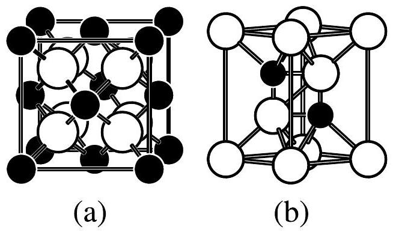
Figure 1.1. (a) The fluorite structure of ceria. (b) The A-type $\mathrm{Ce}_{2} \mathrm{O}_{3}$ structure. Oxygen ions are large open circles and cerium ions small filled circles. The same style is used throughout this section.

Partially and fully reduced ceria. Much of ceria's useful properties can be linked to the presence of oxygen vacancies, and among native defects in ceria, the oxygen vacancy is by far the most extensively studied and the most stable defect under a wide range of conditions. As mentioned, the formation of neutral oxygen vacancies in ceria involves a reversible change in the oxidation state of two cerium ions from Ce(IV) to Ce(III). The process can be written:

$$
O^{2-}+2 C e^{4+} \rightarrow 2 C e^{3+}+\frac{1}{2} O_{2}(g)
$$

or in Kröger-Wink notation:

$$
O_{O}^{\times}+2 C e_{C e}^{\times} \rightarrow V_{O}^{\bullet \bullet}+2 C e_{C e}^{\prime}+\frac{1}{2} O_{2}(g)
$$

Thus an oxygen ion, formally $\mathrm{O}^{2-}$, leaves the lattice as a neutral species, $\frac{1}{2} \mathrm{O}_{2}(\mathrm{~g})$, and the two electrons left behind in the process get trapped at two cerium sites, i.e. they become localized at two cerium sites. At such cerium sites, the electron occupies an otherwise empty $\mathrm{Ce} 4 f$-state and the $\mathrm{Ce} 4 f$ band in ceria is split into two bands: an occupied $\mathrm{Ce} 4 f_{\text {Full }}$ band and an empty $\mathrm{Ce} 4 f_{\text {Empty }}$ band; see Fig. 1.2b.

There exists a number of higher oxides of cerium with composition $\mathrm{CeO}_{2-x}$, with $\mathrm{x}=0-0.5$. The practical reduction limit of non-stoichiometric ceria is $\mathrm{Ce}_{2} \mathrm{O}_{3}$, where all cerium ions are found in a Ce(III) oxidation state. The crystal structure of $\mathrm{Ce}_{2} \mathrm{O}_{3}$ under normal conditions is the A-type sesquioxide $(P 3 m 1)$, Fig. 1.1b. The electronic band structure of $\mathrm{Ce}_{2} \mathrm{O}_{3}$ bears resemblance to that of partially reduced ceria, the main difference being that the $\mathrm{Ce} 4 f_{\text {Empty }}$ and $\mathrm{Ce} 5 d$ bands have merged together in the conduction band; see Fig. 1.2c. The experimental $\mathrm{Ce} 4 f_{\text {Full }} \rightarrow \mathrm{Ce} 5 d+\mathrm{Ce} 4 f$ band gap is about 2.4 eV (see references in Paper I).

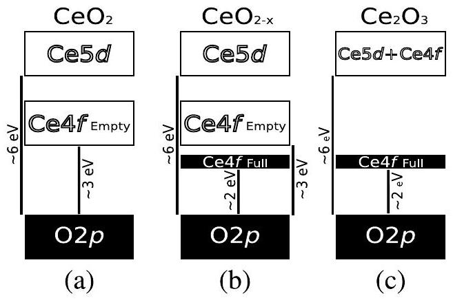
Figure 1.2. Schematic electronic structures of (a) stoichiometric $\mathrm{CeO}_{2}$, (b) partially reduced $\mathrm{CeO}_{2-x}$ and (c) $\mathrm{Ce}_{2} \mathrm{O}_{3}$. Filled bands are drawn as filled boxes while empty band are drawn as empty boxes.

Low index surfaces of ceria. The interesting chemistry in heterogeneous catalysis using ceria involves reactions taking place at the ceria surface. Experimentally, the most stable surface termination is normally the (111)-termination. Other terminations than (111) become gradually more important as the particle size is reduced and it has been pointed out that much of the interesting chemistry of ceria may take place at these surfaces [5]. The (100) surface is polar and typically reconstructs. Figure 1.3 shows the two non-polar low-index surfaces, (111) and (110), which will be in focus in this thesis. The (111) surface is a compact zig-zag surface consisting of O-Ce-O triple-layers with a 3-fold rotational symmetry axis along the [111] direction. The (110) surface consists of stoichiometric surface layers and is less symmetric.

It is shown in this thesis that the (111) and (110) surfaces demonstrate quite different properties. For example, it is discussed in Paper VIII that sulfur recovery from $\mathrm{SO}_{2}$ rich gas can be accomplished on the $\mathrm{CeO}_{2}(111)$ surface but not on the $\mathrm{CeO}_{2}(110)$ surface.

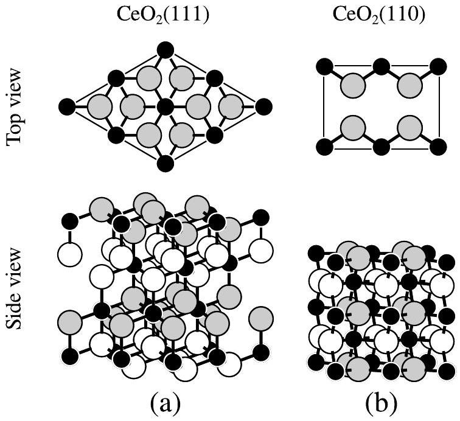
Figure 1.3. The two non-polar low-index surfaces of ceria. Top view and side view of (a) the (111) surface, and (b) the (110) surface. The triple-layers in the (111) surface are indicated by alternating white and gray color on oxygen. The stoichiometric layers in the (110) surface are indicated in a similar way.

Ceria nano crystals. Nano-crystalline ceria with a controlled size distribution in a variety of shapes can be prepared experimentally [6, 7, 8, 9, 10]. While the most stable nano crystals are \{111\}-terminated octahedra, other shapes that expose only the less stable \{110\} facets (nano rods) and \{100\} facets (nano cubes) can also be prepared. Figure 1.4 shows the atomic arrangement in a typical octahedral nano crystal. A related type of nano crystal, frequently observed experimentally, is the truncated octahedral nano crystal, which is also illustrated in figure 1.4.

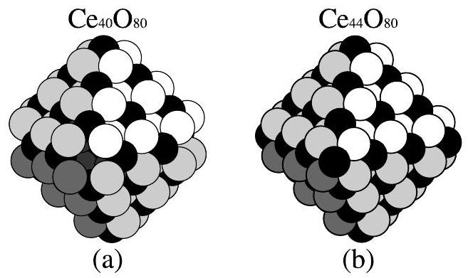
Figure 1.4. Examples of (a) truncated and (b) non-truncated octahedral \{111\}-terminated nano crystals.

Small nano crystals can display unusual activity towards low temperature CO oxidation and an impressive OSC has been measured for nano crystals less than 5 nm [3]. New theoretical results related to the stability, activity and OSC of small nano crystals of various stoichiometries are presented in Paper V of this thesis.

### 1.4 Specific questions in focus in this thesis

Some specific questions that are answered in this thesis are the following:

- Paper I. Can the failures of standard DFT methods be rectified with the DFT+U method? What is a suitable $U$-value?
- Paper II. Can hybrid methods be used to study reduced ceria? Which local basis-sets can be used in such studies?
- Paper III. What supercells should be used to study oxygen vacancies at the ceria (110) surface? What structure do these vacancies adopt?
- Paper IV. What mechanisms are involved in vacancy clustering at the ceria (111) surface? What types of methods can be used to study these clusters?
- Paper $\mathbf{V}$. What is the origin of the increased OSC in nano crystalline ceria?
- Paper VI. How does $S O_{2}$ interact with ceria? Which different $S O_{x}$ species are formed?
- Paper VII. How does atomic $S$ interact with ceria? Once on the surface, is $S$ mobile or not? Does $S$ diffuse into the bulk?
- Paper VIII. Which $S O_{x}$ species are present on the ceria (111) and (110) surfaces under reducing and oxidizing conditions? Are the two surface different in this respect?

## 2. Results: Describing vacancies and electron localization with DFT

When I started working with ceria it was already known that standard density functional theory (DFT) calculations based on the Local Density Approximation (LDA) or the generalized gradient approximation (GGA) are unable to correctly describe the localized nature of the $f$-electrons in reduced ceria. In fact, those methods predict the electrons left behind in the vacancy formation process to reside in orbitals that are delocalized over many atoms, which is in contrast to experimental findings. Since then, two main techniques to deal with these shortcomings have emerged for DFT studies of defective ceria. These are the so-called hybrid functionals and the DFT+U approach. In this thesis, development and characterization of both these approaches are described. They are treated in detail in Papers I and II and a summary is given below.

### 2.1 DFT+U

In the DFT+U method (see the appendix for more details), the $f$-electrons are projected out and treated in a Hubbard-like model with an on-site Coulomb interaction controlled by the parameter U (see the references of Paper I). This method imposes an energy penalty on partial $f$-occupancy and thus drives the DFT ground state away from the delocalized LDA/GGA ground state, towards an electronic structure that more closely corresponds to an integer $f$-occupancy. The DFT+U approach (in the Dudarev formulation[11]) was used for calculations on partially reduced ceria in Paper I. A 96 atom $2 \times 2 \times 2$ crystallographic ceria supercell was used and partially reduced ceria was modeled by introducing a single oxygen vacancy in that supercell. The dependencies of some key structural, mechanical and electronic properties on the U-parameter were investigated and extensively compared to available experimental data. Moreover, the GGA+U and LDA+U results were compared to each other.

A crucial question here is whether $D F T+U$ can rectify the problems of the delocalized Ce4f states in reduced bulk ceria. This question can be answered from the detailed analysis of the DFT+U electronic structure presented in Paper I. In this thesis chapter, LDA+U is used as an example, but similar trends were obtained using GGA+U in Paper I.

It was found that when U is equal to zero (standard LDA), the defect band of the partially reduced ceria is merged with the $\mathrm{Ce} 4 f_{\text {Empty }}$ band and the partially reduced ceria system is very similar to the unreduced system (left part of Fig. 2.1a). As U is made to increase, the defect band detaches from the Ce4f Empty band and moves towards the valence band, eventually merging with it at around $\mathrm{U}=9 \mathrm{eV}$ (right part of Fig. 2.1a). At U-values between 5-7 eV, the defect band is well isolated in the $\mathrm{O} 2 p \rightarrow \operatorname{Ce} 4 f_{\text {Empty }}$

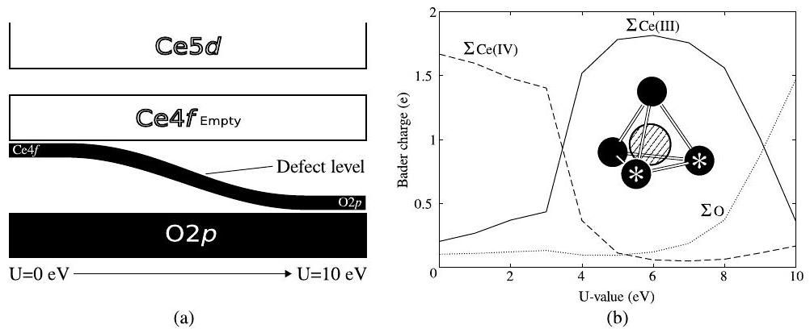
Figure 2.1. (a) A qualitative sketch of how the defect level in partially reduced ceria is effected by the Hubbard U-parameter in the LDA+U method. (b) Bader charges of the defect level. The three lines show total Bader charge of all Ce(IV) atoms (dashed line), of the two Ce(III) ions (solid line) and all oxygen ions (thin dotted line). The inset shows, schematically, the local coordination of cerium ions (filled circles) around an oxygen vacancy (striped circle). Ce(III) ions are marked with stars (*).

band gap, as experiments suggests that it should be (middle part of Fig. 2.1a). For such U-values, the defect band shows mostly $\mathrm{Ce} 4 f$ character. The partial charge density of this band is strongly concentrated on two cerium ions neighboring the oxygen vacancy. This demonstrates that, for these U-values (5-7 eV), LDA+U gives a qualitative correct description of the electron localization, i.e. one that does not contradict experiment.

The character of the defect band at lower U-values is also dominated by $\mathrm{Ce} 4 f$. However, the partial charge density is now delocalized and spread over many cerium sites. At higher U-values (8-10 eV), on the other hand, the defect band acquires more and more $\mathrm{O} 2 p$ character and the partial charge density becomes delocalized over the oxygen ions. This qualitative behavior of the electronic structure is neatly summarized in figure 2.1b, where so-called Bader charges [12] on selected atoms were calculated from the partial charge density (the defect band) and plotted as a function of U. The atoms were divided into three groups according to: the two cerium ions where most of the charge in the defect band is concentrated (denoted Ce(III) in Fig. 2.1b), the remaining cerium ions and all oxygen ions. From this figure it is clear that the sum of the charges on two of the four cerium ions neighboring the vacancy goes through a maximum at $\mathrm{U}=6 \mathrm{eV}$.

Interestingly, using the LDA+U method, a U-value of 6 eV (i.e. the maximum in the figure), seems to yield the best overall agreement to the full set of experimental data for ceria and $\mathrm{Ce}_{2} \mathrm{O}_{3}$ considered in the assessment. It can also be noted that, for both ceria and $\mathrm{Ce}_{2} \mathrm{O}_{3}$, the LDA+U method is superior to GGA+U in terms of reproducing the experimental data. This is especially apparent when one considers the cell parameter of ceria. The extrapolated experimental 0 K value for the cell parameter of ceria is $5.39 \AA[13]$. At the LDA+U level, the cell parameter increases from 5.37 to $5.43 \AA$ when U is varied between 0 and 10 eV, and at $\mathrm{U}=6 \mathrm{eV}$ the cell parameter is $5.40 \AA$. For GGA, the cell parameter increases from 5.47 to $5.52 \AA$ over the same range of U-values. Structural, mechanical and electronic data for $\mathrm{CeO}_{2}$ and $\mathrm{Ce}_{2} \mathrm{O}_{3}$ obtained from DFT calculation using LDA+U and GGA+U and hybrid methods (presented in the next section) are compared to available experimental data in tables 2.1-2.3.

In conclusion, both LDA+U and GGA+U give descriptions of the localized Ce4f-states that are consistent with available experimental data, providing that a proper U-value is used.

Answers to the questions: Can the failures of standard DFT methods be rectified with the DFT+U method? What is a suitable U-value?
Yes.
5-6 eV.

Table 2.1. Cell parameter, $a_{0}$, and bulk modulus, $B$, of $\mathrm{CeO}_{2}$, using the LDA+U, PBE0 and B3LYP functionals.
| Functional | Basis-set | $\mathrm{a}_{0}(\AA)$ | B (GPa) | Ref. |
| :--- | :--- | :--- | :--- | :--- |
| $\mathrm{LDA}+\mathrm{U}(\mathrm{U}=6 \mathrm{eV})$ | PW | 5.40 | 213 | Paper I |
| $\mathrm{PBE}+\mathrm{U}(\mathrm{U}=5 \mathrm{eV})$ | PW | 5.49 | 184 | Paper I |
| PBE0 | GTO | 5.41 | 220 | Paper II |
| PBE0 | PW | 5.39 | - | [14] |
| PBE0 | PW | 5.40 | 209 | Unpublished |
| HSE | GTO | 5.41 | 206 | [15] |
| B3LYP | GTO | 5.48 | 199 | Paper II |
| Exp. (Ext. to 0 K) | - | 5.39 | - | [13] |
| Exp. | - | - | 220(9) | [16] |
| Exp. | - | - | 204 | [17] |

Table 2.2. Cell parameters ( $a_{0}, c_{0}$ ) of $\mathrm{Ce}_{2} \mathrm{O}_{3}$ using the $L D A+U$, $P B E+U, P B E 0$ and B3LYP functionals.
| Functional | Basis-set | $a_{0}(\AA)$ | $c_{0}(\AA)$ | Ref. |
| :--- | :--- | :--- | :--- | :--- |
| $\mathrm{LDA}+\mathrm{U}(\mathrm{U}=6 \mathrm{eV})$ | PW | 3.86 | 6.04 | Paper II |
| PBE0 | PW | 3.87 | 6.07 | [14] |
| PBE0 | GTO | 3.87 | 6.07 | Paper II |
| B3LYP | GTO | 3.90 | 6.19 | Paper II |
| Exp. | - | 3.891(1) | 6.059(1) | [18] |

Table 2.3. Direct and indirect $\mathrm{CeO}_{2}$ band gaps calculated using the LDA+U, PBE+U, PBE0 and B3LYP functionals.
| Functional | Basis-set | $\mathrm{O} 2 p \rightarrow \mathrm{Ce} 5 d(\mathrm{eV})$ |  | $\mathrm{O} 2 p \rightarrow \mathrm{Ce} 4 f_{\text {Empty }}(\mathrm{eV})$ |  |
| :--- | :--- | :--- | :--- | :--- | :--- |
|  |  | Dir. | Ind. | Dir. | Ind. |
| LDA+U | PW | 5.63 | 5.14 | 2.66 | 2.45 |
| PBE+U | PW | 5.67 | 5.23 | 2.44 | 2.28 |
| PBE0 | GTO | 8.46 | 8.08 | 4.06 | 3.94 |
| B3LYP | GTO | 8.06 | 7.65 | 3.42 | 3.30 |
| Exp. | - | 5.5-7.0 |  | 2.5-3.5 |  |

### 2.2 Hybrid methods and basis-sets

Paper II discusses a different approach to overcoming the failures of the standard DFT methods, namely the so-called hybrid methods (see the appendix for more details). With the DFT+U method (Paper I), a plane-wave basis-set was used, while local Gaussian type orbital (GTO) basis-sets were used in the hybrid study. Local basis-sets can be used in certain computational approaches where plane-waves are not well suited. For example, local basis-sets are needed in embedded cluster calculations when high-level wave function based methods are applied. The background to the study in paper IIIwas the wish to perform B3LYP calculations for stoichiometric and reduced ceria for a number of reasons (some of which are outside the context of this thesis). No B3LYP study of ceria had been published in the literature before, although studies using another hybrid functionals, namely HSE [15, 14] and PBE0[14] existed.

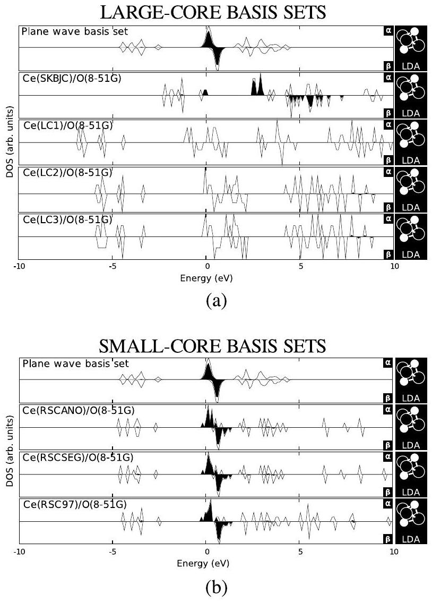
Figure 2.2. Comparisons of basis-sets for the description of a $\mathrm{Ce}_{2} \mathrm{O}_{3}$ cluster using LDA. (a) Large-core basis-sets and (b) small-core basis-sets (b). In the top panels results for the reference plane wave basis-set are shown. Here and in the following figures the lines mark the total DOS, while the black filled curves mark the $\mathrm{Ce} 4 f$ contributions.

Our strategy for assessing the qualities of the various local basis-sets (old and new) was as follows. We selected one Hamiltonian (LDA) for which we systematically tested all the basis-sets against a fully converged plane-wave basis-set reference, regardless of the fact that the LDA functional itself is far from perfect for ceria, as discussed above. The basis-sets were carefully adjusted and tested against the converged plane-wave basis-set reference. In particular one property was assessed and compared between the plane-wave reference and the local basis-sets tested: the electronic density-of-states (DOS). Figure 2.2 shows the DOS comparison between the plane wave reference basis-set and the GTO basis-sets for the small $\mathrm{Ce}_{2} \mathrm{O}_{3}$ cluster shown in the right panels.

The GTO basis-sets were divided into two groups. The first group contained a number of large-core basis-sets, all using an effective core potential (ECP) for cerium including 46 electrons. Thus these basis-sets describe 12 valence electrons only, as cerium has the atomic number 58. In the second group of GTO basis-sets, the small-core basis-sets are all based on a 28-electron ECP and thus all have 30 valence electrons. From figure 2.2a it becomes clear that none of the large-core basis-sets can match the reference. On the other hand, figure 2.2b shows that the small-core basissets performs well in this respect.

In paper II, a carefully adjusted basis-set designed for periodic calculation of $\mathrm{CeO}_{2}$ and $\mathrm{Ce}_{2} \mathrm{O}_{3}$ was developed. Such adjustments were needed in order to remove ghost-states appearing in the $\mathrm{Ce}_{2} \mathrm{O}_{3}$ DOS, as indicated in figure 2.3. Our final, best, basis-set is the one used in the last panel of figure 2.3.

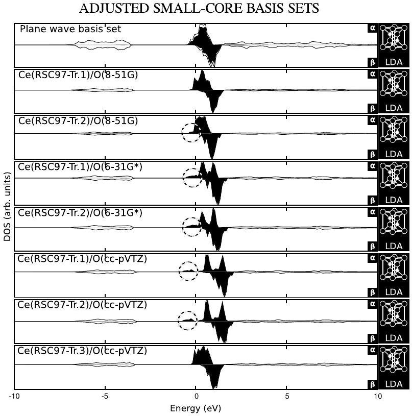
Figure 2.3. Small-core basis-sets were adjusted in order to remove the ghost state (marked with a dashed circle) appearing in the band gap of bulk $\mathrm{Ce}_{2} \mathrm{O}_{3}$. The final optimized basis-set is shown in the bottom panel.

Next the new local basis sets was used in a study to compare the performance of different functionals. Figure 2.4 shows a DOS comparison for $\mathrm{CeO}_{2}$ and $\mathrm{Ce}_{2} \mathrm{O}_{3}$ between, on the one hand, the plane-wave reference using the LDA+U functional and, on the other hand, the adjusted GTO basis-set using the two hybrid functionals, PBE0 and B3LYP. The two hybrid functionals in combination with our new GTO basis-set are seen to both manage to qualitatively describe the DOS of $\mathrm{Ce}_{2} \mathrm{O}_{3}$ and the localized $f$-electrons in $\mathrm{Ce}_{2} \mathrm{O}_{3}$. However, none of the hybrid/GTO basis-set methods are as successful as LDA+U/PW in terms of quantitatively describing the electronic structure; see Table 2.3. Overall, for the electronic structure, B3LYP performs slightly better than PBE0; see Table 2.3. For cell parameters and bulk modulus of $\mathrm{CeO}_{2}$ and $\mathrm{Ce}_{2} \mathrm{O}_{3}$, the PBE0 results are much better than the B3LYP results; see Tables 2.2 and 2.1. Marsman et al. [19] made similar observations for a larger number of solids (not including ceria).

In conclusion, hybrid methods and a carefully tuned local basis-sets manage to successfully describe both ceria and $\mathrm{Ce}_{2} \mathrm{O}_{3}$.

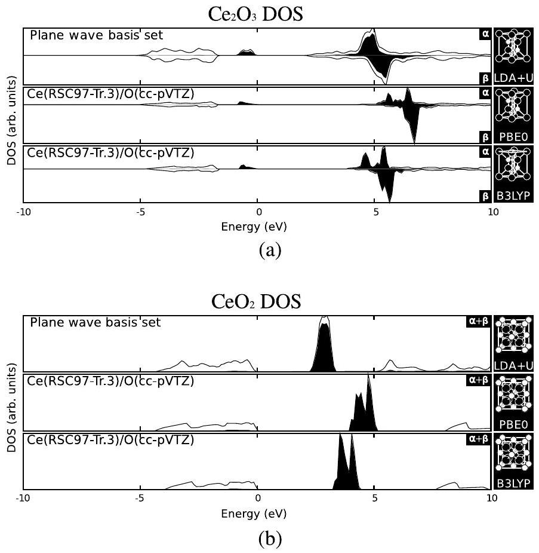
Figure 2.4. Comparisons between LDA+U using a plane wave basis-set on the one hand and PBE0 and B3LYP with the adjusted localized atomic basis-set on the other. (a) DOS comparison for bulk $\mathrm{Ce}_{2} \mathrm{O}_{3}$ and (b) DOS comparison for bulk $\mathrm{CeO}_{2}$.

Answers to the questions: Can hybrid methods be used to study reduced ceria?
Which local basis-sets can be used in such studies?
Yes.
Local basis-sets based on a small-core ECP.

## 3. Results: Oxygen vacancies in ceria

### 3.1 Single oxygen vacancies at the ceria(111) and (110) surface

In the standard picture of electron localization in ceria, the excess electrons left behind in the vacancy formation process localize at two cerium ions in the proximal vicinity of the vacancy; see Fig. 3.1a. We never challenged this picture in our work on oxygen vacancies in bulk ceria in 2007 (Paper I). It was later demonstrated by Shoko et al. [20] and Ganduglia-Pirovano [21] that this standard picture appears to be incorrect and that the excess electrons localize at cerium ions that are next nearest neighbors (NNNs) to the vacancies. Shoko et al. used valence bond sums derived from high quality crystal diffraction studies of partially reduced $\mathrm{CeO}_{2-x}$ phases. Ganduglia-Pirovano used QM methods for the ceria(111) surface. Calculations presented in this thesis show that using similar QM methods as in Ref. [21], the same conclusion also holds for bulk vacancies, where both electrons localize at NNN positions, and for oxygen vacancies on the $\mathrm{CeO}_{2}(110)$ surface, where one of the electrons localize at a NNN position (paper III).

Thus for ceria (111), which is normally the most stable surface, Ganduglia-Pirovano et al. showed that the most stable single vacancy structures are found when the localized electrons reside at Ce ions in NNN positions relative to the vacancy (Fig. 3.1b) and this hold true for both surface and sub-surface vacancies. Even though this is unexpected from a simple electrostatic model they demonstrated that this can be explained by a significant reduction of the Madelung potential (corresponding to a stabilization in this case) at the position of the vacancy for the NNN configuration once the structure has been relaxed.

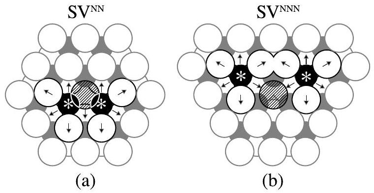
Figure 3.1. Two types of surface vacancy (SV) structures at the ceria (111) surface. (a) $\mathrm{SV}^{N N}$ with localization at nearest neighbors (NN) cerium ions and (b) $\mathrm{SV}^{N N N}$ with localization at next nearest neighbors (NNN) cerium ions.

The effect of relaxation is illustrated in figure 3.2 using a simple point charge model of the ceria(111) surface. This model uses formal charges for cerium and oxygen,
+4 and -2, respectively. The charge at a cerium site in the surface is decreased (by $0.5 e$ in the example shown here), to mimic electron localization, and the Madelung potential at oxygen ions, both surface and sub-surface, that are nearest and next nearest neighbors to that cerium site is calculated. Relaxation in this model is introduced by a spherical relaxation of the nearest neighbors oxygen ions around the reduced cerium ion. The difference in Madelung potential (here a measure of vacancy stability) at NN and NNN positions is calculated as a function of relaxation and three regions are identified: (i) a region at small relaxation where Ce(III) is the most stable at a short distances (NN) to both surface and sub-surface vacancies (electrostatic regime), (ii) a region at intermediate relaxation where Ce(III) is most stable at a short distance to surface vacancies and at a long distance (NNN) to sub-surface vacancies (mixed regime) and (iii) a region with large relaxation where Ce(III) is most stable at a long distances from both types of vacancies (relaxation regime). It should be pointed out that this model actually has two parameters: the amount of localized charge and the amount of relaxation. With more localization it takes more relaxation to reach beyond the electrostatic regime and if a whole electron ( $1.0 e$ ) is localized we reach at most the mixed regime upon relaxation. The significance of these regimes will become clear in the discussion of vacancy clustering at the (111) surface presented in section 3.2.

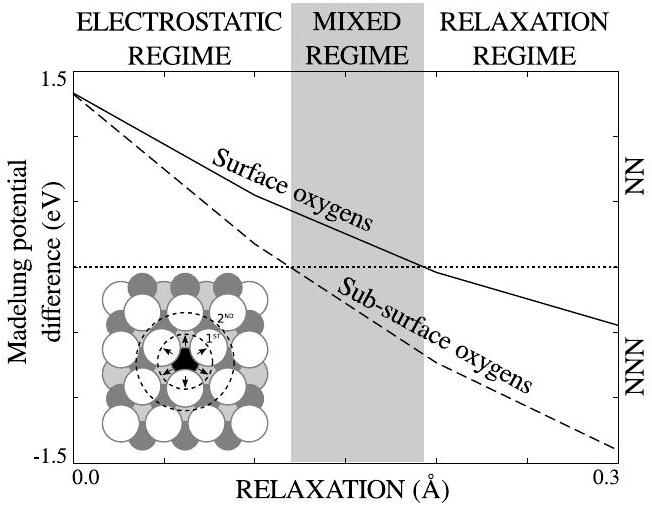
Figure 3.2. Difference in Madelung potential at oxygen ions in the first and second shell around a Ce(III) ion at the $\mathrm{CeO}_{2}(111)$ surface as a function of relaxation in the simplified model presented in paper IV. Relaxation is modelled by a spherical relaxation of the first shell oxygen ions. Curves for surface and sub-surface oxygen ions are drawn separately.

Much interesting chemistry is suggested to take place on non-(111) surface terminations [5]. In paper III, the single surface oxygen vacancy at the (110) surface was investigated with the GGA+U method using a supercell approach. The dependence on supercell size for a large number of localization patterns were investigated. Seven supercells p(2×1),p(2×2),p(2×3),p(3×2),p(3×3),p(2×4) and $\mathrm{p}(4 \times 2)$, and six localization patterns were investigated, see Fig. 3.3. The localization pattern dictates the local structure or coordination figure, adopted around the vacancy. The relaxation and local distortion are rather complex, and all attempts to explain or predict the stability of the different structures based on any simplistic model, such as that presented for the (111) surface, were unsuccesful. In paper III we classify the vacancy structres
at the (110) surface into three geometrical shapes according to the relaxation of the geminal oxygen. Here geminal oxygen refers to the oxygen that shares the same two surface cerium ions as the removed oxygen; see Fig. 3.3. It turns out that the geminal oxygen either remains in the surface plane (labeled InPl) or occupies a bridging position between the two surface cerium ions (labeled Bri). This bridging was found to be either symmetric (s-Bri), with equal bond lengths to the two cerium ions, or unsymmetric (u-Bri) with unequal bond lengths. Each of these geometrical shapes was earlier presented in separate contexts by different authors. The localization patterns explored in these previous studies were all restricted to the standard picture while the new ground state structure found in paper III corresponds to a non-standard localization pattern with Ce(III) located at positions 1 and 4 in Fig 3.3. Many other local minima structures, with other localization patterns, were also found. The largest difference in oxygen vacancy formation energy between these structures is about 0.5 eV in any individual supercell. However, for some of these structures, the formation energy changes with about 1 eV, depending on the choice of supercell size. Even without counting the results for the two smallest supercells considered, the difference is still about 0.8 eV.

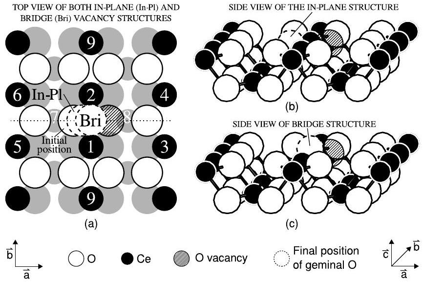
Figure 3.3. Schematic representation of a single oxygen vacancy at the $\mathrm{CeO}_{2}(110)$ surface. Two of three geometrical structures found are illustrated in the figure: The in-plane (InPl) and the bridge (Bri) geometries. (a) Top view. (b) Schematic side view of the InPl structure. (c) Schematic side view of the Bri structure. The numbers 1-9 are used to describe the localization patterns discussed in the text and in Table 3.1.

For comparison I calculated the dependence of vacancy stability on supercell size for the (111) surface. At the GGA+U level the formation energy for the two surface vacancy structures, $\mathrm{SV}^{N N}$ and the $\mathrm{SV}^{N N N}$, change with about 0.2 eV when changing from a $\mathrm{p}(3 \times 3)$ to a $\mathrm{p}(6 \times 6)$ cell, while the energy difference between them only changes by about 0.02 eV. Such robustness in trends and relative energies on the (111) surface was observed also in the study of vacancy clustering presented below.

Still, any attempt to accurately determine the vacancy formation energy based on the supercell approximation does not only require a serious consideration on methods but must also involve an estimate of the supercell approximation error.

Table 3.1. Vacancy formation energies $E_{\text {vac }}$ at the ceria (110) surface for various vacancy structures and Ce4f localization patterns in the seven supercells considered. $p(2 \times 2)$ is entered twice for clarity of comparison. Subscripts in labels refer to the numbered atoms in figure 3.3.
| Supercell | $\mathrm{s}-\mathrm{InPl}_{1+2}$ | $\mathrm{s}-\mathrm{Bri}_{1+2}$ | $\mathrm{s}-\mathrm{Bri}_{3+4}$ | $\mathrm{u}-\mathrm{Bri}_{1+3}$ | u-Bri ${ }_{1+4}$ | u-Bri ${ }_{1+8}$ |
| :--- | :--- | :--- | :--- | :--- | :--- | :--- |
| p(2×1) | 2.31 | 2.84 | - | - | - | 2.48 |
| p(2×2) | 2.23 | 2.39 | 2.05 | 1.77 | 1.74 | 2.03 |
| p(2×3) | 2.22 | 2.28 | 2.30 | 1.77 | 1.76 | 1.97 |
| p(2×4) | 2.22 | 2.29 | 2.32 | 1.77 | 1.78 | 1.96 |
| p(2×2) | 2.23 | 2.39 | 2.05 | 1.77 | 1.74 | 2.03 |
| p(3 × 2) | 1.94 | 2.01 | 1.72 | 1.59 | 1.56 | 1.74 |
| p(4×2) | 1.85 | 1.87 | 1.55 | 1.52 | 1.51 | 1.66 |
| p(3×3) | 1.91 | 1.98 | 1.89 | 1.58 | 1.54 | 1.77 |

Answers to the questions: What supercells should be used to study oxygen vacancies at the ceria (110) surface? What structure does these vacancies adopt? In order to estimate the supercell size error a large series of supercells must be used.
The ground state structure is an unsymmetric bridge structure.

### 3.2 Vacancy clustering at the ceria (111) surface

Numerous experimental investigations of the ceria(111) surface using Scanning Tunneling Microscopy (STM) [22, 23, 24, 25] and non-contact Atomic Force Microscopy (nc-AFM) [26, 27, 24, 28, 29] all suggest that at this surface, both surface and subsurface vacancies order into triangular clusters, extended lines and chains. However, while surface vacancies form compact clusters where vacancies are separated by one primitive lattice surface vector, sub-surface vacancies form sparse clusters where vacancies are separated by two primitive surface lattice vectors. Some of these vacancy structures have been suggested to act as pockets for molecular adsorption [28].

Interestingly, very few theoretical investigations supporting the experimental findings of vacancy clustering have been presented in the literature. Early Force Field (FF) studies by Conesa [30] suggested that surface oxygen vacancies should associate into pairs on the (111) surface. However, these findings were later contradicted by DFT investigations [31, 32], which were unable to predict vacancy clustering. In paper IV, these apparent contradictions are dealt with in detail. There, it is found that part of the problem seems to lie in an incorrect description of the single vacancies using these DFT methods. More generally, methods which predict NNN localization at both surface and sub-surface vacancies (relaxation regime), are unable to predict the type of vacancy clustering seen experimentally. NNN localization refers to localization at cerium ions that are not directly adjacent to the vacancy but rather nearest neighbors to the vacancy; see Fig. 3.1b. On the other hand, methods that suggest that the most stable positions for electron localization is NN around surface vacancies but NNN around sub-surface vacancies (mixed regime) do give a qualitative correct prediction
for vacancy clustering. Thus the following principle of 4 rules for vacancy clustering, which can be seen as a generalization of the principle presented by Esch et al. for surface vacancies, is proposed:

1. Ce(III) ions should only be found at NN positions for single surface vacancies and at NNN positions for sub-surface vacancies.
2. Vacancies must be combined so that they share Ce(III) ions amongst them.
3. Three vacancies must not share the same Ce(III) ion.
4. Rules 1-3 lead to chains. These are the most stable when containing a closed loop.

## Computer experiments

In order to disclose the underlying mechanism governing the vacancy formation at the ceria (111), a large series of computer experiments were conducted (paper IV). In these experiments a number of structural models for vacancy clusters were explored, namely the surface vacancy dimer, the surface vacancy trimer, the infinite surface vacancy line and the infinite sub-surface vacancy line, see Fig. 3.4. For each of these structure models, the energies of all unique localization patterns involving NN and NNN positions at the surface were calculated using a number of different shell-model FFs. DFT-GGA+U calculations were performed on a selection of these combinations of structure models and localization patterns. The association energy per vacancy was calculated and a correlation between localization patterns and stability was sought. In the following, results from two of these models are presented, but the conclusions reached here apply to the full set.

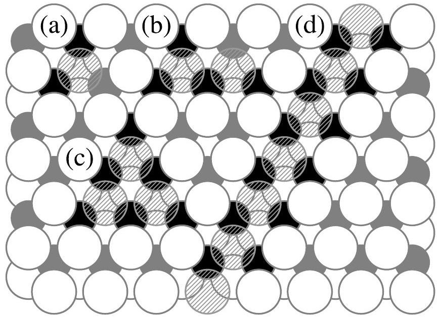
Figure 3.4. Structure models for surface vacancy clusters used in the computer experiments for ceria (111). (a) Single surface vacancy, (b) surface vacancy dimer, (c) surface vacancy trimer and (d) infinite surface vacancy line. Oxygen ions are colored white and cerium ions dark gray (Ce(IV)) or black (Ce(III)). Vacancies are drawn with striped circles and the most stable localization patterns found with the Conesa FF method are highlighted with black circles.

Table 3.2. Calculated association energy of single surface vacancies into infinite surface vacancy lines with different methods. Ground state localization patterns of single vacancies and infinite surface lines are given in columns 2 and 3. $E_{a}$ is defined as the energy gain (negative values) or energy loss (positive values) per vacancy when going from the isolated defects (calculated in a p(4×4) cell) to the infinite vacancy line (calculated in a $p(1 \times 4)$ supercell). All localization patterns were not exhausted for DFT.
| Method | Localization |  | $\mathrm{E}_{a}$ |
| :--- | :--- | :--- | :--- |
|  | SV | SV line |  |
| FF-Conesa [30] | NN | NN | -0.26 |
| FF-Kullgren11 ( paper IV) | NN | NN | -0.13 |
| FF-Balducci [33] | NNN | NN | +0.24 |
| FF-Gotte04 [34] | NNN | NN+NNN | +1.03 |
| FF-Gotte07 [35] | NNN | NN+NNN | +1.03 |
| DFT-GGA+U | NNN | NN+NNN | +0.45 |

Sub-surface vacancy clustering. AFM and STM experiments show that, in subsurface vacancy clusters, the vacancies are separated by two primitive surface lattice vectors. This was taken into account in the structural model used in paper IV to investigate sub-surface vacancy clustering, the infinite sub-surface vacancy line. All methods, including DFT, predict that stable sub-surface vacancy lines form when the Ce(III) ions occupy NNN positions with respect to these vacancies. However the association energy is modest, ~ 0.1 eV per vacancy, as expected from the large separation of the sub-surface vacancies.

Surface vacancy clustering. As mentioned, for surface vacancy clusters, STM and AFM experiments show that vacancies are separated by one primitive surface vector. Again this was reflected in the structural model constructed in paper IV. For the infinite surface vacancy line (Fig. 3.4d), only two of the methods (the FF developed by Conesa [30] and those developed in paper IV), predict that stable vacancy clusters should form. All other methods, including DFT, predict that these clusters are unstable with respect to single vacancies. These results are summarized in Table 3.2. The two methods that predict vacancy clustering are the only methods with a $\mathrm{SV}^{N N}$ ground state structure for single surface vacancies and the corresponding infinite cluster also has localization at NN positions; cf. Figs. 3.4a and d. To be more specific, these two methods predict localization corresponding to the mixed regime in the simplified model presented in section 3.1 while all other methods have localization patterns corresponding to the relaxation regime.

## A consistent description of clustering

Paper IV shows that the types of surface and sub-surface vacancy cluster structures found in experiments for the ceria (111) surface, both STM and AFM, are found to be stable with respect to the corresponding single vacancies using the Conesa FF. Moreover paper IV also shows that, all these cluster structures are formed by sharing Ce(III) ions neighbors among the vacancies, as proposed by Esch et al.[25] for surface vacancies. This gives rise to sparse linear arrangements (vacancies separated by two lattice
constants) for SSVs and dense lines (vacancies separated by one lattice constant) for SVs in accordance with the general principle for vacancy clustering proposed at the opening of the section. Figure 3.5 shows a collection of surface vacancy clusters structures and their association energy per oxygen vacancy calculated in a $\mathrm{p}(8 \times 8)$ supercell with the Conesa FF[30]. These calculations were performed to further test and generalise our principle. From these calculations it becomes clear that the surface vacancy trimer is an effective seed for growth of linear vacancy clusters as previously suggested by Nörenberg and Briggs in their experimental investigation[23]; see Fig. 3.5a. Such structures always contain a closed loop and their high stability is in accordance with rule number 4 in the general principle. Furthermore, in accordance with rule number 3, the least stable trimer is just the one where all three vacancies share a common Ce(III) ion. Although this structure is actually predicted to be more stable than three single vacancies, it is much less stable than a dimer and a single vacancy and is therefore unstable.

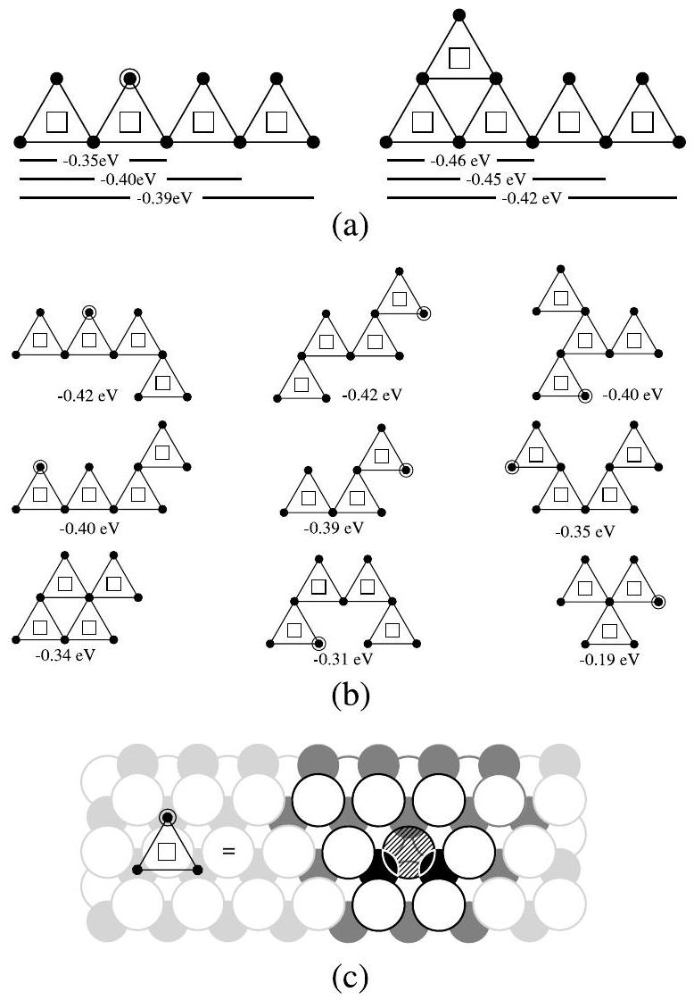
Figure 3.5. A collection of surface vacancy clusters and their association energy calculated with the Conesa FF parameters. (a) Linear clusters with and without triangular seed, corresponding to open chains and chains containing a closed loop, respectively. (b) General clusters sorted according to their association energy. (c) A key for the representation used in (a) and (b). Open circles are oxygen and filled gray circles are cerium. The oxygen vacancy is drawn with a striped circle. In (a) and (b) oxygen vacancies are drawn with squares, reduced cerium ions are drawn with black circles and Ce(IV) ions are highlighted by black halos.

Turbrügge et al. [29] observed a 2×2 pattern of sub-surface vacancies (SSV) in their AFM experiments. They concluded that while forming a $2 \times 2$ pattern the vacancies do not fall into close packing but rather form chains. This is consistent with rule number 3 in the general principle presented here. In fact, many of the chains found in the work by Turbrügge et al. contain a closed loop in accordance with rule number 4. The Conesa FF is successful in describing also these clusters and predict a non-favorable association (+0.50 eV per vacancy) into a closed packed p(2x2) arrangement of SSV, while linear arrangements, both open and with closed loops, are stable with respect to single vacancies.

Answers to the questions: What mechanisms are involved in vacancy clustering at the ceria (111) surface? What types of methods can be used to study these clusters?
The ground state localization around the single vacancies governs the type of clusters formed.
Certain force-field methods can be used.

## 4. Results: Ceria nano crystals

Ceria nano crystals are interesting candidates for efficient low temperature catalysis of CO oxidation, as clearly seen in temperature programed reduction (TPR) experiments, where a new peak at lower temperature is observed for nano structured ceria[4]. Tchöpe et al. [4] suggested that the increased activity for CO oxidation in these nano crystals is due to the existence of a more reactive type of oxygen. Guzman et al. [36] later showed that these species are superoxides $\left(\mathrm{O}_{2}^{-}\right)$. On reduced ceria surfaces, superoxides could in principle be formed when an electron, trapped at a Ce(III) site, is transferred to an adsorbed $\mathrm{O}_{2}$ molecule and the reaction can be written as follows:

$$
\mathrm{Ce}(\mathrm{III})+\mathrm{O}_{2}(g) \rightarrow \mathrm{Ce}(\mathrm{IV})+\mathrm{O}_{2}^{-}(a)
$$

Xu et al.[3] detected a dramatic increase in the oxygen storage capacity (OSC) for small nano crystals, again ascribed to superoxides. In paper V, DFT+U calculations reveal a possible mechanism responsible for this extraordinary OSC. In paper V, small ceria clusters first revealed the new mechanism, which was subsequently confirmed for nano crystals as well. Here, the same order of events is used in the description.

Thus, calculated energies from a set of $\mathrm{CeO}_{2}$ and $\mathrm{Ce}_{2} \mathrm{O}_{3}$ clusters, including up to 10 cerium ions, suggest an interesting stabilization mechanism which can explain the experimental observations described above. The clusters were obtained from a global optimization using an FF approach with the shell-model FF of Conesa[30]. It is found in paper V that reduced clusters that are fully covered (supercharged) with attached $\mathrm{O}_{2}$ molecules in the form of superoxide ions, are always more stable than stoichiometric clusters of similar sizes (same number of cerium ions); see Fig. 4.1a. Here energies are calculated with respect to ceria and molecular oxygen, corresponding to oxidizing conditions. The stabilization found suggests a new oxygen storage mechanism involving superoxides rather than lattice oxygen ions, as illustrated for the clusters containing 10 cerium ions in figure 4.2. It is proposed in paper V that this new mechanism for small clusters could be quite important, since such superoxide cycles on reduced clusters give a four-fold increase in oxygen storage capacity (OSC) over normal cycles involving lattice oxygen and stoichiometric clusters. Next this mechanism will be explored for more realistic models of nano crystals.

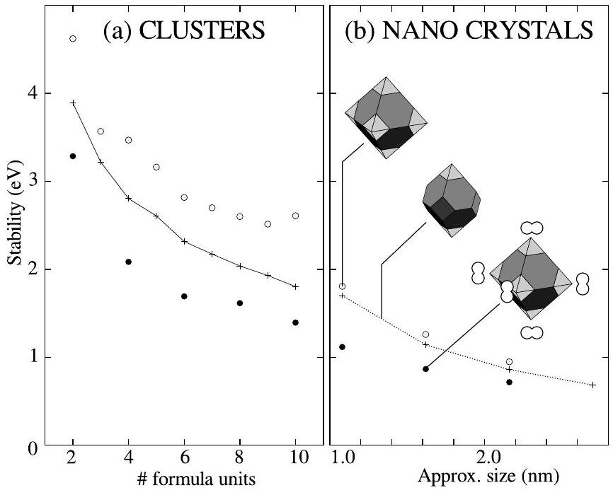
Figure 4.1. Stability (with respect to bulk $\mathrm{CeO}_{2}$ and the oxygen molecule in gas phase) for the stoichiometric, reduced and supercharged ceria clusters and nano crystals. (a) Globally optimized clusters and (b) ceria nano crystals. Stoichiometric clusters/crystals are indicated with crosses and are connected with solid lines. Reduced and supercharged clusters/crystals are drawn with open and closed circles, respectively.

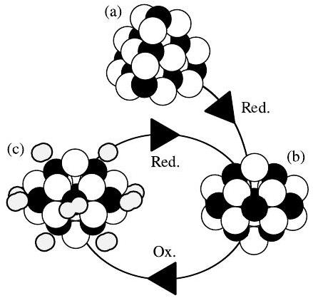
Figure 4.2. Stabilization mechanism for a 10 unit stoichiometric ceria cluster (a), which first becomes reduced (b), and then supercharged with $\mathrm{O}_{2}$ molecules that make superoxides, (c). The supercharged structure in (c) is more stable than the structure in (a) under $\mathrm{O}_{2}$ atmosphere. Therefore a typical red-ox cycle involving $\mathrm{O}_{2}$ will involve only structures (b) and (c). Oxygen ions are drawn with large open circles and cerium ions with filled small circles. Superoxide ions are drawn as light gray dumbbell shapes. The same style is used in remainder of this section.

A set of stoichiometric and partially reduced octahedrally shaped nano clusters of high stability, as suggested in references [37, 38, 39, 40], were used to model ceria nano crystals. Perfect \{111\}-terminated octahedral nano crystals are always cerium rich and therefore reduced (Fig. 4.3b). Stoichiometric clusters are obtained by truncating their corners (Fig. 4.3a). Both these shapes have been observed in experiments [6]. A series of such nano crystals were consider in paper V: the stoichiometric $\mathrm{Ce}_{16} \mathrm{O}_{32}$, $\mathrm{Ce}_{40} \mathrm{O}_{80}$ and $\mathrm{Ce}_{80} \mathrm{O}_{160}$, the partially reduced $\mathrm{Ce}_{19} \mathrm{O}_{32}, \mathrm{Ce}_{44} \mathrm{O}_{80}$ and $\mathrm{Ce}_{85} \mathrm{O}_{160}$. These structures correspond to nano-crystals of diameters 1-3 nm. The relative energies calculated for the stoichiometric (truncated octahedra) and reduced (perfect octahedra) nano crystals as a function of size is shown in figure 4.1b. In paper V, it is demonstrated that, due to their strong binding, superoxides effectively protect also reduced nano crystals from being re-oxidized into stoichiometric crystals. This is illustrated in figure 4.1b, where the stability of stoichiometric (truncated) and reduced (perfect) octahedral nano crystals in $\mathrm{O}_{2}$ atmosphere is plotted as a function of size. As expected, the naked reduced nano crystals are less stable than the stoichiometric crystals under these conditions. However, just as for the small clusters, the reduced nano crystals actually become the most stable after adsorption of $\mathrm{O}_{2}$ and the formation of strongly bound superoxides (Fig. 4.3c). Thus, the perfect \{111\}-terminated octahedral nano crystals represent a particular stable class of structures that are more stable than the truncated stoichiometric crystals, both during reducing condition (for example under CO atmosphere) and under oxidizing conditions with available $\mathrm{O}_{2}$. This is schematically illustrated in Fig. 4.4.

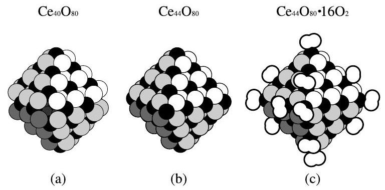
Figure 4.3. (a) Stoichiometric $\mathrm{Ce}_{40} \mathrm{O}_{80}$ nano crystal in the truncated octahedron shape. (b) Reduced $\mathrm{Ce}_{44} \mathrm{O}_{80}$ nano crystal in the perfect octahedron shape. (c) Supercharged $\mathrm{Ce}_{44} \mathrm{O}_{80} \cdot 16 \mathrm{O}_{2}$ nano crystal.

The stabilization mechanism found for clusters and nano crystals in this thesis could explain the peculiar observation made in the experimental TPR study by Tchöpe et al. [4], namely that reduced nano crystals that were "re-oxidized" in $\mathrm{O}_{2}$ atmosphere maintained their high activity towards low temperature CO oxidation using $\mathrm{O}_{2}$, an activity not seen for stoichiometric nano crystals.

In figure 4.5, the relative increase of the OSC (supercharging factor) in perfect \{111\}-terminated octahedral nano crystals via superoxide storage is compared to storage in the form of lattice oxygen for particle sizes up to 10 nm.

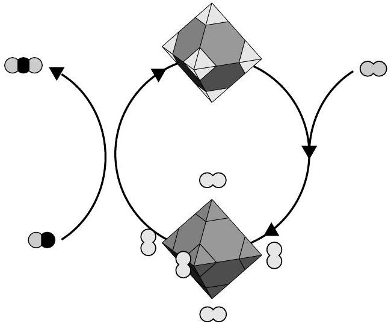
Figure 4.4. A schematic illustration of the superoxide cycle that leads to an increased oxygen storage capacity of small nano crystals. On the left side CO is oxidized to $\mathrm{CO}_{2}$ and on the right the crystal is supercharged with $\mathrm{O}_{2}$.

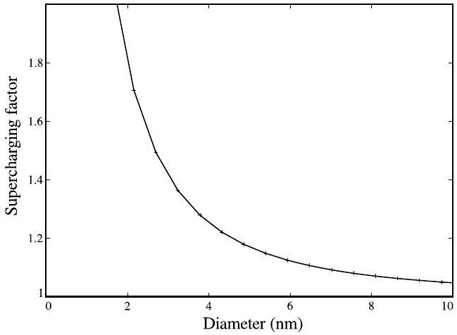
Figure 4.5. Oxygen storage capacity (OSC) increase in perfect \{111\}-terminated octahedral nano crystals. The size of the crystal is shown on the x-axis and the relative increase in OSC due to the superoxide cycle is shown on the y-axis. A supercharging factor of 1 corresponds to the OSC obtained by only involving lattice oxygen.

The stabilization through superoxide formation is related to the number of active sites (number of Ce(III)) on the reduced clusters or crystals. For the perfect octahedral nano crystals, these active sites are found along the edges of the crystals and the number of them grows linearly with the diameter of the crystal. The surface area grows quadratically and one could therefore expect that the energy gain in a decreased surface to volume ratio by truncating the octahedron will overcome the stabilization through superoxide formation as the particles grows larger. The calculations presented in paper V show that particles up to about 3 nm are certainly stabilized through superoxide formation. Further investigations exploring the stability of even larger crystals would be interesting for future work. However, DFT is not feasible for such studies and alternative methods must be adopted/developed.

Answers to the questions: What is the origin of the increased OSC in nano crystalline ceria?
An extraordinary stabilization of reduced nano crystals through superoxide formation.

## 5. Results: Sulfur poisoning and sulfur recovery

Two general aspects of the $\mathrm{SO}_{x}$ /ceria system are considered in this thesis: sulfur poisoning and sulfur recovery.

Deactivation of the three-way catalyst used in the purification of automotive exhaust gases is a serious and complex problem. Several mechanisms appear to be responsible for such deactivation and include: thermal degradation and sintering, fouling caused by deposition of soot and poisoning caused by sulfur, lead or other residues in the fuel. In this thesis, the discussion will be limited to the sulfur poisoning phenomenon and more specifically to the sulfur poisoning of the ceria component of three-way catalysts. Certainly most components of the catalyst are affected by the presence of sulfur impurities in the fuel. Strong adsorption of atomic sulfur onto metal particles alters their electronic properties and can, even at small coverages, inhibit the chemisorption of CO [41]. Furthermore, conversion of $\mathrm{Al}_{2} \mathrm{O}_{3}$ to $\mathrm{Al}_{2}\left(\mathrm{SO}_{4}\right)_{3}$ leads to structural and morphological changes of the catalytically active surfaces[41]. However, at low $\mathrm{SO}_{2}$ levels (5-20 ppm) the primary poisoning seems to take place at the ceria-containing component (Chapter 11 by R. Gorte and T. Luo in [1]). In this thesis, the interaction of sulfur containing molecules with the perfect and reduced ceria (111) and (110) surfaces are explored with DFT+U.

### 5.1 SOx species on ceria

In papers VI and VII, the interaction of $\mathrm{SO}_{2}$ and S with the ceria (111) and (110) surfaces were studied in detail and a number of $\mathrm{SO}_{x}$ species were identified and characterized. No S-Ce bond were found in these studies. This is expected since the valence band of ceria is built almost exclusively from $\mathrm{O} 2 p$ states and the only cerium states close to the Fermi energy are $\mathrm{Ce} 4 f$ states which make poor chemical bonds. The characterization of $\mathrm{SO}_{x}$ species was done by investigating connectivities, atomic charges, electronic structure, charge density difference and Electron Localization Function maps; see some examples in Fig. 5.1.

A selection of identified $\mathrm{SO}_{x}$ species are displayed in figures 5.2 and 5.3. The notation $\mathrm{SO}_{n}(\mathrm{a})$ will be used in the following. In this notation, a $\mathrm{SO}_{x}$ species on the surface is described as an adsorbed $\mathrm{SO}_{n}$ species on a stoichiometric surface although its origin may be different. Thus, for example the $\mathrm{SO}_{x}$ species formed by adsorbing a $\mathrm{SO}_{2}$ molecule on an oxygen vacancy site will be labeled SO(a), even though a $\mathrm{SO}_{2}^{-}$ species is formed.

The adsorption of $\mathrm{SO}_{2}$ on the stoichiometric surfaces $\left(\mathrm{SO}_{2}(\mathrm{a})\right)$ was found in paper VI to lead to the formation of physisorbed $\mathrm{SO}_{2}$ or strongly chemisorbed sulfites ( $\mathrm{SO}_{3}^{2-}$ ) and sulfates ( $\mathrm{SO}_{4}^{2-}$ ). Monodentate sulfites are formed on both surfaces. Bidentate sulfates readily form on the (110) surface, which is the more reducible of the two.

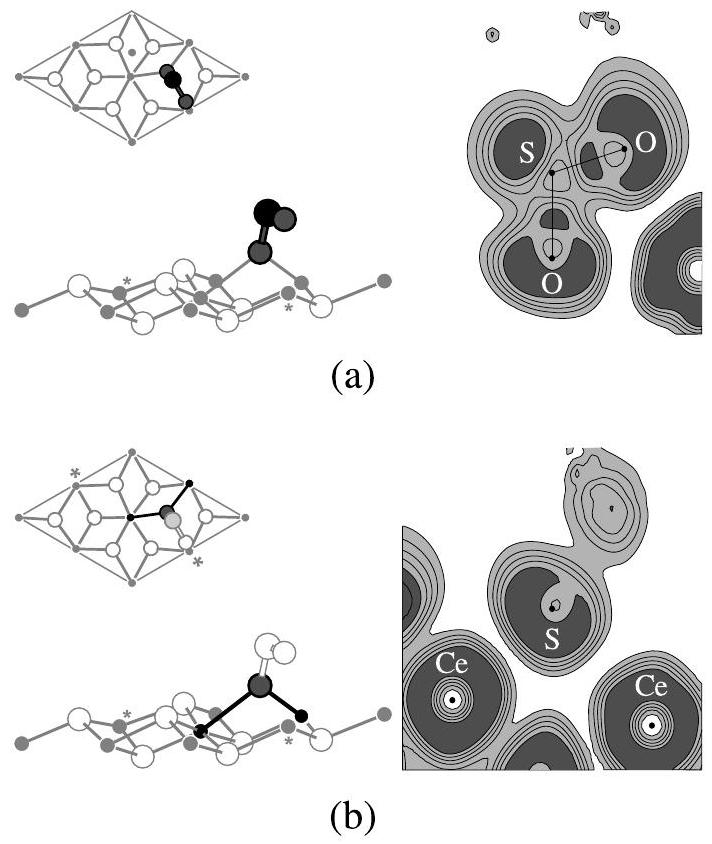
Figure 5.1. $\mathrm{SO}_{x}$ species were characterized based on connectivity, bond lengths, atomic charges, Density of States and electron density difference maps. Another useful method to characterize bonding is the Electron Localization Function (ELF). In (a) and (b) the ELF of a $\mathrm{SO}_{2}^{-}$species on ceria(111) is displayed. The ELF map in (a) is drawn in the plane containing the $\mathrm{SO}_{2}^{-}$species. In (b) the ELF map is drawn in the plane containing S and the two cerium ions closest to it. Contours from 0.0 (white) to 0.5 (dark gray) are used. The covalent bonds within the $\mathrm{SO}_{2}^{-}$species are characterized by a pile up in the ELF map along these bonds while the ionic S-Ce bonds are characterized by a nodal plane perpendicular to the bond.

The (110) surface also contains $\mathrm{O}-\mathrm{O}$ distances in the surface that are well suited for formation of such specie; see Fig. 5.3.

The DFT calculations predict that no sulfates should form when $\mathrm{SO}_{2}$ is adsorbed on the (111) surface. This is in good agreement with some experimental studies of $\mathrm{SO}_{2}$ adsorption at ceria(111) surfaces at low temperature [42, 43], but is in contrast to experiments of Rodriguez et al. [44], where sulfates were reported at 150 K. All experiments essentially agree that at higher temperature, sulfates becomes more abundant. In paper VI it was hypothesized that a monodentate sulfate ( $\mathrm{SO}_{3}(\mathrm{a})$ ) could be formed on the ceria (111) surface by combining a monodentate sulfite $\left(\mathrm{SO}_{2}(\mathrm{a})\right)$ with a neighboring lattice oxygen, cf. the structures in Fig. 5.2. Stated another way, a surface sulfite could be transformed into a surface sulfate and an oxygen vacancy. The energy needed to complete such a reaction was found to be about 14 kcal/mol with an additional cost of 8 kcal/mol to separate the sulfate and the vacancy.

When $\mathrm{SO}_{2}$ is adsorbed at an oxygen vacancy site (SO(a)), it retains its integrity as an $\mathrm{SO}_{2}$ entity and appears to chemisorb as an $\mathrm{SO}_{2}$ molecule in, or atop, the vacancy.

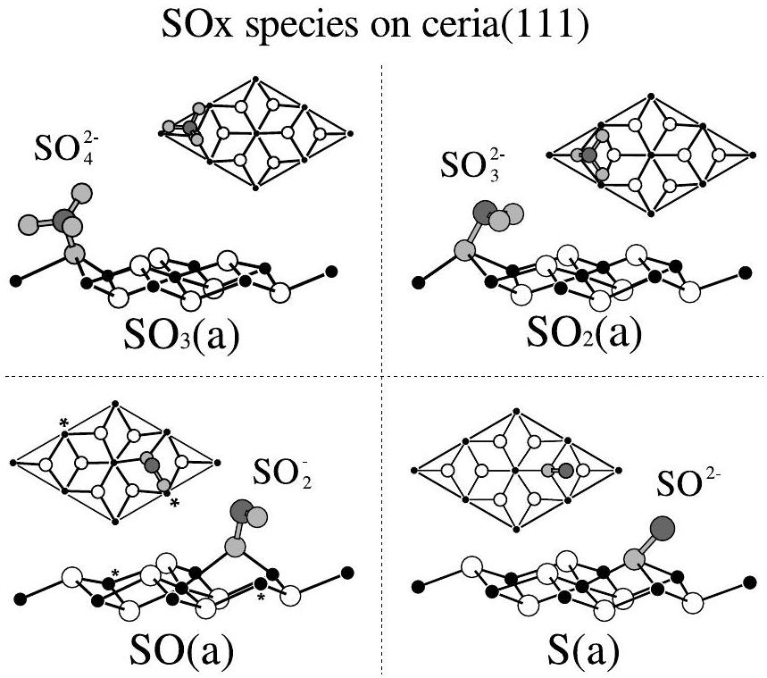
Figure 5.2. The most stable $\mathrm{SO}_{x}$ species corresponding to adsorption of $\mathrm{SO}_{n}$ on the $\mathrm{CeO}_{2}(111)$ surface. Oxygen is drawn with large white or light gray circles, sulfur with large dark gray circles and cerium with small black circles. Ce(III) ions are marked with *. The same style is used in the remainder of this section.

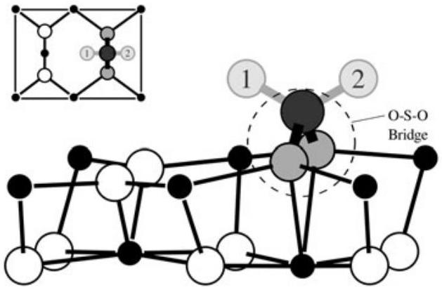
Figure 5.3. The most stable $\mathrm{SO}_{x}$ species at the $\mathrm{CeO}_{2}(110)$ surface are bi-dentate species. The common motif in these structures is the O-S-O bridge. If no further oxygen ions are attached to this bridge, i.e the S(a) situation, it is an $\mathrm{SO}_{2}^{2-}$ species. Attaching one additional oxygen, SO(a), leads to a bi-dentate sulfite $\left(\mathrm{SO}_{3}^{2-}\right)$ while two additional oxygen atoms, $\mathrm{SO}_{2}(\mathrm{a})$, leads to a bi-dentate sulfate $\left(\mathrm{SO}_{4}^{2-}\right)$.

However, from investigation of the electron transfer, it becomes clear that an excess electron localized at a cerium site is transferred to $\mathrm{SO}_{2}$. As a result, S changes its oxidation number from IV to III and a thionite species $\left(\mathrm{SO}_{2}^{-}\right)$is formed. At the (110) surface, this is not the most stable SO(a) structure and in paper VIII, a more stable SO(a) structure, a bidentate sulfite structure, is found at the (110) surface, if an SO entity would be adsorbed on an oxygen bridge site; see Fig. 5.3.

Answers to the questions: How does $S O_{2}$ interact with ceria? Which different $\mathrm{SO}_{x}$ species are formed?
$\mathrm{SO}_{2}$ chemisorbs strongly at the ceria surfaces.
Sulfites, sulfates and thionites are formed.
Adsorption of atomic S (paper VII) on the stoichiometric surfaces (S(a)) leads to formation of physisorbed S, hyposulfite $\left(\mathrm{SO}_{2}^{2-}\right)$ and oxido-sulfate(2-) $\left(\mathrm{SO}^{2-}\right)$ species. Monodentate $\mathrm{SO}^{2-}$ species are formed on both surfaces. On the (110) surface, bidentate $\mathrm{SO}_{2}^{2-}$ structures are formed. These are more stable than the $\mathrm{SO}^{2-}$ species, again reflecting the higher reducibility of the (110) surface. In an analogous way to the $\mathrm{SO}_{2}$ adsorption, no change in the oxidation number of S is seen for S adsorption on the stoichiometric (111) surface. On the (110) surface, on the other hand, S adsorption leads to an oxidation of S from S(0) to S(II). The mobility of the adsorbed S atom was investigated in paper VII and high barriers for diffusion was found: 1.4 eV for the (111) surface, and 2.0 and 2.6 eV along the [001] and [110] directions on the (110) surface, respectively.

Adsorption of S into an oxygen vacancy ( $S_{O}^{\times}$using the Kröger-Wink notation) on both the (111) and (110) surface was found to lead to the formation of sulfides $\left(\mathrm{S}^{2-}\right)$. These sulfides are most stable at the very surface (in the top most atomic layer). The energy loss associated with moving the sulfide further down into the surface region (replacing sub surface oxygen ions) is about 3 eV . Thus, sulfides are likely to be found at the surface at least at low temperatures. This finding is consistent with the experimental observation of Overbury et al. [43], that S does not diffuse into the bulk until high temperatures.

Answers to the questions: How does atomic S interact with ceria? Once on the surface, is $S$ mobile or not? Does $S$ diffuse into the bulk?
S chemisorbs strongly on ceria.
No, not really, the barriers for diffusion are higher than 1.4 eV.
It requires much energy (about 3 eV) for an S atom to diffuse into the bulk.

### 5.2 Sulfation and sulfidation

The various $\mathrm{SO}_{x}$ species presented above can be related to each other through exchange of oxygen atoms and reactions of the type:

$$
S O_{n}(a)+V_{O}^{\bullet \bullet} \rightarrow S O_{n-1}(a)
$$

or

$$
S O_{n}(a)+O(a) \rightarrow S O_{n+1}(a)
$$

These two reactions can be used to investigate the stability of $\mathrm{SO}_{x}$ species under oxidizing and reducing conditions using the reactions above, with the assumption that reducing conditions are characterized by available oxygen vacancies while oxidizing conditions are characterized by available oxygen ad-atoms. Thus reduction in this model is assumed to take place via a Mars-van Krevelen mechanism where the reduction is mediated by oxygen vacancies. This was done in paper VII and there it was shown that the ceria (111) and (110) surfaces display very different behavior towards $\mathrm{SO}_{2}$ adsorption under these conditions. Stable sulfates form on the (110) surface under both conditions. On the (111) surface on the other hand, stable sulfates forms under oxidizing conditions while stable sulfides form under reducing conditions. Thus while the (111) surface is active in the reduction of $\mathrm{SO}_{x}$ the (110) surface in not. These findings are summarized in figure 5.4 showing an energy diagram comparing $\mathrm{SO}_{x}$ species at the two surfaces at reducing conditions.

Answers to the questions: Which $S O_{x}$ species are present on the ceria (111) and (110) surfaces under reducing and oxidizing conditions? Are the two surface different in this respect?
Sulfates dominate on the (110) surface at both conditions. On the (111) surface sulfates are present at oxidizing conditions while sulfides are present at reducing conditions.

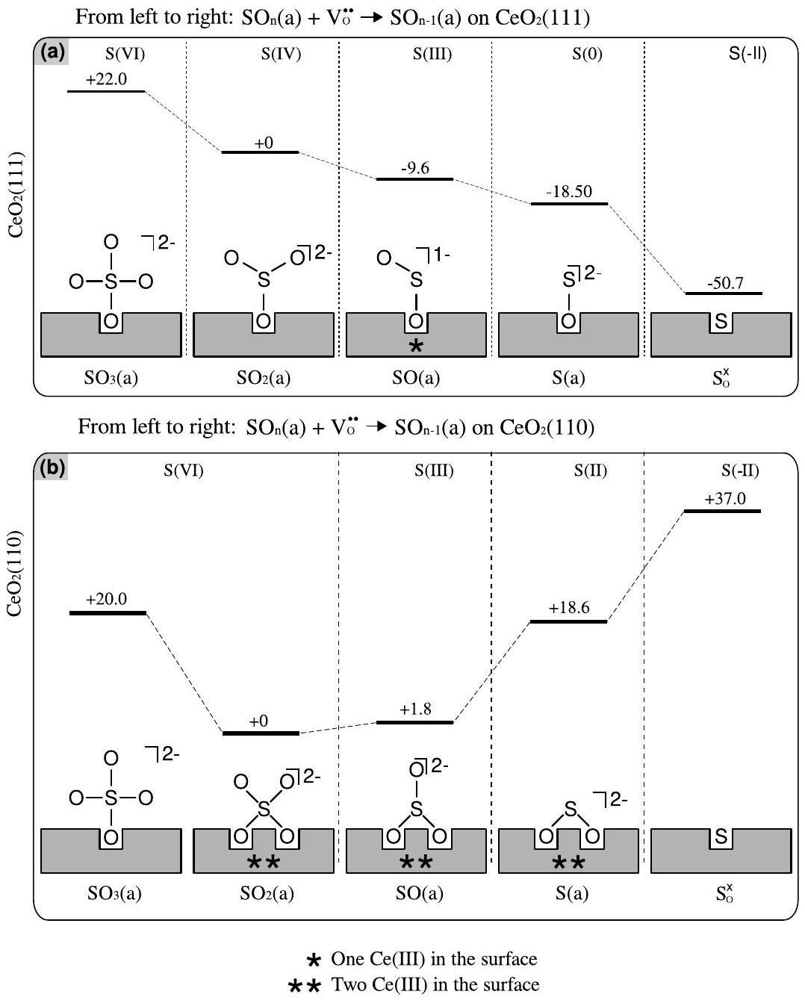
Figure 5.4. Energy diagram of $\mathrm{SO}_{x}$ species on ceria surfaces under reducing conditions. (a) (111) and (b) (110). When moving from the left to the right in the figure, oxygen vacancies are consumed and the energy difference between two steps corresponds to the reaction: $\mathrm{SO}_{n}(\mathrm{a})+\mathrm{V}_{O}^{\bullet \bullet} \rightarrow \mathrm{SO}_{n-1}(\mathrm{a})$. Energies are given in kcal/mol, a * indicates the existence of a reduced cerium ion. At the top of each figure the oxidation number assigned to the sulfur is shown.

### 5.3 A new mechanism for sulfur recovery

A technically interesting use of ceria is in the recovery of elemental sulfur from $\mathrm{SO}_{2}$ rich gas [2, 45]. In this process, $\mathrm{SO}_{2}$ rich gas is mixed with a reducing agent such as CO or $\mathrm{CH}_{4}$ and then passed over a catalytically active surface. Ceria shows a high selectivity for this type of reaction. It was demonstrated in the previous section that the (110) surface is inactive for reduction of $\mathrm{SO}_{2}$. Therefore, only the (111) surface is considered in the following discussion.

Liu et al. [2] proposed that the reduction of $\mathrm{SO}_{2}(\mathrm{a})$ to S(a) proceeds via step-wise removal of O, mediated by vacancies. According to the calculations presented in this thesis such a mechanism is very likely to result in the formation of stable sulfides and not any S(0) species, as was proposed. There are two reasons for this: (i) the very high stability of the sulfides under reducing conditions, and (ii) the low mobility of S(a) species as found in paper VII. Desorption of atomic S is also unlikely since more than 60 kcal/mol is needed to desorb S (paper VII). In paper VIII, another process based on observations and ides presented in the experimental work of Overbury et al. [43] is presented. Overbury et al. found that elemental sulfur could be obtained by repeated cycles of $\mathrm{SO}_{2}$ adsorption and annealing and proposed that surface sulfide species may act as active centers for $\mathrm{SO}_{2}$ adsorption. Based on these ideas a new mechanism for sulfur recovery was proposed in paper VIII. The whole sulfur recovery mechanism is schematically depicted in figure 5.5 and can be divided into three steps:

1. Thio-sulfite formation (upper panel in Fig. 5.5)
Adsorption of $\mathrm{SO}_{2}$ onto a surface sulfide leads to the formation of a stable thiosulfite species. The sulfur end in the thio-sulfite ion (originally the sulfide ion) is replaced by one of its oxygen ends.
2. Thio-sulfite reduction (left part of lower panel in Fig. 5.5)
Reduction of thio-sulfite with an oxygen vacancy gives rise to an $S_{2}(a)$ structure. The formed $\mathrm{S}_{2} \mathrm{O}^{-}$species is somewhat similar to the thionite species $\left(\mathrm{SO}_{2}^{-}\right)$ with similar Bader net charge (-0.75 vs. -0.79 $e$ ) and slightly contracted bonds compared to their parent structures (the thio-sulfite and the sulfite structures, respectively). The two S atoms are assigned oxidation numbers of 0 and 1 .
3. $\mathbf{S}_{2}$ desorption (right part of lower panel in Fig. 5.5)
The desorption of $\mathrm{S}_{2}(\mathrm{~g})$ from the $\mathrm{S}_{2}(\mathrm{a})$ structure requires about 25 kcal/mol.

## The role of CO

CO is commonly used as reducing agent in sulfur recovery from $\mathrm{SO}_{2}$ rich gases. In the light of the mechanisms for sulfur recovery presented above, the role of CO would be to provide oxygen vacancies that are consumed both in the reduction of $\mathrm{SO}_{2}$ to $\mathrm{S}^{2-}$ and in the reduction of thio-sulfite. However, there is a competing reaction where CO adsorbs directly on the surface sulfides sites. This adsorption can lead to the formation of carbonyl sulfide (COS) plus an oxygen vacancy, with a net energy gain of 3.7 kcal/mol for the reaction. This competition for the surface sulfides between CO and $\mathrm{SO}_{2}$ may be the origin of the phenomenon observed in some of the experiments namely that COS production increases when excess CO is used [46].

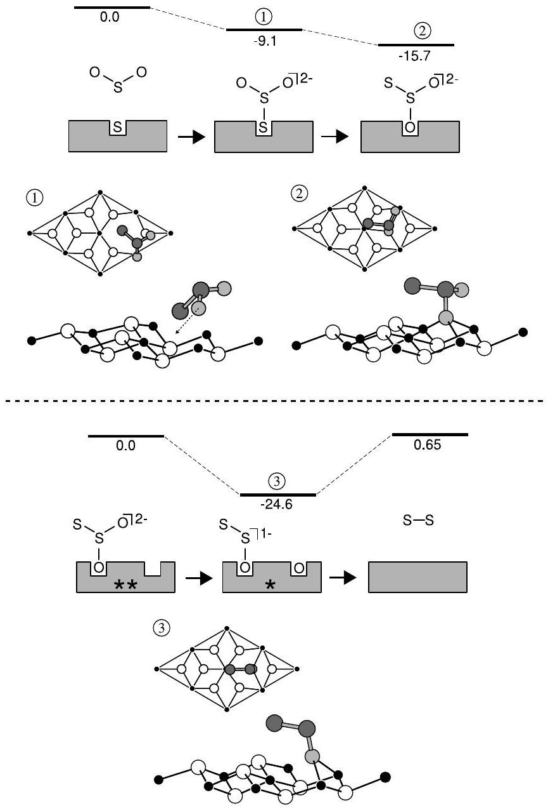
Figure 5.5. A mechanism for sulfur recovery from $\mathrm{SO}_{2}$ rich gas over ceria (111). From left to right in the upper panel: a $\mathrm{SO}_{2}$ molecules adsorbs at a surface sulfide site, a thio-sulfite is formed and rotated so that the sulfur end of the thio-sulfite (originally the sulfide) is replaced by one of its oxygen ends. From left to right in the bottom panel: the thio-sulfite becomes reduced by a vacancy and $\mathrm{S}_{2}$ is desorbed.

## 6. Concluding remarks

In this thesis, the nature of oxygen vacancies at the ceria surface and their interaction with adsorbed $\mathrm{SO}_{2}$ molecules are extensively explored through the use of theoretical calculations. Also the mechanisms involved in the oxygen storage capacity of small nano crystals are investigated.

The results have been carefully scrutinized with respect to available experimental data of various types. On the whole, the theoretical results are consistent with experiments and, additionally, they provide considerable new mechanistic insight.

Much work has been devoted to establishing which theoretical methods that are suited for these studies. The main conclusions emerging from that work is that, while density functional theory calculations based on the local density or the generalized gradient approximation are unable to describe oxygen vacancies in ceria, two main extensions to these methods, DFT+U and hybrid functionals, can be successfully applied. It is further established that a successful description of reduced ceria using Gaussian type orbital basis-sets needs to be based on a small-core ECP as opposed to a large-core ECP. Here small-core basis-sets with 30 explicit electrons for each cerium atom were used compared to only 12 in the large-core basis sets. Since the computational cost of a DFT calculations typically scales as at least $N^{2}$, where $N$ is the number of electrons, this has a rather profound impact on the amount of computer resources needed to study reduced ceria with local basis-sets.

The most important findings emerging from the simulations using the theoretical methods just described are the following.

1. A new ground state structure for the single surface oxygen vacancy at the (110) surface has been discovered. Also a number of structures previously presented separately by different authors in the literature are related to each other.
2. A principle for vacancy clustering at the ceria (111) surface has been proposed. A large number of experimental findings related to vacancy clustering on the ceria (111) surface can now be understood from a simple principle which relates the nature of the isolated vacancies to the type of clusters that these vacancies form. According to this principle,stable vacancy clusters form when oxygen vacancies share neighboring Ce(III) ions.
3. A structural origin of the supercharged oxygen storage capacity in nano crystals is revealed. A stabilization process for small reduced ceria clusters and nano crystals in $\mathrm{O}_{2}$ atmosphere is found. Instead of being re-oxidized into stoichiometric clusters, the reduced clusters and crystals strongly adsorb the $\mathrm{O}_{2}$ molecules as superoxide $\left(\mathrm{O}_{2}^{-}\right)$species. This effect gives rise to an increased oxygen storage capacity of nano sized ceria as seen in experiments on nano crystalline ceria.
4. The two most stable low index surfaces of ceria show very different behaviour towards sulfur containing molecules. Results from DFT calculations

in this thesis suggest that $\mathrm{SO}_{x}$ species on the ceria(111) should be readily reduced by oxygen vacancies and that, in a reducing atmosphere, sulfides should be the dominating species. This is in line with experimental findings. For the (110) surface, where no detailed information from experiments is available, the DFT calculation instead suggest that sulfates should be the most stable $\mathrm{SO}_{x}$ species under both reducing and oxidation conditions. Thus, while the (111) surface is active for sulfur recovery from $\mathrm{SO}_{2}(\mathrm{~g})$, the (110) surface is not. This finding also has implication for sulfur poisoning, which is likely to be very different on the two surfaces.
5. A new mechanism for sulfur recovery from $\mathbf{S O}_{2}$ rich gas over ceria(111) is presented. In this mechanism, $\mathrm{SO}_{2}$ is first reduced to sulfide ( $\mathrm{S}^{2-}$ ) through a vacancy mediated process. The formed sulfide species then acts as a seed in the formation of S-S bonds through adsorption of $\mathrm{SO}_{2}$ at such sites. This leads to the formation of thio-sulfite species $\left(\mathrm{S}_{2} \mathrm{O}_{2}^{2-}\right)$, which subsequently can be reduced to $\mathrm{S}_{2}$ by oxygen vacancies and finally desorbs from the surface. These results may assist in the future design of new interesting catalysts for this technically interesting application.

A high-level theoretical reference method for calculations of ceria and in particular for the oxygen vacancy is still lacking. I have work in progress in this direction using an embedded cluster model and wave function based methods but the results are still premature and the road ahead is paved with technical difficulties. Nevertheless, I believe that it is crucial to continue the development of such reference methods.

## 7. Acknowledgements

First of all I would like to thank my supervisor Kersti Hermansson for all her support and encouragement. A great thank you also goes to Christopher Castleton for all his insightful ideas and for inspiring discussions. Obviously very little of this work would had been realized without the help of my co-authors, thank you all. A special thank you also goes to Lu for all our interesting discussions on science and western and eastern culture.

David Raymand, my former office room mate, thank you for everything, the echo of your voice can still be heard in the halls of Ångström. To all members of our little group, Daniel, Pavlin, Matti and Peter, thank you all for making me feel at home. Pavlin Mitev thanks for all your help with all sorts of computer related issues, and thank you for looking after our cat.

A special thank goes to Eva and Tatti for all help with administrative things, of which I know very little.

Aci and Melker you are simply the best.

## 8. Appendix - Methods overview

### 8.1 Quantum chemical calculations

Schrödinger [47] and Heisenberg [48] laid the foundations for quantum mechanics in middle of the 1920s. The theory successfully explained a series of mysterious phenomena such as the black body radiation, atomic spectra and naturally incorporated the concept of quantization. The central object in the theory is the wave function, which contains all accessible information of a system. For a stationary system, such wave functions are described by the time-independent Schrödinger equation:

$$
\hat{H} \Psi=E \Psi
$$

$\hat{H}$ is the Hamiltonian of the system, $\Psi$ the wave function, and $E$ the energy of the system. Despite its rather simple formulation the Schrödinger equation has proved very difficult to solve and much attention has been devoted to finding acceptable approximations to it. In the following, the approximations leading to the famous Hartree-Fock method and the density functional theory are presented and discussed.

The large mass ratio between electrons and nuclei makes the electrons and nuclei move in essentially different time scales. As a result, the Schödinger equation can often be separated into a nuclear part and an electronic part. This procedure is called the Born-Oppenheimer approximation. Here the positions of the nuclei are treated as parameters in the electronic Schödinger equation, which will be the focus from here on.

## The Hartree-Fock approximation

In order to tackle the complicated many electron wave function, Hartree proposed an approximation, where the many-electron wave function is expressed as a product of one-electron wave functions, $\psi_{i}$ (spin-orbitals). This product is called the Hartree product and can be written:

$$
\Psi\left(\mathbf{r}_{1}, \mathbf{r}_{2}, \ldots, \mathbf{r}_{n}\right)=\psi_{1}\left(\mathbf{r}_{1}\right) \psi_{2}\left(\mathbf{r}_{2}\right) \cdots \psi_{n}\left(\mathbf{r}_{n}\right)
$$

The Schrödinger equation is such an eigenfunction equation. To find the one-electron wave functions a useful mathematical property of eigenfunction equations can be explored. It can be shown that the wave function corresponding to the lowest eigenvalue, the ground state wave function, also minimizes the following expression:

$$
E=\int \Psi^{*} \hat{H} \Psi d \mathbf{r}
$$

Any other function would yield a higher value. Therefore, to find the $\psi_{i}$ we need to minimize equation 8.3. Applying the method of Lagrange multipliers to find the
spin-orbitals that minimize 8.3 with the requirement that the spin-orbitals should be mutually orthogonal leads to a set of coupled one-electron Shrödinger-like equations:

$$
\begin{array}{r}
{\left[h(1)+\sum_{j \neq i} \hat{J}_{j}\right] \psi_{i}=\varepsilon_{i} \psi_{i}} \\
h(1)=-\frac{1}{2} \nabla^{2}-\sum_{\alpha} \frac{Z_{\alpha}}{r_{1 \alpha}} \\
\hat{J}_{j}=\int \psi_{j}^{*} \frac{1}{r_{12}} \psi_{j} d \mathbf{r}_{2}
\end{array}
$$

Here $Z_{\alpha}$ is the charge of a nuclei at a site $\alpha, r_{1 \alpha}$ is the distance between the electron described by $\psi_{i}$ and the nuclei and $r_{12}$ is the distance between the two electrons described by $\psi_{i}$ and $\psi_{j}$, respectively. These equations are non-linear since $\hat{J_{i}}$ (the Coulomb operator), which can be interpreted as the average Coulomb field from the other electrons, depends on the spin-orbitals, $\psi_{j}$, of these electrons. Hartree proposed to systematically refine an initially guessed function, a trial function, and he coined the term Self Consistent Field (SCF) method for this refinement procedure.

Unfortunately, the wave functions obtained from Hartree's original SCF method does not fulfill the Pauli principle, which states that the wave function should change sign when two electrons change identity. One way to incorporate this property, proposed by Fock, is to replace the Hartree product by a Slater determinant:

$$
\Psi=\frac{1}{\sqrt{N!}}\left|\begin{array}{cccc}
\psi_{1}\left(\mathbf{r}_{1}\right) & \psi_{2}\left(\mathbf{r}_{1}\right) & \cdots & \psi_{N}\left(\mathbf{r}_{1}\right) \\
\psi_{1}\left(\mathbf{r}_{2}\right) & \psi_{2}\left(\mathbf{r}_{2}\right) & \cdots & \psi_{N}\left(\mathbf{r}_{2}\right) \\
\vdots & \vdots & \ddots & \vdots \\
\psi_{1}\left(\mathbf{r}_{\mathbf{N}}\right) & \psi_{2}\left(\mathbf{r}_{\mathbf{N}}\right) & \cdots & \psi_{N}\left(\mathbf{r}_{\mathbf{N}}\right)
\end{array}\right|
$$

This leads to the Hartree-Fock (HF) approximation. We obtain a similar set of coupled Shrödinger like equations:

$$
\begin{array}{r}
{\left[h(1)+\sum_{j \neq i}\left(\hat{J}_{j}-\hat{K}_{j}\right)\right] \psi_{i}=\varepsilon_{i} \psi_{i}} \\
\hat{K}_{j} \psi_{i}=\left[\int \psi_{i}^{*} \frac{1}{r_{12}} \psi_{j} d \mathbf{r}_{2}\right] \psi_{j}
\end{array}
$$

The term $\hat{K}$ is called the exchange operator and is a direct result of imposing the Pauli principle. HF is an mean field technique where electrons are treated as moving completely uncorrelated to each other in the average field (Coulomb and exchange) of the remaining electrons and any external field. Therefore, an energy called correlation energy is defined as the difference between the real energy and the HF energy.

The trial functions $\psi_{i}$ used in the SCF method is usually restricted to a linear combination of known functions $\chi_{k}$, a basis-set, whose coefficients are optimized in the SCF procedure. Thus we may write:

$$
\psi_{i}=\sum_{k=1}^{n} c_{i, k} \chi_{k}
$$

Using this approach one can, quite easily, cast the Hartree-Fock equation into a non-linear matrix equation, the Roothaan-Hall equations [49, 50], usually written:

$$
\mathbf{F} \mathbf{C}=\mathbf{S C} \varepsilon
$$

where F is called the Fock matrix, C is a matrix containing the coefficients to be evaluated, $\varepsilon$ a vector containing the energies of the spin-orbitals and $\mathbf{S}$ is the overlap matrix describing the overlap between the different basis functions. The Fock matrix, F, depends on the coefficients in the matrix C and so again the SCF method is used to solve the equation.

## DFT

Another way of approaching the Schrödinger equation was independently presented by Llewellyn Thomas [51] and Enrico Fermi [52]. Instead of dealing directly with the complicated wave function, Thomas and Fermi turned to the electron density function $\rho(\mathbf{r})=|\Psi|^{2}$. This was an important step towards a more complete theory using the electron density as the central quantity, density functional theory (DFT). DFT is founded on the theorems of Hohenberg and Kohn published in 1964 [53], which state that:

- all ground-state properties are uniquely determined by the ground-state electron density, and
- this ground-state energy minimizes the total energy functional.

DFT is in principle an orbital-free technique. However, in practice most DFT calculation are based on the Kohn-Sham approach [54], where an artificial system (Kohn-Sham system) of non-interacting electrons is constructed. A wave function, expressed as a Slater determinant, that yields the true ground state density of the true system of interacting electrons is sought. This procedure yields an equation similar to the HF equation:

$$
\begin{array}{r}
\hat{H}_{K S}(1)=-\frac{1}{2} \nabla^{2}-\sum_{\alpha} \frac{Z_{\alpha}}{r_{1 \alpha}}+\sum_{j} \int \psi_{j}^{*} \frac{1}{r_{12}} \psi_{j} d \mathbf{r}_{2}+V_{X C}[\rho] \\
V_{X C}=\frac{\delta E_{X C}[\rho]}{\delta \rho}
\end{array}
$$

Here $E_{X C}$ is the exchange-correlation potential. Note that while an electron in a spinorbital in HF experiences the field of all the other electrons, an electron in a Kohn-Sham orbital in DFT experiences the field of all electrons, so-called self interaction. If the expression $E_{X C}$ would be known, DFT would be exact. However, so far only approximations to it, exact in certain limits such as for the free electron gas, have been established. The conceptually most simple approximation used is the local density approximation (LDA), where the exchange-correlation energy is calculated only from the value of the local density and can be written:

$$
E_{X C}^{L D A}=\int \varepsilon_{X C}(\rho) \rho(\mathbf{r}) d \mathbf{r}
$$

where $\varepsilon_{X C}$ is the free electron gas value for the exchange-correlation energy. In the Perdew and Schmidt Jacob's ladder of density functional approximations [55], chemical accuracy is gained by also including the gradient of the density into the expression for the exchange-correlation energy. This leads to the so-called generalized gradient approximation (GGA), which may be written as:

$$
E_{X C}^{G G A}=\int \varepsilon_{X C}(\rho, \nabla \rho) \rho(\mathbf{r}) d \mathbf{r}
$$

We may climb the ladder further by including also the second derivative of the density, or even further by including Hartree-Fock exchange to form so called hybrid functionals, as described below.

When the Kohn-Sham orbitals are expanded in a basis-set we obtain a non-linear matrix equation similar to the Roothaan-Hall equations.

## Hybrid methods

Although derived quite differently, HF and Kohn-Sham DFT (hereafter simply DFT) calculations have much in common. Each can essentially be described as a transformation of a complicated many-electron problem, described by the Schrödinger equation, to a set of coupled one-electron equations, the Kohn-Sham or Roothan-Hall equations, for DFT and HF, respectively. This is illustrated in figure 8.1.

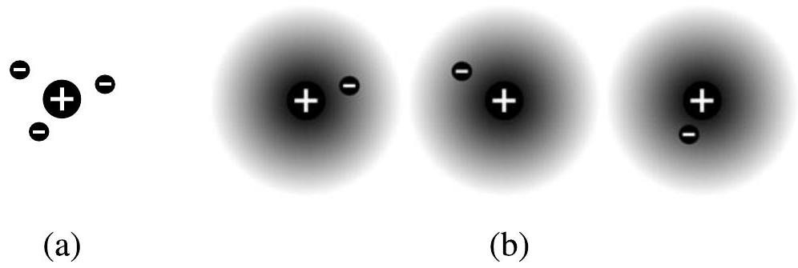
Figure 8.1. The complicated many electron problem described by the Schrödinger equation, (a), is transferred into many coupled one electron problems in HF or DFT, (b).

The two different approaches have different strengths and weaknesses. For example, DFT gives a better description of screening, which is not present in HF, and does in principle include correlation although in an approximate way. On the other hand, HF includes exact exchange while no known functional in DFT does so. Thus, because their mathematical formulation is similar enough and because they complement each other in some respects, HF and DFT are often combined to yield so called hybrid methods. The name hybrid functionals is often used and emphasises that most hybrid methods include a fraction, usually around 20-25 \% , of HF exchange into a pre-defined DFT functional. Two well known examples, which are encountered in this thesis, are PBE0 [56, 57] and B3LYP [58, 59, 60, 61]. PBE0 is constructed according to the following recipe:

$$
E_{X C}^{P B E 0}=E_{X C}^{P B E}+\frac{1}{4}\left(E_{X}^{H F}-E_{X}^{P B E}\right)
$$

where $E_{X C}$ denotes exchange-correlation energy and $E_{X}$ denotes exchange energy. PBE (Perdew-Burke-Ernzerhof [62]) is a GGA functional.

B3LYP is a more complicated construction with three parameters, and has the general form:

$$
E_{X C}^{B 3 L Y P}=E_{X C}^{L D A}+a_{0}\left(E_{X}^{H F}-E_{X}^{L D A}\right)+a_{X}\left(E_{X}^{G G A}-E_{X}^{L D A}\right)+a_{C}\left(E_{C}^{G G A}-E_{C}^{L D A}\right)
$$

with three (3) parameters: $a_{0}=0.20, a_{X}=0.72$ and $a_{C}=0.81$. Here $E_{C}$ denotes correlation energy. $E_{X C}$ and $E_{X}$ were defined above. The GGA exchange is described using the parametrization of Becke (B) [63] while the GGA correlation is described by the parametrization of Lee-Yang-Parr (LYP) [59].

## DFT+U

Strongly correlated system such as metal oxides with partially filled $d$ - or $f$-shells are usually not well described by DFT using the standard LDA or GGA functionals. The problem originates from the self-interaction which promotes delocalization of the spatially confined $d$ - or $f$-states. One popular approach correcting this error is DFT+U. A simplified description of the method is given below. A much more complete descriptions can be found, for example, in the review article by Anisimov et al. [64]. In DFT+U, two subsystems are defined: the set of localized $d$ - or $f$-electrons and the remaining electrons. The $d$ - or $f$-electrons are treated in a Hubbard like model with an on-site Coulomb interaction controlled by the Hubbard parameter U, while the remaining electrons are treated with LDA or GGA. The energy functional can be written as:

$$
\begin{array}{r}
E=E_{L D A / G G A}+\frac{1}{2} U \sum_{i \neq j} n_{i} n_{j}-E_{D C} \\
E_{D C}=U N(N-1)
\end{array}
$$

where $E_{L D A / G G A}$ is the LDA or GGA energy functional and $E_{D C}$ is the double counting term which subtracts the interaction of the $N d$ - or $f$-electrons already contained in the LDA or GGA functionals. The other term in the expression is the Hubbard like term, which describes the on-site interaction of the individual $d$ - or $f$-electrons $n_{i}$ at a specific atomic site. This leads to a shift of occupied $d$ - or $f$-orbitals to lower energies and thus balances the tendency for delocalization caused by the self-interaction.

### 8.2 Basis-sets

In quantum chemical calculations, the molecular orbitals (MOs) or Kohn-Sham orbitals are usually expressed as linear combinations of known mathematical functions, basis functions. These functions are commonly of types possessing well known and useful mathematical properties. Typically Gaussian functions or plane waves are used; these are described below.

## Plane wave basis-sets

When the model system studied is subject to periodic boundary conditions (Born-von Karman boundary condition), such as in a perfect crystal, plane waves are particularly useful. Bloch's theorem states that the eigenstate of a Hamiltonian with a periodic potential can be expressed by a product of a plane wave $\left(e^{i \mathbf{k} \cdot \mathbf{r}}\right)$ and a function with the same periodicity as the potential (the cell periodic part, $u_{k}(\mathbf{r})$ ):

$$
\psi_{k}(\mathbf{r})=u_{k}(\mathbf{r}) e^{i \mathbf{k} \cdot \mathbf{r}}
$$

If we now expand the cell periodic part into a plane wave expansion we can write:

$$
\psi_{k}(\mathbf{r})=\sum_{G} c_{k, G} e^{i(\mathbf{k}+\mathbf{G}) \cdot \mathbf{r}}
$$

where the summation is taken over reciprocal lattice vectors, $G$ and $k$ is a $k$-point in the $1^{\text {st }}$ Brillioun zone. Thus the infinite number of electrons within the periodic system are now represented by the infinite number of points ( $k$-points) in the $1^{\text {st }}$ Brillioun zone and eq. 8.22 is usually evaluated at special $k$-points selected to give a fair sampling of the whole Brillioun zone. There exist several recipes to select such $k$-point meshes, the most popular is perhaps the Monkhurst-Pack grid [65].

Since plane waves are eigenfunctions to the Schödinger equation for the free electron gas, they are well suited for describing the delocalized states of metals and electrons in a soft (weak) periodic potential. When applied to a harder potential such as a real material, pseudo potentials (cf. separate section below) are needed in order to reduce the number of plane waves needed.

## Gaussian type orbitals

A Cartesian Gaussian type orbitals (GTOs) can be written:

$$
N x^{i} y^{k} z^{l} \exp \left(-\zeta \mathbf{r}^{2}\right)
$$

where $N$ is a normalization factor and $i, j, k$ are positive integers. When $i+j+k=0$, the GTO is classified as an 1s GTO, when $i+j+k=1$ it is a $2 p$ GTO, etc. GTOs are useful for describing molecular systems, and the description of molecular orbitals (MOs) converges quickly with the number of local atomic orbitals (AOs) used in the basis-set. Local atomic basis-set can also be applied, successfully, to non-metallic periodic systems such as ionic and molecular crystals. Each atomic orbital is normally described by a linear combination of GTOs in a so called contracted GTO (cGTO). There is a vast collection of basis-sets presented in the literature.

## Pseudo potentials/Effective core potentials

Core electrons of heavy atoms generally contribute only little to chemical bonding while they contribute significantly to the computational cost in QM calculations. Furthermore, as already mentioned, large expansions are needed for plane wave basis-sets in hard potentials such as those created by the nuclei in a solid are used. Thus in order to facilitate calculations, and especially of heavy elements such as cerium, a limited number of electrons, valence electrons, are treated explicitly in the calculation while the remainder, the core electrons, are described by an effective core potential (ECP), also called pseudo potential (PP). However, the computational speed-up is not the
only advantage of ECPs. They also enable us to indirectly include relativistic effects into an otherwise non-relativistic theory by fitting the pseudo potentials to all-electron calculations including these effects, such as Dirac-Hartree-Fock calculations.

Nowadays most ECPs are non-local or semi-local and $s, p, d, f, \ldots$ electrons feel different potentials, $v_{l}$, from the ECP. Usually, at some distance, $\mathrm{r}_{c}$, from the core these individual potentials are set to zero and only the local potential determined by the effective core charge, $V_{\text {loc }}(r)=-Z_{\text {eff }} / r$, is in effect. Thus, for example, a simple pseudo potential $V^{P S}$ can be written

$$
V^{P S}=v_{l o c}(r)+\sum_{l=0}^{l_{\max }}\left(v_{l}(r)-v_{l o c}(r)\right) \sum_{m}|l m\rangle\langle l m|
$$

where $|l m\rangle\langle l m|$ is the projector operator onto a spherical harmonics, $Y_{l m}$. The potentials $v_{l}$ can be obtained from fitting to an all-electron calculation of the isolated atom. Electron excitations are often included in the training-set used in such a fitting procedure.

Obviously, the transferability, i.e. the ability to describe the same element in many different chemical surroundings, is an important property and some ECPs are more versatile than others. In this thesis, the ability of an ECP to describe both Ce(IV) and Ce(III) ions is important and many examples of both ECPs that are successful and unsuccessful are given.

### 8.3 Force-Field methods

A Force-Field (FF) is a set of analytical functions that are used to describe the potential energy of a system of particles. These particles can be atoms, molecules, fragments of proteins, etc. These mathematical functions are chosen and fitted to reproduce relevant properties such as bond lengths and binding energies. In this thesis, so-called shell-model FFs, that include electronic polarization effects are used to describe the interaction between the cerium and oxygen ions in ceria. In this type of model, each ion is represented by a core with charge (Q) and a shell with charge (Y), connected by a harmonic spring with spring constant k, see Fig. 8.2. The shell from different ions here interact with each other through a Buckingham potential:

$$
\Phi(\mathbf{r})=A \exp (-\rho \mathbf{r})+\frac{C}{\mathbf{r}^{6}}
$$

where A, $\rho$ and C are parameters to be fitted. In addition, the Coulomb interaction between the charged species is included.

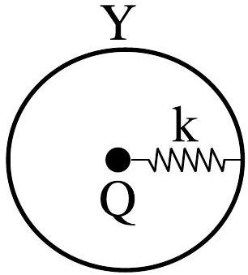
Figure 8.2. The shell-model FF. Ions are represented by a core with charge (Q) and a shell with charge (Y) connected by a harmonic spring with spring constant k.

### 8.4 Supercell approximation

The choice of representation for the studied system, i.e. the choice of structural model, is a crucial part in any theoretical investigation. Most systems studied in this thesis are either bulk crystals or crystalline surfaces and most of the calculations are based on the supercell approximation in combination with density functional theory methods.

In the supercell approximation, the system is described by a single unit, called supercell, periodically repeated to model an infinite system. The supercell approach allows for the use of plane-wave basis sets and is well suited to describe delocalized metallic states, electronic band structures and phonons. However, isolated defects cannot be directly modelled and will always be represented by an infinite array of defects. The error introduced by the artificial interaction between mirror images can be estimated by finite scaling and largely avoided by using large enough supercells.

Surface systems can be modelled in the supercell approximation through a lamellar system with full 3D periodicity, see Fig. 8.3a. The slabs are separated by a sufficient vacuum gap in the z-direction to reduce the interaction between the exposed surfaces. The notation $\mathrm{p}(\mathrm{i} \times \mathrm{j})$ is often used to indicate that the supercell size in the x- and y-directions is i and j times the primitive lattice vectors.

This approach can be contrasted to non-periodic models such as the embedded cluster model, which is ideal for describing isolated defects, see Fig. 8.3b. In such an approach, (usually) a part of the structure (a cluster) is cut out and treated with a quantum chemical method, while the remainder of the system is described in a simpler way, e.g. by simple point charges.

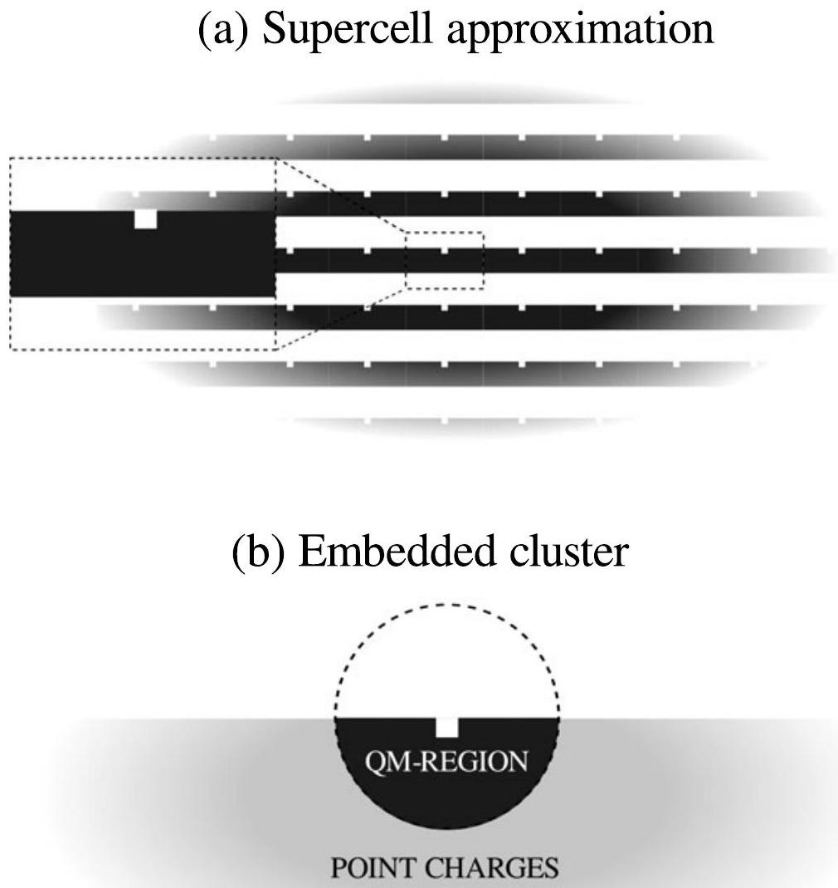
Figure 8.3. Surface systems modelled with (a) the supercell approximation (b) the embedded-cluster model. The supercell approximation gives a homogeneous description of the system but also gives an artificial interaction between repeated images. In the embedded cluster model a defect occurs only once. However, the description of the system is inhomogeneous with two (or more) different regions which must be carefully adjusted to avoid boundary errors.

## 9. Summary in Swedish

### 9.1 Syrevakansers kemi i ceria

Kemiska reaktioner som sker på metalloxidytor är viktiga i många sammanhang. Det kan röra sig om heterogen katalys där ytan kan underlätta en annars långsam process mellan exempelvis molekyler i gasfas. I detta sammanhang har metalloxider en framgångrik historia och används i några av vår tids mest berömda kemiska processer såsom Haber-Borchmetoden. I allmänhet är de mekanismer som på atomär nivå bidrar till dessa metalloxiders framgång okända. Trots att experimentella ytvetenskapliga metoder kan ge detaljerad information ner på atomär nivå kan de bara undantagsvis tillämpas under de förhållanden som råder vid de katalytiska processer som man ämnar förstå. Man är också begränsad till en tidsupplösning som är otillräcklig för att studera en kemisk reaktions förlopp. Indirekta spektroskopiska metoder som kräver någon form av modell för att tolka resultaten kan ge viktiga ledtrådar om vilka kemiska species som är inblandade vid katalys men ger ingen direkt information om hur dessa bildas. Teoretiska beräkningsmetoder kan ge de nödvändiga detaljer som saknas.

Ceriumdioxid (ceria) är ett tekniskt mycket intressant material som änvänds i en rad olika tillämpningar såsom självrengörande ugnar, bränsleceller och kanske framförallt i rening av avgaser i bilkatalysatorer. I alla dessa tillämpningar utnyttjas den unika syrelagringsförmågan hos ceria. Genom utbyta av syreatomer med molekyler på dess yta kan ceria förmedala reduktion och oxidation mellan molekyler som är vitt skilda åt på ytan. Denna förmedling sker framförallt med syrevakanser (tomma syreplatser i strukturen) som budbärare. Dessa proccesser kallas för Mars-van Krevelen procceser och är viktiga i många katalytiska reaktioner på ceriaytan. I ceria som är ett joniskt material återfinns syre som negatvt laddade joner, formelt $\mathrm{O}^{2-}$ medan cerium återfinns som positivt laddade joner, formelt $\mathrm{Ce}^{4+}$. När en negativt laddad syrejon lämnar strukturen gör den det ofta det som en laddningsneutral enhet. De två elektroner som stannar kvar i strukturen fångas upp av två närliggande ceriumjoner som därmed ändrar sin laddning från $\mathrm{Ce}^{4+}$ till $\mathrm{Ce}^{3+}$. Dessa fångade eller lokaliserade elektroner som de också kallas är mycket centrala för syrevakansernas reaktivitet. I detta avhandlingsabrete har avancerade beräkningsmetoder som kan beskriva ceriaytan och dess budbärare (syre vakanserna) noga undersökts och utvecklats. Mer specifikt har en populär beräknings metod som heter täthetsfunktionalanalys (DFT från engelskans density functional theory) studerats. I denna beräkningsmetod är elektroner explicit beskrivna och överföring av lokaliserade elektroner till och från ceria ytan kan beskrivas. I alla fall i princip. Det visar sig nämligen att några av de mest anlitade DFT metoderna, det finns väldigt många varianter av DFT, inte klarar av att beskriva lokaliserade elektroner i ceria. Två typer av strategier för att lösa detta, den så kallde DFT+U-metoden och hybridmetoden, har undersökts i detalj i denna avhandling och beräkningarna som presenteras här visar att dessa strategier är lyckade förutsatt man noga justerar de parametrar som ingår. Med hjälp av dessa metoder har ny kunskap
om syrevakansers struktur på den reaktiva (110) ytan erhållits och en princip som beskriver hur syrevakanser ordnar sig på den mer stabila (111) ytan har presenteras.

Även om syrelagring och reaktioner på ceriaytan allt som oftast involverar syrevakanser så finns intressanta undantag. I denna avhandling har en mekanism som kan förklara den ovanligt höga syrelagrings förmågan hos små nanokristaller föreslagits. I den ingår inga syrevakanser och här sker syrelagring inte genom att bilda och fylla vakanser utan genom direkt adsorption av syremolekyler $\left(\mathrm{O}_{2}\right)$ som bildar stabila superoxider $\left(\mathrm{O}_{2}^{-}\right)$på ytan av dessa små nanokristaller. Denna syrelagringsmekanism är särskilt intressant då dessa superoxider är mycket aktiva även vid låg temperatur. Detta gör att ceriananopartiklar kan användas vid lågtemperatur oxidation av CO. Vilket ä är intressant ur ett miljöperspektiv då effektiv avgasrening i sådana fall sker redan innan katylasatorn blivit varm.

Ceria är som sagt ett mångsidigt katalytiskt material men dess katalytiska förmåga kan på verkas mycket negativt när svavelinnehållande föreningar reagerar med ceria ytan. Denna process kallas för svavelförgiftning. I denna avhandling undersöks några av de svavel föreningar som kan tänkas ingå vid denna förgiftning. Slutligen har nya mekanismer som förklarar hur svaveloxid kan reduceras till svavel över ceria ytan presenteras också. Denna process kan faktiskt utnyttjas till att framställa svavel ur svaveloxidrik gas och är således något önskvärt vid dessa tillämpningar.

## References

[1] A. Trovarelli, Catalysis by Ceria and Related Materials. Imperial College Press, 2002.
[2] W. Liu, A. Sarofim, and A. F. Flytzani-Stephanopoulos M. Applied Catalysis B: Environmental, vol. 4, p. 167, 1994.
[3] J. Xu, J. Harmer, G. Li, T. Chapman, P. Collier, S. Longworth, and S. C. Tsang Chem. Commun., vol. 46, p. 1887, 2010.
[4] A. Tschöpe, D. Staadt, R. Birringer, and J. Y. Ying Nanostruct. Mater., vol. 9, p. 423, 1997.
[5] M. A. Henderson, C. L. Perkins, M. H. Engelhard, S. Thevuthasan, and C. H. F. Peden Surf. Sci., vol. 526, p. 1, 2003.
[6] F. Zhang, Q. Jin, and S.-W. Chan J. Appl. Phys., vol. 95, p. 4319, 2004.
[7] K. Zhou, X. Wang, X. Sun, Q. Peng, and Y. Li J. Catal., vol. 229, p. 206, 2005.
[8] H. Mai, L. Sun, Y. Zhang, R. Si, W. Feng, H. Zhang, H. Liu, and C. Yan The journal of physical chemistry. B, vol. 109, no. 51, pp. 24380-24385, 2005.
[9] Z. Yang, K. Zhou, X. Liu, Q. Tian, D. Lu, and S. Yang Nanotechnology, vol. 18, p. 185606, Apr. 2007.
[10] Z. Wu, M. Li, J. Howe, H. M. Meyer III, and S. H. Overbury Langmuir, vol. 26, pp. 16595-16606, Nov. 2010.
[11] S. L. Dudarev, G. A. Button, S. Y. Savrasov, C. J. Humphreys, and A. P. Sutton Phys. Rev. B, vol. 57, p. 1505, 1998.
[12] R. F. W. Bader, Atoms in Molecules: A Quantum Theory (International Series of Monographs on Chemistry). Oxford University Press, USA, 1994.
[13] S. Rossignol, F. Gerard, D. Mesnard, C. Kappenstein, and D. Duprez J. Mater. Chem., vol. 13, p. 3017, 2003.
[14] J. L. F. D. Silva, M. V. Ganduglia-Pirovano, J. Sauer, V. Bayer, and G. Kresse Phys. Rev. B, vol. 75, p. 045121, 2007.
[15] P. J. Hay, R. L. Martin, J. Uddin, and G. E. Scuseria J. Chem. Phys., vol. 125, p. 034712, 2006.
[16] L. Gerward, J. S. Olsen, L. Petit, G. Vaitheeswaran, V. Kanchana, and A. Svane J. Alloys and Comp., vol. 400, p. 56, 2005.
[17] A. Nakajima, A. Yoshihara, and M. Ishigame Phys. Rev. B, vol. 50, p. 13297, 1994.
[18] H. Bärninghausen and G. Schiller J. Less-common Met., vol. 110, p. 385, 1985.
[19] M. Marsman, J. Paier, A. Stroppa, and G. Kresse J. Phys.: Condens. Matter, vol. 20, p. 064201, 2008.
[20] E. Shoko, M. F. Smith, and R. H. McKenzie Journal of Physics, vol. 22, p. 223201, 2010.
[21] M. Ganduglia-Pirovano, J. L. F. D. Silva, and J. Sauer Phys. Rev. Lett., vol. 102, p. 026101, 2009.
[22] H. Nörenberg and G. A. D. Briggs Phys. Rev. Lett., vol. 79, p. 4222, 1997.

[23] H. Nörenberg and G. A. D. Briggs Surf. Sci., vol. 424, p. L352, 1999.
[24] Y. Namai, K. Fukui, and Y. Iwasawa Catal. Today, vol. 85, p. 79, 2003.
[25] F. Esch, S. Fabris, L. Zhou, T. Montini, C. Africh, P. Fornasiero, G. Comelli, and R. Rosei Science, vol. 309, p. 752, 2005.
[26] K. Fukui, Y. Namai, and Y. Iwasawa Appl. Surf. Sci., vol. 188, p. 252, 2002.
[27] Y. Namai, K. Fukui, and Y. Iwasawa J. Phys. Chem. B, vol. 107, p. 11666, 2003.
[28] S. Gritschneder and M. Reichling Nanotechnology, vol. 18, p. 044024, 2007.
[29] S. Torbrügge, M. Reichling, A. Ishiyama, S. Morita, and O. Custance Phys. Rev. Lett., vol. 99, p. 056101, 2007.
[30] J. C. Conesa Surf. Sci., vol. 339, p. 337, 1995.
[31] C. Zhang, A. Michaelides, D. A. King, and S. J. Jenkins Phys. Rev. B, vol. 79, pp. 075433-1, 2009.
[32] J. C. Conesa Catalysis Today, vol. 143, p. 315, 2009.
[33] G. Balducci, J. Kašpar, P. Fornasiero, M. Graziani, and M. S. Islam J. Phys. Chem. B, vol. 102, p. 557, 1998.
[34] A. Gotte, K. Hermansson, and M. Baudin Surf. Sci., vol. 552, p. 273, 2004.
[35] A. Gotte, D. S. ngberg, K. Hermansson, and M. Baudin Solid State Ionics, vol. 178, p. 1421, 2007.
[36] J. Guzman, S. Carrettin, J. C. Fierro-Gonzalez, Y. Hao, B. C. Gates, and A. Corma Angew. Chem. Int. Ed., vol. 44, p. 4778, 2005.
[37] C. Loschen, S. T. Bromley, K. M. Neyman, and F. Illas J. Phys. Chem. C, vol. 111, p. 10142, 2007.
[38] C. Loschen, A. Migani, S. T. Bromley, F. Illas, and K. M. Neyman Physical chemistry chemical physics : PCCP, vol. 10, no. 37, p. 5730, 2008.
[39] G. N. Vayssilov, Y. Lykhach, A. Migani, T. Staudt, G. P. Petrova, N. Tsud, T. Skala, A. Bruix, F. Illas, K. C. Prince, V. Matolin, K. M. Neyman, and J. Libuda Nature Materials, vol. 10, no. 4, pp. 310-315, 2011.
[40] G. Preda, A. Migani, K. N. Neyman, S. T. Bromley, F. Illas, and G. Pacchioni J. Phys. Chem. C, vol. 115, p. 5817, 2011.
[41] J. A. Rodriguez and J. Hrbek Accounts of Chemical Research, vol. 32, p. 719, 1999.
[42] M. Y. Smirnov, A. V. Kalinkin, A. V. Pashis, A. M. Sorokin, A. S. Noskov, K. C. Kharas, and V. I. Bukhtiyarov J. Phys. Chem. B, vol. 109, p. 11712, 2005.
[43] S. Overbury, D. Mullins, D. Huntley, and L. Kundakovic J. Phys Chem. B, vol. 103, p. 11313, 1999.
[44] J. A. Rodriguez, M. Perez, J. Evans, G. Liu, and J. Hrbek J. Chem. Phys., vol. 122, p. 241101, 2005.
[45] M. Flytzani-Stephanopoulos, T. Zhu, and Y. Li Catalysis Today, vol. 62, p. 145, 2000.
[46] W. Liu, C. Wadia, and M. Flytzani-Stephanopoulos Catalysis Today, vol. 28, p. 391, 1996.
[47] E. Shrodinger Phys. Rev., vol. 28, p. 1049, 1926.
[48] W. Heisenberg Zeitschrift fur Physik, vol. 33, p. 879, 1925.
[49] C. C. Roothaan Reviews of Modern Physics, vol. 23, p. 69, 1951.
[50] G. G. Hall Proceedings of the Royal Society London A, vol. 205, p. 541, 1951.
[51] L. H. Thomas Proc. Cambridge Phil. Soc., vol. 23, p. 542, 1927.
[52] F. Enrico Rend. Accad. Naz. Lincei, vol. 6, p. 602, 1927.
[53] P. Hohenberg and W. Kohn Phys. Rev. B, vol. 136, p. 864, 1964.
[54] W. Kohn and L. J. Sham Phys. Rev., vol. 140, p. 1133, 1965.
[55] J. P. Perdew and K. Schmidt AIP Conference Proceedings, vol. 577, p. 1, 2001.
[56] M. Ernzerhof and G. E. Scuseria J. Chem. Phys., vol. 110, p. 5029, 1999.
[57] C. Adamo and V. Barone J. Chem. Phys., vol. 110, p. 6158, 1999.
[58] A. Becke J. Chem. Phys., vol. 98, p. 5648, 1993.
[59] C. Lee, W. Yang, and R. Parr Phys. Rev. B, vol. 37, p. 785, 1988.
[60] S. Vosko, L. Wilk, and M. Nusair Can. J. Phys., vol. 58, p. 1200, 1980.
[61] P. Stephens, F. Devlin, C. Chabalowski, and M. Frisch J. Phys. Chem., vol. 98, p. 11623, 1994.
[62] J. P. Perdew, K. Burke, and M. Ernzerhof Phys. Rev. Lett., vol. 77, p. 3865, 1996.
[63] A. D. Becke Phys. Rev. A, vol. 38, p. 3098, 1988.
[64] V. I. Anisimov, F. Aryasetiawan, and A. I. Lichtenstein J. Phys.: Condens. Matter, vol. 9, p. 767, 1997.
[65] H. J. Monkhorst and J. D. Pack Phys. Rev. B, vol. 13, p. 5188, 1976.

## Acta Universitatis Upsaliensis

Digital Comprehensive Summaries of Uppsala Dissertations from the Faculty of Science and Technology 896

Editor: The Dean of the Faculty of Science and Technology

A doctoral dissertation from the Faculty of Science and Technology, Uppsala University, is usually a summary of a number of papers. A few copies of the complete dissertation are kept at major Swedish research libraries, while the summary alone is distributed internationally through the series Digital Comprehensive Summaries of Uppsala Dissertations from the Faculty of Science and Technology.

