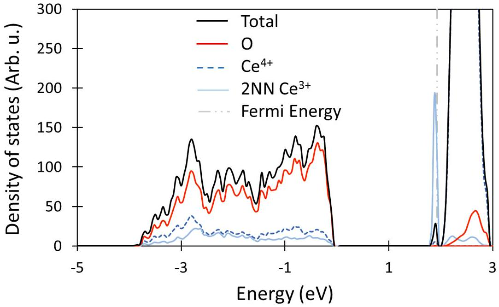
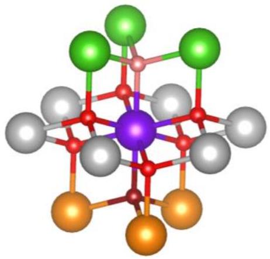
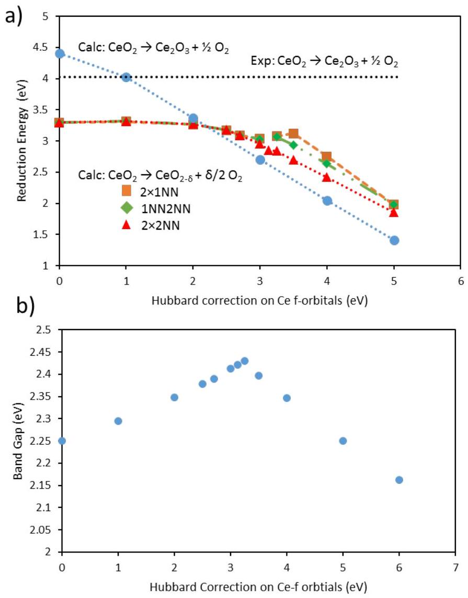
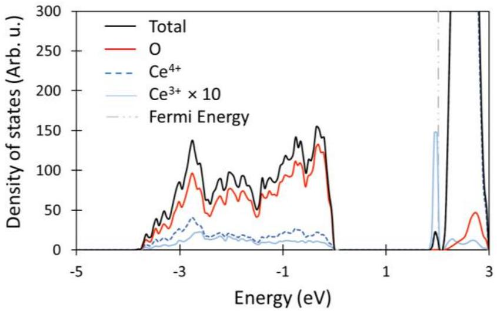
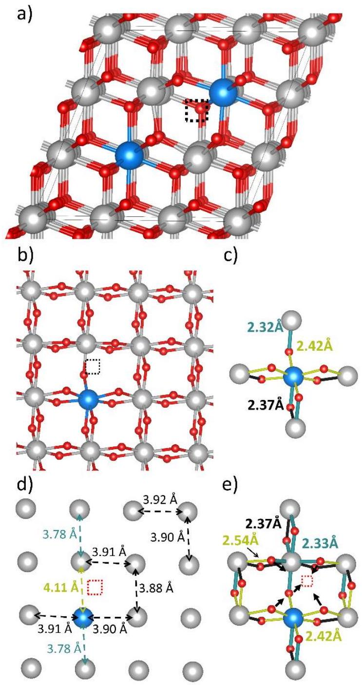
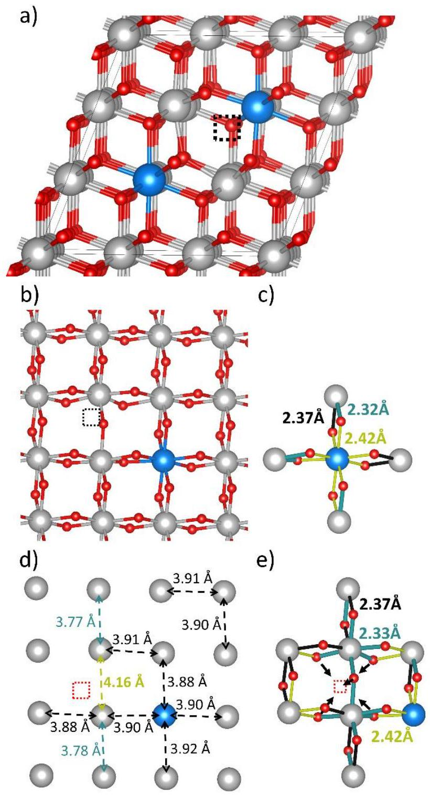
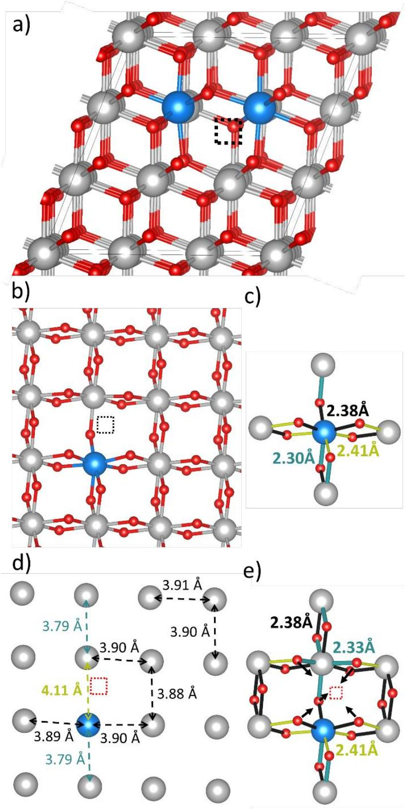
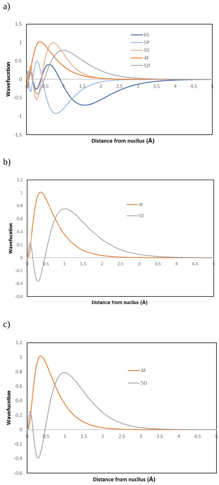

# Re-evaluating $\mathrm{CeO}_{2}$ Expansion Upon Reduction: Non-counterpoised Forces, Not Ionic Radius Effects, are the Cause 

Christopher L. Muhich, ${ }^{\mathrm{a}^{*}}$ ${ }^{\mathrm{a}}$ ETH Zurich, Department of Mechanical and Process Engineering, 8092 Zurich, Switzerland *Corresponding author email: cmuhich@ethz.ch Address: Sonneggstrasse 3, 8092 Zurich, Switzerland

## Supporting Information

## S1. HSE calculation details

A comparison of the relative energies of the three examined $\mathrm{Ce}^{3+}$ configurations was also determined using the meta-GGA HSE06 ${ }^{1,2}$ functional. The relative energies of the configurations were $2 \times 2 \mathrm{NN}<1 \mathrm{NN} 2 \mathrm{NN}<2 \times 1 \mathrm{NN}$, which matched the DFT+U predicted ordering. The $2 \times 2 \mathrm{NN}$ configuration is 0.03 eV lower in energy than 1NN2NN and 0.08 eV lower in energy than the 2×1NN configuration. The calculation was conducted at the $\Gamma$-point and was allowed to fully relax. The calculations were carried out using the Vienna Ab initio Simulation Package (VASP), ${ }^{3,4}$ and a 450 eV cutoff energy. VASP was used rather than Quantum Espressos due to its more stable HSE algorithm.

## S2. Evaluation of the $\mathbf{1 N N}$ and $\mathbf{1 N N 2 N N} \mathbf{C e}^{\mathbf{3 +}}$ configurations

An examination of the $2 \times 1 \mathrm{NN}$ and $1 \mathrm{NN} 2 \mathrm{NN} \mathrm{Ce}^{3+}$ configurations, shown in Figure S5 and Figure S7 respectively, also supports the non-counterpoised force theory rather than the expanded ionic radius explanation. First the 1NN2NN configuration is described then the 2×1NN configuration.

The location of the $\mathrm{Ce}^{3+}$ cations on a 1NN site and a 2NN site is confirmed in Figure S4. In the 1NN2NN configuration, the super cell lattice expands to $\mathrm{a}=11.677 \AA, \mathrm{~b}=11.674 \AA$, and $\mathrm{c}=$ $11.674 \AA$. The $\mathrm{Ce}^{3+}-\mathrm{O}^{2-}$ bonds also elongate from $\sim 2.38 \AA$ to $\sim 2.45 \AA$ and $\sim 2.42 \AA$ for the 2NN $\mathrm{Ce}^{3+}$ and $1 \mathrm{NN} \mathrm{Ce}^{3+}$, respectively, with the Ce-O bond opposite the vacancy shrinking to $2.33 \AA$, as shown in SI Figure S5 and Figure S6. However, the O-Ce bond elongation is compensated by the compression of the other $\mathrm{Ce}^{4+}-\mathrm{O}$ bonds of the O anions coordinating the $\mathrm{Ce}^{3+}$ cations. The 2NN $\mathrm{Ce}^{3+}-\mathrm{Ce}^{4+}$ interatomic distances $(\sim 3.90 \AA)$, and $1 \mathrm{NN} \mathrm{Ce}^{3+}-\mathrm{Ce}^{4+}$ interatomic distances $(\sim 3.90 \AA$, not including the Ce-Ce distances crossing the vacancy), are essentially identical to the $\mathrm{Ce}^{4+}-\mathrm{Ce}^{4+}$ distance found away from the vacancy $(\sim 3.90 \AA)$ and in fully oxidized ceria $(\sim 3.89 \AA)$, as shown in SI Figure S6. Conversely, the Ce cations around the vacancy expand substantially outward, leading to $\mathrm{Ce}^{4+}-\mathrm{Ce}^{4+}$ and $\mathrm{Ce}^{3+}-\mathrm{Ce}^{4+}$ distances of $4.16 \AA$, and $4.11 \AA$ respectively, as shown in SI Figure S5. This outward relaxation around the vacancy is substantially larger than that caused by the presence of the $\mathrm{Ce}^{3+}$ cations, and thus corroborates the NCFT as the underlying cause of ceria expansion rather than the size of the $\mathrm{Ce}^{3+}$ cations.

The same cause of expansion is also found in the 2×1NN configuration. Ceria reduction in the $2 \times 1$ NN configuration results in the lattice expanding to $\mathrm{a}=11.666 \AA, \mathrm{~b}=11.683 \AA$, and $\mathrm{c}=$ $11.683 \AA$. Unlike in the previous cases not all of the $\mathrm{Ce}^{3+}-\mathrm{O}$ bonds all expand; while three $\mathrm{Ce}^{3+}-$ O of each $\mathrm{Ce}^{3+}$ cation elongate to $\sim 2.41 \AA$, three remain relatively unchanged $(2.38 \AA)$ while the bond opposite the vacancy shrinks to $2.30 \AA$, as shown in Figure S7. Even the three expanded Ce-O bonds are again accompanied by a concomitant compression of the $\mathrm{O}-\mathrm{Ce}^{4+}$ bonds one coordination shell out from the $\mathrm{Ce}^{3+}$ cations, resulting in non-vacancy crossing $\mathrm{Ce}^{3+}-\mathrm{Ce}^{4+}$ distances $(3.90 \AA)$ which are essentially unchanged from fully oxidized ceria $(3.89 \AA)$ or far from the vacancy $(3.90 \AA)$, with one exception. The $\mathrm{Ce}^{4+}$ cations one coordination shell away from the $\mathrm{Ce}^{3+}$
in the direction opposite the vacancy has actually shrunk to $\sim 3.79 \AA$, as was seen in the other two configurations and shown in Figure S7d. This shrinkage in Ce-Ce distances is contradictory to the expected if the presence of a $\mathrm{Ce}^{3+}$ cation was expanding the material. However, once again there is substantial outward expansion around the vacancy resulting in $\mathrm{Ce}^{3+}-\mathrm{Ce}^{3+}, \mathrm{Ce}^{3+}-\mathrm{Ce}^{4+}$ and $\mathrm{Ce}^{4+}$ -$\mathrm{Ce}^{4+}$ distances of $4.09 \AA, 4.11 \AA$ and $4.13 \AA$, respectively. The difference in inter cationic distances arise from the size of the cations, the shortest distance is between the larger two cations, the middle distance is between the larger and smaller cations and the shortest distance is between the smallest cations. It is worth noting that even the effect of various cationic radii is rather small $(<0.04 \AA)$. These results are summarized in in SI Figure S7 and further substantiates the NCFT.

## S3. Comparison of Ce 4f and 5d orbital extent

The relative contraction of the 4f and 5 d orbitals of cerium cations were investigated by calculating the all electron wave function of isolated $\mathrm{Ce}^{4+}$ and $\mathrm{Ce}^{3+}$ cations. The wave functions for the outermost electrons are show in Figure SI 8. For a $\mathrm{Ce}^{4+}$ cation, the 4f electrons have a maximum in their wave function roughly $0.38 \AA$ from the nucleus, and the wave function has a value of roughly zero by $2.5 \AA$. This is more contracted than the Ce 5 d orbitals, which have a maximum and return to zero at roughly $0.97 \AA$ and $3.5 \AA$ respectively. Additionally, I determined the radius of a sphere containing 95\% of the electron probability density for each of the orbitals, being $0.99 \AA$ and $1.83 \AA$ for the 4f and 5d orbitals respectively; once again this shows that the 4f orbitals are more contracted than 5d orbitals. Not only are the 4f orbitals more contracted than the 5d orbitals, but they are also tighter than the 6s, 5s, and 5p orbitals, as shown in Figure SI8a. To investigate the possibility of a change in relative extent after reduction I also calculated the wave function of two $\mathrm{Ce}^{3+}$ orbitals, one where the 4f orbital is occupied and one where the 5d orbital is.

As can be seen in Figure 8b and c, the inclusion of an additional electron causes expansion of all orbitals. This is due to increased shielding of the nucleus. Although the orbitals expand, the relative extents of them remain the same, i.e. f-orbitals are more contracted than the 5-d orbitals, based on a similar analyst as discussed above reaches. The radial extent analysis is summarized in in Table S2.

## S 4. Comments on charge distribution calculation

The charge distribution plot shown in Figure 3 was calculated by subtracting a super position of atomic charge densities form the calculated charge density distribution. This was done to aid in seeing the accumulation or loss of charge. Although no ion exists at the vacancy site to subtract from the calculated charge density distribution, one can still determine if charge localization occurs. If positive charge were to accumulate at the vacancy, as implied by Kröger-Vink notation, one would expect to see charge loss because positive charge (or negative electron density) minus nothing is still loss. If negative charge were to accumulate at the vacancy it would still appear as charge gain, once again because charge localization minus nothing is still charge gain.

## S 5. Point charge analysis of forces on $\mathbf{1 N N} \mathbf{C e}^{\mathbf{4}+}$ cations

In order to distinguish the cause of the outward force on the $1 \mathrm{NN} \mathrm{Ce}^{4+}$ cations I calculated the force contribution of the ions within one O and Ce coordination shell of a $1 \mathrm{NN} \mathrm{Ce}^{4+}$ cation, as shown in SI Figure S2. The forces acting on a single 1NN cation were calculated using Coulomb's law assuming that each ion was a point charge of the formal oxidation state of the ion, i.e. $\mathrm{O}^{2-}=-$ 2 and $\mathrm{Ce}^{4+}=+4$. When oxidized, the forces acting the 1NN Ce is counterpoised, as shown in SI Table S1. Upon O-vacancy formation this is no longer true; a force of $3.26 \times 10^{-8} \mathrm{~N}$ acts on the 1NN $\mathrm{Ce}^{4+}$ in the direction opposite the vacancy. The other three 1NN Ce exert a $5.99 \times 10^{-8} \mathrm{~N}$ force on
the cation of interest ( the purple sphere in SI Figure S2) and in the direction away from the vacancy. However, the force from the 1NN cations (the purple spheres in SI Figure S2) is balanced by their mirroring $\mathrm{Ce}^{4+}$ cations (the purple spheres in SI Figure S2), which exert a $5.99 \times 10^{-8} \mathrm{~N}$ force on the $\mathrm{Ce}^{4+}$ of interest in the direction of the vacancy. However, the O anion 180° opposite the O-vacancy provides an attractive force of $3.26 \times 10^{-8} \mathrm{~N}$ on the Ce4+ of interest. Therefore, this O anion is responsible for pulling the Ce outwards and expanding ceria upon reduction.

## Figures:

Figure S1: PDOS for reduced $\mathrm{CeO}_{2}$ in the $2 \times 2 \mathrm{NN}$ configuration. The DOS of the $\mathrm{Ce}^{3+}$ cations have been increased by a factor of 10 to increase its clarity.

Figure S2: Ion positions for the ionic force model. Small red, burgundy, and pink spheres denote the location of $\mathrm{O}^{2-}$ ions (-2 point charges), where the pink sphere indicates the location of the O-vacancy and the burgundy the anion 180° opposite the vacancy site. Large gray, green, purple and orange spheres denote the location of $\mathrm{Ce}^{4+}$ cations (+4 point charges), where the green spheres indicate $\mathrm{Ce}^{4+}$ 1NN next to the O-vacancy, the purple sphere represents the Ce for which the effective force is calculated, orange spheres reprent $\mathrm{Ce}^{4+}$ cations which counterpoise the 1NN cations and gray spheres represent $\mathrm{Ce}^{4+}$ cations which counterpoise one another.

Figure S3: The effect of various Hubbard correction energies applied to the Ce-f orbitals on a) ceria reduction and b) the band gap between the valence band maximum and f-band minimum at the $\Gamma$ point.

Figure S4: PDOS for reduced $\mathrm{CeO}_{2}$ in the 1NN2NN configuration. The DOS of the $\mathrm{Ce}^{3+}$ cations have been increased by a factor of 10 to increase its clarity.

Figure S5: O vacancy in the 1NN2NN configuration. a) Super cell containing the O -vacancy b) plane of atoms containing the O-vacancy, and the $1 \mathrm{NN} \mathrm{Ce}^{3+}$ cation. c) bond length representation of the $\mathrm{Ce}^{3+}$ cation, its coordinating O anions and its $2 \mathrm{NN} \mathrm{Ce}^{4+}$ cations in the plane shown in b). d) the Ce-Ce distances in the plane shown b, and e) the relative bond lengths of the ions around the vacancy. Large blue, medium gray and small red spheres represent $\mathrm{Ce}^{3+}, \mathrm{Ce}^{4+}$ and $\mathrm{O}^{2-}$ ions respectively. The dotted square shows the location of the O-vacancy. In c) and e) the thin occur yellow, medium black and thick teal lines indicate bonds that are compressed (<2.35 Å), unchanged $(2.35 \AA$ to $2.4 \AA)$, or elongated $(>2.4 \AA)$ as compared to the Ce-O bond length in fully oxidized ceria $(2.38 \AA)$. The bond-lengths shown represent average bond lengths for that type of bond unless specifically indicated. The black arrows in e) show the relaxation direction of the O anions towards the O-vacancy.

Figure S6: O vacancy in the 1NN2NN configuration. a) Super cell containing the O -vacancy b) plane of atoms containing the O-vacancy, and the $2 \mathrm{NN} \mathrm{Ce}^{3+}$ cation. c) bond length representation of the $\mathrm{Ce}^{3+}$ cation, its coordinating O anions and its $2 \mathrm{NN} \mathrm{Ce}^{4+}$ cations in the plane shown in b). d) the Ce-Ce distances in the plane shown b, and e) the relative bond lengths of the ions around the vacancy. Large blue, medium gray and small red spheres represent $\mathrm{Ce}^{3+}, \mathrm{Ce}^{4+}$ and $\mathrm{O}^{2-}$ ions respectively. The dotted square shows the location of the O-vacancy. In c) and e) the thin occur yellow, medium black and thick teal lines indicate bonds that are compressed (<2.35 Å), unchanged ( $2.35 \AA$ to $2.4 \AA$ ), or elongated ( $>2.4 \AA$ ) as compared to the Ce-O bond length in fully oxidized ceria $(2.38 \AA)$. The bond-lengths shown represent average bond lengths for that type of bond unless specifically indicated. The black arrows in e) show the relaxation direction of the O anions towards the O-vacancy.

Figure S7: O vacancy in the 2×1NN configuration. a) Super cell containing the O -vacancy b) plane of atoms containing the O-vacancy, and one of the $1 \mathrm{NN} \mathrm{Ce}^{3+}$ cations. c) bond length representation of the $\mathrm{Ce}^{3+}$ cation, its coordinating O anions and its $2 \mathrm{NN} \mathrm{Ce}^{4+}$ cations in the plane shown in b). d) the Ce-Ce distances in the plane shown b, and e) the relative bond lengths of the ions around the vacancy. Large blue, medium gray and small red spheres represent $\mathrm{Ce}^{3+}, \mathrm{Ce}^{4+}$ and $\mathrm{O}^{2-}$ ions respectively. The dotted square shows the location of the O-vacancy. In c) and e) the thin occur yellow, medium black and thick teal lines indicate bonds that are compressed (<2.35 Å), unchanged (2.35 Å to $2.4 \AA$ ), or elongated (> $2.4 \AA$ ) as compared to the Ce-O bond length in fully oxidized ceria $(2.38 \AA)$. The bond-lengths shown represent average bond lengths for that type of bond unless specifically indicated. The black arrows in e) show the relaxation direction of the O anions towards the O-vacancy.

Figure S8: Wave function of 4f and 5d orbitals of an isolated Ce ion that is: a) $\mathrm{Ce}^{+4}$, b) $\mathrm{Ce}^{3+}$ with one f orbital occupied, and c) $\mathrm{Ce}^{3+}$ with one d orbital occupied.

Table SI 1: Columbic forces on a 1NN Ce cation by the $1^{\text {st }} \mathrm{O}$ and Ce coordination shell
| Ion position ${ }^{\mathrm{a}}$ | Ion | $\mathrm{F}_{\text {total }}(\mathrm{N})$ | $\mathrm{F}_{\mathrm{x}}(\mathrm{N})$ | $\mathrm{F}_{\mathrm{y}}(\mathrm{N})$ | $\mathrm{F}_{\mathrm{z}}(\mathrm{N})$ |
| :--- | :--- | :--- | :--- | :--- | :--- |
| 1NN (Green) | $\mathrm{Ce}^{4+}$ | $2.45 \mathrm{E}-08$ | $-1.22 \mathrm{E}-08$ | 7.06E-09 | $2.00 \mathrm{E}-08$ |
|  | $\mathrm{Ce}^{4+}$ | $2.45 \mathrm{E}-08$ | $1.73 \mathrm{E}-12$ | -1.41E-08 | $2.00 \mathrm{E}-08$ |
|  | $\mathrm{Ce}^{4+}$ | $2.45 \mathrm{E}-08$ | $1.22 \mathrm{E}-08$ | 7.06E-09 | $2.00 \mathrm{E}-08$ |
| 1NN $\mathrm{CP}^{\mathrm{b}}$ (orange) | $\mathrm{Ce}^{4+}$ | $2.45 \mathrm{E}-08$ | $-1.22 \mathrm{E}-08$ | -7.06E-09 | $-2.00 \mathrm{E}-08$ |
|  | $\mathrm{Ce}^{4+}$ | $2.45 \mathrm{E}-08$ | $1.22 \mathrm{E}-08$ | -7.06E-09 | -2.00E-08 |
|  | $\mathrm{Ce}^{4+}$ | $2.45 \mathrm{E}-08$ | $4.03 \mathrm{E}-13$ | $1.41 \mathrm{E}-08$ | $-2.00 \mathrm{E}-08$ |
| Spectating (gray) | $\mathrm{Ce}^{4+}$ | $2.45 \mathrm{E}-08$ | $-2.45 \mathrm{E}-08$ | $-2.52 \mathrm{E}-13$ | $-1.83 \mathrm{E}-13$ |
|  | $\mathrm{Ce}^{4+}$ | $2.45 \mathrm{E}-08$ | -1.22E-08 | $-2.12 \mathrm{E}-08$ | $3.59 \mathrm{E}-13$ |
|  | $\mathrm{Ce}^{4+}$ | $2.45 \mathrm{E}-08$ | $1.22 \mathrm{E}-08$ | $-2.12 \mathrm{E}-08$ | $1.79 \mathrm{E}-12$ |
|  | $\mathrm{Ce}^{4+}$ | $2.45 \mathrm{E}-08$ | $2.45 \mathrm{E}-08$ | 9.76E-13 | $1.32 \mathrm{E}-12$ |
|  | $\mathrm{Ce}^{4+}$ | $2.45 \mathrm{E}-08$ | $-1.22 \mathrm{E}-08$ | $2.12 \mathrm{E}-08$ | $2.96 \mathrm{E}-13$ |
|  | $\mathrm{Ce}^{4+}$ | $2.45 \mathrm{E}-08$ | $1.22 \mathrm{E}-08$ | 2.12E-08 | $5.98 \mathrm{E}-13$ |
| O-vac (pink) | $\mathrm{O}^{2-}$ | -3.26E-08 | $-7.07 \mathrm{E}-12$ | $-7.47 \mathrm{E}-12$ | -3.26E-08 |
| O-vac CP ${ }^{\mathrm{b}}$ (Burgundy) | $\mathrm{O}^{2-}$ | $-3.26 \mathrm{E}-08$ | $-1.88 \mathrm{E}-12$ | $3.67 \mathrm{E}-12$ | $3.26 \mathrm{E}-08$ |
| Spectating (red) | $\mathrm{O}^{2-}$ | $-3.26 \mathrm{E}-08$ | $2.66 \mathrm{E}-08$ | $1.54 \mathrm{E}-08$ | $1.09 \mathrm{E}-08$ |
|  | $\mathrm{O}^{2-}$ | $-3.26 \mathrm{E}-08$ | $9.78 \mathrm{E}-12$ | $-3.08 \mathrm{E}-08$ | $1.09 \mathrm{E}-08$ |
|  | $\mathrm{O}^{2-}$ | -3.26E-08 | -2.66E-08 | $1.54 \mathrm{E}-08$ | $1.09 \mathrm{E}-08$ |
|  | $\mathrm{O}^{2-}$ | $-3.26 \mathrm{E}-08$ | $2.66 \mathrm{E}-08$ | $-1.54 \mathrm{E}-08$ | $-1.09 \mathrm{E}-08$ |
|  | $\mathrm{O}^{2-}$ | -3.26E-08 | $-1.23 \mathrm{E}-13$ | $3.08 \mathrm{E}-08$ | $-1.09 \mathrm{E}-08$ |
|  | $\mathrm{O}^{2-}$ | -3.26E-08 | -2.66E-08 | $-1.54 \mathrm{E}-08$ | $-1.09 \mathrm{E}-08$ |
| Total force when oxidized |  | $1.40 \mathrm{E}-11$ | -7.56 E-13 | $1.40 \mathrm{E}-11$ | $2.97 \mathrm{E}-12$ |
| Total force when reduced |  | $3.26 \mathrm{E}-08$ | $5.10 \mathrm{E}-12$ | -6.40 E-12 | $3.26 \mathrm{E}-08$ |
| Force from 1NN when reduced |  | $5.99 \mathrm{E}-08$ | $3.23 \mathrm{E}-12$ | -6.50 E-12 | $5.99 \mathrm{E}-08$ |
| Force from 1NN CP ${ }^{\mathrm{b}}$ when reduced |  | $5.99 \mathrm{E}-08$ | $3.50 \mathrm{E}-12$ | -1.30 E-12 | -5.99 E-8 |

[^0]Table S2: Comparison of radial extent of Ce 4f and 3d orbitals
|  | Radius at wave function maximum $(\AA)$ |  | Radius containing 95\% of electron probability density $(\AA)$ |  |
| :--- | :--- | :--- | :--- | :--- |
|  | 4f | 5d | 4f | 5d |
| $\mathrm{Ce}^{4+}$ | 0.38 | 0.97 | 0.99 | 1.83 |
| $\mathrm{Ce}^{4+}$ (4f occupied) | 0.40 | 1.05 | 1.14 | 2.07 |
| $\mathrm{Ce}^{4+}$ (5d occupied) | 0.39 | 1.02 | 1.02 | 1.96 |

References:

1. Heyd, J.; Scuseria, G. E.; Ernzerhof, M., Hybrid Functionals Based on a Screened Coulomb Potential. The Journal of Chemical Physics 2003, 118, 8207-8215.
2. Heyd, J.; Scuseria, G. E.; Ernzerhof, M., Erratum: "Hybrid Functionals Based on a Screened Coulomb Potential" [J. Chem. Phys. [Bold 118], 8207 (2003)]. The Journal of Chemical Physics 2006, 124, 219906-1.
3. Kresse, G.; Furthmüller, J., Efficient Iterative Schemes for Ab Initio Total-Energy Calculations Using a Plane-Wave Basis Set. Physical Review B 1996, 54, 11169.
4. Kresse, G.; Furthmüller, J., Efficiency of Ab-Initio Total Energy Calculations for Metals and Semiconductors Using a Plane-Wave Basis Set. Computational Materials Science 1996, 6, 15-50.
5. Heyd, J.; Scuseria, G. E.; Ernzerhof, M., Hybrid Functionals Based on a Screened Coulomb Potential. The Journal of Chemical Physics 2003, 118, 8207-8215.

[^0]:    ${ }^{\mathrm{a}}$ The color in parentheses corresponds to the color of the ion in SI Figure S2
    ${ }^{\mathrm{b}}$ Counter poising ions

