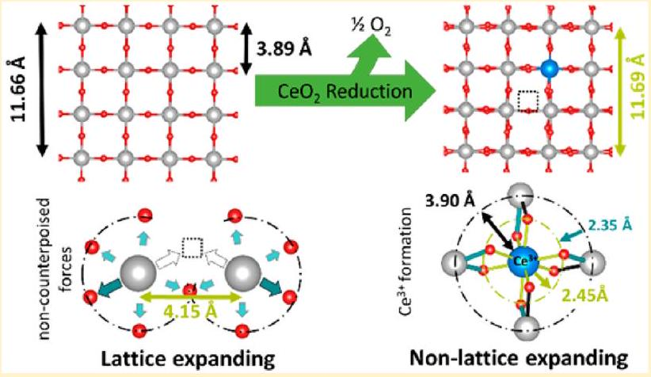
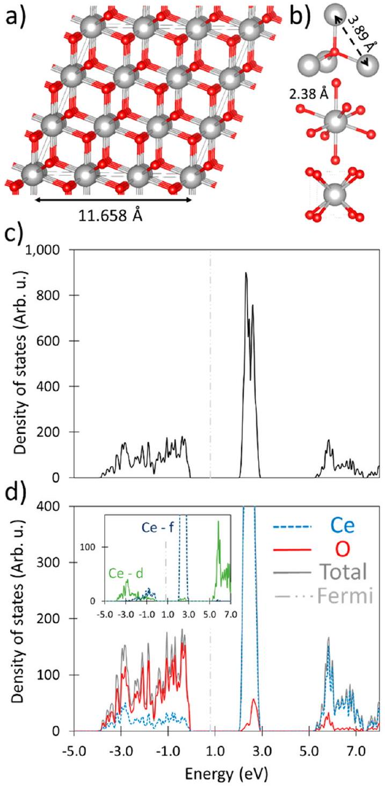
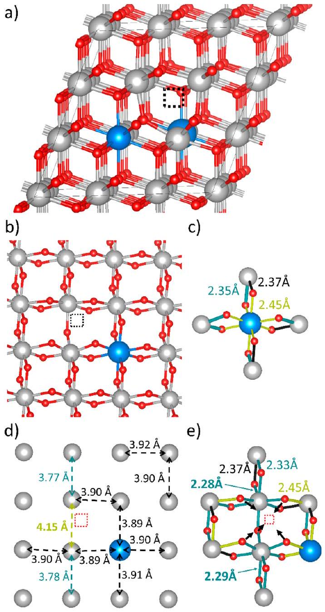
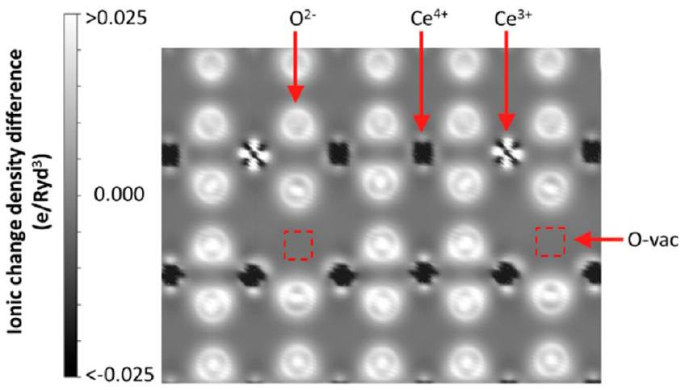
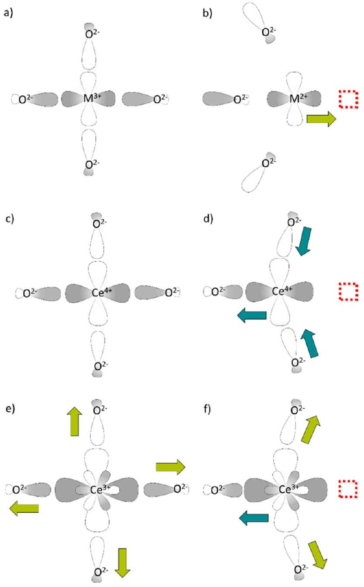

# Re-Evaluating $\mathbf{C e O}_{\mathbf{2}}$ Expansion Upon Reduction: Noncounterpoised Forces, Not Ionic Radius Effects, Are the Cause 

Christopher L. Muhich* ETH Zurich, Department of Mechanical and Process Engineering, 8092 Zurich, Switzerland

(S) Supporting Information

#### Abstract

Ceria $\left(\mathrm{CeO}_{2}\right)$ is widely used in reduction and  oxidation processes such as catalysis, solid-oxide fuel cells and electrolyzers, and thermochemical redox processes. Counterintuitively, as ceria reduces and oxidizes, it expands and contracts, respectively. This has been attributed to the larger ionic radius of $\mathrm{Ce}^{3+}$ as compared with $\mathrm{Ce}^{4+}$. However, electronic structure calculations (DFT+U) detailed herein show that this is incorrect. While the presence of $\mathrm{Ce}^{3+}$ cations causes local expansion of their coordinating O anions, the expansion is compensated by the contraction of the O-Ce bonds in the second coordination shell. This results in only negligible changes in the Ce sublattice $\left(\mathrm{Ce}^{3+}-\mathrm{Ce}^{4+}\right.$ distances of $3.90 \AA$ rather than a $3.89 \AA \mathrm{Ce}^{4+}-\mathrm{Ce}^{4+}$ distance in oxidized ceria). The severing of Ce-O bonds upon the formation of an O vacancy results in noncounterpoised forces acting on the vacancy neighboring Ce cations, which relax toward the O anion opposite the vacancy, thereby expanding ceria $\left(\mathrm{Ce}^{4+}{ }_{\text {vac }}-\mathrm{Ce}^{4+}{ }_{\text {vac }}\right.$ distance of $\left.4.14 \AA\right)$. The relaxation of $\mathrm{Ce}^{4+}$ cations away from the vacancy rather than toward the vacancy, as is found in other materials, arises because ceria reduction results in the population f orbitals rather than d-O p antibonds. The corrected explanation for ceria expansion presented here will enable better design of ceria-based systems and modifications to ceria, such as doping, that will improve its performance.

## 1. INTRODUCTION

Cerium oxide (ceria), and $\mathrm{CeO}_{2}$ in particular, is used for many reduction and oxidation (redox) processes owing to its facile oxygen ion diffusivity and crystallographic stability over a broad range of O-vacancy concentrations. ${ }^{1}$ These applications include catalytic converters, ${ }^{2}$ solid oxide fuel cells and electrolyzers, ${ }^{3-5}$ chemical looping combustion, ${ }^{6}$ and solar thermochemical splitting of $\mathrm{H}_{2} \mathrm{O}$ and $\mathrm{CO}_{2} .^{7-9}$ In these processes, ceria supplies O atoms for one of the desired reactions by forming O vacancies, which, in turn, are filled by O atoms from an oxygen source in a complementary reaction. When $\mathrm{CeO}_{2}$ reduces and an O vacancy forms, the two electrons previously associated with the removed $\mathrm{O}^{2-}$ anion formally reduce two $\mathrm{Ce}^{4+}$ cations to $\mathrm{Ce}^{3+}$ cations; this reaction is typically represented by Kröger-Vink notation, as shown in eq 1. Counterintuitive structural changes accompany ceria reduction and oxidation: Ceria expands upon reduction and shrinks upon oxidation.

$$
2 \mathrm{Ce}_{\mathrm{Ce}}^{x}+\mathrm{O}_{\mathrm{O}}^{x} \rightarrow \mathrm{~V}_{\mathrm{O}}^{\bullet \bullet}+2 \mathrm{Ce}_{\mathrm{Ce}}^{\prime}+\frac{1}{2} \mathrm{O}_{2(\mathrm{~g})}
$$

The expansion of ceria upon reduction has been attributed to the change in ionic radius of Ce cations: ${ }^{10-15}$ Because $\mathrm{Ce}^{3+}$ cations are larger (ionic radius of $1.14 \AA$ ) ${ }^{16}$ than $\mathrm{Ce}^{4+}$ cations (ionic radius of $1.00 \AA$ ) ${ }^{16}$ the formation of $\mathrm{Ce}^{3+}$ cations in $\mathrm{CeO}_{2}$ expands its lattice. ${ }^{10-15}$ This assertion is commonly taken as a fact, and often no source for the claim is cited. Marrocchelli took a quantitative approach to investigate the cause of expansion using force-field-based molecular dynamic simulations rather than relying solely on the inferences from ionic size. ${ }^{17}$ They suggest that two competing effects exist: local contraction of the anions around the O vacancy and enlarged ionic radii of the reduced $\mathrm{Ce}^{3+}$ cations, where the latter dominates anionic contraction, resulting in overall lattice expansion. ${ }^{17}$ While an excellent first step at understanding ceria explanation, the rigid nature of force-field-based molecular dynamics failed to capture the full picture of ceria reduction. The $\mathrm{Ce}^{3+}$ radius hypothesis has become ingrained in the ceria community and even been used to explain the increased reducibility of doped ceria. For example, it has been suggested that Zr-doped ceria has a decreased O-vacancy formation energy because the smaller $\mathrm{Zr}^{4+}$ cations compensate for lattice expansion caused by the presence of $\mathrm{Ce}^{3+}$ cations. ${ }^{10,11,18-20}$ The simulations used to support the $\mathrm{Ce}^{3+}$ radius explanation are convoluted by the use of force-field descriptions of the ions or the assumption that the $\mathrm{Ce}^{3+}$ cations occupy first nearestneighbor (1NN) sites to the O vacancy. ${ }^{11,21-26}$ Recently, experimental and computational work has shown that the $\mathrm{Ce}^{3+}$ cations preferentially occupy sites that are second Ce cation

Received: December 8, 2016
Revised: March 19, 2017
Published: March 22, 2017
nearest-neighbor sites (2NN) to the vacancy. ${ }^{27-30}$ Because the $\mathrm{Ce}^{3+}$ radius explanation for ceria expansion is based on high-energy structures, it deserves further scrutiny.
Although it seems logical on initial consideration that the formation of larger $\mathrm{Ce}^{3+}$ cation would expand the $\mathrm{CeO}_{2}$ lattice, the claim is not substantiated by the finding detailed herein. I use periodic-boundary-condition-based density functional theory with a Hubbard correction (DFT+U) to investigate ceria expansion upon reduction. This shows that the effects of $\mathrm{Ce}-\mathrm{O}$ bond expansion when $\mathrm{Ce}^{3+}$ forms are highly localized and are almost completely compensated by the contraction of the O-Ce bonds one coordination shell away from the $\mathrm{Ce}^{3+}$ cation. Rather, the expansion is predominantly caused by the relaxation of the four Ce cations away from the O vacancy and toward the O anion directly opposite the vacancy due to the noncounterpoised force (NCF) induced on the cations by the O anions 180° opposite the vacancy. On the basis of on the NCF explanation and an investigation of bonding I also provide an explanation for the preferential localization of $\mathrm{Ce}^{3+}$ cations away from the vacancy. This corrected understanding of ceria expansion will not only expand general materials science knowledge but also aid in the development of more stable, higher performing pure and doped ceria processes.

## 2. RESULTS AND DISCUSSION

I investigated the expansion of ceria upon reduction using plane-wave-based periodic boundary condition Perdew-Burke-Ernzerhof (PBE) ${ }^{31}$ DFT calculations, as implemented in Quantum Espresso, ${ }^{32}$ with a Hubbard correction ${ }^{33}$ ( $U=$ 3.125 eV) on the Ce f orbitals. For full computational methods, see Section 4. A $3 \times 3 \times 3$ repetition of the $\mathrm{CeO}_{2}$ primitive unit cell was used to represent ceria, as shown in Figure 1a. Ceria has a fluorite structure, where the O anions are tetrahedral-coordinated and nominally in the -2 oxidation state and the Ce cations are cubically (eight-fold) coordinated and are nominally in the +4 oxidation state, as shown in Figure 1b. In the fully oxidized state, the super cell has a calculated lattice vector length of $11.658 \AA$. This corresponds to a lattice constant of $5.496 \AA$ for a cubic representation and is in agreement with previous calculations ( 5.46 to $5.49 \AA$ ), ${ }^{24,34}$ although it is slightly larger than the experimental value of $5.411 \AA^{35}$ due to the tendency of generalized gradient approximation functionals to overestimate lattice parameters. The $\mathrm{Ce}-\mathrm{O}$ bonds are $2.38 \AA$ long, and nearest-neighboring Ce cations are $3.89 \AA$ apart.

In oxidized ceria, the valence band is fully occupied and is composed mainly of O 2p states, while the conduction band is empty and composed mainly of Ce d states, as shown in Figure 1c,d. A narrow band of Ce 4f states sits 2.26 eV above the valence band in the band gap. This is an underestimation of the band gap, as is expected of GGA methods, but is in agreement with past GGA results. ${ }^{34,36}$ Although this is the lowest energy excitation, it is a forbidden transition for light excitation. ${ }^{36}$ The calculated O 2p-Ce 5d band gap is 5.25 eV. The empty Ce 5d and 4f states and full O 2p states indicate that the O ions are reduced while the Ce ions are oxidized. The presence of Ce states in the valence band suggests that the Ce-O bonds are not completely ionic in nature; instead, they maintain some covalent character. Bader charge analysis supports this assessment, predicting that the Ce cations and O anions have charges of only +2.46 and -1.23 rather than their formal charges of +4 and -2, respectively. Although Bader analysis, like all charge assignment methods, is imprecise and the predicted charge should not be taken as true representation of

Figure 1. Oxidized ceria (a) geometric representation of the super cell used in this work and (b) the coordination of the O anion (top) and Ce cation shown from two angles (middle and bottom). The large gray and small red spheres represent Ce and O ions, respectively. The light-black lines define the periodic cell. (c) Total DOS of $\mathrm{CeO}_{2}$ and (d) PDOS of $\mathrm{CeO}_{2}$. The $y$ axis of panel d is truncated to highlight the detail in the valence and conduction bands. The Ce d- and f-orbital projections of the DOS are plotted in the inset of panel d.

the experimental oxidation state, it nonetheless shows a substantial under reduction and oxidation of the anions and cations respectively, which is attributed to the electron sharing associated with covalent bonds. Throughout this work, I use Bader charge to show movement and localization of charge; however, this should not be taken as an explicit prediction of experimental oxidation state.

To simulate ceria reduction, an O vacancy was introduced into the lattice. Given the 81-atom super cell, the presence of one oxygen vacancy corresponds to a $1.85 \%$ O-vacancy concentration, or equivalently a reduction extent of $\delta=$ 0.037. The formation of an O vacancy in ceria results in the reduction of two $\mathrm{Ce}^{4+}$ cations to $\mathrm{Ce}^{3+}$ cations. The two electrons previously associated with the removed O atom localize on two Ce cations rather than delocalizing over all of the cations in the system. ${ }^{27-30}$ I investigated three different
initial localization configurations: both $\mathrm{Ce}^{3+}$ cations at first nearest neighbors sites to the vacancy (2×1NN), one $\mathrm{Ce}^{3+}$ cation in the first nearest neighbor position to the vacancy and one in the second Ce nearest neighbor position (1NN2NN), and both $\mathrm{Ce}^{3+}$ cations in the second nearest neighbor position to the vacancy $(2 \times 2 \mathrm{NN})$. Other $\mathrm{Ce}^{3+}$ localizations further than 2NN sites were not considered because previous work has shown them to be significantly higher in energy. ${ }^{27}$ The calculations predict that the $\mathrm{Ce}^{3+}$ cations preferentially localized in the $2 \times 2$ NN configuration-with an O-vacancy formation energy $\left(E_{\text {ovac }}\right)$ of 2.90 eV-rather than either the $2 \times 1 \mathrm{NN}\left(E_{\text {ovac }}\right.$ $=3.12 \mathrm{eV})$ or 1NN2NN $\left(E_{\text {ovac }}=2.98 \mathrm{eV}\right)$ configurations. The preference for the 2×2NN configuration is in agreement with previous work. ${ }^{27-29}$ Additionally, the relative energy ordering configurations calculated with PBE+U agrees with calculations conducted using the HSE06 functional, which found an energy preference of the $2 \times 2$ NN configuration of 0.03 and 0.08 eV compared with the 1NN2NN and 2×1NN configurations, respectively. For further information, see the Supporting Information (SI) Section S1. On the basis of these energy preferences, I use the 2×2NN configuration, shown in Figure 2a,b, to investigate ceria expansion in detail; however, analysis of the other configurations results in the same conclusion and is discussed in the SI Section S2.
The localization of the two electrons worth of electron density on two Ce cations at 2NN sites is confirmed by both PDOS analysis and Bader charge analysis. Upon reduction electron density transfers to the lowest two Ce 4f states, which, when filled, decrease in energy and are located just below, and separate from, the main f band, as shown in SI Figure S1. This suggests that the 4f electron density is localized. Additionally, the PDOS analysis confirms that the filled mid-gap states are composed almost entirely of 2×2NN Ce 4f states, as shown in SI Figure S1. The area under the curve of these new states predicts that 1.61 e of the 2.00 e worth of electron density ( $77 \%$ ) has localized on the $2 \times 2$ NN Ce 4 f states, with the remainder distributed across the other Ce cations (21\%) and the O anions (2\%). Bader charge analysis further confirms a large degree of localization, predicting that the 2×2NN Ce cations have charges of +2.21, while the others Ce cations have an average charge of +2.40. The underestimation of the reduction of each 2NN Ce cation (+0.39 e) as compared with the expected reduction extant (+1 e) is attributed to shortcomings in the Bader method.

Upon reduction, the unit cell expands by 0.8\% from a calculated super cell vector length of $a=b=c=11.658 \AA$ to an asymmetric cell, where $a=11.691 \AA, b=11.688 \AA$, and $c=$ $11.690 \AA$. The lattice increase is accompanied by an outward expansion of the four Ce cations neighboring the O vacancy. While this has been described before, it has not been named as the cause of ceria expansion. ${ }^{24,37,38}$ Additionally, the O anions coordinated to the newly formed $\mathrm{Ce}^{3+}$ cations relax outward. The increase in the Ce-O bond length of $\mathrm{Ce}^{3+}$ as compared with $\mathrm{Ce}^{4+}$ stems from an outward expansion of the Ce-d orbitals due to the population of the contracted Ce f orbitals and the associated increased nucleus shielding, as described more fully in SI Section S3. This increase in the ionic radius of $\mathrm{Ce}^{3+}$ as compared with $\mathrm{Ce}^{4+}$ is commonly invoked as the cause of reduced ceria expansion. ${ }^{10-15,18-20}$ However, upon further examination this hypothesis does not hold. Rather, the lattice expansion of ceria upon reduction arises from outward expansion of the Ce cations upon the severing of the O-Ce bonds due to noncounterpoised forces and the electronic

Figure 2. Reduced ceria where both $\mathrm{Ce}^{3+}$ cations are 2NN to the vacancy. (a) Super cell containing the O vacancy. (b) Plane of atoms containing the O vacancy, two Ce cations neighboring the vacancy, and a $\mathrm{Ce}^{3+}$ cation. (c) Bond length representation of the $\mathrm{Ce}^{3+}$ cation, its coordinating O anions, and its $2 \mathrm{NN} \mathrm{Ce}^{4+}$ cations in the plane shown in panel b. (d) Ce-Ce distances in the plane shown in panel b. (e) Relative bond lengths of the ions around the vacancy. Large blue, medium gray, and small red spheres represent $\mathrm{Ce}^{3+}, \mathrm{Ce}^{4+}$, and $\mathrm{O}^{2-}$ ions, respectively. The dotted square shows the location of the O vacancy. In panels c and e the thin yellow, medium black, and thick teal lines indicate bonds that are compressed $(<2.35 \AA)$, unchanged (2.35 to $2.4 \AA$ ), or elongated ( $>2.4 \AA$ ) as compared with the $\mathrm{Ce}-\mathrm{O}$ bond length in fully oxidized ceria $(2.38 \AA)$. The bond lengths shown represent average bond lengths for that type of bond unless specifically indicated. The black arrows in panel e show the relaxation direction of the O anions toward the O vacancy.

structure of Ce atoms. First I discuss the evidence against the ionic radius hypothesis before examining the evidence of the actual cause, NCF.
2.1. Limited Effects of $\mathbf{C e}^{3+}$ Formation. The $\mathrm{Ce}^{3+}$ cations preferential form at the 2NN positions, meaning that the two $\mathrm{Ce}^{3+}$ cations remain eight-fold coordinated after reduction. The eight $\mathrm{Ce}^{3+}-\mathrm{O}$ bonds are not of equal length, rather seven elongate from the $\sim 2.38 \AA$ in fully oxidized $\mathrm{CeO}_{2}$ to $\sim 2.45 \AA$, as shown in Table 1, while the eighth elongates even further to $2.58 \AA$. The longer eighth $\mathrm{Ce}-\mathrm{O}$ bond is between the $\mathrm{Ce}^{3+}$ cation and an O anion bound to a Ce cation neighboring the O vacancy. This increased elongation is not attributed to Jahn-

Table 1. Distance between Ions in Reduced and Oxidized $\mathbf{C e O}_{\mathbf{2}}$
|  | $\mathrm{Ce}-\mathrm{O}$ bond length $(\AA)$ |  |  | Ce-Ce intercationic distance (Å) |  |  |
| :--- | :--- | :--- | :--- | :--- | :--- | :--- |
|  | $\mathrm{Ce}^{3+}-\mathrm{O}$ | $\mathrm{Ce}^{4+}{ }_{\text {vac }}-\mathrm{O}^{a}$ | $\mathrm{Ce}^{3+}{ }_{\text {vac }}-\mathrm{O}^{a}$ | $\mathrm{Ce}^{4+}{ }_{\text {vac }}-\mathrm{Ce}^{4+}{ }_{\text {vac }}$ | $\mathrm{Ce}^{3+}-\mathrm{Ce}^{4+}$ | $\mathrm{Ce}^{3+}{ }_{\text {vac }}-\mathrm{Ce}^{4+}{ }_{\text {vac }}$ |
| 2×2NN | 2.45 | 2.33 (2.28) |  | 4.14 | 3.90 |  |
| 1NN2NN | 2.47 | 2.33 (2.28) | 2.42 (2.32) | 4.16 | 3.90 | 4.11 |
| 2×1NN |  | 2.34 (2.29) | 2.39 (2.30) | 4.13 | $3.90^{b}$ | 4.09 |
| oxidized |  | $2.38{ }^{c}$ |  | $3.89^{c}$ |  |  |

${ }^{a}$ Distances do not include the bond length to the O anion 180° opposite the vacancy; this distance is reported in parentheses. ${ }^{b} \mathrm{Ce}^{3+}-\mathrm{Ce}^{4+}$ distances not including the shell 180° opposite the vacancy. ${ }^{c}$ Ions do not neighbor a vacancy as none exist in fully oxidized ceria.

Teller distortions but rather to the O anion being pulled out of alignment by the $\mathrm{Ce}^{4+}$ cation neighboring the vacancy as it relaxes away from the vacancy. The 3 and 8\% expansions in Ce-O bond lengths are a significant increase, although they are <15\% expansion predicted by the ionic radius change. Taken alone, this would seem to support the currently accepted ionic radius expansion hypothesis. However, the lengthening of the $\mathrm{Ce}^{3+}-\mathrm{O}$ bonds is accompanied by a compression of the O-$\mathrm{Ce}^{4+}$ bonds one coordination shell out from the $\mathrm{Ce}^{3+}$ cation to only 2.32 to $2.39 \AA$, as shown in Figure 2 c . Given this concomitant expansion and contraction, the distance between the $\mathrm{Ce}^{3+}$ cations and their nearest $\mathrm{Ce}^{4+}$ cations ( $3.90 \AA$, as shown in Figure 2d) is scarcely increased from the $\mathrm{Ce}^{4+}-\mathrm{Ce}^{4+}$ distance in fully oxidized ceria $(3.89 \AA)$. In fact, the calculated increase in $\mathrm{Ce}^{3+}-\mathrm{Ce}^{4+}$ distance is roughly equal to that of $\mathrm{Ce}^{4+}-\mathrm{Ce}^{4+}$ pairs away from the $\mathrm{Ce}^{3+}$ cations and the vacancy in the reduced super cell. The effective $0.01 \AA$ radius increase around the two $\mathrm{Ce}^{3+}$ cations could at most account for a $0.02 \AA$ expansion in the lattice because the two $\mathrm{Ce}^{3+}$ cations are not aligned along a single lattice vector. This maximum expansion is less than the calculated $0.032 \AA$ expansion. In other words, the increase in the O-Ce bond length of $\mathrm{Ce}^{3+}$ does not significantly affect the cation lattice structure or size, or the anionic lattice outside of its coordination shell. Therefore, the contaminant expansion of the $\mathrm{Ce}^{3+}$ cations and compression of the neighboring $\mathrm{Ce}^{4+}-\mathrm{O}$ bonds is too small to be responsible for the expansion of reduced ceria, and the currently accepted explanation for ceria expansion must be replaced with one that agrees with the computational findings.
2.2. Noncounterpoised Force Explanation. While a change in ionic radius does not cause ceria to expand upon reduction, the relaxation of the four previously fully coordinated $\mathrm{Ce}^{4+}$ cations away from the vacancy does. This outward movement of the 1NN Ce cations results in the Ce-Ce distance across the vacancy to increase from $\sim 3.89 \AA$ in oxidized ceria to $\sim 4.14 \AA$, as shown in Figure 2d. Some of this large expansion is counteracted by the compression of O-Ce bonds further from the vacancy, resulting in a $3.78 \AA \mathrm{Å-Ce}$ distance between cations neighboring the vacancy and those in the next row away from the vacancy, as shown in Figure 2d. This $0.1 \AA$ compression in the $\mathrm{Ce}-\mathrm{Ce}$ distance one coordination shell from the O vacancy cannot fully compensate for the $0.25 \AA \mathrm{Ce}-\mathrm{Ce}$ expansion around the vacancy. It is worth noting that the strong compression between the expanding Ce cations and the next coordination shell out from the vacancy is exacerbated by periodic image effects and that in an infinite system this contraction is minimized. Although this shows that $\mathrm{Ce}^{4+}$ relaxation away from the vacancy, rather than ionic radius effects, is responsible for the expansion, it does not explain the relaxation. There are two possible causes: (1) columbic repulsion between the positively charged 1NN Ce cations and the vacancy or other 1NN cations or (2) columbic attraction between the $\mathrm{Ce}^{4+}$ cations and the $\mathrm{O}^{2-}$ anions.

The four 1NN $\mathrm{Ce}^{4+}$ could be pushed outward by positive charges at or around the vacancy. On the basis of the Kröger-Vink formulation (eq 1), the vacancy is assigned a +2 charge. This would indeed repel the cations and expand the lattice. While Kröger-Vink notation provides a useful framework for thinking about defects and accounting for charges, it is not entirely physical, as nuclei are the positive charges in materials and no nucleus occupy the vacancy site. This is shown in the charge density distribution map of Figure 3, where there is no

Figure 3. Charge distribution of reduce $\mathrm{CeO}_{2}$ in the plane containing the O vacancy, two 1NN Ce ${ }^{4+}$ cations, and one $\mathrm{Ce}^{3+}$ cation. Charge distribution is determined by taking the calculated charge density and subtracting the charge-density distribution from a super position of atoms. Areas of negative charge are bright (white), areas of positive charge are dark (black), and no charge are gray. For further analysis, see SI Section S4. As can be seen, O and Ce ions are negatively and positively charged, respectively, while the vacancy is not charged.

charge accumulation (positive or negative) at the vacancy site. This is in contrast with the Ce cations, which are positively charged, and the O anions, which are negatively charged. Because no positive charge localization exists at the vacancy site, it cannot be responsible for repulsing 1NN $\mathrm{Ce}^{4+}$ cations and expanding ceria upon reduction.

Additionally, the repulsive columbic interaction of the 1NN $\mathrm{Ce}^{4+}$ cations could be responsible for ceria explanation. Although each $\mathrm{Ce}^{4+}$ experiences a repulsive columbic force away from the vacancy caused by the other three 1NN $\mathrm{Ce}^{4+}$, this repulsion is balanced by Ce cations one additional coordination shell out from the vacancy. This results in zero net force on 1NN $\mathrm{Ce}^{4+}$ cations from other cations. Further information and a calculation of forces acting on the ions using point charges is available in the SI Section S5. Overall, the 1NN $\mathrm{Ce}^{4+}$ cations do not relax away from the O vacancy because of repulsive positive-positive ionic interactions, either real (other Ce cations) or hypothetical (vacancy charge localization);
therefore, they are not responsible for causing ceria expansion upon reduction. However, noncounterpoised anion-cation attraction does explain ceria expansion.

In fluorite-structured $\mathrm{CeO}_{2}$, Ce cations are coordinated to eight O anions, each of which is positioned 180° opposite from another O anion, as seen in Figure 1b. The columbic and covalent forces of each $\mathrm{O}^{2-}$ anion counterpoise the anion 180° opposite it. When an $\mathrm{O}^{2-}$ anion is removed the forces no longer balance and the Ce cations are pulled toward the anion opposite the vacancy. This unbalanced force causes the distance between the $\mathrm{Ce}^{4+}$ and the $\mathrm{O}^{2-}$ opposite the vacancy to shrink from $\sim 2.38 \AA$ in oxidized ceria to $\sim 2.28 \AA$, as shown in Figure 2e. The remaining six Ce-O bonds shrink to an average length of $2.33 \AA$. As the $\mathrm{Ce}^{4+}$ cations relax outward, the reaming six coordinating $\mathrm{O}^{2-}$ anions relax as well. The three $\mathrm{O}^{2-}$ anions nearest the vacancy relax toward it to maximize interanion distances, while the other three are pulled outward with the $\mathrm{Ce}^{4+}$ cations. This latter group of anions pull their coordinating cations outward contributing to expanding the lattice.

Overall, the outward expansion of the cations neighboring the vacancy caused by NCF has long-range structural effects on the system in contrast with the presence of $\mathrm{Ce}^{3+}$ cations, which only induces short-range distortions in their coordinating O anions. Additionally, the NCF is caused by attractive ionic interactions rather than repulsive ones. Therefore, the expansion of $\mathrm{CeO}_{2}$ upon reduction is attributable to the noncounterpoised attractive force exerted on the 1NN $\mathrm{Ce}^{4+}$ cations by the O anions 180° opposite the vacancy and the concomitant relaxation of $\mathrm{Ce}^{4+}$ cations toward this anion and away from the vacancy. An examination of the structure of the other $\mathrm{Ce}^{3+}$ configurations, as detailed in the SI Section S2 and summarized in Table 1, supports the finding that NCF rather than ionic radius changes causes ceria expansion upon reduction.
While the outward expansion behavior is logical based on the loss of counterpoising forces around the vacancy, it is opposite to that found for other metal oxide reductions. For example, when O vacancies form in ferrite spinels, the Fe cations move toward the vacancy rather that away from it due to O-Fe bond elongation; this inward movement causes the lattice to contract. ${ }^{39}$ This difference in behavior stems from the nature of Ce reduction as compared with that of d-block transition metals and the cubic coordination of cations in fluorites. In most transition-metal oxides, bonding orbitals comprise the highest energy occupied bands, while antibonding d-based orbitals compose the lowest energy unoccupied bands, as shown schematically in Figure 4a,b. Upon reduction, electrons populate the antibonding orbital bands, elongating the metal-O bonds, pushing the cation toward the vacancy, and contracting the lattice, as shown in Figure 4b.

This does not occur during $\mathrm{Ce}^{4+}$ reduction in ceria. First, $\mathrm{Ce}^{4+}$ cations neighbor the vacancy, not the reduced $\mathrm{Ce}^{3+}$ cations. As such, no new orbitals, antibonding or otherwise, are populated; therefore, the $\mathrm{Ce}^{4+}$ cations only experience the uneven ionic and covalent pull of the O anion opposite the vacancy, as shown in Figure 4c,d. Second, the lowest unoccupied bands in $\mathrm{CeO}_{2}$ are composed of f orbitals, which are highly contracted and therefore do not overlap the O 2p orbitals to the same extent as the d orbitals. A comparison of orbital extent is provided in SI Section S3 and Figure S8 and Table S2. Therefore, the population of an f orbital and cubic coordination does not induce a strong directional antibond. Rather, f-orbital occupation expands the ion due to the

Figure 4. Orbital diagram of metal-O interactions. Coordination is shown in a simplified 2D projection of the 3D reality. (a) Valence band d-p bonds in a transition-metal oxide and (b) occupied conduction band antibond when an O vacancy forms and the cation reduces. Ce-O interactions are shown in panels c-f. The d-p bonding orbitals of (c) a fully coordinated $\mathrm{Ce}^{4+}$ cation and (d) a $\mathrm{Ce}^{4+}$ cation neighboring an O vacancy. The d-p bonding orbitals of (e) a fully coordinated $\mathrm{Ce}^{3+}$ cation and (f) a $\mathrm{Ce}^{3+}$ cation neighboring an O vacancy. The red box indicates the location of the O vacancy. Arrows indicate ionic relaxation, where teal and yellow arrows indicate bond contraction and elongation, respectively.

increased electronic shielding of the nucleus, as illustrated in Figure 4e. Third, even when a $\mathrm{Ce}^{3+}$ cation neighbors an O vacancy not all of the Ce-O bonds elongate due to increased nuclear shielding; the Ce-O bond directly opposite the vacancy contracts, as shown in Table 1 and discussed in SI Section 3. Thus expansion caused by the increased electron shielding is not sufficiently large to overcome the unbalanced ionic and covalent forces of the O anion opposite the vacancy, and the $\mathrm{Ce}^{3+}$ cation is still pulled toward the noncounterpoised $\mathrm{O}^{2-}$ anion, as illustrated in Figure 4f.
2.3. Understanding Site Preferences in Reduced Ceria.

The electrons occupying the f band preferentially localize on $\mathrm{Ce}^{3+}$ cations away from the O vacancy to minimize bond strain. When $\mathrm{Ce}^{4+}$ cations are in the 1NN positions, one d-p bond is compressed. When a $\mathrm{Ce}^{3+}$ cation occupies a 1NN site, six of the remaining Ce-O bonds are able to expand. However, the lack
of a counterpoising $\mathrm{O}^{2-}$ anion at the vacancy site results in the compression of the seventh $\mathrm{Ce}^{3+}-\mathrm{O}$ bond, as shown in Figure 4f. This bond is substantially stained; not only is it unable to expand but also it actually contracts and is shorter than the $\mathrm{Ce}^{4+}-\mathrm{O}$ bond in fully oxidized $\mathrm{CeO}_{2}$. This large $\mathrm{Ce}^{3+}-\mathrm{O}$ bond strain raises the energy of the system more than the compression of the inherently shorter $\mathrm{Ce}^{4+}-\mathrm{O}$ bond.

## 3. CONCLUSIONS

This work explains the fundamental physics of ceria expansion upon reduction and, in doing so, corrects a long-held misunderstanding of the phenomenon. The reduction of $\mathrm{Ce}^{4+}$ to $\mathrm{Ce}^{3+}$ does not cause $\mathrm{CeO}_{2}$ to expand. The elongation of the $\mathrm{Ce}^{3+}-\mathrm{O}^{2-}$ bonds is offset by a concomitant contraction of the $\mathrm{O}-\mathrm{Ce}^{4+}$ bonds one coordination shell away from the $\mathrm{Ce}^{3+}$ cation, resulting in minimal long-range lattice effects. Instead, these results evidence the noncounterpoised forces as the cause of ceria expansion. The formation of an O vacancy eliminates the balancing force of the O anions 180° opposite the O vacancy acting on each of the $\mathrm{Ce}^{4+}$ cations neighboring the vacancy. The $\mathrm{Ce}^{4+}$ cations are thusly pulled toward the remaining anions, causing a substantial outward relaxation from the vacancy and expansion of the lattice as a whole. Additionally, Ce cations relax toward, rather than away from, the remaining O anions because the reducing electrons populate nonhighly interacting f orbitals rather than antibonding metal d-O p orbitals as occurs in other materials and because the reduced ions preferentially occupy 2NN sites. This correct understanding of ceria expansion via the NCF will enable more rational design of doped ceria materials, resulting in better performance of the many applications of ceria.

## 4. COMPUTATIONAL METHODS

Plane-wave periodic-boundary-condition-based density functional theory calculations were carried out using the Quantum Espresso package. ${ }^{32}$ The Perdew-Burke-Ernzerhof (PBE) generalized gradient approximation (GGA) exchange-correlation functional ${ }^{31}$ was used to calculate the exchange and correlation energies. The core states of the ions were represented using ultrasoft pseudopotentials. ${ }^{40}$ The 2s and 2p valence electrons of O were calculated explicitly; however, some core electrons of the cerium ions are included; namely, the 5s and 5p core electrons were treated explicitly in addition to the 6s, 5d, and 4f valence electrons.

Plane waves with energies up to 530.6 eV (39 Ry) comprised the wave function. This cutoff energy was determined based on a cutoff energy study including plane waves up to 680.3 eV (50 Ry). Only a 0.002 eV difference in O-vacancy formation between the 530.6 eV cutoff energy and a higher 680.3 eV cutoff energy exists for a 2 × 2 × 2 super cell. A Monkhorst-Pack k-point mesh of $2 \times 2 \times 2$ sampled the Brillouin zone. I found that O-vacancy formation energies differed by only 0.028 eV in a 2 × 2 × 2 super cell between the 2 × 2 × 2 mesh and the finer 4 × 4 × 4 mesh. Because a 3 × 3 × 3 super cell was used for the calculations detailed here, the use of the $2 \times 2 \times 2$ k-point mesh is even more accurate than in the $2 \times 2 \times 2$ super-cell case due to additional Brillouin zone folding. DOS and PDOS plots were calculated using a 4 × 4 × 4 k-point mesh. Calculations were relaxed until forces were $<7.7 \times 10^{-4}$ Ry/au. $(<0.02 \mathrm{eV} / \AA)$.
All calculations were spin-polarized. The calculations find that oxidized ceria prefers all spins to be paired, as expected, while super cells containing an O vacancy preferentially had two non-spin-paired electrons. Different configurations of $\mathrm{Ce}^{3+}$ cations were initialized by first relaxing the super cell with La cations on the desired $\mathrm{Ce}^{3+}$ sites. The La cations were then replaced by Ce cations and the geometry was reoptimized. Additionally, the starting magnetic configuration was set such that the $\mathrm{Ce}^{3+}$ sites had one unpaired electron, while the remaining Ce cations had spin-paired electrons.

O-vacancy formation energies were calculated using the following equation

$$
E_{\mathrm{Ovac}}=E_{\mathrm{CeO}_{2-\delta}}+\frac{1}{2} E_{\mathrm{O}_{2}}-E_{\mathrm{CeO}_{2}}
$$

where $E_{\text {ovac }}$ is the O-vacancy formation energy (reduction energy), $E_{\mathrm{CeO}_{2-\delta}}$ is the energy of the ceria with an O vacancy, $E_{\mathrm{CeO}_{2}}$ is the energy of the fully oxidized material, and $E_{\mathrm{O}_{2}}$ is the energy of an $\mathrm{O}_{2}$ molecule in vacuum.

Because of the propensity of GGA methods to overly delocalize highly correlated d and f orbitals, I applied a Hubbard correction ${ }^{33}$ of $U=3.125 \mathrm{eV}$ to the Ce-f orbitals. This value is a compromise between electronic and energetic accuracy and was chosen based on a $U$ parameter study conducted over the range of $U=0$ to 6. At corrections above 3 eV, the f electrons of the O vacancy containing ceria super cell localize rather than delocalizing across the system, as indicated by the identical formation energy and as can be seen in SI Figure S3a and Bader analysis. As the U correction value increases, the O-vacancy formation and $\mathrm{CeO}_{2}$ decomposition $\left(2 \mathrm{CeO}_{2} \rightarrow \mathrm{Ce}_{2} \mathrm{O}_{3}+1 / 2 \mathrm{O}_{2}\right)$ energies decrease. Because calculations based on uncorrected Ce orbitals give reduction energies similar to experiment due to a fortuitous cancelation of errors, increasing the Hubbard energy penalty increases the reduction energy error. Additionally, at $U>3.25$ the calculations show a decrease in band gap energy between the valence band maximum and the f-band minimum at the $\Gamma$ point, as shown in SI Figure 3b. Therefore, a U correction of 3.125 eV is used as a compromise between electric and energetic accuracy. The use of $U=3.125 \mathrm{eV}$ rather than the commonly used $U=5$ or 6 eV stems from the pseudopotential used, where the higher correction penalty was determined for a PAW rather than the ultrasoft pseudopotential used in this work.

## ■ ASSOCIATED CONTENT

## (S) Supporting Information

The Supporting Information is available free of charge on the ACS Publications website at DOI: 10.1021/acs.jpcc.6b12373.

> Further details of HSE calculations, analysis of 2×1NN and 1NN2NN $\mathrm{Ce}^{3+}$ configurations, comparison of Ce 4f and 5d orbital extents, discussion of the charge difference potential plot, and discussion of the ionic charge force calculation, along with corresponding figures. (PDF)

## ■ AUTHOR INFORMATION

Corresponding Author
*E-mail: cmuhich@ethz.ch.
ORCID
Christopher L. Muhich: 0000-0003-3089-559X
Notes
The author declares no competing financial interest.

## ■ ACKNOWLEDGMENTS

The author gratefully acknowledges Prof. Aldo Steinfeld for funding and research support. Computations were conducted on the on the ETH High Performance Computing's clusters (BRUTUS and EULER). The author would also like to acknowledge and thank Prof. Charles Musgrave for generously donating computing time on his cluster, which was used for the HSE calculations. Geometric representations of the atomic structures were generated using VESTA 3D visualization software. ${ }^{41}$ Bader charges were calculated using software developed by the Henkelman group. ${ }^{42,43}$

## ■ REFERENCES

(1) Chueh, W. C.; Haile, S. M. A Thermochemical Study of Ceria: Exploiting an Old Material for New Modes of Energy Conversion and $\mathrm{CO}_{2}$ Mitigation. Philos. Trans. R. Soc., A 2010, 368, 3269-3294.
(2) Yao, H.; Yao, Y. Y. Ceria in Automotive Exhaust Catalysts: I. Oxygen Storage. J. Catal. 1984, 86, 254-265.
(3) Park, S.; Vohs, J. M.; Gorte, R. J. Direct Oxidation of Hydrocarbons in a Solid-Oxide Fuel Cell. Nature 2000, 404, 265-267.
(4) Yahiro, H.; Eguchi, K.; Arai, H. Electrical Properties and Reducibilities of Ceria-Rare Earth Oxide Systems and Their Application to Solid Oxide Fuel Cell. Solid State Ionics 1989, 36, 71-75.
(5) Ni, M.; Leung, M. K. H.; Leung, D. Y. C. Technological Development of Hydrogen Production by Solid Oxide Electrolyzer Cell (Soec). Int. J. Hydrogen Energy 2008, 33, 2337-2354.
(6) Moghtaderi, B. Review of the Recent Chemical Looping Process Developments for Novel Energy and Fuel Applications. Energy Fuels 2012, 26, 15-40.
(7) Chueh, W. C.; Falter, C.; Abbott, M.; Scipio, D.; Furler, P.; Haile, S. M.; Steinfeld, A. High-Flux Solar-Driven Thermochemical Dissociation of $\mathrm{CO}_{2}$ and $\mathrm{H}_{2} \mathrm{O}$ Using Nonstoichiometric Ceria. Science 2010, 330, 1797-1801.
(8) Romero, M.; Steinfeld, A. Concentrating Solar Thermal Power and Thermochemical Fuels. Energy Environ. Sci. 2012, 5, 9234-9245.
(9) Muhich, C. L.; Ehrhart, B. D.; Al-Shankiti, I.; Ward, B. J.; Musgrave, C. B.; Weimer, A. W. A Review and Perspective of Efficient Hydrogen Generation Via Solar Thermal Water Splitting. Wiley Interdisciplinary Reviews: Energy and Environment 2016, 5, 261-287.
(10) Scaranto, J.; Idriss, H. The Effect of Uranium Cations on the Redox Properties of $\mathrm{CeO}_{2}$ within the Context of Hydrogen Production from Water. Top. Catal. 2015, 58, 143-148.
(11) Balducci, G.; Kašpar, J.; Fornasiero, P.; Graziani, M.; Islam, M. S.; Gale, J. D. Computer Simulation Studies of Bulk Reduction and Oxygen Migration in Ceo2-Zro2 Solid Solutions. J. Phys. Chem. B 1997, 101, 1750-1753.
(12) Al-Shankiti, I.; Al-Otaibi, F.; Al-Salik, Y.; Idriss, H. Solar Thermal Hydrogen Production from Water over Modified $\mathrm{CeO}_{2}$ Materials. Top. Catal. 2013, 56, 1129-1138.
(13) Hull, S.; Norberg, S. T.; Ahmed, I.; Eriksson, S. G.; Marrocchelli, D.; Madden, P. A. Oxygen Vacancy Ordering within Anion-Deficient Ceria. J. Solid State Chem. 2009, 182, 2815-2821.
(14) Bishop, S. R. Chemical Expansion of Solid Oxide Fuel Cell Materials: A Brief Overview. Acta Mech. Sin. 2013, 29, 312-317.
(15) Aneggi, E.; Boaro, M.; Colussi, S.; de Leitenburg, C.; Trovarelli, A. Ceria-Based Materials in Catalysis: Historical Perspective and Future Trends. Handbook on the Physics and Chemistry of Rare Earths 2016, 50, 209.
(16) Shannon, R. t. Revised Effective Ionic Radii and Systematic Studies of Interatomic Distances in Halides and Chalcogenides. Acta Crystallogr., Sect. A: Cryst. Phys., Diffr., Theor. Gen. Crystallogr. 1976, 32, 751-767.
(17) Marrocchelli, D.; Bishop, S. R.; Tuller, H. L.; Yildiz, B. Understanding Chemical Expansion in Non-Stoichiometric Oxides: Ceria and Zirconia Case Studies. Adv. Funct. Mater. 2012, 22, 1958-1965.
(18) Andersson, D. A.; Simak, S.; Skorodumova, N. V.; Abrikosov, I.; Johansson, B. Redox Properties of $\mathrm{CeO}_{2}-\mathrm{MO}_{2}(\mathrm{M}=\mathrm{Ti}, \mathrm{Zr}, \mathrm{Hf}$, or Th$)$ Solid Solutions from First Principles Calculations. Appl. Phys. Lett. 2007, 90, 031909.
(19) Andersson, D. A.; Simak, S.; Skorodumova, N. V.; Abrikosov, I.; Johansson, B. Theoretical Study of $\mathrm{CeO}_{2}$ Doped with Tetravalent Ions. Phys. Rev. B: Condens. Matter Mater. Phys. 2007, 76, 174119.
(20) Bishop, S. R.; Marrocchelli, D.; Fang, W.; Amezawa, K.; Yashiro, K.; Watson, G. W. Reducing the Chemical Expansion Coefficient in Ceria by Addition of Zirconia. Energy Environ. Sci. 2013, 6, 1142-1146.
(21) Kehoe, A. B.; Scanlon, D. O.; Watson, G. W. Role of Lattice Distortions in the Oxygen Storage Capacity of Divalently Doped $\mathrm{CeO}_{2}$. Chem. Mater. 2011, 23, 4464-4468.
(22) Tang, Y.; Zhang, H.; Cui, L.; Ouyang, C.; Shi, S.; Tang, W.; Li, H.; Lee, J.-S.; Chen, L. First-Principles Investigation on Redox Properties of M-Doped $\mathrm{CeO}_{2}(\mathrm{M}=\mathrm{Mn}, \mathrm{Pr}, \mathrm{Sn}, \mathrm{Zr})$. Phys. Rev. B: Condens. Matter Mater. Phys. 2010, 82, 125104.
(23) Wang, H.-F.; Gong, X.-Q.; Guo, Y.-L.; Guo, Y.; Lu, G. Z.; Hu, P. A Model to Understand the Oxygen Vacancy Formation in Zr-Doped $\mathrm{CeO}_{2}$ : Electrostatic Interaction and Structural Relaxation. J. Phys. Chem. C 2009, 113, 10229-10232.
(24) Yang, Z.; Woo, T. K.; Hermansson, K. Effects of Zr Doping on Stoichiometric and Reduced Ceria: A First-Principles Study. J. Chem. Phys. 2006, 124, 224704.
(25) Nolan, M.; Fearon, J. E.; Watson, G. W. Oxygen Vacancy Formation and Migration in Ceria. Solid State Ionics 2006, 177, 3069-3074.
(26) Castleton, C. W. M.; Kullgren, J.; Hermansson, K. Tuning LDA +U for Electron Localization and Structure at Oxygen Vacancies in Ceria. J. Chem. Phys. 2007, 127, 244704.
(27) Wang, B.; Xi, X.; Cormack, A. N. Chemical Strain and Point Defect Configurations in Reduced Ceria. Chem. Mater. 2014, 26, 3687-3692.
(28) Murgida, G. E.; Ferrari, V.; Ganduglia-Pirovano, M. V.; Llois, A. M. Ordering of Oxygen Vacancies and Excess Charge Localization in Bulk Ceria: A Dft+U Study. Phys. Rev. B: Condens. Matter Mater. Phys. 2014, 90, 115120.
(29) Sutton, J. E.; Beste, A.; Overbury, S. H. Origins and Implications of the Ordering of Oxygen Vacancies and Localized Electrons on Partially Reduced $\mathrm{CeO}_{2}$ (111). Phys. Rev. B: Condens. Matter Mater. Phys. 2015, 92, 144105.
(30) Jerratsch, J.-F.; Shao, X.; Nilius, N.; Freund, H.-J.; Popa, C.; Ganduglia-Pirovano, M. V.; Burow, A. M.; Sauer, J. Electron Localization in Defective Ceria Films: A Study with Scanning-Tunneling Microscopy and Density-Functional Theory. Phys. Rev. Lett. 2011, 106, 246801.
(31) Perdew, J. P.; Burke, K.; Ernzerhof, M. Generalized Gradient Approximation Made Simple. Phys. Rev. Lett. 1996, 77, 3865.
(32) Giannozzi, P.; Baroni, S.; Bonini, N.; Calandra, M.; Car, R.; Cavazzoni, C.; Ceresoli, D.; Chiarotti, G. L.; Cococcioni, M.; Dabo, I.; et al. Quantum Espresso: A Modular and Open-Source Software Project for Quantum Simulations of Materials. J. Phys.: Condens. Matter 2009, 21, 395502.
(33) Hubbard, J. Electron Correlations in Narrow Energy Bands. Proc. R. Soc. London, Ser. A 1963, 276, 238.
(34) Da Silva, J. L. F.; Ganduglia-Pirovano, M. V.; Sauer, J.; Bayer, V.; Kresse, G. Hybrid Functionals Applied to Rare-Earth Oxides: The Example of Ceria. Phys. Rev. B: Condens. Matter Mater. Phys. 2007, 75, 045121.
(35) Gerward, L.; Olsen, J. S. Powder Diffraction Analysis of Cerium Dioxide at High Pressure. Powder Diffr. 1993, 8, 127-129.
(36) Khalifi, M. E.; Picaud, F.; Bizi, M. Electronic and Optical Properties of $\mathrm{CeO}_{2}$ from First Principles Calculations. Anal. Methods 2016, 8, 5045-5052.
(37) Esch, F.; Fabris, S.; Zhou, L.; Montini, T.; Africh, C.; Fornasiero, P.; Comelli, G.; Rosei, R. Electron Localization Determines Defect Formation on Ceria Substrates. Science 2005, 309, 752-755.
(38) Fabris, S.; de Gironcoli, S.; Baroni, S.; Vicario, G.; Balducci, G. Taming Multiple Valency with Density Functionals: A Case Study of Defective Ceria. Phys. Rev. B: Condens. Matter Mater. Phys. 2005, 71, 041102.
(39) Muhich, C. L.; Ehrhart, B. D.; Witte, V. A.; Miller, S. L.; Coker, E. N.; Musgrave, C. B.; Weimer, A. W. Predicting the Solar Thermochemical Water Splitting Ability and Reaction Mechanism of Metal Oxides: A Case Study of the Hercynite Family of Water Splitting Cycles. Energy Environ. Sci. 2015, 8, 3687-3699.
(40) Vanderbilt, D. Soft Self-Consistent Pseudopotentials in a Generalized Eigenvalue Formalism. Phys. Rev. B: Condens. Matter Mater. Phys. 1990, 41, 7892-7895.
(41) Momma, K.; Izumi, F. Vesta 3 for Three-Dimensional Visualization of Crystal, Volumetric and Morphology Data. J. Appl. Crystallogr. 2011, 44, 1272-1276.
(42) Henkelman, G.; Arnaldsson, A.; Jónsson, H. A Fast and Robust Algorithm for Bader Decomposition of Charge Density. Comput. Mater. Sci. 2006, 36, 354-360.
(43) Sanville, E.; Kenny, S. D.; Smith, R.; Henkelman, G. Improved Grid-Based Algorithm for Bader Charge Allocation. J. Comput. Chem. 2007, 28, 899-908.

