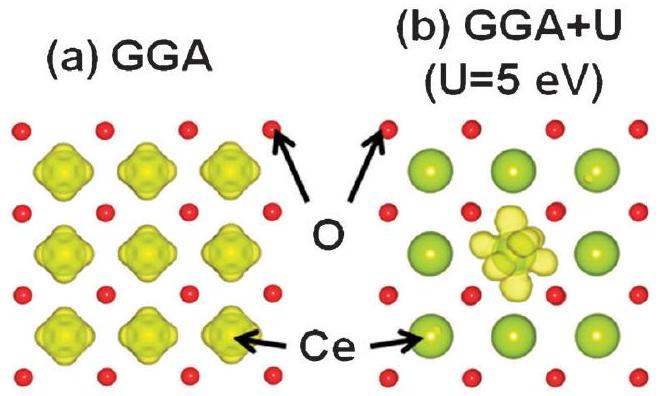
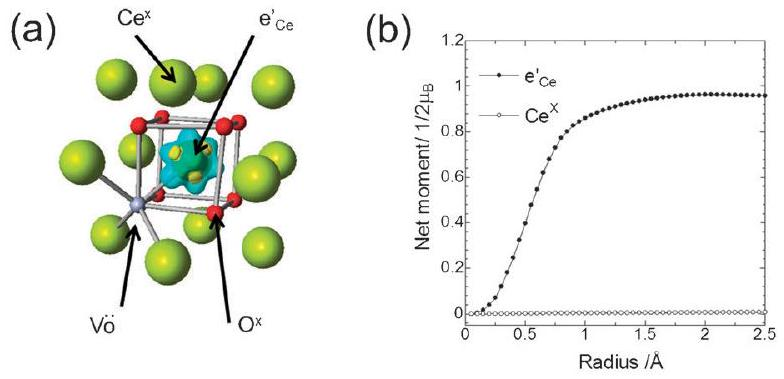
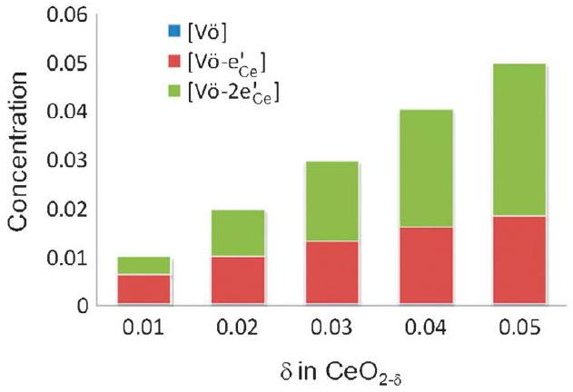
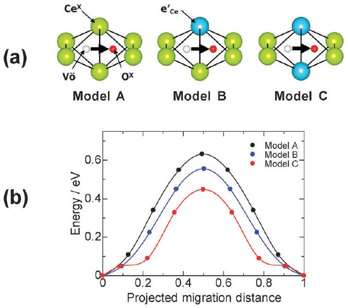
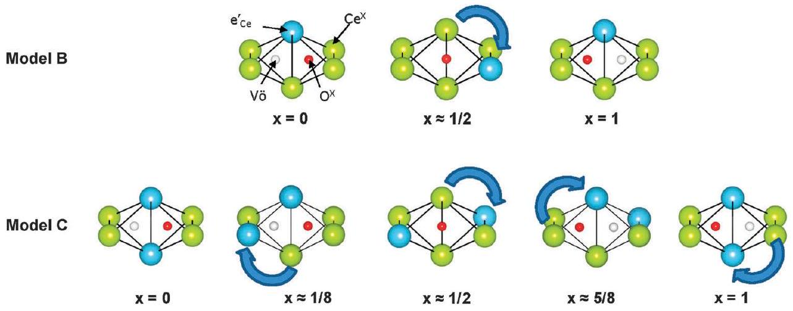
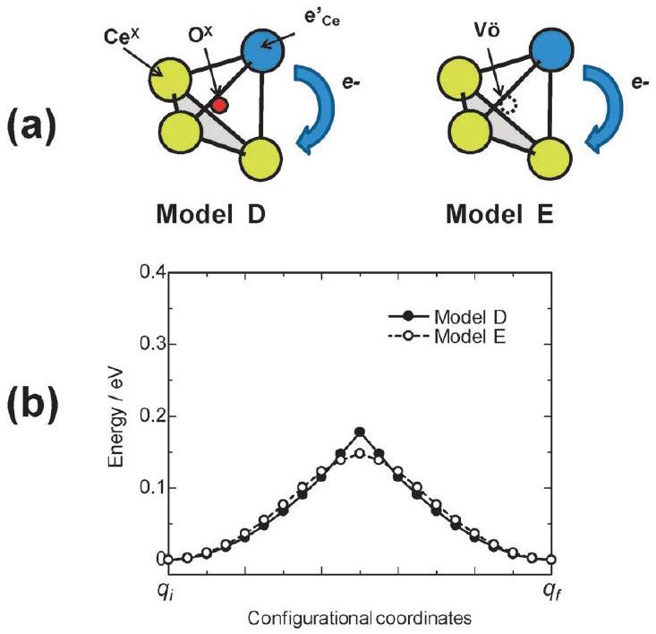

# A concerted migration mechanism of mixed oxide ion and electron conduction in reduced ceria studied by first-principles density functional theory 

Masanobu Nakayama, ${ }^{\boldsymbol{*} \boldsymbol{a}}$ Hiromi Ohshima, ${ }^{\boldsymbol{a}}$ Masayuki Nogami ${ }^{\boldsymbol{a}}$ and Manfred Martin ${ }^{\boldsymbol{b}}$ Received 4th January 2012, Accepted 29th February 2012 DOI: 10.1039/c2cp00020b

#### Abstract

Ceria based oxides are regarded as key oxide materials for energy and environmental applications, such as solid oxide fuel cells, oxygen permeation membranes, fuel cell electrodes, oxygen storage, or heterogeneous catalysis. This great versatility in applications is rendered possible by the fact that rare earth-doped ceria is a pure oxygen ion conductor while undoped ceria, $\mathrm{CeO}_{2-\delta}$, is a mixed oxygen ion-electron conductor. To get deeper insight into the mixed conduction mechanism of oxygen ions and electrons from atomistic and electronic level viewpoints we have applied first-principles density functional theory (DFT + U method). The calculation results show that oxygen vacancies strongly attract localized electrons, forming associates between them. The migration energy of an oxygen vacancy in such an associate is substantially lowered compared to the unassociated case due to the simultaneous positional rearrangement of localized electrons during the ionic jump process. Accordingly, we propose a concerted migration mechanism of oxygen vacancies and localized electrons in reduced ceria; this mechanism results in an increased diffusivity of oxygen vacancies supported by localized electrons compared with that in pure oxide ion conductors.

## 1. Introduction

Interest in materials exhibiting mixed oxide ion and electron conduction has increased during the last years, owing to their great importance for energy and environmental applications, such as oxygen permeation membranes for separating oxygen from air, solid oxide fuel cell electrodes for converting chemical to electrical energy, reversible oxygen storage-release materials to store oxygen, and catalysts to develop efficient and ecofriendly chemical processes. ${ }^{1-4}$ Therefore, many fundamental research studies have been carried out in order to provide an atomistic and electronic level understanding of fast-ion and fast-electron transport and their potential interdependence. In experimental studies, total conductivities have been measured at various temperatures and oxygen partial pressures using reversible electrodes, while partial ionic and electronic conductivities were obtained using blocking electrodes (Hebb-Wagner method). ${ }^{5-9}$ Conventionally, in the evaluation and interpretation of these measurements, the coupling between ions and electrons, that is, the Onsager cross coefficients, ${ }^{10}$ is

[^0]ignored, and independent migration of carrier ions and electrons is assumed. ${ }^{11}$ This assumption is almost fulfilled in $\mathrm{Ag}_{2} \mathrm{Se}$ and $\mathrm{Cu}_{2} \mathrm{~S}$ exhibiting mixed cation-electron conduction, ${ }^{12}$ while in defective transition metal oxides, such as $\mathrm{Co}_{1-\delta} \mathrm{O}, \mathrm{Fe}_{3-\delta} \mathrm{O}_{4}$, and $\mathrm{TiO}_{2-\delta}$, significant coupling effects between the motion of cations and electrons were found. ${ }^{13-17}$ Recently, a non-vanishing cross effect was also reported for mixed oxygen ion-electron conducting $\mathrm{CeO}_{2-\delta}$ and Pr-doped ceria. ${ }^{18,19}$

Among the mixed conductors, this study focuses on reduced ceria $\left(\mathrm{CeO}_{2-\delta}\right)$ because of its simple composition, crystal structure, and electronic structure as described below. ${ }^{2}$ Under oxidizing conditions, fluorite-structured cerium(iv) oxide ( $\mathrm{CeO}_{2}$ ) exhibits (nearly) ideal stoichiometry and is an electronic insulator due to the empty localized Ce $4 \mathrm{f}^{0}$ states in its wide band gap $\left(E_{\mathrm{g}}=6.0 \mathrm{eV}^{20,21}\right) . \mathrm{CeO}_{2}$ is also an ionic insulator due to the lack of point defects in its structure. Oxygen gas release under a reducing atmosphere results in $\mathrm{CeO}_{2-\delta}$ with oxygen vacancies, accompanying the reduction of $\mathrm{Ce}^{4+}$ to $\mathrm{Ce}^{3+}$ with Ce $4 \mathrm{f}^{1}$ states in the band gap. ${ }^{22,23}$ Accordingly, mixed oxide ion and electron conduction is induced by the existence of oxygen vacancies and localized $\mathrm{Ce} 4 \mathrm{f}^{1}$ electrons, respectively, as carrier species in $\mathrm{CeO}_{2-\delta .}{ }^{24-27}$ Recently, strong interaction between oxygen vacancies and localized electrons was experimentally confirmed. ${ }^{18}$ The observed effective charges of oxygen vacancies (nominal charge is +2 ) are in the range of +1.3 to +0.4, i.e. an oxygen vacancy drags 0.7-1.6 electrons during its migration. In this article, we report on attempts to
devise an atomistic and electronic level model of the coupling effect for mixed conduction in reduced ceria by using first-principles density functional theory (DFT).

## 2. Computational details

All first-principles DFT calculations were performed with the Vienna ab initio simulation package (VASP) ${ }^{28,29}$ using the modified Perdew-Burke-Ernzerhof generalized gradient approximation (PBEsol-GGA) ${ }^{30,31}$ and the projector-augmented wave (PAW) method. ${ }^{32}$ Onsite Coulomb correction (GGA + U) was included to describe the localized electronic states of Ce $4 \mathrm{f}^{1}$ (polaron) in mixed-valence rare earth metals as discussed later. $U$ was set to 5 eV for the Ce 4f states, according to the literature. ${ }^{33-39}$ Spin polarization calculation was adopted. Unless specifically mentioned otherwise, a simulation cell with $2 \times 2 \times 2$ conventional cubic fluorite unit cells $\left(\mathrm{Ce}_{32} \mathrm{O}_{64}\right)$ was used to model the introduction of low-concentration point defects (such as oxygen vacancies), polarons, their association, and oxygen vacancy migration. A kinetic cutoff energy of 500 eV and 2 × 2 × 2 k-point meshes were found by a convergence test $\left(<3 \mathrm{meV} / \mathrm{CeO}_{2}\right)$. The total number of electrons in the lattice was controlled by using a jellium background for a charged system, and dipole correction due to periodic boundary conditions ${ }^{40}$ was calculated by using a bulk dielectric constant of 25. ${ }^{41}$ Structural relaxation was also assumed to affect only local defect sites in the $\mathrm{Ce}_{32} \mathrm{O}_{64}$ superstructure, such that only internal atomic positions were allowed to relax and cubic lattice parameters were fixed in the calculations. The nudged elastic band (NEB) method ${ }^{42}$ was used to investigate the minimum energy pathways of oxygen vacancy jumps from one lattice position to adjacent sites.

## 3. Results and discussion

Table 1 lists the present computational and previous experimental lattice parameters, bulk moduli, and reaction enthalpies for perfect $\mathrm{CeO}_{2}$ and $\mathrm{Ce}_{2} \mathrm{O}_{3}$. The obtained lattice parameters and bulk moduli by PBEsol-GGA + U showed relatively better accordance with experimental ones than those by PBE-GGA + U. The band gaps of both compounds were underestimated, a typical error in the GGA + U functional. ${ }^{52}$ The calculated exothermic reaction enthalpy for $\mathrm{Ce}_{2} \mathrm{O}_{3} / \mathrm{CeO}_{2}$ was underestimated for PBEsol-GGA + U. The difference may owe to $\mathrm{O}_{2}$ molecule binding energy error by the LDA or GGA functional. ${ }^{53-56}$ According to Wang et al., ${ }^{56}$ the estimated difference between experimental and calculated (using PBE-GGA) formation energies for various metal oxides is -1.36 eV. Applying this value to the present results improves the reaction enthalpy from $-151 \mathrm{~kJ} \mathrm{~mol}^{-1}$ to $-184 \mathrm{~kJ} \mathrm{~mol}^{-1}$, showing good accordance with experimental results $\left(-191 \mathrm{~kJ} \mathrm{~mol}^{-1}\right)$, though the GGA functional was different.

It is worth noting that the usage of the on-site Coulomb correction term, $U$, was essential to reproduce the localized electronic states of Ce $4 \mathrm{f}^{1}$. Fig. 1 presents the isosurface of the magnetization density distribution (difference in electron density between spin up and spin down) for $\left[\mathrm{Ce}_{32} \mathrm{O}_{64}\right]^{-}$obtained by (a) PBEsol-GGA and (b) PBEsol-GGA + U $(U=5 \mathrm{eV})$ computations. Since both Ce and O in stoichiometric $\mathrm{CeO}_{2}$ form an inert gas electronic structure, the magnetization density distribution of $\left[\mathrm{Ce}_{32} \mathrm{O}_{64}\right]$, i.e. perfect $\mathrm{CeO}_{2}$, is zero in the entire space. However, $\left[\mathrm{Ce}_{32} \mathrm{O}_{64}\right]^{-}$, where one electron was added to $\mathrm{Ce}_{32} \mathrm{O}_{64}$, causes an unpaired electron density at Ce 4f states, as shown in Fig. 1. To create a localized electron $\mathrm{e}_{\mathrm{Ce}}^{\prime}$ $\left(\mathrm{Ce}^{3+}=[\mathrm{Xe}] 4 \mathrm{f}^{1}\right)$ at an arbitrary Ce site, we assigned a nonzero initial magnetic moment to this specific atom, while zero for the other atoms, that is, $\mathrm{Ce}^{4+}\left([\mathrm{Xe}] 4 \mathrm{f}^{0}\right)$ and $\mathrm{O}^{2-}$( $[\mathrm{He}] 2 \mathrm{~s}^{2} 2 \mathrm{p}^{6}$ ). In addition, the initial structural inputs were modified by elongating $\mathrm{Ce}^{3+}-\mathrm{O}^{2-}$ bonds.

In the PBEsol-GGA computation, the added electron is distributed uniformly to Ce 4f states (delocalized), such that each of the Ce ions was symmetrically equivalent (Fig. 1(a)), although the initial electronic and structural inputs (see above) were non-symmetrical. On the other hand, the added electron localized at the specific Ce 4f state (shown in Fig. 1(b)) caused a nonzero magnetic moment, and the bond length of $\mathrm{Ce}^{3+}-\mathrm{O}(\sim 2.43 \AA)$ was

Table 1 Lattice parameters, bulk moduli, and reaction enthalpies of stoichiometric $\mathrm{CeO}_{2}$ and $\mathrm{Ce}_{2} \mathrm{O}_{3}$ obtained by DFT and experiments (exp.). The value of the onsite Coulomb correction, $U$, was chosen as 5 eV. LP means lattice parameter
|  | Computation (DFT) |  |  | Exp. |
| :--- | :--- | :--- | :--- | :--- |
|  | PBEsol-GGA + U | PBE-GGA + U | PBEsol-GGA |  |
| $\mathrm{CeO}_{2}$ |  |  |  |  |
| Cubic LP/Å | 5.428 | 5.462 | 5.398 | $5.411^{43}$ |
| Bulk modulus/GPa | 205 | 186 | 196 | $236^{44}, 204^{45}$ |
| Band gap/eV ${ }^{a}$ | 4.75 | 4.94 | 5.71 | $6.0^{46}$ |
| $\mathrm{Ce}_{2} \mathrm{O}_{3}$ |  |  |  |  |
| Hexagonal LP a/Å | 3.875 | 3.915 | 3.789 | $3.888^{47}$ |
| Hexagonal LP c/A | 6.102 | 6.222 | 5.933 | $6.070^{47}$ |
| Bulk modulus/GPa | 145 | 145 | 128 | - |
| Band gap/eV ${ }^{b}$ | 1.67 | 1.67 | (0) | $2.4^{48}$ |
| Reaction enthalpy |  |  |  |  |
| $\mathrm{Ce}_{2} \mathrm{O}_{3}+1 / 4 \mathrm{O}_{2} \rightarrow \mathrm{CeO}_{2} / \mathrm{kJ} \mathrm{mol}^{-1}$ | $-151^{c}$ | $-144^{c}$ | $-223^{c}$ | $-191^{49}$ |
|  | $-166^{d}$ | $-159^{d}$ | $-238^{d}$ |  |

[^1]
Fig. 1 Isosurface of magnetization density distribution (difference in electron density between spin up and spin down) for $\left[\mathrm{Ce}_{32} \mathrm{O}_{64}\right]^{-}$ obtained by (a) PBEsol-GGA and (b) PBEsol-GGA + U ( $U=5 \mathrm{eV}$ ) computations.

larger than that of $\mathrm{Ce}^{4+}-\mathrm{O}(\sim 2.35 \AA)$ in the relaxed structure using PBEsol-GGA + U computation. Thus, the GGA + U method is essential to localize an electron in the Ce 4f state. Hereinafter, PBEsol-GGA + U was used for all the computations, unless specifically mentioned otherwise.

The association between oxygen vacancies and electrons localized at nearest-neighbour (NN) Ce sites was simulated. Conventionally, a conductive electron is expressed as e' in the Kröger-Vink notation. However, this expression may be ambiguous with respect to distinguishing a localized or delocalized electron. Thus, we use $\mathrm{e}_{\mathrm{Ce}}^{\prime}$ to denote a localized electron explicitly in this paper; likewise, oxygen vacancy, oxide ion $\left(\mathrm{O}^{2-}\right)$, and cerium ion are expressed as $\mathrm{V}_{\mathrm{O}}^{\bullet \bullet}, \mathrm{O}^{x}$, and $\mathrm{Ce}^{x}$, respectively. $\mathrm{O}^{x}$ and $\mathrm{V}_{\mathrm{O}}^{\bullet \bullet}$ sites are situated at the center of a tetrahedron coordinated with four Ce atoms. Thus, one oxygen vacancy associates with four $\mathrm{NN} \mathrm{e}_{\mathrm{Ce}}^{\prime}$ at most, and we hereafter represent NN defect associates as $\left\{\mathrm{V}_{\mathrm{O}}^{\bullet \bullet}-n \mathrm{e}_{\mathrm{Ce}}^{\prime}\right\}$, where $n$ is the number of associated electrons localized on cerium. Using the DFT + U method, we confirmed localization of an electron at a specific Ce ions site $\left(\mathrm{e}_{\mathrm{Ce}}^{\prime}\right)$. In Fig. 2(a) the corresponding electron density is visualized by means of the isosurface of the magnetization density distribution around the defect couple of $\left\{\mathrm{V}_{\mathrm{O}}^{\bullet \bullet}-\mathrm{e}_{\mathrm{Ce}}^{\prime}\right\}$. As clearly shown in the figure, the magnetization density distribution appears only at a single cerium site and the shape of the isosurface corresponds to the lobe of the f-orbital.

Fig. 2(b) represents the total electron-spin difference (net spin) for a corresponding cerium site, taken as the electron spin up minus the electron spin down as a function of the integration radius of the ion core. The net spin of cerium is almost $1 / 2 \mu_{\mathrm{B}}$

Fig. 2 Defect association of localized electron $\left(\mathrm{e}_{\mathrm{Ce}}^{\prime}\right)$ and oxygen vacancy $\left(\mathrm{V}_{\mathrm{O}}^{\bullet \bullet}\right)$. (a) Configuration of a $\mathrm{e}_{\mathrm{Ce}}^{\prime}$ and $\mathrm{V}_{\mathrm{O}}^{\bullet \bullet}$ couple and isosurface of magnetization density distribution, (b) integrated total electron spin difference (net-spin) around the $\mathrm{e}_{\mathrm{Ce}}^{\prime}$ site and neighbouring $\mathrm{Ce}^{x}$ site.

at a radius of about $1.5 \AA$, whereas the net spins of the other cerium, oxygen, and vacancy sites are zero. Therefore, we successfully reproduced electrons localized at NN cerium sites by the DFT + U method. In this manner, the electronic structure of $\left\{\mathrm{V}_{\mathrm{O}}^{\bullet \bullet}-n \mathrm{e}_{\mathrm{Ce}}^{\prime}\right\}(n=0,1,2,3$, and 4) associates was computed. However, the NN defect associates $\left\{\mathrm{V}_{\mathrm{O}}^{\bullet \bullet}-3 \mathrm{e}_{\mathrm{Ce}}^{\prime}\right\}$ and $\left\{\mathrm{V}_{\mathrm{O}}^{\bullet \bullet}-4 \mathrm{e}_{\mathrm{Ce}}^{\prime}\right\}$ could not be relaxed, and a portion of localized electrons moved to next-nearest-neighbour (NNN) Ce sites from oxygen vacancies during electronic and ionic relaxation. This may stem from the following factors: (1) local expansion of cells by $\mathrm{V}_{\mathrm{O}}^{\bullet \bullet}$ and $\mathrm{e}_{\mathrm{Ce}}^{\prime}$ defects, and (2) local Coulombic repulsion among negatively charged $\mathrm{e}_{\mathrm{Ce}}^{\prime}$. Thus, we consider only $\left\{\mathrm{V}_{\mathrm{O}}-n \mathrm{e}_{\mathrm{Ce}}^{\prime}\right\}(n=0,1$, and 2$)$ associates in this study.

The defect association energy was calculated by subtracting the sum of the total energies of a cell containing isolated $\mathrm{V}_{\mathrm{O}}^{. .}$and $\mathrm{e}_{\mathrm{Ce}}^{\prime}$ point defects from that of a cell containing a $\left\{\mathrm{V}_{\mathrm{O}}^{\bullet \bullet}-n \mathrm{e}_{\mathrm{Ce}}^{\prime}\right\}$ associate. Therefore, negative energy corresponds to defect association causing stabilization and positive energy to destabilization. The calculated defect association energies are -0.49 and -0.80 eV for the $\left\{\mathrm{V}_{\mathrm{O}}^{̈}-\mathrm{e}_{\mathrm{Ce}}^{\prime}\right\}$ and $\left\{\mathrm{V}_{\mathrm{O}}^{̈}-2 \mathrm{e}_{\mathrm{Ce}}^{\prime}\right\}$ associates, respectively, indicating strong attraction. Note that the antiferromagnetic arrangement between neighbouring $\mathrm{e}_{\mathrm{Ce}}^{\prime}$ was adopted for the $\left\{\mathrm{V}_{\mathrm{O}}^{\bullet \bullet}-2 \mathrm{e}_{\mathrm{Ce}}^{\prime}\right\}$ associate, since the total energy computation showed it to be ~90 meV more stable than the ferromagnetic arrangement. Skorodumova et al. also reported strong attraction between $\mathrm{V}_{\mathrm{O}}^{\bullet \bullet}$ and $\mathrm{e}_{\mathrm{Ce}}^{\prime}$, as determined by DFT together with the full-potential linear muffin-tin orbital (FP-LMTO) method, ${ }^{23}$ although the calculated association energy for $\left\{\mathrm{V}_{\mathrm{O}}^{\bullet \bullet}-2 \mathrm{e}_{\mathrm{Ce}}^{\prime}\right\}$ associates (-1.43 eV) was much larger than the present result. This numerical discrepancy in association energies might be attributable to the difference in the Hamiltonians used in both studies.

Fig. 3 shows the fractions of $\left\{\mathrm{V}_{\mathrm{O}}-n \mathrm{e}_{\mathrm{Ce}}^{\prime}\right\}(n=0,1$, and 2$)$ associates at 800 °C as a function of $\delta$ in $\mathrm{CeO}_{2-\delta}$, considering the equilibria $\mathrm{V}_{\mathrm{O}}^{\bullet \bullet}+\mathrm{e}_{\mathrm{Ce}}^{\prime} \leftrightarrow\left\{\mathrm{V}_{\mathrm{O}}^{\bullet \bullet}-1 \mathrm{e}_{\mathrm{Ce}}^{\prime}\right\}$ and $\left\{\mathrm{V}_{\mathrm{O}}^{\bullet \bullet}-1 \mathrm{e}_{\mathrm{Ce}}^{\prime}\right\}+\mathrm{e}_{\mathrm{Ce}}^{\prime} \leftrightarrow$ $\left\{\mathrm{V}_{\mathrm{O}}^{\bullet \bullet}-2 \mathrm{e}_{\mathrm{Ce}}^{\prime}\right\}$ and the charge balance. Owing to the considerable attraction between $\mathrm{V}_{\mathrm{O}}^{\bullet \bullet}$ and $\mathrm{e}_{\mathrm{Ce}}^{\prime}$, the formation of isolated $\mathrm{V}_{\mathrm{O}}^{\text {O. }}\left(\mathrm{V}_{\mathrm{O}} \ddot{-}-0_{\mathrm{Ce}}^{\prime}\right)$ is negligible and most oxygen vacancies accompany localized electrons at their neighbouring sites, even at $800^{\circ} \mathrm{C}$.

It is expected that localized electrons in a lattice will play an important role in oxygen vacancy migration as well as in significant defect association interactions. In our previous studies of ceria doped with rare earth (RE) oxides, ${ }^{57}$ we found that oxide ions jump between NN tetrahedral sites and pass through a particular type of cation shared edge. In addition,

Fig. 3 Fractions of $\mathrm{V}_{\mathrm{O}}^{\bullet \bullet},\left\{\mathrm{V}_{\mathrm{O}}^{\bullet \bullet}-\mathrm{e}_{\mathrm{Ce}}^{\prime}\right\}$ and $\left\{\mathrm{V}_{\mathrm{O}}^{\bullet \bullet}-2 \mathrm{e}_{\mathrm{Ce}}^{\prime}\right\}$ defect associates as functions of $\delta$ in $\mathrm{CeO}_{2-\delta}$ at $800^{\circ} \mathrm{C}$.

Fig. 4 (a) Three types of nearest-neighbour $(\mathrm{NN}) \mathrm{e}_{\mathrm{Ce}}^{\prime} / \mathrm{Ce}^{x}$ configurations for oxygen vacancy migration examined in this study. Shared-edge sites are occupied by $\mathrm{Ce}^{x}-\mathrm{Ce}^{x}$ (Model A), $\mathrm{Ce}^{x}-\mathrm{e}_{\mathrm{Ce}}^{\prime}$ (Model B), and $\mathrm{e}_{\mathrm{Ce}}^{\prime}-\mathrm{e}_{\mathrm{Ce}}^{\prime}$ (Model C). (b) Energy profiles for Models A-C determined by the NEB method. The projected migration distance indicates the relative distance along the straight line connecting the initial and final ion positions.

the migration energy strongly depends on the cation arrangement at shared edges, that is, Ce-Ce, Ce-RE, and RE-RE edges. We thus used the NEB method to investigate oxygen vacancy migration through three types of shared edges in reduced ceria, namely, the $\mathrm{Ce}^{x}-\mathrm{Ce}^{x}, \mathrm{Ce}^{x}-\mathrm{e}_{\mathrm{Ce}}^{\prime}$, and $\mathrm{e}_{\mathrm{Ce}}^{\prime}-\mathrm{e}_{\mathrm{Ce}}^{\prime}$ edges (see Fig. 4(a)).

Fig. 4(b) shows the corresponding adiabatic energy profiles for Models A, B, and C. For all the models, the trajectory of oxide ion migration was straightforward (not shown), and the energy maximum lies at the centre between NN oxygen sites, where cations are situated at the shared edge of two tetrahedra. The migration energy for Model A was ~0.62 eV, showing good accordance with the experimental result for stoichiometric $\mathrm{CeO}_{2}$ (0.6 eV, extrapolated from Table 1 in ref. 43). The migration energy decreased considerably with the occupation of shared edges by localized electrons, $\mathrm{e}_{\mathrm{Ce}}^{\prime}$, resulting in migration energies of ~0.55 and ~0.45 eV for Models B and C, respectively. Note that the maximum decrease in migration energy (~0.17 eV) corresponds at 600 °C to an increase of oxygen ion conductivity by one order of magnitude. However, according to our previous studies of $\mathrm{RE}_{2} \mathrm{O}_{3}$-doped ceria by DFT, ${ }^{57}$ the migration energy tends to increase with the occupation of shared edges by large RE ions, such as $\mathrm{La}^{3+}$ and $\mathrm{Nd}^{3+}$. In this respect, the decrease in migration energy by $\mathrm{e}_{\mathrm{Ce}}^{\prime}$ occupation seems to be in disagreement with our previous results, since the ionic radius of $\mathrm{e}_{\mathrm{Ce}}^{\prime}\left(\mathrm{Ce}^{3+}\right)$ is between those of $\mathrm{La}^{3+}$ and $\mathrm{Nd}^{3+}$ ions. ${ }^{58}$ Moreover, the energy profile for Model C showed peaks between an oxygen vacancy site and a shared edge site, which was not observed in NEB calculations for $\mathrm{V}_{\mathrm{O}}^{\circ}$ migration in RE-doped ceria.

To account for the above difference between reduced and $\mathrm{RE}_{2} \mathrm{O}_{3}$-doped ceria, the evolution of electronic structures during $\mathrm{V}_{\mathrm{O}}^{\bullet \bullet}$ migration is investigated. Fig. 5 describes positional changes of $\mathrm{e}_{\mathrm{Ce}}^{\prime}$ with oxide ion migration by analyzing spin integration. In Model $\mathrm{B}, \mathrm{e}_{\mathrm{Ce}}^{\prime}$ jumps from a shared edge site to an NN Ce site, when the migrating oxide ion approaches the centre of shared edge sites. This is due to Coulombic and short-range repulsions between the oxide ion and $\mathrm{e}_{\mathrm{Ce}}^{\prime}$, as mentioned above on the defect association. (The latter repulsion is related to the fact that the ionic radius of $\mathrm{e}_{\mathrm{Ce}}^{\prime}\left(\mathrm{Ce}^{3+} ; 1.283 \AA\right)$ is larger than that of $\left.\mathrm{Ce}^{x}\left(\mathrm{Ce}^{4+} ; 1.11 \AA\right) .{ }^{58}\right)$ However, in reduced $\mathrm{CeO}_{2-\delta}$, the positional freedom of $\mathrm{e}_{\mathrm{Ce}}^{\prime}$ by localized electron jumps (polaron hopping mechanism) enables the formation of stable $\mathrm{Ce}^{x} / \mathrm{e}_{\mathrm{Ce}}^{\prime} / \mathrm{O}^{x} / \mathrm{V}_{\mathrm{O}}^{\bullet \bullet}$ configurations in the transition state, resulting in a significant decrease in the migration energy of $\mathrm{O}^{2-}$ jumps. On the other hand, the large dopants $\mathrm{La}^{3+}$ and $\mathrm{Nd}^{3+}$ in $\mathrm{RE}_{2} \mathrm{O}_{3}$-doped ceria cannot jump to neighbouring sites to reduce the two repulsive interactions; thus, the migration energy is larger for these $\mathrm{RE}_{2} \mathrm{O}_{3}$-doped ceria than for undoped or reduced $\mathrm{CeO}_{2}$. Similarly, $\mathrm{e}_{\mathrm{Ce}}^{\prime}$ jumps were observed in Model C via two steps. In detail, in the first step of oxygen migration, one of the two $\mathrm{e}_{\mathrm{Ce}}^{\prime}$ jumps to a NN Ce site where the $\mathrm{e}_{\mathrm{Ce}}^{\prime}$ position is more distant to the migrating oxide ion (Fig. 5 (Model C)). In the second step, the oxide ion reaches the centre of the shared edge, and the remaining $\mathrm{e}_{\mathrm{Ce}}^{\prime}$ jumps to a NN Ce site that is diagonal to the other $\mathrm{e}_{\mathrm{Ce}}^{\prime}$ position. Thus, the peak seen in the energy profile at the $x=1 / 8$ portion of the migration pathway in Model C is related to the first single $\mathrm{e}_{\mathrm{Ce}}^{\prime}$ jump. To summarize, the significant decrease in migration energy (up to ~0.17 eV) in Models B and C is due to local charge compensation around $\mathrm{V}_{\mathrm{O}}^{\bullet \bullet}$ sites by a single or two $\mathrm{e}_{\mathrm{Ce}}^{\prime}$ as well as to the configurational variety of $\mathrm{e}_{\mathrm{Ce}}^{\prime} / \mathrm{Ce}^{x} / \mathrm{O}^{x} / \mathrm{V}_{\mathrm{O}}^{\bullet \bullet}$ arrangements.

Fig. 5 Variation in the $\mathrm{e}_{\mathrm{Ce}}^{\prime} / \mathrm{Ce}^{x} / \mathrm{V}_{\mathrm{O}}^{\bullet \bullet} / \mathrm{O}^{x}$ configuration during oxygen vacancy migration for Models B and C (see Fig. 3(a)). Arrows indicate the migration of localized electrons, and $x$ denotes the corresponding projected migration distance in Fig. 2(b).

Fig. 6 (a) Two types of anion configuration around the migration path of a localized electron (polaron) between two adjacent cerium sites. In Model D, all the anion sites are filled with oxide ions, while one oxygen vacancy is situated at the NN position of a migrating electron in Model E. (b) Energy profiles of localized electron jump for Models D and E. The configurational coordinates $q_{i}$ and $q_{f}$ correspond to the localization of polarons at specific Ce ion sites $\left(\mathrm{e}_{\mathrm{Ce}}^{\prime}\right)$ before and after polaron jumps.

As mentioned above, localized electrons, $\mathrm{e}_{\mathrm{Ce}}^{\prime}$, in reduced ceria play an important role in stabilizing $\mathrm{V}_{\mathrm{O}}$ and enhancing $\mathrm{V}_{\mathrm{O}}^{\bullet \bullet}$ (or oxide ion) migration in the lattice. In other words, the mobility of $\mathrm{e}_{\mathrm{Ce}}^{\prime}$ defects, unlike pinned $\mathrm{RE}^{3+}$ dopants, is crucial in the ceria lattice. However, the above discussion holds owing to the $\mathrm{e}_{\mathrm{Ce}}^{\prime}$ migration being faster than the $\mathrm{V}_{\mathrm{O}}^{\bullet \bullet}$ jumps. In this respect, the mobility of $\mathrm{e}_{\mathrm{Ce}}^{\prime}$ can be attributed to their low migration energy. However, the reported activation energies of $\mathrm{e}_{\mathrm{Ce}}^{\prime}$ conductivity in stoichiometric ceria and doped ceria, determined experimentally, have a wide range from ~0.2 to $\sim 0.5 \mathrm{eV} .{ }^{24,25,59}$ Thus, we calculated energy profiles for $\mathrm{e}_{\mathrm{Ce}}^{\prime}$ jumps by adapting the method used in ref. 60. In detail, we simulated $\mathrm{e}_{\mathrm{Ce}}^{\prime}$ jumps to an NN Ce site for Models D and E shown in Fig. 6(a), in which $\mathrm{e}_{\mathrm{Ce}}^{\prime}$ migrates in the nearestneighbourhood of $\mathrm{O}^{x}$ and $\mathrm{V}_{\mathrm{O}}^{\bullet \bullet}$ sites, respectively. The total energies and relaxed internal configurations of the local energy minima $q_{i}$ and $q_{f}$, in which a localized electron is positioned at one of the adjacent Ce ions, were first calculated. Since the polaron hopping energy corresponds to the sequential variation of local lattice distortion between the two configurations of $q_{i}$ and $q_{f}$, it was assumed that the migration path can be linearized from two configurations. Total energy calculation was performed for each intermediate configuration. Fig. 6(b) shows the calculated energy profiles for $\mathrm{e}_{\mathrm{Ce}}^{\prime}$ jumps. $\mathrm{e}_{\mathrm{Ce}}^{\prime}$ migration energies (<0.2 eV) much smaller than $\mathrm{V}_{\mathrm{O}}^{\bullet \bullet}$ migration energies ( $>0.4 \mathrm{eV}$ ) are indicated in both models. Note that the adiabatic energy barrier for both models may be even lower than that obtained in the present calculation, which assumes a linearized path between the initial and final local configurations, during an $\mathrm{e}_{\mathrm{Ce}}^{\prime}$ jump. Therefore, the assumption of fast $\mathrm{e}_{\mathrm{Ce}}^{\prime}$ migration appears valid. Besides, it is worth noting that the total conductivity of reduced ceria is essentially electronic, according to the literature, ${ }^{18,26,27}$ which supports our argument above.

## 4. Summary

The defect chemistry and migration properties of reduced ceria were investigated by calculating the defect association energies and migration energies of oxygen vacancies $\mathrm{V}_{\mathrm{O}}^{\circ}$ and localized electrons $\mathrm{e}_{\mathrm{Ce}}^{\prime}$ using the DFT + U method. The computational results revealed strong association between $\mathrm{V}_{\mathrm{O}}^{\bullet \bullet}$ and $\mathrm{e}_{\mathrm{Ce}}^{\prime}$ and enhancement of $\mathrm{V}_{\mathrm{O}}^{\bullet \bullet}$ migration by the surrounding localized electrons $\mathrm{e}_{\mathrm{Ce}}^{\prime}$, as well as the high likelihood of rapid $\mathrm{e}_{\mathrm{Ce}}^{\prime}$ migration, which suggests that $\mathrm{V}_{\mathrm{O}}^{\bullet \bullet}$ is always accompanied by an electron, $\mathrm{e}_{\mathrm{Ce}}^{\prime}$, during its migration. This indicates that the assumption of vanishing Onsager cross coefficients is improper for reduced ceria, in agreement with a recent experimental study on reduced and Pr-doped ceria. ${ }^{18,19}$ The present computational results reveal a strong interaction between oxygen vacancies $\left(\mathrm{V}_{\mathrm{O}}^{\bullet \bullet}\right)$ and localized electrons $\left(\mathrm{e}_{\mathrm{Ce}}^{\prime}\right)$, and aptly describe the origin of Onsager cross coefficients from atomistic and electronic level viewpoints. In addition, it has to be emphasized that the polaron assists the oxygen vacancy migration, i.e. reduces its migration energy, by simultaneous positional rearrangement of the polaron during the oxygen vacancy jump. We infer that the above polaron-assisted oxygen migration mechanism (concerted mechanism) applies to various mixed electron-ion conductors consisting of transition metal oxide. In fact, the experimental ionic conductivity of perovskite-type $\mathrm{Ba}_{1-x} \mathrm{Sr}_{x} \mathrm{Co}_{1-y} \mathrm{Fe}_{y} \mathrm{O}_{3-\delta}$ (calculated from the oxygen diffusion coefficients), ${ }^{61}$ which is a mixed ion-electron conductor, is larger by a factor of four than that of $\mathrm{La}_{0.8} \mathrm{Sr}_{0.2} \mathrm{Ga}_{0.8} \mathrm{Mg}_{0.2} \mathrm{O}_{2.8}$, which is one of the best perovskite-type pure ionic conductors. ${ }^{62,63}$ The present finding of the concerted mechanism may account for the better ionic conductivity of oxide ions in mixed conductors such as $\mathrm{Ba}_{1-x} \mathrm{Sr}_{x} \mathrm{Co}_{1-y} \mathrm{Fe}_{y} \mathrm{O}_{3-\delta}$.

Finally, it would also be worth noting that the conductivity of oxygen vacancies in reduced ceria $\mathrm{CeO}_{2-\delta}$ is not sufficient for practical usage, though the migration energy of oxygen vacancies is reduced by the associated polaron(s). This is due to the low concentration of oxygen vacancies formed during reduction of ceria. Therefore, an extrinsic defect process, i.e. doping appropriate cations into ceria, is often used to increase the number of oxygen vacancies. The present findings also give us an insight to design fast mixed conductors doped with aliovalent cations. The expected requirements for the dopants are as follows: (1) "divalent or trivalent" in order to form oxygen vacancies as seen in ceria doped with $\mathrm{RE}_{2} \mathrm{O}_{3}$, (2) "n-type" which results in an increase of the number of polarons, and (3) "small attraction" of the dopants to oxygen vacancies and polarons to prevent pinning of them. We will study the defect association energies among dopants, oxygen vacancies, and polarons in doped ceria and discuss which cation to find out which dopant might be appropriate for improved mixed conduction in the near future.

## Acknowledgements

M.N. acknowledges the Grant for Young Research from the JGC-S (Nikki-Saneyoshi) Scholarship Foundation. This work was supported in part by grant from Institute of Ceramics Research and Education, NITECH.

## References

1 U. Balachandran, B. Ma, P. S. Maiya, R. L. Mieville, J. T. Dusek, J. J. Picciolo, J. Guan, S. E. Dorris and M. Liu, Solid State Ionics, 1998, 108, 363.
2 V. V. Kharton, F. M. Figueiredo, L. Navarro, E. N. Naumovich, A. V. Kovalevsky, A. A. Yaremchenko, Ap. P. Viskup, A. Carneiro, F. M. B. Marques and J. R. Frade, J. Mater. Sci., 2001, 36, 1105.
3 V. V. Kharton, F. M. B. Marques and A. Atkinson, Solid State Ionics, 2004, 174, 135.
4 J. Sunarso, S. Baumann, J. M. Serra, W. A. Meulenberg, S. Liu, Y. S. Lin and J. C. Diniz da Costa, J. Membr. Sci., 2008, 320, 13.
5 C. Wagner, Z. Elektrochem., 1956, 60, 4.
6 M. H. Hebb, J. Chem. Phys., 1952, 20, 185.
7 J. Mizusaki, K. Fueki and T. Mukaibo, Bull. Chem. Soc. Jpn., 1975, 48, 428.
8 I. Riess, Solid State Ionics, 1992, 51, 219.
9 Y. Teraoka, H. M. Zhang, K. Okamoto and N. Yamazoe, Mater. Res. Bull., 1988, 23, 51.
10 L. Onsager, Phys. Rev., 1931, 37, 405.
11 E. A. Guggenheim, in Thermodynamics, North-Holland, Amsterdam, 1985.
12 S. Miyatani, Solid State Commun., 1981, 38, 257.
13 H.-I. Yoo and M. Martin, Ceram. Trans., 1991, 24, 103.
14 J.-H. Lee and H.-I. Yoo, J. Electrochem. Soc., 1994, 141, 2789.
15 M. Schroeder and M. Martin, Z. Phys. Chem., 1998, 207, 1.
16 D.-K. Lee and H.-I. Yoo, Phys. Rev. Lett., 2006, 97, 255901.
17 H.-I. Yoo and D.-K. Lee, Solid State Ionics, 2008, 179, 837.
18 W.-S. Park, I. Yang and H.-I. Yoo, ECS Trans., 2008, 13, 327.
19 C. Chatzichristodoulou, W.-S. Park, H.-S. Kim, P. V. Hendriksen and H.-I. Yoo, Phys. Chem. Chem. Phys., 2010, 12, 9637.
20 D. D. Koelling, A. M. Boring and J. H. Wood, Solid State Commun., 1983, 47, 227.
21 E. Wuilloud, B. Deley, W. D. Schneider and Y. Baer, Phys. Rev. Lett., 1984, 53, 202.
22 I. K. Naik and T. Y. Tien, J. Phys. Chem. Solids, 1978, 39, 311.
23 N. V. Skorodumova, S. I. Simak, B. I. Lundqvist, I. A. Abrikosov and B. Johansson, Phys. Rev. Lett., 2002, 89, 166601.
24 A. Pfau and K. D. Schierbaum, Surf. Sci., 1994, 321, 71.
25 M. Mogensen, T. Lindegaard, U. R. Hansen and G. Mogensen, J. Electrochem. Soc., 1994, 141, 2122.
26 H. L. Tuller and A. S. Nowick, J. Phys. Chem. Solids, 1977, 38, 859.
27 H. L. Tuller and A. S. Nowick, J. Electrochem. Soc., 1979, 126, 209.
28 G. Kresse and J. Furthmuller, Phys. Rev. B: Condens. Matter Mater. Phys., 1996, 54, 11169.
29 G. Kresse and J. Furthmuller, Comput. Mater. Sci., 1996, 6, 15.
30 J. P. Perdew, K. Burke and M. Ernzerhof, Phys. Rev. Lett., 1996, 77, 3865.
31 J. P. Perdew, A. Ruzsinszky, G. I. Csonka, O. A. Vydrov, G. E. Scuseria, L. A. Constantin, X. Zhou and K. Burke, Phys. Rev. Lett., 2008, 100, 136406.
32 P. E. Blöchl, Phys. Rev. B: Condens. Matter Mater. Phys., 1994, 50, 17953.
33 S. Fabris, S. de Gironcoli, S. Baroni, G. Vicario and G. Balducci, Phys. Rev. B: Condens. Matter Mater. Phys., 2005, 71, 041102.
34 Z. Yang, T. K. Woo and K. Hermansson, J. Chem. Phys., 2006, 124, 224704.
35 Z. Yang, G. Luo, Z. Lu and K. Hermansson, J. Chem. Phys., 2007, 127, 074704.
36 C. W. M. Castleton, J. Kullgren and K. Hermansson, J. Chem. Phys., 2007, 127, 244704.
37 C. Loschen, J. Carrasco, K. M. Neyman and F. Illas, Phys. Rev. B: Condens. Matter Mater. Phys., 2007, 75, 035115.
38 S. F. Li, H. Lu, P. Li, Z. Yang and Z. X. Guo, J. Chem. Phys., 2008, 128, 164718.
39 A. Migani, K. M. Neyman, F. Illas and S. T. Bromley, J. Chem. Phys., 2009, 131, 064701.
40 G. Makov and M. C. Payne, Phys. Rev. B: Condens. Matter Mater. Phys., 1991, 51, 4014.
41 D. Y. Wang, D. S. Park, J. Griffith and A. S. Nowick, Solid State Ionics, 1981, 2, 95-105.
42 H. Jonsson, G. Mills and K. M. Jacobsen, in Classical and Quantum Dynamics in Condensed Phase Simulations, ed. B. J. Berne, G. Ciccotti and D. F. Coker, World Scientific, Singapore, 1998.
43 W. Ruedorff and G. Valet, Z. Anorg. Allg. Chem., 1953, 271, 257; W. Ruedorff and G. Valet, J. Solid State Chem., 1976, 18, 217.
44 L. Gerward and A. S. Staun-Olsen, Powder Diffr., 1993, 8, 127.
45 A. Nakajima, A. Yoshihara and M. Ishigame, Phys. Rev. B: Condens. Matter Mater. Phys., 1994, 50, 13297.
46 E. Wuilloud, B. Delley, W.-D. Schneider and Y. Baer, Phys. Rev. Lett., 1984, 53, 202.
47 W. H. Zachariasen, Z. Phys. Chem., 1926, 123, 134.
48 A. V. Prokofiev, A. I. Shelykh and B. T. Melekh, J. Alloys Compd., 1996, 242, 41.
49 JANAF thermochemical tables, 2nd ed. NSRDS-NBS37, ed. D. R. Stull and H. Prophet, NSRDA, 1971.
50 W. F. Giauque and H. L. Johnston, J. Am. Chem. Soc., 1929, 51, 2300.
51 C.-H. Fagerstroem and A. C. Hollis Hallett, J. Low Temp. Phys., 1969, 1, 3.
52 J. L. F. Da Silva, M. V. Ganduglia-Pirovano, J. Sauer, V. Bayer and G. Kresse, Phys. Rev. B: Condens. Matter Mater. Phys., 2007, 75, 045121.
53 R. O. Jones and O. Gunnarsson, Rev. Mod. Phys., 1989, 61, 689.
54 D. C. Patton, D. V. Porezag and M. R. Pederson, Phys. Rev. B: Condens. Matter Mater. Phys., 1997, 55, 7454.
55 B. Hammer, L. B. Hansen and J. K. Norskøv, Phys. Rev. B: Condens. Matter Mater. Phys., 1999, 59, 7413.
56 L. Wang, T. Maxisch and G. Ceder, Phys. Rev. B: Condens. Matter Mater. Phys., 2006, 73, 195107.
57 M. Nakayama and M. Martin, Phys. Chem. Chem. Phys., 2009, 11, 3241.
58 R. D. Shannon, Acta Crystallogr., 1976, A32, 751.
59 S. Lübke and H.-D. Wiemhöfer, Solid State Ionics, 1999, 117, 229.
60 T. Maxsch, F. Zhou and G. Ceder, Phys. Rev. B: Condens. Matter Mater. Phys., 2006, 73, 104301.
61 L. Wang, R. Merkle, J. Maier, T. Acartürk and U. Starke, Appl. Phys. Lett., 2009, 94, 071908.
62 T. Ishihara, H. Matsuda and Y. Takita, J. Am. Chem. Soc., 1994, 116, 3801.
63 R. Merkle, Y. A. Mastrikov, E. A. Kotomin, M. M. Kuklja and J. Maier, J. Electrochem. Soc., 2012, 159, B219.

[^0]:    ${ }^{a}$ Department of Materials Science and Engineering, Nagoya Institute of Technology, Room 604A, Bldg. 2, Gokiso-cho, Showa-ku, Nagoya City, Aichi, 466-8555, Japan.
    E-mail: nakayama.masanobu@nitech.ac.jp; Fax: + 81-52-735-5189; Tel: +81-52-735-5189
    ${ }^{b}$ Institute of Physical Chemistry, RWTH Aachen University, Landoltweg 2, 52056 Aachen, Germany

[^1]:    ${ }^{a}$ The band gap was estimated from the energy difference between the highest level of occupied O 2p states and the lowest level of unoccupied Ce 5d states. Ce 4f states lie in the gap. ${ }^{b}$ The band gap was estimated from the energy difference between the highest level of occupied Ce 4f states and the lowest level of unoccupied Ce 5d states. ${ }^{c}$ To calculate the reaction enthalpy, the total energies of $\mathrm{Ce}_{2} \mathrm{O}_{3}, \mathrm{CeO}_{2}$, and $\mathrm{O}_{2}$ molecules were used. $P V$ and entropy terms are neglected. ${ }^{d}$ Instead of using the total energy of the $\mathrm{O}_{2}$ molecule, that of $\alpha-\mathrm{O}_{2}$ (solid phase) was used by adding the integral of experimental heat capacity from 0 to 298 K. ${ }^{49-51}$

