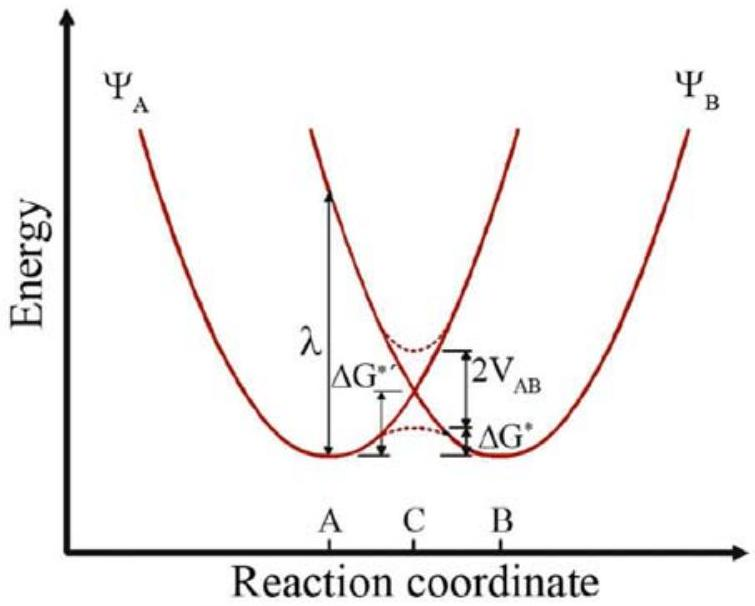
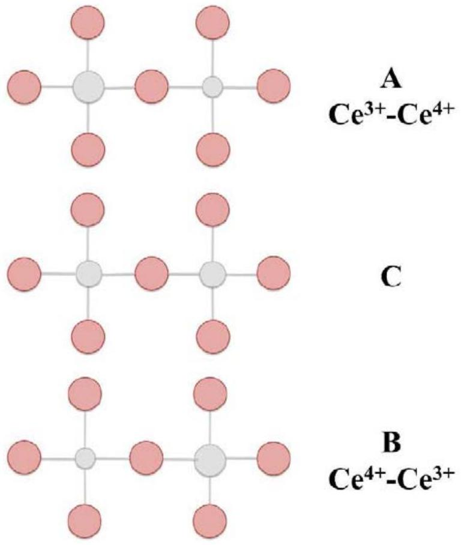
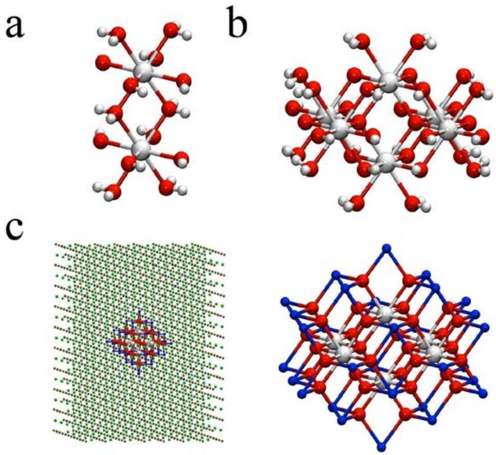
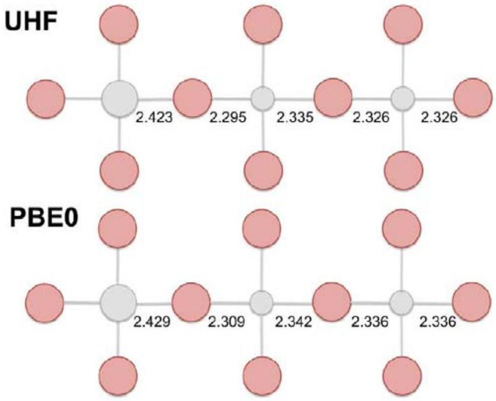
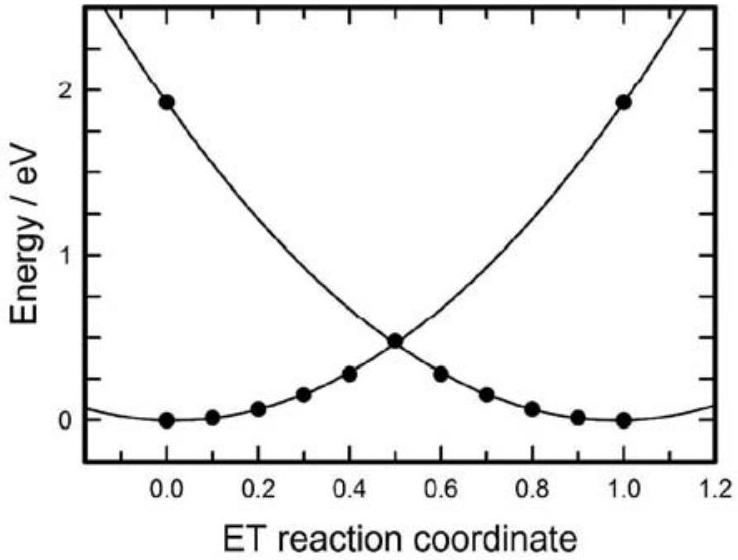
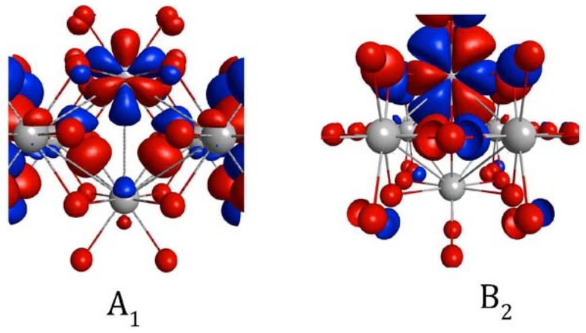
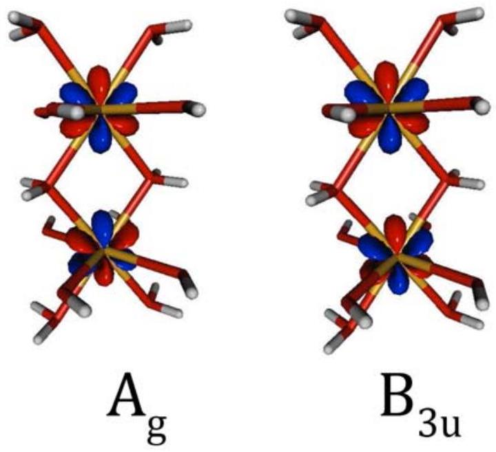

# 4.2 Electron Mobility via Polaron Hopping in Bulk Ceria: A First-Principles Study 

José J. Plata, Antonio Márquez, and Javier Fdez. Sanz Published in J. Phys. Chem. C, 2013 DOI:10.1021/jp402594x

#### Abstract

The outstanding catalytic properties of cerium oxides, and, consequently, the broad use in heterogeneous catalysis rely on the easy $\mathrm{Ce}^{3+} \leftrightarrow \mathrm{Ce}^{4+}$ redox conversion. Within the two-state model of Marcus, the electron transfer associated to the redox process is governed by the electronic coupling matrix element $\mathrm{V}_{A B}$ that accounts for the interaction between the diabatic electronic states at the crossing seam. Here we present a computational analysis based on ab initio quantum mechanics theory that allows for a characterization of negative polaron structures and intrinsic polaron hopping in perfect bulk $\mathrm{CeO}_{2}$. The relevant parameters inherent to the model: reorganization energy, activation barrier and electronic coupling for the $4 f \rightarrow 4 f$ electron hopping are estimated for several models. Our analysis predicts an activation barrier of 0.4 eV and a transmission coefficient $\kappa=0.81$ confirming the earlier proposed adiabatic theory of small polaron and hopping conductivity in reduced bulk ceria.

## Introduction

Cerium oxide is one of the most used materials in catalysis both as support and active phases. Typical examples of industrial applications are the three-way catalysts in automotive catalytic converters, fluid-cracking catalysts in refineries, and ethylbenzene dehydrogenation in the production of styrene. ${ }^{16}$ Either $\mathrm{CeO}_{2}$ or non-stoichiometric $\mathrm{CeO}_{2-x}$, hereafter generically referred to as ceria, are also an active component in a number of processes such as low-temperature CO and VOC oxidation catalysts, ${ }^{17}$ wet-oxidation of organic pollutants, ${ }^{18}$ hydrocarbon reforming, ${ }^{19}$ and the water-gas-shift reaction. ${ }^{20}$ Although the promoting effect of ceria was initially attributed to the enhancement of the metal dispersion and the stabilization towards thermal sintering, ${ }^{21,22}$ subsequent work has shown that ceria can act as a chemically active component as well, working as an oxygen reservoir able to deliver it in the presence of reductive gases and to incorporate it upon interaction with oxidizing gases. ${ }^{23-25}$

The outstanding catalytic properties of ceria rely on its ability to undergo rapid and repeatable $\mathrm{Ce}^{3+} \leftrightarrow \mathrm{Ce}^{4+}$ redox cycles depending on the conditions in the reactor stream. Stoichiometric $\mathrm{CeO}_{2}$ is an insulator and its electronic structure might be described as a formally fully occupied $\mathrm{O} 2 p$ band and empty $4 f$ and $5 d$ states, with an experimental band gap of 6-8 eV between the $\mathrm{O} 2 p$ and $\mathrm{Ce} 5 d$ states, ${ }^{26,27}$ although there is agreement with the
facts that the valence band contains a non-negligible admixture of f-symmetry orbitals. ${ }^{28}$ When $\mathrm{CeO}_{2}$ is reduced (metal doping, for instance) or exposed to reducing conditions ( $\mathrm{O}_{2}$ deficient atmosphere and high temperature), the in gap $4 f$ states are occupied, leading to states strongly localized at Ce sites. In the limit, the configuration of the sesquioxide $\mathrm{Ce}_{2} \mathrm{O}_{3}$, described as a Mott insulator, is reached. Therefore, we might conceive that partially reduced cerium oxide phases consist of a distribution of $\mathrm{Ce}^{3+}$ and $\mathrm{Ce}^{4+}$ centers that may easily interconvert, ${ }^{29}$ which, actually, involves oxidation and reduction of the Ce $4 f$ levels. On the other hand, the capability to store and mobilize oxygen within the ceria matrix should also be related with this interconversion between $\mathrm{Ce}^{3+}$ and $\mathrm{Ce}^{4+}$ centers, which, in fact, involves electron transport through the material.

The electronic conduction in cerium oxide has been attributed to the formation of small-polarons that diffuse according to a hopping mechanism. From electrical conductivity measurements performed by Naik and Tien, ${ }^{30}$ it was reported that in nonstoichiometric ceria the electrons are localized and the high temperature electrical conduction occurs by a hopping mechanism in which electrons jump from a $\mathrm{Ce}^{3+}$ ion to a neighboring $\mathrm{Ce}^{4+}$ ion. The small-polaron model developed by Holstein and Friedman ${ }^{31,32}$ satisfactorily explains the observed temperature dependence of the high temperature drift mobility. A similar conclusion was drawn from the work of Tuller and Nowick, ${ }^{33}$ that showed ceria to be perhaps the clearest case of small polaron hopping conductivity. The mobility in $\mathrm{CeO}_{2-x}$ was found to be activated, with activation energy $\mathrm{E}_{a}=0.40 \mathrm{eV}$ at small $x$ and increasing to 0.52 eV at $x=0.25$. Moreover, the so-called hopping integral, $t$, a key quantity in the analysis of the electron mobility of a system, has been investigated. However, depending of the methos to compute this value, a large discrepancy has been reported. ${ }^{34}$

From a theoretical point of view the study of electron transfer hopping in ceria has been hampered by the intrinsic difficulty in the explicit treatment of $4 f$ electrons in a solid-state context. Here we must recall that the Ce $4 f$ electrons in reduced ceria are localized, and that to render this situation in a density functional theory approach needs to incorporate either the exchange, via a hybrid xc-functional, or an explicit Hubbard type term (DFT+U). In fact, and as far as we know, ab initio computations of the electron transfer integral in an $f-f$ system have never been reported. This is contrast with the $d-d$ systems, some of which have been analyzed by Dupuis and coworkers. ${ }^{35-38}$ Notice on the other hand, that the $\mathrm{Ce}^{I I I}\left(4 f^{1}\right)-\mathrm{Ce}^{I V}\left(4 f^{0}\right)$ electron hopping is the simplest case among the possible $f-f$ systems.

In this paper, we report a first-principles study of the electron mobility parameters in perfect bulk cerium oxide as a first step to obtain an inclusive theoretical characterization of charge transport in ceria. Our aim is to present a computational description of the structure of negative polaron arrangements and polaron hopping in perfect $\mathrm{CeO}_{2}$. According to the theoretical model described below, several quantities are needed for such a characterization. For instance, choosing the Marcus terminology ${ }^{39,40}$ we must provide an estimate for the

Figure 4.1: General description of the main features of the Marcus model for a symmetric electron transfer. $\Psi_{A}$ and $\Psi_{B}$ stands for the diabatic wavefunctions. The adiabatic activation barrier is denoted by $\Delta \mathrm{G}^{*}$, estimated by subtracting to the diabatic barrier $\Delta \mathrm{G}^{*^{\prime}}$ the electronic coupling matrix element, defined as half the energy splitting at the intersection point.

electronic coupling, $\mathrm{V}_{A B}$, the adiabatic barrier, $\Delta \mathrm{G}^{*}$, and the reorganization energy $\lambda$ (see Figure 4.1). Because one of our concerns refers to the suitability and reliability of our approach for the present system, we use a variety of computational techniques making use of both embedded cluster and periodic approaches. The paper is arranged as follows. First we summarize the theoretical foundations that are rooted in the Marcus two-state model for electron transfer, or in its equivalent description of polaron movement in solids as formulated by Emin and Holstein ${ }^{41,42}$ and Austin and Mott, ${ }^{43}$ (EHAM). In Section 3 the computational methods and models are described. Section 4 reports the results and discussion, and finally, the conclusions are outlined in Section 5.

## Theoretical framework

As noted by Deskins and Dupuis, ${ }^{38}$ there is a parallelism between the EHAM theory and the two-state Marcus model that we briefly review here. The electron transfer (ET) process between adjacent cerium cations in oxidation states +3 and +4 is schematically represented in Figure 4.2. At the top of this figure the negative polaron is localized on the left, corresponding to a local electronic configuration of $\mathrm{Ce}^{I I I}\left(4 f^{1}\right)-\mathrm{Ce}^{I V}\left(4 f^{0}\right)$, and
conforming a nuclear arrangement labeled as $\mathrm{q}_{A}$. At the bottom, the polaron is on the right, $\mathrm{Ce}^{I V}\left(4 f^{0}\right)-\mathrm{Ce}^{I I I}\left(4 f^{1}\right)$, and the nuclear arrangement is denoted as $\mathrm{q}_{B}$. The structure at the middle, $\mathrm{q}_{C}$, corresponds to the transition state, where the electron charge is shared by the two cations. Because of the lower positive charge of $\mathrm{Ce}^{I I I}$ centers, the interatomic distance $\mathrm{Ce}^{I I I}-\mathrm{O}$ is expected to be larger than in the case of $\mathrm{Ce}^{I V}-\mathrm{O}$, therefore, passing from A to B involves an antisymmetric breathing vibration mode. The idealized energy profiles for the process following a generic reaction coordinate are represented in Figure 4.1. The two curves are assumed to be parabolic with minima at $\mathrm{q}_{A}$ and $\mathrm{q}_{B}$, while the transition state is at $\mathrm{q}_{c}$, that corresponds to the crossing point between the two localized wavefunctions $\Psi_{A}$ and $\Psi_{B}$. The other highlighted parameter in Figure 4.1 is the reorganization energy $\lambda$ that corresponds to the energy of the final state $\Psi_{B}$ at the geometric configuration $\mathrm{q}_{A}$.

Figure 4.2: Schematic description of the electron transfer between two Ce ions. At the top, $\mathrm{q}_{A}$, the electron is occupying a $4 f$ orbital localized on the left Ce ion. At the bottom, $\mathrm{q}_{A}$, the electron is localized on the right Ce ion. At the transition state $\mathrm{q}_{C}$, the electron is shared between the two cations.

The adiabatic or non-adiabatic nature of the ET process relies on the relative value of the time it takes the electron to jump between two adjacent centers, $t_{e l}$, which in turn is related to the electron transfer integral, $J$, or electronic coupling $\mathrm{V}_{A B}$. Briefly, in the adiabatic process the electron coupling is strong, $\mathrm{V}_{A B}$ is large, and the activation barrier lowers by this amount, in which case the main mechanism occurs via thermal hopping. If the electron transfer integral is small, the process is non- adiabatic and the ET mainly takes place by tunneling. In summary, whatever the process is, adiabatic or non-adiabatic, the electronic coupling element $\mathrm{V}_{A B}$ plays the crucial role.

Within the Marcus theory the electronic coupling matrix element $\mathrm{V}_{A B}$ is defined as half the energy difference between the two adiabatic states at the crossing seam, $2 \mathrm{~V}_{A B}=$ $\mathrm{E}^{-}-\mathrm{E}^{+}$, where $\mathrm{E}^{-}$and $\mathrm{E}^{+}$are the energies of upper and lower states respectively. However, to estimate this quantity one may follow different strategies depending on the actual states used for this purpose. We can choose the localized states $\Psi_{A}$ and $\Psi_{B}$, and the formula:

$$
V_{A B}=\frac{\left|H_{A B}-S_{A B}\left(H_{A A}+H_{B B}\right) / 2\right|}{1-S_{A B}^{2}}
$$

where $H_{A A}=\left\langle\Psi_{A}\right| H\left|\Psi_{A}\right\rangle, H_{A B}=\left\langle\Psi_{A}\right| H\left|\Psi_{B}\right\rangle, \ldots$ are the matrix elements of the full Hamiltonian on the basis of diabatic states, and $S_{A A}=\left\langle\Psi_{A} \mid \Psi_{A}\right\rangle, S_{A B}=\left\langle\Psi_{A} \mid \Psi_{B}\right\rangle, \ldots$ the overlap elements. In the present work we used this strategy using the technique reported by Farazdel et al. ${ }^{44}$ Also using orthogonalized diabatized states one can compute directly the off diagonal term of the $2 x 2$ Hamiltonian representation $\mathrm{H}_{A B}$, to several orders of perturbation which renders more accurate estimates of the transfer integral. ${ }^{45,46}$ On the other hand, one can formally compute the adiabatic energies $\mathrm{E}^{+}$and $\mathrm{E}^{-}$although now the difficulty relies on the calculation of the ground and first excited state to the same degree of accuracy. This latter point is of outstanding importance because the electronic coupling elements $\mathrm{V}_{A B}$ use to be small quantities, many times of the order of a few hundreds wavenumbers, and therefore reliable estimates are needed. We will see in the next section how the symmetry of the system can be exploited to achieve such a calculation.

## Models and Computational Methods

The present work makes use of both periodic and embedded cluster calculations to explore the different properties of the system. Firstly periodic calculations were performed to analyze the local structure of the negative polaron that results when a cerium atom in perfect $\mathrm{CeO}_{2}$ is populated with an extra electron. Also using a periodic model, we estimated the energy barrier of the electron hopping process. These calculations were undertaken using the CRYSTAL09 code ${ }^{47}$ and CGTOs basis sets. The CeO2 fluorite crystal ( $\mathrm{Fm} \overline{3} \mathrm{~m}$ ) was represent by a $2 x 2 x 2$ supercell containing 96 atoms. Inner electrons of Ce atom were replaced by an effective core potential developed by the Stuttgart-Dresden
group. ${ }^{48}$ The Ce electrons explicitly treated were the $4 s^{2} 4 p^{6} 4 d^{10} 5 s^{2} 5 p^{6} 4 f^{1} 6 s^{2} 5 d^{1}$, with a $(10 s p 7 d 8 f) /[4 s p 2 d 3 f]$ basis set optimized to properly describe oxides where the metal features III and IV oxidation states. ${ }^{49}$ For O an all-electron $(8 s 6 s p 1 d) /[1 s 3 s p 1 d]$ basis set proposed for ionic crystals was adopted. ${ }^{50}$ The two most external sp and d exponents have been re- optimized for cerium oxide, their resulting values being 0.4798717, 0.1801227 and 0.2991812 bohr ${ }^{-2}$, respectively. ${ }^{51,52}$

Spin-polarized density functional, DFT, calculations were performed using the Perdew-Burke-Ernzerhof PBE0 functional, ${ }^{53}$ that has been shown to perform adequately when both $\mathrm{Ce}^{I I I}$ and $\mathrm{Ce}^{I V}$ ions are present. ${ }^{51}$ This hybrid functional is a combination of the GGA exchange-correlation functional PBE ${ }^{54}$ and the exact Hartree-Fock (HF, EXHF) exchange following the expression: $E_{X C}^{P B E 0}=E_{X C}^{P B E}+1 / 4\left(E_{X}^{H F}-E_{X}^{P B E}\right)$. However, near the crossing seam such admixture led to delocalized solutions, therefore, we decided to keep the reaction path exploration at the UHF level of theory. The calculations were performed in the reciprocal space, and a $4 x 4 x 4$ Monkhorst-Pack grid, ${ }^{55}$ corresponding to 36 reciprocal space irreducible points, was used to sample the Brillouin zone. The SCF procedure was considered converged when the energy changes between the iterations were smaller than 10-8 hartree. To analyze the polaronic structure, the ions positions were fully optimized until gradients were lesser than 0.00045 hartree/bohr. The lattice parameter at the UHF level of theory was found to be $5.37 \AA$ in agreement with that obtained from PBE0 calculations, $5.40 \AA .{ }^{51}$

Using the structures obtained in the above described ab initio optimizations, model clusters were designed following two lines. In the first one, two molecular clusters were used. The minimal model consisted of a pair of cerium octahedra (minimal dimer cluster), having formula $\mathrm{Ce}_{2} \mathrm{O}_{4}\left(\mathrm{H}_{2} \mathrm{O}\right)_{10}$ that will be labeled as small. This cluster, shown in Figure 4.3, is stoichiometric, represents the smallest structural unit able to exhibit the pair $\mathrm{Ce}^{I I I}$ - $\mathrm{Ce}^{I V}$, and has $\mathrm{D}_{2 h}$ symmetry at the crossing seam. To include in the calculations additional effects of environment atoms a larger molecular model of gross formula $\mathrm{Ce}_{6} \mathrm{O}_{12}\left(\mathrm{H}_{2} \mathrm{O}\right)_{20}$, labeled as big and $\mathrm{D}_{2 h}$ was built from the bulk calculations. Again, the oxygen atoms were kept at their optimized positions and saturated with hydrogen atoms in order to have stoichiometric non-charged clusters. The second type of finite models was of the embedded cluster type. $\mathrm{A} \mathrm{Ce}_{6} \mathrm{O}_{32}$ cluster was excised from the bulk, and embedded in an array of point charges (PC) to incorporate the effect of the Madelung potential in the calculations. To avoid the excess of polarization of the outer oxygen atoms, the nearest layer of counterions was represented by Ce total ion potentials (TIPs), giving place to a model of formula $\mathrm{Ce}_{6} \mathrm{O}_{32}(\mathrm{CeTIP})_{30} \mathrm{PC}$. The whole system was symmetrized to preserve $\mathrm{D}_{2 h}$ symmetry and will be labeled big+PC.

The calculation of the electronic coupling matrix element $\mathrm{V}_{A B}$ started by determining the geometry at the crossing point. Once the geometry of the system with, for instance, the extra electron localized on the left, so the pair $\mathrm{Ce}^{I I I}-\mathrm{Ce}^{I V}$, is determined, the crossing-point

Figure 4.3: Structure of the cluster models used to compute the electronic coupling $\mathrm{V}_{A B}$. a: small; b: big; c: big+PC. Red spheres are oxygen atoms and small light spheres hydrogen atoms. In model c, the blue spheres stand for Ce TIPS, The array of charges is also shown on the bottom left part of the figure

configuration for the system might be estimated using the linearized reaction coordinate approximation. If the electron-transfer reactant and product potential-energy surfaces are assumed to be parabolic, a reasonable approximation of the reaction coordinate is given by

$$
q(\alpha)=\alpha q_{A}+(1-\alpha) q_{B}
$$

where $0 \leq \alpha \leq 1$, and if $\alpha=0.5$ then $\mathrm{q}(\alpha)=\mathrm{q}_{C}$. Broken symmetry $\left(\mathrm{C}_{2 v}\right)$ Hartree-Fock solutions for the cerium dimer cluster holding the electron localized left and right are then obtained and used to compute $\mathrm{V}_{A B}$ using the approach of Farazdel et al. ${ }^{44}$ The calculations were performed using a home-adapted version of HONDO program. The effective core potential and basis sets used were essentially the same that in the periodic approach unless that the basis set for oxygen (and hydrogen) atoms was the standard DZP. Notice that the $\mathrm{C}_{2}$ axis of the reduced symmetry cluster falls along the Ce-Ce axis, so the according to Figure 4.3, we should speak in terms of up and down instead of left and right localization.

Figure 4.4: Schematic representation showing the structure of the polaron obtained from DFT and UHF calculations.

## Results and Discussion

## Polaron structure and reorganization energy

We start the section analyzing the deformation induced in the cerium ion $\mathrm{Ce}^{I V}$ coordination shell when it is reduced to $\mathrm{Ce}^{I I I}$. The PBE0 optimization leads to a Ce-O interatomic distance of $2.429 \AA$, that compared with that of perfect $\mathrm{CeO}_{2}(2.338 \AA)^{51}$ shows a noticeable lengthening, which, on the other hand agrees with the lowering of the electrostatic interaction. This interatomic distance falls within those reported for $\mathrm{Ce}_{2} \mathrm{O}_{3}$ bulk: $2.321,2.435 \AA .{ }^{51}$ The expansion of the coordination shell around the $\mathrm{Ce}^{I I I}$ center is accompanied by a shortening of the neighboring $\mathrm{O}-\mathrm{Ce}^{I V}$ interatomic distance, $2.309 \AA$, as depicted in the scheme of Figure 4.4. The next neighbor $\mathrm{Ce}^{I V}-\mathrm{O}$ distances are computed to be $2.342,2.336$ and $2.336 \AA$, recovering thus the usual value of bulk ceria. These results indicate that the perturbation induced by the reduction almost exclusively involves the first coordination shell around the concerned Ce center, which is consistent with the small polaron nature experimentally proposed. ${ }^{30,33}$ Population analysis of this structure confirms that the extra electron is occupying a Ce $4 f$ orbital. As shown in the scheme of Figure 4.4, the optimization at the UHF level of theory leads to values very close to those obtained from DFT calculations.

Using an adequate initial guess we were able to obtain a converged UHF wavefunction for this configuration when the electron is localized on one of the neighboring Ce atoms.
"thesis" - 2013/6/27 - 15:59 - page 85 - \#97

Figure 4.5: Electron transfer energy profiles along the ideal reaction coordinate q.

Formally speaking, the difference of energy associated to these states gives the reorganization energy $\lambda$, which in the present case is found to be 1.92 eV . This value might be considered as an upper bound and is in reasonable agreement with that of 1.4 eV obtained from the experimental optical absorption coefficient of reduced ceria samples. ${ }^{56}$ On the other hand, employing this optimized structure and the linearized reaction coordinate approximation aforementioned we performed a series of static calculations to reach the crossing point and estimate the diabatic barrier. The results are summarized in Figure 4.5 where the parabolic shape of the potential curves is clearly observed (coefficient of determination for a square fitting $\mathrm{R}^{2}=1.0018$ ). The diabatic barrier was found to be 0.48 eV, that is, just a fourth of $\lambda$, as ideally expected.

## Electronic coupling matrix element

The determination of $\mathrm{V}_{A B}$ from cluster models and equation (1) involves first obtaining localized wavefunctions at the crossing seam. In principle the highly symmetric $4 f$ atomic orbital that bears the extra electron may correspond to any of the four possible symmetry species that result after splitting under the reduced symmetry $\left(\mathrm{C}_{2 v}\right)$. Because these states may be close in energy we were compelled to obtain the four different solutions and therefore to perform four electronic coupling type calculations. The localized nature of the solutions was verified for every model, and the shape of the active orbitals for the lowest solutions each symmetry is reported in Figure 4.6. For the small model cluster, the $\mathrm{A}_{1}$ symmetry state is found to be the lowest state, while the other states are found to lye more than 0.1 eV higher. The electronic coupling matrix element for this state is 65 meV or 522

Figure 4.6: Shape of the active orbitals obtained for the small cluster model.

$\mathrm{cm}^{-1}$, a relatively small value. For the states of the other symmetries the coupling is even smaller, ranging between 2 and 34 meV. Increasing the model cluster leads to variations in the ordering of the states and also in the estimated coupling. Thus, for the big model the lowest state still has $\mathrm{A}_{1}$ symmetry, however for the big+PC model the $\mathrm{B}_{2}$ state is found to be the ground state, though almost degenerate with the $\mathrm{A}_{1}$ state. This result agrees with the periodic calculations in which a $\mathrm{B}_{2}$ state was found to be one of the precursor states. If we now analyze the dependence of the electronic coupling with the model we can see that changing the model cluster also changes the coupling. Thus, one can see that for $\mathrm{A}_{1}$ states the estimated values are quite stable indicating that even the simplicity of the small model cluster captures the main physical factors affecting the coupling. The same can be roughly said of the $\mathrm{B}_{2}$ symmetry states. However, for the two other symmetries one can see that at least the big model cluster is needed. The largest differences found are when passing from the small to the big cluster models, while the addition of the electrostatic field through the point charges is of lesser importance in the coupling, although appears to be essential to stabilize the $\mathrm{B}_{2}$ component, and correctly account for the ground state.

One further aspect that may be considered concerns the adequacy of the extrapolating procedure to estimate crossing seam geometry. Although in principle a geometry optimization could be performed, it has been shown that, in general, the electronic coupling slightly depends on the geometry. In the present work no attempts to carry out such optimization were envisaged, however, preliminary calculations at different geometries were done. For instance, in the case of the small cluster model, the electronic coupling was calculated for a configuration in which both Ce and O atoms were kept frozen at the experimental bulk
positions of $\mathrm{CeO}_{2}$. The values of $\mathrm{V}_{A B}$ obtained were 61, 2, 26 and 18 meV, that are quite close to those obtained incorporating the polaronic distortion at the crossing point. This low dependency of the ET matrix element on the geometry agrees with that observed in the mixed valence $\mathrm{Cu}^{I}-\mathrm{Cu}^{I I}$ system. ${ }^{57}$

Let us now consider the results obtained with the adiabatic strategy. As the largest coupling is that of $\mathrm{A}_{1}$ states, we will focus on this symmetry in the following discussion. If the full $\mathrm{D}_{2 h}$ symmetry is allowed in the SCF procedure at the crossing seam, the open shell orbital, SOMO, is of $\mathrm{A}_{g}$ symmetry. This molecular orbital actually corresponds to a symmetric (g or gerade) combination of the two $\mathrm{A}_{1}$ localized active orbitals, one of which is shown in Figure 4.6. For the antisymmetric (ungerade) combination of the pair of active orbitals one obtains u-symmetry molecular orbitals. The shape of these molecular orbitals is shown in Figure 4.7. As the associated states are of different symmetry one can in principle achieve convergence in the SCF procedure, and according to the Marcus theory we have assumed that half the difference of energy between the ground state $\left(\mathrm{A}_{g}\right)$ symmetry and the lowest root of u-type symmetry, a $\mathrm{B}_{3 U}$ state, corresponds to the electronic coupling matrix element. Because of the stability observed in the coupling matrix element for $\mathrm{A}_{1}$ states with respect to the cluster model, we have limited our analysis to the small model. Also, we have explored several exchange-correlation functionals, in particular B3LYP, ${ }^{58-60}$ HSE06, ${ }^{61}$ and M06, ${ }^{62}$ besides the PBE0 approach. These calculations were performed using the same basis sets and theoretical setup but using Gaussian09 program. The values obtained for $\mathrm{V}_{A B}$ are: 85, 83, 68 and 88 meV for the functionals PBE0, B3LYP, HSE06, and M06 respectively. As can be seen these values appear to be steady, though somewhat larger than that obtained using the diabatic approach (65 meV). This behavior has been already reported in the calculation of the electronic coupling in other metal transition dimer clusters. For instance, hole-doped $\mathrm{La}_{2} \mathrm{CuO}_{4}$ perovskites, where the B3LYP computations led to an ET matrix element of 217 meV, noticeably larger than that obtained using the diabatic procedure, 189 meV, but underestimated with respect to the value of 262 meV using a selected CI (DDCI). ${ }^{63}$

The analysis of the values calculated for the electronic coupling is generally performed on the basis of through-bond and through-space contributions although this evaluation can only be made on very simple models. However, in order to put our results in context first, it is worth comparing them with those found for related systems. The closest (and simplest) system is the $3 d^{1}-3 d^{0}$ present in reduced titanium dioxide extensively investigated by Deskins and Dupuis. ${ }^{38}$ These authors considered electron transfer in both anatase and rutile phases, along different directions, obtaining values ranging between 10 and 200 meV. The differences were attributed to there factors: the Ti-Ti distance, the degree of oxygen bridging, and the orientation of active d orbitals. Yet, the gross analysis was consistent with the well-known decay of the electronic coupling with distance, as one of its main ingredients relies on the overlap between donor and acceptor pairs. In particular,

Figure 4.7: Shape of the highest occupied molecular orbital, $\mathrm{A}_{g}$, and its antisymmetric counter part of $\mathrm{B}_{3 u}$ symmetry for the small cluster model.

for those cases where Ti atoms are linked by two bridging oxygens, the ET coupling element lowers from 200 meV (rutile [001] direction, Ti-Ti distance of $2.97 \AA$ ), to 30 meV (anatase, [201] direction, $\mathrm{Ti}-\mathrm{Ti}$ distance of $3.09 \AA$ ). Since in our case two oxygen atoms link two Ce atoms, with a Ce-Ce distance of $3.80 \AA$, our estimate of 64 meV appears to be reasonable. A similar conclusion might be inferred when we compare with the results obtained for a related system, the $\mathrm{Cu}^{I}\left(3 d^{10}\right)-\mathrm{Cu}^{I I}\left(3 d^{9}\right)$ where the ET process also involves only one d electron. ${ }^{57}$ For this system the metal-metal distance was $3.1 \AA$ and a comparable calculation gave an ET element of 189 meV. Let us now compare with other values of the electronic coupling derived from experimental data. Taking a value for $\lambda$ of 0.88 eV and the mobility reported by Tuller et al., ${ }^{33}$ Shoko et al. ${ }^{35}$ estimated an ET integral of 20 meV. However, this value was suggested to be too low, as using the Harrison method a much larger hopping integral was obtained (~100 meV). Beyond the approximations assumed in these estimations, we suggest that the discrepancy is due to the small value of the reorganization energy used for the calculation. Although our value for $\lambda(1.96 \mathrm{eV})$ calculated at the UHF level might be overestimated, it is interesting to note that assuming $\mathrm{T}=1000^{\circ} \mathrm{C}$, the estimated value for the ET hopping integral is 79 meV, remarkably close to the value of 65 meV obtained using the diabatic UHF wavefunctions.

To end up with this discussion let us analyze the adiabatic barriers for the ET process. For the ET matrix element we can take the mean of the values determined from the
adiabatic DFT approach (81 meV). For the diabatic barrier we can chose as a reasonable approximation the difference between the UHF energies computed at the crossing seam and at the minima reported in the energy profiles of Figure 4.5 (0.48 eV). Disregarding ZPE corrections we can estimate an adiabatic barrier of 0.40 eV, which is agreement with the 0.42-0.50 eV range experimentally determined. ${ }^{30,33}$ On the other hand, the adiabatic or diabatic behavior of the ET transfer is governed by the transmission probability $\kappa$. This coefficient gives the probability of passing from the initial state to the final state and is given by $\kappa=2 P_{12}^{0} /\left(1+P_{12}^{0}\right),{ }^{64}$ where $P_{12}^{0}$ is the probability of conversion to the final state per passage through the crossing seam. A value near 1 for $\kappa$ indicates adiabatic transfer. For a self-exchange process, ${ }^{65}$ the probability $P_{12}^{0}$ might be estimated through the Landau and Zenner expresin: ${ }^{66,67}$

$$
P_{12}^{0}=1-\exp \left[-\left(V_{A B}^{2} / h v_{0}\right)\left(\pi^{3} / \lambda k_{B} T\right)^{1 / 2}\right]
$$

Here $v_{0}$ is a typical frequency for nuclear motion, and in our case it corresponds to the specific phonon mode describing the antiphase breathing mode of the oxygen atoms bound to the $\mathrm{Ce}^{I I I}$ site. Taking for this quantity the experimental accepted value of $595 \mathrm{~cm}^{-1}$ for longitudinal optic-mode phonon, ${ }^{26,68}$ we obtain a coefficient transmission $\kappa=0.81$, i.e. close to the ideal adiabaticity. This finding agrees with the adiabatic theory of small polaron and reinforces the proposed hopping conductivity mechanism in which electrons jump from a $\mathrm{Ce}^{3}+$ ion to a neighboring $\mathrm{Ce}^{4+}$ ion.

## Conclusions

Ab initio quantum theory has been employed to determine and characterize the nature of the electron transfer process between adjacent $\mathrm{Ce}^{3+}$ and $\mathrm{Ce}^{4+}$ centers in bulk ceria. Using a supercell model, periodic boundary conditions and DFT calculations with the PBE0 xc-functional, we have demonstrated that the reorganization that takes place when a $\mathrm{Ce}^{4+}$ is reduced to $\mathrm{Ce}^{3+}$ involves almost exclusively the first coordination shell with an increasing in the Ce(III)-O interatomic distance of $0.09 \AA$. This result allows us to confirm the small polaron nature of reduced ceria previously proposed. The analysis of the spin and electronic density shows a strongly localized charge distribution around the $\mathrm{Ce}^{3+}$ ions. Within the two-state Marcus model, we have estimated the electronic coupling matrix element or electron transfer integral, $\mathrm{V}_{A B}$, following two approaches. Using diabatic wavefunctions determined at the Hartree-Fock level of theory we obtain for this quantity a value of 65 meV. The analysis of the active orbitals nicely shows the strong localized nature of the $4 f$ states. Using an adiabatic approach enabled us to estimate $\mathrm{V}_{A B}$ from DFT calculations employing several exchange-correlation functionals. The obtained values fall in the 68-88 meV range (mean value $\mathrm{V}_{A B}=81 \mathrm{meV}$ ).

From the energy profiles determined at the UHF level of theory for the electron transfer process along an idealized reaction path we obtained a reorganization energy $\lambda$ of 1.96
eV, and an adiabatic barrier for the polaron hopping of 0.40 eV, in very good agreement with activation energy estimated from conductivity experiments performed on reduced ceria. Finally, the transmission coefficient $\kappa$ was estimated to be 0.81, indicating that the electron transfer process is mainly adiabatic, confirming the earlier proposed adiabatic theory of small polaron and hopping conductivity in defective bulk ceria.

