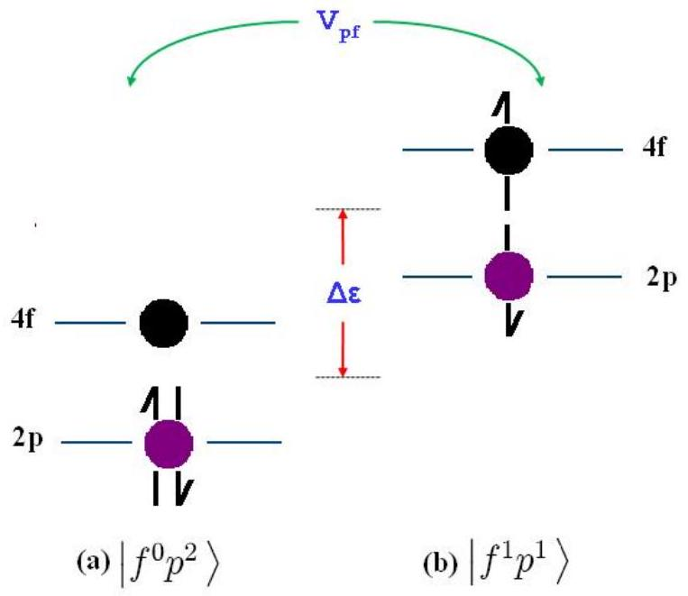
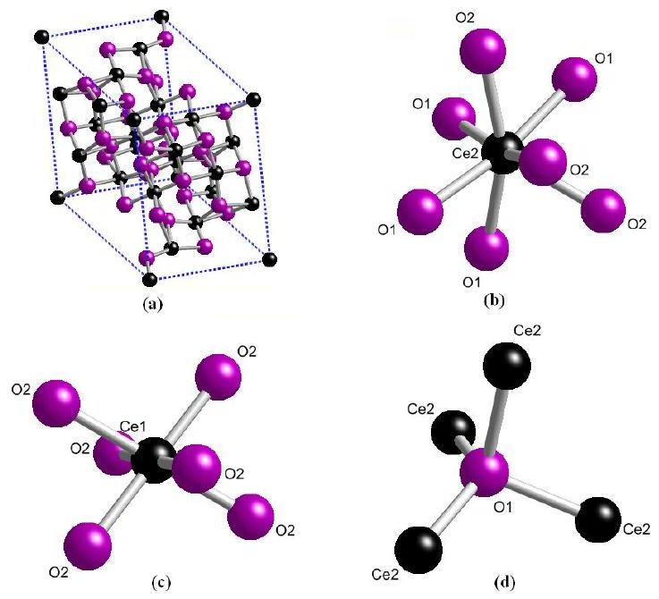
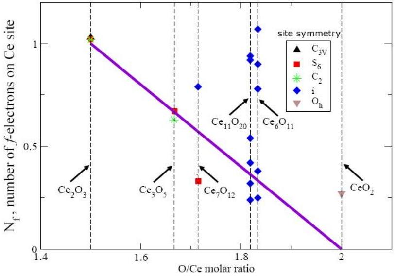

# Mixed valency in cerium oxide crystallographic phases: Determination of valence of the different cerium sites by the bond valence method 

E. Shoko, M. F. Smith, and Ross H. McKenzie University of Queensland, Department of Physics, Brisbane, QLD 4072, Australia (Date textdate; Received textdate; Revised textdate; Accepted textdate; Published textdate)

#### Abstract

We have applied the bond valence method to cerium oxides to determine the oxidation states of the Ce ion at the various site symmetries of the crystals. The crystals studied include cerium dioxide and the two sesquioxides along with some selected intermediate phases which are crystallographically well characterized. Our results indicate that cerium dioxide has a mixed-valence ground state with an $f$-electron population on the Ce site of 0.27 while both the $A$ - and $C$-sesquioxides have a nearly pure $f^{1}$ configuration. The Ce sites in most of the intermediate oxides have non-integral valences. Furthermore, many of these valences are different from the values predicted from a naive consideration of the stoichiometric valence of the compound.

## I. INTRODUCTION

Mixed valency of transition metal and rare-earth ions in solids and compounds is a question of fundamental interest in materials physics, chemisty, and molecular biophysics. ${ }^{1}$ In 1967, Robin and Day ${ }^{2}$ published a classification scheme for mixed-valence that is still widely used today. ${ }^{3}$ Class 1 describes systems with two crystallographic sites that are clearly distinct and and the two sites have integral but unequal valence. There is a large energy associated with transfer of electrons between sites. At the other extreme is Class 3 for which there are two sites which are not distinguishable, and one assigns a non-integral valence to both sites. The valence electrons are delocalised between the two sites. Class 2 is the intermediate case where the environments of the two sites are distinguishable but not very different. The energy associated with electron transfer is sufficiently small that it can be thermally activated and be associated with significant optical absorption in the visible range. On the time scale of the vibrations of the atoms the electrons may appear to be delocalised. Classes 1 and 2 correspond to what Varma ${ }^{4}$ terms inhomogeneous mixed valence, although, perhaps, inhomogeneous integral valence may be more appropriate. Class 3 corresponds to homogeneous mixed valence.

In systems which are characterized by homogeneous mixed-valence, each ion has the same, noninteger, valence which is a result of a quantum mechanical superposition of two integral valences occuring on each ion (See for example Eq. (2). Compounds exhibiting this type of mixed-valence include, for example, $\mathrm{CePd}_{3}$ (Ref. 5), TmSe (Ref. 6) and $\mathrm{SmB}_{6}$ (Ref. 7) where the valences of the ions are 3.45, 2.72 and 3.7 for Ce, Tm, and Sm respectively. In TmSe, the valence of 2.72 for the Tm ion is a result of valence fluctuations of this ion between the $\mathrm{Tm}^{2+}$ and $\mathrm{Tm}^{3+}$ states. ${ }^{6}$ In contrast, the inhomogeneous mixed-valence case involves a mixture of different integer valence ions which occupy inequivalent lattice sites in a static charge-ordered array. Examples of this are provided by $\mathrm{Fe}_{3} \mathrm{O}_{4}$ (Ref. 8), $\mathrm{Eu}_{3} \mathrm{O}_{4}$ (Ref. 9) and $\mathrm{Eu}_{3} \mathrm{~S}_{4}$ (Ref. 10). The inverse spinel crystal structure of magnetite $\left(\mathrm{Fe}_{3} \mathrm{O}_{4}\right)$ is considered the classic case of inhomogeneous mixed-valence. In this crystal, the $\mathrm{Fe}^{3+}$ ions completely occupy the tetrahedral $(A)$ sublattice while the octahedral $(B)$ sublattice is equally shared between the $\mathrm{Fe}^{3+}$ and $\mathrm{Fe}^{2+}$ ions and the ionic formulation is $\left(\mathrm{Fe}^{2+}\right)\left(\mathrm{Fe}^{3+}\right)_{2}\left(\mathrm{O}^{2-}\right)_{4}$. However, we note that this inverse-spinel charge ordering in $\mathrm{Fe}_{3} \mathrm{O}_{4}$ has recently been challenged in favour of the normal spinel charge structure where the $\mathrm{Fe}^{3+}$ ions exclusively occupy all the octahedral sites while the $\mathrm{Fe}^{2+}$ ions reside in the tetrahedral sites. ${ }^{11}$ The crystal of $\mathrm{Eu}_{3} \mathrm{O}_{4}$ is a good example of the case where ions of different valence strictly occupy inequivalent cation sites. It consists of two nonequivalent Eu sites in which the $\mathrm{Eu}^{2+}$ and $\mathrm{Eu}^{3+}$ ions occupy the eight- and six-coordinated sites respectively giving a static charge-ordered array whose ionic formulation may be written as $\left(\mathrm{Eu}^{2+}\right)\left(\mathrm{Eu}^{3+}\right)_{2}\left(\mathrm{O}^{2-}\right)_{4}$ (Ref. 9).

Oxides of cerium (Ce) appear to exhibit mixed-valence characteristics which may help to explain some of their properties relevant to their engineering applications. An important industrial use of Ce oxides is as anode materials in high-temperature solid-oxide fuel cells. ${ }^{12}$ For these applications, $\mathrm{CeO}_{2}$ (ceria) and $\mathrm{Ce}_{2} \mathrm{O}_{3}$ represent the extremal oxidation states in the reversible chemical reaction, Eq. (1):

$$
\mathrm{CeO}_{2} \rightleftharpoons \mathrm{CeO}_{2-y}+\frac{y}{2} \mathrm{O}_{2}, \quad 0 \leq y \leq 0.5
$$

Strong electron-correlation effects may be involved in the crystallographic phase transitions which occur between $\mathrm{CeO}_{2}$ and $\mathrm{Ce}_{2} \mathrm{O}_{3}$, i.e., the reaction in Eq. (1). When $\mathrm{CeO}_{2}$ is reduced to the various defective phases, $\mathrm{CeO}_{2-y}$, O vacancies are formed in the lattice structure. The crystal structure adopted by any such defective phase, $\mathrm{CeO}_{2-y}$, is understood to be the one that provides the most favourable energetics for the arrangement of all the O vacancies within the structure. In a widely accepted view of the microscopic description of O vacancy formation and ordering in $\mathrm{CeO}_{2-y}$ phases, the two electrons left by the O atom when an O vacancy forms fully localize on two of the nearest $\mathrm{Ce}^{4+}$ ions. ${ }^{1213|14| 15}$ The localization of an electron on a $\mathrm{Ce}^{4+}$ ion converts it to the slightly
larger $\mathrm{Ce}^{3+}$ ion with one electron in the $4 f$ orbital. In the reverse process where a defective phase, $\mathrm{CeO}_{2-y}$, is oxidized, two $4 f$ electrons are transferred from the two neighbouring $\mathrm{Ce}^{3+}$ ion sites into the O $2 p$ band.

This description leads one to expect that the Ce lattice sites in the defective $\mathrm{CeO}_{2-y}$ phases would consist of a mixture of $\mathrm{Ce}^{3+}$ and $\mathrm{Ce}^{4+}$ ions in a static charge-ordered array. Thus, useful insight into the microscopic processes involved in the reversible chemical reaction, (1), could be gained from a knowledge of the valences of the Ce ions in the defective $\mathrm{CeO}_{2-y}$ phases. However, as we discuss in the next section, it turns out that the task of establishing the oxidation states of the Ce ions in the lattices of the crystal phases involved in (1) is very challenging owing to valence fluctuations on the Ce ions.

Here, we report the results of calculations based on a simple empirical method, the bond valence model ${ }^{16|17| 18}$, to determine the $f$-electron occupancies in the various Ce ion sites for seven of the crystallographic phases involved in Eq. (1). The crystals studied include $A-\mathrm{Ce}_{2} \mathrm{O}_{3}, C$ -$\mathrm{Ce}_{2} \mathrm{O}_{3}, \mathrm{Ce}_{3} \mathrm{O}_{5}, \mathrm{Ce}_{7} \mathrm{O}_{12}, \mathrm{Ce}_{11} \mathrm{O}_{20}, \mathrm{Ce}_{6} \mathrm{O}_{11}$ and $\mathrm{CeO}_{2}$.

The structure of this paper is as follows. In Section II, we outline the general problem of mixed-valence in Ce oxides from both experimental and theoretical perspectives. Section III describes the bond valence model and how we used it to determine the valences of Ce ions in the different phases of the Ce oxide crystals. We present our results in Section IV which we then discuss in light of two other models for predicting cationic valences in crystals. The main conclusions of this paper are given in Section V. Appendix A lists all the Ce-O bond lengths used in our calculations for Ce-centred polyhedra.

## II. THE MIXED-VALENCE PROBLEM IN CERIUM OXIDES

In Ce oxides, the number of $f$ electrons on a Ce site, $N_{f}$, is observed to lie between 0 and slightly above 1.0. An isolated Ce atom has the electronic configuration $[\mathrm{Xe}] 4 f^{1} 5 d^{1} 6 s^{2}$. In a crystal of the oxide, the $5 d^{1} 6 s^{2}$ electrons participate in bonding, forming part of the $\mathrm{O} 2 p$ valence band, while the state of the $4 f^{1}$ electron depends on the energy of the associated electronic state within the particular crystal structure. If the $4 f^{1}$ state lies well within the band gap between the empty $5 d 6 s$ conduction band and the $\mathrm{O} 2 p$ valence band, then the $4 f^{1}$ electron is fully localized on the Ce atom and $N_{f}=1.0$. On the other hand, if the $4 f^{1}$ electron state merges with the valence band, then the electron is lost to neighbouring O atoms so that $N_{f}=0$ thus forming an ionic bond. Intermediate behaviour with fractional occupancy of the $4 f$ state occurs when the associated state lies close to the valence band. Occupancies for which $N_{f}>1.0$ are however energetically discouraged by the large on-site Coulomb repulsion for localized Ce states.

Fig. 1 illustrates this situation for $\mathrm{CeO}_{2}$ showing the relevant energy scales when the system is described by

FIG. 1: A schematic of the energy level structure of $\mathrm{CeO}_{2}$ showing the two important system parameters in the Anderson impurity model: $\Delta \varepsilon$, the energy gap between the two states $\left|f^{0} p^{2}\right\rangle$ and $\left|f^{1} p^{1}\right\rangle$ which are mixed by the hybridization, $V_{p f}$. For $\mathrm{CeO}_{2}$, the two parameters, $\Delta \varepsilon$ and $V_{p f}$ are comparable and the Ce $4 f$ level may be close to the O $2 p$ level. ${ }^{19}$ In (a), the pure $f^{0}$ configuration corresponding to $\mathrm{Ce}^{4+}$ at the Ce site is shown. In (b), an electron has hopped from the O $2 p$ site to the Ce site where it occupies the $4 f$ level giving the pure $f^{1}$ configuration, i.e., $\mathrm{Ce}^{3+}$ as shown. An electron hole is thus created in the $\mathrm{O} 2 p$ valence band. The mixing between these states due to the hybridization, $V_{p f}$, may result in mixed-valence at the Ce site. Here, we have set the on-site Coulomb repulsion, $U_{f f}$, (for double occupancy of the $f$ orbital) to infinity.

the Anderson impurity model. ${ }^{19}$ Here, $U_{f f}$, the on-site Coulomb repulsion for the $f$-orbital on a Ce site is considered to be very large. As already noted above, setting $U_{f f} \rightarrow \infty$ excludes from the ground state wavefunction the state $\left|f^{2} p^{0}\right\rangle$ which corresponds to $N_{f}=2.0$. Once this assumption has been made, then, as shown in Fig. 1, the only key parameters of the model become the energy gap between the $\left|f^{1} p^{1}\right\rangle$ and $\left|f^{0} p^{2}\right\rangle$ configurations, $\Delta \varepsilon$, and the hybridization strength, $V_{p f}$.

Due to the mixing of states shown in Fig. 1, the electronic ground state wavefunction of a Ce site in the oxide can be written in the general form:

$$
\Psi=\alpha\left|f^{0} p^{2}\right\rangle+\beta\left|f^{1} p^{1}\right\rangle
$$

where $\alpha$ and $\beta$ are constants and $\alpha^{2}+\beta^{2}=1$, with the states assumed to be orthogonal. If for the two states $\left|f^{0} p^{2}\right\rangle$ and $\left|f^{1} p^{1}\right\rangle, \Delta \varepsilon$ and $V_{p f}$ are comparable, then the necessary conditions for valence fluctuation phenomena hold. ${ }^{420}$ Thus one can think of the $4 f$-level at a given Ce site as fluctuating between the $f^{0}$ and $f^{1}$ configurations.

Various experimental and theoretical approaches have been brought to bear on the problem of mixed valence in

Ce oxides with much of the focus concentrated on $\mathrm{CeO}_{2}$ and to some extent $\mathrm{Ce}_{2} \mathrm{O}_{3}$. There appears to be general agreement that the electronic ground state of $\mathrm{Ce}_{2} \mathrm{O}_{3}$ is the $f^{1}$ configuration. ${ }^{21 / 22}$ However, controversy exists on the exact nature of the ground state of $\mathrm{CeO}_{2}$ with strong arguments in favour of both a pure $f^{0}$ configuration and a mixed-valence ground state. We briefly review some of this interesting debate indicating which approaches have consistently arrived at the same conclusions and which ones have had mixed interpretations.

The $3 d$ photoabsorption and photoemission spectra analysed by the Anderson impurity model consistently reach the conclusion that $\mathrm{CeO}_{2}$ has a mixed valent ground state. ${ }^{19 / 212223|24| 25 \mid 26}$ A cluster model has also been used to interpret some $3 d$ photoemission spectra and it was also concluded that the $f$ state is strongly mixed-valent in the ground state of $\mathrm{CeO}_{2} .^{.27 \mid 28}$ Although the results of $3 d$ x-ray photoemission spectroscopy (XPS) interpreted in the Anderson impurity model have consistently predicted a mixed-valent ground state for $\mathrm{CeO}_{2}$, doubts have been raised about the reliability of assigning initial state configurations from Ce $3 d$ XPS spectra because of the possibility of reduction of the oxide on exposure to the x-ray radiation. ${ }^{29}$ Perhaps, an even more difficult challenge in the interpretation of XPS spectra is how to trace the ground state configuration of a sample from the spectral signatures of the final state of XPS. The conventional interpretation is that in $\mathrm{Ce}_{2} \mathrm{O}_{3}$, the two-peak structure observed in XPS spectra is a result of final state effects whereas $\mathrm{CeO}_{2}$ shows a three-peak structure in its XPS spectrum which has been attributed to final state effects. ${ }^{19 / 2122}$

X-ray absorption near-edge spectroscopy (XANES) has provided a second source of evidence for the mixed valence of the ground state of $\mathrm{CeO}_{2}$. The characteristic double peak structure observed in all XANES spectra is considered a signature for mixed valence in $\mathrm{CeO}_{2} .{ }^{\underline{30|31| 32|33| 34|35| 36 \mid 37}}$

In contrast to the $3 d$ XPS and XANES data discussed above, the $4 d-4 f$ photoabsorption spectra of $\mathrm{CeO}_{2}$ support the $f^{0}$ ground state configuration based on their close resemblance to La trihalide spectra which have no $f$ electron while they differ considerably from the Ce trihalide spectra which have one $f$ electron. ${ }^{3839}$ Also in favour of the $f^{0}$ ground state configuration are results from reflectance spectroscopy in the $4 d-4 f$ absorption region. ${ }^{40}$

Among the methods which have produced an ambiguous picture of the ground state of $\mathrm{CeO}_{2}$ are included resonant inelastic x-ray spectroscopy (RIXS), bremsstrahlung isochromat spectroscopy (BIS), valence band XPS and energy band structure calculations. Application of resonant photoemission to the problem led to the conclusion that the ground state of $\mathrm{CeO}_{2}$ is mixedvalent by some authors ${ }^{4142}$ while a pure $f^{0}$ configuration was claimed by others. ${ }^{3813943}$ The spectrum investigated by the bremstrahlung isochromat spectroscopy (BIS) combined with XPS study shows empty localized $4 f$ states in the band gap providing evidence in support of the pure $f^{0}$ configuration. ${ }^{2344}$ This conclusion was also supported by valence band XPS studies. ${ }^{45 / 46}$ However, it was later shown that the valence-band photoemission, BIS, and $4 d$ photoabsorption spectra can all be explained consistently with other core-level spectra by the Anderson impurity model. ${ }^{26|47| 48}$ The results of this analysis led to the conclusion that $\mathrm{CeO}_{2}$ is mixed-valent in the ground state.

An energy band calculation by the linear augmented plane wave (LAPW) method showed a $4 f$ electron count of ~ 0.5 with considerable covalent character. ${ }^{49}$ Similar results were obtained from a linear muffin-tin orbital (LMTO) band structure ${ }^{35}$ and in a molecular orbital calculation of a $\mathrm{CeO}_{8}$ cluster. ${ }^{50}$ On the other hand, band structures of $\mathrm{CeO}_{2}$ obtained from density functional theory (DFT) calculations, both in the local density approximation (LDA) and generalized gradient approximation (GGA), have empty $4 f$ states above the valence band supporting the $f^{0}$ ground state configuration. ${ }^{51|52| 53 \mid 54}$ This electronic configuration for $\mathrm{CeO}_{2}$ is widely accepted in DFT work largely because it predicts the structural properties of the $\mathrm{CeO}_{2}$ crystal with reasonable accuracy. However, LDA and GGA do not give the experimentally observed band structure and structural properties of $\mathrm{Ce}_{2} \mathrm{O}_{3}$. Some pragmatic strategies have been adopted to augment LDA and GGA so that predictions closer to the experimental results could be obtained. Skorodumova et al. ${ }^{54}$ artificially localized the $4 f$ states in what was called the 'core state model' while others have used the LDA (GGA) $+U$ formalism, where an onsite Coulomb repulsion is incorporated to account for the repulsive energy arising from the double occupancy of an $f$ orbital on a Ce site. ${ }^{52}$

The problem of the $4 f$ states in the ground state configurations of $\mathrm{CeO}_{2}$ and $\mathrm{Ce}_{2} \mathrm{O}_{3}$ resembles the difficulties also encountered in studying these same states in Ce metal. Ce metal undergoes an isostructural $\alpha-\gamma$ phase transition with a 15\% change in volume. ${ }^{55}$ The average $f$ electron populations observed experimentally are 0.81 and 0.97 for $\alpha$ - and $\gamma$-Ce respectively. ${ }^{56}$ Thus, the pure Ce metal shows significant mixed valence in the $\gamma$ phase.

## III. THE BOND VALENCE MODEL

The bond valence model (BVM), which is a generalization of Pauling's original concept of the electrostatic valence principle, has been reviewed extensively in the literature ${ }^{161718}$. A quantum chemical justification of the model has been discussed by Mohri. ${ }^{57}$ The model defines the relationship between bond valences, $s$, and the corresponding atomic valences, $V$, through the equations:

$$
V_{i}=\sum_{j} s_{i j}
$$

where $i$ and $j$ refer to different atoms. This relationship is called the valence-sum rule.

There is a well-defined empirical relationship between bond valences as defined in (3) and bond lengths in a given coordination polyhedron and it is this functional relationship which makes the BVM quantitatively useful. The relationship is monotonic, and over the small range in which most bonds are found, it can be approximated by ${ }^{17}$

$$
s_{i j}=\exp \left(\frac{R_{0}-R_{i j}}{B}\right)
$$

Here $R_{0}$ and $B$ are fitted parameters, $R_{0}$ being the bond length of a bond of unit valence. For a specific bond, these parameters are determined by fitting the measured lengths of bonds in a wide range of compounds by enforcing the valence-sum rule (3). It has been shown that for most bonds, $B$ can actually be set to be $0.37 \AA$ which reduces the bond valence model (4) to a one-parameter model. ${ }^{58}$ In that case, for each structure where a central atom is bonded only to atoms of a particular species, the $R_{0}$ parameter is then obtained by combining the valencesum rule (3) and (4), i.e:

$$
\begin{aligned}
V_{i} & =\sum_{j} s_{i j}=\sum_{j} \exp \left(\frac{R_{0 i}-R_{i j}}{B}\right) \\
& =\exp \left(\frac{R_{0 i}}{B}\right) \sum_{j} \exp \left(\frac{-R_{i j}}{B}\right)
\end{aligned}
$$

Which can be rewritten in the form:

$$
R_{0 i}=B \ln \left[\frac{V_{i}}{\sum_{j} \exp \left(\frac{-R_{i j}}{B}\right)}\right]
$$

The BVM is applicable to bipartite crystals which, in our case, means that only Ce-O bonds can exist in any given crystal. In all cases, the bipartite requirement is satisfied for Ce polyhedra considered below. However this is not true of all O polyhedra as in a few cases, e.g., in $\mathrm{Ce}_{6} \mathrm{O}_{11}$, O atoms are included in the coordination polyhedron of an O atom. Nevertheless, this does not concern us as all our calculations are performed on cation-centred polyhedra. A second issue arises from how to precisely define the coordination number for some of the Ce sites. We adopt Brown's definition of the coordination number as the number of atoms (O, in this case) to which a central atom (Ce, in this case) is bonded. ${ }^{59}$ The operational meaning of this definition was given by Altermatt and Brown. ${ }^{60}$ a bond exists between a cation and an anion if its experimental bond valence is larger than 0.04 × the cation valence.

Various authors have determined values for the parameters $R_{0}$ and $B$ in Eq. (4) for Ce-O bonds from an analysis of measured bond lengths in both organic ${ }^{6162}$ and inorganic compounds. ${ }^{5863}$ It has been reported that Ce-O bonds in inorganic compounds are longer than in metal-organic coordination compounds and so the bond parameters are larger ${ }^{62}$. Although Zocchi has derived detailed parameters for the Ce-O bonds in iorganic compounds explicitly giving the dependence on coordination number ${ }^{63}$, his so-called method of intercepts ${ }^{64}$ does not provide a clear physical basis for the calculation. In view of these considerations, we selected the parameterization of the BVM by Brese and O'Keeffe. ${ }^{58}$

In this parameterization, $B=0.37 \AA$ with $R_{0}=$ $2.151 \AA$ and $R_{0}=2.028 \AA$ for $\mathrm{Ce}^{3+}$ and $\mathrm{Ce}^{4+}$ ions respectively. This means that, by Brown's criterion for the coordination sphere, only O atoms within the critical distances $R_{c}=2.905 \AA$ and $R_{c}=2.746 \AA$ are included within the coordination polyhedron for $\mathrm{Ce}^{3+}$ and $\mathrm{Ce}^{4+}$ sites respectively.

To perform bond valence calculations, the only input required is the bond length data of the Ce-O bonds in the respective coordination polyhedra of the various oxides. For this, we obtained crystallographic data from the sources listed in Table I. For each oxide, all the distinct coordination spheres for both Ce and O atoms were identified. Fig. 2 illustrates the procedure using the example of $\mathrm{Ce}_{7} \mathrm{O}_{12}$ where we have shown only one of the two O atom polyhedra in the crystal of this oxide. The CeO bond distances in each polyhedron were then obtained from the crystallographic data using CrystalMaker. ${ }^{65}$ We have listed the Ce-O bond length data in Appendix A. We note here two oxides, $C-\mathrm{Ce}_{2} \mathrm{O}_{3}$ and $\mathrm{Ce}_{6} \mathrm{O}_{11}$, for which we were not able to obtain full crystallographic data. $C$ -$\mathrm{Ce}_{2} \mathrm{O}_{3}$ has not been observed experimentally and the lattice constant used here, $11.22 \AA$, was derived by Eyring ${ }^{66}$ and also by Tsunekawa et al. ${ }^{67}$ We could not find positional parameters for the crystal of $\mathrm{Ce}_{6} \mathrm{O}_{11}$ and we used the positional parameters for $\mathrm{Pr}_{6} \mathrm{O}_{11}$ with which it is isostructural. ${ }^{68}$

## IV. RESULTS AND DISCUSSION

We have noticed from the results of Roulhac ${ }^{61}$ that the parameter $R_{0}$ varies approximately linearly with the oxidation state of the Ce atom between $R_{0}=2.121(13) \AA$ $\left(\mathrm{Ce}^{3+}\right)$ and $R_{0}=2.068(12) \AA\left(\mathrm{Ce}^{4+}\right)$. We exploit this relationship between $R_{0}$ and the Ce oxidation state to calculate the $f$ occupancies of the Ce sites self-consistently in the following way. As already mentioned, the valence at each Ce site fluctuates between the $f^{0}\left(\mathrm{Ce}^{4+}\right)$ and $f^{1}$ $\left(\mathrm{Ce}^{3+}\right)$ configurations. Let $x$ be the probability that a Ce ion is in the $f^{1}$ configuration $(0 \leq x \leq 1)$, then, the corresponding probability of the $f^{0}$ configuration at the same site is given by $1-x$. Thus, for such a mixed-valence Ce site, the correponding value of the parameter $R_{0}$ is then given by linear interpolation between these values:

$$
R_{0}=R_{3}^{0} x+R_{4}^{0}(1-x)
$$

As already mentioned, we have used $R_{3}^{0}=2.151 \AA$ and $R_{4}^{0}=2.028 \AA$, i.e., $R_{0}$ parameters for $\mathrm{Ce}^{3+}$ and $\mathrm{Ce}^{4+}$

FIG. 2: Identification of the coordination polyhedra in $\mathrm{Ce}_{7} \mathrm{O}_{12}$ for bond valence calculations. Atom labels refer to the distinct sites in the crystal. (a) The unit cell of $\mathrm{Ce}_{7} \mathrm{O}_{12}$ in the hexagonal crystal lattice. The space group is R3 and the unit cell consists of three formula units. (b) The polyhedron of the Ce(2) site which is seven-coordinated and of triclinic symmetry and (c) that of the the six-coordinated Ce(1) site of $\mathrm{S}_{6}$ symmetry. There are two distinct polyhedra for the O atoms and one of these, the O(1) site is shown in (d). In this polyhedron, the O atom has a coordination of four in triclinic symmetry. The colours of the atoms are: Ce - black and O - violet. Images generated in CrystalMakel ${ }^{65}$.

states respectively. ${ }^{58}$ From (7) and (4), we have:

$$
s_{i j}(x)=\exp \left(\frac{\left[R_{3}^{0} x+R_{4}^{0}(1-x)\right]-R_{i j}}{B}\right)
$$

It then follows that, for a Ce site $i, V_{i}(x)=4-x=$ $\sum_{j} s_{i j}(x)$, which then with $N_{f}=x$, leads to the required self-consistent equations:

$$
x=4-\sum_{j} \exp \left(\frac{\left[R_{3}^{0} x+R_{4}^{0}(1-x)\right]-R_{i j}}{B}\right)
$$

We solved (9) for $x=N_{f}$ to get the $f$ occupancies of the various Ce sites in the seven crystals studied. The results of applying Eq. (9) to the seven oxides of cerium selected for this study are given in Table I.

For $\mathrm{CeO}_{2}$, all O atoms are symmetry equivalent (as are all Ce atoms). For this simple case, we can write down an equation describing the polyhedron centred on given O, equivalent to (9), and use it to determine the valence of the O atom self-consistently. The valence on the oxygen atom of $\mathrm{CeO}_{2}$ is given by:

$$
\begin{aligned}
V_{i}(x) & =-1.5 x-2(1-x)=\sum_{i=1}^{4} s_{j i}(x)=-\sum_{i=1}^{4} s_{i j}(x) \\
& =-\sum_{i=1}^{4} \exp \left(\frac{\left[R_{3}^{0} x+R_{4}^{0}(1-x)\right]-R_{i j}}{B}\right) \\
& \Rightarrow x=4-2 \sum_{i=1}^{4} \exp \left(\frac{\left[R_{3}^{0} x+R_{4}^{0}(1-x)\right]-R_{i j}}{B}\right)
\end{aligned}
$$

Evaluation of (11) gives $x=0.268$ from where it follows that the O valence is -1.87 which is consistent with the Ce valence already calculated above.

In the general case, in which there are inequivalent O atoms, we cannot determine the valence of a given O site in this way. That is, while the valence of each Ce atom can be determined by considering the polyhedron consisting of this central Ce and its nearest neighbors, the same is not generally true of an O atom. This is because we have assumed that the parameter $R_{0}$, a property of a CeO bond, depends on the valence of the Ce atom but not on the valence of the O atom. This assumption is consistent with the observation that the structures of different Ce-oxides with the same Ce-valence can be adequately described by (4) using a single value for $R_{0}$ (Ref.79).

Locock and Burns have defined a measure of the variation in bond lengths of the bonds included in a coordination polyhedron as follows. ${ }^{80}$

$$
\operatorname{variation}(\%)=\frac{\mid \text { bond }_{\max }-\text { bond }_{\min } \mid}{\text { bond }_{\text {avg }}} \cdot 100
$$

where the subscripts max, min, and avg refer to the maximum, minimum and average bond lengths in the polyhedron. We have calculated the \% variation for all the polyhedra in this study and the results are given in Table I.

We now give a few remarks about the accuracy of the bond valence method. Brown has estimated that bond valence sums have an accuracy of 0.05 v.u. ${ }^{79}$ The main error in the method comes from the fitted parameters of the model $\left(B, R_{0}\right)$. It has been noted that bond valence parameters which overestimate valences of strong bonds while underestimating those weak bonds will give bond valence sums which are too high in low coordination polyhedra and too low in the case of high coordination. ${ }^{81}$ We have estimated that with the following uncertainties in the model parameters and bond length data: $R_{0}$ $( \pm 0.01 \AA), R_{i j}( \pm 0.01 \AA)^{[58}$ and $B(0.037 \AA)^{17}$ the uncertainties in the bond valence sums for $\mathrm{CeO}_{2}$ and $A-\mathrm{Ce}_{2} \mathrm{O}_{3}$ are ±0.13 vu and ±0.12 v.u respectively which is in agreement with Ref. 82.

In Fig. 3, we have plotted the Ce site $f$ occupancies, $N_{f}$, calculated from Eq. (9) . The results are plotted for increasing average degree of oxidation of the Ce ion. For each crystal, the results are reported according to the site symmetries of the Ce sites which range from the

TABLE I: Site valencies of Ce at different sites in cerium oxides $\left(\mathrm{CeO}_{2-y}\right)$ calculated from our self-consistent bond valence method.
| Oxide | $y$ | Ref. | Ce site | Coord. | No. | Site metry | Sym- | No. of Sites in Unit Cell | Site Valence Sum (v.u) |  | $N_{f}$ | \% tion | Varia- |
| :--- | :--- | :--- | :--- | :--- | :--- | :--- | :--- | :--- | :--- | :--- | :--- | :--- | :--- |
| $A-\mathrm{Ce}_{2} \mathrm{O}_{3}$ | 0.50 | 6970 | Ce | 7 |  | $C_{3 v}$ |  | 2 | 2.97 | 1.03 | 14 |  |  |
| $C-\mathrm{Ce}_{2} \mathrm{O}_{3}$ | 0.50 | 707172 | Ce(1) | 6 |  | $S_{6}$ |  | 8 | 2.98 | 1.02 | 0.0 |  |  |
|  |  |  | Ce(2) | 6 |  | $C_{2}$ |  | 24 | 2.98 | 1.02 | 4 |  |  |
| $\mathrm{Ce}_{3} \mathrm{O}_{5}$ | 0.33 | [70,72]73] | Ce(1) | 8 |  | $S_{6}$ |  | 8 | 3.33 | 0.67 | 8.5 |  |  |
|  |  |  | Ce(2) | 8 |  | $C_{2}$ |  | 24 | 3.37 | 0.63 | 8.7 |  |  |
| $\mathrm{Ce}_{7} \mathrm{O}_{12}$ | 0.29 | 7475 | Ce(1) | 6 |  | $S_{6}$ |  | 3 | 3.67 | 0.33 | 0.0 |  |  |
|  |  |  | Ce(2) | 7 |  | $\overline{1}$ |  | 18 | 3.21 | 0.79 | 7.0 |  |  |
| $\mathrm{Ce}_{11} \mathrm{O}_{20}$ | 0.18 | 7276 | Ce(1) | 8 |  | $\overline{1}$ |  | 2 | 3.08 | 0.92 | 13 |  |  |
|  |  |  | Ce(2) | 8 |  | $\overline{1}$ |  | 2 | 3.06 | 0.94 | 7.6 |  |  |
|  |  |  | Ce(3) | 7 |  | $\overline{1}$ |  | 2 | 3.46 | 0.54 | 7.8 |  |  |
|  |  |  | Ce(4) | 7 |  | $\overline{1}$ |  | 2 | 3.58 | 0.42 | 12.5 |  |  |
|  |  |  | Ce(5) | 7 |  | $\overline{1}$ |  | 2 | 3.68 | 0.32 | 8.2 |  |  |
|  |  |  | Ce(6) | 7 |  | $\overline{1}$ |  | 2 | 3.76 | 0.24 | 9.4 |  |  |
| $\mathrm{Ce}_{6} \mathrm{O}_{11}$ | 0.17 | 687177 | Ce(1) | 6 |  | 1 |  | 4 | 3.22 | 0.78 | 30.9 |  |  |
|  |  |  | Ce(2) | 7 |  | $\overline{1}$ |  | 4 | 3.75 | 0.25 | 26.7 |  |  |
|  |  |  | Ce(3) | 7 |  | $\overline{1}$ |  | 4 | 3.10 | 0.90 | 15.1 |  |  |
|  |  |  | Ce(4) | 5 |  | $\overline{1}$ |  | 4 | 3.62 | 0.38 | 37.4 |  |  |
|  |  |  | Ce(5) | 6 |  | $\overline{1}$ |  | 4 | 2.93 | 1.07 | 24.0 |  |  |
|  |  |  | Ce(6) | 6 |  | $\overline{1}$ |  | 4 | 3.22 | 0.78 | 30.9 |  |  |
| $\mathrm{CeO}_{2}$ | 0.00 | 687178 | Ce | 8 |  | $O_{h}$ |  | 4 | 3.73 | 0.27 | 0.0 |  |  |

lowest triclinic sites $(i)$ to the most symmetrical octahedral sites $\left(O_{h}\right)$. The dashed line labelled $\mathrm{Ce}_{2} \mathrm{O}_{3}$ refers to both the $A$ - and $C$-phases of this oxide. For comparison, we have included the solid straight line which represents $N_{f}$ values calculated from the formula units by requiring charge balance of the formula unit, a valence of -2 for all O ions and an even distribution of the valence among all the Ce ions in a formula unit. We will call this method of calculating $N_{f}$ the homogeneous mixed-valence approximation (HMA) as it assigns the same valence to each cationic site regardless of the specific site properties. We contrast this method with another simple approach for predicting cationic valences which we will call the inhomogeneous mixed-valence approximation (IHMA). The IHMA is based on the requirement that all valences must be integral but their exact assignment in the crystal lattice does not necessarily have to satisfy constraints which may arise from specific differences in local site symmetry. Thus, this approximation considers the crystal lattice to be a static charge ordered array.

The results plotted in Fig. 3 show that mixed-valence in Ce oxides does not fit nicely into either of the traditional classes of mixed-valence, i.e., homogeneous or inhomogeneous mixed-valence as originally defined by Varma. ${ }^{4}$ For the Ce oxides, only $\mathrm{CeO}_{2}$ and $\mathrm{Ce}_{2} \mathrm{O}_{3}$ are strictly homogeneous mixed-valent oxides since all the Ce sites are symmetrically equivalent and have the same oxidation state. The rest of the oxides do not have sym-

FIG. 3: Ce $f$-level site occupancies in different crystallographic phases of the oxides calculated self-consistently in the bond valence model. The results are given according to the exact point group symmetries of the respective Ce sites in each crystallographic phase. As can be seen from the legend, the point symmetries of the Ce sites vary from as low as triclinic (i) to as high as octahedral $\left(\mathrm{O}_{h}\right)$, the point group of the cube. The straight line represents $N_{f}$ values obtained from a simple Ce valence calculation based on the electroneutrality of the formula unit and the assumption of an oxidation state of -2 for the O ions in all the oxides.

metrically equivalent Ce sites and the oxidation states of the individual sites are generally different within the error limits of the method. The mixed-valence in the crystal is not a result of the averaging of the oxidation states at the different sites but a property of the individual sites, which means that the mixed-valence is not of the simple inhomogeneous type.

It is interesting and important to compare our results to those obtained by other methods. In Table II we have reported the results of the Ce site $4 f$ occupancy, $N_{f}$, from the literature. We have not been able to obtain results for all other oxides except for $\mathrm{CeO}_{2}$ and $\mathrm{Ce}_{2} \mathrm{O}_{3}$. The data in Table II shows that while there is good agreement on the $f$ occupancy of the Ce site in $A-\mathrm{Ce}_{2} \mathrm{O}_{3}$, there is considerable variation in the reported results for $\mathrm{CeO}_{2}$. The $N_{f}$ values for $\mathrm{CeO}_{2}$ vary from 0.00 for LDA and GGA calculations to 0.60 for Ce $3 d$ core XPS. We now discuss our results in detail for the individual oxides. The format of our discussion is as follows: for each oxide, we compare the predicted valences from the BVM to those obtainded from HMA and IHMA. We then indicate whether the particular oxide exhibits mixed-valence or not. We sum up this section by relating our results to the conventional model of vacancy formation and ordering in bulk Ce oxides and the possible role of electron correlation in these oxides.

## A. $A-\mathbf{C e}_{2} \mathbf{O}_{3}$

The bond valence method gives $N_{f}=1.0$ for this oxide. As can be seen from Table II, the bond valence method gives $N_{f}$ values which accord well with results from the other methods for this oxide. In addition, both the HMA (Fig. 3) and IHMA also predict $N_{f}=1.0$ and so all the methods are in agreement. Compared to $\mathrm{CeO}_{2}$, Table II shows that the variation in bond lengths in the Ce polyhedron of $A-\mathrm{Ce}_{2} \mathrm{O}_{3}$ is relatively high at about 14\%. However, the result of $N_{f}$ obtained in this calculation which is in good agreement with other methods may suggest that bond lengths distortions of this magnitude may have no significant role in the bond valence model. We conclude that mixed-valence in $A-\mathrm{Ce}_{2} \mathrm{O}_{3}$ is negligible.

## B. $C-\mathrm{Ce}_{2} \mathrm{O}_{3}$

The results are similar to those for $A-\mathrm{Ce}_{2} \mathrm{O}_{3}$ just described above in both the $S_{6}$ and $C_{2}$ site symmetries of $C-\mathrm{Ce}_{2} \mathrm{O}_{3}$. However, structurally, the two sesquioxides are very different. The $A$-sesquioxide has a hexagonal Bravais lattice (space group $P \overline{3} m 1$ ) with a lattice constants $a=3.891 \AA$ and $b=6.059 \AA$ and only one Ce site of $C_{3 v}$ symmetry. In contrast, the $C$-sesquioxide has a cubic fluorite structure with two O vacancies along the body and face diagonals (space group $I a \overline{3}$ ) giving the $S_{6}$ and $C_{2}$ site symmetries for the Ce ions respectively. That the Ce sites in $A-\mathrm{Ce}_{2} \mathrm{O}_{3}$ and $C-\mathrm{Ce}_{2} \mathrm{O}_{3}$ still have the same $N_{f}$ value despite the differences in point symmetry appears to suggest that site symmetry may have no significant influence on the valence of a given site in $\mathrm{Ce}_{2} \mathrm{O}_{3}$. Compared to the other oxides included in this study, the only other Ce site with a comparable $N_{f}$ value is the triclinic Ce(5) site in $\mathrm{Ce}_{6} \mathrm{O}_{11}$.

## C. $\mathbf{C e}_{3} \mathbf{O}_{5}$

The results in Table I indicate that both Ce sites in this crystal have comparable valences with $N_{f}$ values of 0.67 and 0.63 for the $S_{6}$ and $C_{2}$ sites respectively. Again, this result highlights the earlier observation that site symmetry may have no significant role in site valences as the two $N_{f}$ values of these two sites are comparable. The HMA predicts that $N_{f}=0.67$ for this crystal which compares favourably with the BVM while the IHMA requires the ionic formulation $\left[\left(\mathrm{Ce}^{3+}\right)_{2} \mathrm{Ce}^{4+}\right]\left(\mathrm{O}^{2-}\right)_{5}$ for $\mathrm{Ce}_{3} \mathrm{O}_{5}$. Thus, the IHMA indicates that in a static charge-ordered array of integral valences, the $\mathrm{Ce}_{3} \mathrm{O}_{5}$ lattice has twice as many $\mathrm{Ce}^{3+}$ ions as there are $\mathrm{Ce}^{4+}$ ions. Although the Ce(1) and Ce(2) sites are of different point group symmetries, they are of comparable polyhedron sizes with average Ce-O distances of $2.444 \AA$ and $2.435 \AA$ respectively. When one considers how to distribute the $\mathrm{Ce}^{3+}$ and $\mathrm{Ce}^{4+}$ ions between these sites, there is a conceptual difficulty. Firstly, in typical ionic crystals of Ce, the average radii of the ions in an 8-coordinate environment are $1.28 \AA$ and $1.11 \AA$ for $\mathrm{Ce}^{3+}$ and $\mathrm{Ce}^{4+}$ respectively. ${ }^{88}$ This 13\% difference in the crystal radii of the ions is significantly different from the 0.4\% difference in the average sizes of the coordination polyhedra. Secondly, the ratio of the Ce(1) and Ce(2) sites does not match that of the ions as given in the ionic formulation above. Thus, if one were to argue that the smaller $\mathrm{Ce}^{4+}$ ion will show a slight preference for the smaller Ce(2) site, then all the $\mathrm{Ce}^{4+}$ ions would occupy the Ce(2) sites. However, since there are almost twice as many Ce(2) sites as there are $\mathrm{Ce}^{4+}$ ions, the remainder of these sites will be occupied by the $\mathrm{Ce}^{3+}$ ions and the latter, will, in addition, occupy all the Ce(1) sites. This, of course, results in a situation where $\mathrm{Ce}^{3+}$ and $\mathrm{Ce}^{4+}$ occupy the same type of site in the crystal. This logical inconsistency does not arise when the BVM is applied and we conclude that $\mathrm{Ce}_{3} \mathrm{O}_{5}$ is a homogeneous mixedvalence compound.

## D. $\mathbf{C e}_{7} \mathbf{O}_{12}$

Both the Ce(1) and Ce(2) sites are predicted in the BVM to be mixed-valent with the more symmetrical Ce(1) site closer to $\mathrm{Ce}^{4+}$ (3.67 v.u) and the triclinic Ce(2) site closer to $\mathrm{Ce}^{3+}$ (3.21 v.u) whereas the HMA gives a valence of 3.4 v.u. The ionic formulation for the IHMA is $\left[\left(\mathrm{Ce}^{3+}\right)_{4}\left(\mathrm{Ce}^{4+}\right)_{3}\right]\left(\mathrm{O}^{-2}\right)_{12}$ giving the unit cell,

TABLE II: $N_{f}$ values for the Ce ion in cerium oxides determined by different methods
| Compound | $N_{f}$ | Method | Remarks | Ref. |
| :--- | :--- | :--- | :--- | :--- |
| $\mathrm{CeO}_{2}$ | 0.3 ± 0.1 | Bond valence | From crystal structure data | This work |
|  | 0.60 | Ce $3 d$ core XPS | Bulk measurement | 27 |
|  | 0.45 | XANES | Bulk measurement | 83 |
|  | 0.50 | Ce $3 d$ core XPS | Bulk measurement | 19 |
|  | 0.05 | Optical reflectance | Bulk, measurement | 84 |
|  | 0.2-0.4 | LDA $+U$ | Bulk, calculation | 85 |
|  | 0.50 | LAPW $\chi_{\alpha}$ | Bulk, calculation | 49 |
|  | 0.40 | Ce $3 d$ XAS | Bulk, calculation | 86 |
|  | 0.20 | HSE | Bulk, calculation | 51 |
|  | 0.00 | LDA and GGA | Bulk, calculation | 54 |
| $\mathrm{Ce}_{2} \mathrm{O}_{3}$ | 1.0 ± 0.1 | Bond valence | From crystal structure data | This work |
|  | 1.0 | Ce $3 d$ core XPS | Bulk measurement | 19 |
|  | 1.0 | LDA and GGA ${ }^{90}$ | Bulk, calculation. | 54 |
|  | 1.0 | HSE | Bulk, calculation | 51 |
| $\mathrm{Ce}_{2} \mathrm{Zr}_{2} \mathrm{O}_{7.5}$ | 0.5 | EELS $\left(\mathrm{Ce}-\mathrm{M}_{4,5}\right)$ | Bulk measurement, ceria- 87 zirconia solid solution |  |

${ }^{90}$ Both the LDA and GGA calculations were performed by artificially localizing the $4 f$ states, the so called core state model. Hence, $N_{f}=1$ was actually assumed in the calculation.
$\left[\left(\mathrm{Ce}^{3+}\right)_{12} \mathrm{Ce}_{9}^{4+}\right]\left(\mathrm{O}^{-2}\right)_{36}$ for $\mathrm{Ce}_{7} \mathrm{O}_{12}$. The $\mathrm{Ce}(1)$ site is smaller than the $\mathrm{Ce}(2)$ site and it has been suggested that since the lower coordination at the Ce(1) site would require a smaller cation, then $\mathrm{Ce}^{4+}$ ions are expected to occupy all three of these sites. The remaining six $\mathrm{Ce}^{4+}$ and the twelve $\mathrm{Ce}^{3+}$ then occupy the Ce(2) which leads to a similar problem as already noted for $\mathrm{Ce}_{3} \mathrm{O}_{5}$ above. When the BVM and IHMA results are compared, we notice that the BVM predicts that there are two distinct valences for the Ce ions, one closer to $\mathrm{Ce}^{3+}$ and the other closer to $\mathrm{Ce}^{4+}$ but without the inconsistency of assigning different valences to the same type of Ce site. These results indicate mixed-valence in $\mathrm{Ce}_{7} \mathrm{O}_{12}$.

## E. $\mathbf{C e}_{11} \mathbf{O}_{20}$

This oxide has the lowest symmetry of all the cerium oxides included in this study. Based on the the BVM results in Table I, the following approximate assignments of site oxidation states can be made: Ce(1) and Ce(2) - $\mathrm{Ce}^{3+}$, Ce(3) and Ce(4) - strongly mixed-valent, Ce(5) and Ce(6) - closer to $\mathrm{Ce}^{4+}$. Fig. 3 shows that the HMA predicts a valence of 3.6 v.u. which is also mixed-valent. The ionic formulation $\left[\left(\mathrm{Ce}^{3+}\right)_{4}\left(\mathrm{Ce}^{4+}\right)_{7}\right]\left(\mathrm{O}^{-2}\right)_{20}$ results from applying the IHMA to this crystal. Both the BVM and the IHMA predict the presence of $\mathrm{Ce}^{3+}$ sites in this crystal and a consistent distribution of the sites is obtained between the methods since it is expected that, in the IHMA ionic formulation, the larger $\mathrm{Ce}^{3+}$ ion will occupy the larger eight-coordinated polyhedra Ce(1) and Ce(2) which is the same result obtained from the BVM analysis. However, the two methods disagree on the assignment of valencies to the remainder of the sites with the IHMA assigning them all to $\mathrm{Ce}^{4+}$ while the BVM clearly indicates strong mixed-valence for the Ce(3) and Ce (4) sites and less but still significant mixed valence for the Ce(5) and Ce(6) sites. The HMA does not appear to be a viable proposition for this crystal lattice because of its very low symmetry. Again, we find that $\mathrm{Ce}_{11} \mathrm{O}_{20}$ is a mixed-valence compound but one that does not fit into either of the traditional classes.

## F. $\mathbf{C e}_{6} \mathbf{O}_{11}$

The results in Table I obtained from the BVM show that all Ce sites in $\mathrm{Ce}_{6} \mathrm{O}_{11}$ are mixed-valent with deviations from the nearest integral valences increasing from 0.1 v.u. to 0.38 v.u. in the order Ce(5), Ce(3), $\mathrm{Ce}(1), \mathrm{Ce}(6), \mathrm{Ce}(2)$ and $\mathrm{Ce}(4)$. As shown in Fig 3, the HMA predicts mixed-valence for this compound giving a valence of 3.7 v.u for the Ce ions. Considered in the IHMA, the ionic composition of $\mathrm{Ce}_{6} \mathrm{O}_{11}$ should be $\left[\left(\mathrm{Ce}^{3+}\right)_{2}\left(\mathrm{Ce}^{4+}\right)_{4}\right]\left(\mathrm{O}^{2-}\right)_{11}$ which implies that there are twice as many $\mathrm{Ce}^{4+}$ ion sites as there are $\mathrm{Ce}^{3+}$ sites in a unit cell of $\mathrm{Ce}_{6} \mathrm{O}_{11}$. We notice that the predictions of the three methods are very different for this crystal. Table I shows that this crystal has the most distorted polyhedra with \% variation in the bond lengths ranging 15\% - 37\% and it is expected that the BVM would reflect this aspect of the local site geometries. With these complex local geometries, it is not expected that the HMA would give a good approximation to the site valences. Comparing the IHMA and the BVM, we notice that even if one tentatively considered both Ce(2) and Ce(4) to be $\mathrm{Ce}^{4+}$ sites
and the rest $\mathrm{Ce}^{3+}$, then one gets twice as many $\mathrm{Ce}^{3+}$ sites as there are $\mathrm{Ce}^{4+}$ sites. This charge-ordering is the reverse of that predicted by the IHMA ionic formulation which clearly highlights the disagreement between the methods.

## G. $\mathbf{C e O}_{\mathbf{2}}$

Our value of $N_{f}=0.27$ for $\mathrm{CeO}_{2}$ is comparable to the result obtained by Castleton et al. ${ }^{85}$ from an $L D A+U$ calculation as shown in Table II, We can see from Table II that results from $3 d$ core-level spectroscopy tend to give relatively high $N_{f}$ vaues $\left(N_{f} \geq 0.40\right)$. In $\mathrm{CeO}_{2}$, the Ce site is in a symmetric polyhedron with all the Ce-O bonds equal in length and therefore the bond valence model is expected to perform well for this oxide. As can be seen from Fig. 3, the HMA predicts that the Ce ion is in a pure $f^{0}$ configuration in $\mathrm{CeO}_{2}$. The same result is obtained from the IHMA and, thus, both methods contradict the BVM. From our result, we conclude that $\mathrm{CeO}_{2}$ is a mixed-valent compound.

It would be informative to compare the bond valence sum results obtained here to those for their Pr oxide counterparts. However, we have not found any detailed study of the bond valence sums of Pr oxides for a meaningful comparison to be made here. We only found a bond valence calculation performed for the Pr-O bond in the high- $\mathrm{T}_{c}$ superconductor $\mathrm{PrYBa}_{2} \mathrm{Cu}_{3} \mathrm{O}_{7}$ where the Pr was mixed-valent with a valence of 3.4 v.u. ${ }^{89}$

## V. CONCLUSION

Since we did not obtain integral $N_{f}$ values for most of the Ce oxide sites, our results suggest that mixed valence is an essential feature of Ce in its pure oxide phases. We have also shown that for a given crystallographic phase, several different oxidation states may exist for Ce sites which belong to the same point group. Thus, it appears that valence fluctuations depend on the exact coordination geometry of a Ce site which suggests that valence fluctuation is a 'local' property of the Ce site. The point group symmetry of a Ce site does not appear to play a significant role in determining the valence state of that site. We have also noted that the bond valence method eliminates some of the conceptual difficulties which arise when one attempts to distribute Ce ions of different integral valences in sites of the same type in a given crystal.

## Acknowledgments

Our interest in the study of cerium oxides was motivated by our discussions with Prof. C. Stampfl at the University of Sydney. We thank B. Powell, A. Jacko, E. Scriven, J. Merino, M. Yethiraz, A. Stilgoe, B. Mostert and H. F. Schaefer for helpful discussions. One of us (E. S) is grateful to the Australian Commonwealth Government Department of Science Education and Training for the award of the International Postgraduate Research Scholarship (IPRS) and to the University of Queensland for the University of Queensland International Postgraduate Research Scholarship (UQIPRS). This work was also supported by the Australian Research Council.

[^0]Prog. Phys. 44, 1 (1981).
${ }^{21}$ A. Kotani and H. Ogasawasara, J. Electron. Spectrosc. Relat. Phenom. 60, 257 (1992).
${ }^{22}$ F. de Groot and A. Kotani, Core Level Spectroscopy of Solids, Advances in Condensed Matter Science (CRC Press, 2008).
${ }^{23}$ E. Wuilloud, B. Delley, W.-D. Schneider, and Y. Baer, Phys. Rev. Lett. 53, 202 (1984).
${ }^{24}$ T. Jo and A. Kotani, Solid State Commun. 54, 451 (1985).
${ }^{25}$ A. Kotani, H. Mizuta, T. Jo, and J. C. Parlebas, Solid State Commun. 53, 805 (1985).
${ }^{26}$ M. Nakazawa, S. Tanaka, T. Uozumi, and A. Kotani, J. Phys. Soc. Jpn. 65, 2303 (1996).
${ }^{27}$ A. Fujimori, Phys. Rev. B 28, 2281 (1983).
${ }^{28}$ A. Fujimori, Phys. Rev. B 27, 3992 (1983).
${ }^{29}$ M. V. R. Rao and T. Shripathi, J. Electron. Spectrosc. Relat. Phenom. 87, 121 (1997).
${ }^{30}$ A. V. Soldatov, T. S. Ivanchenko, S. D. Longa, A. Kotani, Y. Iwamoto, and A. Bianconi, Phys. Rev. B 50, 5074 (1994).
${ }^{31}$ H. Dexpert, R. C. Karnatak, J. M. Esteva, J. P. Connerade, M. Gasgnier, P. E. Caro, and L. Albert, Phys. Rev. B 36, 1750 (1987).
${ }^{32}$ A. Bianconi, A. Marcelli, H. Dexpert, R. Karnatak, A. Kotani, T. Jo, and J. Petiau, Phys. Rev. B 35, 806 (1987).
${ }^{33}$ R. C. Karnatak, J. M. Esteva, H. Dexpert, M. Gasgnier, P. E. Caro, and L. Albert, J. Magn. Magn. Mater. 63-64, 518 (1987).
${ }^{34}$ A. Bianconi, M. Campagna, and S. Stizza, Phys. Rev. B 25, 2477 (1982).
${ }^{35}$ L. D. Finkelstein, A. V. Postnikov, N. N. Efremova, and E. Z. Kurmaev, Mater. Lett. 14, 115 (1992).
${ }^{36}$ G. Krill, J. P. Kappler, A. Meyer, L. Abadli, and M. F. Ravet, J. Phys. F 11, 1713 (1981).
${ }^{37}$ A. Kotani, M. Okada, and T. Jo, J. Phys. Soc. Jpn. 56, 798 (1987).
${ }^{38}$ R. Haensel, P. Rabe, and B. Sonntag, Solid State Commun. 8, 1845 (1970).
${ }^{39}$ T. Hanyuu, H. Ishii, M. Yanagihara, T. Kamada, T. Miyahara, H. Kato, K. Naito, S. Suzuki, and T. Ishii, Solid State Commun. 56, 381 (1985).
${ }^{40}$ T. Miyahara, A. Fujimori, T. Koide, S. Sato, S. Shin, Y. O. M. Ishigame, and T. Komatsubara, J. Phys. Soc. Jpn. 56, 3689 (1987).
${ }^{41}$ M. Matsumoto, K. Soda, K. Ichikawa, S. Tanaka, Y. Taguchi, K. Jouda, O. Aita, Y. Tezuka, and S. Shin, Phys. Rev. B 50, 11340 (1994).
${ }^{42}$ S. M. Butorin, D. C. Mancini, J. H. Guo, N. Wassdahl, J. Nordgren, M. Nakazawa, S. Tanaka, T. Uozomi, A. Kotani, Y. Ma, et al., Phys. Rev. Lett. 77, 574 (1996).
${ }^{43}$ T. K. Sham, R. A. Gordon, and S. M. Heald, Phys. Rev. B 72, 035113 (2005).
${ }^{44}$ J. W. Allen, J. Magn. Magn. Mater. 47-48, 168 (1985).
${ }^{45}$ A. F. Orchard and G. Thornton, J. Electron. Spectrosc. Relat. Phenom. 10, 1 (1977).
${ }^{46}$ M. V. Ryzhkov, V. A. Gubanov, Y. A. Teterin, and A. S. Baev, Z. Phys. B 59, 1 (1985).
${ }^{47}$ T. Nakano, A. Kotani, and J. C. Parlebas, J. Phys. Soc. Jpn. 56, 2201 (1987).
${ }^{48}$ T. Jo and A. Kotani, Phys. Rev. B 38, 830 (1988).
${ }^{49}$ D. D. Koelling, A. M. Boring, and J. H. Wood, Solid State Commun. 47, 227 (1983).
${ }^{50}$ G. Thornton and M. J. Dempsey, Chem. Phys. Lett. 77, 409 (1981).
${ }^{51}$ P. J. Hay, R. L. Martin, J. Uddin, and G. E. Scuseria, J. Chem. Phys. 125, 034712 (2006).
${ }^{52}$ D. A. Andersson, S. I. Simak, B. Johansson, I. A. Abrikosov, and N. V. Skorodumova, Phys. Rev. B 75, 035109 (2007).
${ }^{53}$ S. Fabris, S. de Gironcoli, S. Baroni, G. Vicario, and G. Balducci, Phys. Rev. B 71, 041102(R) (2005).
${ }^{54}$ N. V. Skorodumova, R. Ahuja, S. I. Simak, I. A. Abrikosov, B. Johansson, and B. I. Lundqvist, Phys. Rev. B 64, 115108 (2001).
${ }^{55}$ O. Eriksson, R. C. Albers, A. M. Boring, G. W. Fernando, Y. G. Hao, and B. R. Cooper, Phys. Rev. B 43, 3137 (1991).
${ }^{56}$ J. Rueff, J. Itie, C. Hague, M. J.M, R. Delaunay, K. J.P, and N. Jaouen, Phys. Rev. Lett. 96, 237403 (2006).
${ }^{57}$ F. Mohri, Acta Crystallogr., Sect. B 59, 190 (2003).
${ }^{58}$ N. E. Brese and M. O'Keeffe, Acta. Crystallogr., Sect. B 47, 192 (1991).
${ }^{59}$ I. Brown, The Chemical Bond in Inorganic Chemistry: The Bond Valence Model (Oxford Science Publications, 2002), chap. 4, p. 43.
${ }^{60}$ D. Altermatt and I. D. Brown, Acta Crystallogr. B41, 240 (1985).
${ }^{61}$ P. L. Roulhac and G. J. Palenik, Inorg. Chem. 42, 118 (2003).
${ }^{62}$ A. Trzesowska, R. Kruszynski, and T. Bartczak, Acta Crystallogr., Sect. B 60, 174 (2004).
${ }^{63}$ F. Zocchi, J. Mol. Struc. - THEOCHEM 805, 73 (2007).
${ }^{64}$ F. Zocchi, Solid State Sci. 4, 149 (2002).
${ }^{65}$ CrystalMaker ${ }^{\text {® }}$, :A crystal and molecular structures program for Mac and Windows. (2008).
${ }^{66}$ L. Eyring, in Handbook on the physics and chemistry of rare earths, edited by K. A. Gschneider and L. Eyring (1979), vol. 3, p. Chap. 27.
${ }^{67}$ S. Tsunekawa, R. Sivamohan, S. Ito, A. Kasuya, and T. Fukuda, Nanostruct. Mater. 11, 141 (1999).
${ }^{68}$ O. T. Sorensen, J. Solid State Chem. 18, 217 (1976).
${ }^{69}$ H. Barnighausen and G. Schiller, J. Less-Common Met. 110, 385 (1985).
${ }^{70}$ R. W. G. Wyckoff, Crystal Structures, vol. 2 (Interscience, 1963), 2nd ed.
${ }^{71}$ P. Villars and L. D. Calvert, Pearson's Handbook of Crystallographic Data for Intermetallic Phases, vol. 2 (ASM International, 1991).
${ }^{72}$ E. A. Kummerle and G. Heger, J. Solid State Chem. 147, 485 (1999).
${ }^{73}$ M. Zinkevich, D. Djurovic, and F. Aldinger, Solid State Ionics 177, 989 (2006).
${ }^{74}$ S. F. Bartram, Inorg. Chem. 5, 749 (1966).
${ }^{75}$ S. P. Ray and D. E. Cox, J. Solid State Chem. 15, 333 (1975).
${ }^{76}$ J. Zhang, R. V. Dreele, and L. Eyring, J. Solid State Chem. 104, 21 (1993).
${ }^{77}$ J. Zhang, R. B. Von Dreele, and L. Eyring, J. Solid State Chem. 122, 53 (1996).
${ }^{78}$ D. Taylor, Trans. J. Br. Ceram. Soc. 83, 32 (1984).
${ }^{79}$ I. D. Brown, The bond-valence method: an empirical approach to chemical structure and bonding (Academic Press, New York, 1981), vol. II, chap. 1, pp. 1-30.
${ }^{80}$ A. J. Locock and P. C. Burns, Z. Kristallogr. 219, 259 (2004).
${ }^{81}$ S. V. Krivovichev and I. D. Brown, Z. Kristallogr. 216, 245 (2001).

${ }^{82}$ F. Liebau and X. Wang, Z. Kristallogr. 220, 589 (2005).
${ }^{83}$ Z. Wu, R. E. Benfield, L. G. H. Li, Q. Yang, D. Grandjean, Q. Li, and H. Zhu, J. Phys.: Condens. Matter 13, 5269 (2001).
${ }^{84}$ F. Marabelli and P. Wachter, Phys. Rev. B 36, 1238 (1987).
${ }^{85}$ C. W. M. Castleton, J. Kullgren, and K. Hermansson, J. Chem. Phys. 127, 244704 (2007).
${ }^{86}$ A. Kotani, H. Ogasawara, K. Okada, B. T. Thole, and G. A. Sawatzky, Phys. Rev. B 40, 65 (1989).
${ }^{87}$ S. Arai, S. Muto, J. Murai, T. Sasaki, Y. Ukyo, K. Kuroda, and H. Saka, Mater. Trans. 45, 2951 (2004).
${ }^{88}$ R. D. Shannon, Acta. Crystallogr., Sect. A 32, 751 (1976).
${ }^{89}$ M. Guillaume, P. Allenspach, J. Mesot, B. Roessli, U. Staub, P. Fischer, and A. Furrer, Z. Phys. B 90, 13 (1993).

## APPENDIX A: BOND LENGTHS IN THE VARIOUS CERIUM COORDINATION POLYHEDRA OF THE CERIUM OXIDES

The calculated Ce-O bond distances in the various Ce coordination polyhedra of the Ce oxide crystals are listed in Table III.

TABLE III: Bond length data used in the bond valence calculations of the Ce oxides. Crystallographic data was obtained from the references as cited in the table and the Ce-O bond lengths were calculated from that data in CrystalMaker ${ }^{\text {R }}$. ${ }^{\text {65 }}$ The O atoms, $\mathrm{O}(i)(i=1-8)$ in each polyhedron may be equivalent or distinct O sites in a given crystal. All bond lengths are in Å . Estimated errors in bond lengths are approximately $0.01 \AA$.
| Oxide | Ref. | Ce Site |  | Bond Lengths in Ce Coordination Polyhedron |  |  |  |  |  |  |
| :--- | :--- | :--- | :--- | :--- | :--- | :--- | :--- | :--- | :--- | :--- |
|  |  |  | O(1) | O(2) | O(3) | O(4) | O(5) | O(6) | O(7) | O(8) |
| $\mathrm{A}-\mathrm{Ce}_{2} \mathrm{O}_{3}$ | $69 / 70$ | Ce | 2.339 | 2.339 | 2.339 | 2.434 | 2.694 | 2.694 | 2.694 | - |
| $\mathrm{C}-\mathrm{Ce}_{2} \mathrm{O}_{3}$ | 707172 | Ce(1) | 2.416 | 2.416 | 2.416 | 2.416 | 2.416 | 2.416 | - | - |
|  |  | Ce(2) | 2.375 | 2.375 | 2.403 | 2.403 | 2.469 | 2.469 | - | - |
| $\mathrm{Ce}_{3} \mathrm{O}_{5}$ | 707273 | Ce(1) | 2.393 | 2.393 | 2.393 | 2.393 | 2.393 | 2.393 | 2.600 | 2.600 |
|  |  | Ce(2) | 2.352 | 2.352 | 2.380 | 2.380 | 2.445 | 2.445 | 2.563 | 2.563 |
| $\mathrm{Ce}_{7} \mathrm{O}_{12}$ | 7475 | Ce(1) | 2.249 | 2.249 | 2.249 | 2.249 | 2.249 | 2.249 | - | - |
|  |  | $\mathrm{Ce}(2)$ | 2.405 | 2.392 | 2.652 | 2.307 | 2.367 | 2.380 | 2.478 | - |
| $\mathrm{Ce}_{11} \mathrm{O}_{20}$ | 7276 | Ce(1) | 2.489 | 2.474 | 2.379 | 2.489 | 2.474 | 2.379 | 2.701 | 2.701 |
|  |  | $\mathrm{Ce}(2)$ | 2.423 | 2.407 | 2.446 | 2.624 | 2.589 | 2.444 | 2.539 | 2.597 |
|  |  | Ce(3) | 2.311 | 2.405 | 2.263 | 2.333 | 2.447 | 2.385 | 2.379 | - |
|  |  | Ce(4) | 2.251 | 2.309 | 2.361 | 2.544 | 2.267 | 2.279 | 2.356 | - |
|  |  | Ce(5) | 2.429 | 2.254 | 2.268 | 2.342 | 2.240 | 2.358 | 2.281 | - |
|  |  | Ce(6) | 2.214 | 2.280 | 2.227 | 2.315 | 2.306 | 2.274 | 2.429 | - |
| $\mathrm{Ce}_{6} \mathrm{O}_{11}$ | 687177 | Ce(1) | 2.180 | 2.241 | 2.245 | 2.490 | 2.560 | 2.618 | - | - |
|  |  | Ce(2) | 2.189 | 2.230 | 2.236 | 2.252 | 2.516 | 2.669 | 2.834 | - |
|  |  | Ce(3) | 2.260 | 2.324 | 2.377 | 2.441 | 2.593 | 2.603 | 2.698 | - |
|  |  | Ce(4) | 2.064 | 2.143 | 2.147 | 2.189 | 2.670 |  | - | - |
|  |  | Ce(5) | 2.235 | 2.285 | 2.347 | 2.482 | 2.723 | 2.830 | - | - |
|  |  | Ce(6) | 2.180 | 2.241 | 2.245 | 2.490 | 2.590 | 2.618 | - | - |
| $\mathrm{CeO}_{2}$ | 687178 | Ce | 2.434 | 2.434 | 2.434 | 2.434 | 2.434 | 2.434 | 2.434 | 2.434 |

[^0]:    ${ }^{1}$ For a recent survey, see Mixed Valency: Papers of a Discussion Meeting Issue organized and edited by R. J. H. Clark and P. Day, and N. S. Hush, Phil. Trans. R. Soc. A 366, 3 (2008).
    ${ }^{2}$ M. Robin and P. Day, Adv. Inorg. Chem. Radiochem. 10, 247 (1967).
    ${ }^{3}$ P. Cox, The Electronic Structure and Chemistry of Solids, Section 6.3. (Oxford U.P., Oxford, 1987).
    ${ }^{4}$ C. M. Varma, Rev. Mod. Phys. 48, 219 (1976).
    ${ }^{5}$ W. E. Gardner, J. Penfold, T. F. Smith, and I. R. Harris, J. Phys. F 2, 133 (1972).
    ${ }^{6}$ B. Batlogg, H. R. Ott, E. Kaldis, W. Thoni, and P. Wachter, Phys. Rev. B 19, 247 (1979).
    ${ }^{7}$ D. T. Adroja and S. K. Malik, J. Magn. Magn. Mater. 100, 126 (1991).
    ${ }^{8}$ F. Walz, J. Phys.: Condens. Matter 14, R285 (2002).
    ${ }^{9}$ B. Batlogg, E. Kaldis, A. Schlegel, and P. Wachter, Phys. Rev. B 12, 3940 (1975).
    ${ }^{10}$ H. Ohara, S. Sasaki, Y. Konoike, T. Toyoda, K. Yamawaki, and M. Tanaka, Physica B 350, 353 (2004).
    ${ }^{11}$ P. Ravindran, R. Vidya, H. Fjellvag, and A. Kjekshus, Phys. Rev. B 77, 134448 (2008).
    ${ }^{12}$ A. Trovarelli, Catalysis by Ceria and Related Materials (Imperial College Press, 2002).
    ${ }^{13}$ B. F. Hoskins and R. L. Martin, Australian Journal of Chemistry 48, 709 (1995).
    ${ }^{14}$ N. V. Skorodumova, S. I. Simak, B. I. Lundqvist, I. A. Abrikosov, and B. Johansson, Phys. Rev. Lett. 89, 166601 (2002).
    ${ }^{15}$ F. Esch, S. Fabris, L. Zhou, T. Montini, C. Africh, P. Fornasiero, G. Comelli, and R. Rosei, Science 309, 752 (2005).
    ${ }^{16}$ I. D. Brown, Acta Crystallogr., Sect. B 48, 553 (1992).
    ${ }^{17}$ I. D. Brown, The Chemical Bond in Inorganic Chemistry: The Bond Valence Model, International Union of Crystallography (Oxford Science Publications, 2002).
    ${ }^{18}$ J. K. Burdett, Chemical Bonding in Solids (Oxford University Press, 1995), chap. 6.
    ${ }^{19}$ A. Kotani, T. Jo, and J. C. Parlebas, Adv. Phys. 37, 37 (1988).
    ${ }^{20}$ J. M. Lawrence, P. S. Riseborough, and R. D. Parks, Rep.

