# Charge Distribution Near Bulk Oxygen Vacancies in Cerium Oxides 

E. Shoko, M. F. Smith, and Ross H. McKenzie University of Queensland, Department of Physics, Brisbane, QLD 4072, Australia

(Date textdate; Received textdate; Revised textdate; Accepted textdate; Published textdate)

#### Abstract

Understanding the electronic charge distribution around oxygen vacancies in transition metal and rare earth oxides is a scientific challenge of considerable technological importance. We show how significant information about the charge distribution around vacancies in cerium oxide can be gained from a study of high resolution crystal structures of higher order oxides which exhibit ordering of oxygen vacancies. Specifically, we consider the implications of a bond valence sum analysis of $\mathrm{Ce}_{7} \mathrm{O}_{12}$ and $\mathrm{Ce}_{11} \mathrm{O}_{20}$. To illuminate our analysis we show alternative representations of the crystal structures in terms of orderly arrays of co-ordination defects and in terms of flourite-type modules. We found that in $\mathrm{Ce}_{7} \mathrm{O}_{12}$, the excess charge resulting from removal of an oxygen atom delocalizes among all three triclinic Ce sites closest to the O vacancy. In $\mathrm{Ce}_{11} \mathrm{O}_{20}$, the charge localizes on the next nearest neighbour Ce atoms. Our main result is that the charge prefers to distribute itself so that it is farthest away from the O vacancies. This contradicts the standard picture of charge localisation which assumes that each of the two excess electrons localises on one of the cerium ions nearest to the vacancy. This standard picture is assumed in most calculations based on density functional theory (DFT). Based on the known crystal structure of $\mathrm{Pr}_{6} \mathrm{O}_{11}$, we also predict that the charge in $\mathrm{Ce}_{6} \mathrm{O}_{11}$ will be found in the second coordination shell of the O vacancy. Although this review focuses on bulk cerium oxides our approach to characterising electronic properties of oxygen vacancies and the physical insights gained should also be relevant to surface defects and to other rare earth and transition metal oxides.

## CONTENTS

I. Introduction
II. Alternative Representations of the Crystal Structures of $\mathrm{Ce}_{11} \mathrm{O}_{20}$ and $\mathrm{Ce}_{7} \mathrm{O}_{12}$
    A. Coordination defect model
    B. Modules
    C. $\mathrm{Ce}_{11} \mathrm{O}_{20}$
    D. $\mathrm{Ce}_{7} \mathrm{O}_{12}$
III. Excess electrons delocalise away from the oxygen vacancy
    A. $\mathrm{Ce}_{11} \mathrm{O}_{20}$
    B. $\mathrm{Ce}_{7} \mathrm{O}_{12}$
IV. Failure of the standard picture of charge localisation near a vacancy
    A. $\mathrm{Ce}_{11} \mathrm{O}_{20}$
    B. $\mathrm{Ce}_{7} \mathrm{O}_{12}$
    C. Comparison with calculations based on Density Functional Theory
V. Predicted charge distribution in $\mathrm{Ce}_{6} \mathrm{O}_{11}$
VI. Delocalisation via $f-p$ hybridisation
VII. Conclusions and future directions
VIII. Acknowledgements
References

## I. INTRODUCTION

Non-stoichiometric phases of a number of transition metal and rare earth oxides have become widely studied in the past decade because of their potential in technological applications. Important examples are derived from the "parent" materials $\mathrm{TiO}_{2}, \mathrm{ZrO}_{2}, \mathrm{HfO}_{2}, \mathrm{CeO}_{2}$, by doping with metal ions or reduction by removal of oxygen atoms. A key scientific question in all these materials is the structure and electronic properties of oxygen vacancies. Ceria (cerium oxide) is a technologically important material with applications in high temperature electrochemical devices ${ }^{1-5}$, catalysis ${ }^{6-9}$, oxygen gas sensors ${ }^{1011}$, and magnetic semiconductors ${ }^{1213}$. A fundamental property of this material relevant to all of these application is its oxygen storage capacity (OSC). The material can rapidly take up and release oxygen through a reversible chemical reaction. There has been a considerable multidisciplinary research effort aimed at developing a fundamental picture of the microscopic processes associated with this reversible chemical reaction. Key questions include:

1. What is the origin of the reversible uptake and release of oxygen by ceria?
2. What is the origin and mechanism of the anionic conduction?
3. What is the nature, composition and geometry of the catalytically active sites on cerium oxide surfaces?
4. What is the nature of oxygen vacancies in the bulk solid and on surfaces?

5. When an oxygen atom is removed to create a vacancy, what happens to the two electrons that are left behind?

Similar questions are also important in other oxides. This review is primarily concerned with the last two questions and the study is restricted to the case of bulk ceria. In this introduction, we briefly outline the current understanding of the problem with respect to the last two questions.

When $\mathrm{CeO}_{2}$ is reduced to the various defective phases, $\mathrm{CeO}_{2-x}$, according to Eq. 1, O vacancies are formed in the lattice structure.

$$
\mathrm{CeO}_{2} \rightleftharpoons \mathrm{CeO}_{2-x}+\frac{x}{2} \mathrm{O}_{2}(\mathrm{~g}), \quad 0 \leq x \leq 0.5
$$

The crystal structure adopted by any such defective phase, $\mathrm{CeO}_{2-x}$, is understood to be the one that provides the most favourable energetics for the arrangement of all the O vacancies within the structure. In a widely accepted view of the microscopic description of O vacancy formation and ordering in $\mathrm{CeO}_{2-x}$ phases, the two electrons associated with a missing O atom when an O vacancy forms fully localize on two of the four equivalent $\mathrm{Ce}^{4+}$ ions which form a tetrahedron around the vacancy site as shown in Eq. $2^{6 / 14-16}$ :

$$
4 \mathrm{Ce}_{\mathrm{Ce}}+\mathrm{O}_{\mathrm{O}} \rightleftharpoons 2 \mathrm{Ce}_{\mathrm{Ce}}+2 \mathrm{Ce}_{\mathrm{Ce}}^{\prime}+V_{O}^{. \because}+\frac{1}{2} \mathrm{O}_{2}(\mathrm{~g})
$$

where we have used the Kroger-Vink notation ${ }^{17}$ so that the symbols have the following meanings: $\mathrm{Ce}_{\mathrm{Ce}}-\mathrm{a} \mathrm{Ce}^{4+}$ ion on a Ce lattice site, $\mathrm{O}_{\mathrm{O}}-\mathrm{O}^{2-}$ ion on an O lattice site, $\mathrm{Ce}_{\mathrm{Ce}}^{\prime}$ - a $\mathrm{Ce}^{3+}$ ion on a Ce lattice site and $V_{O}^{. \because}$ - neutral O vacancy site. This mechanism, which we will henceforth refer to as the standard picture, is illustrated in the schematic in Fig. 1. The localization of an electron on a $\mathrm{Ce}^{4+}$ ion converts it to the slightly larger $\mathrm{Ce}^{3+}$ ion with one electron in the $4 f$ orbital. In the reverse process where a defective phase, $\mathrm{CeO}_{2-x}$, is oxidized, two $4 f$ electrons from the two neighbouring $\mathrm{Ce}^{3+}$ ion sites move onto the site where an O atom is incorporated and then delocalize into the O $2 p$ valence band. Thus, the reversible processes of oxidation and reduction in Eq. 1 have been considered to involve the extremal states of the Ce $4 f$ electrons in which they are fully delocalized and fully localized respectively ${ }^{15}$.

There have been, broadly speaking, three different approaches for investigating this problem. Crystallographers have attempted to establish general principles for O vacancy ordering in the reduced ceria phases. In 1974, Martin proposed the coordination defect model ${ }^{18}$. He suggested that when an O vacancy is created in the lattice of a rare-earth oxide, the local environment of the vacancy undergoes relaxations in such a way that the four nearest neighbour Ce and six nearest neighbour O atoms form a stable structural entity which is referred to as a coordination defect. The crystal structures of the higher rare-earth oxides are then determined and restricted by the topology of this coordination defect. In

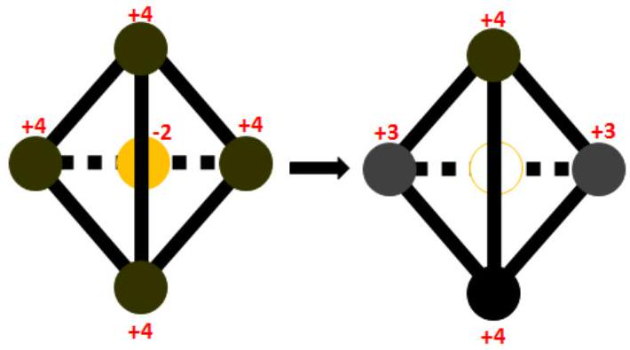
FIG. 1. Schematic of the standard picture of charge redistribution following the formation of an oxygen vacancy in $\mathrm{CeO}_{2}$. The tetrahedron of Ce atoms (black circles) with an O atom at its centre (grey (orange in colour version) circle) is shown along with the charges on these atoms in the simple ionic picture description of $\mathrm{CeO}_{2}$. The process of reduction shown by the arrow leads to a neutral O vacancy at the centre of the tetrahedron (empty circle) while two of the Ce ions have been reduced to the +3 oxidation state.

1996, Kang and Eyring developed a different framework for describing vacancy ordering based on structural elements which are derived from the conventional unit cell of $\mathrm{CeO}_{2}$ in a simple way ${ }^{19}$. As will be described in more detail later, there are thirteen of these structural elements, called modules, and they are the fundamental building blocks for all the crystal structures of the higher oxides in the Kang-Eyring fluorite-type module theory. As a result, it is possible to define what has been called a modular unit cell in which, instead of the usual atomic basis, the different modules form the basis. The value of this approach is the simplicity and elegance with which it provides insight into the superstructures observed in the reduced higher oxides in relation to the parent fluorite structure from which they are derived.

Neither crystallographic approach sought to explicitly account for the charge redistribution that occurs when an O vacancy is formed. However, as we will show, they provide useful vantage points from which to examine the problem. In contrast, the remaining two approaches in the strategy sought to specifically establish the nature and occupation of the Ce $4 f$ level in the Ce oxides and consequently, the charge redistribution that occurs when an oxygen vacancy is created. The earliest literature in this direction emerged from spectroscopists ${ }^{20}$ with their results being interpreted using either cluster models ${ }^{21}$ or the single impurity Anderson model ${ }^{22-24}$. This work investigated the occupation of the Ce $4 f$ level in the two extremal phases, $\mathrm{CeO}_{2}$ and $\mathrm{Ce}_{2} \mathrm{O}_{3}$ and it was concluded that $\mathrm{CeO}_{2}$ is mixed valence whereas $\mathrm{Ce}_{2} \mathrm{O}_{3}$ is a pure $4 f^{1}$ configuration. The result that $\mathrm{CeO}_{2}$ is mixed valence is inconsistent with the ionic description underlying the standard picture. However, the models used to interpret the spectroscopic results are not parameter-free and the conclusions drawn from them have been contested ${ }^{25}$.

Recently electronic structure calculations based of density functional theory (DFT) have been performed. In general, DFT results for $\mathrm{CeO}_{2}$ assume empty Ce $4 f$ states which is the simple ionic picture of bonding in this oxide, e.g., Ref. ${ }^{26}$. To describe vacancy formation in $\mathrm{CeO}_{2}$, the simplest case to consider is a 2 × 2 × 2 supercell of $\mathrm{CeO}_{2}$ from which a single O atom is removed. This supercell has the composition $\mathrm{Ce}_{32} \mathrm{O}_{63}\left(\mathrm{CeO}_{1.97}\right)$. As this composition does not correspond to any known phases of reduced ceria, it is customary to require the structural parameters of the relaxed structure to match those of $\mathrm{CeO}_{2}$ based on Vergard's rule ${ }^{27}$, i.e., there is a linear relationship between the lattice constant and the extent of reduction. As will be discussed in more detail in Section IV C, most of the DFT work supported the standard picture. However, the approximate functionals of DFT such as LDA, GGA, and LDA $+U$ do not appear to describe well the electronic properties of the reduced phases ${ }^{28-30}$. Furthermore, recent calculations using hybrid functionals ${ }^{31}$ and DFT $+U^{30-32}$ do not appear to support the standard picture.

As far as we know, a study of the charge distribution near bulk O vacancies in crystallographic phases of reduced cerium oxide apart from $\mathrm{Ce}_{2} \mathrm{O}_{3}$ (and the customary supercell of DFT calculations, i.e., $\mathrm{CeO}_{1.97}$ ) has not been done. Our study of the charge distribution in the well-characterized intermediate phases represents a complementary approach to answering the fundamental question of where the two electrons left behind when an O vacancy forms go. Furthermore, since no in-situ studies have been done to identify the precise phases involved in ceria-based catalysis, it is also possible that the intermediate phases may play an important role in the engineering applications of these materials.

In this study, we examine the standard picture for the oxidation and reduction in ceria described above, considering primarily two intermediate phases namely $\mathrm{Ce}_{11} \mathrm{O}_{20}$ and $\mathrm{Ce}_{7} \mathrm{O}_{12}$. A brief discussion of $\mathrm{Ce}_{6} \mathrm{O}_{11}$ is also included. We discuss this in light of our recent results on Ce site valencies obtained by an analysis of observed crystal structures using the bond valence method ${ }^{33}$. The two cases, $\mathrm{Ce}_{11} \mathrm{O}_{20}$ and $\mathrm{Ce}_{7} \mathrm{O}_{12}$, were chosen to illustrate the evolution of the charge distribution around O vacancies that occurs with reduction. Furthermore, apart from the extremal structures, namely $\mathrm{CeO}_{2}$ and $\mathrm{Ce}_{2} \mathrm{O}_{3}$, these two examples along with $\mathrm{Ce}_{3} \mathrm{O}_{5}$ were the only crystal structures of the Ce oxides for which we were able to obtain highly accurate crystallographic data to enable the type of analysis we do here.

As is discussed later, both $\mathrm{Ce}_{11} \mathrm{O}_{20}$ and $\mathrm{Ce}_{7} \mathrm{O}_{12}$ have fluorite-related crystal structures. According to Kang and Eyring, $\mathrm{Ce}_{7} \mathrm{O}_{12}$ is the limiting intermediate oxide for which any further reduction leads to loss of the fluorite structure of $\mathrm{CeO}_{2}{ }^{34}$. However, the fluorite-related $\mathrm{Ce}_{3} \mathrm{O}_{5}$ phase was recently observed in the phase diagram of the Ce-O system ${ }^{35}$. In addition to the conventional unit cells, we will generally use the Kang and Eyring structural principle of modular units to discuss O vacancy ordering in reduced ceria phases ${ }^{19|34| 36 \mid 37}$. There will be occasional references to Martin's coordination defect mode. ${ }^{1418 \mid 38}$ where this model may provide a better conceptual framework.

This paper is organized as follows: In Section II we present the crystal structures of $\mathrm{Ce}_{11} \mathrm{O}_{20}$ and $\mathrm{Ce}_{7} \mathrm{O}_{12}$ both in the conventional way as well as in the representation of the Kang-Eyring fluorite-type module theory. We show how the Kang-Eyring fluorite-type module theory helps to understand the structure of O vacancies in $\mathrm{Ce}_{11} \mathrm{O}_{20}$ and $\mathrm{Ce}_{7} \mathrm{O}_{12}$ in relation to the parent fluorite structure. In Section III, we consider the implications of our bond valence calculations for the charge distribution in the local environment of the O vacancies. Section IV discusses how our results conflict with the standard picture of charge localization in reduced ceria phases. We then make a prediction of the charge distribution to be expected in the $\mathrm{Ce}_{6} \mathrm{O}_{11}$ crystal based on the bond valence model in Section V. The possibility of direct $f-f$ coupling between neighbouring Ce sites in crystals of the Ce oxides. We assess the validity of this idea from the Harrison method of universal parameters in Section VI. Conclusions are presented in Section VII

## II. ALTERNATIVE REPRESENTATIONS OF THE CRYSTAL STRUCTURES OF CE $\mathrm{E}_{11} \mathrm{O}_{20}$ AND $\mathbf{C E}_{7} \mathbf{O}_{12}$

## A. Coordination defect model

Martin proposed describing an O vacancy in a Ce oxide crystal as a structural entity made up of 4 Ce ions and 6 O ions around the vacancy site as illustrated in Fig. $2{ }^{\underline{4118}}$. The 4 Ce ions form the first coordination shell (a tetrahedron) of the vacancy site while the 6 O atoms form the second coordination shell (an octahedron). Compared to the perfect structure of $\mathrm{CeO}_{2}$, all 4 Ce ions are displaced $0.2 \AA$ away from the vacant O site while the O atoms are shifted $0.3 \AA$ towards the vacancy. This structural unit has been called the coordination defect and it maintains its structural integrity in a crystal of the oxide (see Fig. 2). It is constructed from two types of subunits called octants, one of composition $\mathrm{Ce}_{\frac{1}{2}} \mathrm{O}$ called the $\delta$ phase and the other incorporating an $\mathrm{O}^{2}$ vacancy, the $\lambda$ phase, of composition $\mathrm{Ce}_{\frac{1}{2}}$. The exploded view in Fig. 2 (b) shows these octants and how they are arranged to form the coordination defect. This model, in its original formulation, does not explicitly account for the changes in the valences of the Ce ions and the four Ce ions which are nearest neighbours to the O vacancy in the coordination defect are implicitly identical.

## B. Modules

Soon after the elaboration of Martin's coordination defect model ${ }^{14}$, Kang and Eyring developed a simpler

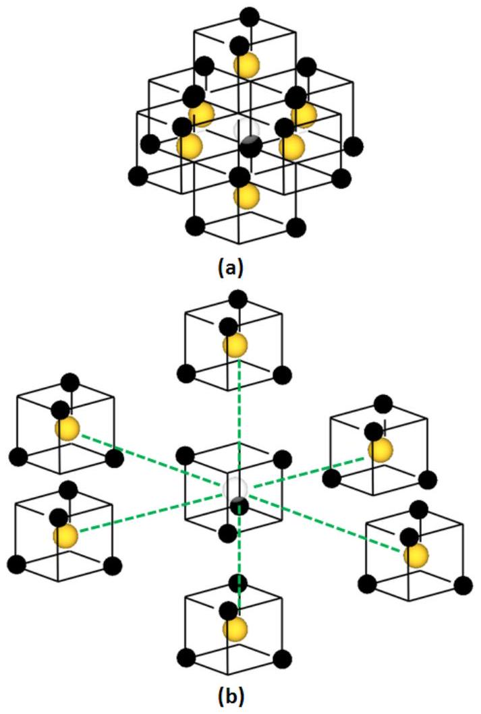
FIG. 2. (a) Coordination defect showing characteristic topology. (b) Exploded view of the coordination defect showing the central octant of what is called the " $\lambda$ phase" coordinated by six $\mathrm{M}_{\frac{1}{2}} \mathrm{O}$ octants of what is called the " $\delta$ phase". The $\lambda$ phase only differs from the $\delta$ phase in that it has an O vacancy as shown. Black circles represent Ce atoms, grey (orange in colour version) circles - O atoms and the light grey circle inside the $\lambda$ phase is an O vacancy. After Martin ${ }^{39}$.

model for constructing the crystal structures of the higher rare earth oxides, i.e., oxides from $\mathrm{Ce}_{7} \mathrm{O}_{12}$ to $\mathrm{CeO}_{2}$ based on a different set of structural elements ${ }^{19}$. These socalled modules, include the $\mathrm{CeO}_{2}$ unit cell with the rest derived from it by creating one or two O vacancies in certain prescribed ways resulting in a total of thirteen modules. These modules are the fundamental building blocks for all the higher oxides under a prescription of rules defined by the authors ${ }^{34}$. In Fig 3, we show the ten modules relevant to $\mathrm{Ce}_{11} \mathrm{O}_{20}$ and $\mathrm{Ce}_{7} \mathrm{O}_{12}$ in addition to the unit cell of $\mathrm{CeO}_{2}$. Kang and Eyring's method accounted for all the higher oxides known at the time and was successful in predicting the existence of new structures ${ }^{34}$. The Kang and Eyring method enables a relatively simple way of visualizing vacancy sites which are otherwise difficult to decipher when the structure is cast in the conventional setting of its space group. This provides considerable facility in the analysis of the local environment of the O vacancy site. As a result, we will make frequent reference to this framework in the rest of this paper.

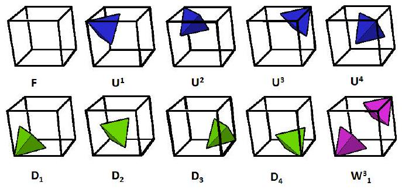
FIG. 3. The ten different modules required to build the modular unit cells of $\mathrm{Ce}_{11} \mathrm{O}_{20}$ and $\mathrm{Ce}_{7} \mathrm{O}_{12}$. The vertices of the tetrahedra denote the locations of the Ce ions surrounding an O vacancy. Module $F$ is the conventional unit cell of $\mathrm{CeO}_{2}$. Except for $W_{1}^{3}$ which has two O vacancies along the body diagonal of the $\mathrm{CeO}_{2}$ unit cell, the rest of the modules have only one O vacancy in the positions shown. [Adapted from ${ }^{34}$ ]

## C. $\mathbf{C e}_{11} \mathbf{O}_{20}$

The conventional unit cell of $\mathrm{Ce}_{11} \mathrm{O}_{20}$ is shown in Fig. 4. Note that for all ball and stick figures in this paper, the sticks between the Ce sites and the O vacancy site do not represent chemical bonds. Instead, the sticks are only included to show the geometric relationships between the atoms. The unit cell of $\mathrm{Ce}_{11} \mathrm{O}_{20}$ consists of one formula unit per unit cell with inversion as its point group symmetry. It has six Ce and ten O distinct sites along with their inversion images with the Ce(1) site as the centre of inversion. However, for a description of the vacancy structure and charge distribution in this crystal, it is convenient to view all the lattice points in the O sublattice as roughly equivalent and to divide the Ce sublattice into two regions. The first region consists of the Ce(1) and Ce(2) sites which, in the Ce sublattice, occupy the second coordination shells of the O vacancies. The remainder of the Ce atoms are the first coordination shells of the O vacancies. The crystal structure of $\mathrm{Ce}_{11} \mathrm{O}_{20}$ can be readily related to the fluorite structure of $\mathrm{CeO}_{2}$ from which it is derived by reduction. This relationship becomes clearer with the Kang-Eyring module representation. Kang and Eyring ${ }^{34}$ have shown that the modular unit cell of $\mathrm{Ce}_{11} \mathrm{O}_{20}$ has the modular composition $3 F, 4 D, 4 U$ where the module types are as given in Fig. 3. They also provided the modular sequences for the [100] and [010] directions in this crystal as $F F U^{3} U^{2} D_{3} D_{2} F U^{4} U^{1} D_{4} D_{1}$ and $F U^{3} D_{3} F U^{1} D_{1} F U^{2} D_{2} U^{4} D_{4}$ respectively. Using this information along with their module juxtaposition rules, we derived the modular sequence for the [001] direction to be $D_{1} D_{2} F F F U^{4} U^{3} U^{1} U^{2} D_{4} D_{3}$. This then enabled us to construct the 3D modular unit cell of $\mathrm{Ce}_{11} \mathrm{O}_{20}$ shown in Fig. 5. We note that this unit cell is not unique. There is only one type of O vacancy in the crystal of $\mathrm{Ce}_{11} \mathrm{O}_{20}$ and if we only consider the Ce sublattice, each O vacancy has the four Ce(3)-Ce(6) sites forming its first coordination shell. These four Ce sites form a distorted tetrahedron.

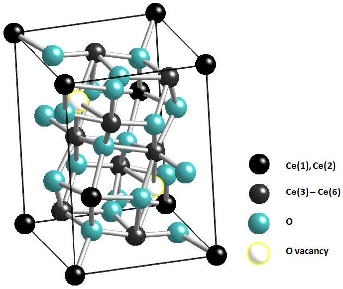
FIG. 4. The unit cell of $\mathrm{Ce}_{11} \mathrm{O}_{20}$ whose space group is $P \overline{1}$. There are six distinct Ce sites in this crystal. However, to facilitate the discussion of vacancy structures and charge distribution, the Ce sublattice has been partitioned into two types of lattice points as shown in the legend. The first set of lattice points consists of the Ce(1) and Ce(2) sites which, if we only consider the Ce sublattice, occupy the second coordination shells of the O vacancies. The second set consists of the remainder of the Ce sites and these form the first coordination shell of the O vacancies in the Ce sublattice of the crystal. There are ten distinct O sites in the crystal but for our purposes, it is convenient to treat all the O sites in the O sublattice as roughly equivalent as indicated in the legend.

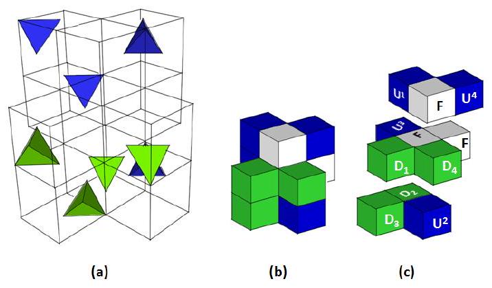
FIG. 5. The fluorite-type modular unit cell of $\mathrm{Ce}_{11} \mathrm{O}_{20}$ derived using the Kang and Eyring rules ${ }^{34}$. In (a), the modular unit cell is constructed from transparent modules to show the location of the O vacancy site as indicated by the shaded tetrahedra with the module types as identified in (c) and shown in detail in Fig. 3 A simplified block representation of the modular unit cell given in (a) is shown in (b). The exploded view with all the module types identified is given in (c). The modular composition is: top layer - $U^{1}, F, U^{4}$; middle layer - $D_{1}, D_{4}, F, F, U^{3}$; bottom layer - $D_{2}, D_{3}, U^{2}$. These figures make clear the distribution of the O vacancies within the crystal in relation to the original fluorite structure. There are large contiguous regions, modules F, where there are no O vacancies.

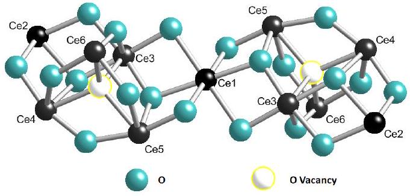
FIG. 6. The proposed vacancy cluster of $\mathrm{Ce}_{11} \mathrm{O}_{20}$ consisting of two O vacancies which are nearest neighbours and related to each other by inversion symmetry centred on the Ce(1) site. The various Ce sites are labelled as shown. The white and light grey (teal) circles represent O vacancies and various O sites respectively.

The O vac - $\mathrm{Ce}(i)$ distances are shown in Table I where $i=3,4,5,6$. The second coordination shell consists of twelve Ce sites namely, two Ce(1), four Ce(2), two Ce(3), two Ce(4) and one of each of the Ce(5) and Ce(6) sites as shown in Table I. Of these twelve Ce sites in the O vacancy's second coordination shell, only half a Ce(1) site and one Ce(2) site can be assigned to the particular O vacancy site. Thus, in total, an O vacancy in $\mathrm{Ce}_{11} \mathrm{O}_{20}$ is proportionately associated with five and half Ce sites. It is convenient to work with an integral number of Ce sites when studying the charge distribution in the local environment of an O vacancy. In order to do this, we propose to partition the lattice so that we consider a vacancy cluster consisting of two neighbouring O vacancies which can then be associated with eleven Ce sites. Since the choice of the Ce(1) site is the most difficult to establish, we pick a Ce(1) site and construct the vacancy cluster around it. A Ce(1) site has four closest O vacancies all in the third coordination shell. Two of the O vacancies are located $4.558 \AA$ away from the Ce(1) lattice point with the other two at $4.571 \AA$. Since the $\mathrm{Ce}(1)$ site is a centre of inversion, each of these pairs of O vacancies are related by inversion symmetry. We choose the pair with the shortest distance from the Ce(1) site to define the vacancy cluster consisting of two O vacancies. The cluster obtained by this procedure is illustrated in Fig. 6. This cluster should not be confused with the divacancy of $\mathrm{Ce}_{7} \mathrm{O}_{12}$ to be discussed later. The divacancy of $\mathrm{Ce}_{7} \mathrm{O}_{12}$ is a unique structural entity of the crystal arising from long-range ordering of the vacancies whereas the cluster we define here is simply an analytic convenience. It cannot be strictly considered to be specified in a unique way since the pair of O vacancies we chose is only $0.01 \AA$ closer to the Ce(1) compared to the other. On the O vacancy sublattice, each O vacancy has four nearest neighbours $6.134 \AA$ away for the first pair and $6.138 \AA$ for the second. There is no difficulty in identifying the Ce(2) site associated with each O vacancy since there is only one closest $(4.495 \AA)$ $\mathrm{Ce}(2)$ site. The distances are calculated from the crystallographic data of Kummerle and Hegel ${ }^{40}$. Zhang et al. ${ }^{41}$ suggested another useful way of viewing the crys-

TABLE I. The first- and second coordination shells of the O vacancy in the Ce sublattice of $\mathrm{Ce}_{11} \mathrm{O}_{20}$ and some selected distances between the sites. These Ce-Ce distances show that the average intra-tetrahedral separation between Ce sites $(4.2 \AA)$ is larger than the inter-tetrahedral separation $(3.9 \AA)$.
| Ce site | Distance from O vacancy, Å | Direct type | Ce-Ce | Direct Ce-Ce distance, Å |
| :--- | :--- | :--- | :--- | :--- |
| First Coordination |  |  |  |  |
| Ce(6) | 2.5106 | Ce(6)-Ce(3) | 4.169 |  |
| Ce(3) | 2.5674 | Ce(6)-Ce(4) | 4.194 |  |
| Ce(4) | 2.5817 | Ce(6)-Ce(5) | 4.207 |  |
| Ce(5) | 2.6185 | Ce(3)-Ce(4) | 4.219 |  |
|  |  | Ce(3)-Ce(5) | 4.144 |  |
|  |  | Ce(4)-Ce(5) | 4.234 |  |
| Second Coordination |  |  |  |  |
| Ce(5) | 4.3184 | $\mathrm{Ce}(1)-\mathrm{Ce}(5)$ | 3.810 |  |
| Ce(4) | 4.4140 | Ce(1)-Ce(4) | 6.904 |  |
| Ce(3) | 4.4164 | Ce(1)-Ce(3) | 3.852 |  |
| Ce(3) | 4.4341 |  |  |  |
| Ce(4) | 4.4390 |  |  |  |
| Ce(6) | 4.4438 | Ce(1)-Ce(6) | 5.561 |  |
| Ce(2) | 4.4952 | Ce(1)-Ce(2) | 7.715 |  |
| Ce(2) | 4.5265 | Ce(2)-Ce(3) | 3.873 |  |
| Ce(2) | 4.5340 | Ce(2)-Ce(4) | 3.861 |  |
| Ce(1) | 4.5579 | Ce(2)-Ce(5) | 6.860 |  |
| Ce(1) | 4.5705 | Ce(2)-Ce(6) | 5.573 |  |
| Ce(2) | 4.6007 |  |  |  |

tal structure of $\mathrm{Tb}_{11} \mathrm{O}_{20}$ which is also directly applicable to $\mathrm{Ce}_{11} \mathrm{O}_{20}$ because these compounds are isostructural. Their perspective is based on the observation that the O vacancies are more or less uniformly distributed within the crystal structure with no evidence of vacancy pairing. The vacant O sites are distributed in a way such that the separation between the defects is maximized and thus, the repulsive interactions are reduced. The Ce ions in the first coordination shell relax outward in a more or less isotropic way ( $\mathrm{Ce}-V_{O}$ ranges $2.51-2.62 \AA$, see Table I). As the vacant Ce tetrahedra expand, the regions between them experience substantial compression as indicated by the difference in the distances between the intra-tetrahedral ions $(4.2 \AA)$ and those of the intertetrahedral ions $(3.9 \AA)$. These distances are given in Table I. In this table, the intra-tetrahedral ion distances are given as the direct Ce-Ce distances in the first coordination shell while the inter-tetrahedral ion distances refer to these distances in the second coordination shell: $\mathrm{Ce}(1)-\mathrm{Ce}(5), \mathrm{Ce}(1)-\mathrm{Ce}(3) ; \mathrm{Ce}(2)-\mathrm{Ce}(3)$ and $\mathrm{Ce}(2)-\mathrm{Ce}(4)$. The inter-tetrahedral Ce ions have a coordination number of 8 as in the parent fluorite structure. In discussing the charge distribution in the local environment of the vacancy, we will notice that the charge is distributed in a manner which is distinctly different between the intratetrahedral and inter-tetrahedral Ce ions.

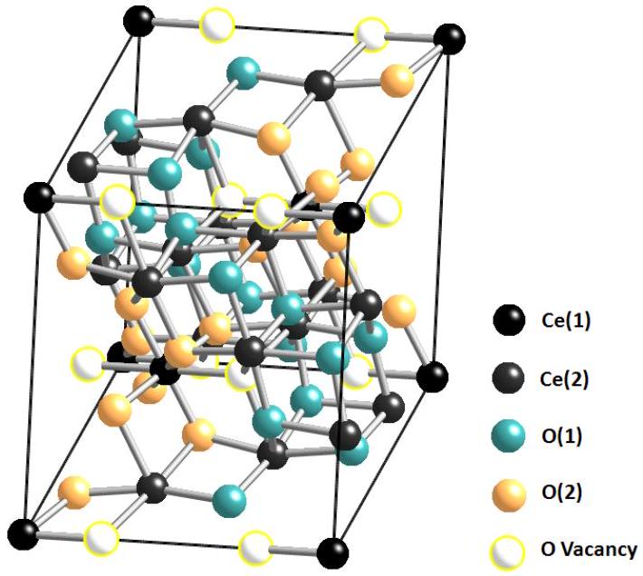
FIG. 7. The unit cell of $\mathrm{Ce}_{7} \mathrm{O}_{12}$ showing the two distinct Ce sites: Ce(1) - black and Ce(2) - dark grey. The O(1) sites are shown in grey (teal) with the O(2) light grey (orange). The $\mathrm{Ce}(1)$ and $\mathrm{Ce}(2)$ sites are of $S_{6}$ and $i$ symmetries, respectively. The O vacancy sites are shown in white. A characteristic structural unit of the $\mathrm{Ce}_{7} \mathrm{O}_{12}$ crystal is the divacancy, which consists of two O vacancy sites connected by an $S_{6}$ Ce site between them.

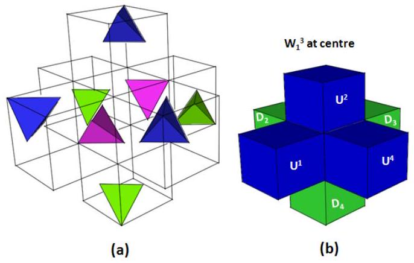
FIG. 8. (a) The modular unit cell of $\mathrm{Ce}_{7} \mathrm{O}_{12}$ showing the details of the seven modules used to construct it. Each tetrahedron represents the four Ce atoms around the oxygen vacancy. (b) A simplified model of the modular unit cell. Adapted from Kang and Eyring ${ }^{34}$.

## D. $\mathbf{C e}_{7} \mathbf{O}_{12}$

Fig. 7 shows the unit cell of $\mathrm{Ce}_{7} \mathrm{O}_{12}$ in the conventional rhombohedral setting. In the Kang-Eyring framework, the modular composition of this crystal is $D_{2}, D_{3}$, $D_{4}, W_{1}^{3}, U^{1}, U^{2}$ and $U^{434}$. The modular unit cell constructed from this basis is depicted in Fig. 8. It is readily apparent from Fig. 8 where the O vacancy sites are located. There are two types of Ce sites, Ce(1) and $\mathrm{Ce}(2)$, in the crystal lattice of $\mathrm{Ce}_{7} \mathrm{O}_{12}$ which are of $S_{6}$ and $i$ symmetry respectively ${ }^{40 \mid 42}$. These distinct sites are indicated in the conventional unit cell of Fig. 7. Al-
though Kang and Eyring did not explicitly identify the distinct sites in their modular unit cell according to their symmetries, it is apparent that by translating their unit cell in three dimensions, two distinct Ce sites are obtained; the $S_{6}$ site with two nearest neighbour O vacancies around it and the $i$ site with only one O vacancy. The $S_{6}$ site has been called the divacancy site ${ }^{34}$ and it forms a shared corner between two coordination tetrahedra of the O vacancies as illustrated in Fig. 11. We list here some interatomic distances that we will use in our analysis of the divacancy cluster: $\mathrm{Ce}(2)-\mathrm{Ce}(2)=4.09 \AA$, $\mathrm{Ce}(1)-\mathrm{Ce}(2)=4.11 \AA, \mathrm{Ce}(1)-\mathrm{O}(2)=2.19 \AA$ and for $\mathrm{Ce}(2)-$O(1), there are two relevant bond lengths, namely $2.23 \AA$ and $2.32 \AA$. The Ce-Ce distances are direct distances between these sites, not distances along the Ce-O bonds connecting them. It appears that the Ce sublattice has not changed much relative to $\mathrm{CeO}_{2}$.

It is helpful to visualize vacancy ordering in $\mathrm{Ce}_{7} \mathrm{O}_{12}$ by viewing the divacancy as a structural unit of the O vacancies in this crystal. This clarifies why the ratio of $S_{6}$ to $i$ sites is 1 : 6; all the Ce sites which are nearest neighbours to the two O vacancies forming a divacancy are of $S_{6}$ symmetry. As there are seven Ce atoms in the formula unit, the rest of the Ce atoms (six) must be the Ce(2) sites of $i$ symmetry. The formation of the divacancy structures as $\mathrm{CeO}_{2}$ is reduced to $\mathrm{Ce}_{7} \mathrm{O}_{12}$ is associated with some relaxation of the crystal lattice although the Ce sublattice remains somewhat invariant ${ }^{34}$. We now examine this relaxation process which is illustrated in Fig. 9 and based on Kummerle and Heger's neutron diffraction data ${ }^{40}$. The bond lengths in $\mathrm{CeO}_{2}$ are $2.434 \AA$ and $2.706 \AA$ for the $\mathrm{Ce}-\mathrm{O}$ and $\mathrm{O}-\mathrm{O}$ bonds respectively. When a divacancy is formed, the bonds within the divacancy relax and diffraction data show that in $\mathrm{Ce}_{7} \mathrm{O}_{12}$ the 'bond' lengths $\operatorname{arc}{ }^{40}$ : $2.505 \AA$ for $\mathrm{O}(1)-V_{O}$, $2.364 \AA$ for $\mathrm{O}(2)-V_{O}, 2.418 \AA$ for $\mathrm{Ce}(1)-V_{O}$ and $2.543 \AA$ for $\mathrm{Ce}(2)-V_{O}$. This structural data indicates that compared to $\mathrm{CeO}_{2}$, the bonds within the divacancy have changed as follows: the $\mathrm{O}(1)-V_{O}$ and $\mathrm{O}(2)-V_{O}$ ' bonds' contract by $0.20 \AA$ and $0.34 \AA$ respectively while the $\mathrm{Ce}(2)-V_{O}$ 'bond' gets longer by $0.109 \AA$. The $\mathrm{Ce}(1)-V_{O}$ 'bond' is practically unchanged, showing only a small contraction of about $0.02 \AA$. Thus, we see that, just as was the case for $\mathrm{Ce}_{11} \mathrm{O}_{20}$, the O atoms are attracted to the vacancy site while the Ce(2) atoms are repelled away so that the O atoms now become the nearest neighbours of the vacancy site. This appears to be a general feature of vacancies in rare earth higher oxides ${ }^{1434}$. We note that the six O atoms around the vacancy relax by different amounts with the O(2) atoms being more strongly attracted to the vacancy site. We also note that according to the coordination defect model, the crystal structure of $\mathrm{Ce}_{7} \mathrm{O}_{12}$ has the highest packing density of the coordination defect.

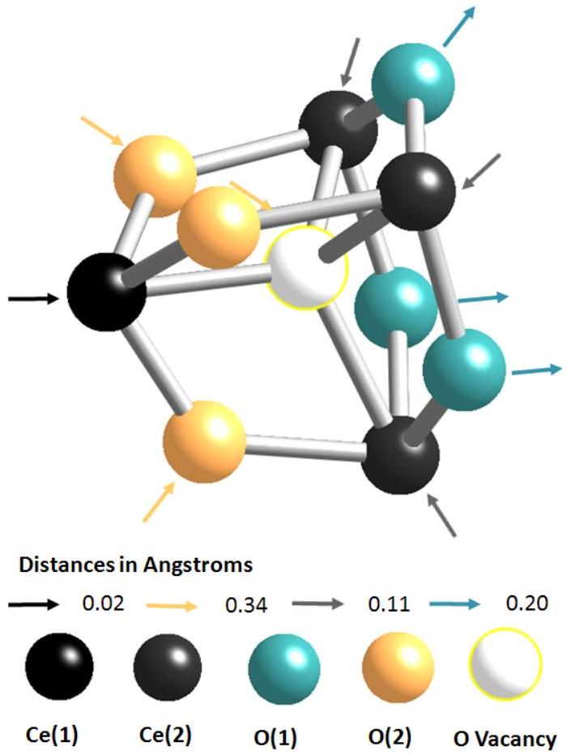
FIG. 9. The relaxation of atoms forming part of the divacancy in $\mathrm{Ce}_{7} \mathrm{O}_{12}$. The different lattice sites are indicated by the colours as follows: Ce(1) - black, Ce(2) - dark grey, O(1) - grey (teal), O(2) - light grey (orange) and the O vacancy $\left(V_{O}\right.$ ) - white. The arrows indicate the direction in which the respective atoms relax relative to the O vacancy site and the amounts by which the 'bonds' relax are shown in the legend. This figure was produced from the crystal structure determined by neutron scattering ${ }^{40}$.

## III. EXCESS ELECTRONS DELOCALISE AWAY FROM THE OXYGEN VACANCY

Having discussed the O vacancy ordering in $\mathrm{Ce}_{11} \mathrm{O}_{20}$ and $\mathrm{Ce}_{7} \mathrm{O}_{12}$ as well as proposing some vacancy clusters suitable for the analysis of charge distribution in these crystals in the previous section, we now present the results of the bond valence calculations, I, in these clusters.

## A. $\mathbf{C e}_{11} \mathbf{O}_{20}$

Fig. 10 shows the bond valence sums on the various Ce sites in the vacancy cluster of $\mathrm{Ce}_{11} \mathrm{O}_{20}$ which was introduced earlier, see Fig. 6. Clearly the charge from the vacancy does not localize on the Ce sites closest to the vacancy but rather, delocalizes onto the Ce(1) and Ce(2) sites. This contradicts the standard picture. The results of Fig. 10 can be compared with those of $\mathrm{Tb}_{11} \mathrm{O}_{20}$ with which it is isostructural. Based on a simple consideration of the crystal radii of the cations ${ }^{43}$, Zhang et al. ${ }^{41}$ suggested the following valencies for the cations: Tb(1) and

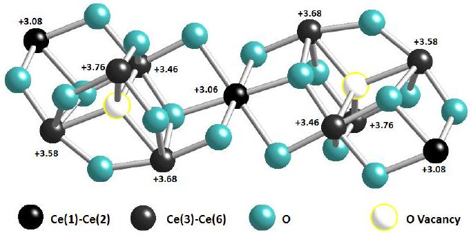
FIG. 10. Charges of the different Ce ions in the vacancy cluster of $\mathrm{Ce}_{11} \mathrm{O}_{20}$ obtained from the bond valence model. The vacancy cluster consists of two vacancies connected by the Ce(1) site which is also a centre of inversion for the cluster. The four excess electrons that arise due to the removal of the two oxygen atoms do not localise on the cerium atoms nearest the vacancies. This is contrary to the standard picture.

$\operatorname{Tb}(2)-+3, \operatorname{Tb}(3)$ and $\operatorname{Tb}(4)-+3.75, \operatorname{Tb}(5)$ and $\operatorname{Tb}(6)$ - +4. Here the numbering of the sites is the same as for $\mathrm{Ce}_{11} \mathrm{O}_{20}$ given in Fig. 6. Their assigment of the site valences qualitatively agrees well with our bond valence results for $\mathrm{Ce}_{11} \mathrm{O}_{20}$. The $\mathrm{Tb}^{3+}$ and $\mathrm{Tb}^{4+}$ ions are $f^{8}$ and $f^{7}$ configurations respectively and can be compared to the corresponding $f^{1}$ and $f^{0}$ configurations respectively for the Ce ions. They suggested the possibility of fast electron transfer between the neighbouring Tb(2) sites so that, instead of two $\mathrm{Tb}(2)^{3+}$ and one $\mathrm{Tb}(2)^{4+}$ instantaneous states, an average is obtained from the neutron diffraction data. It was suggested by the authors that the thermal ellipsoids of the atoms in $\mathrm{Ce}_{7} \mathrm{O}_{12}$ which are much higher than in $\mathrm{CeO}_{2}$ could be evidence of the dynamic disorder arising from the fast electron transfer.

## B. $\mathbf{C e}_{7} \mathbf{O}_{12}$

The charge distribution in the divacancy of $\mathrm{Ce}_{7} \mathrm{O}_{12}$ is shown in Fig. 11. This figure clearly shows that, apart from the Ce(1) site which is of a different local site symmetry compared to the Ce(2) sites, the charge delocalizes over all three of the Ce atoms closest to the vacancy. Again, this contradicts the standard picture, which has the electrons completely localise on two of the neighbouring Ce atoms.

## IV. FAILURE OF THE STANDARD PICTURE OF CHARGE LOCALISATION NEAR A VACANCY

We now discuss the above results comparing them to the standard picture and propose an alternative view of how the charge redistributes itself following O vacancy formation in ceria as deduced from the bond valence model. As already mentioned, the conventional description of the electronic processes involved during O vacancy

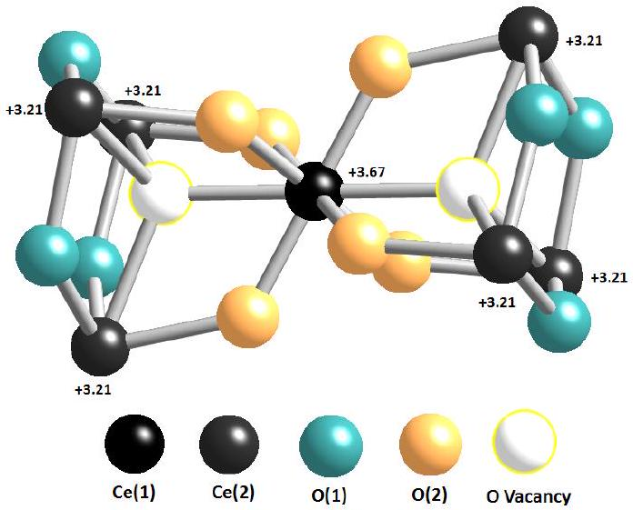
FIG. 11. The divacancy of $\mathrm{Ce}_{7} \mathrm{O}_{12}$ showing the valences of the Ce atoms calculated from the bond valence model, I. The charge delocalizes on the three Ce(1) sites of triclinic symmetry which now have a valence of +3.21.

formation requires that the excess charge at the vacant O site be shared between two of the four Ce ions which form the first coordination shell of the vacancy. This means that the tetrahedron formed by the four Ce ions around the O vacancy consists of two $\mathrm{Ce}^{3+}$ and two $\mathrm{Ce}^{4+}$ ions. This description is based on the ionic model for these oxides although Kang and Eyring do indicate that there may be some covalent character in these oxides ${ }^{34}$.

## A. $\mathbf{C e}_{11} \mathbf{O}_{20}$

If we assume that the four electrons which are left when the two O vacancies are formed are localized within the cluster, then we can describe how the charge redistributes itself. In fact, from the bond valence results, which also showed mixed valence in $\mathrm{CeO}_{2}$, the valence of Ce in $\mathrm{CeO}_{2}$ is +3.73 and the corresponding valence of O is -1.87. A description of vacancy formation in $\mathrm{CeO}_{2}$ to form $\mathrm{Ce}_{11} \mathrm{O}_{20}$ can then be illustrated in the bond valence model as shown in Fig. 12. Thus, according to the mixed valence description of the $\mathrm{CeO}_{2}$ crystal from the bond valence model (see Fig. 12(a)), when an O vacancy is created in $\mathrm{CeO}_{2}$, a charge of -1.87 is left behind as opposed to a charge of -2.0 in the ionic picture. This then means that, if we consider the vacancy cluster of Fig. 10 and equivalently, Fig. 12(b), the creation of the two O vacancies leaves a total charge of -3.74 in the cluster. From Fig. 10, we can see that compared to their original valences in $\mathrm{CeO}_{2}$, the valences of $\mathrm{Ce}(5)$ and Ce(6) are virtually unchanged. Thus, considering the change in the valences of the remainder of the Ce sites, the total charge accummulation on the Ce sites in the cluster is -2.87. There is therefore a discrepancy of ~ -1 between the total extra charge in the $\mathrm{Ce}_{11} \mathrm{O}_{20}$ crystal inferred from the bonding in $\mathrm{CeO}_{2}$ (i.e. -3.74) and that directly calculated for this crystal by the bond

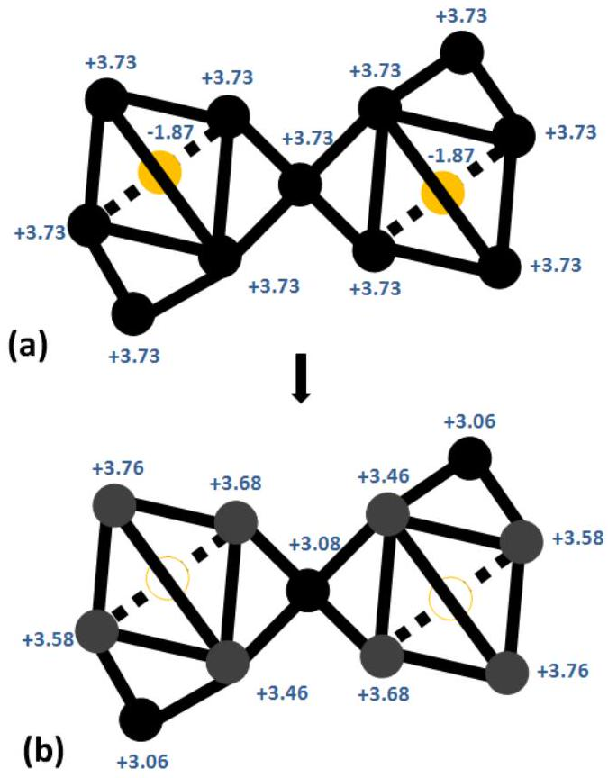
FIG. 12. A schematic to illustrate the formation of $\mathrm{Ce}_{11} \mathrm{O}_{20}$ from $\mathrm{CeO}_{2}$ through vacancy formation in the O sublattice. In (a), a part of the $\mathrm{CeO}_{2}$ lattice, which, after removing the two O atoms (light grey (orange) circles), gives a cluster corresponding to the one given in Fig. 6 Also note that compared to Fig. 6, here we have made the further simplification of replacing all the Ce-O-Ce bonds with direct Ce-Ce bonds except for the two O atoms which are subsequently removed to create vacancies. For these two atoms, no bonding detail is given in the schematic except that we place each of them at the centre of a regular Ce tetrahedron reflecting their coordination environment in $\mathrm{CeO}_{2}$. The numbers shown at the atomic sites are the valences of the respective atoms as determined by the bond valence method ${ }^{33}$, and Fig. 10. In (b), the cluster of (a) after reduction to create the two O vacancies (empty circles). The colours in this figure denote the following: black circles - Ce sites which are not nearest neighbours to any O vacancies, grey circles - Ce atoms which are the nearest neighbours of at least one O vacancy, light grey (orange) circles - O atoms and empty circles - O vacancies.

valence calculations (-2.87). This discrepancy is entirely consistent with the accuracy of the bond valence model reported in I although we note that the accounting of charge we have done here from $\mathrm{CeO}_{2}$ to $\mathrm{Ce}_{11} \mathrm{O}_{20}$ is very simplistic. It ignores the many-body effects which may follow the injection of extra charge at the Ce sites when the O vacancies are created. Such an extra charge may change the degree of mixing between the Ce 4f- and the O $2 p$ states in manner that may not be related in a simple way to their state in $\mathrm{CeO}_{2}$. It may happen that, for instance, due to a change in the hybridization of Ce 4f-and the O $2 p$ states, the extra charge may not be confined to the Ce 4f as we assumed in calculating the discrepancy in the total charge, but rather, some of the charge

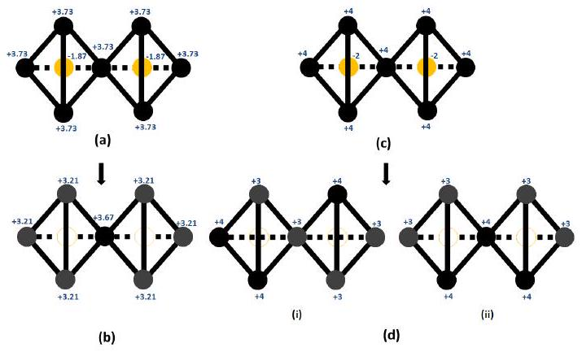
FIG. 13. Schematic illustrating the charge distribution following divacancy formation, based on a bond valence sum analysis of the crystal structures of $\mathrm{CeO}_{2}$ and $\mathrm{Ce}_{7} \mathrm{O}_{12}$. (a) Part of the $\mathrm{CeO}_{2}$ lattice showing two neighbouring O atoms (light grey (orange) circles), each inside a tetrahedron of Ce atoms (black circles). The numbers shown are the bond valence sums for each of the atoms. When the two neigbouring O atoms are removed due to the reduction of $\mathrm{CeO}_{2}$, the divacancy of $\mathrm{Ce}_{7} \mathrm{O}_{12}$ is formed as shown in (b). The bond valence sums on the Ce sites of triclinic symmetry (grey circles) have decreased from +3.73 in $\mathrm{CeO}_{2}$ to +3.21 reflecting the presence of the additional charge left behind when the two O atoms are removed. The bond valence sum on the $S_{6}$ Ce site is virtually unchanged.

may go into the O valence band. It is expected that the results in Fig. 10 would capture these many-body effects. An important point from the results of Fig. 10 is that -1.99 (~ 70\%) of the total charge of -2.87 goes to the three Ce atoms in the second coordination shell with the remainder being shared among the eight Ce atoms in the first coordination shell.

If one just considers the cation sublattice, it is evident that the charge accumulates in regions of high strain (inter-tetrahedral Ce ions) where the Ce-Ce distances are slightly shorter compared to the intra-tetrahedral case. This led some authors to consider the possibility that there may be some direct $f-f$ hopping in these dense regions ${ }^{41}$. As we will discuss in Section VI for the case of $\mathrm{Ce}_{7} \mathrm{O}_{12}$, direct $f-f$ hopping appears unlikely in these oxides.

## B. $\mathbf{C e}_{7} \mathbf{O}_{12}$

Based on the results of Fig. 11, we can now discuss the electronic features of the local environment of the O vacancy in $\mathrm{Ce}_{7} \mathrm{O}_{12}$. The formation of the $\mathrm{Ce}_{7} \mathrm{O}_{12}$ divacancy from the $\mathrm{CeO}_{2}$ crystal lattice according to the BVM is schematically illustrated in Fig. 13(a) and (b). It can be seen that two corner-sharing Ce tetrahedra of $\mathrm{CeO}_{2}$ lose an O atom each from the centre of the tetrahedron. Our bond valence calculations show that the valences of the Ce(1) and Ce(2) sites in $\mathrm{Ce}_{7} \mathrm{O}_{12}$ are +3.67 and +3.21 respectively. The valence at the Ce(1) site is comparable to the value of +3.73 calculated for Ce in $\mathrm{CeO}_{2}$ using a
bond valence method analysis of the crystal structure. If we use the Kang and Eyring modular unit cell with its 8 O vacancies, $4 \mathrm{Ce}(1)$ and $24 \mathrm{Ce}(2)$ sites and further assume that we start from mixed-valence $\mathrm{CeO}_{2}$ where the valences are +3.73 and -1.87 for the Ce and O sites respectively, we can get some estimate of how the excess charge on the O vacancy sites is distributed in the modular unit cell. The valence of the Ce(1) sites does not change much from its value before the O vacancy is created. Thus, virtually all the charge left at the vacancy site by an O atom is evenly distributed within the first coordination shell of the vacancy site among the (three) $\mathrm{Ce}(2)$ sites. On this basis and only considering a simple analysis using the bond valence results for $\mathrm{CeO}_{2}$, the valence at the Ce(2) sites is then readily calculated to be +3.11 (i.e., 3.73-1.87/3) which is comparable to the independently calculated value of +3.21 within the error bounds (±0.1) of the method. That the excess charge is not distributed evenly among all four of the Ce atoms in the first coordination shell contradicts the standard picture. If the charge was evenly distributed among all four Ce atoms, the valences would be +2.79 and +3.26 for the $S_{6}$ and $i$ sites respectively.

The above picture from the BVM can be contrasted with standard picture description of the same process as illustrated in Fig. 13(c) and (d). Here, there are two ways one could assign the valences of the Ce sites in the divacancy. One way is to assign valences of +4 to three of the $i$ sites, two on the first tetrahedron and one on the second. The remainder of the Ce sites are then assigned the valence of +3 as illustrated in Fig. 13(d)(i). An alternative arrangement of the charges is illustrated in Fig. 13(d)(ii). Here, the three +4 valences are assigned one each to one of the $i$ sites from the first and second tetrahedra with the third being assigned to the $S_{6}$ site.

## C. Comparison with calculations based on Density Functional Theory

Most DFT calculations (performed in the supercell of composition $\mathrm{Ce}_{32} \mathrm{O}_{63}$ ) characterizing the location and character of the excess charge near bulk O vacancies concluded that the charge localizes on two of the nearest neighbour Ce ions ${ }^{1215|16| 26|28| 44 \mid 46}$. This is what we have called the standard picture. It appears that this picture was first brought into question by Castleton et al. ${ }^{30}$ in a paper where the question of charge localization was extensively explored. They concluded that it wasn't possible to fully localize the Ce $4 f$ electrons on these Ce sites in the $\mathrm{DFT}+U$ framework while at the same time preserving a correct description for all the other electrons. We are not aware of any subsequent DFT+U reports directly addressing this question in the conventional supercell. The more recent work used a periodic electrostatic embedded cluster method (PEECM) ${ }^{47}$. This work found that the charge preferred to localize well away from the O vacancy, being on Ce sites of the third coordination shell. As this shell coincided with the boundary of the quantum mechanical part of the cluster used in the calculation, the authors raised the possibility that the result may be an artifact of the method.

We also note that Burow et al. ${ }^{47}$ obtained three different Ce-Ce distances of 4.07, 4.12 and $4.20 \AA$ in the first coordination shell. These distances are shorter than those reported in Table I for the vacancy cluster of $\mathrm{Ce}_{11} \mathrm{O}_{20}$. However, since the structures in question are different, one should be cautious about such comparisons.

Our results are also in agreement with some recent reports on the location and localization of the excess electrons for surface and subsurface O vacancies ${ }^{3132}$. These authors argued that the localization of charge on next nearest neighbour Ce sites was mainly controlled by the lattice relaxation due to electrostatics as reflected in the lowering of the Madelung potential. However, it should be remarked that a bulk O vacancy is in a different coordination environment relative to either a surface or subsurface O vacancy. It is therefore possible that the comparison between our results for bulk O vacancies and those reported for surface/subsurface O vacancies may not be simple. Indeed, some authors have reported differences in the location of the charge between surface/subsurface and bulk O vacancies ${ }^{47}$. Nevertheless, it is interesting to note that, until these more recent results, the standard picture was considered applicable to surface and subsurface O vacancies as well ${ }^{16,45,48}$.

## V. PREDICTED CHARGE DISTRIBUTION IN $\mathbf{C E}_{6} \mathbf{O}_{11}$

We make a few remarks about a possible charge distribution around the O vacancies in this crystal whose unit cell is shown in Fig. 14 Complete crystal structure data is not available but we make predictions of the charge distribution to be expected in this crystal from a generalization of the bond valence results of $\mathrm{Ce}_{7} \mathrm{O}_{12}$ and $\mathrm{Ce}_{11} \mathrm{O}_{20}$. The proposed vacancy cluster for studying the charge distribution in the local environment of the oxygen vacancy in this crystal is shown in Fig. 15. We did not find a full crystallographic characterization of this crystal and therefore it is not possible to perform accurate bond valence calculations for it. The results reported in I for this crystal were based on the positional parameters of $\mathrm{Pr}_{6} \mathrm{O}_{11}$. If one were to accept these results (Table I of I), then since $\mathrm{Ce}(1), \mathrm{Ce}(2), \mathrm{Ce}(3)$ and Ce (4) coordinate the O vacancy with Ce(5) and Ce(6) in the second coordination shell for the Ce sublattice, we see that the charge distribution does not quite follow the pattern one would expect from the results obtained for $\mathrm{Ce}_{11} \mathrm{O}_{20}$ and $\mathrm{Ce}_{7} \mathrm{O}_{12}$. The overall charge in the vacancy cluster is larger by about $\sim-1.2$ compared to what one would expect starting from mixed valence $\mathrm{CeO}_{2}$. This discrepancy is twice what we found in the case of $\mathrm{Ce}_{11} \mathrm{O}_{20}$ if the discrepancies are normalized to the total number of Ce sites in each vacancy cluster. As a result, the three

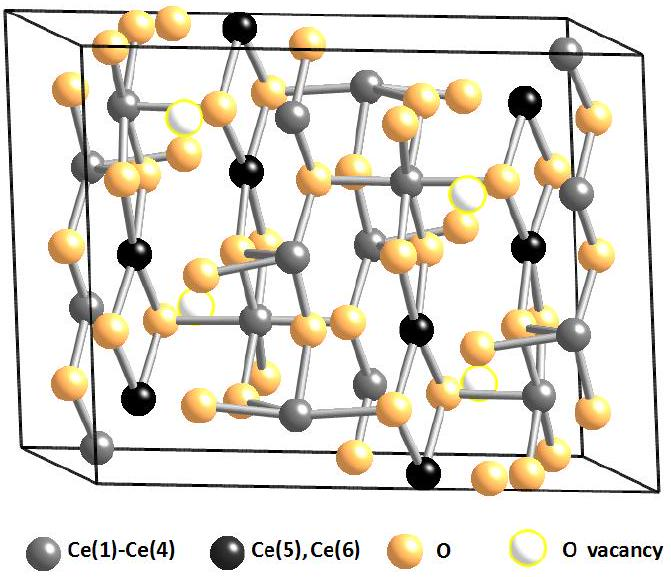
FIG. 14. The unit cell of $\mathrm{Ce}_{6} \mathrm{O}_{11}$ which consists of four formula units. The Bravais lattice is monoclinic and of space group $P 2_{1} / c$.

Ce sites Ce(1), Ce(2) and Ce(3) which one would expect to have valences close to +3.7 have much lower valences. We do not believe that this is the correct charge distribution in the local environment of the O vacancy for this crystal. Instead, we prefer to extrapolate the argument which emerges from the bond valence results of $\mathrm{Ce}_{11} \mathrm{O}_{20}$ and $\mathrm{Ce}_{7} \mathrm{O}_{12}$. Doing so leads to the prediction that the correct charge distribution for this crystal should be as illustrated in Fig. 15 where all the charge goes to the two Ce sites in the second coordination shell i.e. Ce(5) and $\mathrm{Ce}(6)$. Of the known crystal structures of the reduced higher oxides of ceria, $\mathrm{Ce}_{6} \mathrm{O}_{11}$ is the closest to the customary supercell used in DFT in that it is the least reduced. The prediction we have made here would suggest that, except in an artificial way, it should not be possible to localize the electrons from the O vacancy site in the first coordination shell for the customary supercell used in DFT for studying this problem. An experiment giving the full crystallographic data for this phase would help resolve this question.

## VI. DELOCALISATION VIA $f-p$ HYBRIDISATION

The possibility of the direct hopping of electrons between $f$-orbitals on neighbouring Ce sites has been suggested to explain the charge distribution in reduced ceria phases ${ }^{41}$. We briefly explore this suggestion considering the example of $\mathrm{Ce}_{7} \mathrm{O}_{12}$. There are two immediate questions one may like to answer about the charge distribution obtained for this phase from the bond valence calculations. First, how does an $f$-electron delocalize among the Ce(2) sites? Is this through direct $f-f$ hopping or through the more indirect two-step process of $f-p$ hopping which involves an O site bonded to both Ce sites? Second, why does this delocalization of the charge not

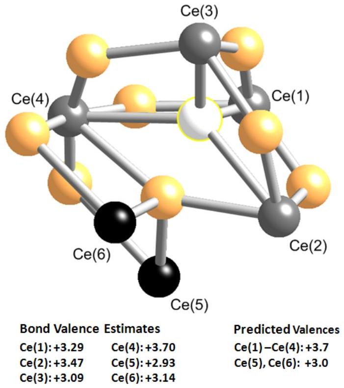
FIG. 15. The proposed vacancy cluster of $\mathrm{Ce}_{6} \mathrm{O}_{11}$ consisting of the six Ce sites as shown. The sites Ce(1) - Ce(4) are in the first coordination shell of the O vacancy and are coordinated to 7 O atoms. The Ce(5) and Ce(6) sites are in the second coordination shell and have the full 8-coordination of the Ce site in $\mathrm{CeO}_{2}$. Bond valence sums are listed for each of these Ce sites as estimated from the positional parameters of $\mathrm{Pr}_{6} \mathrm{O}_{11}$ and taken from I. We also show the site valences we predict from a generalization of the bond valence results of $\mathrm{Ce}_{7} \mathrm{O}_{12}$ and $\mathrm{Ce}_{11} \mathrm{O}_{20}$.

extend to include the Ce(1) which is also in the same first coordination shell of the O vacancy? We are not in a position to give a detailed answer to these questions in the present paper but only some preliminary indications based on Harrison's method of universal parameters ${ }^{49}$. We do not believe that the delocalization of the $f$-level charge between the Ce(2) sites is a result of direct $f-f$ coupling between these sites.

We now consider the two relevant cases, i.e., direct $f-f$ hopping between neighbouring Ce sites and the indirect $f-p$ hopping which involves an O site between the Ce sites in question. In each of these cases, we consider two situations: electron hopping between two Ce(2) sites which delocalizes the charge between these sites and the electron hopping between a Ce(2) and a Ce(1) site which could also delocalize the charge between these sites.

For the case of direct $f-f$ coupling, the relevant distances are: $\mathrm{Ce}(1)-\mathrm{Ce}(2)-4.11 \AA$. These distances are quite comparable and they give the same direct $f-f$ hopping matrix element, $t_{f f}$, be estimated ${ }^{4950}$ to be about 0.01 eV. This matrix element is the most favourable of all the four nonvanishing $f-f$ matrix elements and represents a $\sigma-\sigma$ interaction between the two orbitals. This result would suggest that, if direct $f-f$ coupling were the dominant mechanism of charge delocalization, then
charge would delocalize over all four Ce atoms which are nearest neighbours to the O vacancy.

In the case of $f-p$ hopping, we again, consider two cases: hopping along the $\mathrm{Ce}(1)-\mathrm{O}(2)-\mathrm{Ce}(2)$ bonds which we designate 'O(2) hopping' and the 'O(1) hopping which occurs along Ce(2)-O(1)-Ce(2). For O(2) hopping, the respective matrix elements, $t_{f p}$, for electron hopping between Ce(1) and O(2) as well as O(2) and Ce(2) are ${ }^{49 \mid 51}$ 0.67 and 0.46 eV. These matrix elements refer to a $\sigma$ -$\sigma$ interaction between the two orbitals which are the more favourable of the two nonvanishing matrix elements. Since, for $f-p$ hopping to couple $f$ states between two Ce sites, a two-step process involving the hopping of an $f$-electron from one Ce(2) site to an O $2 p$ level followed by the hopping of an electron from the $\mathrm{O} 2 p$ to the 4f-level of the other Ce(2) site is required, the overall matrix element for O(2) hopping, $t_{\text {eff }}$, becomes 0.15 eV calculated from Eq. (3).

$$
t_{e f f}=\frac{t_{f p}^{2}}{\varepsilon_{f}-\varepsilon_{p}}
$$

Where we have assumed that the energy gap between the Ce $4 f$ - and the O $2 p$ levels, $\varepsilon_{f}-\varepsilon_{p}$, is $\sim 2 \mathrm{eV}^{\underline{30}}$. The corresponding matrix elements for O(1) hopping 0.50, 0.61 and 0.15 eV respectively. We see that the overall matrix element, $t_{\text {eff }}$, is the same in the two cases. Again, this would suggest that the charge should completely delocalize over all the Ce sites in the divacancy which contradicts the results of the bond valence method. Thus, we conclude that the Harrison parameters cannot fully explain the charge delocalization in the $\mathrm{Ce}_{7} \mathrm{O}_{12}$ divacancy. However, they appear to exclude the possibility of direct $f-f$ hopping since $t_{\text {eff }}$ is an order of magnitude larger than $t_{f f}$. These approximate results give some indication of why the charge delocalization may not extend to include the Ce(1) site. An alternative way of looking at the indirect $f-f$ coupling is to view it as a hybridization of the $4 f$ states at the two $\mathrm{Ce}(2)$ sites and the $\mathrm{O} 2 p$ states at the O atom connecting them through Ce-O bonds. This indirect coupling is analogous to the superexchange mechanism first discussed by McConnell ${ }^{52}$.

## VII. CONCLUSIONS AND FUTURE DIRECTIONS

The goal of this review was to answer the question: when an oxygen atom is removed from bulk cerium oxide where do the two excess electrons go? The approach taken was to consider high resolution crystal structures of $\mathrm{Ce}_{11} \mathrm{O}_{20}$ and $\mathrm{Ce}_{7} \mathrm{O}_{12}$ and see how they could be viewed as ordered arrays of oxygen vacancies in an underlying $\mathrm{CeO}_{2}$ crystal. The charge distribution in the local environments of the O vacancies can then be deduced from the bond valence model. An important conclusion is that the results are incompatible with the widely accepted standard picture of charge localization on two cerium ions next to the vacancy. Instead, we found that the charge distributes itself predominantly in the second coordination shell of cerium ions. Furthermore, one excess electron can be delocalised over more than one cerium ion.

Our conclusions concerning the charge distribution near oxygen vacancies are significant for several reasons. First, they contradict many (but not all) atomistic simulations based on density functional theory. Second, the actual charge distribution around the defect has important implications for the other questions we posed at the beginning of this review. The charge distribution has a significant effect on the relative stability of surface and subsurface vacancies ${ }^{31}$. Also, if the charge around oxygen surface and subsurface vacancies is not simply localised on Ce ions next to the vacancy this could change our understanding of the catalytic activity of these surfaces since it has been claimed or assumed that it is associated with $\mathrm{Ce}^{3+}$ ions at the surface. ${ }^{16 \mid 53)}$ The charge distribution around the vacancies has implications for electronic and ionic conduction, a subject we have discussed elsewhere ${ }^{54}$.

Since our determination of the charge distribution around vacancies is indirect it will be important to see whether the same conclusions are obtained on experiments on these higher order oxides with complementary probes such as Electron Spin Resonance (ESR), nuclear magnetic resonance, and photoemission spectroscopies. For example, ESR spectra should quite be distinct for the standard picture of electrons localised onto $\mathrm{Ce}^{3}+$ ions and our alternative picture of partial delocalisation over the second co-ordination shell and unique charge (and spin) distributions associated which single vacancies and divacancies.

A variety of spectroscopic probes have shown that the formation of oxygen vacancies is also associated with next electronic states located in energy between the valence band of nominally "oxygen 2p" states and the "localised 4f" states. ${ }^{55156}$ DFT-based calculations which do not sufficiently include the effect of electronic correlations fail to produce these states. ${ }^{29}$ Generally the energy of defect states is correlated with the extent of electron localisation around defects. Hence, we suggest that spectroscopic studies of ordered phases of higher order oxides could be a fruitful approach to characterising the electronic properties of defects and complementary to the structural approach we have reviewed. We expect that the energies of the electronic states associated with each of the vacancies we have considered will be different and correlated with the extent of charge delocalisation that we find. Such experimental results will provide significant constraints on theories.

This review only considered bulk cerium oxides. However, we believe our approach to characterising electronic properties of oxygen vacancies in terms of a bond valence sum analysis and the physical insights gained should also be fruitful in the study of surface defects and to other widely studied oxidessuch as those of titanium, hafnium, vanadium, and zirconium.

## VIII. ACKNOWLEDGEMENTS

This work was supported by the Australian Research Council. E.S. was supported by an Australian Commonwealth Government International Postgraduate Research Scholarship and a University of Queensland International Postgraduate Research Scholarship. He also received a School of Mathematics and Physics Postgraduate Travel Scholarship and a Travel award from the Australian Research Council Nanotechnology Network. We have benefited from discussions with A. Jacko, B.J. Powell, S. Olsen, D. Sholl, J. Reimers, N.S. Hush, W. Soboyejo, and G. Palenik.
${ }^{1}$ High-temperature Solid Oxide Fuel Cells: Fundamentals, Design and Applications, edited by S. C. Singhal and K. Kendall (Elsevier Advanced Technology, UK, 2003).
${ }^{2}$ H. Inaba and H. Tagawa, Solid State Ionics 83, 1 (1996).
${ }^{3}$ B. C. H. Steele, Solid State Ionics 129, 95 (2000).
${ }^{4}$ V. V. Kharton, F. M. Figueiredo, L. Navarro, E. N. Naumovich, A. V. Kovalevsky, A. A. Yaremchenko, A. P. Viskup, A. Carneiro, F. M. B. Marques, and J. R. Frade, J. Mater. Sci. 36, 1105 (2001).
${ }^{5}$ D.-E. Zhang, X.-J. Zhang, X.-M. Ni, J.-M. Song, and H.-G. Zheng, ChemPhysChem 7, 2468 (2006).
${ }^{6}$ Catalysis by Ceria and Related Materials, edited by A. Trovarelli (Imperial College Press, London, 2002) pp. 15-50.
${ }^{7}$ J. H. Blank, J. Beckers, P. F. Collignon, and G. Rothenberg, ChemPhysChem 8, 2490 (2007).
${ }^{8}$ H.-T. Chen, Y. M. Choi, M. Liu, and M. C. Lin, ChemPhysChem 8, 849 (2007).
${ }^{9}$ L. Mo, X. Zheng, and C.-T. Yeh, ChemPhysChem 6, 1470 (2005).
${ }^{10}$ D. J. Fray, in Encyclopedia of Materials: Science and Technology, edited by K. H. J. Buschow, R. W. Cahn, M. C. Flemings, B. I. (print), E. J. Kramer, S. Mahajan, , and P. V. (updates) (Elsevier, Oxford, 2001) pp. 8726-8730.
${ }^{11}$ P. Jasinski, T. Suzuki, and H. U. Anderson, Sens. Actuators, B 95, 73 (2003).
${ }^{12}$ P. R. L. Keating, D. O. Scanlon, and G. W. Watson, J. Phys.: Condens. Matter 21, 405502 (2009).
${ }^{13}$ Y. Q. Song, H. W. Zhang, Q. H. Yang, Y. L. Liu, Y. X. Li, L. R. Shah, H. Zhu, and J. Q. Xiao, J. Phys.: Condens. Matter 21, 125504 (2009).
${ }^{14}$ B. F. Hoskins and R. L. Martin, Aust. J. Chem. 48, 709 (1995).
${ }^{15}$ N. V. Skorodumova, S. I. Simak, B. I. Lundqvist, I. A. Abrikosov, and B. Johansson, Phys. Rev. Lett. 89, 166601 (2002).
${ }^{16}$ F. Esch, S. Fabris, L. Zhou, T. Montini, C. Africh, P. Fornasiero, G. Comelli, and R. Rosei, Science 309, 752 (2005).
${ }^{17}$ F. A. Kroger and H. J. Vink, Solid State Physics 3, 307 (1956).
${ }^{18}$ R. L. Martin, J. Chem. Soc., Dalton Trans., 1335(1974).
${ }^{19}$ Z. C. Kang, J. Zhang, and L. Eyring, Z. anorg. allg. Chem. 622, 465 (1996).
${ }^{20}$ G. Thornton and M. J. Dempsey, Chem. Phys. Lett. 77, 409 (1981).
${ }^{21}$ A. Fujimori, Phys. Rev. B 28, 2281 (1983).
${ }^{22}$ A. Kotani, H. Mizuta, T. Jo, and J. C. Parlebas, Solid State Commun. 53, 805 (1985).
${ }^{23}$ A. Kotani, T. Jo, and J. C. Parlebas, Adv. Phys. 37, 37 (1988).
${ }^{24}$ A. Kotani, Eur. Phys. J. B 47, 3 (2005).
${ }^{25}$ T. K. Sham, R. A. Gordon, and S. M. Heald, Phys. Rev. B 72, 035113 (2005).
${ }^{26}$ N. V. Skorodumova, R. Ahuja, S. I. Simak, I. A. Abrikosov, B. Johansson, and B. I. Lundqvist, Phys. Rev. B 64, 115108 (2001).
${ }^{27}$ M. Mogensen, N. M. Sammes, and G. A. Tompsett, Solid State Ionics 129, 63 (2000).
${ }^{28}$ S. Fabris, S. de Gironcoli, S. Baroni, G. Vicario, and G. Balducci, Phys. Rev. B 71, 041102 (2005).
${ }^{29}$ M. V. Ganduglia-Pirovano, A. Hofmann, and J. Sauer, Surf. Sci. Rep. 62, 219 (2007).
${ }^{30}$ C. W. M. Castleton, J. Kullgren, and K. Hermansson, J. Chem. Phys. 127, 244704 (2007).
${ }^{31}$ M. V. Ganduglia-Pirovano, J. L. F. D. Silva, and J. Sauer, Phys. Rev. Lett. 102, 026101 (2009).
${ }^{32}$ H.-Y. Li, H.-F. Wang, X.-Q. Gong, Y.-L. Guo, Y. Guo, G. Lu, and P. Hu, Phys. Rev. B 79, 193401 (2009).
${ }^{33}$ E. Shoko, M. F. Smith, and R. H. McKenzie, Phys. Rev. B 79, 134108 (2009).
${ }^{34}$ Z. C. Kang and L. Eyring, Aust. J. Chem. 49, 981 (1997).
${ }^{35}$ M. Zinkevich, D. Djurovic, and F. Aldinger, Solid State Ionics 177, 989 (2006).
${ }^{36}$ Z. C. Kang and L. Eyring, J. Alloys Compd. 275-277, 30 (1998).
${ }^{37}$ C. Lopez-Cartes, J. A. Perez-Omil, J. M. Pintado, J. J. Calvino, Z. C. Kang, and L. Eyring, Ultramicroscopy 80, 19 (1999).
${ }^{38}$ D. J. M. Bevan and R. L. Martin, J. Solid State Chem. 181, 2250 (2008).
${ }^{39}$ R. L. Martin, . Chem. Soc., Dalton Trans., 3659(1997).
${ }^{40}$ E. A. Kummerle and G. Heger, J. Solid State Chem. 147, 485 (1999).
${ }^{41}$ J. Zhang, R. V. Dreele, and L. Eyring, J. Solid State Chem. 104, 21 (1993).
${ }^{42}$ S. P. Ray and D. E. Cox, J. Solid State Chem. 15, 333 (1975).
${ }^{43}$ R. D. Shannon, Acta Crystallogr. , Sect. A 32, 751 (1976).
${ }^{44}$ G. Kresse, P. Blaha, J. L. F. D. Silva, and M. V. Ganduglia-Pirovano, Phys. Rev. B 72, 237101 (2005).
${ }^{45}$ M. Nolan, J. E. Fearon, and G. W. Watson, Solid State Ionics 177, 3069 (2006).
${ }^{46}$ D. A. Andersson, S. I. Simak, B. Johansson, I. A. Abrikosov, and N. V. Skorodumova, Phys. Rev. B 75, 035109 (2007).
${ }^{47}$ A. M. Burow, M. Sierka, J. Döbler, and J. Sauer, J. Chem. Phys. 130, 174710 (2009).
${ }^{48}$ S. Torbrugge, M. Reichling, A. Ishiyama, S. Morita, and O. Custance, Phys. Rev. Lett. 99, 056101 (2007).
${ }^{49}$ W. A. Harrison, Elementary Electronic Structure (World Scientific, 2004) p. 607.
${ }^{50}$ W. A. Harrison, Phys. Rev. B 28, 550 (Jul 1983).
${ }^{51}$ W. A. Harrison and G. K. Straub, Phys. Rev. B 36, 2695 (Aug 1987).
${ }^{52}$ H. M. McConnell, J. Chem. Phys. 35, 508 (1961).
${ }^{53}$ C. T. Campbell and C. H. F. Peden, Science 309, 713 (2005).
${ }^{54}$ E. Shoko, M. F. Smith, and R. H. McKenzie, arXiv:0910.0669v2 [cond-mat.str-el](2009).
${ }^{55}$ D. R. Mullins, P. V. Radulovic, and S. H. Overbury, Surf. Sci. 409, 307 (1998).
${ }^{56}$ M. A. Henderson, C. L. Perkins, M. H. Engelhard, S. Thevuthasan, and C. H. F. Peden, Surf. Sci. 526, 1 (2003), ISSN 0039-6028.

