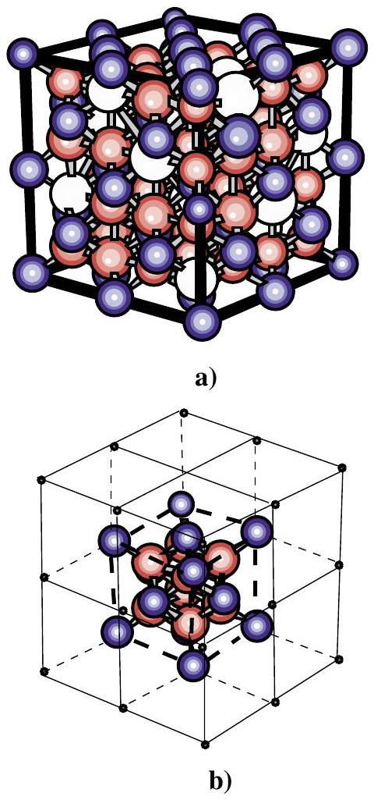
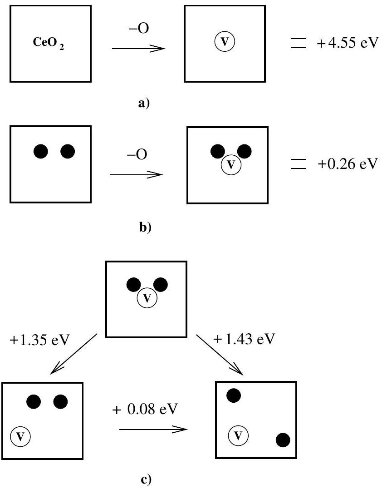
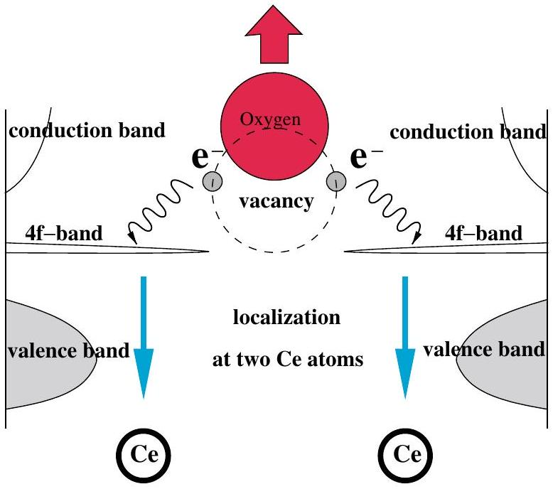
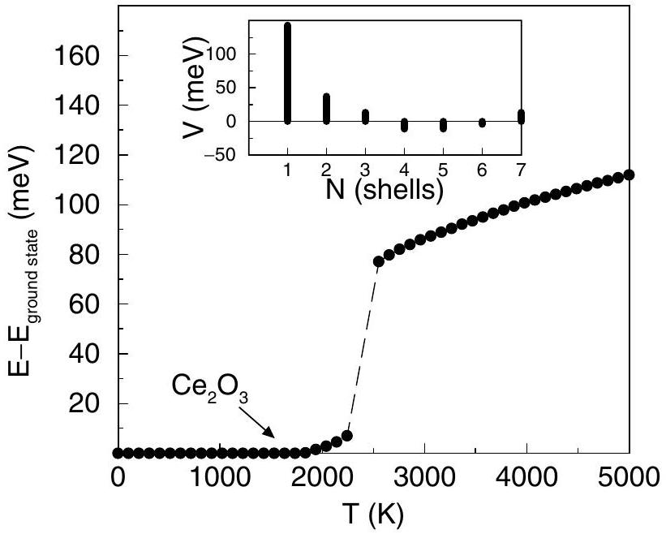

# Quantum Origin of the Oxygen Storage Capability of Ceria 

N.V. Skorodumova, ${ }^{1}$ S. I. Simak, ${ }^{2}$ B. I. Lundqvist, ${ }^{2}$ I. A. Abrikosov, ${ }^{3}$ and B. Johansson ${ }^{3,4}$ ${ }^{1}$ Department of Materials Chemistry, Uppsala University, Box 538, SE-75121 Uppsala, Sweden ${ }^{2}$ Department of Applied Physics, Chalmers University of Technology and Göteborg University, SE-41296 Göteborg, Sweden ${ }^{3}$ Condensed Matter Theory Group, Department of Physics, Box 530, S-75121 Uppsala, Sweden ${ }^{4}$ Applied Materials Physics, Department of Materials and Engineering, Royal Institute of Technology (KTH), SE-10044 Stockholm, Sweden

(Received 5 November 2001; published 26 September 2002)

#### Abstract

The microscopic mechanism behind the extraordinary ability of ceria to store, release, and transport oxygen is explained on the basis of first-principles quantum mechanical simulations. The oxygenvacancy formation energy in ceria is calculated for different local environments. The reversible $\mathrm{CeO}_{2}-\mathrm{Ce}_{2} \mathrm{O}_{3}$ reduction transition associated with oxygen-vacancy formation and migration is shown to be directly coupled with the quantum process of electron localization.

DOI: 10.1103/PhysRevLett.89.166601
PACS numbers: 72.10.-d, 71.30.+h

Air pollution is one of the major global problems threatening modern civilization. It makes environmental friendly technologies to be a requirement of today. For example, catalytic converters reduce the amount of toxic species in automobiles exhausts [1], and an intensive research on new sources of low-emission power generation, such as solid-oxide fuel cells, is in progress [2]. To a large extent, the performance of these devices depends on the ability of ceria to store, release, and transport oxygen ions [1,2]. They exploit an amazing property of the cerium (IV) oxide to release oxygen under reduction conditions forming a series of reduced oxides with stoichiometric cerium (III) oxide as an end product, which in its turn easily takes up oxygen under oxidizing conditions, turning the (III) oxide back into ceria. This reversible transition has been studied in a number of theoretical works [3] applying empirical potentials. However, its fundamental microscopic origin has yet not been elucidated.

This Letter presents the complete picture of these phenomena that incorporates the quantum mechanical issue of electron localization and the materials science aspect of vacancy formation in a single frame. We show how the oxygen-vacancy formation process is facilitated in a most essential way by a simultaneous condensation of two electrons into the localized $f$-level traps on two cerium atoms, which therefore change their valence from +4 to +3. This picture is based upon state-of-theart first-principles calculations and is supported by a Monte Carlo simulation with no adjustable parameters.

Cerium is the first element in the periodic table with a partially occupied $f$ orbital. Its unique electronic structure is determined by a strong on-site Coulomb repulsion (so-called Hubbard $U$ ). This leads to many fascinating features of elemental cerium, such as the $\gamma-\alpha$ isostructural transition, where at a critical pressure the volume of the unit cell suddenly collapses preserving the face centered cubic (fcc) structure. The unusual behavior of Ce has been described within a number of models [4-6]. In par- ticular, the Mott transition model proposed by Johansson [5], and widely recognized nowadays [7,8] suggests that the reason for such a drastic change in volume at the transition point is the delocalization (or metallization) of the $4 f$ electron under pressure. This implies that the $\alpha$ phase of cerium can be considered as the one, where the $4 f$ states are part of the valence band, while in the $\gamma$ phase the $4 f$ electron is firmly localized on the Ce atom. Therefore four valence electrons contribute to metallic bonding in the $\alpha$ phase, and only three in the $\gamma$ phase, a difference, which gives rise to the large volume change. In this sense, the $\gamma-\alpha$ transition is a valence transition, although very different from what is normally implied by the concept of a valence change.

Accordingly, this approach makes it possible to use standard band structure schemes based on the density functional theory (DFT) in combination with the local density approximation or the generalized gradient approximation (GGA) for the exchange-correlation potential to describe the $\gamma-\alpha$ transition in pure cerium [9]. The scheme treats the $f$ states as a part of the valence band in the $\alpha$ phase and as a core state, disconnected from the valence states, in the $\gamma$ phase.

This treatment of cerium appears to be equally justified for the insulating cerium oxides, as cerium formally has the valence 4+ in $\mathrm{CeO}_{2}$, the most oxidized form of cerium, and 3+ in $\mathrm{Ce}_{2} \mathrm{O}_{3}$, the other extreme final state of the transition taking place in oxygen storage devices.

These oxides have been investigated in the framework of DFT using the full-potential linear muffin-tin orbitals (FP-LMTO) method [10] for calculating the electronic spectra, equilibrium lattice parameters, and bulk moduli for $\mathrm{CeO}_{2}$ and the simplest structural form of $\mathrm{Ce}_{2} \mathrm{O}_{3}$ (hexagonal $A$-type) [11]. The results show that the model that treats the $4 f$ electron as an ordinary valence electron gives a very good estimation of the electronic structure and ground state properties of $\mathrm{CeO}_{2}$, whereas the model with the $4 f$ electron localized on the Ce atom gives a correct description of the ground state, magnetic
properties, and electronic spectra of $\mathrm{Ce}_{2} \mathrm{O}_{3}$. The density of states of $\mathrm{CeO}_{2}$, in good agreement with experiments and earlier calculations [12], shows the presence of a narrow, empty Ce $f$ band in the gap between the valence and conduction bands. According to our results, and in agreement with experiment [13], both oxides are insulators and ionic crystals, in $\mathrm{CeO}_{2}$ all four valence electrons of $\mathrm{Ce}, 6 s^{2} 5 d^{1} 4 f^{1}$, nominally leave the host atoms and transfer into the $p$ bands of two oxygen atoms, while in $\mathrm{Ce}_{2} \mathrm{O}_{3}$ the $\mathrm{Ce} f$ electron is fully localized.

Such a good description of the two forms of cerium oxide confirms our conjecture that the localizationdelocalization of the Ce $4 f$ electron is involved in the $\mathrm{CeO}_{2}-\mathrm{Ce}_{2} \mathrm{O}_{3}$ transition. From structural considerations, it is possible to choose a common unit cell for both oxides. The $C$-type structure [14] of $\mathrm{Ce}_{2} \mathrm{O}_{3}$ [Fig. 1(a)], which is the end product of the reduction process of $\mathrm{CeO}_{2}$, can be constructed out of eight unit cells of $\mathrm{CeO}_{2}$ [Fig. 1(b)] with 25\% oxygen vacancies ordered in a particular way. We notice that the addition or removal of oxygen atoms involves a minimal reorganization of the skeleton arrangement of the cerium atoms [15]. This structural property should definitely facilitate the excellent reversibility of the reduction-oxidation process. Note that, ac-

FIG. 1 (color). Lattice unit cells for $\mathrm{Ce}_{2} \mathrm{O}_{3}(C$-type $)$ (a) and $\mathrm{CeO}_{2}$ (b). A cubic unit cell of $C$-type $\mathrm{Ce}_{2} \mathrm{O}_{3}$ can be constructed out of eight $\mathrm{CeO}_{2}$ unit cells by increasing their volume by 3\% and removing 25\% of the oxygen atoms along four nonintersecting $\langle 111\rangle$ diagonals. Blue, red, and white spheres indicate the cerium, oxygen atoms, and vacancies, respectively.

The formation of a single oxygen-vacancy is an elementary step in the reduction of $\mathrm{CeO}_{2}$ to $\mathrm{Ce}_{2} \mathrm{O}_{3}$. To study in detail the energetics of the oxygen-vacancy formation in the $\mathrm{CeO}_{2}$ crystal, we have performed FP-LMTO-GGA [10,16,17] calculations for a unit cell of 96 atoms consisting of eight elementary unit cells of $\mathrm{CeO}_{2}$. We have calculated total energies for a large number of atomic configurations. The most important ones are schematically shown and described in Fig. 2. Subtracting the energy of the configuration without vacancy from the summed up energies of the corresponding configuration with the vacancy and the oxygen atom in its ground state ( $\mathrm{O}_{2}$ molecule) one obtains the vacancy formation energy [Fig. 2(a) and 2(b)]. According to our calculations, it requires 4.55 eV to form an oxygen vacancy in pure $\mathrm{CeO}_{2}$ and only 0.26 eV next to a pair of $\mathrm{Ce}(3+)$ atoms embedded into the $\mathrm{CeO}_{2}$ matrix. In the $\mathrm{CeO}_{2}$ crystal, where all cerium atoms are treated as $\mathrm{Ce}(3+)$, the vacancy formation energy is even negative, -0.84 eV, proving the instability of $\mathrm{Ce}(3+) \mathrm{O}_{2}$. Taking the $\mathrm{Ce}(3+)$ pair away from the vacancy into its sixth coordination shell involves an energy cost of 1.35 eV [Fig. 2(c)], whereas breaking the pair of $\mathrm{Ce}(3+)$ atoms, situated next to a vacancy, and bringing them apart from each other and the vacancy requires already 1.43 eV [Fig. 2(c)]. At the same time, simple breaking of a pair of $\mathrm{Ce}(3+)$ atoms surrounded by the $\mathrm{CeO}_{2}$ matrix requires only 0.08 eV [Fig. 2(c)]. This analysis shows in a direct way that the presence of two Ce 3+ atoms makes it much easier to form an oxygen vacancy in the $\mathrm{CeO}_{2}$ crystal. Moreover, the most favorable position of these two $\mathrm{Ce}(3+)$ atoms in the $\mathrm{CeO}_{2}$ matrix is next to the oxygen vacancy.

Clearly, on the microscopic level, the removal of an oxygen atom is made possible due to the ability of the cerium atom to easily and drastically adjust its electronic configuration to best fit its immediate environment [18]. Thus, the process of the oxygen-vacancy formation is closely coupled with the quantum effect of localization/ delocalization of the $4 f$ electron of cerium (Fig. 3). This is the basis for the oxygen storage capacity of the cerium oxide.

In perfect $\mathrm{CeO}_{2}$, every oxygen atom is situated in the center of a tetrahedron, surrounded by four Ce atoms. The

FIG. 2. The energetics of oxygen-vacancy formation. (a) Vacancy formation in the perfect $\mathrm{CeO}_{2}$ crystal requires 4.55 eV. The $4 f$ electrons of all Ce atoms are treated as valence electrons. (b) Vacancy formation next to a pair of $\mathrm{Ce}(3+)$ atoms (shown in blue) embedded into the $\mathrm{CeO}_{2}$ crystal requires only 0.26 eV. Note that for the case of $\mathrm{Ce}(3+)$ the $4 f$ electrons are treated as firmly localized, i.e., core electrons. (c) shows that the most favorable position of $\mathrm{Ce}(3+)$ atoms in the $\mathrm{CeO}_{2}$ matrix is next to an oxygen vacancy.

oxygen $p$ band has two extra electrons provided by cerium. These electrons are left behind when an oxygen atom is leaving its lattice position. They may occupy the lowest possible empty state, which is the $f$ band of Ce. However, as we have shown, a substantial energy gain is achieved by their further condensation to localized $f$ states on nearest Ce atoms. The choice of the two particular cerium atoms, which act as hosts for this localization, is mainly determined by the Madelung energies involved between the final state $\mathrm{Ce}(3+)$ atoms.

Thus, one would expect that an introduction of 25\% of oxygen vacancies into a cell consisting of eight unit cells of $\mathrm{CeO}_{2}$ together with localization of all $4 f$ electrons onto Ce atoms would result in a ground state characteristic for the $C$-type $\mathrm{Ce}_{2} \mathrm{O}_{3}$ [Fig. 1(a)]. To find the ground state vacancy structure for this case, we have performed a Monte Carlo (MC) simulation of the vacancy ordering based on the effective cluster interactions (ECI) [19,20] determined by the FP-LMTO-GGA [10,16] total energy calculations of inequivalent configurations constructed

FIG. 3 (color). The process of oxygen-vacancy formation in ceria. An oxygen atom moves away from its lattice position leaving behind two electrons, which localize on two cerium atoms, turning $\mathrm{Ce}(4+)$ into $\mathrm{Ce}(3+)$.

on the 80 atom supercell. The extraction of the ECI parameters is done by mapping the obtained total energies onto a cluster expansion of the total energy [20], which allows one to calculate the energy of any possible distribution of vacancies. The strongest ECI are found to be the oxygen-vacancy pair interactions for the first coordination shell, and all significant pair ECI are well inside the first seven coordination shells (see the inset of Fig. 4). The MC simulations are performed for a cell containing 2000 atoms starting from a random configuration of the vacancies at temperature of about 5000 K. The resulting total energy vs temperature curve (Fig. 4) exhibits a clear first-order phase transition at about 2400 K, which is close to the melting temperature of $\mathrm{Ce}_{2} \mathrm{O}_{3}$ (about 2483 K) [13]. The obtained structure is exactly the $C$-type structure of $\mathrm{Ce}_{2} \mathrm{O}_{3}$ with vacancies ordered along the nonintersecting string in the four <111> directions [Fig. 1(a)]. Further cooling does not lead to additional structural changes.

In summary, the present results show that we have an adequate and clear picture of the mechanism of the $\mathrm{CeO}_{2}-\mathrm{Ce}_{2} \mathrm{O}_{3}$ transition. Under reduction conditions, oxygen leaves the surface forming vacant sites. The oxygenvacancy formation process is essentially facilitated by a simultaneous condensation of two electrons into localized $f$-level traps on two cerium atoms. Thus, when an oxygen atom moves diffusively towards the surface, e.g., oxygen vacancy moves into the crystal, these electrons localize on cerium atoms in the immediate surrounding of the vacancy, and, correspondingly, they delocalize and transfer to oxygen from Ce sites when the vacancy leaves. In other words, the formation of reduced oxides can be viewed upon as a formation, migration, and ordering of virtual $\mathrm{Ce}(3+)$-vacancy complexes. This agrees with the

FIG. 4. Results of the Monte Carlo simulation of the oxygen/ vacancy ordering in $\mathrm{CeO}_{2}$ with 25\% of the oxygen atoms removed. The energy vs temperature curve exhibits a clear phase transition into the $C$-type $\mathrm{Ce}_{2} \mathrm{O}_{3}$ structure. Pair ECI (V) used in MC simulation are presented in the inset as a function of the neighboring coordination shell (N).

well-known property of ceria and especially ceria doped with aliovalent cations, such as $\mathrm{Sm}(3+)$ and $\mathrm{La}(3+)$, to have a fast rate of oxygen-ion diffusion belonging to the class of so-called fast ion conductors [2,21]. Note also that this process is reversible as soon as the external conditions change from oxygen poor to oxygen rich. This makes the oxygen storage-and-release ability of ceria a remarkable example of an electron quantum process directly manifesting itself in a macroscopic property used in many modern environmental friendly applications.

Support from the Swedish Foundation for Strategic Research (SSF) and the Swedish Research Council (VR) is gratefully acknowledged. Calculations were performed at the Swedish Supercomputer Center (NSC) in Linköping, Sweden.

[1] M. S. Dresselhaus and I. L. Thomas, Nature (London) 414, 332 (2001).
[2] T. Hibino et al., Science 288, 2031 (2000); S. Park et al., Nature (London) 404, 265 (2000); B.C. H. Steele and A. Heinzel, Nature (London) 414, 345 (2001).
[3] J. C. Conesa, Surf. Sci. 339, 337 (1995); G. Balducci et al., J. Phys. Chem. B 101, 1750 (1997); S. Gennard et al., J. Phys. Chem. B 103, 10158 (1999); 101, 1750 (1997).
[4] W. H. Zachariasen, Phys. Rev. 76, 301 (1949); L. Pauling, J. Chem. Phys. 18, 145 (1950).
[5] B. Johansson, Philos. Mag. 30, 469 (1974).
[6] J.W. Allen and R. M. Martin, Phys. Rev. Lett. 49, 1106 (1982); L. Z. Liu et al., Phys. Rev. B 45, 8934 (1992).
[7] A. Svane, Phys. Rev. Lett. 72, 1248 (1994); Z. Szotek et al. Phys. Rev. Lett. 72, 1244 (1994).
[8] P. Söderlind, Adv. Phys. 47, 959 (1998).
[9] B. Johansson et al., Phys. Rev. Lett. 74, 2335 (1995).
[10] J. M. Wills, O. Eriksson, and M. Alouani, Full-Potential LMTO Total Energy and Force Calculations, in Electronic Structure and Physical Properties of Solids: the Uses of the LMTO Method, edited by H. Dreyssé (Springer, New York, 2000).
[11] N.V. Skorodumova et al., Phys. Rev. B 64, 115108 (2001).
[12] D. D. Koelling et al., Solid State Commun. 47, 227 (1983).
[13] G. Adachi and N. Imanaka, Chem. Rev. 98, 1479 (1998).
[14] L. Eyring, Handbook on the Physics and Chemistry of Rare Earths (North-Holland, Amsterdam, 1979), Vol. 3.
[15] The calculated volume per site increases by about 3\% in $\mathrm{Ce}_{2} \mathrm{O}_{3}$ as compared to $\mathrm{CeO}_{2}$, in good agreement with experimental data [13].
[16] For sampling of the Brillouin zone, we employ the special $k$-points method with a Gaussian smearing of 20 mRy and 4 × 4 × 4 grid resulting in eight $k$-points in the irreducible wedge of the Brillouin zone for both, 80 and 96 atom, supercells. The rest of the computational details are given in Ref. [11]. A number of tests have been carried out to ensure convergence with respect to the number of $k$-points etc.
[17] J. P. Perdew et al., Phys. Rev. B 46, 6671 (1992).
[18] Note that we do not discuss the energy cost of this adjustment itself. From the thermodynamics arguments, as well as from calculations for pure Ce [7], it is expected to be very low. However, an accurate estimation would require to go beyond the present method and use firstprinciples implementations of sophisticated many-body theories, which are at present not feasible for big systems considered here.
[19] J. M. Sanchez et al., Physica (Amsterdam) 128A, 334 (1984); M. Asta et al., Phys. Rev. B 44, 4907 (1991); C. Wolverton et al., Phys. Rev. B 44, 4914 (1991).
[20] S. I. Simak et al., Phys. Rev. Lett. 81, 188 (1998).
[21] J. B. Goodenough, Nature (London) 404, 821 (2000).
