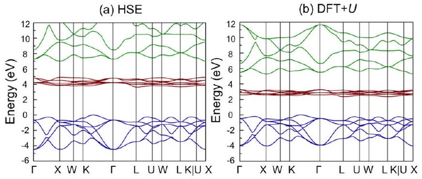
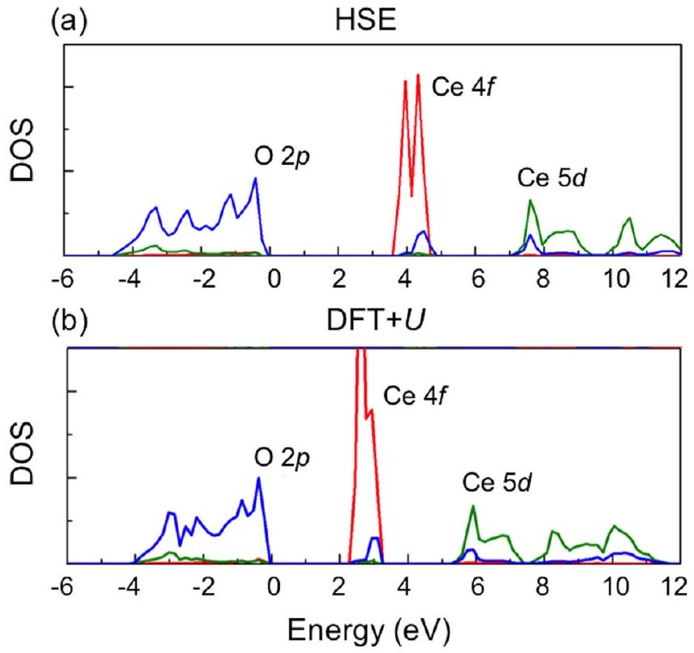
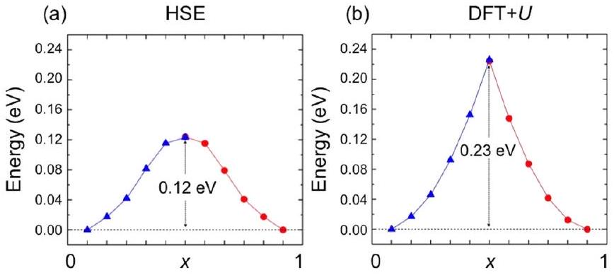
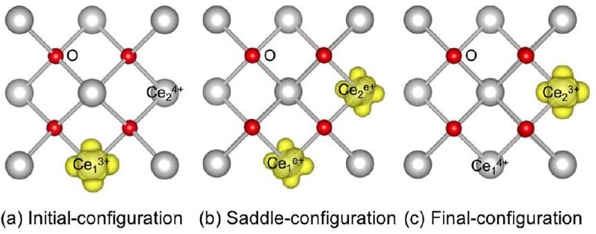
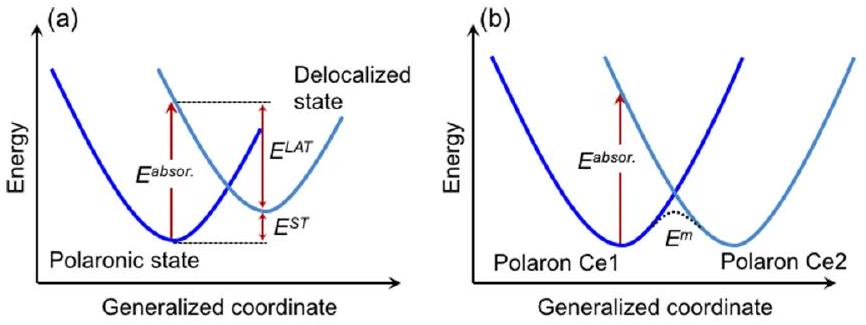
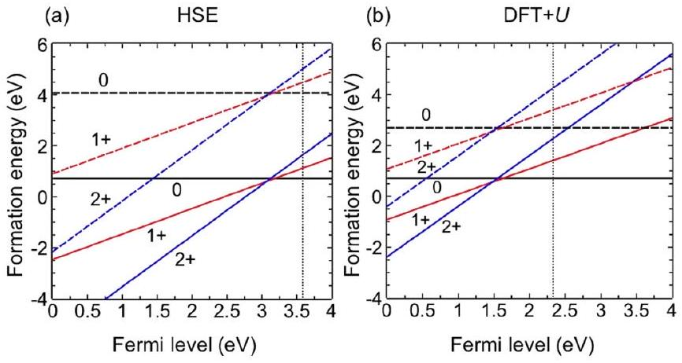
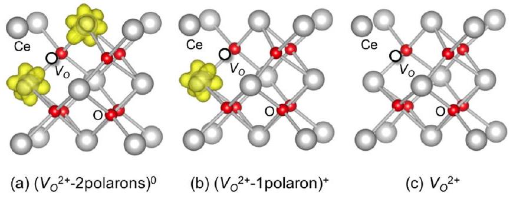
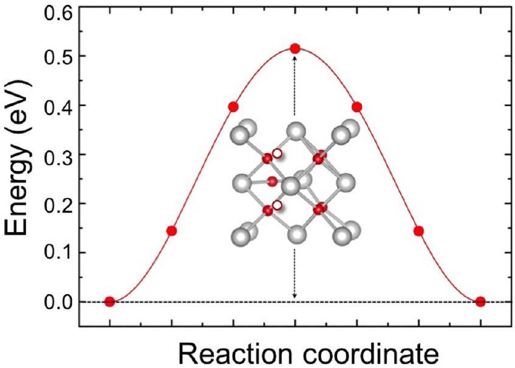

# Disentangling the role of small polarons and oxygen vacancies in $\mathbf{C e O}_{\mathbf{2}}$ 

Lu Sun, ${ }^{1,2}$ Xiaowei Huang, ${ }^{2}$ Ligen Wang, ${ }^{2}$ and Anderson Janotti ${ }^{1, *}$ ${ }^{1}$ Department of Materials Science \& Engineering, University of Delaware, Newark, Delaware 19716, USA ${ }^{2}$ General Research Institute for Nonferrous Metals, Beijing 100088, China (Received 9 February 2017; revised manuscript received 19 April 2017; published 1 June 2017; corrected 15 February 2018)

#### Abstract

The outstanding performance of cerium oxide ( $\mathrm{CeO}_{2}$ ) as ion conductor or catalyst strongly depends on the ease of $\mathrm{Ce}^{4+} \leftrightarrow \mathrm{Ce}^{3+}$ conversion and oxygen vacancy formation. An accurate description of $\mathrm{Ce}^{3+}$ and oxygen vacancy is therefore essential to further progress in this area. Using the HSE06 hybrid functional, we investigate the formation and migration of small polarons ( $\mathrm{Ce}^{3+}$ ) and their interaction with oxygen vacancies in $\mathrm{CeO}_{2}$, considering the small polaron and vacancy as independent entities. Oxygen vacancies are double donors and can bind up to two small polarons, forming a positively charged or neutral complex. We compute the electron self-trapping energy (i.e., energy gain when forming a small polaron), the small-polaron migration barrier, vacancy formation and migration energies, and vacancy-polaron binding energies. We find that small polarons weakly bind to oxygen vacancies, yet this interaction significantly contributes to the activation energy for hopping electronic conductivity. The results are compared with previous calculations and discussed in the light of available experimental data.

DOI: 10.1103/PhysRevB.95.245101

## I. INTRODUCTION

Cerium oxide ( $\mathrm{CeO}_{2}$ ) is a technologically important material, with applications ranging from catalysis in automotive exhaust [1-5], solid-oxide fuel cells [6,7], and water-gas shift reactions [8,9]. The outstanding functionality of $\mathrm{CeO}_{2}$ in these applications is largely due to its great oxygen storage/release capability (OSC). The OSC of $\mathrm{CeO}_{2}$ is in turn closely related to the oxygen-vacancy formation and, ultimately, to the reduction into nonstoichiometric $\mathrm{CeO}_{2-\mathrm{x}}$ phases as oxygen is released [10-15]. Such reaction is totally reversible and repeatable, making $\mathrm{CeO}_{2}$ an oxygen holder or oxygen pumper, depending on the oxygen content in the environment. When an oxygen vacancy is formed in $\mathrm{CeO}_{2}$, two electrons are left behind; instead of behaving as delocalized electrons in the conduction band or occupying a defect-related state, these excess electrons prefer to localize on Ce atoms neighboring the vacancy, as small polarons ( $\mathrm{Ce}^{3+}$ ) [10,15,16]. These small polarons can escape from the oxygen vacancy and contribute to the electronic conductivity of $\mathrm{CeO}_{2}$ [17]. Therefore, to further the development of $\mathrm{CeO}_{2}$ in energy-related applications that depend on catalytic or OSC properties, it is essential to develop a deeper understanding and quantitative description of the behavior of the oxygen vacancy, the small polaron, and their interactions.
$\mathrm{CeO}_{2}$ is an insulator with a large band gap [18-22]. The electronic structure of $\mathrm{CeO}_{2}$ has been probed by different experimental techniques, including valence $x$-ray photoemission spectroscopy (XPS) [18-21], O $1 s$ x-ray-absorption spectroscopy (XAS) [19], electron energy-loss spectroscopy (EELS) [19,20], and optical reflectance (OR) [22]. The valence band, composed of $\mathrm{O} 2 p$ states, is separated by a gap of $\sim 3 \mathrm{eV}$ from a quite narrow unoccupied band composed of Ce $4 f$ states. This unoccupied and narrow $4 f$ band is in turn separated by ~2 eV from a much more dispersive band composed of Ce $5 d$ states, as shown in Fig. 1. Excess electrons, due to oxygen

[^0] vacancies or other donors, would thus occupy the lowest energy states in the narrow Ce $4 f$ band. However, electrons in the $4 f$ band tend to localize on individual Ce atoms, turning $\mathrm{Ce}^{4+}$ into $\mathrm{Ce}^{3+}$. This localization is accompanied by a local structural relaxation and distortion, where the $\mathrm{Ce}^{3+}-\mathrm{O}$ bonds are slightly elongated. The combination of electron localization and local structural distortion is what characterizes a small polaron. The stabilization energy of the small polaron is, therefore, a balance between the electronic energy gain due to bringing down an occupied level in the gap, well below the Ce $4 f$ band, and the lattice energy penalty due to the local structural relaxation and distortion.

The electronic conductivity in $\mathrm{CeO}_{2}$ is thermally activated and occurs via hopping of small polarons [17] rather than through delocalized electrons in the conduction band. On the other hand, the ionic conductivity, that typically dominates the charge transport at high temperatures, has been attributed to the migration of ionized oxygen vacancies [23]. Reported experimental values for the activation energy for electronic conductivity vary in a wide range [17,24]. Tuller and Nowick [17] reported an activation energy of 0.40 eV, while Blumenthal et al. [24] reported lower values of 0.16 and 0.22 eV. For the migration of oxygen vacancies, experimental values for the motion energy vary from 0.49 to 0.61 eV [25,26]. Reported activation energies for ionic conductivity are higher due to the contribution of the vacancy formation energy or vacancy-impurity binding energies. For comparison, results based on density functional theory (DFT) calculations for the oxygen-vacancy migration energy barrier vary from 0.46 to 1.08 eV [27-29], depending on the approximation for the exchange-correlation functional and on the supercell size (vacancy concentration).

There have appeared numerous studies of bulk $\mathrm{CeO}_{2}$ based on DFT calculations, many focusing on the oxygen vacancy [10-16,27-41]. DFT calculations using the local density approximation (LDA) or the generalized gradient approximation (GGA) for the exchange-correlation term underestimate the separation between the top of the valence band (O $2 p$ band)

FIG. 1. Calculated band structure of bulk $\mathrm{CeO}_{2}$ using (a) the HSE06 hybrid functional and (b) DFT + U. The valence-band maximum (top of the $\mathrm{O} 2 p$ bands) is set to 0 . The $\mathrm{O} 2 p$ bands (blue) are between -5 eV and 0 , the $\mathrm{Ce} 4 f$ bands (red) between 2 and 5 eV, and the $\mathrm{Ce} 5 d$ bands are higher than 5 eV.

and the empty $\mathrm{Ce} 4 f$ bands in $\mathrm{CeO}_{2}$ by $\sim 35 \%$ [16,30-32]. For the oxygen vacancy in DFT-LDA or GGA, the excess electrons wind up occupying the narrow $4 f$ band, erroneously leading to delocalized electrons due to the well-known self-interaction error [30-32]. The DFT $+U$ method has also been employed to study the electronic properties of $\mathrm{CeO}_{2}$ and the impact of oxygen vacancies [28,29,32-41]. In this approach, an extra on-site Coulomb interaction is added to the Ce $4 f$ states, leading to a split between occupied and unoccupied states. In the case of perfect bulk $\mathrm{CeO}_{2}, \mathrm{DFT}+U$ pushes up the unoccupied $4 f$ band with respect to the valence band derived from the $\mathrm{O} 2 p$ states. For the oxygen vacancy, the excess electrons are localized on individual Ce atoms, turning two $\mathrm{Ce}^{4+}$ into two $\mathrm{Ce}^{3+}$ species, which, by Coulomb attraction, sit near the vacancy [28-41]. The results of DFT $+U$ studies are largely dependent on the $U$ value, bringing some uncertainty to the results and raising questions on what value of $U$ should be used to describe the properties of perfect and reduced $\mathrm{CeO}_{2}$. Furthermore, the band gap and the oxygen-vacancy formation energy derived from DFT + $U$ calculations have noticeable differences from experimental data [42,43], with the reported oxygen-vacancy formation energies varying over a wide range, from 2.3 to 4.7 eV [10,13,16,28-38]. The electron distribution of the neutral oxygen vacancy in bulk $\mathrm{CeO}_{2}$ has also been a subject of intense debate. Some researchers reported that the two excess electrons prefer to localize on two Ce atoms that are the nearest neighbor (NN) to the vacancy [15,16,28,29,33-38], while others [39-41] suggested that having the $\mathrm{Ce}^{3+}$ on the next-nearest-neighbor (NNN) sites is energetically more favorable over the NN configuration.

Hybrid functionals, in which nonlocal Hartree-Fock exchange is mixed into the GGA exchange, have been shown to successfully describe materials in which excess electrons tend to localize when occupying narrow bands derived from $d$ or $f$ states [43-48]. Few research groups have already employed hybrid functionals to describe the electronic properties of bulk $\mathrm{CeO}_{2}$ and $\mathrm{Ce}_{2} \mathrm{O}_{3}$ [34,49-51]. Overall, these calculations give lattice parameters within 1\% of the experimental values, slightly improving over the $\mathrm{DFT}(+U)$ results. The calculated electronic structures, i.e., the band dispersions and the position of the empty $\mathrm{Ce} 4 f$ and $\mathrm{Ce} 5 d$ bands with respect to the occupied $\mathrm{O} 2 p$ bands, are also in good agreement with experimental data [18-22]. For the oxygen vacancy in bulk $\mathrm{CeO}_{2}$, results are scarce. Recent studies focused on vacancyvacancy interactions, but did not explore the single vacancy in $\mathrm{CeO}_{2}$ [52]. Reports on small polarons have also appeared in the literature, including calculations using the PBE0 hybrid functional. An activation energy of 0.40 eV for the small-polaron migration has been reported [53]. Notwithstanding, a detailed comparison between theoretical results and experimental data is still lacking, despite the importance of $\mathrm{CeO}_{2}$ for various applications in which oxygen vacancies and small polarons have been conjectured to play a fundamental role.

In this paper, we report results of calculations based on the screened hybrid functional of Heyd, Scuseria, and Ernzerhof (HSE06) for small polarons, oxygen vacancies, and their interactions in bulk $\mathrm{CeO}_{2}$. For comparison, we also performed calculations using DFT + U. We discuss the self-trapping and migration energies of small polarons, formation energy, and migration barrier for the oxygen vacancy, and binding energies between small polarons and the doubly ionized oxygen vacancy. Finally, we discuss the activation energies for the electronic and ionic conductivities. The results are compared to available experimental data.

## II. COMPUTATIONAL METHODS

Our calculations are based on DFT with projectoraugmented wave (PAW) potentials [54] as implemented in the VASP code [55,56]. PAW potentials with valence $5 s^{2} 5 p^{6} 5 d^{1} 4 f^{1} 6 s^{2}$ for Ce and $2 s^{2} 2 p^{4}$ for O atoms were employed. In the $\mathrm{DFT}+U$ approach, we used the GGA-PBE exchange-correlation functional [57], and the effective Hubbard $U$ parameter [58] to describe the on-site Coulomb interactions for the Ce $4 f$ states was set to $5.0 \mathrm{eV}(U-J=$ $5.0 \mathrm{eV})$. This value for the $U$ parameter was taken from the literature [32,33]. In the HSE06 functional, 75\% of the PBE exchange is combined with 25\% of the nonlocal Hartree-Fock exchange, and the screening parameter that separates the exchange potential into short- and long-range parts was set at 0.2 [45].

For simulating an oxygen vacancy and a small polaron, a supercell of $\mathrm{CeO}_{2}$ with 96 atoms was adopted, which is a $2 \times 2 \times 2$ repetition of the 12-atom cubic unit cell. Integrations over the Brillouin zone of the supercell were performed using the (1/4, 1/4, 1/4) special- $k$ point for both the DFT + $U$ and HSE06 functional calculations. The energy cutoff for the plane-wave basis was set to 400 eV in the $\mathrm{DFT}+U$ calculations. Due to the computational cost, the plane-wave cutoff energy was set to 300 eV in the HSE06 calculations. Tests for the formation energy of the doubly ionized oxygen vacancy using a cutoff of 400 eV in the HSE06 indicate that total-energy differences are converged within less than 0.05 eV. We also performed tests using a $2 \times 2 \times 2$ mesh using $\mathrm{DFT}+U$ to ensure convergence. The volume of the supercell was kept fixed during atomic relaxations, and the structures were relaxed until the force on each atom was lower than $0.01 \mathrm{eV} /$ Å .

The self-trapping energy of an excess electron $\left(E^{\mathrm{ST}}\right)$, i.e., the energy gain when forming a small polaron $\left(\mathrm{Ce}^{3+}\right)$, is defined as

$$
E^{\mathrm{ST}}=E_{\mathrm{tot}}(\text { polaron })-E_{\text {tot }}(\text { delocalized }),
$$

where $E_{\text {tot }}$ (polaron) is the total energy of the supercell containing a small polaron, i.e., an extra electron localized on an individual Ce atom ( $\mathrm{Ce}^{3+}$ ), and $E_{\text {tot }}$ (delocalized) is the total energy of $\mathrm{CeO}_{2}$ supercell with an extra electron in the narrow Ce $4 f$ band.

The formation energy of an oxygen vacancy in charge state $q\left[E^{f}\left(V_{\mathrm{O}}^{q}\right)\right]$ is given by

$$
\begin{aligned}
E^{f}\left(V_{\mathrm{O}}^{q}\right)= & E_{\mathrm{tot}}\left(V_{\mathrm{O}}^{q}\right)-E_{\mathrm{tot}}(\mathrm{bulk})+\frac{1}{2} E_{\mathrm{tot}}\left(\mathrm{O}_{2}\right)+\mu_{\mathrm{O}} \\
& +q\left(E_{\mathrm{VBM}}+E_{F}\right)+\Delta^{q},
\end{aligned}
$$

where $E_{\mathrm{tot}}\left(V_{\mathrm{O}}^{q}\right)$ is the total energy of the supercell containing an oxygen vacancy in the charge state $q$, and $E_{\text {tot }}$ (bulk) is the total energy of perfect bulk $\mathrm{CeO}_{2}$ using the same supercell. The chemical potential $\mu_{\mathrm{O}}$ is the energy per atom of the oxygen reservoir, referenced to half of the total energy of an isolated $\mathrm{O}_{2}$ molecule $\left[\frac{1}{2} E_{\text {tot }}\left(\mathrm{O}_{2}\right)\right]$. This constitutes the upper bound of $\mu_{\mathrm{O}}$ (O-rich condition, $\mu_{\mathrm{O}}=0$ ). The lower bound of $\mu_{\mathrm{O}}$ (O-poor condition) is limited by the formation of $\mathrm{Ce}_{2} \mathrm{O}_{3}$. The Fermi level, which represents the energy of the electronic reservoir, is a variable in this formalism and referenced to the valenceband maximum $\left(\mathrm{VBM}, E_{\mathrm{VBM}}\right)$ of bulk $\mathrm{CeO}_{2}$. Finally, $\Delta^{q}$ is the charge-state dependent correction due to the finite size of the supercell [59].

## III. RESULTS AND DISCUSSION

## A. Lattice parameter and electronic structure

Bulk $\mathrm{CeO}_{2}$ adopts the cubic fluorite structure, where each Ce atom is bonded to eight O atoms, and each O atom is bonded to four Ce atoms [60]. The calculated structural parameters of bulk $\mathrm{CeO}_{2}$ are listed in Table I. The experimental value of lattice parameter is $5.41 \AA$, with a $\mathrm{Ce}-\mathrm{O}$ equilibrium bond length of $2.34 \AA$ [61]. $\mathrm{DFT}+U$ gives a lattice parameter of $5.49 \AA$, that is 1.4\% larger than the experimental value, while the HSE06 gives $5.40 \AA$, only slightly smaller than the experimental value. Both DFT + $U$ and HSE06 results agree with previous calculations [28-38,49-51].

The calculated electronic band structures and density of states of bulk $\mathrm{CeO}_{2}$ are shown in Figs. 1 and 2, for both HSE06 and $\mathrm{DFT}+U$. The bandwidth of the $\mathrm{O} 2 p$ band is 4.5 eV (4.0 eV) and the Ce $4 f$ bandwidth is 1.4 eV (1.0 eV) in HSE06 $(\mathrm{DFT}+U)$. In these plots, we placed the zero at the top of the $\mathrm{O} 2 p$ valence band. Overall, the HSE06 hybrid functional gives a wider band gap for $\mathrm{CeO}_{2}$ than that obtained by $\mathrm{DFT}+U$. The $\mathrm{O} 2 p-\mathrm{Ce} 4 f$ gap is 3.5 eV and the Ce $4 f-\mathrm{Ce} 5 d$ is 2.1 eV in HSE06. For comparison, these are 2.3 and 1.9 eV in DFT + $U$. Our DFT + $U$ results are in good agreement with previous calculations which reported the O $2 p-\mathrm{Ce} 4 f$ gap in the range of $2.2-2.7 \mathrm{eV}$ and the distance

TABLE I. Structural and electronic properties of bulk $\mathrm{CeO}_{2}$.
| Method | $a_{0}(\AA)$ | $\mathrm{O} 2 p-\mathrm{Ce} 5 d$ gap (eV) | $\mathrm{O} 2 p-\mathrm{Ce} 4 f$ gap (eV) |
| :--- | :--- | :--- | :--- |
| $\mathrm{DFT}+U$ | 5.49 | 5.3 | 2.3 |
| HSE | 5.40 | 7.0 | 3.5 |
| Expt. [18,61] | 5.41 | 6.0 | 3.3 |

FIG. 2. Projected density of states (DOS) of $\mathrm{CeO}_{2}$ calculated using (a) the HSE06 hybrid functional and (b) DFT $+U$. The zero in energy was placed at the top of the $\mathrm{O} 2 p$ band.

between the $\mathrm{O} 2 p$ and $\mathrm{Ce} 5 d$ bands in the range of $5.3-5.7 \mathrm{eV}$ [32-39]. For HSE06, the reported values vary in a narrower range, with the $\mathrm{O} 2 p-\mathrm{Ce} 4 f$ gap of $3.1-3.5 \mathrm{eV}$ and the O $2 p-\mathrm{Ce} 5 d$ gap of ~7.0 eV [34,49,50]. The HSE06 results are in better agreement with the experimental value of 3.3 eV for the $\mathrm{O} 2 p$-Ce $4 f$ gap [18]. For the $\mathrm{Ce} 4 f-\mathrm{Ce} 5 d$ separation, the experimental result of ~3.0 eV is less clear due to the large broadening of the signal. The experimental values were obtained using a combination of photoemission and inverse photoemission, as well as absorption spectroscopy [18-21].

## B. Small polarons

Excess electrons in $\mathrm{CeO}_{2}$ can originate from donor impurities or native defects, such as oxygen vacancies. In any case, the excess electrons, that would occupy the narrow $\mathrm{Ce} 4 f$ band, prefer to localize on individual Ce atoms, in the form of $\mathrm{Ce}^{3+}$ species. The electron localization is accompanied by a local lattice distortion, where the $\mathrm{Ce}^{3+}-\mathrm{O}$ bonds are slightly elongated with respect to the equilibrium Ce-O bond length. The combination of the electron localization and the local lattice distortion comprises the small polaron. We emphasize here that the formation of small polarons is a feature of $\mathrm{CeO}_{2}$ and does not depend on the donor species. We simulated a small polaron by adding an excess electron to a supercell of bulk $\mathrm{CeO}_{2}$. After breaking the local symmetry around a chosen Ce atom, all the atomic positions are then allowed to relax, minimizing the total energy. As a result, a state with $4 f$ character appears in the band gap, in the up-spin channel, at about 0.6 eV below the $\mathrm{Ce} 4 f$ band. The system is paramagnetic with spin $S=1 / 2$. The $\mathrm{Ce}^{+3}-\mathrm{O}$ bond lengths are 3.4\% longer than the equilibrium Ce-O bond length. The selftrapping energy of the excess electron, from Eq. (1), is -0.30 eV in HSE06 and -0.54 eV in DFT $+U$. We decompose the small-polaron self-trapping energy in electronic and strain

TABLE II. Self-trapping energy ( $E^{\text {ST }}$ ) of the polaron in bulk $\mathrm{CeO}_{2}$. Lattice strain energy ( $E^{\text {LAT }}$ ) and electronic energy ( $E^{\text {EL }}$ ) are included.
|  | $E^{\mathrm{ST}}(\mathrm{eV})$ | $E^{\mathrm{LAT}}(\mathrm{eV})$ | $E^{\mathrm{EL}}(\mathrm{eV})$ |
| :--- | :--- | :--- | :--- |
| $\mathrm{DFT}+U$ | -0.54 | 0.43 | -0.97 |
| HSE06 | -0.30 | 0.52 | -0.82 |

contributions [62], i.e.,

$$
E^{\mathrm{ST}}=E^{\mathrm{LAT}}+E^{\mathrm{EL}} .
$$

The strain energy contribution ( $E^{\text {LAT }}$ ) is the total-energy difference between the supercell with atomic positions frozen to that of the polaronic state but without the extra electron, and the supercell of the perfect bulk. This term represents the energy penalty required to accommodate the small polaron. The electronic energy gain is defined as $E^{\mathrm{EL}}=E^{\mathrm{ST}}-E^{\mathrm{LAT}}$, and represents the energy of the polaronic state in the gap occupied by the excess electron with respect to the empty $4 f$ band. We find $E^{\text {LAT }}=0.52 \mathrm{eV}$ in HSE06, and 0.43 eV in DFT + $U$. The results of this decomposition are listed in Table II. We note that these quantities are strongly dependent on the $U$ parameter in the $\mathrm{DFT}+U$ calculation: the larger the $U$, the higher the electronic energy gain. The small polaron self-trapping energy is negative, indicating that localization is favorable over delocalization of the electron in the Ce $4 f$ band. It also indicates that the electronic energy gain due to lowering an occupied state in the gap wins over the lattice energy penalty required to accommodate the localized electron.

## C. Small-polaron migration

Since excess electrons in $\mathrm{CeO}_{2}$ prefer to form small polarons (or $\mathrm{Ce}^{3+}$ ), it is expected that the electronic conductivity occurs through the thermally activated migration of small polarons. This migration process consists of $\mathrm{Ce}^{3+}$ moving from one Ce site to a neighboring Ce site in the $\mathrm{CeO}_{2}$ lattice. In other words, the electron initially localized on a given $\mathrm{Ce}\left(\mathrm{Ce}_{1}{ }^{3+}\right)$ moves to a neighboring $\mathrm{Ce}\left(\mathrm{Ce}_{2}{ }^{4+}\right)$, transforming it into $\mathrm{Ce}_{2}{ }^{3+}$ and leaving a $\mathrm{Ce}_{1}{ }^{4+}$ behind, i.e., $\mathrm{Ce}_{1}{ }^{3+}-\mathrm{Ce}_{2}{ }^{4+} \rightarrow \mathrm{Ce}_{1}{ }^{4+}-\mathrm{Ce}_{2}{ }^{3+}$. The energy barrier for this process was determined by first performing two separate calculations, one for the small polaron on a given Ce site in the supercell (initial configuration), and the other for the polaron on a nearest-neighbor site (final configuration). The intermediate configurations were obtained by a linear interpolation of the initial and final configurations, i.e., the atomic positions for the intermediate configurations are $\mathbf{r}=$ $(1-x) \mathbf{r}_{i}+x \mathbf{r}_{f}$, where $\mathbf{r}_{i}$ and $\mathbf{r}_{f}$ are the positions of the atoms in the supercells representing the initial and final configurations. An electronic self-consistent calculation is then performed for each intermediate configuration, and the total-energy difference between each intermediate and the initial or final configurations is plotted as a function of $x$.

The calculated energy barrier for the small polaron migration is shown in Fig. 3. The saddle point in the migration path occurs at $x=0.5$, i.e., the saddle-point configuration is the average of the initial and final configurations. Here the HSE06 and DFT + U give different results. In HSE06, the

FIG. 3. Migration energy barrier for a small polaron in bulk $\mathrm{CeO}_{2}$ using (a) the HSE06 hybrid functional and (b) the DFT $+U$ method.

excess electron is gradually transferred from one $\mathrm{Ce}\left(\mathrm{Ce}_{1}\right)$ to the neighboring $\mathrm{Ce}\left(\mathrm{Ce}_{2}\right)$ as the fraction of final configuration increases, as in an adiabatic process [53]. At the saddle point, the electron is equally distributed among the two neighboring Ce atoms, with magnetic moments of $0.453 \mu_{\mathrm{B}}$ and $0.460 \mu_{\mathrm{B}}$. The charge distribution of the excess electron at the initial, saddle-point, and final configurations are shown in Fig. 4. The calculated migration energy barrier is 0.12 eV and the energy versus $x$ is a smooth curve. In contrast, in DFT + $U$, the excess electron remains localized on the initial atom for all $x$. If we start the calculation from the final configuration, i.e., the electron localized on the second $\mathrm{Ce}\left(\mathrm{Ce}_{2}\right)$, the electron remains localized on the second atom as $x$ decreases from 1 to 0, as in a nonadiabatic process [53]. In the saddle-point configuration, the excess electron is localized in either the initial or final Ce, depending on if the calculation started from the initial or final configuration. The saddle-point configuration in $\mathrm{DFT}+U$ is 0.23 eV higher in energy than the initial or final configurations.

Since polarons lead to occupied states in the gap, we expect that light absorption excites the electrons from the polaronic states to either the conduction band (Ce $4 f$ band) or to another polaronic state in a neighboring site. These two complementing processes are described as follows: One is the transition from the polaronic state in the gap to the delocalized state in the conduction-band minimum (Ce $4 f$ band) [62], as shown in Fig. 5(a). After that, the delocalized electron will likely become self-trapped again by emitting or absorbing phonons. The other is the transition between two localized states where in the initial configuration the electron is localized on a given $\mathrm{Ce}\left(\mathrm{Ce}_{1}\right)$ site, and in the final configuration the electron is localized on a neighboring $\mathrm{Ce}\left(\mathrm{Ce}_{2}\right)$ site [63]. This corresponds to the light-induced migration of the polaron, as shown in Fig. 5(b).

FIG. 4. Charge distribution for the migration of a small polaron in $\mathrm{CeO}_{2}$ at the (a) initial, (b) saddle-point, and (c) final configurations, calculated using the HSE06 hybrid functional.

FIG. 5. Schematic description of the absorption mechanism of small polarons in $\mathrm{CeO}_{2}$. (a) The transition from polaronic state to a delocalized state in the conduction band, and (b) the transition between two neighboring polaronic states.

The calculated absorption energy for the first process is given by the energy difference between the initial configuration with the electron localized on a given Ce , and the final configuration with the electron delocalized in the $4 f$ band but with the same atomic configuration as that of the localized state. For the first process, the peak in the absorption energy equals the modulus of the self-trapping energy of polarons ( $E^{\mathrm{ST}}$ ) plus the strain energy ( $E^{\text {LAT }}$ ), which is 0.82 eV in HSE06 and 0.97 eV in $\mathrm{DFT}+U$, as we discussed in the former session. For the second process, the peak in the absorption energy is given by the energy difference between the initial configuration with the electron localized on a given $\mathrm{Ce}\left(\mathrm{Ce}_{1}\right)$ and the final configuration with the electron localized on the same $\mathrm{Ce}\left(\mathrm{Ce}_{1}\right)$ but with the same lattice configuration as that of the electron localized on the neighboring $\mathrm{Ce}\left(\mathrm{Ce}_{2}\right)$. This energy is 0.90 eV in HSE06 and 0.92 eV in $\mathrm{DFT}+U$ according to our calculation for the polaron migration as shown above.

## D. Oxygen vacancies

It is widely accepted that oxygen vacancies are easy to form in $\mathrm{CeO}_{2}$, and that vacancies have low migration barriers, leading to high ionic conductivities at high temperatures [25-29]. In contrast, DFT calculations often report oxygenvacancy formation energies that are much too high, necessarily implying negligible concentrations. This uneasy discrepancy is due to a misleading comparison between theory and experiment. In fact, most DFT results take the energy per atom of an isolated $\mathrm{O}_{2}$ molecule as the reference for the oxygen reservoir, i.e., $\mu_{\mathrm{O}}=0$ in Eq. (2), which, in turn, corresponds to the oxygen-rich limit and therefore describes the highest formation energy for an oxygen vacancy. However, for a direct comparison with the experimental data, the minimum energy required to form an oxygen vacancy would be more appropriate, or equivalently, the maximum oxygen-vacancy concentration that can be accommodated in $\mathrm{CeO}_{2}$. That would occur for the lowest value of $\mu_{\mathrm{O}}$ in Eq. (2) which would still make $\mathrm{CeO}_{2}$ stable against the formation of secondary phases such as $\mathrm{Ce}_{2} \mathrm{O}_{3}$ or any other stable reduced phase $\mathrm{Ce}_{n} \mathrm{O}_{m}$ between $\mathrm{CeO}_{2}$ and $\mathrm{Ce}_{2} \mathrm{O}_{3}$ [15]. Taking $\mathrm{Ce}_{2} \mathrm{O}_{3}$ as the limiting phase, the minimum value of $\mu_{\mathrm{O}}\left(\mu_{\mathrm{O}}{ }^{\text {min }}\right)$ must satisfy $\mu_{\mathrm{Ce}}+2 \mu_{\mathrm{O}}=\Delta H_{f}\left(\mathrm{CeO}_{2}\right)$ and $2 \mu_{\mathrm{Ce}}+3 \mu_{\mathrm{O}}<\Delta H_{f}\left(\mathrm{Ce}_{2} \mathrm{O}_{3}\right)$, where $\Delta H_{f}\left(\mathrm{CeO}_{2}\right)$ is the formation enthalpy of $\mathrm{CeO}_{2}$, and $\Delta H_{f}\left(\mathrm{Ce}_{2} \mathrm{O}_{3}\right)$ is that of $\mathrm{Ce}_{2} \mathrm{O}_{3}$. From our calculations, we obtain $\Delta H_{f}\left(\mathrm{CeO}_{2}\right)=$ -11.35 eV and $\Delta H_{f}\left(\mathrm{Ce}_{2} \mathrm{O}_{3}\right)=-19.33 \mathrm{eV}$ in HSE06, so that $\mu_{o}{ }^{\text {min }}=2 \Delta H_{f}\left(\mathrm{CeO}_{2}\right)-\Delta H_{f}\left(\mathrm{Ce}_{2} \mathrm{O}_{3}\right)=-3.37 \mathrm{eV}$. In

FIG. 6. Formation energies of vacancy-polaron complexes in different charge states as a function of Fermi levels in bulk $\mathrm{CeO}_{2}$, using (a) the HSE06 hybrid functional and (b) DFT + U. Dark, red, and blue lines represent formation energies of the neutral ( $V_{\mathrm{O}}{ }^{2+}-2$ polarons) ${ }^{0}$ complex, singly positive $\left(V_{\mathrm{O}}{ }^{2+}-1 \text { polaron }\right)^{+}$ complex, and doubly positive $V_{\mathrm{O}}{ }^{2+}$, respectively. The solid lines show the oxygen-poor limit condition, $\mu_{\mathrm{O}}=-3.37 \mathrm{eV}(-2.00 \mathrm{eV})$ in HSE06 ( $\mathrm{DFT}+U$ ). The dashed lines show the oxygen-rich limit condition, $\mu_{\mathrm{O}}=0$.

$\mathrm{DFT}+U$, the corresponding values are $-10.51,-19.02$, and -2.00 eV , respectively. Our calculated formation enthalpies for $\mathrm{CeO}_{2}$ and $\mathrm{Ce}_{2} \mathrm{O}_{3}$ in DFT + U are in good agreement with previous calculations [35,37,38,49], with the HSE06 results being closer to the experimental data [64].

The calculated formation energy for the oxygen vacancy in $\mathrm{CeO}_{2}$ is shown in Fig. 6 for $\mu_{\mathrm{O}}=-3.37 \mathrm{eV}\left(\mu_{\mathrm{O}}=-2.00 \mathrm{eV}\right.$ in $\mathrm{DFT}+U$ ) and $\mu_{\mathrm{O}}=0 \mathrm{eV}$. First, we find that the oxygen vacancy is stable exclusively in the doubly ionized $2+$ charge state ( $V_{\mathrm{O}}{ }^{2+}$ ). Defect states associated with oxygen vacancy, i.e., dangling-bond states derived from $\mathrm{Ce} 5 d$, do not appear in the band gap; they are resonant in the conduction band, well above the unoccupied $4 f$ bands. The two electrons that are donated by the vacancy would occupy the lowest lying $4 f$ bands; however, due to the tendency of excess electrons in $\mathrm{CeO}_{2}$ to form small polarons, we find that adding the electrons back to $V_{\mathrm{O}}{ }^{2+}$ result in positively charged [ $\left(V_{\mathrm{O}}{ }^{2+}-1 \text { polaron }\right)^{+}$ or $V_{\mathrm{O}}{ }^{2+}-\mathrm{Ce}^{3+}$ ] and neutral [ $\left(V_{\mathrm{O}}{ }^{2+}-2\right.$ polarons) ${ }^{0}$ or $V_{\mathrm{O}}{ }^{2+}-$ $2 \mathrm{Ce}^{3+}$ ] vacancy-polaron complexes. Namely, the excess electrons near the vacancy do not occupy defect-related states, which arise from the Ce-5d dangling bonds, but rather prefer to localize near the vacancy as small polarons $\left(\mathrm{Ce}^{3+}\right)$ bonded to the positively charged $V_{\mathrm{O}}{ }^{2+}$ center. The charge distribution for the vacancy-polaron complexes are shown in Fig. 7. Previous calculations, using DFT $+U$ and 96-atom supercells, have explored different configurations for the two electrons localized near the vacancy, $\left(V_{\mathrm{O}}{ }^{2+}-2 \text { polarons }\right)^{0}$, where the $\mathrm{Ce}^{3+}$ species sit next to the vacancy or at the next-nearestneighbor shell around the vacancy [15]. We note that a supercell of 96 atoms might be too small for such analyses, since one has also to consider the spurious interactions between vacancies and polarons in image cells due to the periodic boundary conditions. Coulomb interaction between positive $V_{\mathrm{O}}{ }^{2+}$ centers and effectively negative $\mathrm{Ce}^{3+}$ species in $\mathrm{CeO}_{2}$ in a 96-atom cell are very likely to favor configurations where the $V_{\mathrm{O}}{ }^{2+}$ and $\mathrm{Ce}^{3+}$ do not sit next to each other. However, in very large supercells where the interaction between charged centers

FIG. 7. Configurations of oxygen vacancies in different charge states along with small polarons in bulk $\mathrm{CeO}_{2}$. (a) Neutral ( $V_{\mathrm{O}}{ }^{2+}-$ 2 polarons) ${ }^{0}$ complex. (b) Singly positive ( $V_{\mathrm{O}}{ }^{2+}-1$ polaron) ${ }^{+}$complex. (c) Doubly positive $V_{\mathrm{O}}{ }^{2+}$. Large grey spheres represent Ce atoms, small red spheres represent O atoms, and the dark hollow circles represent oxygen vacancies. The polarons are marked with yellow spin-up isosurfaces which are set to be $0.05 \mathrm{e} / \AA^{3}$.

in image cells are minimized, one would expect the polarons to sit next to the vacancy. Therefore, due to the limitation of finite size of the 96-atom supercell, we restrict ourselves to considering only complexes where the $\mathrm{Ce}^{3+}$ sits next to the vacancy.

In the $V_{\mathrm{O}}{ }^{2+}$ configuration, the neighboring Ce atoms are displaced by 6.8\% in HSE06 (7.1\% in DFT + U) of the equilibrium bond length away from the vacancy. This relaxation pattern is only slightly perturbed in the presence of small polarons. For instance, in the neutral ( $V_{\mathrm{O}}{ }^{2+}-2$ polarons) ${ }^{0}$ complex, we find the two $\mathrm{Ce}^{4+}$ are displaced by 7.6\% and the two $\mathrm{Ce}^{3+}$ by $5.2 \%$ in HSE06 ( $7.8 \%$ and $5.6 \%$ in DFT $+U$ ). Similar displacements of the $\mathrm{Ce}^{3+}$ and the other three $\mathrm{Ce}^{4+}$ are obtained for the positively charged $\left(V_{\mathrm{O}}{ }^{2+}-1 \text { polaron }\right)^{+}$ complex. In the case of the neutral ( $V_{\mathrm{O}}{ }^{2+}-2$ polarons) ${ }^{0}$, we find that the unpaired electrons of the $\mathrm{Ce}^{3+}$ species are both spin up, resulting in a paramagnetic triplet $S=1$ center in HSE06. On the other hand, in DFT $+U$, the singlet $S=0$ configuration, where the polarons near the vacancy have opposite spins, is 1.5 meV lower in energy than the triplet state, in agreement with previous studies [33,35].

The formation energy of the neutral ( $V_{\mathrm{O}}{ }^{2+}-2$ polarons) ${ }^{0}$ complex is only 0.72 eV under the oxygen-poor limit condition, $\mu_{\mathrm{O}}=-3.37 \mathrm{eV}$ in HSE06 ( 0.70 eV for $\mu_{\mathrm{O}}=-2.00 \mathrm{eV}$ in $\mathrm{DFT}+U$ ). For $\mu_{\mathrm{O}}=0$, we thus obtain a formation energy of 4.09 eV (2.70 eV) in HSE06 (DFT + U), which lies in the range of reported values in previous calculations [13,28-35]. We note that if only oxygen vacancies were present in $\mathrm{CeO}_{2}$, the Fermi level would be pinned near where the formation energy of ( $V_{\mathrm{O}}{ }^{2+}-2$ polarons) ${ }^{0}$ and ( $V_{\mathrm{O}}{ }^{2+}-1$ polaron) ${ }^{+}$and $V_{\mathrm{O}}{ }^{2+}$ intersect, with the remainder excess electrons as isolated small polarons to satisfy the charge neutrality condition. Taking the formation energy of the neutral complex, 0.72 eV, in the dilute regime, the vacancy concentration at 1000 K would amount to about 0.03\%. We consider this as a lower limit to the vacancy concentration at oxygen-poor (reducing) conditions. In practice, it is likely that acceptor defects or impurities that compensate the doubly ionized $V_{\mathrm{O}}{ }^{2+}$ are also present in the samples, pinning the Fermi level at lower energies in the gap, between 2.8 and 3.2 eV above the $\mathrm{O} 2 p$ valence band, lowering the formation energy of the oxygen vacancy and enhancing its concentration, up to a few percent, as reported in many experiments [3,5].

## E. Oxygen vacancy migration

The migration of oxygen vacancies is another important parameter that impacts the OSC, and determines the ionic conductivity of $\mathrm{CeO}_{2}$. Assuming an oxygen-vacancy mediated mechanism, the activation energy for ionic conductivity is given by the formation energy and migration barrier of the oxygen vacancy. Experimental study based on ${ }^{17} \mathrm{O}$ NMR of lightly doped $\mathrm{CeO}_{2}$ revealed a migration barrier of 0.49 eV [25], while other groups reported slightly higher values of 0.61 eV [26] and 0.63 eV [43] based on ionic conductivity measurements in $\mathrm{CeO}_{2}$ samples where the vacancy concentration is fixed by the lower valence cation impurities. For comparison with experiments, here we only focus on the vacancy migration barrier. We also neglect the effect of having polarons near the vacancy as previously studied [35]. At high temperatures typically used to measure ionic conductivity, polarons are likely to be unbound to the vacancies as discussed below. We employed the climbing-image nudged elastic band (CI-NEB) method [65] in the DFT + U approach to calculate the migration barrier of an oxygen vacancy in bulk $\mathrm{CeO}_{2}$. In the CI-NEB method, a chain of images that are linearly interpolated between the initial and final configurations were used to construct an elastic band, and the intermediate images were optimized simultaneously to find the transition state. The migration energy as a function of reaction coordinate of the doubly ionized oxygen vacancy $V_{\mathrm{O}}{ }^{2+}$ along the shortest migration path is shown in Fig. 8. The saddle point occurs halfway between two adjacent oxygen sites, as indicated in the inset of Fig. 8. The energy barrier for the migration of $V_{\mathrm{O}}{ }^{2+}$ is 0.52 eV in DFT + U. Taking the configuration of the saddle point, we then performed a HSE06 hybrid functional calculation, allowing the atomic positions to relax, finding an energy barrier of 0.48 eV. This value is in good agreement with the experimental value of 0.49 eV based on ${ }^{17} \mathrm{O}$ NMR studies [25]. Our calculated migration barriers also agree with

FIG. 8. Migration energy barrier for doubly ionized oxygen vacancies in bulk $\mathrm{CeO}_{2}$ in DFT + U. The inserted configuration represents the saddle-point structure. The hollow circles indicate the vacant oxygen sites.

Nolan's DFT + U result of 0.53 eV [28], who also used a 96-atom supercell, but are lower than the value of 0.61 eV reported by Chen et al., who used a supercell containing 24 atoms [29].

## F. Interactions between small polarons and oxygen vacancy

So far, we treated small polarons ( $\mathrm{Ce}^{3+}$ ) and oxygen vacancies as independent entities, yet they can be closely related to each other by forming complexes. We now discuss the interaction between small polarons and vacancies by calculating the energy required to separate one and two polarons from the ( $V_{\mathrm{O}}{ }^{2+}-2$ polarons) ${ }^{0}$ complex. We first considered the energy required to remove one polaron from the neutral ( $V_{\mathrm{O}}{ }^{2+}-2$ polarons) ${ }^{0}$ complex, resulting in an isolated small polaron and a positively charged $\left(V_{\mathrm{O}}{ }^{2+}-1 \text { polaron }\right)^{+}$ complex. The binding energy for this process is given by

$$
\begin{aligned}
E_{b}= & E_{\mathrm{tot}}\left[\left(V_{\mathrm{O}}^{2+}-1 \text { polaron }\right)^{+}\right]+E_{\mathrm{tot}}[\text { polaron }] \\
& -E_{\mathrm{tot}}\left[\left(V_{\mathrm{O}}^{2+}-2 \text { polarons }\right)^{0}\right]-E_{\mathrm{tot}}[\text { bulk }],
\end{aligned}
$$

where $E_{\text {tot }}\left[\left(V_{\mathrm{O}}^{2+}-1 \text { polaron }\right)^{+}\right]$is the total energy of the supercell containing the ( $V_{\mathrm{O}}{ }^{2+}-1$ polaron) ${ }^{+}$complex, $E_{\text {tot }}$ [polaron] is the total energy of the supercell containing an isolated small polaron, $E_{\text {tot }}\left[\left(V_{\mathrm{O}}^{2+}-2 \text { polarons }\right)^{0}\right]$ is the total energy of the supercell containing the neutral ( $V_{\mathrm{O}}{ }^{2+}-2$ polarons) ${ }^{0}$ complex, and $E_{\text {tot }}$ [bulk] is the total energy of the perfect bulk supercell. We find a binding energy of 0.103 eV in HSE06 and 0.113 eV in DFT + U. We then considered the energy required to remove the second polaron from the positively charged ( $V_{\mathrm{O}}{ }^{2+}-1$ polaron) ${ }^{+}$complex, resulting in a doubly ionized vacancy $V_{\mathrm{O}}{ }^{2+}$ and an isolated small polaron. In this case, we find a binding energy of 0.137 eV in HSE06, and 0.142 eV in DFT + $U$. According to these results, removing a polaron from the ( $V_{\mathrm{O}}{ }^{2+}-1$ polaron) ${ }^{+}$complex cost ~30 meV more than removing a polaron from the neutral ( $V_{\mathrm{O}}{ }^{2+}-2$ polarons) ${ }^{0}$ complex. These results also indicate that small polarons are somewhat weakly bonded to oxygen vacancies, yet the binding energy between small polarons and oxygen vacancies significantly affects the trapping of carriers that contribute to the activation energy for the electronic conductivity in $\mathrm{CeO}_{2}$. On the other hand, the binding energy is relatively small, so that at high temperatures used in ionic conductivity measurements, polarons are unbound to vacancies, i.e., vacancies exist as $V_{\mathrm{O}}{ }^{2+}$.

Assuming the electronic conductivity is given by hopping of small polarons, and that oxygen vacancies are the dominant donors, the activation energy is given by the sum of the small polaron migration barrier and the binding energy of the polaron to the vacancy, which amounts to 0.26 eV in HSE06 and 0.37 eV in DFT $+U$. These values are in good agreement with experimental data for activation energies which lie in the range 0.22-0.51 eV [66]. We note that our results can be compared to experimental data for $\mathrm{CeO}_{2}$ containing vacancies in the dilute regime, i.e., where interactions between defects are negligible.

## IV. SUMMARY AND CONCLUSION

We have investigated small polarons, oxygen vacancies, and their interactions in bulk $\mathrm{CeO}_{2}$ using calculations based on the HSE06 hybrid functional and the DFT + U for comparison. We treat the small polarons and oxygen vacancies as separate entities, departing from the current literature on $\mathrm{CeO}_{2}$ in which the polaron is often referred to as an oxygen-vacancy defect state. We find the polaron formation is an intrinsic property of $\mathrm{CeO}_{2}$, and conclude that any shallow donor center that would result in electrons in the conduction band can give rise to polarons. This is an important aspect of the present work and is expected to apply to a much broader class of transition-metal or rare-earth oxides. We provide information on the polaron-related optical absorption that should guide future experiments. Using HSE06, the binding energy between small polarons and oxygen vacancies are computed, and it is predicted to give a sizeable contribution to the electronic activation energy of $\mathrm{CeO}_{2}$. From the calculations for quantities such as the gap separating the occupied $\mathrm{O} 2 p$ band from the unoccupied Ce $4 f$ band, the oxygen vacancy formation energies, and the activation energy for electronic and ionic conductivities, we find HSE06 gives an overall more accurate description compared with experimental values.

## ACKNOWLEDGMENTS

This work was supported by the National Science Foundation under Grant No. DMR-1652994. The calculations were performed using the Extreme Science and Engineering Discovery Environment (XSEDE) supercomputer facility, which is supported by National Science Foundation Grant No. ACI-1053575, and the Information Technologies (IT) resources at the University of Delaware, specifically the high-performance computing resources.

[1] J. Kašpar, P. Fornasiero, and M. Graziani, Catal. Today 50, 285 (1999).
[2] R. Di Monte and J. Kašpar, Top. Catal. 28, 47 (2004).
[3] A. Trovarelli, M. Boaro, E. Rocchini, C. de Leitenburg, and G. Dolcetti, J. Alloy Compd. 323-324, 584 (2001).
[4] M. Yashima, Catal. Today 253, 3 (2015).
[5] A. Trovarelli, Catalysis by Ceria and Related Materials (Imperial College Press, London, 2002).
[6] K. Eguchi, T. Setoguchi, T. Inoue, and H. Arai, Solid State Ionics 52, 165 (1992).
[7] M. Mogensen, N. M. Sammes, and G. A. Tompsett, Solid State Ionics 129, 63 (2000).
[8] Q. Fu, H. Saltsburg, and M. Flytzani-Stephanopoulos, Science 301, 935 (2003).
[9] Q. Fu, A. Weber, and M. Flytzani-Stephanopoulos, Catal. Lett. 77, 87 (2001).
[10] N. V. Skorodumova, S. I. Simak, B. I. Lundqvist, I. A. Abrikosov, and B. Johansson, Phys. Rev. Lett. 89, 166601 (2002).
[11] C. T. Campbell and C. H. F. Peden, Science 309, 713 (2005).
[12] F. Esch, S. Fabris, L. Zhou, T. Montini, C. Africh, P. Fornasiero, G. Comelli, and R. Rosei, Science 309, 752 (2005).
[13] M. V. Ganduglia-Pirovano, A. Hofmann, and J. Sauer, Surf. Sci. Rep. 62, 219 (2007).

[14] D. Marrocchelli, S. R. Bishop, H. L. Tuller, and B. Yildiz, Adv. Funct. Mater. 22, 1958 (2012).
[15] G. E. Murgida, V. Ferrari, M. V. Ganduglia-Pirovano, and A. M. Llois, Phys. Rev. B 90, 115120 (2014).
[16] S. Fabris, S. de Gironcoli, S. Baroni, G. Vicario, and G. Balducci, Phys. Rev. B 71, 041102 (2005).
[17] H. L. Tuller and A. S. Nowick, J. Phys. Chem. Solids 38, 859 (1977).
[18] E. Wuilloud, B. Delley, W. D. Schneider, and Y. Baer, Phys. Rev. Lett. 53, 202 (1984).
[19] D. R. Mullins, S. H. Overbury, and D. R. Huntley, Surf. Sci. 409, 307 (1998).
[20] A. Pfau and K. D. Schierbaum, Surf. Sci. 321, 71 (1994).
[21] J. W. Allen, J. Magn. Magn. Mater. 47-48, 168 (1985).
[22] F. Marabelli and P. Wachter, Phys. Rev. B 36, 1238 (1987).
[23] M. Yashima and S. Kobayashi, Appl. Phys. Lett. 84, 526 (2004).
[24] R. N. Blumenthal and R. K. Sharma, J. Solid State Chem. 13, 360 (1975).
[25] K. Fuda, K. Kishio, S. Yamauchi, K. Feuki, and Y. Onoda, J. Phys. Chem. Solids 45, 1253 (1984).
[26] D. Y. Wang, D. S. Park, J. Griffith, and A. S. Nowick, Solid State Ionics 2, 95 (1981).
[27] D. A. Andersson, S. I. Simak, N. V. Skorodumova, I. A. Abrikosov, and B. Johansson, Proc. Natl. Acad. Sci. USA 103, 3518 (2006).
[28] M. Nolan, E. F. Fearon, and G. W. Watson, Solid State Ionics 177, 3069 (2006).
[29] H. T. Chen and J. G. Chang, J. Chem. Phys. 132, 214702 (2010).
[30] Z. Yang, T. K. Woo, M. Baudin, and K. Hermansson, J. Chem. Phys. 120, 7741 (2004).
[31] Y. Jiang, J. B. Adams, M. van Schilfgaarde, R. Sharma, and P. A. Crozier, Appl. Phys. Lett. 87, 141917 (2005).
[32] D. A. Andersson, S. I. Simak, B. Johansson, I. A. Abrikosov, and N. V. Skorodumova, Phys. Rev. B 75, 035109 (2007).
[33] C. W. M. Castleton, J. Kullgren, and K. Hermansson, J. Chem. Phys. 127, 244704 (2007).
[34] C. W. M. Castleton, A. L. Lee, J. Kullgren, and K. Hermansson, J. Phys.: Conf. Ser. 526, 012002 (2014).
[35] M. Nakayama, H. Ohshima, M. Nogami, and M. Martin, Phys. Chem. Chem. Phys. 14, 6079 (2012).
[36] T. Zacherle, A. Schriever, R. A. De Souza, and M. Martin, Phys. Rev. B 87, 134104 (2013).
[37] P. R. L. Keating, D. O. Scanlon, B. J. Morgan, N. M. Galoa, and G. W. Watson, J. Phys. Chem. C 116, 2443 (2012).
[38] B. Huang, R. Gillen, and J. Robertson, J. Phys. Chem. C 118, 24248 (2014).
[39] J. Kullgren, K. Hermansson, and C. Castleton, J. Chem. Phys. 137, 044705 (2012).
[40] J. P. Allen and G. W. Watson, Phys. Chem. Chem. Phys. 16, 21016 (2014).
[41] B. Wang, X. N. Xi, and A. N. Cormack, Chem. Mater. 26, 3687 (2014).
[42] Y. M. Chiang, E. B. Lavik, and D. A. Blom, Nanostruct. Mater. 9, 633 (1997).
[43] M. A. Panhans and R. N. Blumenthal, Solid State Ionics 60, 279 (1993).
[44] S. J. Clark and J. Robertson, Phys. Rev. B 82, 085208 (2010).
[45] J. Heyd, G. E. Scuseria, and M. Ernzerhof, J. Chem. Phys. 118, 8207 (2003); 124, 219906 (2006).
[46] J. Paier, M. Marsman, K. Hummer, G. Kresse, I. C. Gerber, and J. G. Ángyán, J. Chem. Phys. 124, 154709 (2006).
[47] A. Janotti, J. B. Varley, P. Rinke, N. Umezawa, G. Kresse, and C. G. Van de Walle, Phys. Rev. B 81, 085212 (2010).
[48] M. Swift, A. Janotti, and C. G. Van de Walle, Phys. Rev. B 92, 214114 (2015).
[49] J. L. F. Da Silva, M. V. Ganduglia-Pirovano, J. Sauer, V. Bayer, and G. Kresse, Phys. Rev. B 75, 045121 (2007).
[50] P. J. Hay, R. L. Martin, J. Uddin, and G. E. Scuseria, J. Chem. Phys. 125, 034712 (2006).
[51] J. Graciani, A. M. Márquez, J. J. Plata, Y. Ortega, N. C. Hernández, A. Meyer, and J. F. Sanz, J. Chem. Theory Comput. 7, 56 (2011).
[52] X. Han, N. Amrane, Z. Zhang, and M. Benkraouda, J. Chem. Phys. C 120, 13325 (2016).
[53] J. J. Plata, A. M. Márquez, and J. F. Sanz, J. Phys. Chem. C 117, 14502 (2013).
[54] P. E. Blochl, Phys. Rev. B 50, 17953 (1994).
[55] G. Kresse and J. Hafner, Phys. Rev. B 47, 558 (1993).
[56] G. Kresse and J. Furthmüller, Comput. Mater. Sci. 6, 15 (1996).
[57] J. P. Perdew, K. Burke, and M. Ernzerhof, Phys. Rev. Lett. 77, 3865 (1996).
[58] V. I. Anisimov, J. Zaanen, and O. K. Andersen, Phys. Rev. B 44, 943 (1991).
[59] C. Freysoldt, J. Neugebauer, and C. G. Van de Walle, Phys. Rev. Lett. 102, 016402 (2009).
[60] G. Adachi and N. Imanaka, Chem. Rev. 98, 1479 (1998).
[61] J. Gerwand, J. S. Olsen, L. Petit, G. Vaitheeswaran, V. Kanchana, and A. Svane, J. Alloys Compd. 400, 56 (2005).
[62] A. Janotti, C. Franchini, J. B. Varley, G. Kresse, and C. G. Van de Walle, Phys. Status Solidi RRL 7, 199 (2013).
[63] N. A. Deskins and M. Dupuis, Phys. Rev. B 75, 195212 (2007).
[64] M. Zinkevich, D. Djurovic, and F. Aldinger, A. Janotti, and C. Franchini, Solid State Ionics 177, 989 (2006).
[65] G. Henkelman and H. Jonsson, J. Chem. Phys. 113, 9978 (2000).
[66] E. Shoko, M. F. Smith, and R. H. Mckenzie, J. Phys. Chem. Soilds 72, 1482 (2011).

[^0]:    *Corresponding author: janotti@udel.edu

