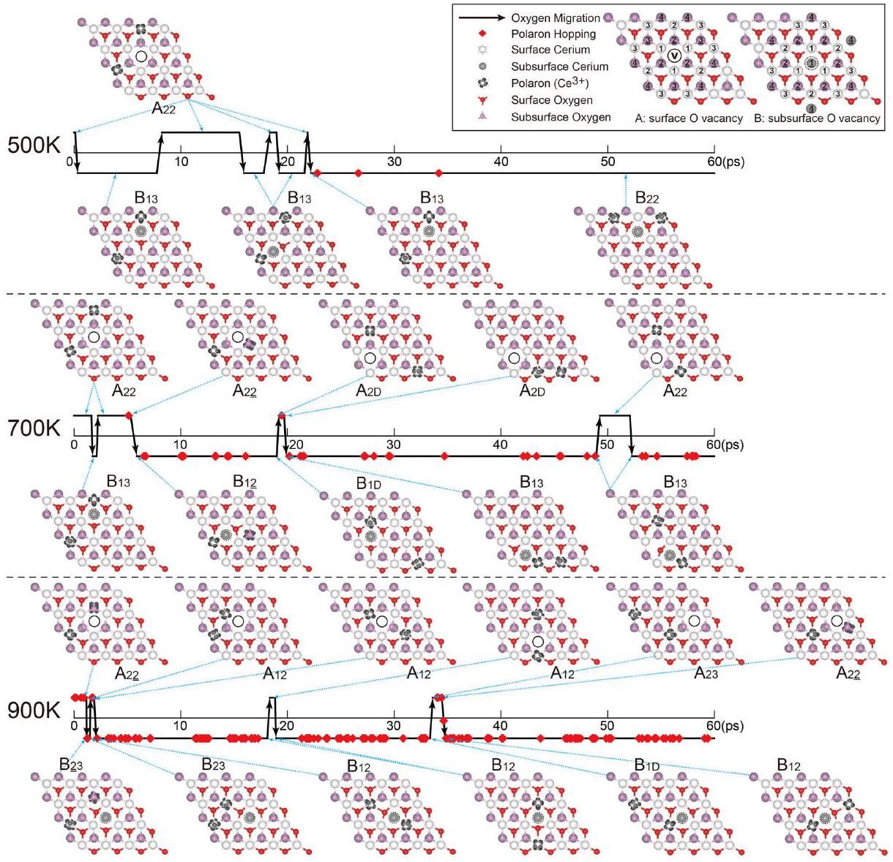
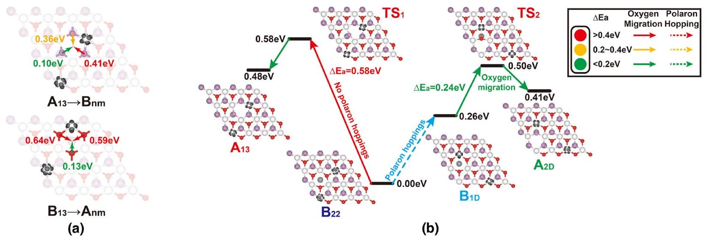
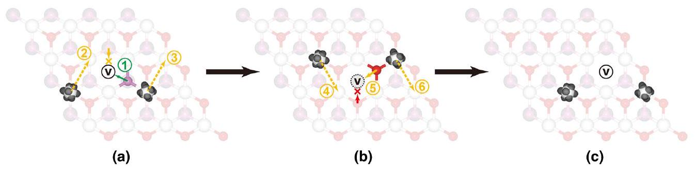

# Oxygen-Vacancy Dynamics and Entanglement with Polaron Hopping at the Reduced $\mathbf{C e O}_{\mathbf{2}}$ (111) Surface 

Dawei Zhang, ${ }^{1}$ Zhong-Kang Han, ${ }^{1,2, *}$ Gustavo E. Murgida, ${ }^{3}$ M. Verónica Ganduglia-Pirovano, ${ }^{4, \dagger}$ and Yi Gao ${ }^{1,5, \ddagger}$ ${ }^{1}$ Division of Interfacial Water and Key Laboratory of Interfacial Physics and Technology, Shanghai Institute of Applied Physics, Chinese Academy of Sciences, 201800 Shanghai, People's Republic of China ${ }^{2}$ University of Chinese Academy of Sciences, 100049 Beijing, People's Republic of China ${ }^{3}$ Centro Atómico Constituyentes, GlyA, CNEA, San Martín, Buenos Aires, Argentina and Consejo Nacional de Investigaciones Científicas y Técnicas, C1033AAJ, Buenos Aires, Argentina ${ }^{4}$ Instituto de Catálisis y Petroleoquímica of the Consejo Superior de Investigaciones Científicas, 28049, Madrid, Spain ${ }^{5}$ Shanghai Advanced Research Institute, Chinese Academy of Sciences, 201210 Shanghai, China

(Received 8 March 2018; revised manuscript received 12 November 2018; published 8 March 2019)

#### Abstract

The migration of oxygen vacancies $\left(V_{\mathrm{O}}\right)$ in ceria-based systems is crucial to their functionality in applications. Yet, although the $V_{\mathrm{O}}$ 's structure and the distribution of the $\mathrm{Ce}^{3+}$ polarons at the $\mathrm{CeO}_{2}(111)$ surface has received extensive attention, the dynamic behaviors of $V_{\mathrm{O}}$ 's and polarons are not fully understood. By combining density functional theory calculations and ab initio molecular dynamics simulations, we show that the movements of $V_{\mathrm{O}}$ 's and polarons exhibit very distinct entanglement characteristics within a temperature range of 300-900 K, and that the positions of the $\mathrm{Ce}^{3+}$ polarons play a key role in the $V_{\mathrm{O}}$ migration. Long-distance vacancy migration occurs at moderate temperatures when the "suitable" $\mathrm{Ce}^{3+}$ distribution remains long enough to promote oxygen migration. This study provides microscopic insight into the interplay between the electronic and ionic charge transport in ceria that will be beneficial for the rational design of conductive ceria-based materials.

DOI: 10.1103/PhysRevLett.122.096101

Ceria $\left(\mathrm{CeO}_{2}\right)$-based materials are of outstanding importance for numerous catalytic processes [1-6], as well as holding promise as key materials for fuel cell applications [7], in resistive switching devices [8], and recently in biology [9,10], with the ability of ceria to store, release, and transport oxygen being crucial to its functionality in such applications.

Reduced ceria $\left(\mathrm{CeO}_{2-\mathrm{x}}\right)$ is a typical example of both polaron and ion conductors. In the past decade, significant progress has been achieved in the characterization and understanding of the possible arrangements of both oxygen vacancies ( $V_{\mathrm{O}}$ 's) and associated excess charges ( $\mathrm{Ce}^{3+}$ 's), mainly at the reduced $\mathrm{CeO}_{2}(111)$ surface [11-20]. Now, it is widely accepted that for the $\mathrm{CeO}_{2}(111)$ surface, isolated vacancies localize preferably in the subsurface and that the excess electrons created upon $V_{\mathrm{O}}$ formation would rather not localize at first-neighbor cationic positions to the vacancies [21-25]. Yet, a microscopic understanding of the migration of $V_{\mathrm{O}}$ 's at ceria surfaces, along with its interplay with polaron hopping motions, is still lacking.

Tuller et al. [26] experimentally determined that the barrier for polaron hopping in bulk ceria is relatively high, lying within the 0.40 to 0.52 eV range. For the $\mathrm{CeO}_{2}(111)$ surface, Namai et al. [27,28] reported $V_{\mathrm{O}}$ mobility at room temperature, whereas Esch et al. [11] indicated that higher temperatures of about 700 K were required. Further, theoretical studies of $V_{\mathrm{O}}$ migration at the $\mathrm{CeO}_{2}(111)$ surface are relatively scarce and limited to the investigation of migration paths for selected configurations of the excess charges [18,29-31]. Li et al. [29] first proposed an energetically favorable two-step exchange mechanism, in which the surface $V_{\mathrm{O}}$ migrates from the surface to the subsurface and then reappears at a neighboring surface oxygen site, instead of direct hopping between surface sites. Later, Plata et al. [30] and Sutton et al. [18] pointed out the importance of specific polaron arrangements on $V_{\mathrm{O}}$ migration at $\mathrm{CeO}_{2}(111)$ and estimated barriers for polaron hopping within the 0.3 to 0.5 eV range. Recently, Su et al. [31] proposed a "polaron-hopping-assisted mechanism" for a surface vacancy with two first-neighboring $\mathrm{Ce}^{3+}$ ions. Despite these efforts, there is still a notable lack of understanding of the dynamic behaviors of $V_{\mathrm{O}}$ 's and $\mathrm{Ce}^{3+}$ 's, as well as the dynamic entanglements between them as a function of temperature. In this work, we address the $V_{\mathrm{O}}$ 's and $\mathrm{Ce}^{3+}$ 's dynamics at the defective $\mathrm{CeO}_{2}(111)$ surface by combining density functional theory (DFT) calculations and ab initio molecular dynamics (AIMD) simulations, and provide a consistent picture about charge transport. We provide firm computational evidence of entanglement between the oxygen migration and polaron hopping processes, and put forward the existence of different dynamic regimes as a function of temperature. This work presents unprecedented microscopic understandings of oxygen migration processes and the role of polarons
in it, which will be beneficial for the optimization of materials performance in applications such as catalysis or fuel cells.

Spin-polarized DFT calculations with the Perdew-Burke-Ernzerhof (PBE) functional [32] were performed using the Vienna ab initio simulation package (vasp, version 5.2.12) [33,34]. A Hubbard-type term $U=5.0 \mathrm{eV}$ was used for the Ce $4 f$ states to describe the localization of the excess charges. Most studies agree that $U$ values within the 4.5-6.0 eV range are suitable [35-37]. The suitability of our $U$ value for the study of the migration of $V_{\mathrm{O}}$ 's at the defective $\mathrm{CeO}_{2}(111)$ is briefly analyzed in the Supplemental Material [38]. The Kohn-Sham valence states were expanded in a plane-wave basis set with a cutoff energy of 400 eV. The core-valence interactions were represented using the projector augmented wave (PAW) approach [39], where for Ce and O atoms, the $(4 f, 5 s, 5 p, 5 d, 6 s)$ and $(2 s, 2 p)$ states were treated as valence states, respectively. A periodic slab with a (4 × 4) surface unit cell with one (or four) oxygen atom(s) removed was considered to model the defective $\mathrm{CeO}_{2}(111)$ surface, which contains nine atomic layers and a vacuum layer of $15 \text{Å}$. The bottom three layers (O-Ce-O) were frozen to their bulk positions during geometry optimizations and AIMD simulations. A Monkhorst-Pack $1 \times 1 \times 1 k$ -point mesh was used for the Brillouin zone integration. The climbing image nudged-elastic band (CI-NEB) algorithm was employed to identify the transition state structures for oxygen migrations and polaron hoppings on the surface [40]. Standard AIMD simulations in the canonical (NVT) ensemble were performed at 300, 500, 700, and 900 K to investigate the dynamics of the electronic and ionic carriers with temperature. The simulations run 60 ps for each trajectory with a 1 fs time step. The AIMD trajectories are shown in Fig. 1.

Hereinafter, a capital letter $A(B)$ denotes a surface (subsurface) vacancy, and a pair of subindices $n$ and $m$ $(m \geq n)$ denote the neighboring cationic coordination shells in which the two excess electrons are located (underlined $\underline{n}$ and $\underline{m}$ are in the second cerium layer). Any $n$ or $m>4$ is replaced by a letter " $D$ " ("distant"). All simulations started from the most stable surface vacancy structure $\left(A_{22}\right)$. At room temperature (300 K), neither oxygen migration nor polaron hopping was observed during the 60 ps simulation period. At 500 K (cf. Fig. 1), polaron hopping did not occur during the first 22.5 ps , while the vacancy migrated 7 times between

FIG. 1. Schematic AIMD trajectories of reduced $\mathrm{CeO}_{2}(111)$ surface at 500, 700, and 900 K. The black arrow represents the $V_{\mathrm{O}}$ migration; the red diamond represents a polaron hopping.

TABLE I. Activation energies (in eV) for oxygen migration paths and polaron hoppings at $\mathrm{CeO}_{2}(111)$.
| Process | Path | This work |  | References |
| :--- | :--- | :--- | :--- | :--- |
| $V_{\mathrm{O}}$ migration |  | $1 V_{\mathrm{O}}$ in $4 \times 4$ cell | $4 V_{\mathrm{O}}$ 's in $4 \times 4$ cell |  |
| $\mathrm{O}_{\text {Sub }} \rightarrow \mathrm{O}_{\text {Surf }}$ | $\mathrm{Ce}^{3+}-\mathrm{Ce}^{3+}$ | 0.71 |  | 0.73 [30] |
| (i.e., $A \rightarrow B$ ) | $\mathrm{Ce}^{3+}-\mathrm{Ce}^{4+}$ | 0.22-0.41 | 0.20, 0.38 | 0.39 [30], 0.40 [31] |
|  | $\mathrm{Ce}^{4+}-\mathrm{Ce}^{4+}$ ( $\mathrm{Ce}^{3+}$ nearby) | 0.06-0.21 | 0.16 | 0.12 [30], 0.15 [31] |
|  | $\mathrm{Ce}^{4+}-\mathrm{Ce}^{4+}$ ( $\mathrm{Ce}^{3+}$ faraway) | 0.28 |  | 0.44 [29], 0.27 [30] |
| $\mathrm{O}_{\text {Surf }} \rightarrow \mathrm{O}_{\text {Sub }}$ | $\mathrm{Ce}^{3+}-\mathrm{Ce}^{3+}$ | 0.90 |  |  |
| (i.e., $B \rightarrow A$ ) | $\mathrm{Ce}^{3+}-\mathrm{Ce}^{4+}$ | 0.37-0.72 | 0.55, 0.66 |  |
|  | $\mathrm{Ce}^{4+}-\mathrm{Ce}^{4+}\left(\mathrm{B}_{1 \mathrm{~m}}\right)$ | 0.13-0.45 | 0.28 | 0.26 [18] |
|  | $\mathrm{Ce}^{4+}-\mathrm{Ce}^{4+}$ (no NN $\mathrm{Ce}^{3+}$ ) | 0.31-0.77 |  | 0.61 [29], 0.53 [18] |
| Polaron hopping |  | ~0.2-0.5 |  | 0.18 [31], 0.28-0.50 [29] 0.29 [18], 0.2-0.4 [26,42] |

adjacent surface ( $A_{22}$ ) and subsurface ( $B_{13}$ ) sites across a $\left(\mathrm{Ce}^{4+}-\mathrm{Ce}^{4+}\right)$ pair during this time. Although the vacancy migrated, it remained confined within a small area near the polarons. With the vacancy in the subsurface, a few polaron hops occurred after which the most stable configuration $\left(B_{22}\right)$ was reached; such a stable configuration is difficult to change at low temperatures. At 700 K, 42 polaron hoppings and 7 vacancy migrations were observed. We noticed that (i) all migrations took place across $\left(\mathrm{Ce}^{4+}-\mathrm{Ce}^{4+}\right)$ pairs, (ii) the system remained at the most energetically favorable configuration $\left(B_{22}\right)$ for a long time (totally 27 ps within the 60 ps period of time), and (iii) all of the $V_{\mathrm{O}}$ migrations from the subsurface to the surface $(B \rightarrow A)$ took place from a configuration with a nearest neighbor (NN) polaron (hereinafter referred to as $B_{1 \mathrm{~m}}$ ), and the $V_{\mathrm{O}}$ always moves away from it. Finally, at 900 K, the frequency of polaron hoppings is sharply increased up to 148 times in 60 ps, while that of $V_{\mathrm{O}}$ migrations does not increase (7 times). At this temperature, some short-lived $V_{\mathrm{O}}$ structures with higher energies appeared, including a subsurface vacancy with two NN polarons $\left(B_{1 \underline{1}}\right)$ and a surface vacancy with one NN polaron $\left(A_{12}, A_{12}\right)$, while the least stable vacancy structure ( $A_{11}$ ) was never observed. Again all $V_{\mathrm{O}}$ migrations took place across $\left(\mathrm{Ce}^{4+}-\mathrm{Ce}^{4+}\right)$ pairs, while $V_{\mathrm{O}}$ migrations from the subsurface to the surface occasionally occurred from configurations other than $B_{1 \mathrm{~m}}$. We notice that in our AIMD simulations, the $V_{\mathrm{O}}$ always remains in the near-surface (within the two outermost oxygen layers) up to 900 K, which is consistent with the reported predicted trends in the vacancy formation energy as a function of the layer deepness [16,18]. Besides, the AIMD simulations show that the oxygen atoms move much slower than the polarons (e.g., at 700 K, an oxygen migration process takes an average time of 0.25 ps while a polaron hop only takes about 0.02 ps), as expected due to the much smaller mass of the electrons.

We calculated all the oxygen migration pathways appearing in the AIMD simulations as well as some other representative vacancy structures and oxygen migration pathways. The activation energies are listed in Table I. In agreement with earlier works [13,14,16,18], our calculations indicate that an $V_{\mathrm{O}}$ usually prefers the subsurface rather than the surface (by about 0.2 eV), whereas $\mathrm{Ce}^{3+}$ polarons prefer the outermost cerium layer more than the layer beneath (by about 0.2 eV). Moreover, as mentioned above, the most stable $\mathrm{Ce}^{3+}$ positions are localized on the next nearest neighbor (NNN) sites to the vacancy, being $A_{22}$ and $B_{22}$ the lowest energy configurations for a surface and subsurface $V_{\mathrm{O}}$, respectively. This stability can be related to the interaction (binding) between $V_{\mathrm{O}}$ and polarons [24] (cf. the Supplemental Material [38]). As shown in the AIMD simulations, temperature plays a critical role in the dynamic behaviors of $V_{\mathrm{O}}$ 's and $\mathrm{Ce}^{3+}$ 's due to the different energy barriers for oxygen migrations and polaron hoppings. The barriers for oxygen migration (within a 0.06-0.30 eV range) are typically lower than those of polaron hopping (within a 0.23-0.50 eV range). Thus, vacancy migrations already occur at relatively moderate temperatures, whereas polaron hoppings become more frequent only at higher temperatures. Furthermore, we notice that the near-surface oxygen migration barriers are by about 0.3 eV smaller than those reported for oxygen migration in bulk ceria (0.45 to 0.62 eV) [41]. For migration pathways, energy barriers, and reaction energies, see the Supplemental Material [38].

The AIMD trajectories indicate that none of the oxygen migrations took place across $\left(\mathrm{Ce}^{3+}-\mathrm{Ce}^{4+}\right)$ or $\left(\mathrm{Ce}^{3+}-\mathrm{Ce}^{3+}\right)$ pairs, even at 900 K. The calculated activation barriers for oxygen migrations show a clear trend: $\left(\mathrm{Ce}^{4+}-\mathrm{Ce}^{4+}\right)<$ $\left(\mathrm{Ce}^{4+}-\mathrm{Ce}^{3+}\right)<\left(\mathrm{Ce}^{3+}-\mathrm{Ce}^{3+}\right)$; i.e., the most favorable oxygen migration path is across $\left(\mathrm{Ce}^{4+}-\mathrm{Ce}^{4+}\right)$ pairs, in line with the early results by Plata et al. [30]. Therefore, if one polaron is NN to a vacancy, there will be two energetically less favorable oxygen migration paths crossing $\left(\mathrm{Ce}^{4+}-\mathrm{Ce}^{3+}\right)$ pairs and one energetically more favorable path crossing a $\left(\mathrm{Ce}^{4+}-\mathrm{Ce}^{4+}\right)$ pair [cf. Fig. 2(a)]. We will refer to the mechanism by which a NN polaron selectively hinders oxygen migration pathways as the "NN-polaron-hindered mechanism".

FIG. 2. Examples of the two oxygen migration mechanisms: (a) the NN-polaron-hindered mechanism; (b) the NN-polaron-promoted mechanism.

Moreover, oxygen migration from the surface into the subsurface $(B \rightarrow A)$ is generally more difficult than the reverse process due to the higher stability of subsurface vacancies [13,14,16,18]. Most noticeably, $B \rightarrow A$ migrations predominantly (always in our simulations at 500 and 700 K) started from a $B_{1 \mathrm{~m}}$-type configuration, i.e., a structure with one NN polaron to the subsurface vacancy. As exemplified in Fig. 2(b), the energy barrier for a subsurface-directed oxygen migration path ( $V_{\mathrm{O}}$ 's movement in the opposite direction), starting from the most stable $B_{22}$ configuration (no NN polarons), is considerably high $\left(B_{22} \rightarrow A_{13}: 0.58 \mathrm{eV}\right)$ [18]. However, if a polaron hops to a NN site to the subsurface vacancy first $\left(B_{22} \rightarrow B_{1 \mathrm{D}}\right)$, the barrier for the surface oxygen migration into the subsurface is significantly reduced $\left(B_{1 \mathrm{D}} \rightarrow A_{2 \mathrm{D}}: 0.24 \mathrm{eV}\right)$. The barrier reduction results from the destabilization of the starting subsurface vacancy configuration by the presence of a NN polaron. However, after the oxygen migration, this polaron is in a NNN position to the surface vacancy and thus stabilizes the final state. We will refer to the oxygen migration mechanism by which a NN polaron to a subsurface vacancy aids oxygen migration from the surface into the subsurface as the "NN-polaron-promoted mechanism".

As shown in Table I, the activation barriers for both the NN-polaron-hindered mechanism and the NN-polaron-promoted mechanism are weakly dependent on vacancy concentration within the 1/16 to 1/4 range. That is, at the high $V_{\mathrm{O}}$ concentration of 1/4, for which a subsurface vacancy is again more stable than a surface vacancy [13,16], a NN polaron also hinders the $B \leftrightarrow A$ migration pathways next to it as well as helps the subsurface vacancy to migrate to the surface away from it.

The distinct dynamic behaviors of $V_{\mathrm{O}}$ 's and $\mathrm{Ce}^{3+}$ 's depending on temperature can be explained by considering the correlation between the position of the $\mathrm{Ce}^{3+}$ 's and the possible oxygen migration pathways. At moderate temperatures, polarons remain for long enough time at favorable positions ( $B_{1 \mathrm{~m}}$, which helps the subsurface $V_{\mathrm{O}}$ to migrate to the surface) for long-distance $V_{\mathrm{O}}$ migration to occur. At higher temperatures, however, polarons hop too frequently and therefore the $V_{\mathrm{O}}$ movement is disrupted. The observed temperature dependence of the reaction rates for oxygen migration translates into temperature-dependent effective activation energy barriers, which, e.g., at 900 K is by 1.8 times higher than that at 500 K. For a detailed discussion, see the Supplemental Material [38].

Based on the above discussion, in Fig. 3 we sketch how long-range oxygen migration at the ceria (111) surface may happen. Starting from the stable surface $V_{\mathrm{O}}\left(A_{22}\right)$, the migration of a subsurface oxygen atom to the surface is highly probable [Fig. 3(a), step 1]. After forming a subsurface vacancy in the $B_{13}$ configuration, the system may

FIG. 3. Schematic view of possible $V_{\mathrm{O}}$ migration pathways at the ceria (111) surface. "x" here indicates the oxygen migrations which are difficult and thus less likely to occur.

reach the most stable $B_{22}$ state through several polaron hopping processes [Fig. 3(a), steps 2 and 3]. However, if a $B_{1 \mathrm{~m}}$-type configuration is achieved by suitable polaron hopping [Fig. 3(b), step 4], it is probable that the subsurface $V_{\mathrm{O}}$ would migrate back to the surface [NN-polaron-promoted mechanism, Fig. 3(b), step 5], reappearing at a site which is different from the initial position [cf. Fig. 3(a) and 3(c)]; by repeating these steps, oxygen migrates along the surface. Note that the considered oxygen migrations pathways in Fig. 3 only cross $\left(\mathrm{Ce}^{4+}-\mathrm{Ce}^{4+}\right)$ lines due to the NN-polaron-hindered mechanism.

In summary, DFT + U calculations in combination with AIMD simulations at different temperatures provide crucial insight into the dynamic behaviors of $V_{\mathrm{O}}$ 's and $\mathrm{Ce}^{3+}$ polarons at the reduced $\mathrm{CeO}_{2}(111)$ surface. We show that both vacancy migration and polaron hopping are thermally activated and that the temperature plays a critical role in the oxygen-vacancy and polaron movements at the surface. At relatively low temperatures, $V_{\mathrm{O}}$ 's move, but not far from their initial positions, whereas polarons practically do not hop. At higher but still moderate temperatures, polarons hop and promote $V_{\mathrm{O}}$ 's to migrate farther away. Nevertheless, at even higher temperatures, polarons hop too frequently and disturb oxygen migrations. Our results provide evidence of entanglements between the oxygen migration and polaron hopping processes. Oxygen movements across $\left(\mathrm{Ce}^{4+}-\mathrm{Ce}^{4+}\right)$ lines are energetically preferred as compared to those across $\left(\mathrm{Ce}^{3+}-\mathrm{Ce}^{4+}\right)$ and $\left(\mathrm{Ce}^{3+}-\mathrm{Ce}^{3+}\right)$ lines (NN polaron hindered mechanism). Moreover, it is energetically more favorable for oxygen atoms to move from the subsurface to the surface than the other way around. Furthermore, the presence of a nearest neighbor polaron to a subsurface vacancy facilitates oxygen migration from the surface into the subsurface [across a $\left(\mathrm{Ce}^{4+}-\mathrm{Ce}^{4+}\right)$ line] as well as stabilizes the newly formed surface vacancy (NN-polaron-promoted mechanism). A number of statistical tests show that the conclusions derived from the AIMD simulations are robust; also, the rates of oxygen migration and polaron hopping as derived from a simple model that describes the characteristics of their entangled dynamics, are consistent with a non-Arrhenius temperature dependence of the oxygen migration (Supplemental Material [38]). The formation of $V_{\mathrm{O}}$ 's and polarons is particularly favorable in reducible oxides and the decisive role of polarons in the stabilization of vacancy structures, as well as in electron and ionic transports, is of continued interest in surface science and has important implications for established and emerging technologies [43-45]. Recently, e.g., polarons were found to be very important for the stabilization and reconstruction of reduced rutile $\mathrm{TiO}_{2}$ surfaces [46]. Thus, the entanglement of polarons and vacancies at reducible oxide surfaces is likely to influence their physical and chemical properties as well as the surface charge transport. Fundamental understanding of the interactions between vacancies and polarons is paramount for the optimization of the functionality of reducible oxide-based materials in advanced applications.

This work is funded by the National Natural Science Foundation of China (11574340, 21773287). M. V. G.-P. acknowledges support by the MINECO-Spain (CTQ2015-71823-R) and G.E.M. by the ANPCyT-Argentina (PICT-1555), and CONICET-Argentina (PIP-0069CO). The computational resources utilized in this research are provided by the National Supercomputing Center in Tianjin, Shanghai Supercomputer Center, and Guangzhou Supercomputer Center.

[^0]

[20] R. Olbrich, G. E. Murgida, V. Ferrari, C. Barth, A. M. Llois, M. Reichling, and M. V. Ganduglia-Pirovano, J. Phys. Chem. C 121, 6844 (2017).
[21] G.E. Murgida, V. Ferrari, M. V. Ganduglia-Pirovano, and A. M. Llois, Phys. Rev. B 90, 115120 (2014).
[22] X. Han, N. Amrane, Z. Zhang, and M. Benkraouda, J. Phys. Chem. C 120, 13325 (2016).
[23] M. V. Ganduglia-Pirovano, G. E. Murgida, V. Ferrari, and A. M. Llois, J. Phys. Chem. C 121, 21080 (2017).
[24] L. Sun, X. Huang, L. Wang, and A. Janotti, Phys. Rev. B 95, 245101 (2017).
[25] B. Wang, X. Xi, and A. N. Cormack, Chem. Mater. 26, 3687 (2014).
[26] H. L. Tuller and A. S. Nowick, J. Phys. Chem. Solids 38, 859 (1977).
[27] Y. Namai, K. Fukui, and Y. Iwasawa, J. Phys. Chem. B 107, 11666 (2003).
[28] Y. Namai, K. Fukui, and Y. Iwasawa, Catal. Today 85, 79 (2003).
[29] H.-Y. Li, H.-F. Wang, Y.-L. Guo, G.-Z. Lu, and P. Hu, Chem. Commun. (Cambridge) 47, 6105 (2011).
[30] J. J. Plata, A. M. Márquez, and J. F. Sanz, J. Phys. Chem. C 117, 25497 (2013).
[31] Y. Q. Su, I. A. W. Filot, J. X. Liu, I. Tranca, and E. J. M. Hensen, Chem. Mater. 28, 5652 (2016).
[32] J. P. Perdew, K. Burke, and M. Ernzerhof, Phys. Rev. Lett. 77, 3865 (1996).
[33] G. Kresse and J. Furthmüller, Phys. Rev. B 54, 11169 (1996).
[34] G. Kresse and J. Furthmüller, Comput. Mater. Sci. 6, 15 (1996).
[35] S. L. Dudarev, G. A. Botton, S. Y. Savrasov, C. J. Humphreys, and A. P. Sutton, Phys. Rev. B 57, 1505 (1998).
[36] M. Nolan, S. Grigoleit, D. C. Sayle, S. C. Parker, and G. W. Watson, Surf. Sci. 576, 217 (2005).
[37] C. W. M. Castleton, J. Kullgren, and K. Hermansson, J. Chem. Phys. 127, 244704 (2007).
[38] See Supplemental Material at http://link.aps.org/supplemental/10.1103/PhysRevLett.122.096101 for the detailed AIMD trajectories and the pathways of $V_{\mathrm{O}}$ migrations and polaron hoppings as well as the results of a number of statistical tests in addition to those of a simple model to describe their entangled dynamics.
[39] P. E. Blöchl, Phys. Rev. B 50, 17953 (1994).
[40] G. Henkelman, B. P. Uberuaga, and H. Jonsson, J. Chem. Phys. 113, 9901 (2000).
[41] M. Nakayama, H. Ohshima, M. Nogamia, and M. Martin, Phys. Chem. Chem. Phys. 14, 6079 (2012).
[42] I. K. Naik and T. Y. Tien, J. Phys. Chem. Solids 39, 311 (1978).
[43] C. B. Gopal, M. García-Melchor, S. C. Lee, Y. Shi, A. Shavorskiy, M. Monti, Z. Guan, R. Sinclair, H. Bluhm, A. Vojvodic, and W. C. Chueh, Nat. Commun. 8, 15360 (2017).
[44] Y. Shi, A. H. Bork, S. Schweiger, and J. L. M. Rupp, Nat. Mater. 14, 721 (2015).
[45] S. M. Yang, S. Lee, J. Jian, W. Zhang, P. Lu, Q. Jia, H. Wang, T. W. Noh, S. V. Kalinin, and J. L. MacManus-Driscoll, Nat. Commun. 6, 8588 (2015).
[46] M. Reticcioli, M. Setvin, X. Hao, P. Flauger, G. Kresse, M. Schmid, U. Diebold, and C. Franchini, Phys. Rev. X 7, 031053 (2017).

[^0]:    *Present address: Fritz Haber Institute of the Max Planck Society, Faradayweg 4-6, 14195 Berlin, Germany.
    ${ }^{\dagger}$ vgp@icp.csic.es
    ${ }^{\ddagger}$ gaoyi@sinap.ac.cn
    [1] A. Trovarelli and P. Fornasiero, Catalysis by Ceria and Related Materials, 2nd ed. (Imperial College Press, London, 2013), DOI: 10.1142/p870.
    [2] Q. Fu, H. Saltsburg, and M. Flytzani-Stephanopoulos, Science 301, 935 (2003).
    [3] G. A. Deluga, J. R. Salge, L. D. Schmidt, and X. E. Verykios, Science 303, 993 (2004).
    [4] C. T. Campbell and C. H. F. Peden, Science 309, 713 (2005).
    [5] J. A. Rodriguez, S. Ma, P. Liu, J. Hrbek, J. Evans, and M. Pérez, Science 318, 1757 (2007).
    [6] R. J. Gorte, AIChE J. 56, 1126 (2010).
    [7] S. Park, J. M. Vohs, and R. J. Gorte, Nature (London) 404, 265 (2000).
    [8] E. Miranda, S. Kano, C. Dou, K. Kakushima, J. Suñé, and H. Iwai, Appl. Phys. Lett. 101, 012910 (2012).
    [9] C. Xu and X. Qu, NPG Asia Mater. 6, e90 (2014).
    [10] G. Pulido-Reyes, I. Rodea-Palomares, S. Das, T. S. Sakthivel, F. Leganes, R. Rosal, S. Seal, and F. Fernández-Piñas, Sci. Rep. 5, 15613 (2015).
    [11] F. Esch, S. Fabris, L. Zhou, T. Montini, C. Africh, P. Fornasiero, G. Comelli, and R. Rosei, Science 309, 752 (2005).
    [12] S. Torbrügge, M. Reichling, A. Ishiyama, S. Morita, and O. Custance, Phys. Rev. Lett. 99, 056101 (2007).
    [13] M. V. Ganduglia-Pirovano, J. L. F. Da Silva, and J. Sauer, Phys. Rev. Lett. 102, 026101 (2009).
    [14] H. Y. Li, H. F. Wang, X. Q. Gong, Y. L. Guo, Y. Guo, G. Z. Lu, and P. Hu, Phys. Rev. B 79, 193401 (2009).
    [15] J. F. Jerratsch, X. Shao, N. Nilius, H. J. Freund, C. Popa, M. V. Ganduglia-Pirovano, A. M. Burow, and J. Sauer, Phys. Rev. Lett. 106, 246801 (2011).
    [16] G.E. Murgida and M. V. Ganduglia-Pirovano, Phys. Rev. Lett. 110, 246101 (2013).
    [17] J. Kullgren, M. J. Wolf, C. W. M. Castleton, P. Mitev, W. J. Briels, and K. Hermansson, Phys. Rev. Lett. 112, 156102 (2014).
    [18] J. E. Sutton, A. Beste, and S. H. Overbury, Phys. Rev. B 92, 144105 (2015).
    [19] X. P. Wu and X. Q. Gong, Phys. Rev. Lett. 116, 086102 (2016).

