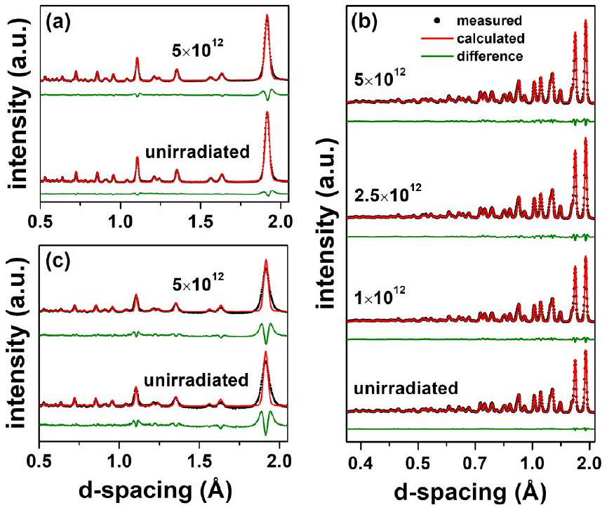
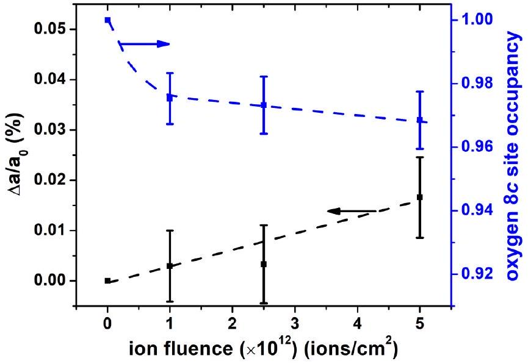
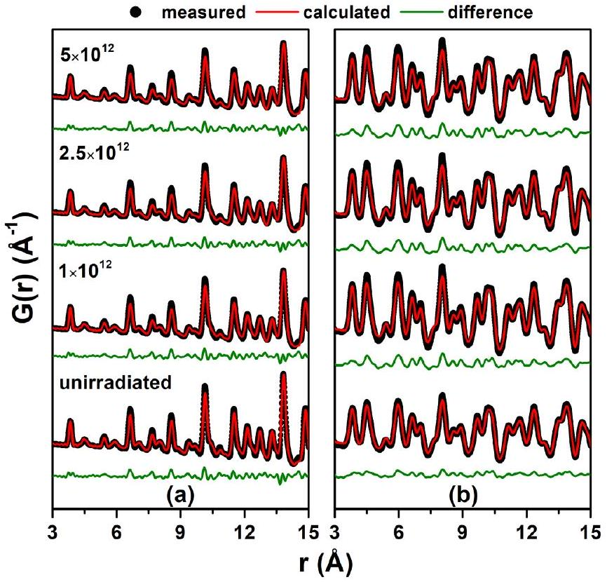
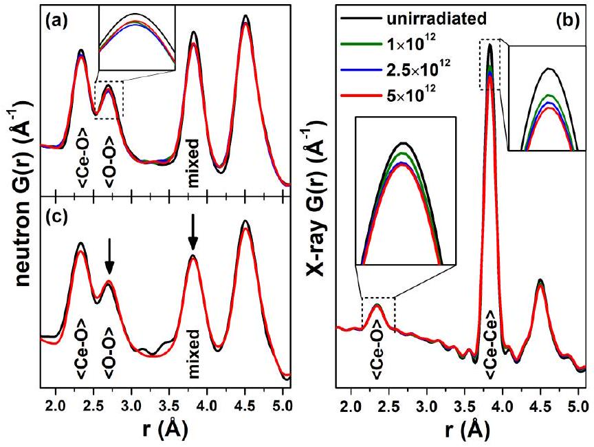
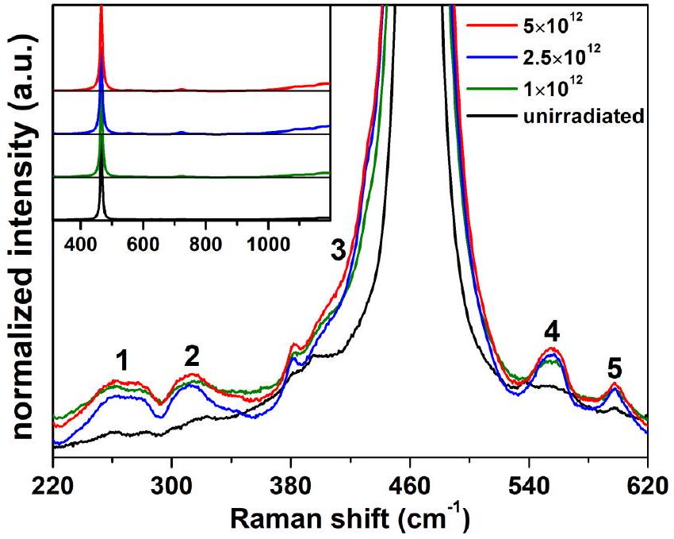
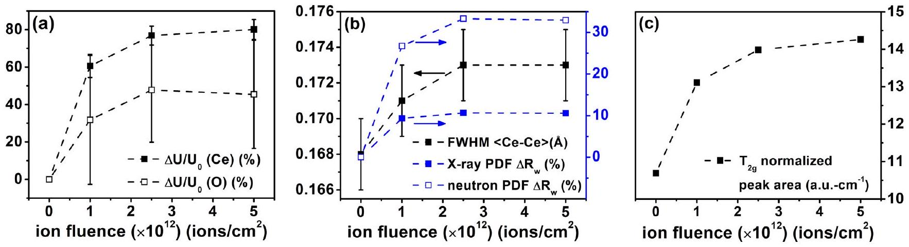
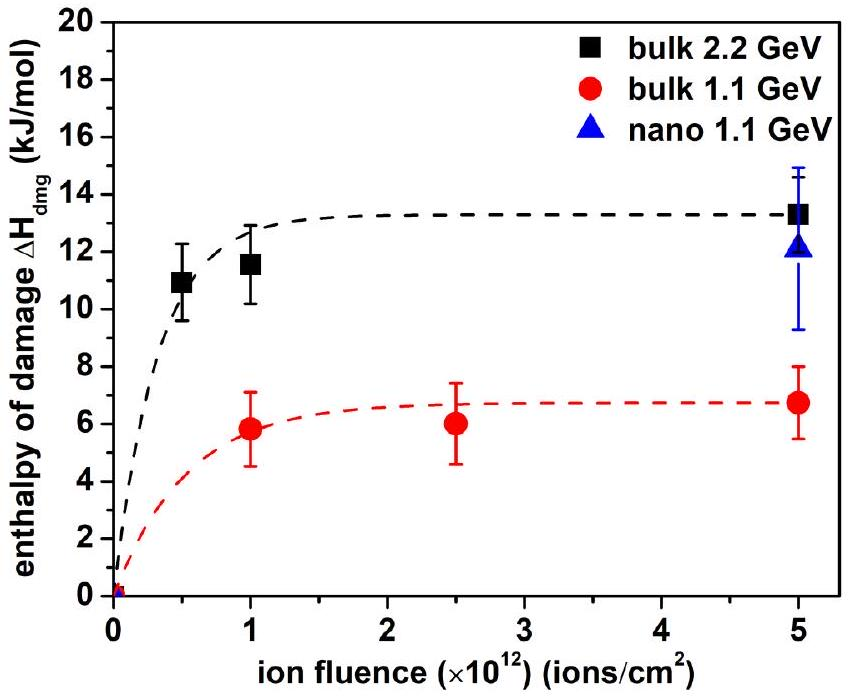
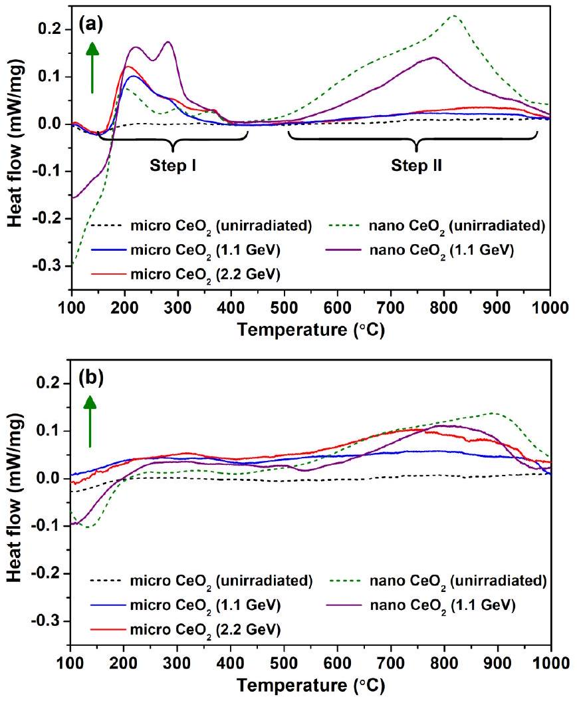
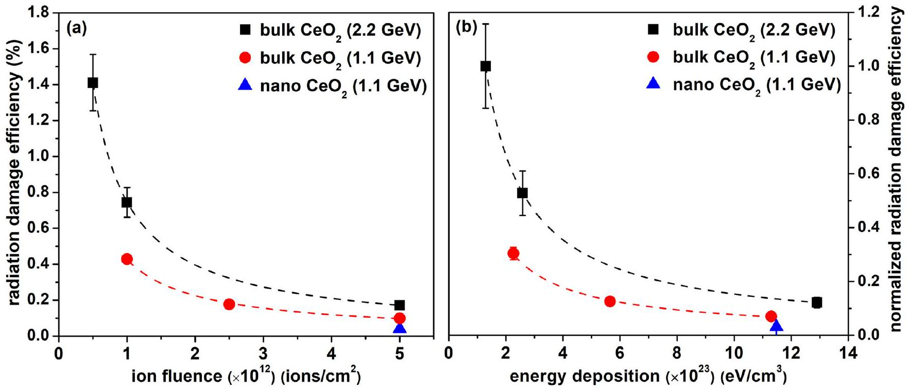

# Energetics of defect production in fluorite-structured $\mathbf{C e O}_{\mathbf{2}}$ induced by highly ionizing radiation 

A. Shelyug, ${ }^{1}$ R. I. Palomares, ${ }^{2}$ M. Lang, ${ }^{2}$ and A. Navrotsky ${ }^{1, *}$ ${ }^{1}$ Peter A. Rock Thermochemistry Laboratory and NEAT ORU, University of California Davis, Davis, California 95616, USA ${ }^{2}$ Department of Nuclear Engineering, University of Tennessee, Knoxville, Tennessee 37996, USA

(Received 25 April 2018; revised manuscript received 17 July 2018; published 19 September 2018)

#### Abstract

Understanding the energetics of radiation-induced defects is critical to the development of next-generation materials for nuclear and other energy systems and for aerospace applications. However, it remains a challenge to experimentally characterize defect morphologies and energies, especially in regard to anion defects in irradiated oxides. Here, using a combination of advanced structural and calorimetric characterization techniques, we show that the energetic response of defects in $\mathrm{CeO}_{2}$ is strongly coupled to atomic disordering on the oxygen sublattice induced by energetic heavy ions. Fitting of calorimetric data yields an estimate of stored energy in the form of defects and microstrain. These results provide a means to calculate the efficiency of structural destabilization and aid in a better understanding of defect formation and annealing mechanisms in fluorite-structured materials subject to extreme conditions.

DOI: 10.1103/PhysRevMaterials.2.093607

## I. INTRODUCTION

Numerous fluorite-structured materials are used in nuclear and electrochemical energy systems, as they generally exhibit attractive properties and phase stability under a wide range of extreme conditions. One such extreme is high-energy ion irradiation [1-4], which is common among nuclear, geological, and space environments. Energy deposition from highly ionizing radiation typically results in the formation of point defects in these materials [5-8] that are either isolated or associated in clusters [9-11]. The accumulation of defects can have both positive and negative impacts on material properties and performance in energy-related applications. For example, individual defects from self-irradiation can form voids and cracks at elevated temperatures that contribute to mechanical failure of nuclear fuel materials [12]. In contrast, the incorporation of heterogeneous microstrain from radiation-induced oxygen defects can significantly increase the ionic conductivity [13,14]. This opens an opportunity to use ion beams for nanoengineering and to tailor defects to improve oxygen transport in solid oxide fuel cell (SOFC) electrolytes. This highlights the need for better understanding of the underlying mechanisms of defect accumulation and annealing in fluorite-structured oxides.

Substantial efforts have been made to understand the behavior of fluorite-structured materials under highly ionizing radiation. Several recent studies have focused on structural aspects of irradiated materials through the application of neutron scattering, x-ray diffraction, x-ray absorption spectroscopy, and Raman spectroscopy. These analytical techniques have allowed for the better understanding of damage accumulation, redox effects [15], and defect annealing processes [16,17]. However, a fundamental thermodynamic approach is required in order to fully assess defect production mechanisms and

[^0] to link energetics with underlying defect structure features. Experimental efforts to quantify defect energetics are challenging, thus there are only a limited number of studies focusing on natural zircon damaged via alpha decay of uranium [18] and swift heavy-ion irradiated pyrochlore oxides [19-21]. It was shown for amorphizable pyrochlore materials that damage recovery processes are complex, involving modifications to the local structure which do not directly correlate to bulk structural changes. Further coupled thermodynamic and structural investigations are needed to better understand damage formation and thermal recovery.

Many materials with a fluorite structure have enhanced radiation resistance and cannot be amorphized by energetic ion beams at and above room temperature. Despite the importance of these materials to the nuclear fuel cycle, such compounds have not been in the focus of thermodynamic studies and their defect energetics remain for the most part unclear [2,3]. Fluorite-structured cerium dioxide $\left(\mathrm{CeO}_{2}\right)$ is isostructural with several actinide oxides and doped zirconia (e.g., yttria-stabilized zirconia) and exhibits thermophysical properties similar to uranium dioxide. Furthermore, $\mathrm{CeO}_{2}$ is a candidate component of inert matrix fuel [22] and a structural analog for $\mathrm{PuO}_{2}$ for facilitating the study of various physiochemical and dilution properties of highly radioactive plutonium [23] because Ce exhibits IV and III oxidation states and similar size to Pu (ionic radii of $0.97 \AA$ for $\mathrm{Ce}(\mathrm{IV})$ and $0.96 \AA$ for $\mathrm{Pu}(\mathrm{IV})$ in eightfold coordination [24]). This makes it a useful nonradioactive analog to nuclear fuel and SOFC electrolyte materials and a good model system for first thermodynamic investigations.

Cerium dioxide is also an important catalyst material due to its variable oxidation state ( $\mathrm{Ce}^{3+}$ and $\mathrm{Ce}^{4+}$ ), large oxygen transport and capacity [25]. Computer simulations [26-29] have shown that intrinsic defects, predominantly oxygen vacancies, exhibit low formation energies. Surface effects also play a major role in the accumulation of defects and are largely responsible for the unique catalytic properties of ceria
[30-32]. Both oxygen vacancies $\left(V_{\ddot{O}}\right)$ and interfaces (i.e., grain boundaries) are effective recombination sites for extrinsic defects caused by irradiation [33-36]. Vacancy formation is typically accompanied by the localization of electrons on cerium ions, which further induces reduction of cerium atoms from Ce(IV) to Ce(III) [37,38]. These redox processes, which are highly dependent on the grain size of the material, can result in an increase of the unit cell volume by distortion of the local coordination environment and electrostatic repulsion between reduced ions [15]. Both experimental and simulation studies [9-11,17,36] also suggest the existence of various oxygen defect complexes. Despite a substantial body of work, many details of defect structures and atomic disordering remain unclear, particularly as to how they correlate to overall lattice destabilization.

Here, we report findings from combined experimental structural and thermodynamic analyses of defect formation and stability in microcrystalline and nanocrystalline $\mathrm{CeO}_{2}$ subject to dense electronic excitation from energetic ion irradiation (1.1- and 2.2-GeV Au ions). Neutron and x-ray diffraction were used to evaluate the overall structural response while pair distribution function analysis and Raman spectroscopy provided information on the short-range structural modifications. Nondestructive structural characterization allowed further investigation by high-temperature oxide melt solution calorimetry and differential scanning calorimetry to evaluate the overall magnitude of energetic destabilization, defect annealing, and defect energetics.

## II. METHODS

## A. Sample preparation

All samples were prepared from microcrystalline (grain size $\sim 1-5 \mu \mathrm{~m}$ ) and nanocrystalline (grain size $\sim 20 \mathrm{~nm}) \mathrm{CeO}_{2}$ powders purchased from Alfa Aesar and MTI Corporation, respectively. The powders were uniaxially pressed at room temperature and in air into 1 -cm-diameter $45-75-\mu \mathrm{m}$ deep circular indentations that were machined into small aluminum plates. The filled aluminum holders were tightly wrapped with $7-10-\mu \mathrm{m}$-thick aluminum foil in order to secure the pressed powders for subsequent shipping and irradiation.

## B. Irradiation

The samples were irradiated at room temperature and under vacuum at the X0 beamline of the Universal Linear Accelerator at the GSI Helmholtz Center for Heavy Ion Research in Darmstadt, Germany. One set of microcrystalline $\mathrm{CeO}_{2}$ samples was irradiated with a $5 \times 5-\mathrm{cm}^{2}$ beam of $2.2-\mathrm{GeV}$ ${ }^{197}$ Au ions. Another set of microcrystalline and nanocrystalline $\mathrm{CeO}_{2}$ samples was irradiated with 1.1-GeV ${ }^{197} \mathrm{Au}$ ions. The final ion-beam energies at the sample surfaces were 1.93 and 1.04 GeV after taking into account the energy loss in the aluminum foils. The ion flux was monitored with the help of an on-line secondary electron detector consisting of three aluminum foils (total thickness $\sim 3 \mu \mathrm{~m}$ ). The current was calibrated with a Faraday cup and is used to determine the target fluence on the samples [39]. The ion energy loss in the GeV energy regime is primarily electronic with negligible nuclear energy loss contributions (approximately three orders of magnitude smaller). Electronic energy loss was calculated using the srim 2008 code [40]. Calculated values for the mean electronic energy loss deposited in the samples were 27 ± 3 and 37 ± 2 keV/nm for 1.1- and 2.2-GeV ${ }^{197} \mathrm{Au}$ ion irradiations, respectively. In both cases, the nuclear energy loss was more than an order of magnitude lower than the electronic energy loss. The mean values with errors represent the energy loss variation over the entire sample thickness of the energetic ions which fully penetrated the samples.

## C. Characterization

## 1. Structural characterization

Neutron total scattering measurements were performed at the Nanoscale-Ordered Material Diffractometer (NOMAD) beamline at the Spallation Neutron Source at Oak Ridge National Laboratory. The irradiated powders (~100 mg for a given sample and fluence) were removed from the irradiation sample holders and loaded into quartz tubes with 0.01-mm wall thickness and 2-mm diameter. The scattering from an empty quartz tube served as the background measurement. The NOMAD detectors were calibrated using a diamond powder standard. Neutron structure factors, $S(Q)$, were obtained by first normalizing the measured scattering intensity to the scattering from a solid vanadium rod and then subtracting the background signal.

X-ray total scattering measurements were performed at beamline 11-ID-B of the Advanced Photon Source at Argonne National Laboratory. Small quantities of the irradiated powders were loaded into Kapton tubes and the data were collected using a beam of $86.7-\mathrm{keV}(\lambda=0.1430 \AA)$ photons. Background measurements were collected using an empty Kapton tube. Exposure times were limited to 0.2 s in order to mitigate detector saturation. The reported data represent a sum of 900 frames (i.e., 3 min of total exposure). The x-ray detector was calibrated with the use of a $\mathrm{CeO}_{2}$ NIST standard. X-ray $S(Q)$ functions were obtained by subtracting the background scattering intensity from each corrected sample scattering pattern.

Both neutron and x-ray pair distribution functions (PDFs), $G(r)$, were calculated by the Fourier transform:

$$
G(r)=r\left\{A \int_{Q_{\min }}^{Q_{\max }} Q[S(Q)-1] \sin (Q r) d Q\right\},
$$

where $Q$ is the scattering vector $Q=4 \pi / \lambda \sin (\theta), r$ is realspace distance, and $A$ is an arbitrary scaling factor. The $Q_{\text {min }}$ and $Q_{\text {max }}$ values were set to 0.1 and $31.4 \AA^{-1}$ for the neutron scattering data, and 0.5 and $34.0 \AA^{-1}$ for the x-ray scattering data.

All scattering data were analyzed using both Rietveld refinement of diffraction patterns and small-box structural refinement of PDFs. Rietveld refinements were conducted with the gsas-II software [41]. Since x-ray diffraction (XRD) and neutron diffraction (ND) are primarily sensitive to cerium and oxygen, respectively, the XRD and ND patterns were refined simultaneously using multiple diffraction patterns for each sample: an XRD pattern and ND patterns from detectors located at different scattering angles. Refining both XRD and ND patterns together ensured that the derived structural model
was consistent with the behaviors of both cation and oxygen sublattices. The instrument parameters for the Rietveld refinements were derived by fitting the scattering patterns of NIST silicon (ND) and $\mathrm{CeO}_{2}$ (XRD) standards.

Neutron and x-ray PDFs were refined using the PDFgui software [42]. The instrument resolution factors, $Q_{\text {damp }}$ and $Q_{\text {broad }}$, were derived from refinements of standards (Si and $\mathrm{CeO}_{2}$ ). As with the diffraction analysis, the neutron and x-ray PDFs for each sample were refined simultaneously in order to obtain structural models consistent with both cerium and oxygen substructures. In all cases, six variables were refined. These were the scale, isometric unit cell parameter, atomic displacement parameters for cerium and oxygen, occupancy of the oxygen site, and delta parameter, which models shortrange correlated motion of nearest-neighbor atoms.

Micro-Raman spectroscopy data were collected using a LabRam HR Evolution instrument equipped with a 785-nm red diode laser. Optical filters maintained a low laser power (0.01 mW) during the experiments ensuring that there were no undesired annealing effects during the measurements. The spectra presented for each sample represent the average of 25 measurements performed at different spatial positions on the surface of each sample. This spectral averaging ensured that the results are representative of the average sample composition. All spectra were normalized to the $T_{2 g}$ peak at $\sim 465 \mathrm{~cm}^{-1}$ and the datalab software [43] was used to perform peak fitting of the Raman and x-ray PDF data.

## 2. Thermodynamic characterization

The surface area of the nanocrystalline $\mathrm{CeO}_{2}$ sample was measured by the Brunauer-Emmett-Teller method using a Micromeritics ASAP 2020 instrument [44]. The sample was degassed under vacuum at 200 °C for 12 h and reoxidized under oxygen ( $\mathrm{P}=700 \mathrm{mmHg}$ ) at $200^{\circ} \mathrm{C}$ for an additional 12 h. The sample tube was dipped into liquid nitrogen and five-point adsorption isotherms of nitrogen were acquired in the relative pressure range from 0.05 to 0.30. The sample was measured three times to get an average value of the surface area.

The enthalpies of the drop solution of the samples into molten sodium molybdate $\left(3 \mathrm{Na}_{2} \mathrm{O} \cdot 4 \mathrm{MoO}_{3}\right)$ at $700^{\circ} \mathrm{C}$ were measured in a custom built Tian-Calvet high-temperature microcalorimeter. Constant oxygen bubbling was performed through the melt (4.5 ml/min) and flushing over it (70 $\mathrm{ml} / \mathrm{min}$ ) in order to ensure an oxidative environment and evolved gas evacuation. The samples were pressed into ~5-mg pellets and dropped from room temperature into the calorimeter cell located in a room with controlled environment. The number of drops varied depending on the sample availability. The calorimeter was calibrated using the heat content of ~ 5-mg $\alpha-\mathrm{Al}_{2} \mathrm{O}_{3}$ pellets [45-47]. Upon rapid and complete dissolution of the sample, the enthalpy of the drop solution $\Delta H_{\mathrm{DS}}$ was obtained. Values for nanocrystalline $\mathrm{CeO}_{2}$ obtained during the experiments were corrected for surface energy components and water content by building a thermocycle similar to what was applied for ceria samples before [48].

Differential scanning calorimetry (DSC) was performed on DSC 404 F1 Pegasus (Netzsch Instruments, Selb, Germany) to evaluate the number of damage recovery steps and to study

FIG. 1. Rietveld refinement fits for (a) neutron and (b) x-ray diffraction patterns of microcrystalline $\mathrm{CeO}_{2}$ and (c) neutron diffraction patterns of nanocrystalline $\mathrm{CeO}_{2}$. Black circles, red lines, and green lines represent the measured data, refined fluorite structural model, and difference curves, respectively. All samples were irradiated with 1.1-GeV Au ions to various fluences (values are given in ions/ $\mathrm{cm}^{2}$ ).

the extent of recovery. The runs were performed in oxidative (flow of simulated air $20 \mathrm{ml} / \mathrm{min}$ of $25 \% \mathrm{O}_{2}$ and $75 \% \mathrm{~N}_{2}$ ) and inert (50 ml/min of Ar) atmospheres. The sensitivity correction run was performed on sapphire prior to the samples set measurement. For all the sample runs ~20 mg of the powder was put into the platinum crucibles with a cap and heated to 1000 °C at 20°/min and then cooled to 30 °C. This cycle was repeated for the baseline correction.

## III. RESULTS

## A. Irradiation-induced structural modifications

Fluorite-structured simple oxides do not typically undergo phase transformations or amorphization under highly energetic ion irradiation at and above room temperature [1]. Neutron and x-ray diffraction patterns (Fig. 1) confirm that swift heavy-ion irradiation results in only minor structural modification of micro- and nanocrystalline $\mathrm{CeO}_{2}$, such as the incorporation of point defects and heterogeneous microstrain, as indicated by peak broadening and decreases in diffraction peak intensities. Small peak shifts to higher- $d$ spacings after irradiation are indicative of an increase in unit cell volume caused by the accumulation of point defects [15,49]. Rietveld refinement was used to quantify the change in unit cell parameter $\Delta a / a_{0}$, with increasing ion fluence (Fig. 2). Swelling increases after irradiation but does not saturate, as shown previously for this fluence range for swift heavy-ion irradiated $\mathrm{CeO}_{2}$ [15]. Saturation of the unit cell parameter for this material typically occurs at fluences of at least $1 \times 10^{13}$ ions $/ \mathrm{cm}^{2}$ for GeV ion irradiations [15,49]. The data are consistent with this behavior, as the maximum fluence in the present study, $5 \times 10^{12}$ ions $/ \mathrm{cm}^{2}$, is not high enough to result in saturation of volumetric swelling and lattice parameter change.

FIG. 2. Results from simultaneous Rietveld refinement of neutron and x-ray diffraction patterns of microcrystalline $\mathrm{CeO}_{2}$ irradiated with 1.1-GeV Au ions. The results show a relative increase in unit cell parameter $\Delta a / a_{0}$, and a decrease in oxygen site occupancy factor with increasing ion fluence. Dashed lines are meant to guide the eye and error bars reflect estimated standard deviation values from the least-squares refinement procedure.

One advantage to using neutron scattering is the increased sensitivity to the oxygen sublattice compared to x-ray methods. The use of neutron diffraction enables accurate determination of occupancy values for the $8 c$ Wyckoff site of oxygen atoms in the fluorite structure (space group $F m-3 m$ ) by Rietveld refinement. The evolution of the $8 c$ site occupancy value for microcrystalline $\mathrm{CeO}_{2}$ is shown in Fig. 2. Refinement of the unirradiated sample resulted in a site occupancy value of 1, which indicates that essentially all oxygen sites are occupied and the structure is undisturbed. After irradiation, the site occupancy factor monotonically decreases, indicating an increasing concentration of oxygen vacancies with accumulation of ion fluence. Qualitatively similar trends for volumetric swelling and oxygen site occupancy factors were observed for ceria after irradiation with 2.2-GeV Au ions [17].

Both volumetric swelling and the decreasing oxygen site occupancy are consistent with the accumulation of point defects. Unit cell expansion is often attributed to the incorporation of interstitials and vacancies, which result in defect agglomerates, such as loops and clusters, at high defect concentrations. The decrease in site occupancy values indicates that significant concentrations of oxygen vacancies are generated during irradiation. The decreased oxygen site occupancy factor also suggests that partial reduction of cerium occurs $\left(\mathrm{Ce}^{4+} \rightarrow \mathrm{Ce}^{3+}\right)$ during exposure to highly ionizing radiation because cation reduction is concomitant with oxygen vacancy formation and is a dominant charge compensation mechanism in ceria, especially at high temperatures [50]. It has been shown previously that the redox behavior plays a key role in the radiation behavior of $\mathrm{CeO}_{2}$ and it was suggested that cation reduction can enhance swelling due to the large size difference between $\mathrm{Ce}^{3+}(1.14 \AA)$ and $\mathrm{Ce}^{4+}(0.97 \AA)[15]$.

Rietveld analysis revealed that the nanocrystalline material also undergoes swelling after irradiation with 1.1-GeV Au ions with a relative increase in unit cell parameter $\Delta a / a_{0}$, of ~0.09\% at the highest fluence, $5 \times 10^{12}$ ions $/ \mathrm{cm}^{2}$. This increase is approximately five times larger than the value for the corresponding microcrystalline sample. Values for the relative change in unit cell parameter (~0.02 and ~0.09\% for microand nanocrystalline samples irradiated with 1.1-GeV Au ions to $5 \times 10^{12}$ ions $/ \mathrm{cm}^{2}$ ) are similar to values reported for 950-MeV Au [15,51] and 2.2-GeV Au [17] ion irradiations, suggesting that $\mathrm{CeO}_{2}$ swelling behavior under highly ionizing radiation is little influenced by variations in ion energy at low fluences, but depends strongly on the grain size of the material. A similar conclusion was derived from the study of microcrystalline $\mathrm{CeO}_{2}$ irradiated with 950-MeV Au and 167-MeV Xe ions to higher fluences [15]. Rietveld analysis also revealed a decreased $8 c$ site occupancy (0.93 ± 0.02) in the starting nanocrystalline sample indicating that the nanocrystalline material was slightly reduced before irradiation, in agreement with studies of valence dependence on grain size in ceria [31]. Surprisingly, the $8 c$ occupancy value of the nanocrystalline material remained constant within experimental uncertainty (0.95 ± 0.02) after irradiation to the maximum fluence of $5 \times 10^{12}$ ions $/ \mathrm{cm}^{2}$. It is known that smaller ceria crystallite sizes show enhanced redox effects compared to larger crystallite sizes [15]. Therefore, it is likely that the oxygen site occupancy factor does not account for all sources of cation reduction, and cation reduction can also be caused by other types of defects or structural modifications. For example, the accumulation of oxygen interstitials and subsequent formation of peroxide ion defects is an alternative mechanism by which cerium cations can be reduced in $\mathrm{CeO}_{2}$ [52].

Rietveld analysis reveals that point defects are generated during irradiation, but the results do not provide insights into how defects are accommodated within the fluorite structure. In order to probe short-range structural modifications and to search for characteristic defect signatures, the samples were further investigated using PDF analysis. Figure 3 shows the neutron and x-ray PDFs of microcrystalline ceria irradiated with 1.1-GeV Au ions at various fluences alongside the results from small-box refinement fits to the PDFs with the fluorite structural model. Most noticeable is the increasingly poor agreement between the structural model and the experimental data at higher fluences, as indicated by the larger difference curve intensities (green lines in Fig. 3). Quantifying these differences using goodness-of-fit values ( $R_{w}$ ) showed that neutron PDF $R_{w}$ values are approximately five times larger than those of corresponding x-ray PDFs at the highest fluences [see Fig. 6(b)]. These observations are consistent with the diffraction analysis, which showed that ion irradiation causes subtle changes in peak positions, peak intensities, and peak widths as a result of incorporation of point defects and associated heterogeneous microstrain. The poor fits at high fluences are more noticeable in the neutron PDFs compared to the x-ray PDFs, suggesting that defects are accumulated primarily on the oxygen sublattice, since neutrons are more sensitive to oxygen and x rays are more sensitive to cerium for $\mathrm{CeO}_{2}$. Similar trends were observed for x-ray and neutron PDF data collected for nanocrystalline $\mathrm{CeO}_{2}$ irradiated with 1.1-GeV ions. A comparison of neutron and x-ray data could not be made for samples irradiated with 2.2-GeV ions because no x-ray PDF data were collected for those samples and no more irradiated samples are currently available [17].

FIG. 3. Small-box refinement fits of (a) x-ray and (b) neutron pair distribution functions of microcrystalline $\mathrm{CeO}_{2}$ irradiated with $1.1-\mathrm{GeV}$ Au ions to different fluences (values are given in ions $/ \mathrm{cm}^{2}$ ). Black circles, red lines, and green lines represent the measured data, refined fluorite structural model, and difference curves, respectively.

Further evidence of defect accumulation is seen in the evolution of the very local structure $(1-5 \AA)$ of $\mathrm{CeO}_{2}$ after irradiation (Fig. 4). Monotonic decreases in the first-nearest-neighbor (1-NN) Ce-O and Ce-Ce peak intensities are observed in both neutron and x-ray PDFs of microcrystalline $\mathrm{CeO}_{2}$ with increasing ion fluence [see insets in Fig. 4(b)].

FIG. 4. First-nearest-neighbor peaks of (a) neutron and (b) x-ray PDFs of microcrystalline $\mathrm{CeO}_{2}$ and (c) neutron PDFs of nanocrys-talline $\mathrm{CeO}_{2}$. Peaks labeled mixed in the neutron PDFs comprise contributions from both $\langle\mathrm{Ce}-\mathrm{Ce}\rangle$ and $\langle\mathrm{O}-\mathrm{O}\rangle$ peaks. Insets in (a) and (b) are magnified views of the peak maxima that highlight the saturation in peak intensity changes at high fluences. All samples were irradiated with 1.1-GeV Au ions to different fluences (values are given in ions $/ \mathrm{cm}^{2}$ ).

This decrease is consistent with molecular-dynamics (MD) radial distribution function predictions [53] and experimental PDF analysis findings for ceria irradiated with 2.2-GeV Au ions [17] showing that swift heavy-ion irradiation results in a decrease in PDF peak intensities as a result of atomic displacement and point defect production. The decreases in peak intensities saturate at the highest fluences, indicating that damage production eventually approaches steady state with increasing exposure to radiation. In other words, saturation means that the rate of point defect production approximately equals the rate of point defect annihilation. Point defect annihilation can occur by several mechanisms. For example, point defects can be annealed during transient ion-matter interactions, or point defects can essentially be eliminated by migration to sinks, such as grain boundaries or defect aggregates. If point defect concentrations continued to increase indefinitely, the PDF peak intensities would continue to decrease and the material would amorphize, which is not observed. The saturation of the PDF peak intensities is in contrast to the unit cell changes derived from the diffraction data that showed no saturation at the highest fluence. This suggests that volumetric swelling is somewhat decoupled from the defect production mechanism that governs changes in PDF peak intensities. Considering that the materials continue to swell at higher fluences, it is possible that defect clustering continues to occur at higher fluences, at least until $\sim 1 \times 10^{13}$ ions $/ \mathrm{cm}^{2}$ when swelling saturates for this material [15]. Some of the swelling may be related to the production of voids which need not affect the crystal structure of the surrounding crystalline matrix.

The evolution with ion fluence of the 1-NN O-O peak is much different from that of the Ce-O and Ce-Ce peaks. The neutron PDFs of both microcrystalline [Fig. 4(a)] and nanocrystalline [Fig. 4(c)] ceria illustrate that irradiation results in a larger concentration of O-O pairs in the regions between $\sim 2.5$ and $3.0 \AA$, i.e., the peak intensities increase after irradiation. For reference, the PDF peak at $\sim 2.7 \AA$ corresponds to the 1-NN O-O atom pair. This suggests that the materials incorporate a significant number of defects with interatomic distances between $\sim 2.5$ and $3.0 \AA$. These distances are longer than values typically reported for smaller defects such as dimers [54] and may therefore arise from the formation of larger aggregates, such as clusters or dislocation loops. A similar change in the 1-NN O-O peak of microcrystalline $\mathrm{CeO}_{2}$ was observed after irradiation with 2.2-GeV Au ions [17].

PDF analysis [17] also revealed the emergence of a small correlation at $\sim 1.45 \AA$ in $\mathrm{CeO}_{2}$ after $2.2-\mathrm{GeV}$ Au ion irradiation. This feature was also observed for microcrystalline samples irradiated with 1.1-GeV ions but was not observed in data for nanocrystalline samples because of poor data quality. The corresponding interatomic O-O distance of this correlation is similar to that of the peroxide ions, which are predicted to be stable in ceria by first-principles calculations [52,55]. The small PDF feature is therefore attributed to the presence of irradiation-induced oxygen dimers, potentially peroxide ions. Peroxide ions are chemically bound dimers with an overall charge state of -2. The production of these defects by highly ionizing radiation is notable because they provide an alternative means for charge transfer, which facilitates cerium cation reduction. The charge state and size of

FIG. 5. Low-intensity defect bands in the Raman spectra of microcrystalline $\mathrm{CeO}_{2}$ after irradiation with 1.1-GeV Au ions to various ion fluences (values are given in ions/ $\mathrm{cm}^{2}$ ). The various defect bands and features in the vicinity of the $T_{2 g}$ mode are numbered (see text for detailed explanation). The full range Raman spectra are presented in the inset, illustrating the increasing background at high wave numbers.

these defects also reduce the chemical and mechanical impact of interstitials on the local structure.

Raman spectroscopy provides further clues as to the local defect configurations present after irradiation. Figure 5 shows the Raman spectra of microcrystalline ceria before and after irradiation. Group theory predicts one triply degenerate Raman-active mode $\left(T_{2 g}\right)$ for the fluorite structure [56]. The $T_{2 g}$ peak is centered at $466 \pm 1 \mathrm{~cm}^{-1}$ and represents the breathing mode of the local Ce-O coordination environment. Two large modifications to the Raman spectra occur after irradiation. These are the asymmetric broadening of the $T_{2 g}$ peak to the lower frequency side (feature 3 in Fig. 5) and the degradation of the signal-to-noise ratio. The latter is denoted by the increasing background at frequencies greater than $\sim 1000 \mathrm{~cm}^{-1}$ (see Fig. 5 inset). Asymmetric broadening of the $T_{2 g}$ peak is typically attributed to distorted Ce-O coordination environments and the associated increase in heterogeneous microstrain [57,58]. This feature has also been attributed to an increased concentration of oxygen vacancies [58]. Degradation of the signal-to-noise ratio indicates atomic disordering and is concomitant with the degradation of the pristine fluorite structure after irradiation.

A closer inspection of the Raman spectra also reveals the emergence of low-intensity defect bands after irradiation (see Fig. 5). Many of these bands have been observed in studies of irradiated ceria [57] and ceria doped with aliovalent cations [59]. Peaks 1 and 4 are attributed to oxygen vacancies in coordination with cerium, whereas peak 5 is attributed to $\mathrm{Ce}^{3+}$ cations at the $\mathrm{O}_{\mathrm{h}}$ symmetry site [57]. Peak 2 at $\sim 310 \mathrm{~cm}^{-1}$ was observed in the Raman spectra of $\mathrm{Rh} / \mathrm{Ce}_{0.5} \mathrm{Zr}_{0.5} \mathrm{O}_{2}$ [60], but was not attributed to any structural or chemical modification in particular. It is possible that this peak is also related to the presence of $\mathrm{Ce}^{3+}$ and/or vacancies based on the descriptions of peaks 1, 4, and 5. Collectively, these findings from Raman spectroscopy confirm the presence of cationvacancy complexes and reduced cerium ions after irradiation.

A summary of variables associated with atomic disorder from Rietveld, PDF, and Raman analyses shows that nearly all variables for $\mathrm{CeO}_{2}$ irradiated with 1.1-GeV Au ions exhibit similar saturation behavior (Fig. 6). Examples include atomic displacement parameters $(U)$ from diffraction analysis [Fig. 6(a)] which partially quantify static atomic displacements, the full width at half maximum of the 1-NN Ce-Ce PDF peak [Fig. 6(b)], which represents heterogeneous microstrain, goodness-of-fit $\left(R_{w}\right)$ parameters [Fig. 6(b)] that illustrate the increasingly poor fit of the fluorite structural model to the experimental PDFs, and the $T_{2 g}$ Raman peak area [Fig. 6(c)], which increases as a result of the production of defects and associated microstrain. Saturation behavior is consistent for various types of analytical techniques (i.e., neutron, x-ray, and Raman) that measure different aspects of structural damage. This implies that further increase in

FIG. 6. Summary of disorder-related structural parameters as a function of increasing ion fluence from analysis of (a) neutron and x-ray diffraction, (b) neutron and x-ray PDF analyses, and (c) Raman spectroscopy of the microcrystalline $\mathrm{CeO}_{2}$ samples irradiated with 1-GeV Au ions. The variables are as follows: relative change in isotropic atomic displacement parameter, $\Delta U / U_{0}$, from Rietveld refinement; full width at half maximum (FWHM) of the first-nearest-neighbor x-ray PDF $\langle\mathrm{Ce}-\mathrm{Ce}\rangle$ peak; relative change in goodness-of-fit parameters, $R_{w}$, from fitting of the PDFs; and integrated $T_{2 g}$ peak area from the normalized Raman spectra. All disorder-related variables from both long- and short-range structural analyses begin to saturate at a similar fluence. Arrows denote the $y$ axis to be used for the respective data points. The units for the variables are denoted in the plot legends.

TABLE I. Enthalpies of the drop solution $\left(\Delta H_{\mathrm{DS}}\right)$ of irradiated and unirradiated $\mathrm{CeO}_{2}$ samples. Numbers in brackets represent the number of single measurements performed. Errors are two standard deviations of the mean.
|  | Ion energy (GeV) | Fluence (ions/ $\mathrm{cm}^{2}$ ) | $\Delta H_{\mathrm{DS}}(\mathrm{kJ} / \mathrm{mol})$ |  |
| :--- | :--- | :--- | :--- | :--- |
|  |  |  | Microcrystalline $\mathrm{CeO}_{2}$ | Nanocrystalline $\mathrm{CeO}_{2}$ |
| Nonirradiated |  |  | $75.92 \pm 1.22(6)$ | $85.42 \pm 2.12(4)$ |
| Irradiated | 1.1 | $5.0 \times 10^{11}$ |  |  |
|  |  | $1.0 \times 10^{12}$ | 70.10 ± 0.42(3) |  |
|  |  | $2.5 \times 10^{12}$ | 69.91 ± 0.70(3) |  |
|  |  | $5.0 \times 10^{12}$ | $69.18 \pm 0.32(3)$ | $54.03 \pm 1.86(3)$ |
|  | 2.2 | $5.0 \times 10^{11}$ | $64.98 \pm 0.57(3)$ |  |
|  |  | $1.0 \times 10^{12}$ | 64.37 ± 0.61(3) |  |
|  |  | $2.5 \times 10^{12}$ |  |  |
|  |  | $5.0 \times 10^{12}$ | $62.63 \pm 0.47(3)$ |  |

the magnitude of radiation damage is not limited by the sensitivity of an analytical technique, but rather by the ionmatter interaction mechanism itself. Saturation indicates that the rate of damage production matches the rate of damage annihilation. The latter can be caused by mechanisms such as dynamic defect annealing or the effective elimination of point defects by aggregation or migration to other sinks, such as grain boundaries.

A comparison of Fig. 2 with Fig. 6 clearly shows that atomic disordering and microstrain (represented by Fig. 6) saturate faster than volumetric swelling (illustrated in Fig. 2). Based on prior reports for swift heavy-ion irradiated $\mathrm{CeO}_{2}$ [15], saturation of swelling occurs at fluences-three to five times higher than the saturation fluence for atomic disordering and microstrain. Similar behavior was observed for swift heavy-ion irradiated $\mathrm{ThO}_{2}$ [61]. These findings suggest that swelling of the material may be highly dependent on defect clustering, which occurs at high point defect concentrations in order to relieve strain in the material. Several studies have shown that swift heavy-ion irradiation of $\mathrm{CeO}_{2}$ causes the formation of cylindrical damage zones, so-called ion tracks, that comprise a vacancy-rich core surrounded by an interstitialrich shell [62]. Core and shell components exhibit smaller and larger cross-sectional areas, respectively. Therefore, it is likely that atomic disordering and microstrain variables (data in Fig. 6) represent the entirety of radiation damage in the material (both core and shell regions) whereas swelling is primarily driven by defects and disorder occurring in the vacancy-rich core region. The latter assumption would imply that swelling is highly dependent on vacancy concentrations and vacancy clustering.

## B. Thermodynamics of irradiation-induced defects

After nondestructive characterization, the irradiated samples were further analyzed by high-temperature calorimetry. One advantage to using high-temperature oxide melt solution calorimetry is that the sample fully dissolves and releases energy in the form of a heat flow which can be recorded precisely [45-47]. The heat effect from dissolution of an irradiated sample consists of not only heat capacity and heat of dissolution but also the energy stored in the form of defects. Knowing the initial and the final states of the sample, the enthalpy of damage can be calculated using Hess's law [63]. The enthalpy of damage (i.e., energetic destabilization) for the irradiated samples was calculated as

$$
\Delta H_{\mathrm{dmg}}=\Delta H_{\mathrm{DS} 700}^{\text {unirradiated }}-\Delta H_{\mathrm{DS} 700}^{\text {irradiated }},
$$

where $\Delta H_{\text {DS700 }}^{\text {unirradiated }}$ and $\Delta H_{\text {DS700 }}^{\text {irradiated }}$ are enthalpies of the drop solution at 700 °C for the unirradiated and irradiated samples, respectively. The calculated values are tabulated in Table I and plotted against fluence in Fig. 7. The data reflect that the extent of energetic destabilization depends significantly on the ion energy and fluence.

Au ions of 2.2 GeV cause a larger overall energetic destabilization in microcrystalline ceria than 1.1-GeV Au ions and the energetic responses show a similar fluence dependence as was observed for disorder-related parameters from x-ray and neutron PDF characterization [Fig. 6(b)]. The saturation value for the 2.2-GeV irradiation is about a factor of 2 larger than for the 1.1-GeV ion irradiation and the increase at lower fluence appears to be more rapid for the 2.2-GeV Au ions. The

FIG. 7. Enthalpy of damage calculated from drop solution calorimetry, denoted as the difference between irradiated and unirradiated samples, plotted against ion fluence. The value of the nanocrystalline sample was corrected for the surface energy component. The curves represent fits using a single impact mechanism described by Poisson's law.

energetic destabilization in irradiated nanocrystalline $\mathrm{CeO}_{2}$ is larger than in microcrystalline $\mathrm{CeO}_{2}$ under identical 1.1-GeV Au ion irradiation (a factor 2 at the maximum fluence). The contribution of the surface energy to the destabilization energy was applied to the data in Fig. 7 by building a thermodynamic cycle similar to that applied to ceria samples previously [48]. Thus, the value for the destabilization in nanocrystalline ceria can be fully attributed to the energetics of defect formation caused by swift heavy-ion irradiation. Besides the formation of simple defects, such as Frenkel pairs, ceria is also susceptible to defects related to the partial reduction of $\mathrm{Ce}^{4+}$ to $\mathrm{Ce}^{3+}$ [30]. Nanocrystalline ceria has been shown to undergo substantially more volumetric swelling under swift heavy-ion irradiation owing to enhanced reduction of $\mathrm{Ce}^{4+}$ to $\mathrm{Ce}^{3+}$ [31]. It has been proposed that reduction is enhanced because irradiation of nanocrystalline materials enables more efficient expulsion of oxygen from the smaller crystallites [15].

As was mentioned earlier, ion tracks comprise a vacancyrich core surrounded by an interstitial-rich shell [62]. The enthalpy data shown in Fig. 7 follow Poisson-type behavior as a function of increasing fluence and can therefore be described by a single-impact model [64] for radiation damage accumulation. This enables the estimation of the areal dimension of cylindrical ion tracks by the following expression:

$$
H=H_{0}+\exp (-\sigma \times \phi),
$$

where $H$ is the fraction of energy stored in the form of defects, $H_{0}$ is the saturation value for energy stored in the material, $\phi$ is the ion fluence, and $\sigma$ is the cross-sectional area of a single ion track. The calculated track diameters are 16.6 ± 3.2 nm for 2.2-GeV irradiation and 13.8 ± 2.8 nm for 1.1-GeV irradiation. These values are somewhat larger than the track diameter associated with microstrain reported by Tracy et al. [15] (8.4 ± 0.7 nm) for 950-MeV Au irradiation of $\mathrm{CeO}_{2}$. Effects of microstrain contribute significantly to the enthalpy of radiation damage and can be effectively measured using calorimetry. However, calorimetry measures the entirety of the defect structure associated with an ion track because the entire sample is dissolved. Isolated defects can be found in the periphery of an ion track, much further out than distances probed by many diffraction techniques, such as XRD, which are sensitive only to the track core and shell regions (i.e., most heavily damaged). For example, Takaki et al. [62] used scanning transmission electron microscopy to measure the diameter of tracks in $\mathrm{CeO}_{2}$ damaged by 200-MeV Xe ions and found the extent of oxygen disorder to be ~17 nm in diameter, which is closer to the values reported here.

In addition to measuring the overall magnitude of lattice destabilization, DSC was also used to probe the defect transformation regimes with respect to annealing temperature. The scans were recorded in oxidizing [Fig. 8(a)] and reducing [Fig. 8(b)] atmospheres for micro- and nanocrystalline $\mathrm{CeO}_{2}$ samples irradiated with 1.1- and 2.2-GeV Au ions (fluence $5 \times 10^{12}$ ions $/ \mathrm{cm}^{2}$ ) to observe heat effects from annealing events of radiation-induced defects. Heating was performed at a constant rate such that the temperature axis is also proportional to time. Unirradiated microcrystalline $\mathrm{CeO}_{2}$ does not show any heat effect, as there are no structural changes during heat treatment. This is in contrast to the irradiated microcrystalline samples, which exhibit two distinguishable

FIG. 8. DSC scans of micro- and nanocrystalline $\mathrm{CeO}_{2}$ in air (a) and argon (b). All irradiated samples were taken from the batches with highest fluence $\left(5 \times 10^{12}\right.$ ions $\left./ \mathrm{cm}^{2}\right)$. Correction was performed using the second run on the same sample. The arrow indicates the direction of the exothermic signal. Compared to unirradiated samples, irradiated $\mathrm{CeO}_{2}$ samples release heat in two distinguishable steps. The processes seem to be slower in inert atmosphere in all samples. The nanocrystalline sample annealing behavior implies the presence of unstable structures before irradiation.

heat release steps under oxidizing atmosphere [Fig. 8(a)]. The first annealing stage consists of several sharp peaks in the lower-temperature region $\left(150-400^{\circ} \mathrm{C}\right)$ whereas the second annealing step is a much slower process with broader peaks occurring at higher temperatures (500-1000 °C). A similar multistep annealing behavior was previously observed in isochronal annealing studies of other irradiated fluorite-structured materials [16,65].

The annealing events associated with the first step observed within an oxidizing atmosphere [Fig. 8(a)] are less pronounced when samples are heated in an inert atmosphere [Fig. 8(b)], as the peaks are less intense and very broad with significant overlap across the entire temperature regime. Signal intensity also increases in the temperature range 400-500 °C. This implies that the mechanism responsible for the annealing regime of the first step is less favorable (kinetically, thermodynamically, or both) in the absence of oxygen and requires higher temperature to occur. This atmosphere dependence suggests that the first annealing regime is associated with modifications on the oxygen sublattice. The first annealing step also occurs over a relatively narrow temperature range within oxygen atmosphere compared to the second one. This

TABLE II. Heat effects from DSC scans [Fig. 8(a), air atmosphere] and enthalpy of damage of irradiated microcrystalline ceria. DSC scans were measured only once so the error cannot be propagated. Errors for enthalpy of damage are propagated and are two standard deviations of the mean.
| Sample | DSC step 1, 150-400 °C (kJ/mol) | DSC step 2, 600-1000 °C (kJ/mol) | Total $\Delta H_{\text {dmg }}$-sum from DSC (kJ/mol) | $\Delta H_{\text {dmg }}$-from solution calorimetry $(\mathrm{kJ} / \mathrm{mol})$ |
| :--- | :--- | :--- | :--- | :--- |
| $\mathrm{CeO}_{2} 2.2 \mathrm{GeV}$ | 8.7 | 3.5 | 12.2 | $13.4 \pm 1.3$ |
| $\mathrm{CeO}_{2} 1.1 \mathrm{GeV}$ | 5.1 | 1.7 | 6.8 | $6.7 \pm 1.3$ |

can probably be attributed to the various kinetic constants for the reactions governing the heat release. Such a fast-slow, two-step defect annealing process might be associated with (1) surface-assisted defect annihilation where processes are faster and are facilitated by the atmosphere and (2) defect annealing in the bulk where processes are limited by adjacent atoms that constrain atomic diffusion. This is supported by the behavior of the irradiated nanocrystalline sample, which shows a much more pronounced first annealing step which can be attributed to the greatly enhanced surface-to-volume ratio.

Heat effects associated with the two annealing stages were quantified by fitting the areas under DSC peaks (Table II). It is evident that the overall peak area is higher for the 2.2-GeV irradiation as compared to the 1.1-GeV irradiation, which agrees well with the higher destabilization energy (Fig. 7). The sum of heat effects in DSC also gives the same values as those from oxide melt solution calorimetry. This suggests that the heated irradiated samples are fully annealed from any damage caused by swift heavy-ion irradiation after reaching the temperature of 1000 °C. This behavior is different from that seen recently for radiation damaged pyrochlore, where radiation amorphized samples heated up to 1200 °C recovered only about halfway from the energetic destabilization caused by swift heavy-ion irradiation [21].

The origin of the individual annealing events within the first step (narrow subpeaks) remains unclear. Previous DSC studies on disordered pyrochlores also reported a two-step annealing process [19,21]; however, no individual peaks have been reported within the two annealing stages. This implies that recovery of irradiated nonamorphizable $\mathrm{CeO}_{2}$ is much more complex, involving several independent processes with associated activation energies. Prior structural studies of irradiated $\mathrm{CeO}_{2}$ [17,36,66] have suggested that oxygen interstitials aggregate as small defect clusters, such as bonded peroxide ions. In order to anneal such defects, defects need to be dissolved and then recombine on $\mathrm{Ce}^{3+}$ sites and oxygen vacancies to fully recover. This mechanism alone yields at least three distinct thermal recovery processes with distinct activation energies, which accounts for the complex subpeak structure within the two annealing steps.

DSC scans of nanocrystalline samples generally exhibit two features: endothermic water loss at lower temperatures (up to 200 °C) and exothermic grain coarsening at elevated temperatures (500-1000 °C in $\mathrm{CeO}_{2}$ [67]). Surprisingly, the unirradiated nanocrystalline $\mathrm{CeO}_{2}$ sample shows (apart from the normal nanocrystalline features) the presence of heat effects that are similar to those observed for irradiated nanoand microcrystalline samples in both annealing stages. This indicates that the nanoscale grain size affects the amount of intrinsic defects in the fluorite structure of $\mathrm{CeO}_{2}$ [31]. After irradiation of the nanocrystalline samples, heat effects are enlarged in the temperature range 150-400 °C. It appears that irradiation results in the enhancement of defect features that were already present in the unirradiated nanocrystalline sample. Irradiation also causes a decrease in signal intensity at higher temperatures $\left(600-1000^{\circ} \mathrm{C}\right)$. This might imply grain coarsening that results in a decrease in surface area and consequent decrease in water content. However, powder x-ray diffraction performed on pristine and irradiated nanocrystalline samples did not indicate any grain growth. This suggests that the underlying mechanism responsible for the annealing behavior of nanocrystalline ceria is different and remains unclear. Further studies are needed to better understand the distinct annealing mechanisms.

## C. Structural destabilization efficiency

We explained above that the enthalpy of damage in kilojoules per mole is obtained from the difference between the values of the drop solution enthalpy of irradiated and nonirradiated samples. Similarly, one can calculate an absolute heat release from the dissolution of each sample in order to obtain the heat of damage in kilojoules. Assuming a homogeneous distribution of ion tracks in the samples, one can use the mass of each sample pellet to estimate the average energy stored in the form of defects and microstrain $\left(E_{\text {dmg }}\right)$ for a single ion track in the material:

$$
E_{\mathrm{dmg}}=\frac{H_{\mathrm{dmg}} \times \rho \times t}{m \times \varphi},
$$

where $H_{\text {dmg }}$ is the heat of damage of an individual irradiated sample in kilojoules, $\rho$ is the density of the material, $t$ is the thickness of the irradiated sample, $m$ is the mass, and $\varphi$ is the ion fluence. SRIM calculations [40] were used to estimate the total energy deposited in the sample by a single ion, $E_{\text {dep }}$. We define the ratio of these energies for each fluence as the efficiency of structural destabilization by ion irradiation, $\eta$ :

$$
\eta=\frac{E_{\mathrm{dmg}}}{E_{\mathrm{dep}}} .
$$

The efficiency factor, in other words, defines the percentage of the total energy deposited in the material that is retained in the sample and results in a measurable amount of structural disorder.

Figure 9 shows the calculated efficiency values for all irradiated samples at all fluences. The efficiency for both ion energies decreases significantly with increasing fluence and shows a saturation behavior at the maximum fluence. The efficiency of 2.2-GeV Au ions is initially ~1.4\% at $5 \times 10^{11}$ ions $/ \mathrm{cm}^{2}$, a fluence at which ion tracks have minimal

FIG. 9. (a) Efficiency of structural destabilization, $\eta$, caused by energy deposition from swift heavy ions in $\mathrm{CeO}_{2}$ based on calorimetric data (see text for details). Efficiency factors decrease with increasing fluence and tend towards saturation at the maximum fluence. (b) Normalized efficiency of structural destabilization $(\eta / \varphi)$ as a function of total deposited energy. The normalized efficiency is efficiency divided by fluence and represents efficiency per ion track. Dashed lines are used to guide the eye.

overlap, and decreases to ~0.2\% at $\sim 5 \times 10^{12}$ ions $/ \mathrm{cm}^{2}$, when track overlap is reached (Fig. 6). The corresponding efficiencies for 1.1-GeV Au ion irradiations are ~0.4 and ~0.1\%, respectively. Thus, the formation of defects and microstrain is less efficient for the lower ion energy, but the relative difference diminishes at higher fluences. The efficiency for the nanocrystalline sample is the lowest of all samples at the highest fluence (~0.05\%). The overall behavior is in agreement with recently performed MD simulations on track formation based on the two-temperature thermal spike model, which show that most of the energy deposited from a swift heavy ion results in heat that is quickly dissipated [68]. Only a small fraction of total deposited energy (<~ 2\%) results in defects and microstrain that can be probed by analytical techniques.

The large discrepancy in defect efficiency at low fluences can be qualitatively explained in terms of deposited energy densities induced by the 1.1- and 2.2-GeV Au ions in the material. The transfer of energy from swift heavy ions to the lattice results in initial excitation and ionization processes that yield the production of holes and $\delta$ electrons. The latter are highly energetic electrons ejected from atoms through collisions with swift heavy ions and can travel hundreds of nanometers radially from the ion trajectory, dissipating energy laterally by secondary ionization processes [69]. The maximum energy and thus the range of $\delta$ electrons can be estimated by simple kinematic calculations based on the maximum energy transfer between the heavy ion and a light electron. Estimated maximum $\delta$-electron energies were converted into range values using the NIST software, EStar [70]. These simple kinematic calculations yield maximum $\delta$-electron range estimates of ~840 and ~2650 nm for 1.1-and 2.2-GeV irradiations, respectively. Energy deposition falls rapidly radially from the ion trajectory and we therefore used 66\% of these ranges as cutoff values to estimate effective damage volumes (~550 and ~1750 nm, respectively). This results in maximum effective damage volumes of $\sim 4 \times 10^{10}$ and $\sim 7 \times 10^{11} \mathrm{~nm}^{3}$ for 1.1- and 2.2-GeV Au ions, respectively. Note that the effective damage volume caused by 2.2-GeV ions is approximately 17 times larger than the volume produced by 1.1-GeV ions. Using deposited energy values calculated by SRIM [40] resulted in deposited energy densities of ~4.3 and $\sim 0.6 \mathrm{~J} / \mathrm{cm}^{3}$ for 1.1- and 2.2-GeV irradiations, respectively.

Results from these very simple calculations are also supported by calculations performed using the inelastic thermal spike (i-TS) model. Calculations were performed for $\mathrm{CeO}_{2}$ following the procedure outlined elsewhere [71]. The i-TS model utilizes time-dependent energy diffusion equations that are solved numerically for a cylindrical ion track geometry to quantify energy deposited on the electronic system following swift heavy-ion irradiation [72]. These calculations show that 66\% of electronic energy loss from 1.1- and 2.2-GeV Au ions is deposited in cylindrical regions with radii of 6.2 and 7.3 nm, respectively. Equivalent values for energy deposited on electrons are 2.8 and 2.3 eV/atom, respectively. Results from both the very simple kinematic calculation and the i-TS calculation reflect the fact that the lower-energy Au ions cause smaller damage volumes with more concentrated energy deposition compared to higher-energy Au ions, which cause larger damage volumes with more diffuse energy deposition. This so-called velocity effect is often used to explain the apparent increase in amorphous ion track diameter with decreasing ion velocity in materials that are amorphizable by swift heavy-ion irradiation at room temperature [73]. It is noted that energy is assumed to be deposited on the electronic system and we make no assumption as to how energy is transferred to the atomic system. MD simulations of swift heavy-ion irradiated ceria suggest that approximately 85\% of energy deposited on the electronic system is transferred to
phonons under a wide range of swift heavy-ion irradiation conditions (electronic energy loss ~12-42 keV/nm) [53].

Figure 9 shows that 1.1-GeV ion irradiation leads to radiation damage that is, in terms of system energetics, less efficient at destabilizing the structure compared to 2.2-GeV ion irradiation. This lower efficiency explains the lower magnitude of energetic destabilization overall (Fig. 7). Collectively, these observations and the energy deposition calculations suggest that higher deposited energy densities (i.e., the 1.1-GeV irradiation) induce lower overall point defect concentrations in the low fluence regime where ion tracks do not severely overlap. These features are somewhat analogous to effects observed from lower-energy ion irradiations that exhibit a higher ratio of nuclear-to-electronic energy loss: atomic displacement cascades caused by more energetic primary knock-on atoms can cause pronounced in-cascade Frenkel pair recombination and clustering, thus lowering defect production efficiency [74]. The lower magnitude of energetic destabilization caused by 1.1-GeV Au ion irradiation is likely a consequence of prominent defect clustering and/or dynamic Frenkel pair recombination, both of which would lower point defect concentrations. The analytical methods used in the present paper do not enable distinction between the two mechanisms. In contrast, lower deposited energy densities (i.e., the 2.2-GeV irradiation) result in less dynamic annealing and/or clustering. This however, does not explain the saturation behavior at high fluences where ion tracks overlap. The saturation behavior of $\eta$ with ion fluence (Fig. 9) suggests that the efficiency approaches a value which is only weakly dependent on the energy of a swift heavy ion and the grain size of the material. This indicates that defect production processes at high fluences are influenced by nanoscale interplay of newly formed and preexisting defect structures. When ion tracks continually overlap, point defects anneal and/or agglomerate in such a way that energetic destabilization of the structure is mitigated. The relative ratio of annealing to agglomeration at high fluences must be different than that of low fluences in order to explain the observed behavior. The present data show that defects within swift heavy-ion tracks behave qualitatively similar to defects produced by elastic collision cascades. However, it is difficult to disentangle effects from dynamic defect annealing and defect clustering at low and high fluence regimes without additional experimental characterization and modeling. It is reasonable to assume that preexisting defect agglomerates produced by swift heavy ions act as additional sinks and reduce point defect concentration leading to a reduced energetic destabilization at higher fluences. Recent models predict that most ionic oxides exhibit dislocation network formation after ion irradiation to high fluences as a means to relieve strain [75]. If defect clustering dominates at high fluences, it is possible that dynamic Frenkel pair recombination plays a larger role at lower ion fluences. The opposite has also been proposed. It has been suggested that dynamic damage annealing from damage region overlap is the cause for high-fluence saturation behavior [74].

## IV. SUMMARY AND CONCLUSIONS

Combining both structural and thermodynamic characterizations enabled a more fundamental insight into the behavior of radiation-induced defects in fluorite-structured materials. Structural analyses showed that all variables associated with atomic disorder and associated microstrain saturate at a fluence ( $\sim 2 \times 10^{12}$ ions $/ \mathrm{cm}^{2}$ ) that is significantly lower than the reported fluence for the onset of swelling saturation ( $\sim 1 \times 10^{13}$ ions $/ \mathrm{cm}^{2}$ ) [15,49]. This discrepancy is attributed to differences in defect structures probed by the various analytical techniques. Neutron total scattering and Raman spectroscopy applied in the present paper are sensitive to the anion sublattice of the samples and therefore characterize the extent of damage occurring in both ion track core and shell regions. This is in contrast to volumetric swelling measurements derived from unit cell data that are presumably more influenced by vacancies and vacancy clusters relegated mostly to ion track cores. The effective damage cross section probed by neutron and Raman methods is thus larger and causes quicker saturation than the cross section derived from unit cell data. Analysis of Fresnel contrast by transmission electron microscopy, for example, has yielded track sizes on the order of 15 nm for swift heavy-ion irradiated ceria [62], in agreement with track sizes of ~10-15 nm estimated from the structural analysis results presented in Fig. 6. Track sizes for unit cell expansion data are by contrast ~3-5 nm [15] under similar irradiation conditions.

Thermodynamic analysis provides insight into energetic structural destabilization mechanisms in fluorite-structured materials caused by different ion energies and fluence regimes. In these nonamorphizable materials, the vast majority of deposited energy is dissipated in the form of heat and only a small amount of energy is stored in the form of defects and microstrain that can be measured (on the order of 1\%). The deposited energy density, which depends on energy loss and ion velocity, controls the formation, recovery, and agglomeration of defects within individual ion tracks. However, track overlap provides an additional means to control defect formation and stability and this seems to be the dominating mechanism in the high-fluence regime diminishing the dependence on energy density and grain size. Such behavior is well known for traditional displacement damage from elastic collisions with low-energy ions but the present paper reveals a similar behavior for swift heavy ions. It is not possible to clearly disentangle competing effects from dynamic defect recovery and defect agglomeration from the present data. It is often assumed that athermal Frenkel pair recombination and annihilation of defects on preexisting defect agglomerates (additional sinks for point defects) dominate when ion tracks overlap; however, experimental validation is difficult. Recent findings [75] have begun to unravel the intricacies of defect clustering under ion irradiation, but dynamic defect annealing effects are still not fully understood. The so-called velocity effect is often invoked to describe defect creation mechanisms in a wide variety of materials, but results can sometimes be unexpected and highly material dependent (see, e.g., Volkov et al. [76]). Defect annealing measured by DSC reflects the complex damage structure present in swift heavy-ion irradiated materials. Two distinct annealing stages are present with many individual annealing peaks, possibly caused by a wide range of defect structures. The results put forth by this combined structural and thermodynamic study elucidate defect accumulation and annealing mechanisms in swift heavy-ion
irradiated $\mathrm{CeO}_{2}$. This represents an innovative approach to reveal potential trends of damage production processes in a very important class of oxide materials relevant to numerous energy-related applications.

## ACKNOWLEDGMENTS

This research was supported by the Office of Basic Energy Sciences of the U.S. Department of Energy as part of the Materials Science of Actinides Energy Frontier Research Center (Grant No. DE-SC0001089). The research at ORNL's Spallation Neutron Source was sponsored by the Scientific User Facilities Division, Office of Basic Energy Sciences, U.S. Department of Energy. This research used resources at the Advanced Photon Source, a U.S. Department of Energy (DOE) Office of Science User Facility operated for the DOE Office of Science by Argonne National Laboratory under Contract No. DE-AC02-06CH11357. R.I.P. gratefully acknowledges support from the DOE National Nuclear Security Administration through the Carnegie DOE Alliance Center under Grant No. DE-NA-0002006.

[1] K. E. Sickafus, Science 289, 748 (2000).
[2] F. Garrido, L. Vincent, L. Nowicki, G. Sattonnay, and L. Thomé, Nucl. Instrum. Methods Phys. Res. Sect. B 266, 2842 (2008).
[3] F. Garrido, S. Moll, G. Sattonnay, L. Thomé, and L. Vincent, Nucl. Instrum. Methods Phys. Res. Sect. B 267, 1451 (2009).
[4] M. Durante and F. A. Cucinotta, Nat. Rev. Cancer 8, 465 (2008).
[5] E. M. Bringa and R. E. Johnson, Phys. Rev. Lett. 88, 165501 (2002).
[6] D. Lesueur and A. Dunlop, Radiat. Eff. Defects Solids 126, 163 (1993).
[7] X. Lin, H. Chen, S. Jiang, and C. Zhang, Sci. China Technol. Sci. 55, 694 (2012).
[8] J. Zhang, M. Lang, R. C. Ewing, R. Devanathan, W. J. Weber, and M. Toulemonde, J. Mater. Res. 25, 1344 (2010).
[9] M. Kinoshita, K. Yasunaga, T. Sonoda, A. Iwase, N. Ishikawa, M. Sataka, K. Yasuda, S. Matsumura, H. Y. Geng, T. Ichinomiya, Y. Chen, Y. Kaneta, M. Iwasawa, T. Ohnuma, Y. Nishiura, J. Nakamura, and H. Matzke, Nucl. Instrum. Methods Phys. Res. Sect. B 267, 960 (2009).
[10] V. Alexandrov, N. Grønbech-Jensen, A. Navrotsky, and M. Asta, Phys. Rev. B 82, 174115 (2010).
[11] G. E. Murgida, V. Ferrari, M. V. Ganduglia-Pirovano, and A. M. Llois, Phys. Rev. B 90, 115120 (2014).
[12] V. V. Rondinella and T. Wiss, Mater. Today 13, 24 (2010).
[13] P. D. Edmondson, W. J. Weber, F. Namavar, and Y. Zhang, Scr. Mater. 65, 675 (2011).
[14] J. Lian, L. M. Wang, S. X. Wang, J. Chen, L. A. Boatner, and R. C. Ewing, Phys. Rev. Lett. 87, 145901 (2001).
[15] C. L. Tracy, M. Lang, J. M. Pray, F. Zhang, D. Popov, C. Park, C. Trautmann, M. Bender, D. Severin, V. A. Skuratov, and R. C. Ewing, Nat. Commun. 6, 6133 (2015).
[16] R. I. Palomares, C. L. Tracy, F. Zhang, C. Park, D. Popov, C. Trautmann, R. C. Ewing, and M. Lang, J. Appl. Crystallogr. 48, 711 (2015).
[17] R. I. Palomares, J. Shamblin, C. L. Tracy, J. Neuefeind, R. C. Ewing, C. Trautmann, and M. Lang, J. Mater. Chem. A 5, 12193 (2017).
[18] S. Ellsworth, A. Navrotsky, and R. C. Ewing, Phys. Chem. Miner. 21, 140 (1994).
[19] S. Hayun, T. B. Tran, J. Lian, A. F. Fuentes, and A. Navrotsky, Acta Mater. 60, 4303 (2012).
[20] P. Zietlow, T. Beirau, B. Mihailova, L. A. Groat, T. Chudy, A. Shelyug, A. Navrotsky, R. C. Ewing, J. Schlüter, R. Škoda, and U. Bismayer, Z. Kristallogr. Kristallgeom. Kristallphys. Kristallchem. 232, 25 (2017).
[21] C. Chung, A. Shelyug, J. Shamblin, E. O. Quinn, I. Gussev, M. Asta, M. Lang, and A. Navrotsky, Acta Mater. 145, 227 (2018).
[22] R. A. Verrall, Conference Proceedings of the 4th International Conference on CANDU Fuel V 1,2 (Canada, 1997), p. 830.
[23] H. S. Kim, C. Y. Joung, B. H. Lee, J. Y. Oh, Y. H. Koo, and P. Heimgartner, J. Nucl. Mater. 378, 98 (2008).
[24] R. D. Shannon, Acta Crystallogr. Sect. A 32, 751 (1976).
[25] A. Trovarelli, M. Boaro, E. Rocchini, C. de Leitenburg, and G. Dolcetti, J. Alloys Compd. 323-324, 584 (2001).
[26] P. R. L. Keating, D. O. Scanlon, B. J. Morgan, N. M. Galea, and G. W. Watson, J. Phys. Chem. C 116, 2443 (2012).
[27] A. Filtschew, K. Hofmann, and C. Hess, J. Phys. Chem. C 120, 6694 (2016).
[28] B. Huang, R. Gillen, and J. Robertson, J. Phys. Chem. C 118, 24248 (2014).
[29] T. Zacherle, A. Schriever, R. A. De Souza, and M. Martin, Phys. Rev. B 87, 134104 (2013).
[30] E. Mamontov, T. Egami, R. Brezny, M. Koranne, and S. Tyagi, J. Phys. Chem. B 104, 11110 (2000).
[31] S. Deshpande, S. Patil, S. V. Kuchibhatla, and S. Seal, Appl. Phys. Lett. 87, 133113 (2005).
[32] J. Paier, C. Penschke, and J. Sauer, Chem. Rev. 113, 3949 (2013).
[33] R. Devanathan and W. J. Weber, J. Mater. Res. 23, 593 (2008).
[34] J. Xu, J. Harmer, G. Li, T. Chapman, P. Collier, S. Longworth, and S. C. Tsang, Chem. Commun. 46, 1887 (2010).
[35] C. Loschen, S. T. Bromley, K. M. Neyman, and F. Illas, J. Phys. Chem. C 111, 10142 (2007).
[36] M. Huang and S. Fabris, Phys. Rev. B 75, 081404 (2007).
[37] N. V. Skorodumova, S. I. Simak, B. I. Lundqvist, I. A. Abrikosov, and B. Johansson, Phys. Rev. Lett. 89, 166601 (2002).
[38] F. Esch, S. Fabris, L. Zhou, T. Montini, C. Africh, P. Fornasiero, G. Comelli, and R. Rosei, Science 309, 752 (2005).
[39] R. Spohr, Nucl. Tracks 4, 101 (1980).
[40] J. F. Ziegler, M. D. Ziegler, and J. P. Biersack, Nucl. Instrum. Methods Phys. Res. Sect. B 268, 1818 (2010).
[41] B. H. Toby and R. B. Von Dreele, J. Appl. Crystallogr. 46, 544 (2013).
[42] C. L. Farrow, P. Juhas, J. W. Liu, D. Bryndin, E. S. Božin, J. Bloch, T. Proffen, and S. J. L. L. Billinge, J. Phys. Condens. Matter 19, 335219 (2007).

[43] K. Syassen, datalab, Version 1.29, MPI/FKF, Stuttgart, Germany, 2003.
[44] S. Brunauer, P. H. Emmett, and E. Teller, J. Am. Chem. Soc. 60, 309 (1938).
[45] A. Navrotsky, Phys. Chem. Miner. 2, 89 (1977).
[46] A. Navrotsky, Phys. Chem. Miner. 24, 222 (1997).
[47] A. Navrotsky, J. Am. Ceram. Soc. 97, 3349 (2014).
[48] L. Wu, J. A. Aguiar, P. P. Dholabhai, T. Holesinger, T. Aoki, B. P. Uberuaga, and R. H. R. Castro, J. Phys. Chem. C 119, 27855 (2015).
[49] K. Shimizu, S. Kosugi, Y. Tahara, K. Yasunaga, Y. Kaneta, N. Ishikawa, F. Hori, T. Matsui, and A. Iwase, Nucl. Instrum. Methods Phys. Res. Sect. B 286, 291 (2012).
[50] Y. Zeng, S. Kaytakoglu, and D. Harrison, Chem. Eng. Sci. 55, 4893 (2000).
[51] W. F. Cureton, R. I. Palomares, J. Walters, C. L. Tracy, C. Chen, R. C. Ewing, J. Lian, and M. Lang, Acta Materialia 160, 47 (2018).
[52] S. C. Middleburgh, G. R. Lumpkin, and R. W. Grimes, Solid State Ionics 253, 119 (2013).
[53] C. A. Yablinsky, R. Devanathan, J. Pakarinen, J. Gan, D. Severin, C. Trautmann, and T. R. Allen, J. Mater. Res. 30, 1473 (2015).
[54] H. Y. Xiao, Y. Zhang, and W. J. Weber, Acta Mater. 61, 7639 (2013).
[55] M. Iwasawa, T. Ohnuma, Y. Chen, Y. Kaneta, H. Y. Geng, A. Iwase, and M. Kinoshita, J. Nucl. Mater. 393, 321 (2009).
[56] P. G. Marlow, J. P. Russell, and J. R. Hardy, Philos. Mag. 14, 409 (1966).
[57] V. Grover, R. Shukla, R. Kumari, B. P. Mandal, P. K. Kulriya, S. K. Srivastava, S. Ghosh, A. K. Tyagi, and D. K. Avasthi, Phys. Chem. Chem. Phys. 16, 27065 (2014).
[58] K. Ohhara, N. Ishikawa, S. Sakai, Y. Matsumoto, O. Michikami, and Y. Ohta, Nucl. Instrum. Methods Phys. Res. Sect. B 267, 973 (2009).
[59] J. R. McBride, K. C. Hass, B. D. Poindexter, and W. H. Weber, J. Appl. Phys. 76, 2435 (1994).
[60] P. Fornasiero, J. Kašpar, V. Sergo, and M. Graziani, J. Catal. 182, 56 (1999).
[61] C. L. Tracy, J. McLain Pray, M. Lang, D. Popov, C. Park, C. Trautmann, and R. C. Ewing, Nucl. Instrum. Methods Phys. Res. Sect. B 326, 169 (2014).
[62] S. Takaki, K. Yasuda, T. Yamamoto, S. Matsumura, and N. Ishikawa, Nucl. Instrum. Methods Phys. Res. Sect. B 326, 140 (2014).
[63] P. Atkins and J. de Paula, Physical Chemistry, 8th ed. (Oxford University, New York, 2006).
[64] N. Ishikawa, K. Ohhara, Y. Ohta, and O. Michikami, Nucl. Instrum. Methods Phys. Res. Sect. B 268, 3273 (2010).
[65] W. J. Weber, Radiat. Eff. 83, 145 (1984).
[66] H. Y. Xiao, Y. Zhang, and W. J. Weber, Phys. Rev. B 86, 054109 (2012).
[67] S. Hayun, S. V. Ushakov, and A. Navrotsky, J. Am. Ceram. Soc. 94, 3679 (2011).
[68] R. Devanathan, MRS Adv. 2, 1225 (2017).
[69] N. Itoh, D. M. Duffy, S. Khakshouri, and A. M. Stoneham, J. Phys. Condens. Matter 21, 474205 (2009).
[70] M. J. Berger, J. S. Coursey, M. A. Zucker, and J. Chang, ES-TAR, PSTAR, and ASTAR: Computer Programs for Calculating Stopping-Power and Range Tables for Electrons, Protons, and Helium Ions (Version 1.2.3) (2005).
[71] J.-M. Costantini, S. Miro, G. Gutierrez, K. Yasuda, S. Takaki, N. Ishikawa, and M. Toulemonde, J. Appl. Phys. 122, 205901 (2017).
[72] M. Toulemonde, W. Assmann, C. Dufour, A. Meftah, F. Studer, and C. Trautmann, Mat. Fys. Medd. 52, 263 (2006).
[73] A. Meftah, F. Brisard, J. M. Costantini, M. Hage-Ali, J. P. Stoquert, F. Studer, and M. Toulemonde, Phys. Rev. B 48, 920 (1993).
[74] S. J. Zinkle, in Radiation-Induced Effects on Microstructure. Comprehensive Nuclear Materials, 1st ed. (Elsevier, New York, 2012), pp. 65-98.
[75] A. Debelle, J.-P. Crocombette, A. Boulle, A. Chartier, T. Jourdan, S. Pellegrino, D. Bachiller-Perea, D. Carpentier, J. Channagiri, T.-H. Nguyen, F. Garrido, and L. Thomé, Phys. Rev. Mater. 2, 13604 (2018).
[76] A. E. Volkov, K. Schwartz, N. A. Medvedev, and C. Trautmann, Nucl. Instrum. Methods Phys. Res. Sect. B 407, 80 (2017).

[^0]:    *Corresponding author: anavrotsky@ucdavis.edu

