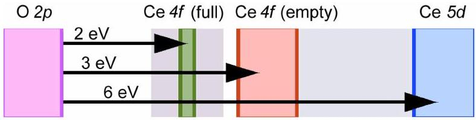
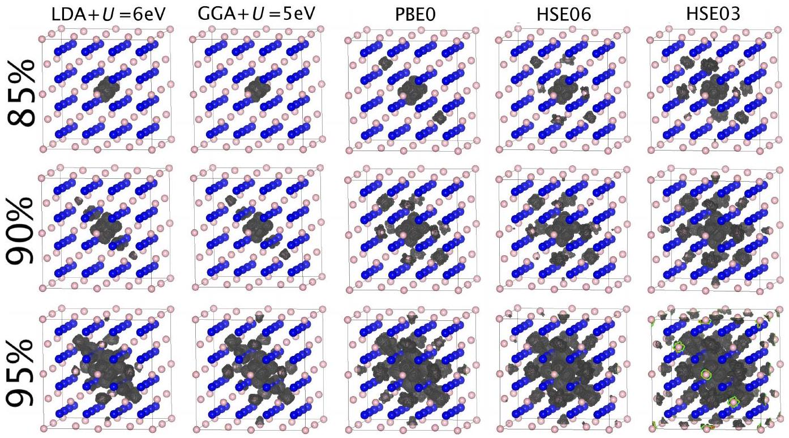
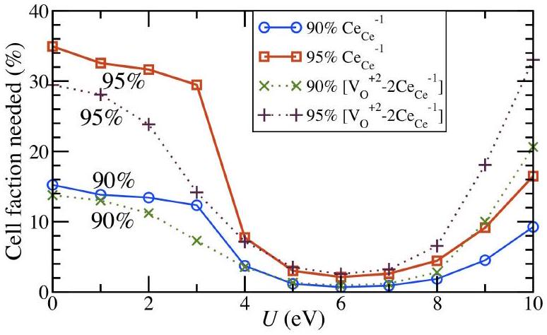
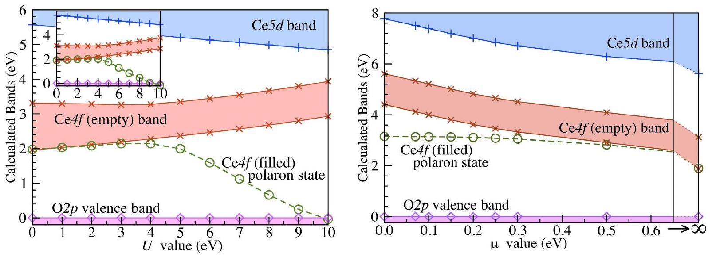

Home Search Collections Journals About Contact us My IOPscience

Description of polarons in ceria using Density Functional Theory

This content has been downloaded from IOPscience. Please scroll down to see the full text.
2014 J. Phys.: Conf. Ser. 526012002
(http://iopscience.iop.org/1742-6596/526/1/012002)
View the table of contents for this issue, or go to the journal homepage for more

Download details:

IP Address: 152.71.207.142
This content was downloaded on 09/09/2014 at 10:07

Please note that terms and conditions apply.

# Description of polarons in ceria using Density Functional Theory. 

Christopher WM Castleton and Amy L. Lee School of Science and Technology, Nottingham Trent University, NG11 8NS, UK E-mail: Christopher.Castleton@ntu.ac.uk Jolla Kullgren and Kersti Hermansson Department of Chemistry, Uppsala University, Box 538, Uppsala, Sweden

#### Abstract

The performance of various density functional theory (DFT) functionals in reproducing the localization of $\mathrm{Ce} 4 f$ electrons to form polarons in cerium dioxide (ceria) is studied. It is found that $\mathrm{LDA}+U$ with $U=6$ eV provides the best description, followed by GGA+U with $U=5 \mathrm{eV}$. Hybrids perform worse, with PBE0 better than HSE06 and HSE03. It is also demonstrated that the improvement in the description of the polarons obtained from LDA $+U$ and GGA $+U$ is due primarily to the effect the $U$ has on the filled $\mathrm{Ce} 4 f$ states, but the improvement obtained using the hybrids is primarily due to their effect on the empty states. This difference can be expected to strongly impact some detailed predictions for the properties of ceria obtained using the two classes of functional.

## 1. Introduction

The wide bandgap material cerium dioxide (ceria, $\mathrm{CeO}_{2}$,) has applications in fuel cells, gas sensors and catalysis, but has proved a challenge for theoretical studies. It has an O2p based valence band and a nominal Ce $5 d$ based conduction band, see Fig 1, but in between lies a narrow, empty band of Ce4f states. Any potential conduction electron added via doping or defect creation enters this band and localizes onto a single Ce site, breaking the crystal's translational symmetry and inducing a local lattice distortion around the Ce site in question. This forms a "polaron", ie a self-trapped electron, $\mathrm{Ce}_{\mathrm{Ce}}^{-1}$, with an energy gain of roughly 1eV. Polarons generally form coupled to other defects, such as Rh adatoms [2] or oxygen vacancies. Oxygen ions have a formal charge of -2, so removing a neutral oxygen (as part of an oxygen molecule) necessarily leaves behind a +2 charged vacancy $\mathrm{V}_{\mathrm{O}}^{+2}$ and two electrons, which in ceria both form polarons. These three remain electrostatically bound in a neutral $\left[\mathrm{V}_{\mathrm{O}}^{+2}-2 \mathrm{Ce}_{\mathrm{Ce}}^{-1}\right]$ complex, which can adopt a wide range of configurations [5]. Conductivity studies [3] have shown that these polarons are well described by the "Small Polaron Model" of Holstein [4], meaning that the radius of the localized charge and lattice distortion are on the order of one lattice spacing. This is also supported by scanning tunnelling microscopy (STM) images of vacancies and vacancy clusters [1], which are best understood if the two electrons are indeed localized in Ce4f states on specific Ce ions.

Obtaining a localized description of these $\mathrm{Ce}_{\mathrm{Ce}}^{-1}$ polarons using Density Functional Theory (DFT) is hard, requiring the use of either LDA $+U$, GGA $+U,[7,8,9]$ or hybrid functionals

| 4th Workshop on Theory, Modelling and Computational Methods for Semiconductors | IOP Publishing |
| :--- | :--- |
| Journal of Physics: Conference Series 526 (2014) 012002 | doi:10.1088/1742-6596/526/1/012002 |

Figure 1. Schematic band diagram for ceria, showing the O2 $p$ based valence band, and empty $\mathrm{Ce} 5 d$ and $\mathrm{Ce} 4 f$ bands, plus the filled, localized (polaronic) Ce4f states.

[6, 9]. The performance of these in describing the bulk properties (structures, bandgaps etc) of ceria and the sesquioxide, $\mathrm{Ce}_{2} \mathrm{O}_{3}$, as well as $\left[\mathrm{V}_{\mathrm{O}}^{+2}-2 \mathrm{Ce}_{\mathrm{Ce}}^{-1}\right]$ complexes has been assessed [6, 7, 8, 9]. The best description is obtained using LDA+U with $U=6 \mathrm{eV}$. The hybrids produce qualitatively reasonable descriptions, but are not as good quantitatively. For example, B3LYP does reasonably well for the electronic properties but not for the structure, while PBE0 does well for the structure but not for the bandgaps.

While numerous DFT studies have examined polarons associated with $\left[\mathrm{V}_{\mathrm{O}}^{+2}-2 \mathrm{Ce}_{\mathrm{Ce}}^{-1}\right]$ and other defects, only a few have considered the properties of isolated polarons [10], and we are not aware of any assessment of the quality of the description of lone polarons obtained using different functionals. So we will here compare the description of lone polaron states in ceria using the functionals LDA $+U$, GGA $+U$, PBE0 [11] and HSE (both HSE03 [12] and HSE06 [13]).

## 2. Method

We use plane-wave ab initio DFT with the Projector Augmented Wave method [14] (PAW) within the VASP code [15]. $\mathrm{O} 2 s^{2} 2 p^{4}$ and $\mathrm{Ce} 4 f^{1} 5 s^{2} 5 p^{6} 5 d^{1} 6 s^{2}$ are treated as valence, with a plane-wave cutoff of 300 eV . We use a 96 atom supercell, which is a $2 \times 2 \times 2$ multiple of the 12 atom crystallographic cell. K-point integrations use a $4 \times 4 \times 4$ and $2 \times 2 \times 2$ Monkhorst-Pack grids [16] for LDA/GGA+U and hybrid calculations respectively. We use the rotationally invariant form of LDA $+U$ due to Dudarev et al. [17], together with LDA and with the PBE form of GGA.

## 3. Results

3.1. Real space charge localization with different functionals

In line with previous studies of $\left[\mathrm{V}_{\mathrm{O}}^{+2}-2 \mathrm{Ce}_{\mathrm{Ce}}^{-1}\right]$ complexes, we find that all the functionals studied can localize $\mathrm{Ce} 4 f$ electrons to form small polarons, as illustrated by the isocharge surfaces in Fig 2. These show the partial charge density of the single filled Ce $4 f$ state. For each functional, surfaces are shown containing 85\%, 90\% and 95\% of the total polaron charge. Clearly, the degree of localization varies, with LDA+U producing the most localized description, closely followed by GGA $+U$, then the hyrbids PBE0 HSE06 and HSE03. Since the experimental evidence points to very tightly localized $\mathrm{Ce} 4 f$ polarons, $\mathrm{LDA}+U=6 \mathrm{eV}$ seems to be the most successful functional.

In order to check the choice of $U=6 \mathrm{eV}$ for LDA $+U$, we show in Fig 3 the percentage of the supercell contained within the 90\% and 95\% isocharge surfaces, as a function of $U$. Clearly, the most localized description is indeed at $U=6 \mathrm{eV}$. Fig 3 also shows the equivalent data (from [7]) for the $\left[\mathrm{V}_{\mathrm{O}}^{+2}-2 \mathrm{Ce}_{\mathrm{Ce}}^{-1}\right]$ complex. Although equally localized near the optimal $U$, the lone polaron starts to localize at slightly higher $U$ values than the vacancy bound polarons. It is apparently easier to localize Ce4f electrons when the presence of something else (such as a vacancy) has already broken the translational symmetry of the lattice.
3.2. Calculated band energies

Fig 4 shows band energies taken from the density of states (DOS) of a supercell containing a single Ce4f electron, and no other defects. (c.f. schematic in Fig 1). Fig 4 (a) plots the variation of these energies with $U$ for LDA $+U$. (The inset shows very similar results for GGA $+U$.) Once localized, the polaron state descends roughly linearly with $U$, falling 2.1 eV to reach the valence

Figure 2. Isocharge surfaces containing 85\%, 90\% and 95\% of the Ce $4 f$ charge, obtained using the functionals $\mathrm{LDA}+U=6 \mathrm{eV}$, GGA $+U=5$ eV, PBE0, HSE06 and HSE03.

Figure 3. Volume of the supercell contained within the 90\% and 95\% isosurfaces of Fig 2 for the polaron (solid lines) and for the $\left[\mathrm{V}_{\mathrm{O}}^{+2}-2 \mathrm{Ce}_{\mathrm{Ce}}^{-1}\right]$ complex (dotted lines), as a function of $U$ for $\mathrm{LDA}+U$. Data for $\left[\mathrm{V}_{\mathrm{O}}^{+2}-2 \mathrm{Ce}_{\mathrm{Ce}}^{-1}\right]$ taken from [7].

band at $U \simeq 10 \mathrm{eV}$. The effect of $U$ on the empty states is much milder, with the Ce4f(empty) states rising by only 0.7 eV and the $C e 5 d$ states falling by 0.4 eV over the same range of $U$ values. In other words, the improvement in the description of the polarons obtained from $\mathrm{LDA}+U$ and GGA $+U$ is due primarily to the effect $U$ has on the filled Ce $4 f$ states.

The HSE functional contains a screening range separation parameter $\mu$. Choosing $\mu=0$ gives the PBE0 functional, $\mu=0.2$ gives HSE06, $\mu=0.3$ gives HSE03 and the limit $\mu \rightarrow \infty$ recovers pure PBE. In Fig 4 (b) we show the evolution of the band positions with $\mu$. In contrast to LDA/GGA+U, these hybrids have virtually no direct effect on the energy of the filled Ce4f state, at least once it has left the Ce4f (empty) band. Instead, the improvements are obtained by moving the empty states upwards in energy. While this is to be expected, given the nature of the hybrids, the difference between this and LDA/GGA+U is striking. Both approaches produce qualitatively reasonable results, but their detailed predictions for the properties of polarons and other features of ceria can therefore be expected to be very different indeed.

## Conclusions

We have shown that, while they all correctly localize $\mathrm{Ce} 4 f$ electrons in ceria to form small polarons, the functionals LDA+U and GGA+U form much more tightly localized polarons than

Figure 4. Bands in ceria with one filled Ce $4 f$ state, as a function of (a) $U$ for $\mathrm{LDA}+U$ (inset: GGA $+U$ ), and (b) $\mu$ for HSE-type functionals: PBE0 $(\mu=0)$ HSE06 $(\mu=0.2)$, HSE03 $(\mu=0.3)$ and pure PBE $(\mu \rightarrow \infty)$. Energies plotted relative to the valence band edge.

the hybrids PBE0, HSE06 and HSE03, and are thus more in keeping with the experimental data. We have confirmed that $U=6 \mathrm{eV}$ is the optimal value for describing lone polarons with LDA $+U$. We have also shown that the improvement in the description of polarons obtained from LDA $+U$ and GGA $+U$ is due primarily to the effect that $U$ has on the filled Ce $4 f$ states, but the improvement obtained using hybrids is due primarily to their effect on the empty states. This difference will impact many of the detailed predictions made using the two classes of functional, and this fundamental difference in behaviour has not perhaps received the attention in the literature that it deserves.

## References

[1] Esch F, Fabris S, Zhou, Montini T, Africh C, Fornasiero P, Comelli G and Rosei R, 2005 Science 309752
[2] Lu Z, Yang Z, Hermansson K and Castleton C W M 2014 J. Mater. Chem. A 22333
[3] Tuller H L and Nowick A S 1977 J. Phys. Chem. Solids 38859
Naik I K and Tien T Y 1978 J. Phys. Chem. Solids 39311
Chang E K and Blumenthal R N 1988 J. Sol. Stat. Chem. 72330
[4] Holstein T 1959 Ann. Phys. 8 325, 8343
[5] Kullgren J, Hermansson K, Castleton C W M, 2012 J. Chem. Phys. 137044705
[6] Hay P J, Martin R L, Uddin J and Scuseria G E 2006 J. Chem. Phys. 125, 034712
Kullgren J, Castleton C W M, Müller C, Muñoz Ramo D and Hermansson K 2010 J. Chem. Phys. 132054110
[7] Castleton C W M, Kullgren J and Hermansson K 2007 J. Chem. Phys. 127244704
[8] Loschen C, Carrasco J, Neyman K N, and Illas F 2007 Phys. Rev. B 75035115
Andersson D A, Simak S I, Johansson B, Abrikosov I A, and Skorodumova N V 2007 Phys. Rev. B 75135109
[9] Da Silva J L F Ganduglia-Pirovano M V, Sauer J, Bayer V and Kresse G 2007 Phys. Rev. B 75045121
[10] Nakayama M, Ohshima H, Nogami M and Martin M 2012 Phys. Chem. Chem. Phys. 146079
Zacherle T, Schriever A, De Souza R A and Martin M 2013 Phys. Rev. B 87134104
Plata J J, Marquez A M, and Sanz J F. 2013 J. Phys. Chem. C, 201311714502
Plata J J, Marquez A M, and Sanz J F. 2013 J. Phys. Chem. C, 201311725497
[11] Adamo C and Barone V 1999 J. Chem. Phys. 1106158
[12] Heyd J, Scuseria G E and Ernzerhof M 2003 J. Chem. Phys. 1188207
[13] Heyd J, Scuseria G E and Ernzerhof M 2006 J. Chem. Phys. 124219906
[14] Blöchl P E, Phys. 1994 Phys. Rev. B 5017953
Kresse G and Joubert D 1999 Phys. Rev. B 591758
[15] Kresse G and Furthmüller J 1996 Comp. Mat. Sci. 615
[16] Monkhorst H and Pack P 1976 Phys. Rev. B 135188
[17] Dudarev S L, Botton G A, Savrasov S Y, Humphreys C J and Sutton A P 1998 Phys. Rev. B 571505
