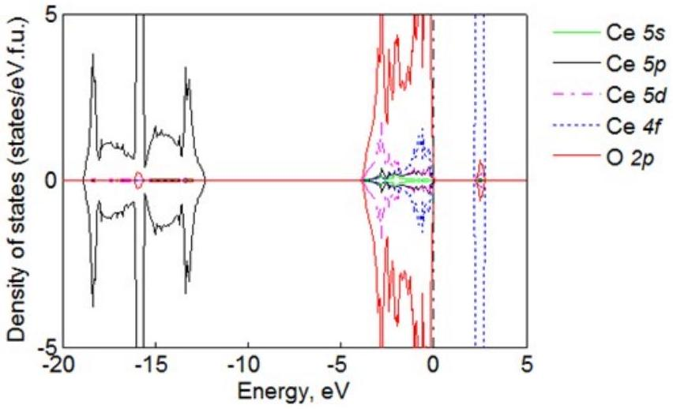
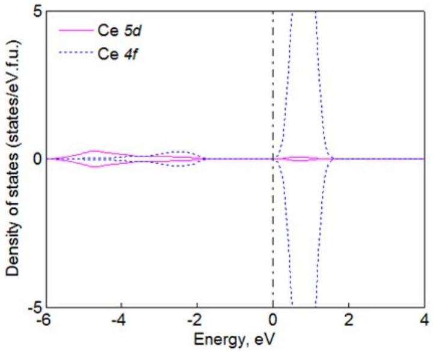
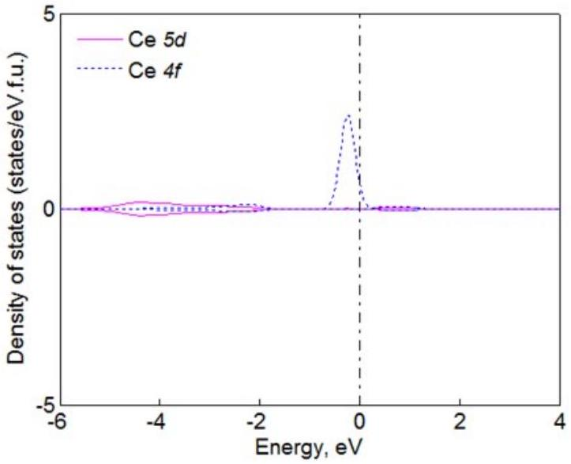
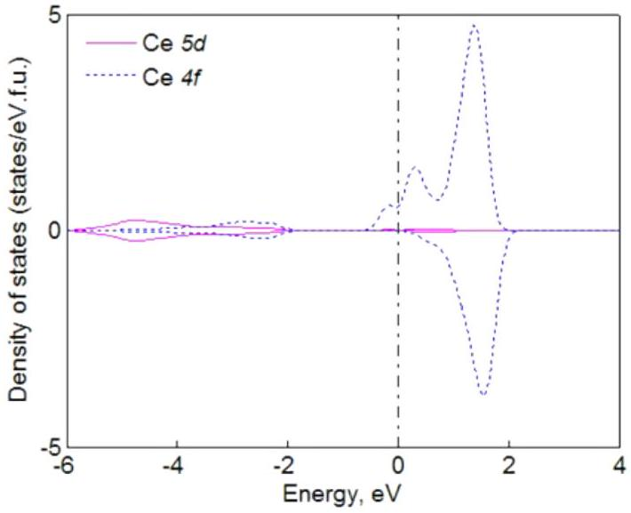

# Supporting Information for Anisotropic Chemical Strain in Cubic Ceria due to Oxygen-Vacancy-Induced Elastic Dipoles 

Tridip Das ${ }^{1}$, Jason D. Nicholas ${ }^{1}$, Brian W. Sheldon ${ }^{2}$, and Yue Qi ${ }^{1, *}$ ${ }^{1}$ Chemical Engineering \& Materials Science Department, Michigan State University, East Lansing, MI 48824, USA ${ }^{2}$ School of Engineering, Brown University, Providence, RI 02912, USA

## Section S1. Derivation of Strain Tensor Using Elastic Dipole Tensor

The chemical strain tensor at a given dilute oxygen vacancy concentration can be calculated by minimizing the total energy, $\Delta E_{\text {total }}$ with respect to the applied stain. $\Delta E_{\text {total }}$ consists of the energy due to local lattice distortion caused by oxygen vacancy formation, $\Delta E_{\text {short }}$ and the long-range elastic strain energy caused by oxygen vacancy formation, $\Delta E_{\text {long }}$, as:

$$
\Delta E_{\text {total }}=\Delta E_{\text {short }}+\Delta E_{\text {long }}=\frac{\delta}{V_{U}} G: \varepsilon+\frac{1}{2}(C: \varepsilon): \varepsilon
$$

where $V_{U}$ is the volume per formula unit of perfect $\mathrm{CeO}_{2}$ and $C$ is the elastic stiffness tensor for the perfect lattice. Taking the derivative of Equation 4 with respect to $\varepsilon$ yields:

$$
\begin{aligned}
\frac{d \Delta E_{\text {total }}}{d \varepsilon}=\frac{d \Delta E_{\text {short }}}{d \varepsilon}+\frac{d \Delta E_{\text {long }}}{d \varepsilon}= & 0 \\
& \frac{d \Delta E_{\text {total }}}{d \varepsilon}=0=\frac{\delta}{V_{U}} G+C: \varepsilon \\
& \frac{d \Delta E_{\text {short }}}{d \varepsilon}=\frac{d}{d \varepsilon}\left(\frac{\delta}{V_{U}} G: \varepsilon\right)=\frac{\delta}{V_{U}} G \\
& \frac{d \Delta E_{\text {long }}}{d \varepsilon}=\frac{1 d}{2 d \varepsilon}\{(C: \varepsilon): \varepsilon\}=\frac{1}{2}\left\{\frac{d(C: \varepsilon)}{d \varepsilon}\right\}: \varepsilon+\frac{1}{2}(C: \varepsilon): \frac{d \varepsilon}{d \varepsilon} \\
& \frac{d \Delta E_{\text {long }}}{d \varepsilon}=\frac{1}{2}\left\{C: \frac{d \varepsilon}{d \varepsilon}\right\}: \varepsilon+\frac{1}{2}(C: \varepsilon): \frac{d \varepsilon}{d \varepsilon}=\frac{1}{2}(C: \varepsilon)+\frac{1}{2}(C: \varepsilon)=C: \varepsilon
\end{aligned}
$$

$$
\begin{gathered}
\frac{d \Delta E_{\text {total }}}{d \varepsilon}=\frac{\delta}{V_{U}} G+C: \varepsilon=0 \\
\varepsilon=\frac{-\delta\left(C^{-1} G\right)}{V_{U}}
\end{gathered}
$$

## Section S2. PDOS Calculations for Stoichiometric and Non-stoichiometric Ceria

Partial density of states (PDOS) were calculated for Ce and O atoms in perfect $\mathrm{CeO}_{2}$ lattice and shown in Figure S1. Figure S2-S4 show the Ce- $5 d$ and $4 f$ orbitals in vacancy containing lattice for two different scenarios. Analysis of PDOS for Ce- $5 d$ and $4 f$ orbitals before and after the formation of oxygen vacancy has shown the charge localization in $4 f$ orbital after $V_{o}^{\bullet \bullet}$ formation. Electron localization in Ce- $4 f$ orbital observed in Figure S3 is consistent with previous computational studies.

Figure S1. Partial density of states plot for Ce-5s, 5p, 5d, 4f and O-2p orbitals in pure $\mathrm{CeO}_{2}$

Figure S2. PDOS for $\mathrm{Ce}^{4+}-5 \mathrm{~d}$ and $\mathrm{Ce}^{4+}-4 \mathrm{f}$ orbital for $\mathrm{Ce}^{4+}$ adjacent to $V_{o}^{\bullet \bullet}$, after $V_{o}^{\bullet \bullet}$ formation in asymmetric case. Orbitals show same shape as $\mathrm{Ce}^{4+}$ in perfect $\mathrm{CeO}_{2}$.

Figure S3. PDOS for $\mathrm{Ce}^{3+}-5 \mathrm{~d}$ and $\mathrm{Ce}^{3+}-4 \mathrm{f}$ orbital for $\mathrm{Ce}^{3+}$ adjacent to $V_{o}^{\bullet \bullet}$, after $V_{o}^{\bullet \bullet}$ formation in asymmetric case. Figure shows localization of excess electron in 4f orbital.

Figure S4. PDOS for $\mathrm{Ce}^{3.5+}-5 \mathrm{~d}$ and $\mathrm{Ce}^{3.5+}-4 \mathrm{f}$ orbital for $\mathrm{Ce}^{3.5+}$ adjacent to $V_{O}^{\bullet \bullet}$, after $V_{O}^{\bullet \bullet}$ formation in symmetric case. Figure shows localization of excess electron in 4f orbital. This scenario is computational artifact as the structure was energetically unfavorable.

## Section S3. Elastic Dipole Moment Calculation

Dipole moment $\begin{aligned} & \vec{p}=\sum_{i} q_{i} d_{i}\end{aligned}$
$q_{i}=$ charge on the $\mathrm{i}^{\text {th }}$ particle
$d_{i}=$ displacement of the $\mathrm{i}^{\text {th }}$ particle
If we assume mean charge as $3.5+$ then charge on $\mathrm{Ce}^{3+}$ is $0.5 e$ and the charge on $\mathrm{Ce}^{4+}$ is $-0.5 e$.
Therefore, displacement of Ce atoms from oxygen vacancy center:

| vectors | x-comp | y-comp | z-comp | $\\|\mathrm{d}\\|$ |
| :--- | :--- | :--- | :--- | :--- |
| Ce4+ | 1.4846 | -1.4846 | -1.4658 | 2.5606 |
| Ce4+ | -1.4846 | 1.4846 | -1.4658 | 2.5606 |
| Ce3+ | -1.4488 | -1.4488 | 1.4665 | 2.5196 |
| Ce3+ | 1.4488 | 1.4488 | 1.4665 | 2.5196 |

| Vector sums |  |  |  |
| :--- | :--- | :--- | :--- |
| Ce4+ | 0.0000 | 0.0000 | -2.9316 |
| Ce3+ | 0.0000 | 0.0000 | 2.9331 |

| Resultant | qi*di |  |  |
| :--- | :--- | :--- | :--- |
| 0.0000 | 0.0000 | 2.9323 | $\mathrm{e} \AA$ |
|  | $\vec{p}$ | 14.0847 | D |

$1 \mathrm{D}($ Debye $)=0.20819434 \mathrm{e} \AA$ [https://en.wikipedia.org/wiki/Debye]
