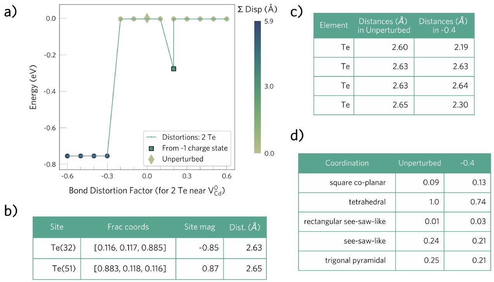

DOI: 10.21105/joss. 04817
Software

- Review
- Repository ${ }^{\text {c }}$
- Archive ${ }^{\text {★ }}$

Editor: Rachel Kurchin ${ }^{\text {® }}$
Reviewers:

- @obaica
- @mkhorton

Submitted: 22 August 2022
Published: 01 December 2022
License
Authors of papers retain copyright and release the work under a Creative Commons Attribution 4.0 International License (CC BY 4.0).

# ShakeNBreak: Navigating the defect configurational landscape 

Irea Mosquera-Lois ${ }^{1^{*}}$, Seán R. Kavanagh ${ }^{1,2^{*} \mathbb{}}$, Aron Walsh ${ }^{2}$, and David O. Scanlon ${ }^{19}$ 1 Thomas Young Centre and Department of Chemistry, University College London, United Kingdom 2 Thomas Young Centre and Department of Materials, Imperial College London, United Kingdom Corresponding author * These authors contributed equally.

#### Abstract

Summary Point defects are present in all crystalline solids, controlling the properties and performance of most functional materials, including thermoelectrics, photovoltaics and catalysts. However, the standard modelling approach, based on local optimisation of a defect placed on a known crystal site, can miss the true ground state structure. This structure may lie within a local minimum of the potential energy surface (PES), trapping a gradient-based optimisation algorithm in a metastable arrangement and thus yielding incorrect defect structures that compromise predicted properties (Mosquera-Lois \& Kavanagh, 2021). As such, an efficient way to explore the defect energy landscape and identify low-energy structures is required.

## Statement of need

To tackle this limitation, two approaches have recently been designed. Arrigoni and Madsen (Arrigoni \& Madsen, 2021a) developed an evolutionary algorithm combined with a machine learning model to navigate the defect configurational landscape and identify low-energy structures. While ideal to study specific defects, its complexity and computational cost hinders its application to typical defect investigations. Alternatively, Pickard and Needs (Pickard \& Needs, 2011) applied random sampling to the atoms near the defect site - with the limitation that random sampling on a high-dimensional space lowers efficiency and increases computational cost. To improve sampling efficiency, domain knowledge can be used to tailor the sampling structures towards likely energy-lowering distortions. This is the purpose of our package, which aims to serve as a simple, efficient, and affordable tool to identify low-energy defect structures.

## ShakeNBreak

ShakeNBreak is a set of Python modules developed to automate the process of defect structure searching. It makes extensive use of several open-source packages, including Python Materials Genomics (pymatgen) (Ong et al., 2013) and the Atomic Simulation Environment (ase) (Hjorth Larsen et al., 2017). It supports most common ab-initio plane wave codes, including VASP (Kresse \& Furthmüller, 1996), CP2K (Kühne et al., 2020), Quantum Espresso (Giannozzi et al., 2009), CASTEP (Clark et al., 2005) and FHI-aims (Blum et al., 2009). In combination, these features make ShakeNBreak compatible with the majority of defect packages such as PyCDT (Broberg et al., 2018), pylada (Goyal et al., 2017), DASP (Huang et al., 2022) and Spinney (Arrigoni \& Madsen, 2021b), as well as workflow managers (FireWorks (Jain et al., 2015) and AiiDA (Uhrin et al., 2021)). In addition to a Python API, ShakeNBreak provides a command line interface, making it user-friendly and readily applicable to defect modelling
workflows.
The structure search strategy is based on applying a range of chemically-guided distortions to the high-symmetry defect configuration, yielding a set of sampling structures which are then geometrically optimised. Although the distortions can be customised, a set of sensible defaults and informative warnings have been implemented. Optionally, the relaxation input files can be generated for the desired ab-initio code and organised into a directory structure. These processes are fully automated, requiring only a few lines of code or a single command. Following the geometry optimisations, the results can be automatically parsed, analysed and plotted to identify the different low-energy structures, as well as the physico-chemical factors driving the energy-lowering distortions. Within its analysis toolbox, ShakeNBreak includes methods to quantify structural similarity (Figure 1a), compare the defect local environments (Figure 1c,d) and analyse site- and orbital-decomposed magnetisations (Figure 1b).

The distortion procedure, underlying rationale and its application to a wide range of semicon-ductors have recently been described (Mosquera-Lois et al., 2022). In addition, the package has been employed to identify the defect structures reported in several studies (Kavanagh et al., 2021, 2022), with the identified configurations having significant impact on predicted behaviour.

Figure 1: Example analysis for a cadmium vacancy defect in CdTe: a) plot of final energies versus bond distortion factor, with a colorbar quantifying the structural similarity between configurations b) analysis of site magnetisations for the Unperturbed configuration, c) distances between the defect and its nearest neighbours and d) resemblance of the defect environment to difference structural motifs.

## Acknowledgements

I.M.L. thanks La Caixa Foundation for funding a postgraduate scholarship (ID 100010434, fellowship code LCF/BQ/EU20/11810070). S.R.K. acknowledges the EPSRC Centre for Doctoral Training in the Advanced Characterisation of Materials (CDTACM)(EP/S023259/1) for funding a PhD studentship. DOS acknowledges support from the EPSRC (EP/N01572X/1) and from the European Research Council, ERC (Grant No. 758345).

ShakeNBreak has benefitted from feature requests from many members of the Walsh and Scanlon research groups, including Adair Nicolson, Xinwei Wang, Katarina Brlec, Joe Willis, Zhenzhu Li, Jiayi Cen, Lavan Ganeshkumar, Daniel Sykes, Luisa Herring-Rodriguez, Alex Squires, Sabrine Hachmiouane and Chris Savory.

## References

Arrigoni, M., \& Madsen, G. K. H. (2021a). Evolutionary computing and machine learning for discovering of low-energy defect configurations. Npj Computational Materials, 7(1). https://doi.org/10.1038/s41524-021-00537-1

Arrigoni, M., \& Madsen, G. K. H. (2021b). Spinney: Post-processing of first-principles calculations of point defects in semiconductors with Python. Computer Physics Communications, 264, 107946. https://doi.org/10.1016/j.cpc.2021.107946

Blum, V., Gehrke, R., Hanke, F., Havu, P., Havu, V., Ren, X., Reuter, K., \& Scheffler, M. (2009). Ab initio molecular simulations with numeric atom-centered orbitals. Computer Physics Communications, 180(11), 2175-2196. https://doi.org/10.1016/j.cpc.2009.06.022

Broberg, D., Medasani, B., Zimmermann, N. E. R., Yu, G., Canning, A., Haranczyk, M., Asta, M., \& Hautier, G. (2018). PyCDT: A Python toolkit for modeling point defects in semiconductors and insulators. Computer Physics Communications, 226, 165-179. https://doi.org/10.1016/j.cpc.2018.01.004

Clark, S. J., Segall, M. D., Pickard, C. J., Hasnip, P. J., P., M. I. J., Refson, K., \& Payne, M. C. (2005). First principles methods using CASTEP. Zeitschrift Für Kristallographie - Crystalline Materials, 220(5-6), 567-570. https://doi.org/10.1524/zkri.220.5.567.65075

Giannozzi, P., Baroni, S., Bonini, N., Calandra, M., Car, R., Cavazzoni, C., Ceresoli, D., Chiarotti, G. L., Cococcioni, M., Dabo, I., Corso, A. D., Gironcoli, S. de, Fabris, S., Fratesi, G., Gebauer, R., Gerstmann, U., Gougoussis, C., Kokalj, A., Lazzeri, M., ... Wentzcovitch, R. M. (2009). QUANTUM ESPRESSO: a modular and open-source software project for quantum simulations of materials. Journal of Physics: Condensed Matter, 21(39), 395502. https://doi.org/10.1088/0953-8984/21/39/395502

Goyal, A., Gorai, P., Peng, H., Lany, S., \& Stevanovi'c, V. (2017). A computational framework for automation of point defect calculations. Computational Materials Science, 130, 1-9. https://doi.org/10.1016/j.commatsci.2016.12.040

Hjorth Larsen, A., Jørgen Mortensen, J., Blomqvist, J., Castelli, I. E., Christensen, R., Dułak, M., Friis, J., Groves, M. N., Hammer, B., Hargus, C., Hermes, E. D., Jennings, P. C., Bjerre Jensen, P., Kermode, J., Kitchin, J. R., Leonhard Kolsbjergs, E., Kubal, J., Kaasbjerg, K., Lysgaard, S., ... Jacobsen, K. W. (2017). The atomic simulation environment-a Python library for working with atoms. Journal of Physics: Condensed Matter, 29(27), 273002. https://doi.org/10.1088/1361-648X/aa680e

Huang, M., Zheng, Z., Dai, Z., Guo, X., Wang, S., Jiang, L., Wei, J., \& Chen, S. (2022). DASP: Defect and Dopant ab-initio Simulation Package. Journal of Semiconductors, 43(4), 042101. https://doi.org/10.1088/1674-4926/43/4/042101

Jain, A., Ong, S. P., Chen, W., Medasani, B., Qu, X., Kocher, M., Brafman, M., Petretto, G., Rignanese, G., Hautier, G., Gunter, D., \& Persson, K. A. (2015). FireWorks: a dynamic workflow system designed for high-throughput applications. Concurrency and Computation: Practice and Experience, 27(17), 5037-5059. https://doi.org/10.1002/cpe. 3505

Kavanagh, S. R., Scanlon, D. O., Walsh, A., \& Freysoldt, C. (2022). Impact of metastable defect structures on carrier recombination in solar cells. Faraday Discussions. https://doi.org/10.1039/d2fd00043a

Kavanagh, S. R., Walsh, A., \& Scanlon, D. O. (2021). Rapid Recombination by Cadmium Vacancies in CdTe. ACS Energy Letters, 6(4), 1392-1398. https://doi.org/10.1021/acsenergylett.1c00380

Kresse, G., \& Furthmüller, J. (1996). Efficient iterative schemes for ab initio total-energy calculations using a plane-wave basis set. Physical Review B, 54(16), 11169. https:
//doi.org/10.1103/PhysRevB.54.11169
Kühne, T. D., lannuzzi, M., Del Ben, M., Rybkin, V. V., Seewald, P., Stein, F., Laino, T., Khaliullin, R. Z., Schütt, O., Schiffmann, F., Golze, D., Wilhelm, J., Chulkov, S., Bani-Hashemian, M. H., Weber, V., Borštnik, U., Taillefumier, M., Jakobovits, A. S., Lazzaro, A., ... Hutter, J. (2020). CP2K: An electronic structure and molecular dynamics software package - Quickstep: Efficient and accurate electronic structure calculations. The Journal of Chemical Physics, 152(19), 194103. https://doi.org/10.1063/5.0007045

Mosquera-Lois, I., \& Kavanagh, S. R. (2021). In search of hidden defects. Matter, 4(8), 2602-2605. https://doi.org/10.1016/j.matt.2021.06.003

Mosquera-Lois, I., Kavanagh, S. R., Walsh, A., \& Scanlon, D. O. (2022). Identifying the ground state structures of point defects in solids. arXiv. https://doi.org/10.48550/ARXIV.2207.09862

Ong, S. P., Richards, W. D., Jain, A., Hautier, G., Kocher, M., Cholia, S., Gunter, D., Chevrier, V. L., Persson, K. A., \& Ceder, G. (2013). Python Materials Genomics (pymatgen): A robust, open-source python library for materials analysis. Computational Material Science, 68, 314-319. https://doi.org/10.1016/j.commatsci.2012.10.028

Pickard, C. J., \& Needs, R. J. (2011). Ab initio random structure searching. Journal of Physics: Condensed Matter, 23(5), 053201. https://doi.org/10.1088/0953-8984/23/5/053201

Uhrin, M., Huber, S. P., Yu, J., Marzari, N., \& Pizzi, G. (2021). Workflows in AiiDA: Engineering a high-throughput, event-based engine for robust and modular computational workflows. Computational Materials Science, 187, 110086. https://doi.org/10.1016/j.commatsci.2020.110086

