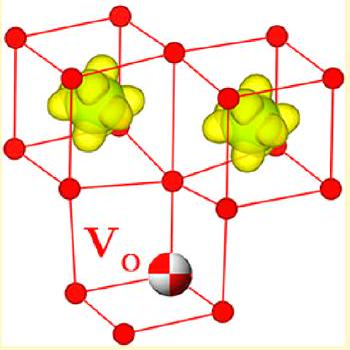
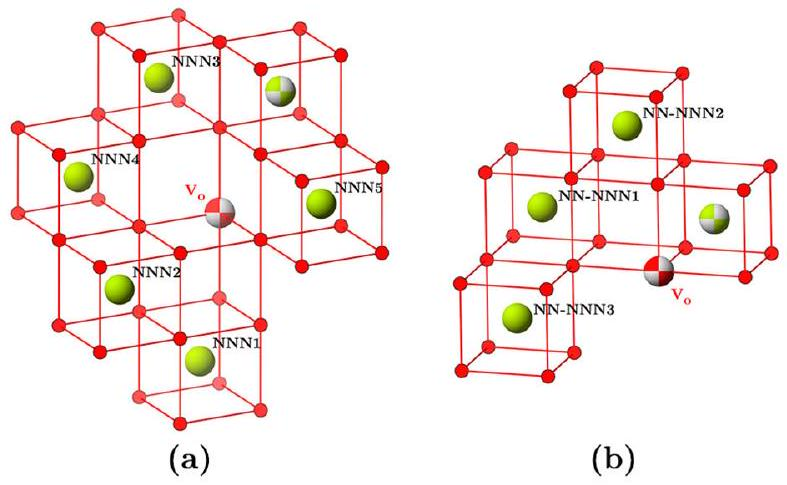
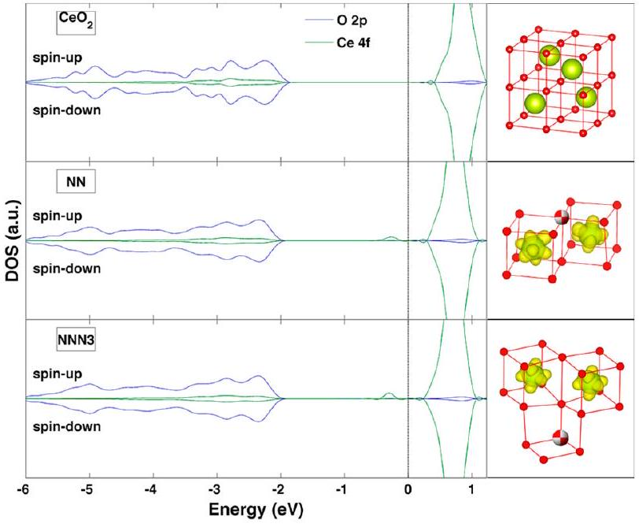
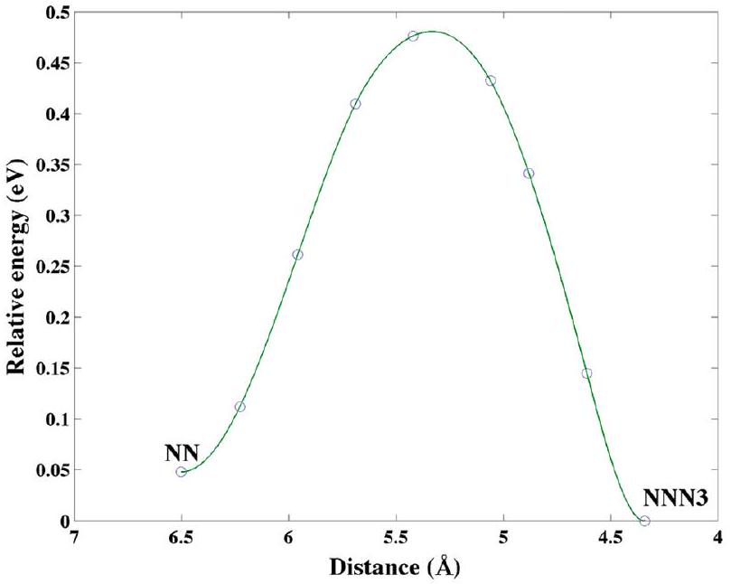

# Chemical Strain and Point Defect Configurations in Reduced Ceria 

Bu Wang, ${ }^{\dagger}$ Xiaoning Xi, ${ }^{\ddagger}$ and Alastair N. Cormack ${ }^{*, \dagger}$ ${ }^{\dagger}$ Kazuo Inamori School of Engineering, New York State College of Ceramics, Alfred University, Alfred, New York 14802, United States ${ }^{\ddagger}$ Department of Engineering Science and Mechanics, The Pennsylvania State University, University Park, Pennsylvania 16802, United States

#### Abstract

New density functional theory (DFT+U) calculations on ceria show that next-

\begin{figure}  ^{\mathbf{3}+}\$}  \end{figure} nearest-neighbor (NNN) configurations for $\mathrm{Ce}^{3+}$ and oxygen vacancy are more stable than the nearest-neighbor (NN) configuration usually found in such calculations, thus removing a long-standing discrepancy with classical simulations. The calculated chemical expansion due to reduction is now in excellent agreement with the experimental value, in contrast to that predicted by the NN configuration. The results suggest that the reduction mechanism in ceria involves relaxation from metastable NN to stable NNN configurations through charge transfer or oxygen hopping. The energy barrier for oxygen hopping mechanism was found to be 0.43 eV. It also suggests that DFT+U simulations of mixed-valence materials should be conducted with considerable care.

## ■ INTRODUCTION

Chemical strain is attracting considerable attention currently because, being associated with point defect behavior, it can have a deleterious impact on the properties of materials, particularly in electromechanical devices. However, it has recently been demonstrated that in reduced ceria (and ceria doped with trivalent cations), its existence can lead to giant electrostriction, which is technologically important. ${ }^{1}$

Positively engineering chemical strain requires a complete understanding of the point defects in the material. In spite of its technological importance, there is still some confusion about the configurations of the oxygen vacancies and concomitant $\mathrm{Ce}^{3+}$ ions in reduced ceria, which has been extensively studied because its redox behavior gives rise to many of its interesting properties such as the oxygen storage capability, mixed electronic and ionic conductivity, and chemical expansion. ${ }^{2-5}$ Furthermore, as possibly the most prominent example of materials with localized f electrons, reduced ceria has posed major challenges for electronic structure calculations. Numbers of studies, based on density functional theory (DFT), have shown that the DFT+U method provides for a nonmetallic description of reduced bulk ceria, in which the f electrons are localized onto Ce ions. ${ }^{6-11}$ Whilst, although simulations based on classical Born model potentials suggest a next-nearest neighbor (NNN) configuration for the neutral $\left[2 \mathrm{Ce}_{\mathrm{Ce}}{ }^{\prime} \cdot \mathrm{V}_{\mathrm{O}}{ }^{\bullet \bullet}\right]$ tricluster, DFT calculations usually argue for a nearest neighbor (NN) configuration in reduced bulk ceria, notwithstanding that this is at odds with the results of doped ceria, in which large trivalent dopants are known to occupy the NNN configuration. ${ }^{12-17}$ The preference for NNN configurations has also been directly supported by bond valence sum analysis on the crystallographic data. ${ }^{18}$ Further widening the discrepancy, combined classical and DFT+U simulations showed that $\mathrm{Ce}^{3+}$ ions do not necessarily neighbor the vacancies in ceria nanoparticles, and studies using scanning tunneling microscopy and DFT simulations with hybrid functionals both suggested that the surface vacancy associates with $\mathrm{Ce}^{3+}$ in a NNN configuration. ${ }^{19-21}$

In the common practice of DFT simulations, the starting electronic configuration is initialized according to atomic configurations. During the self-consistent field (SCF) calculation, electrons are transferred from cations to the neighboring anions. This, however, may become problematic for mixed-valence materials as the electronic and ionic structures are strongly correlated. The initial atomic geometry may dictate where the valence electrons go and, therefore, the resulting ionic configuration. A further complication is the correlated orbital occupation issue, wherein multiple solutions corresponding to different f-orbital occupations and energies can be reached in the SCF calculations with the DFT+U method because of the orbital degrees of freedom which are introduced in this method. ${ }^{22,23}$ The ground state electronic solution cannot be guaranteed in the common practice. This should be considered when determining the ionic ground state, particularly when the relaxations in different defect complexes are to be compared.

In the case of reduced ceria, the common practice usually follows the removal of an (neutral) oxygen atom from the fluorite structure. During the initial SCF calculations, the number of oxygen neighbors (to which electrons may be transferred) is reduced for the NN cations, but the other cations remain in their perfect environment. DFT+U simulations, including ours, show that this always leaves the extra electrons on the NN Ce (in f states) and not in the vacancy. Because these electrons are localized onto Ce, electronic transfer between Ce would not take place unless

Received: March 17, 2014
Revised: June 5, 2014
Published: June 9, 2014
through polaron hopping. As a result, the starting electronic configuration constrains the overall ionic configuration in a local minimum. Conclusions regarding the $\left[2 \mathrm{Ce}_{\mathrm{Ce}}{ }^{\prime} \cdot \mathrm{V}_{\mathrm{O}}{ }^{\bullet \bullet}\right]$ structure, therefore, cannot be drawn unless configurations other than NN can be explicitly simulated and compared. This issue becomes more problematic in heavily reduced ceria or reduced doped ceria, where ordering of the defects likely occurs. The common DFT practice is not likely to produce the appropriate ground state ionic configuration.
A possible way to obtain specific ionic configurations for mixed valence materials is to manipulate the initial atomic geometry so that certain atomic sites are more accommodating to a particular valence state. For example, starting with prerelaxed geometries from classical simulations has been applied to ceria nanoparticles. ${ }^{19}$ However, we found that similar methods did not work for bulk ceria, largely because the extent of structural relaxation is somewhat less than in the nanoparticles. More aggressive modifications of the structure can be made but require significant effort of trial and error. This method may also be difficult for other materials where classical models are not available or the structures are more complicated.
In this paper, we show that with proper attention to the initial electronic configurations in the DFT+U calculations, the f electrons in reduced ceria can be localized onto specific Ce, thus allowing different defect configurations to be explicitly examined. By applying the U-ramping method (see ref 23 and later discussions) iteratively with the ionic relaxations, the correlated orbital occupation issue was addressed simultaneously, allowing the energetics of the neutral $\left[2 \mathrm{Ce}_{\mathrm{Ce}}{ }^{\prime} \cdot \mathrm{V}_{\mathrm{O}}{ }^{\bullet \bullet}\right]$ tricluster to be revisited rigorously. The inconsistency between classical and quantum mechanical simulations is removed. Using the chemical strain as an example, we show that the $\left[2 \mathrm{Ce}_{\mathrm{Ce}}{ }^{\prime} \cdot \mathrm{V}_{\mathrm{O}}{ }^{\bullet \bullet}\right]$ configuration has direct influence on the practically significant properties obtained from the simulation. With the newly identified NNN ground state, the chemical expansion is in excellent agreement with experimental values. The results also suggest a more complex reduction mechanism involving relaxation through charge transfer and urge more rigorous studies to establish appropriate practice for simulating similar materials.

## ■ SIMULATION METHOD

The density functional theory simulations were carried out with Vienna ab initio simulation package (VASP). ${ }^{24}$ Projected augmented wave pseudopotentials supplied with VASP were used; ${ }^{25}$ the PBEsol GGA functional was employed. ${ }^{26} U$ was taken as 5 eV, as suggested by previous studies. ${ }^{9,27-29}$ The cutoff for plane waves was set to 500 eV, and spin-polarization was considered in all of the calculations. Simulations of stoichiometric and reduced ceria were conducted with supercells consisting of $2 \times 2 \times 2$ cubic ceria unitcells and 2 × 2 × 2 k-grid.

To examine different $\left[2 \mathrm{Ce}_{\mathrm{Ce}}{ }^{\prime} \cdot \mathrm{V}_{\mathrm{O}}{ }^{\bullet \bullet}\right]$ configurations, the DFT simulations were started with ionic electronic configurations. Instead of the atomic electronic configurations ([Xe] $4 \mathrm{f}^{1} 5 \mathrm{~d}^{1}$ $6 \mathrm{~s}^{2}$ for Ce, and [He] $2 \mathrm{~s}^{2} 2 \mathrm{p}^{4} 3 \mathrm{~s}^{0}$ for O), [Xe] $4 \mathrm{f}^{0} 5 \mathrm{~d}^{0} 6 \mathrm{~s}^{0}$ and $[\mathrm{He}] 2 \mathrm{~s}^{2} 2 \mathrm{p}^{4} 3 \mathrm{~s}^{2}$ were used to initialize the charges for Ce and O, respectively, at the beginning of the SCF calculations. For reduced supercells, two Ce were selected in the NN or NNN positions of the vacancy, and the charges corresponding to these two Ce were initialized to [Xe] $4 \mathrm{f}^{1} 5 \mathrm{~d}^{0} 6 \mathrm{~s}^{0}$. In this way, specific initial $\left[2 \mathrm{Ce}_{\mathrm{Ce}}{ }^{\prime} \cdot \mathrm{V}_{\mathrm{O}}^{\bullet \bullet}\right]$ configurations can be constructed. In VASP, these initial electronic configurations are defined in the pseudopotential file, which can be modified for such purposes. ${ }^{30}$ Two Ce pseudopotential entries can be created in the file for $\mathrm{Ce}^{4+}$ and $\mathrm{Ce}^{3+}$, respectively. The two entries contain the same pseudopotential information except for different ionic electronic configurations. The coordinates are set up accordingly, so that the two entries are used for the specific $\mathrm{Ce}^{4+}$ and $\mathrm{Ce}^{3+}$ in the structure. The electronic configuration for oxygen in the pseudopotential file should also be modified to the ionic configuration so that the total number of valence electrons remains the same. SCF calculations and ionic relaxations were then conducted for each configuration.

In addition to the above procedure adopted to deal with the correlated electronic and ionic structures (i.e., to fix the Ce ion on which to put the f electron), the correlated f-orbital occupation issue also needs to be addressed in the SCF calculations. The ideal approach is to perform full combinatorial search of the occupation matrix ${ }^{22}$ for each atomic/ionic configuration. It is, however, not practical in our case because the ground state ionic geometry and f-orbital occupation need to be determined simultaneously for a number of low symmetry defect structures. We therefore adapted the heuristic U-ramping method proposed by Meredig et al. ${ }^{23}$ In this method, the SCF calculations are performed stepwise with incremental $U$ values starting from zero. Each step is started with the charge density obtained from the previous step but with a larger $U$ value. In our study, the $U$-ramping was incorporated into the simulations by applying it iteratively with the ionic relaxation. That is, for every structure obtained from the ionic relaxations, $U$-ramping is used to ensure that the SCF convergence is achieved with the f-orbital ground state. Two caveats, however, should be noted. First, relaxed geometry is prerequisite to maintaining the intended $\mathrm{Ce}^{3+}$ configuration in the U-ramping calculations. Small $U$ values result in delocalized f electrons, which always lead back to the NN configuration in an unrelaxed atomic geometry, defeating the purpose of specifying the $\mathrm{Ce}^{3+}$ sites. Second, the distance that the atoms move in the subsequent relaxation steps should be limited, if atomic charge interpolation is used for charge prediction. Otherwise, energy oscillations may occur, preventing efficient convergence.

For each configuration studied in this work, a full relaxation of ion positions and cell shape and size was performed, first without particular attention to the occupation matrix until the force on each ion was below 0.01 eV/Å. The U-ramping method was then applied iteratively with the ionic relaxation until full convergence, which could generally be achieved within two or three iterations. The $U$-ramping calculations were performed from 0 to 5 eV, with 0.5 eV intervals, as suggested in reference. ${ }^{23}$ For the configurations studied in this work, ramping the $U$ value was indeed able to locate the low energy f-orbital occupations, providing a practical alternative to full combinatorial search. Note that, although the energy differences involved here are small (~ tens of meV), they are sufficient to influence the relative order of the defect complex stability.

It is worth noting that for stoichiometric ceria, simulations started with either atomic or ionic electronic configurations gave the same structure, energetics, and properties. The simulated lattice parameter and bulk modulus were $5.429 \AA$ and 200.1 GPa, in good agreement with experimental values of $5.411 \AA$ and $220 \mathrm{GPa} .{ }^{31}$ For reduced ceria from a preconverged wave function, modifying the electronic configuration also would not change the simulation result. However, comparing
with the common practice in which all Ce are initially treated equally, specifically identifying the $\mathrm{Ce}^{3+}$ sites breaks the symmetry. This could result in small numerical differences in the final energy for physically equivalent structures. When the symmetry was switched off in the simulation, the common practice yielded the same relaxed energy and structure with the case where two $\mathrm{Ce}^{3+}$ were placed in the NN positions of the vacancy.

## ■ RESULTS AND DISCUSSIONS

$\left[\mathbf{2} \mathbf{C e}_{\mathrm{Ce}^{\prime}} \cdot \mathbf{V}_{\mathrm{O}}{ }^{\bullet \bullet}\right]$ Configurations. For a $\left[2 \mathrm{Ce}_{\mathrm{Ce}^{\prime}} \cdot \mathrm{V}_{\mathrm{O}} \cdot{ }^{\bullet \bullet}\right]$ cluster in ceria, there are nine symmetrically unique configurations if the two $\mathrm{Ce}^{3+}$ are within the NNN distance. Among these configurations, one has the $2 \mathrm{Ce}^{3+}$ in the NN positions of the vacancy, three have $1 \mathrm{NN} \mathrm{Ce}^{3+}$ and $1 \mathrm{NNN} \mathrm{Ce}^{3+}$ (NN-NNN1-3), and five have both $\mathrm{Ce}^{3+}$ in the NNN positions (NNN1-5). Previous studies indicated that the separation beyond NNN led to weak interactions between $\mathrm{Ce}^{3+}$ and the vacancy and, therefore, is not considered in this investigation. ${ }^{13}$ The NNN and NN-NNN configurations are illustrated in Figure 1.

Figure 1. Five NNN (a) and three NN-NNN (b) symmetrically unique $\left[2 \mathrm{Ce}_{\mathrm{Ce}}{ }^{\prime} \cdot \mathrm{V}_{\mathrm{O}}^{\bullet \bullet}\right]$ configurations, shown as the relative positions of the second NNN Ce with respect to a given NNN Ce (yellow beach ball in (a)) or a given NN Ce (yellow beach ball in (b)) of the vacancy.

Using the technique described earlier, all of the nine configurations were simulated. Figure 2 illustrates the density of states for $\mathrm{CeO}_{2}$ and two representative configurations (NN and NNN3), along with the charge density in the relaxed defect structures. Other reduced configurations showed similar features. Upon reduction, new states belonging to the Ce f orbital appeared in the band gap below the Fermi level. Charge density belonging to these states indicates that the f electrons are successfully localized onto the intended Ce ions. This shows that, unlike the common practice used in previous DFT+U simulations where only NN Ce can be reduced, the f electrons can, in fact, be localized onto any given Ce atom in the vicinity of the vacancy. This is consistent with a physical picture of the localized f electrons and a polaron hopping conduction mechanism. ${ }^{32,33}$

To compare the stability of the reduced configurations, the defect energy for each configuration was calculated as the energy increase of the supercell after incorporating the [ $2 \mathrm{Ce}_{\mathrm{Ce}}{ }^{\prime}$. $\left.\mathrm{V}_{\mathrm{O}}{ }^{\bullet \bullet}\right]$ defect complex (Table 1). It can be seen that the most stable $\left[2 \mathrm{Ce}_{\mathrm{Ce}}{ }^{\prime} \cdot \mathrm{V}_{\mathrm{O}}^{\bullet \bullet}\right]$ configuration occurs when both of the $\mathrm{Ce}^{3+}$ are in the NNN positions of the vacancy. In fact, three

Figure 2. Density of states (DOS) of ceria before and after the reduction. Isosurfaces in the relaxed defect structures on the right show the charge density contributed by the f electrons at the level of $0.005 \mathrm{e} / \AA^{3}$.

Table 1. Defect Energies of Reduced Configurations
| configurations (sorted by DFT stability) | $E_{\text {defect }}(\mathrm{eV}, \mathrm{DFT}$ +U) | $E_{\text {defect }} *(\mathrm{eV}$, classical) |
| :--- | :--- | :--- |
| NN-NNN1 | 8.637 | 8.934 |
| NNN5 | 8.631 | 8.725 |
| NNN1 | 8.622 | 8.703 |
| NN-NNN2 | 8.621 | 8.775 |
| NNN4 | 8.579 | 8.558 |
| NN | 8.569 | 8.677 |
| NNN2 | 8.564 | 8.638 |
| NN-NNN3 | 8.542 | 8.501 |
| NNN3 | 8.521 | 8.443 |

*The fourth ionization energy of the two reduced Ce and the electron affinity of $\mathrm{O}^{2-}(80.79 \mathrm{eV})$ have been subtracted from the defect energies calculated from the classical simulations. ${ }^{34}$
configurations were found to be more stable than the NN configuration. This indicates that the common practice in simulating reduced ceria, where the DFT calculation starts with atomic electronic configurations and results in the NN configuration, did not yield the true ground state. The NN configuration is merely one of a number of possible local minima. Another important note is that the correlated orbital occupation problem, which was addressed with the $U$-ramping method, was able to influence the subtle energetic ordering between some configurations. It can be appreciated, therefore, that the DFT+U simulations of ceria, and similar materials, must be carried out with great care to both electronic and ionic structures. Therefore, we urge additional studies to be conducted to establish more rigorous simulation protocols.

The vacancy formation energies calculated from DFT simulations are between 3.4-3.5 eV, 1 eV lower than the experimental value but agreeing with the previous simulations. ${ }^{8,9,35}$

For completeness, classical supercell calculations of the nine configurations were also performed to investigate the discrepancy between classical and DFT calculations. For these simulations, the set of potentials developed by Sayle et al., which had been successfully used in simulations of reduced ceria was used. ${ }^{36,37}$ Confirming the DFT results, the classical
calculations yielded the same ground state configuration (NNN3) and predicted the NN configuration to be less favorable than the NNN configurations; again, these results are consistent with earlier simulations. ${ }^{13}$ Overall, a good agreement is found between the energetic orderings calculated by the classical and DFT simulations, although the former seems to overestimate the relative stability between these configurations. It is possible that newer potentials may provide improved descriptions and should be examined in future studies. ${ }^{38,39}$ Overall, although the classical simulation cannot directly probe the electronic behavior, it is still a valuable tool for structural simulations of reduced ceria, especially considering the fraction of computer time needed relative to the DFT calculations.
As shown in previous simulations of doped ceria, the difference in the stability of NN and NNN configurations arises from the local lattice distortions around the dopants and vacancy. ${ }^{12,13}$ For isolated small clusters, larger dopants prefer NNN configurations and smaller dopants prefer NN configurations. In the case of reduced ceria, $\mathrm{Ce}^{3+}$ is considerably larger than $\mathrm{Ce}^{4+}$ and, therefore, should prefer NNN configurations. The DFT+U results here, however, show that such preference is somewhat more subtle for reduced ceria, compared to ceria with dopants of sizes close to $\mathrm{Ce}^{3+}$, such as $\mathrm{La}^{3+}$ and $\mathrm{Pr}^{3+}$. DFT simulations of doped ceria have found the energetic differences between NNN and NN configurations greater than 0.1 eV for both $\mathrm{La}^{3+}$ and $\mathrm{Pr}^{3+}$, and classical predictions were even larger. ${ }^{13,16,17}$ One should, therefore, be cautious in using the ionic radius of $\mathrm{Ce}^{3+}$ to predict the structure and properties of reduced ceria. Unlike ceria with large dopants, local minimum configurations may be easily retained in reduced ceria. The material properties would therefore be sensitive to the fabrication conditions. It also suggests that the defect configuration in reduced ceria could be easily modulated. For example, the preference for NNN configuration could be reversed under heavy reduction or mechanical strain, through mechanisms reported in doped ceria. ${ }^{12,40,41}$ The switching between the local minimum states could also have contributed to the elastic anomalies reported by Kossoy et al. ${ }^{42}$ Overall, the results here suggest that the properties of reduced ceria could exhibit interesting nonlinear behaviors, a topic warranting further investigation.

Although the NN configuration is not the most stable one in reduced ceria, the simulations suggest that it is a valid local minimum that may exist in real materials as a metastable configuration in the early stages of the reduction process. The reduction of ceria could, thus, happen as a two-step process, in which a NN configuration is first created upon the creation of an oxygen vacancy, with a subsequent relaxation to a more stable NNN configuration. Interestingly, the transformation from the NN to the NNN3 configuration only requires a single oxygen vacancy jump. We performed a nudged elastic band calculation to examine the energy barrier for such jump. As shown in Figure 3, the energy barrier was found to be 0.43 eV, comparable to the 0.4-0.5 eV activation energy for polaron hopping in reduced ceria. ${ }^{33,43}$ This suggests that both polaron and short-distance oxygen hopping may be equally effective in facilitating the relaxation step. Probably, both mechanisms may already be active at the temperatures where ceria can be easily reduced. This means that the stable NNN configurations are readily accessible upon reduction. It is, however, worth investigating how to decouple the two steps, which would allow the process to be experimentally characterized and studied. Potential methods may include reduction at low

Figure 3. Energy barrier for oxygen jump between the NN and NNN3 configurations. The energy relative to the NNN3 configuration is plotted versus the distance between the hopping oxygen and the center of the two $\mathrm{Ce}^{3+}$. The oxygen vacancy moves in the opposite direction.

temperatures or stabilizing the NN configuration with the mechanisms mentioned in the preceding paragraph.

Chemical Strain. Besides a better understanding of the reduction process, identifying the correct reduced configuration also has an impact on the calculated properties of reduced ceria that have practical importance. For example, different configurations of $\left[2 \mathrm{Ce}_{\mathrm{Ce}}{ }^{\prime} \cdot \mathrm{V}_{\mathrm{O}}{ }^{\bullet \bullet}\right]$ lead to different lattice strains caused by the cluster, as shown in similar materials. ${ }^{40}$ In nonstoichiometric ceria $\mathrm{CeO}_{2-\delta}$, the strain caused by reduction can be characterized by the chemical expansion coefficient, $\alpha_{\mathrm{c}} .^{28,29,44-46}$ Below the dilute solution limit, the oxygen vacancy and reduced Ce would form noninteracting $\left[2 \mathrm{Ce}_{\mathrm{Ce}}{ }^{\prime} \cdot \mathrm{V}_{\mathrm{O}}{ }^{\bullet \bullet}\right]$ clusters, and $\alpha_{\mathrm{c}}$ can be simply calculated using the supercell approach as

$$
\alpha_{c}=\frac{a-a_{0}}{a_{0}} \frac{1}{\delta}
$$

where $a$ and $a_{0}$ are the lattice parameters of the reduced and stoichiometric ceria supercells, respectively. However, because a single $\left[2 \mathrm{Ce}_{\mathrm{Ce}}{ }^{\prime} \cdot \mathrm{V}_{\mathrm{O}}^{\bullet \bullet}\right]$ cluster in a ceria supercell breaks the symmetry, the relaxed structure would deviate slightly from cubic symmetry. To accurately calculate the expansion coefficient under the dilute solution limit, when the reduced ceria would still maintain a cubic symmetry, constant-volume relaxations were performed with the NN and the most stable NNN (NNN3) configurations. For each configuration, the supercell was kept cubic and constant-volume relaxations were performed under a series of hydrostatic strains. The resulting energy-volume relationship was then fitted to a third-order Birch-Murnaghan equation of state to obtain the equilibrium lattice parameter of the reduced supercell in a cubic lattice environment.

The equilibrium lattice parameters for the NN and NNN3 configurations in the cubic lattice were found to be 5.4404 and $5.4428 \AA$, respectively. Comparing with the simulated lattice parameter of the stoichiometric ceria, $5.4287 \AA$, both configurations caused lattice expansion. The calculated chemical expansion coefficient for the NNN3 configuration was 0.083, which is in good agreement with the experimental
reported values of 0.085-0.11 for pure ceria. ${ }^{43,47,48}$ The NN configuration, however, gave an expansion coefficient of 0.069, a 17\% underestimation. It can be seen that the ground-state configuration can have substantial impact to the simulated properties in the reduced ceria. Moreover, the local minimum defect configurations are clearly associated with different strain states, which may indeed provide a potential explanation for experimentally observed elastic anomalies, as discussed before. ${ }^{42}$ Note that the chemical strain is quite strongly dependent on the size of the dopant, as pointed out by Bishop et al. ${ }^{48}$

On a side note, as shown in a previous study, a higher $U$ value for the f electrons in the DFT+U method increases the localization, which, in the case of reduced ceria, translates to increased $\mathrm{Ce}^{3+}$ size and a larger chemical expansion coefficient. ${ }^{28}$ It is shown here that the $U$ parameter of 5 eV, a commonly used value that has been shown to obtain structures and properties of reduce ceria consistent with experiments, can also reproduce the chemical expansion very well and, therefore, is a sensible choice. ${ }^{9,27-29}$ However, it worth stressing again that such conclusions can only be made when the correct ground-state configuration is considered.

## ■ CONCLUSIONS

Systematic simulations of $\left[2 \mathrm{Ce}_{\mathrm{Ce}}{ }^{\prime} \cdot \mathrm{V}_{\mathrm{O}}{ }^{\bullet \bullet}\right]$ configurations in reduced ceria found that the NN configuration commonly reported in similar simulations was a local minimum when the charge density was initialized according to atomic configurations. When starting with ionic electronic configurations, the f electrons in the reduced ceria can be localized onto specific selected Ce atoms, regardless of their relative positions to the oxygen vacancy. This allows for the simulations of specific defect configurations in reduced ceria with the DFT+U method.

After all nine symmetrically unique NN and NNN [ $2 \mathrm{Ce}_{\mathrm{Ce}}{ }^{\prime}$. $\left.\mathrm{V}_{\mathrm{O}}{ }^{\bullet \bullet}\right]$ configurations in reduced ceria were examined with the iterative $U$-ramping and ionic relaxation scheme, the most stable one was found to be a NNN configuration. The NN configuration was only one of a number of local minima. This suggests that the reduction process of ceria might involve relaxation from the metastable NN to more stable NNN configurations through charge transfer or oxygen jumping. The energy barrier for such oxygen jump was found to be 0.43 eV, a value comparable to the activation energy of polaron hopping.

The relative stability of the NN and NNN configurations was also reproduced by classical simulations using pair potentials, confirming that the lattice distortion contributed significantly to the energetic differences between different configurations. Further detailed simulation of the chemical expansion indicated that the NN configuration could underestimate the expansion coefficient by 17\%, stressing the importance of using the correct $\left[2 \mathrm{Ce}_{\mathrm{Ce}}{ }^{\prime} \cdot \mathrm{V}_{\mathrm{O}}{ }^{\bullet \bullet}\right]$ configuration in the simulations of reduced ceria.

## ■ AUTHOR INFORMATION

Corresponding Author
*E-mail: cormack@alfred.edu.
Notes
The authors declare no competing financial interest.

## ■ REFERENCES

(1) Korobko, R.; Patlolla, A.; Kossoy, A.; Wachtel, E.; Tuller, H. L.; Frenkel, A. I.; Lubomirsky, I. Adv. Mater. 2012, 24, 5857.
(2) Trovarelli, A. Catal. Rev. 1996, 38, 439.
(3) Steele, B. C. H.; Middleton, P. H.; Rudkin, R. A. Solid State Ionics 1990, 40-41 (Part 1), 388.
(4) Krishnamurthy, R.; Sheldon, B. W. Acta Mater. 2004, 52, 1807.
(5) Steele, B. C. H. Solid State Ionics 2000, 134, 3.
(6) Skorodumova, N. V.; Simak, S. I.; Lundqvist, B. I.; Abrikosov, I. A.; Johansson, B. Phys. Rev. Lett. 2002, 89, 166601.
(7) Fabris, S.; de Gironcoli, S.; Baroni, S.; Vicario, G.; Balducci, G. Phys. Rev. B: Condens. Matter Mater. Phys. 2005, 71, 041102.
(8) Nolan, M.; Fearon, J. E.; Watson, G. W. Solid State Ionics 2006, 177, 3069.
(9) Andersson, D. A.; Simak, S. I.; Johansson, B.; Abrikosov, I. A.; Skorodumova, N. V. Phys. Rev. B: Condens. Matter Mater. Phys. 2007, 75, 035109.
(10) Keating, P. R. L.; Scanlon, D. O.; Watson, G. W. J. Phys.: Condens. Matter 2009, 21, 405502.
(11) Zacherle, T.; Schriever, A.; De Souza, R. A.; Martin, M. Phys. Rev. B: Condens. Matter Mater. Phys. 2013, 87, 134104.
(12) Wang, B.; Lewis, R. J.; Cormack, A. N. Acta Mater. 2011, 59, 2035.
(13) Minervini, L.; Zacate, M. O.; Grimes, R. W. Solid State Ionics 1999, 116, 339.
(14) Li, Z.-P.; Mori, T.; Zou, J.; Drennan, J. Mater. Res. Bull. 2013, 48, 807.
(15) Muthukkumaran, K.; Bokalawela, R.; Mathews, T.; Selladurai, S. J. Mater. Sci. 2007, 42, 7461.
(16) Nakayama, M.; Martin, M. Phys. Chem. Chem. Phys. 2009, 11, 3241.
(17) Andersson, D. A.; Simak, S. I.; Skorodumova, N. V.; Abrikosov, I. A.; Johansson, B. Proc. Natl. Acad. Sci. U. S. A. 2006, 103, 3518.
(18) Shoko, E.; Smith, M. F.; Ross, H. M. J. Phys.: Condens. Matter 2010, 22, 223201.
(19) Migani, A.; Neyman, K. M.; Illas, F.; Bromley, S. T. J. Chem. Phys. 2009, 131, 064701.
(20) Ganduglia-Pirovano, M. V.; Da Silva, J. L. F.; F, J. L.; Sauer, J. Phys. Rev. Lett. 2009, 102, 026101.
(21) Jerratsch, J.-F.; Shao, X.; Nilius, N.; Freund, H.-J.; Popa, C.; Ganduglia-Pirovano, M. V.; Burow, A. M.; Sauer, J. Phys. Rev. Lett. 2011, 106, 246801.
(22) Dorado, B.; Amadon, B.; Freyss, M.; Bertolus, M. Phys. Rev. B: Condens. Matter Mater. Phys. 2009, 79, 235125.
(23) Meredig, B.; Thompson, A.; Hansen, H. A.; Wolverton, C.; van de Walle, A. Phys. Rev. B: Condens. Matter Mater. Phys. 2010, 82, 195128.
(24) Kresse, G.; Hafner, J. Phys. Rev. B: Condens. Matter Mater. Phys. 1994, 49, 14251.
(25) Blöchl, P. E. Phys. Rev. B: Condens. Matter Mater. Phys. 1994, 50, 17953.
(26) Perdew, J. P.; Ruzsinszky, A.; Csonka, G. I.; Vydrov, O. A.; Scuseria, G. E.; Constantin, L. A.; Zhou, X.; Burke, K. Phys. Rev. Lett. 2008, 100, 136406.
(27) Loschen, C.; Carrasco, J.; Neyman, K. M.; Illas, F. Phys. Rev. B: Condens. Matter Mater. Phys. 2007, 75, 035115.
(28) Marrocchelli, D.; Bishop, S. R.; Tuller, H. L.; Watson, G. W.; Yildiz, B. Phys. Chem. Chem. Phys. 2012, 14, 12070.
(29) Marrocchelli, D.; Bishop, S. R.; Tuller, H. L.; Yildiz, B. Adv. Funct. Mater. 2012, 22, 1958.
(30) Roth, W. L.; Reidinger, F.; LaPlaca, S. In Superionic Conductors; Mahan, G., Roth, W., Eds.; Springer: New York, 1976; p 223.
(31) Gerward, L.; Staun Olsen, J.; Petit, L.; Vaitheeswaran, G.; Kanchana, V.; Svane, A. J. Alloys Compd. 2005, 400, 56.
(32) Blumenthal, R. N.; Panlener, R. J. J. Phys. Chem. Solids 1970, 31, 1190.
(33) Tuller, H. L.; Nowick, A. S. J. Phys. Chem. Solids 1977, 38, 859.
(34) Lide, D. R. CRC Handbook of Chemistry and Physics, 84th ed.; CRC Press: Boca Raton, FL, 2003.
(35) Panhans, M. A.; Blumenthal, R. N. Solid State Ionics 1993, 60, 279.
(36) Balducci, G.; Islam, M. S.; Kašpar, J.; Fornasiero, P.; Graziani, M. Chem. Mater. 2003, 15, 3781.
(37) Sayle, T. X. T.; Parker, S. C.; Catlow, C. R. A. Surf. Sci. 1994, 316, 329.
(38) Burbano, M.; Marrocchelli, D.; Yildiz, B.; Tuller, H. L.; Norberg, S. T.; Hull, S.; Madden, P. A.; Watson, G. W. J. Phys.: Condens. Matter 2011, 23, 255402.
(39) Gotte, A.; Spångberg, D.; Hermansson, K.; Baudin, M. Solid State Ionics 2007, 178, 1421.
(40) Wang, B.; Cormack, A. N. J. Phys. Chem. C 2012, 117, 146.
(41) Ye, F.; Mori, T.; Ou, D. R.; Zou, J.; Auchterlonie, G.; Drennan, J. Solid State Ionics 2008, 179, 827.
(42) Kossoy, A.; Frenkel, A. I.; Feldman, Y.; Wachtel, E.; Milner, A.; Lubomirsky, I. Solid State Ionics 2010, 181, 1473.
(43) Mogensen, M.; Sammes, N. M.; Tompsett, G. A. Solid State Ionics 2000, 129, 63.
(44) Adler, S. B. J. Am. Ceram. Soc. 2001, 84, 2117.
(45) Atkinson, A.; Ramos, T. M. G. M. Solid State Ionics 2000, 129, 259.
(46) Bishop, S. R. Acta Mech. Sin. 2013, 29, 312.
(47) Bishop, S. R.; Duncan, K. L.; Wachsman, E. D. Electrochim. Acta 2009, 54, 1436.
(48) Bishop, S. R.; Marrocchelli, D.; Chatzichristodoulou, C.; Perry, N. H.; Mogensen, M. B.; Tuller, H. L.; Wachsman, E. D. Annual Review of Materials Research 2014, 44, No. 10.1146/annurev-matsci-070813-113329.

