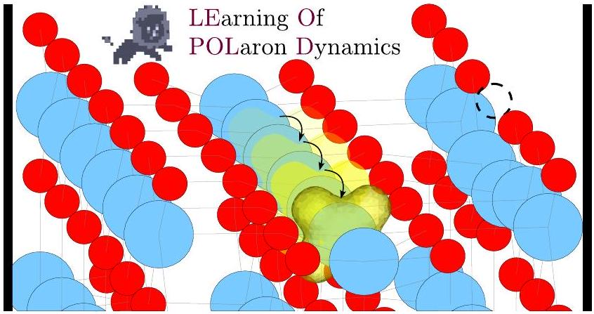
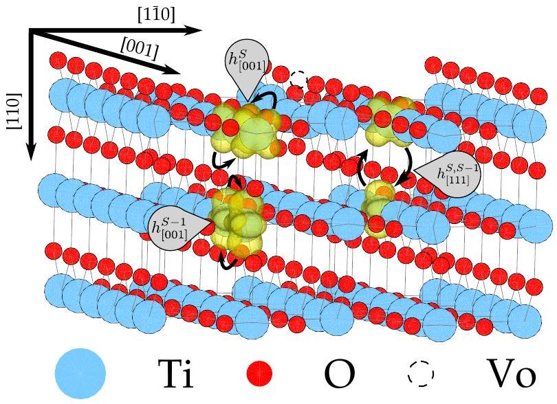
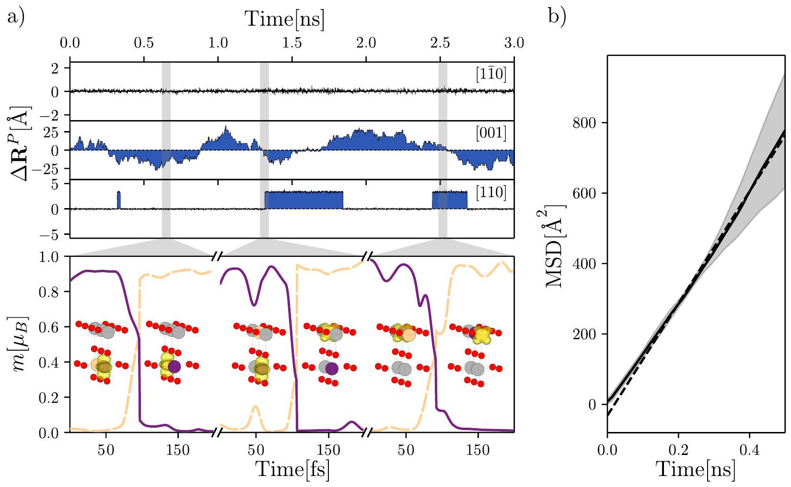
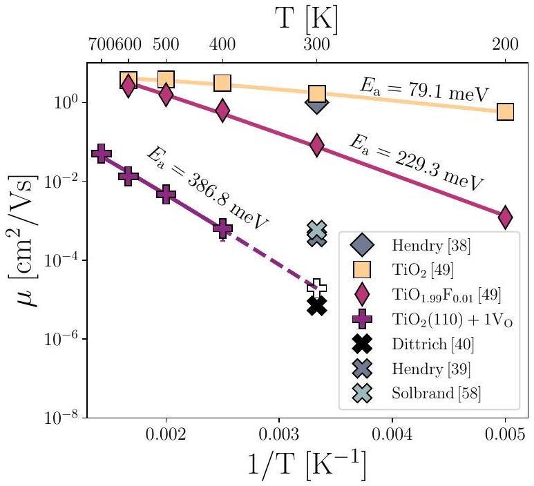
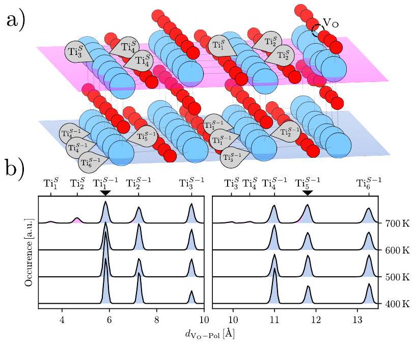
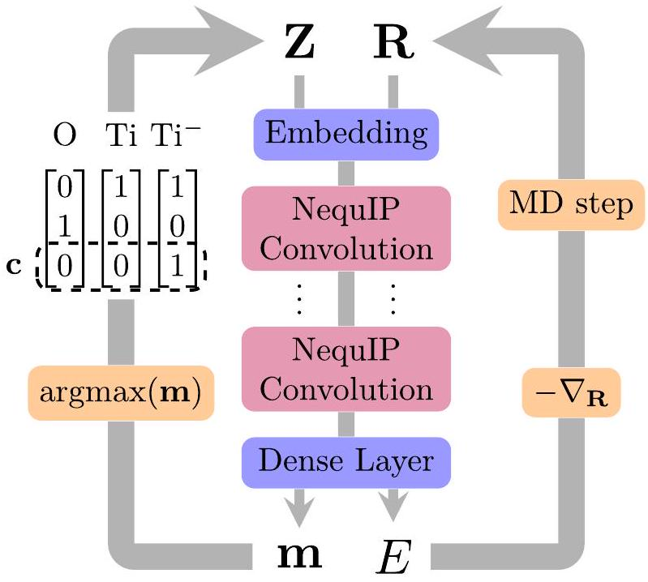

# Machine-learned dynamics of surface polarons at reduced oxide surfaces 

Luca Leoni ${ }^{* 1}$ and Cesare Franchini ${ }^{1,2}$<br>${ }^{1}$ Department of physics and astronomy "Augusto Righi", alma mater studiorum - università di Bologna, Bologna, 40127 Italy<br>${ }^{2}$ university of Vienna, faculty of physics and center for computational materials science, Vienna, Austria<br>*email: luca.leoni12@unibo.it


#### Abstract

Reducible oxides exhibit a rich interplay of electronic, structural, and chemical properties that underpins applications in catalysis, photovoltaics, batteries, and energy storage. This interplay is strongly shaped by excess electrons, often introduced by oxygen vacancies, that localize as small polarons and influence charge transport and surface chemistry. At surfaces, these polarons play a central role in charge localization, mobility, and reactivity, yet their finite-temperature dynamics remain difficult to access from first principles due to the long time scales needed to adequately sample polaron's hopping. To overcome this limitation, we extend machine-learning-assisted polaron dynamics to redox-active oxide surfaces, using oxygen-deficient rutile $\mathrm{TiO}_{2}(110)$ as a paradigmatic case. By accessing several nanoseconds of dynamics over a range of temperatures, we show that small-polaron mobility at the reduced rutile $\mathrm{TiO}_{2}(110)$ surface is suppressed by several orders of magnitude relative to the corresponding bulk material, providing a microscopic interpretation of the lower electron mobilities observed in porous rutile $\mathrm{TiO}_{2}$ compared with single-crystal samples. This suppressed mobility arises from the loss of favourable hopping pathways: surface polaron motion is largely confined to planar inter-row trajectories within the second topmost layers, with only rare interlayer hopping events. These results establish a transferable machine-learning strategy for investigating polaron dynamics in reducible oxides.


## TOC Graphic



Reducible oxide surfaces are central to a wide range of functional materials because the transitionmetal cations they contain can reversibly adopt different oxidation states, enabling charge localization, defect formation, and surface redox activity that can be exploited in applications ranging from heterogeneous catalysis and photocatalysis to energy conversion and storage [1, 2].

The facile formation of oxygen vacancies $\left(V_{\mathrm{O}}\right)$, enabled by their relatively low formation energies, gives rise to reduced surface centers composed of neutral oxygen vacancies and transition-metal cations with modified oxidation states. The localization of the excess electronic charge provided by $V_{\mathrm{O}}$ can induce the formation of small polarons, namely defect complexes in which an excess electron is trapped at a transitionmetal site and strongly coupled to lattice distortions, leading to local structural modifications [3]. In turn, these composite electron-phonon polaronic defects alter the geometric and electronic structure, strongly influencing the physical and chemical properties, and they play a decisive role in their technological applications.

Polaron formation is ubiquitous in many transition-metal oxides, including $\mathrm{TiO}_{2}$ [4-10], $\mathrm{CeO}_{2}$ [11-14], $\mathrm{Fe}_{2} \mathrm{O}_{3}$ [15-20] and $\mathrm{BiVO}_{4}$ [21-24], which are among the most widely studied reduced oxide surfaces exhibiting polaronic behaviour. In particular, titanium dioxide $\left(\mathrm{TiO}_{2}\right)$, an Earth-abundant material of steadily growing technological importance [25], has become a key test-bed system for studying polaronic effects [9, 26-30], with applications spanning biocompatible technologies, gas sensing, photocatalysis, and photovoltaics [31-33]. The performance of these applications is critically governed by the nature and transport properties of polaronic charges. After decades of study, it is now established that the two most common polymorphs of $\mathrm{TiO}_{2}$, rutile and anatase, host small and large electron polarons, respectively [30, 34], which exhibit distinct transport regimes. Whereas large polarons behave similarly to quasi-free particles with a metal-like temperature dependence of the conductivity, small polarons undergo thermally activated hopping transport, with mobilities that increase with increasing temperature [3, 35].

Experimental measurements of small polaron mobility are challenging and can depend sensitively on sample quality, reduction level, and the presence of defects such as Ti interstitials or Nb impurities. As a result, reported values for rutile $\mathrm{TiO}_{2}$ span several orders of magnitude, from $10^{-2}$ to $10 \mathrm{~cm}^{2} \mathrm{~V}^{-1} \mathrm{~s}^{-1}$ [36-38]. Importantly, it has been reported that those values drop when estimated in porous $\mathrm{TiO}_{2}$ samples by several orders of magnitude [39], reaching reported values as low as $7 \times 10^{-6} \mathrm{~cm}^{2} \mathrm{~V}^{-1} \mathrm{~s}^{-1}$ [40]. This reduction has been attributed to electron immobilization at trapping sites, as well as to intrinsic mobility suppression arising from broken symmetry and the restricted transport pathways characteristic of high-surface-area porous materials. These findings suggest that small-polaron mobility at surfaces is likely to be significantly lower than the corresponding bulk value [39, 40].

First-principles simulations provide an efficient framework to interpret and elucidate the microscopic mechanisms underlying small-polaron formation and dynamics. Starting from the seminal work of Deskins et al. [26], several static calculations on bulk and surface rutile $\mathrm{TiO}_{2}$ have been performed, providing valuable insight into the most favorable trapping sites, activation energies, selected polaron hopping directions, and the degree of adiabaticity [29, 30, 41-44]. Beyond static approaches, the actual dynamical pathways of polaron motion can be accessed through first-principles molecular dynamics (FPMD) [9, 45, 46]. However, the high computational cost of FPMD limits simulated polaron-hopping trajectories to timescales of only a few picoseconds. This unavoidably restricts the exploration of configurational space and reduces the statistical sampling needed to accurately predict mobilities. These limitations have recently been overcome by integrating machine-learning interatomic potentials (MLIPs) [47, 48] into ab initio small-polaron dynamics with the LEOPOLD [49] architecture, where time-dependent polaron trajectories are learned through the dynamical prediction of the site-selective polaron occupation matrix using equivariant graph neural networks. This approach extends polaron dynamics to nanosecond timescales and enables the sampling of thousands of polaron trajectories. Applied to small-polaron hopping in bulk rutile $\mathrm{TiO}_{2}$, LEOPOLD correctly reproduces the temperature-dependent hopping regime characteristic of small-polaron transport and yields a room-temperature mobility of $1.6 \mathrm{~cm}^{2} / \mathrm{Vs}$, in agreement with recent spectroscopic measurements [39, 50].

In this Letter, we extend the capabilities of LEO-POLD to reduced oxide surfaces by predicting small-polaron mobility at the oxygen-deficient rutile $\mathrm{TiO}_{2}$ (110) surface. A comparative analysis between bulk and surface dynamics reveals a reduction of four orders of magnitude in small-polaron mobility at the surface, primarily caused by the suppression of favourable hopping pathways, which are largely confined to planar inter-row trajectories within the second topmost layers and only rarely involve interlayer hopping. These results provide a microscopic explanation for experimental observations and broaden the applicability of


Figure 1: Representation of the $\mathrm{TiO}_{2}$ (110) surface with a surface oxygen vacancy. The most probable polaron hopping events observed during the simulation are shown, with the polaronic charge density depicted in the two adjacent states and connected by arrows. Among the hopping events reported, two occur along the preferred [001] direction: one within the surface layer $S$ (labelled $h_{[001]}^{S}$ ) and one within the subsurface layer $S-1$ (labelled $h_{[001]}^{S-1}$ ) directly below it. The third occurs along the [111] direction, corresponding to polaron transfer between the surface and subsurface layers (labelled $h_{[111]}^{S, S-1}$ ).

ML-based ab initio simulations to the study of polaron transport in realistic oxide environments.

The structural model used in this study is shown in Fig. 1. It consists of a 539-atom asymmetric slab containing five Ti layers in a 6 × 3 two-dimensional supercell, with one surface oxygen vacancy, $V_{\mathrm{O}}$, acting as an electron donor [9, 29, 45]. One of the two excess electrons associated with the vacancy was compensated by a uniform background charge, resulting in a single mobile small polaron. The database for the ML-based LEOPOLD run was generated from FPMD simulations performed using the Vienna Ab initio Simulation Package (VASP) [51, 52], within the framework of density functional theory augmented by an effective on-site Hubbard correction of 3.9 eV applied to the d orbital of Ti atoms [9, 53].

By initializing the polaron trapping site at different locations [54], we performed several FPMD simulations at from 300 to 700 K, for a total simulation time of approximately 100 ps. These simulations generated thousands of configurations and yielded several tens of hopping events, in which the small polaron moved from one site to a neighbouring site through a predominantly adiabatic process [26, 49]. The resulting FPMD data were used as initial training dataset for the LEOPOLD model and then further enriched through an active-learning strategy used to insert more exotic jumps identified during the runs by the model itself [49]. Additional computational details, including a description of the MLMD LEOPOLD architecture, are provided in the Methods section.

A representative example of a 3 ns MLMD run obtained using the protocol described above at 700 K is shown in Fig. 2(a). LEOPOLD identifies three main distinct types of hopping trajectories schematically illustrated in Fig. $1\left(h_{[001]}^{S-1}, h_{[001]}^{S}\right.$, and $\left.h_{[111]}^{S, S-1}\right)$, in agreement with previous FPMD studies [9, 45, 46, 55]. These trajectories are shown individually at the bottom of Fig. 2(a) over shorter femtosecond time windows. The most frequent hopping event by far, accounting for approximately 87\% of the total events, involves small-polaron transport along the [001] rows in the subsurface S-1 layer adjacent to the surface row containing $V_{\mathrm{O}}, h_{[001]}^{S-1}$. In about 12\% of the cases, the polaron hops along the surface Ti row next to $V_{\mathrm{O}}, h_{[001]}^{S}$. Interlayer hopping events are observed only very rarely, approximately 1\% of the time, and involve electron transfer from S-1 to S, or vice versa, $h_{[111]}^{S, S-1}$. Small-polaron transport to deeper layers was never observed, confirming the clear tendency of small polarons to form and remain confined within the topmost surface layers [9, 54, 56, 57]. Inter-row hopping between adjacent Ti rows, which are ~3 Å apart and connected by oxygen atoms is equally rare.

Each individual hopping event is tracked by monitoring the time evolution of the local spin magnetization, $m$ [41, 49], as shown in the bottom panels of Fig. 2(a). Initially, the polaron is fully localized on a lattice site, with a projected local spin moment of $\sim 0.9 \mu_{B}$ (solid violet curve). During the hopping process, the spin moment on the initial site progressively decreases, while the increasing probability of finding the polaron on the neighboring final site leads to a corresponding increase of the local spin moment on that site (dashed orange curve). At the end of the hopping event, the small polaron is fully localized on the final site, which exhibits the local spin moment of $\sim 0.9 \mu_{B}$. The point at which the two curves intersect is generally identified as the transition state [26].

The observed hopping trajectories are associated with a sudden jump in the polaron displacement $\Delta \mathbf{R}^{P}$, which measures the spatial distance of the polaron from its starting position. The resulting time-dependent evolution of $\Delta \mathbf{R}^{P}$ is collected in the top part of Fig. 2(a) projected over the three main surface directions. The statistically representative data at 700 K clearly show


Figure 2: a) Leopold simulated small polaron dynamics on $\mathrm{TiO}_{2}(110)$ at 700 K. In the top panel the projection displacement of the polaron position, $\Delta \mathbf{R}^{P}$, on the three main crystallographic directions is shown as a function of the simulation time. The components show a clear discontinuous motion due to the polaron jumping between Ti atoms mainly through jumps in the [001] direction. The bottom panel shows a close up on the three type of jumps present in the dynamic, showing the magnetization profiles as predicted by LEOPOLD, where the purple continuous line describes the magnetization on the donor atom and the yellow dashed line the magnetization on the receiving atom. b) The mean square displacement of the polaron averaged from three different runs at 700 K is reported. The continuous line and the dashed area represent mean MSD and deviation from the mean for the three runs, a linear fit is shown as dashed line.

that polaron transport occurs preferentially along the [001] direction. The polaron moves back and forth along the $S-1$ Ti row with occasional hops from $S-1$ to $S$ and vice-versa, as evidenced by a $2.5 \AA$ displacement along the [110] direction. The occurrence of only six $h_{[111]}^{S, S-1}$-type jump over a 3 ns trajectory indicates that such events are much rarer than the dominant $h_{[001]}^{S}$ and $h_{[001]}^{S-1}$ jumps. This large difference in probability can be rationalized from the bottom panel of Fig. 2(a): the [111] jump involves not only a longer distance between the initial and final Ti sites, but also a reorientation of the polaron orbital. Both factors reduce the overlap between the initial and final states, thereby strongly suppressing the hopping rate, as discussed in previous works [26, 49]. As a result, this type of jump remains a rare event even at high temperature.

To collect sufficient statistics for an accurate estimate of the polaron mobility, $\mu$, four independent simulations, initialized with different polaron sites, were performed at each target temperature (300, 400, 500, 600, and 700 K). The simulation time for each run varied from 1-3 ns at 700 K, where hopping events were frequent and the model was less stable, to 9 ns at 300 K, where the polaron remained essentially localized. For every run we obtained an estimate of the polaron diffusion coefficient, $D$, by fitting the long time regime of the polaron mean square displacement (MSD) (see Fig. 2(b)), and then used the Einstein relation to evaluate $\mu$. The final value of $\mu$ at a target temperature was then taken as the average of the mobility of the different runs.

In Fig. 3, we report the polaron mobility obtained for the reduced rutile- $\mathrm{TiO}_{2}$ surface, together with previous LEOPOLD estimates of $\mu$ for pristine bulk $\mathrm{TiO}_{2}$ and for F-doped bulk $\mathrm{TiO}_{2}$ [49]. The results


Figure 3: Polaron mobility on the oxygen-deficient rutile- $\mathrm{TiO}_{2}(110)$ surface. For comparison, the corresponding polaron mobility values in bulk rutile- $\mathrm{TiO}_{2}$, taken from Ref. [49], are also shown. The dashed purple line indicates the extrapolated region of the fit used to estimate the mobility at 300 K, shown as an open cross. Filled crosses denote different experimental measurements on porous $\mathrm{TiO}_{2}$ [39, 40, 58], while the filled rotated square a bulk experimental mobility [38].

show that polaron mobility is strongly suppressed at the surface, decreasing by several orders of magnitude at all temperatures. This reduction is consistent with the difference between the room-temperature electron mobilities measured experimentally in single-crystal $\mathrm{TiO}_{2}$ [38] and porous $\mathrm{TiO}_{2}$ [39, 40]. We note that a direct quantitative estimate of $\mu$ at 300 K was not possible within LEOPOLD, owing to the extremely low polaron mobility: no hopping event was observed over a total simulation time of ~ 40 ns. Therefore, to compare our model with experiment, we extrapolate the mobility to room temperature assuming Arrhenius behaviour, obtaining $\mu(300 \mathrm{~K})=$ $(1.9 \pm 0.8) \times 10^{-5} \mathrm{~cm}^{2}, \mathrm{~V}^{-1}, \mathrm{~s}^{-1}$. The quoted uncertainty is obtained by propagating the statistical uncertainties of the fitted activation energy and prefactor. It does not account for possible systematic deviations from Arrhenius behaviour outside the simulated temperature range. In particular, at lower temperatures, quantum delocalization, tunnelling, or a crossover toward more coherent polaron transport may become relevant [59, 60]; these effects are not captured by the present localized-polaron molecular-dynamics framework and could alter the extrapolated mobility. The resulting value lies within, although toward the lower end of, the experimental range of 7 × $10^{-6}-5 \times 10^{-4} \mathrm{~cm}^{2} \mathrm{~V}^{-1} \mathrm{~s}^{-1}$ reported for electron mobilities in porous $\mathrm{TiO}_{2}$ [39, 40, 58]. Furthermore, the activation barrier of 386±22 meV obtained from the Arrhenius fit of the LEOPOLD mobilities is comparable to recent infrared-spectroscopy estimates of 300-330 meV for polaronic states in rutile $\mathrm{TiO}_{2}(110)$ [61]. The residual differences between our calculated mobilities and experimental values are likely related to factors not explicitly included in the present model, such as variations in vacancy concentration, disorder, morphology, and multi-polaron interactions. In particular, the strong carrier-concentration dependence of the electronic diffusion constant observed experimentally [36, 37, 62], together with the established role of polaron-polaron interactions in influencing charge localization [46, 63, 64], indicates that the presence of multiple polarons may substantially alter site occupations, preferred hopping pathways, and the effective vacancy-polaron interaction, thereby affecting the calculated mobility. The mobility obtained in the present single-polaron calculations should therefore be regarded as representative of the dilute-polaron limit. Extending the present approach to interacting multipolaron systems and systematically investigating the effects of increasing oxygen-vacancy and carrier concentrations represent important directions for future work.

A further analysis of the generated polaron trajectories was performed to investigate the role of the interaction between the negatively charged polaron and the positively charged oxygen vacancy at the surface considering the different Ti sites shown in Fig. 4(a). In particular, additional MD simulations were carried out by initializing the polaron either in a Ti row close to the vacancy or in a more distant row, and subsequently monitoring the distribution of the polaron-vacancy distance, $d_{\mathrm{V}_{\mathrm{O}-\mathrm{Pol}}}$, at the target tem-peratures.

The results shown in Fig. 4(b) clearly indicate that the polaron is attracted to the oxygen vacancy, in agreement with previous first-principles and neuralnetwork studies [46, 63, 64]. However, the strength and character of this attraction exhibit qualitative changes with temperature and depend on the initial polaron position, as discussed below.

At low temperature (400 K), the distribution of $d_{\mathrm{V}_{\mathrm{O}}-\mathrm{Pol}}$ exhibits a pronounced decay in peak intensity with increasing polaron-vacancy separation. This indicates that the polaron spends most of the simulation time on Ti sites close to the oxygen vacancy, while thermal activation is insufficient to promote hopping toward more distant rows. In this regime,


Figure 4: a) Structural model of the reduced rutile-$\mathrm{TiO}_{2}(110)$ surface, with selected polaron-trapping Ti sites labelled according to their position relative to the oxygen vacancy, $\mathrm{V}_{\mathrm{O}}$. b) Distributions of the polaron-vacancy distance, $d_{\mathrm{V}_{\mathrm{O}}-\mathrm{Pol}}$, obtained from independent LEOPOLD dynamics at different temperatures and initialized from different polaron sites, as indicated by the pointers in the top of the $x$-axis. The left panel corresponds to trajectories initialized with the polaron on site $\mathrm{Ti}_{1}^{S-1}$, whereas the right panel corresponds to trajectories initialized on $\mathrm{Ti}_{5}^{S-1}$ with the polaron farther from $\mathrm{V}_{\mathrm{O}}$. The light-blue shaded region denotes contributions from polaron localization in the $S-1$ layer, while the pink shaded region denotes contributions from localization in the $S$ layer.

the vacancy therefore acts as an effective trapping center, and the dynamics are dominated by local exploration of the nearby Ti sublattice rather than by long-range diffusion.

This localization effect becomes much less pronounced when the polaron is initialized on a Ti row farther from the vacancy, as shown in the right panel. The reduced bias toward short $d_{\mathrm{V}_{\mathrm{O}}-\mathrm{Pol}}$ values demonstrates that LEOPOLD captures not only the attractive character of the polaron-vacancy interaction, but also its rapid spatial decay. In other words, the vacancy strongly affects the local hopping landscape, but its influence does not extend uniformly across the surface slab. Increasing the temperature progressively weakens this trapping effect, as evidenced by the enhanced occupation of configurations with larger polaron-vacancy separations. This reflects the competition between the energetic preference for vacancyproximal sites and the entropic gain associated with accessing a larger number of distant configurations.

The time spent by the polaron in the outermost surface layer remains a small fraction of the total trajectory, as indicated by the pink shaded regions, and becomes appreciable only at 700 K for both initializations. Nevertheless, these rare surface-localized events provide useful insight into the near-surface trapping landscape. For trajectories initialized in the row adjacent to the vacancy, the surface contribution is concentrated mainly on the $\mathrm{Ti}_{1}^{S}$ and $\mathrm{Ti}_{2}^{S}$ sites, with $\mathrm{Ti}_{2}^{S}$ being significantly more populated. This indicates that the attractive interaction with the vacancy persists at the surface, but that the nearest surface Ti site, $\mathrm{Ti}_{1}^{S}$, is not necessarily the most favorable trapping site. The reduced occupation of $\mathrm{Ti}_{1}^{S}$ suggests that short-range structural relaxation, orbital orientation, and local coordination effects can overcome the purely electrostatic tendency to localize as close as possible to the positively charged vacancy. This behavior is consistent with previous first-principles studies of polaron dynamics on rutile- $\mathrm{TiO}_{2}(110)$ [46].

Finally, the fraction of time spent in the surface layer depends strongly on the row in which the polaron is initially localized: it reaches about 17\% when the polaron is initialized in the row closest to the vacancy, but only about 7\% when it starts from the more distant row. This difference indicates that the electrostatic attraction between the negatively charged polaron and the positively charged vacancy not only draws the polaron laterally toward the defect but also lowers the local free-energy cost of occasional hops toward the surface. Thermal fluctuations provide the activation for these events, whereas the vacancy reshapes the underlying energy landscape and enhances their probability. The effect decreases rapidly with increasing distance from the vacancy, consistent with the electrostatic character of the interaction and with previous studies [46, 64]. The oxygen vacancy therefore reshapes the polaron free-energy landscape in two coupled ways: it stabilizes vacancyproximal trapping sites and enhances the probability of surface localization, while increasing temperature partially restores configurational sampling over more distant subsurface sites. Previous studies [46] have also shown that repulsive polaron-polaron interactions can produce effects similar to those associated with polaron-vacancy interactions, leading to longer polaron residence times at the surface as the oxygenvacancy concentration increases. This finding suggests that explicitly accounting for multipolaron dynamics is essential for quantitatively describing $\mathrm{TiO}_{2}$ surfaces at higher degrees of reduction and therefore represents an important direction for future work.

In conclusion, we have extended the use of machine learning polaron dynamics to surfaces, using
the LEOPOLD machine-learning framework to access the long-time dynamics of small polarons at reduced oxide surfaces, focusing on oxygen-deficient rutile$\mathrm{TiO}_{2}(110)$ as a paradigmatic case. The model was trained on an initial set of first-principles moleculardynamics trajectories, covering several temperatures and subsequently enriched through active learning based on machine-learning-generated configurations. This strategy enabled the generation of statistically meaningful polaron trajectories over nanosecond time scales, allowing us to estimate the surface polaron mobility over the temperature range 300-700 K. Our results show that polaron transport at the reduced rutile- $\mathrm{TiO}_{2}(110)$ surface is strongly suppressed compared with the corresponding bulk case, with mobilities reduced by several orders of magnitude across the investigated temperature range. This reduction provides a microscopic interpretation of the experimentally observed difference between electron mobilities in single-crystal and porous rutile $\mathrm{TiO}_{2}$.

By extrapolating the Arrhenius behavior to room temperature, we obtained a mobility in quantitative agreement with the experimental range reported for porous $\mathrm{TiO}_{2}$. Moreover, the activation barrier extracted from the LEOPOLD trajectories is within approximately 15\% of recent infrared-spectroscopy estimates for polaronic states at rutile- $\mathrm{TiO}_{2}(110)$, supporting the reliability of the present approach.

Beyond the quantitative mobility estimates, our simulations clarify the microscopic role of the oxygen vacancy in shaping surface polaron dynamics. The vacancy acts as an attractive center for the excess electron, biasing the polaron distribution toward nearby Ti sites and promoting occasional hoppings from the most favorable subsurface trapping layer to the outermost surface layer. This behavior indicates that surface transport is controlled not only by the local hopping barriers, but also by the defect-induced reshaping of the polaron free-energy landscape.

Overall, this work provides the first nanosecondscale microscopic account of small-polaron mobility at a reduced oxide surface. More broadly, it shows that machine-learning architectures capable of tracking coupled lattice and charge dynamics can extend first-principles accuracy to complex realistic environments and experimentally relevant time scales. The approach introduced here is readily transferable to other reducible oxide surfaces, defect configurations, and adsorbate environments, opening the way to predictive simulations of excess-charge dynamics in (photo)catalytic, and energy-conversion materials.

## Methods

First-principles. All first-principles calculations were performed with the GPU implementation of VASP 6.5.1 [51, 52], including spin polarization and using the Perdew-Burke-Ernzerhof exchange-correlation functional [65]. Electronic correlation on Ti $3 d$ states was treated within the rotationally invariant $\mathrm{DFT}+U$ formalism of Dudarev [53], employing an effective onsite Hubbard parameter of 3.9 eV, consistent with previous studies [9].

The reduced rutile- $\mathrm{TiO}_{2}(110)$ surface was modeled using a five-layer slab separated by $15 \AA$ of vacuum and a 6 × 3 surface supercell. An asymmetric slab geometry was adopted, with the three topmost layers allowed to relax during the simulations, while the remaining layers were kept fixed. A surface oxygen vacancy was introduced to generate the excess charge necessary for enabling polaron formation. To model a single small polaron, one of the two excess electrons released by the vacancy was compensated by a homogeneous positive background charge. The resulting system contained 539 atoms, with surface lattice parameters of $19.9 \AA$ and $18.2 \AA$ and a cell height of $31 \AA$. Such model is shown in Fig. 1, where only the first three surface layers and the two rows closest to the vacancy are shown for convenience.

Standard PAW potentials were used for Ti, together with a soft O potential, allowing a plane-wave kinetic-energy cutoff of 400 eV. Brillouin-zone sampling was restricted to the $\Gamma$ point. Both first-principles molecular dynamics (FPMD) and machine-learning molecular dynamics (MLMD) simulations were carried out in the canonical $N V T$ ensemble using a Nosé-Hoover thermostat [66] and a time step of 1 fs.

LEOPOLD. The LEOPOLD package [49] was used both to train the polaron-aware machine-learning potential and to perform the corresponding MLMD simulations. The architecture of the model is schematically shown in Fig. 5. It is based on a custom implementation of the Neural Equivariant Interatomic Potential (NequIP) framework [67], extended to explicitly account for the presence of a localized polaron through a dedicated "polaron encoding".

In conventional machine-learning interatomic potentials, atoms are typically distinguished only by their chemical species, for instance through a one-hot encoding of the nuclear charge $Z_{i}$. Such a representation does not distinguish between different oxidation states of the same element. LEOPOLD overcomes this limitation by augmenting the atomic representation with an additional one-hot charge-state vector, c, which encodes the discrete change in local oxidation state associated with polaron localization. In this


Figure 5: Graphical representation of the LEOPOLD loop. The model takes as input the polaron encoded species of the system $\mathbf{Z}$ and their atomic positions R to predict the polaron-aware energy and atomic magnetizations. Afterwards, the forces are computed through numerical gradient of energy and used to perform the usual molecular dynamics step to update R. To evolve in time the polaronic charge instead, LEOPOLD uses the predicted m to find the new polaronic site as the one with the current maximum magnetization, thus allowing for a dynamic modification of c.

way, the model can distinguish, for example, a regular Ti site from a Ti site hosting the excess charge, corresponding to a formal oxidation-state change of ±1. To assign the charge state of each configuration, we use the per-atom spin moment $m_{i}$ as a descriptor of the polaron population on atom $i$. The polaron is assigned to the atom carrying the largest absolute magnetization according to

$$
c_{i}= \begin{cases}1 & i=\arg \max _{j}\left|m_{j}\right|, \\ 0 & \text { otherwise }\end{cases}
$$

This procedure yields a discrete vector c that encodes the oxidation-state information of the atoms and, consequently, the instantaneous polaron position.

The resulting "polaron encoding" is constructed by appending c to the atomic-species vector Z, thereby increasing the dimensionality of the input representation. For the $\mathrm{TiO}_{2}$ system considered here, this leads to three effective atomic environments: oxygen, regular titanium, and polaronic titanium. These are encoded as

$$
\mathrm{O}=[0,1,0], \quad \mathrm{Ti}=[1,0,0], \quad \mathrm{Ti}^{\mathrm{pol}}=[1,0,1] .
$$

This representation enables the potential to predict energies and forces in the presence of localized excess charges, while also describing their motion.

To allow the charge-state vector c to evolve dynamically during MLMD simulations, LEOPOLD also learns the atomic charge occupation, defined from the trace of the on-site occupation matrix,

$$
n_{i}^{\sigma l}=\sum_{j m} f_{j}\left\langle\psi_{j}^{\sigma}\right| \mathrm{P}_{l m m}^{i}\left|\psi_{j}^{\sigma}\right\rangle,
$$

where $\psi_{j}^{\sigma}$ are the Kohn-Sham states, $f_{j}$ are their occupations, $\sigma$ denotes the spin channel, and $\mathrm{P}_{l m m^{\prime}}^{i}$ is the projector onto the $l m$ and $l m^{\prime}$ atomic orbitals centered on atom $i$. In the present work, we use projectors onto the Ti $d$ states, where the polaron is localized, and therefore set $l=2$ throughout. For compactness, we denote the corresponding occupations as $n_{i}^{\sigma}$. From these spin-resolved occupations, one can obtain the projected atomic charge and magnetization as $n_{i}^{\uparrow}+n_{i}^{\downarrow}$ and $n_{i}^{\uparrow}-n_{i}^{\downarrow}$, respectively.

In the current implementation of LEOPOLD, the inference of the magnetization has been simplified with respect to the original formulation by training the model to predict directly the sum and difference of the spin occupations. In this way, the network effectively learns the projected on-site charges and magnetizations. This allows the model to infer the polaron population for a given atomic configuration and subsequently apply Eq. (1) to determine the charge-state vector c, thereby predicting the instantaneous charge state of the system.

As illustrated in Fig. 5, this procedure can be embedded directly into a molecular-dynamics loop. At each time step, the model updates the charge-state vector c from the instantaneous atomic configuration, using the polaron position from the previous step as an additional input. The resulting vector c is a one-hot representation of the polaron position and is propagated self-consistently with the atomic degrees of freedom, allowing the polaron to migrate between atomic sites during the dynamics.

The charge state is assigned from $\operatorname{argmax}(\mathbf{m})$, where m is the predicted site-resolved magnetization. This discrete projection maps the continuous magnetization output onto a one-hot charge-state vector, ensuring that exactly one Ti site is identified as polaronic at every time step. Consequently, the dynamics remain constrained to the single-polaron manifold, even when the sum of the predicted magnetizations is not exactly unity, thereby enforcing conservation of the polaron charge throughout the simulation.

Since the LEOPOLD package is fully implemented in Python using the JAX library [68], the molecular-dynamics loop was also implemented in JAX, using JAX-MD [69]. This provides a fully differentiable and accelerator-compatible workflow in which the atomic structure and the polaronic charge state are updated on the fly during the simulation.

In addition, the latest version of LEOPOLD includes a custom implementation of the $N V T$ integration scheme in JAX-MD, with support for selective dynamics. This functionality was specifically introduced to enable simulations of slab geometries such as the reduced rutile- $\mathrm{TiO}_{2}(110)$ surface considered here.

Database construction. The database was constructed following the strategy introduced in Ref. [49]. Four initial configurations were generated by imposing ad hoc local distortions around selected Ti sites, followed by structural relaxation, in order to localize the polaron in different rows and layers of the slab. Each configuration was then used as the starting point for first-principles molecular-dynamics simulations at 300, 500, and 700 K. After thermalization through a temperature ramp of 0.3 K/fs, each trajectory was propagated for at least 8 ps.

In total, approximately 100 ps of FPMD trajectories were collected, containing 50 polaron-hopping events across the sampled temperatures. These data were used to construct the initial database, split into training and validation sets of 4963 and 1256 configurations, respectively. In both sets, 30\% of the configurations were selected in the vicinity of a hopping event, ensuring that the model was exposed to the high-energy transition regions relevant for polaron transport.

The LEOPOLD potential trained on this initial dataset was then employed to perform MLMD simulations of polaron dynamics. Configurations generated along MLMD trajectories, particularly those associated with additional hopping events, were subsequently used to augment the training database in an active-learning procedure. The final production model contained approximately $4.1 \times 10^{4}$ trainable parameters and was trained on the augmented dataset, comprising 6898 training and 1793 validation configurations. The resulting training errors for forces and magnetizations were 20 meV/ $\AA$ and $3.5 \mathrm{~m} \mu$, while the final validation errors were $24 \mathrm{meV} / \AA$ and $3.6 \mathrm{~m} \mu$. The training specifics are reported in the supporting information.

## Supporting information

- supp.pdf: Accurate description of the machine learning training with specifics for the hyperparameters used. Explicit report of the final model errors and computational performances.

## Data availability statement

The new version of LEOPOLD used in this study is openly available in https://github.com/QuantumMate-rialsModelling/leopold. The training data underlying this study are openly available at https://doi.org/10.5281/ze-nodo.20647088.

## Acknowledgements

The authors acknowledge support by the National Recovery and Resilience Plan (NRRP), Mission 4 Component 2 Investment 1.3 - Project NEST (Network 4 Energy Sustainable Transition) and CN-HPC grant no. (CUP) J33C22001170001, SPOKE 7, of Ministero dell'Università e della Ricerca (MUR), funded by the European Union - NextGenerationEU. This research was partially funded by the Austrian Science Fund (FWF) 10.55776/F8100 project TACO. We acknowledge the CINECA award under the ISCRA initiative, for the availability of high-performance computing resources and support.

## References

(1) Rousseau, R.; Glezakou, V.-A.; Selloni, A. Theoretical insights into the surface physics and chemistry of redox-active oxides. Nature Reviews Materials 2020, 5, 460-475.
(2) Ganduglia-Pirovano, M. V.; Hofmann, A.; Sauer, J. Oxygen vacancies in transition metal and rare earth oxides: Current state of understanding and remaining challenges. Surface Science Reports 2007, 62, 219-270.
(3) Franchini, C.; Reticcioli, M.; Setvin, M.; Diebold, U. Polarons in materials. Nature Reviews Materials 2021, 6, 560-586.
(4) Bredow, T.; Pacchioni, G. Electronic structure of an isolated oxygen vacancy at the $\mathrm{TiO}_{2}(110)$ surface. Chemical Physics Letters 2002, 355, 417-423.

(5) Di Valentin, C.; Pacchioni, G.; Selloni, A.; Livragh(15) S.; Giamello, E. Characterization of Paramagnetic Species in N-Doped TiO2 Powders by EPR Spectroscopy and DFT Calculations. The Journal of Physical Chemistry B 2005, 109, 11414-11419.
(6) Di Valentin, C.; Finazzi, E.; Pacchioni, G.; Selloni, A.; Livraghi, S.; Czoska, A. M.; Paganini, M. C.; Giamello, E. Density functional theory and electron paramagnetic resonance study on the effect of N-F codoping of TiO2. Chemistry of Materials 2008, 20, 3706-3714.
(7) Di Valentin, C.; Selloni, A. Bulk and Surface Polarons in Photoexcited Anatase $\mathrm{TiO}_{2}$. The Journal of Physical Chemistry Letters 2011, 2, 2223-2228.
(8) Chiesa, M.; Paganini, M. C.; Livraghi, S.; Giamello, E. Charge trapping in $\mathrm{TiO}_{2}$ polymorphs as seen by Electron Paramagnetic Resonance spectroscopy. Phys. Chem. Chem. Phys. 2013, 15, 9435-9447.
(9) Setvin, M.; Franchini, C.; Hao, X.; Schmid, M.; Janotti, A.; Kaltak, M.; Van de Walle, C. G.; Kresse, G.; Diebold, U. Direct View at Excess Electrons in $\mathrm{TiO}_{2}$ Rutile and Anatase. Phys. Rev. Lett. 2014, 113, 086402.
(10) Yin, W.-J.; Wen, B.; Zhou, C.; Selloni, A.; Liu, L.-M. Excess electrons in reduced rutile and anatase $\mathrm{TiO}_{2}$. Surface Science Reports 2018, 73, 58-82.
(11) Ganduglia-Pirovano, M. V.; Da Silva, J. L. F.; Sauer, J. Density-Functional Calculations of the Structure of Near-Surface Oxygen Vacancies and Electron Localization on $\mathrm{CeO}_{2}$ (111). Phys. Rev. Lett. 2009, 102, 026101.
(12) Esch, F.; Fabris, S.; Zhou, L.; Montini, T.; Africh, C.; Fornasiero, P.; Comelli, G.; Rosei, R. Electron Localization Determines Defect Formation on Ceria Substrates. Science 2005, 309, 752-755.
(13) Zhang, D.; Han, Z.-K.; Murgida, G. E.; Ganduglia-Pirovano, M. V.; Gao, Y. Oxygen-Vacancy Dynamics and Entanglement with Polaron Hopping at the Reduced $\mathrm{CeO}_{2}(111)$ Surface. Phys. Rev. Lett. 2019, 122, 096101.
(14) Pelatti, S. et al. Ultrafast Dynamics of Electronic and Structural Modifications Induced by Photoexcitation in Cerium Oxide. Advanced Electronic Materials 2025, 11, e00429.
Iordanova, N.; Dupuis, M.; Rosso, K. M. Charge transport in metal oxides: A theoretical study of hematite $\alpha-\mathrm{Fe}_{2} \mathrm{O}_{3}$. The Journal of Chemical Physics 2005, 122, 144305.
(16) Carneiro, L. M.; Cushing, S. K.; Liu, C.; Su, Y.; Yang, P.; Alivisatos, A.; Leone, S. R. Excitation-wavelength-dependent small polaron trapping of photoexcited carriers in $\alpha-\mathrm{Fe}_{2} \mathrm{O}_{3}$. Nature Materials 2017, 16, 819-825.
(17) Pastor, E.; Park, J.-S.; Steier, L.; Kim, S.; Grätzel, M.; Durrant, J. R.; Walsh, A.; Bakulin, A. A. In situ observation of picosecond polaron self-localisation in $\alpha-\mathrm{Fe}_{2} \mathrm{O}_{3}$ photoelectrochemical cells. Nature Communications 2019, 10, 3962.
(18) Ahart, C. S.; Blumberger, J.; Rosso, K. M. Polaronic structure of excess electrons and holes for a series of bulk iron oxides. Phys. Chem. Chem. Phys. 2020, 22, 10699-10709.
(19) Bandaranayake, S.; Hruska, E.; Londo, S.; Biswas, S.; Baker, L. R. Small Polarons and Surface Defects in Metal Oxide Photocatalysts Studied Using XUV Reflection-Absorption Spectroscopy. The Journal of Physical Chemistry C 2020, 124, 22853-22870.
(20) Redondo, J. et al. Real-space investigation of polarons in hematite $\mathrm{Fe}_{2} \mathrm{O}_{3}$. Science Advances 2024, 10, eadp7833.
(21) Wiktor, J.; Ambrosio, F.; Pasquarello, A. Role of Polarons in Water Splitting: The Case of $\mathrm{BiVO}_{4}$. ACS Energy Letters 2018, 3, 1693-1697.
(22) Wiktor, J.; Pasquarello, A. Electron and Hole Polarons at the $\mathrm{BiVO}_{4}$-Water Interface. ACS Applied Materials \& Interfaces 2019, 11, 18423-18426.
(23) Zhang, Y.; Cheng, C.; Zhou, Z.; Long, R.; Fang, W.-H. Surface Hydroxylation during Water Splitting Promotes the Photoactivity of $\mathrm{BiVO}_{4}(010)$ Surface by Suppressing Polaron-Mediated Charge Recombination. The Journal of Physical Chemistry Letters 2023, 14, PMID: 37791802, 9096-9102.
(24) Liu, H.; Cong, H.; Yang, G.; Gong, C.; Ding, J.; Fu, Y. y.; Cui, J.; Song, K.; Chen, B.; He, C.; Zhao, N.; Ye, J.; He, F. Surface hole polaron site tuning governs charge carrier separation in $\mathrm{BiVO}_{4}$ photoanodes. Nature Communications 2026, 17, 2562.
(25) Diebold, U. The surface science of titanium dioxide. Surface Science Reports 2003, 48, 53-229.

(26) Deskins, N. A.; Dupuis, M. Electron transport via polaron hopping in bulk $\mathrm{TiO}_{2}$ : A density functional theory characterization. Phys. Rev. B 2007, 75, 195212.
(27) Deák, P.; Kullgren, J.; Frauenheim, T. Polarons and oxygen vacancies at the surface of anatase $\mathrm{TiO}_{2}$. physica status solidi (RRL) - Rapid Research Letters 2014, 8, 583-586.
(28) Deák, P.; Aradi, B.; Frauenheim, T. Oxygen deficiency in $\mathrm{TiO}_{2}$ : Similarities and differences between the Ti self-interstitial and the O vacancy in bulk rutile and anatase. Phys. Rev. B 2015, 92, 045204.
(29) Moses, P. G.; Janotti, A.; Franchini, C.; Kresse, G.; Van de Walle, C. G. Donor defects and small polarons on the $\mathrm{TiO}_{2}(110)$ surface. Journal of Applied Physics 2016, 119, 181503.
(30) Elmaslmane, A. R.; Watkins, M. B.; McKenna, K. P. First-Principles Modeling of Polaron Formation in $\mathrm{TiO}_{2}$ Polymorphs. Journal of Chemical Theory and Computation 2018, 14, 3740-3751.
(31) Ali, I.; Suhail, M.; Alothman, Z. A.; Alwarthan, A. Recent advances in syntheses, properties and applications of $\mathrm{TiO}_{2}$ nanostructures. RSC Advances 2018, 8, 30125-30147.
(32) Fujishima, A.; Zhang, X.; Tryk, D. A. $\mathrm{TiO}_{2}$ photocatalysis and related surface phenomena. Surface Science Reports 2008, 63, 515-582.
(33) Marcelis, E. J.; ten Elshof, J. E.; Morales-Masis, M. Titanium Dioxide: A Versatile Earth-Abundant Optical Material for Photovoltaics. Advanced Optical Materials 2024, 12, 2401423.
(34) Dai, Z.; Giustino, F. Identification of large polarons and exciton polarons in rutile and anatase polymorphs of titanium dioxide. Proceedings of the National Academy of Sciences 2024, 121, e2414203121.
(35) Zhang, S. X.; Kundaliya, D. C.; Yu, W.; Dhar, S.; Young, S. Y.; Salamanca-Riba, L. G.; Ogale, S. B.; Vispute, R. D.; Venkatesan, T. Niobium doped $\mathrm{TiO}_{2}$ : Intrinsic transparent metallic anatase versus highly resistive rutile phase. Journal of Applied Physics 2007, 102, 013701.
(36) Tang, H.; Prasad, K.; Sanjinès, R.; Schmid, P. E.; Lévy, F. Electrical and optical properties of $\mathrm{TiO}_{2}$ anatase thin films. Journal of Applied Physics 1994, 75, 2042-2047.
(37) Yagi, E.; Hasiguti, R. R.; Aono, M. Electronic conduction above 4 K of slightly reduced oxygendeficient rutile $\mathrm{TiO}_{2-x}$. Phys. Rev. B 1996, 54, 7945-7956.
(38) Hendry, E.; Wang, F.; Shan, J.; Heinz, T. F.; Bonn, M. Electron transport in $\mathrm{TiO}_{2}$ probed by THz time-domain spectroscopy. Physical Review $B$ 2004, 69, DOI: 10.1103/physrevb.69.081101.
(39) Hendry, E.; Koeberg, M.; O'Regan, B.; Bonn, M. Local Field Effects on Electron Transport in Nanostructured $\mathrm{TiO}_{2}$ Revealed by Terahertz Spectroscopy. Nano Letters 2006, 6, 755-759.
(40) Dittrich, T. Porous $\mathrm{TiO}_{2}$ : Electron Transport and Application to Dye Sensitized Injection Solar Cells. physica status solidi (a) 2000, 182, 447-455.
(41) Janotti, A.; Franchini, C.; Varley, J. B.; Kresse, G.; Van de Walle, C. G. Dual behavior of excess electrons in rutile $\mathrm{TiO}_{2}$. physica status solidi (RRL) - Rapid Research Letters 2013, 7, 199-203.
(42) Spreafico, C.; VandeVondele, J. The nature of excess electrons in anatase and rutile from hybrid DFT and RPA. Phys. Chem. Chem. Phys. 2014, 16, 26144-26152.
(43) Morita, K.; Golomb, M. J.; Rivera, M.; Walsh, A. Models of Polaron Transport in Inorganic and Hybrid Organic -Inorganic Titanium Oxides. Chemistry of Materials 2023, Publisher: American Chemical Society, DOI: 10. 1021 /acs.chemmater.3c00322.
(44) SHI, Z.; GONG, X. A density functional theory study of polarons on different $\mathrm{TiO}_{2}$ surfaces. Journal of Fuel Chemistry and Technology 2024, 52, 1877-1888.
(45) Kowalski, P. M.; Camellone, M. F.; Nair, N. N.; Meyer, B.; Marx, D. Charge Localization Dynamics Induced by Oxygen Vacancies on the $\mathrm{TiO}_{2}$ Surface. Phys. Rev. Lett. 2010, 105, 146405.
(46) Reticcioli, M.; Setvin, M.; Schmid, M.; Diebold, U.; Franchini, C. Formation and dynamics of small polarons on the rutile $\mathrm{TiO}_{2}(110)$ surface. Phys. Rev. B 2018, 98, 045306.
(47) Behler, J.; Parrinello, M. Generalized Neural-Network Representation of High-Dimensional Potential-Energy Surfaces. Phys. Rev. Lett. 2007, 98, 146401.

(48) Bartók, A. P.; Payne, M. C.; Kondor, R.; Csányi, G. Gaussian Approximation Potentials: The Accuracy of Quantum Mechanics, without the Electrons. Phys. Rev. Lett. 2010, 104, 136403.
(49) Birschitzky, V. C.; Leoni, L.; Reticcioli, M.; Franchini, C. Machine Learning Small Polaron Dynamics. Phys. Rev. Lett. 2025, 134, 216301.
(50) Austin, I. G.; Mott, N. F. Polarons in crystalline and non-crystalline materials. Advances in Physics 2001, 50, 757-812.
(51) Kresse, G.; Furthmüller, J. Efficiency of abinitio total energy calculations for metals and semiconductors using a plane-wave basis set. Computational Materials Science 1996, 6, 15-50.
(52) Kresse, G.; Joubert, D. From ultrasoft pseudopotentials to the projector augmented-wave method. Physical Review B 1999, 59, 1758-1775.
(53) Dudarev, S.; Botton, G. Electron-energy-loss spectra and the structural stability of nickel oxide: An LSDA+U study. Physical Review B 1998, 57, 1505-1509.
(54) Reticcioli, M.; Sokolovi ć, I.; Schmid, M.; Diebold, U.; Setvin, M.; Franchini, C. Interplay between Adsorbates and Polarons: CO on Rutile $\mathrm{TiO}_{2}(110)$. Phys. Rev. Lett. 2019, 122, 016805.
(55) Reticcioli, M.; Setvin, M.; Hao, X.; Flauger, P.; Kresse, G.; Schmid, M.; Diebold, U.; Franchini, C. Polaron-Driven Surface Reconstructions. Phys. Rev. X 2017, 7, 031053.
(56) Papageorgiou, A. C.; Beglitis, N. S.; Pang, C. L.; Teobaldi, G.; Cabailh, G.; Chen, Q.; Fisher, A. J.; Hofer, W. A.; Thornton, G. Electron traps and their effect on the surface chemistry of $\mathrm{TiO}_{2}(110)$. Proceedings of the National Academy of Sciences 2010, 107, 2391-2396.
(57) Reticcioli, M.; Diebold, U.; Franchini, C. Modeling polarons in density functional theory: lessons learned from $\mathrm{TiO}_{2}$. Journal of Physics: Condensed Matter 2022, 34, 204006.
(58) Solbrand, A.; Lindström, H.; Rensmo, H.; Hagfeldt, A.; Lindquist, S.-E.; Södergren, S. Electron Transport in the Nanostructured $\mathrm{TiO}_{2}$-Electrolyte System Studied with Time-Resolved Photocurrents. The Journal of Physical Chemistry B 1997, 101, 2514-2518.
(59) Mishchenko, A. S.; Nagaosa, N.; De Filippis, G.; de Candia, A.; Cataudella, V. Mobility of Holstein Polaron at Finite Temperature: An Unbiased Approach. Physical Review Letters 2015, 114, DOI: 10.1103/physrevlett.114.146401.
(60) Luo, Y.; Park, J.; Bernardi, M. First-principles diagrammatic Monte Carlo for electron-phonon interactions and polaron. Nature Physics 2025, 21, 1275-1282.
(61) Idriss, H. Infrared Spectroscopic Measurements of Excited Polaronic States of $\mathrm{TiO}_{2}$ (110) Rutile and $\mathrm{TiO}_{2}$ (101) Anatase Single Crystals. Journal of the American Chemical Society 2025, 147, 41067-41078.
(62) Kopidakis, N.; Schiff, E. A.; Park, N.-G.; van de Lagemaat, J.; Frank, A. J. Ambipolar Diffusion of Photocarriers in Electrolyte-Filled, Nanoporous $\mathrm{TiO}_{2}$. The Journal of Physical Chemistry B 2000, 104, 3930-3936.
(63) Birschitzky, V. C.; Ellinger, F.; Diebold, U.; Reticcioli, M.; Franchini, C. Machine learning for exploring small polaron configurational space. npj Computational Materials 2022, 8, 125.
(64) Birschitzky, V. C.; Sokolović, I.; Prezzi, M.; Palotás, K.; Setvín, M.; Diebold, U.; Reticcioli, M.; Franchini, C. Machine learning-based prediction of polaron-vacancy patterns on the $\mathrm{TiO}_{2}(110)$ surface. npj Computational Materials 2024, 10, 89.
(65) Perdew, J. P.; Burke, K.; Ernzerhof, M. Generalized Gradient Approximation Made Simple. Phys. Rev. Lett. 1996, 77, 3865-3868.
(66) Nosé, S. A unified formulation of the constant temperature molecular dynamics methods. The Journal of Chemical Physics 1984, 81, 511-519.
(67) Batzner, S.; Musaelian, A.; Sun, L.; Geiger, M.; Mailoa, J. P.; Kornbluth, M.; Molinari, N.; Smidt, T. E.; Kozinsky, B. E(3)-equivariant graph neural networks for data-efficient and accurate interatomic potentials. Nature Communications 2022, 13, DOI: 10.1038/s41467-022-29939-5.
(68) Bradbury, J.; Frostig, R.; Hawkins, P.; Johnson, M. J.; Katariya, Y.; Leary, C.; Maclaurin, D.; Necula, G.; Paszke, A.; VanderPlas, J.; Wanderman-Milne, S.; Zhang, Q. JAX: composable transformations of Python+NumPy programs, version 0.3.13, 2018.

(69) Schoenholz, S. S.; Cubuk, E. D. In Advances in Neural Information Processing Systems, Curran Associates, Inc.: 2020; Vol. 33.

# Supporting information for 'machine-learned dynamics of surface polarons at reduced oxide surfaces' 

luca leoni* ${ }^{*}$ and cesare franchini ${ }^{1,2}$<br>${ }^{1}$ department of physics and astronomy "augusto righi", alma mater studiorum - università di bologna, bologna, 40127 italy<br>${ }^{2}$ university of vienna, faculty of physics and center for computational materials science, vienna, austria<br>*email: luca.leoni12@unibo.it

## Machine learning training specifics

The training of the polaron-aware machine learning model was performed using the LEOPOLD software version 1.0.0 which has been modified respect to the original version in order to straightforward its use. The original version of the model [1] was constructed as a standard NequIP architecture [2] with an additional output layer used to predict the trace of spin up and down on-site occupation matrix $n_{i}^{\sigma}$, defined as in Eq. 3 of the main text. Subsequently $n_{i}^{\sigma}$ is used to estimate the orbital projected magnetization at site $i$ as $m_{i}=n_{i}^{\uparrow}-n_{i}^{\downarrow}$. In the new version of LEOPOLD such extra step has been eliminated by using the extra dense layer to directly predict the orbital projected on-site magnetization $m_{i}$ and charge $q_{i}$. Such decision makes the construction of the dataset more accessible since it no longer requires to store the trace of on-site occupation matrix to train the model needing instead the angular projected magnetization and charges, quantities accessible through any standard DFT code.

Another change brought in the new version of LEOPOLD is the use of configuration files in order to specify model, dataset, and training hyper-parameters, allowing for a better reproducibility of the results. Therefore, we report in the following the yaml configuration file used to train all the LEOPOLD models used during this study:

```
datasets:
    data_paths:
        train: Train.xyz
        validation: Valid.xyz
        test: Test.xyz
    labels;
        scalar:
            energy: energy
        vector:
            charges: charge
            forces: forces
            magmoms: magmoms
general:
    name: LEOPOLD-DATASET-TDEFAULT-H16
    device: gpu
    models_dir: checkpoints
    result_dir: results
    seed: 42
    use_float64: true
model:
    r_cutoff: 5.0
    hidden_irr: 42x0e + 8x1e
    n_basis: 8
```

```
    n_convo: 3
    n_harmo: 1
    even_gate: raw_swish
    even_act: raw_swish
    odd_act: tanh
    odd_gate: tanh
    radial_mlp_activa: raw_swish
    radial_mlp_hidden: 16
    radial_mlp_layers: 2
    self_connection: true
training:
    batch_size: 1
    charge_weight: 1.0
    energy_weight: 1.0
    forces_weight: 1.0
    smagmo_weight: 1.0
    magmom_weight: 1.0
    learning_rate: 0.0005
    max_epoch: 3000
    patience: 1000
```

In some cases when we noticed that the model didn't reached convergence after 3000 epochs the training was restarted by adding 'restart: True' inside the training part of the configuration file. Still, every model required a number of epoch for their training of the order of $10^{3}-10^{4}$, consistent with the one reported in the orginal paper [1].

In Supplementary Table 1 the achieved RMSE for key quantities are reported for the final model used in the dynamics. The errors achieved are in the range expected for Surface systems, while the errors on the polaron site are in line with the ones obtained for disordered systems, consistent with the effect of the polaron of reducing the symmetry of the system [3, 4]. Also, the increase in the force and magnetization error, with respect to the total ones, is consistent with the increase of ~3-4 times reported in the original LEOPOLD paper [1] for bulk $\mathrm{TiO}_{2}$ in the presence of a Flourine defect.

|  | $E / A t o m s$ | $F$ | $F^{\text {Pol }}$ | $m$ | $m^{\mathrm{Pol}}$ |
| :--- | :--- | :--- | :--- | :--- | :--- |
|  | [meV] | $[\mathrm{meV} / \AA]$ |  | $[\mathrm{m} \mu]$ |  |
| Train | 0.196 | 20.9 | 72.8 | 3.49 | 57.9 |
| Validation | 0.197 | 24.3 | 109.9 | 3.67 | 62.7 |
| Test | 1.94 | 22.9 | 138.8 | 2.30 | 37.1 |

Table 1: Root mean squared errors of the models for energy $E$, forces $F$ and magnetization $m$ and root mean squared errors of the models at the polaronic site for forces $F_{\text {pol }}$, and the magnetization $m_{\text {pol }}$. It's important to notice that the Test set has not been augmented during the active learning loop and thus posses a much lower statistical relevance compared to Validation and Train.

## Machine learning performances

Every machine learning calculation from training to molecular dynamics was performed on the nodes of the LEONARDO HPC cluster, using one custom Ampere A100 GPU 64GB HBM2e, NVLink 3.0 (200GB/s) and a single socket 32-core Intel Xeon Platinum 8358 CPU, 2.60GHz (Ice Lake). Using the specifcs of the model showed in the previous section the code allowed to generate 3 ns of trajectory on a 539 atom supercell in 10 hours, corresponding to $4.5 \times 10^{4}$ atom-step/s comparable with other state of the art potentials.

## References

(1) Birschitzky, V. C.; Leoni, L.; Reticcioli, M.; Franchini, C. Machine Learning Small Polaron Dynamics. Phys. Rev. Lett. 2025, 134, 216301.

(2) Batzner, S.; Musaelian, A.; Sun, L.; Geiger, M.; Mailoa, J. P.; Kornbluth, M.; Molinari, N.; Smidt, T. E.; Kozinsky, B. E(3)-equivariant graph neural networks for data-efficient and accurate interatomic potentials. Nature Communications 2022, 13, DOI: 10.1038/s41467-022-29939-5.
(3) Wadowski, A.; Parmar, A. D. S.; Kaśkosz, F.; Byggmästar, J.; Wróbel, J. S.; Alava, M. J.; Bonfanti, S. Efficient training of machine learning potentials for metallic glasses: CuZrAl validation, 2025.
(4) Zeng, Z.; Liang, X.; Fan, Z.; Chen, Y.; Simoncelli, M.; Cheng, B. Thermal Transport of Amorphous Hafnia Across the Glass Transition. ACS Materials Letters 2025, 7, 2695-2701.
