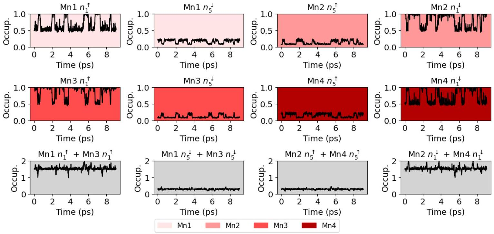
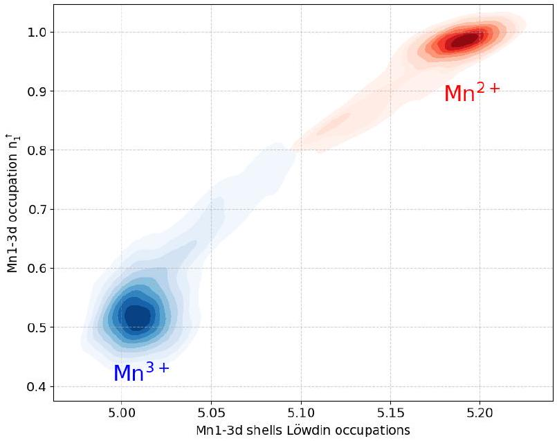
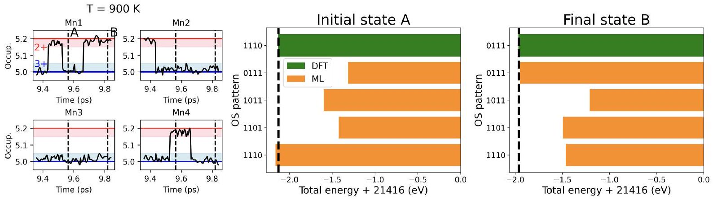
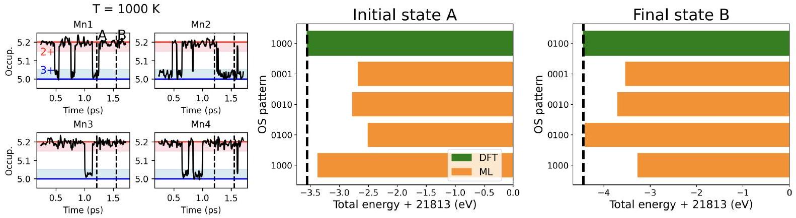
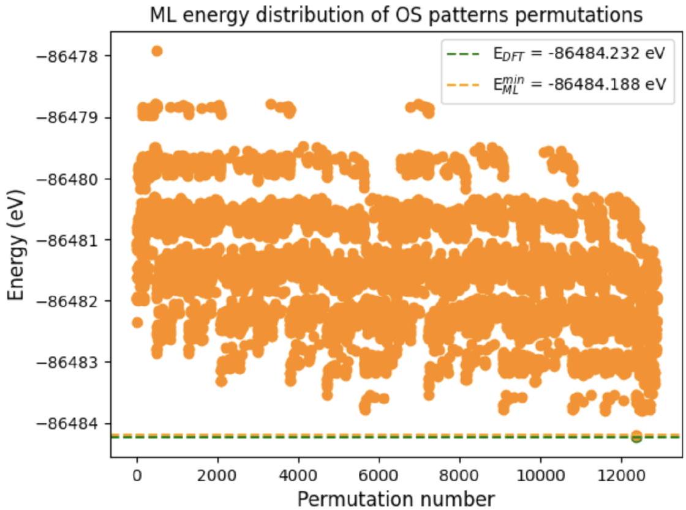
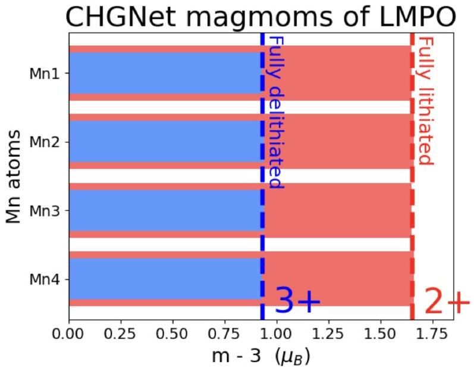
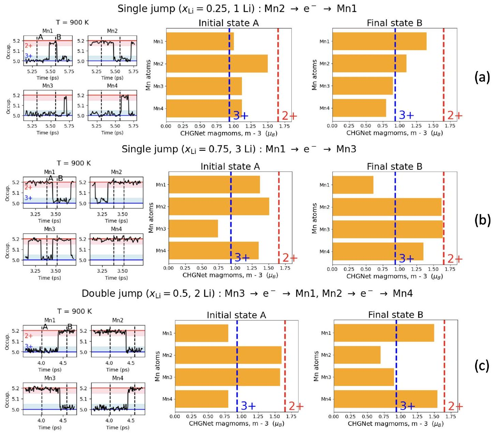
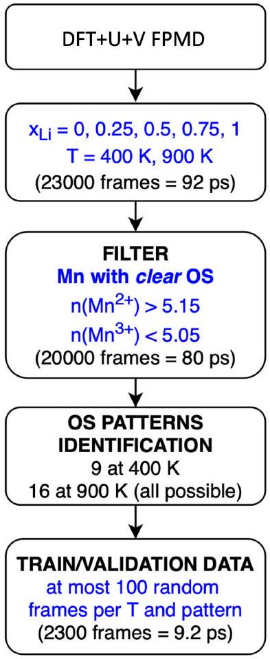

# Supplementary Information Teaching oxidation states to neural networks 

Cristiano Malica ${ }^{1, *}$ and Nicola Marzari ${ }^{1,2,3}$ ${ }^{1}$ U Bremen Excellence Chair, Bremen Center for Computational Materials Science, and MAPEX Center for Materials and Processes, University of Bremen, D-28359 Bremen, Germany ${ }^{2}$ Laboratory for Materials Simulations, Paul Scherrer Institut, 5232 Villigen PSI, Switzerland ${ }^{3}$ Theory and Simulation of Materials (THEOS), and National Centre for Computational Design and Discovery of Novel Materials (MARVEL), École Polytechnique Fédérale de Lausanne (EPFL), CH-1015 Lausanne, Switzerland

(Dated: February 26, 2025)

[^0]
## I. SELF-CONSISTENT HUBBARD U AND V PARAMETERS OF LMPO

In the following Supplementary Table I we report the whole set of self-consistent Hubbard parameters for the LMPO phospho-olivne system (see also Ref. [1]). The self-consistent Hubbard parameters are computed by alternating structural optimization to the linear response calculation of Hubbard U and V parameters by using density-functional perturbation theory (DFPT) up to reach a convergence of 0.1 eV on both parameters. The self-consistent procedure is explained in more detail in Refs. [2]. The self-consistent Hubbard parameters reported in Supplementary Table I are used in the DFT+U+V calculation to derive electronic occupations and oxidation states in Fig. 1 (b) and Voltages in Fig. 1 (d) as discussed in the main text.

| $x$ | HP | Mn1 | Mn2 | Mn3 | Mn4 |
| :--- | :--- | :--- | :--- | :--- | :--- |
| 0 | $U$   $V$ | 6.26   0.54-1.07 | 6.26   0.54-1.07 | 6.26   0.54-1.07 | 6.26   0.54-1.07 |
| 1/4 | $U$   $V$ | 6.26   0.40-1.01 | 6.25   0.46-1.05 | 6.67   0.54-1.11 | 5.44   0.39-1.08 |
| 1/2 | $U$   $V$ | 6.42   0.34-1.01 | 4.95   0.38-0.96 | 6.41   0.34-1.01 | 4.94   0.38-0.96 |
| 3/4 | $U$   $V$ | 4.67   0.48-0.72 | 4.64   0.31-0.91 | 6.58   0.33-1.02 | 4.98   0.41-0.79 |
| 1 | $U$   $V$ | 4.56   0.42-0.78 | 4.56   0.42-0.78 | 4.56   0.42-0.78 | 4.56   0.42-0.78 |

Supplementary Table I. Self-consistent Hubbard parameters (HP) in eV computed using DFPT in the DFT+U+V framework for $3 d$-states of Mn in $\mathrm{Li}_{x} \mathrm{MnPO}_{4}$ for $\mathrm{x}=0,1 / 4,1 / 2,3 / 4,1$.

## II. OXIDATION STATES AND ELECTRONIC OCCUPATIONS

We used Löwdin occupations of Mn-3d states (i.e., the sum of all electronic occupations) to track the variation of Mn oxidation states (OSs) during the simulations. An example is shown in the main text Figures 2 (a-c) for $\mathrm{Li}_{x} \mathrm{MnPO}_{4}$ with $x=1 / 2$ (so 2 additional Li
atoms, 4 Mn atoms). In Supplementary Figure 1, we show for each Mn the two eigenvalues

Supplementary Figure 1. Time evolution of the Mn- $3 d$ electronic occupations for the four Mn atoms in the unit cell of $\mathbf{L}_{x} \mathbf{M n P O}_{4}(\mathbf{x}=\mathbf{0 . 5})$ in DFT+U+V FPMD. Different shades distinguish each atom, with grey-background plots indicating the sum of occupations from the plots above.

of the occupation matrix that show appreciable variation during the simulation (where ↑ and ↓ indicate the spin-up and spin-down channels, respectively); all other eigenvalues are stationary or have smaller fluctuations. The transition in OSs is marked by a single eigenvalue, e.g., $n_{1}^{\uparrow}$ for Mn1 and Mn3, and $n_{1}^{\downarrow}$ for Mn2 and Mn4, that jumps between ~0.5 and ~1.0. The swaps mainly occur between Mn1 and Mn3 through $n_{1}^{\uparrow}$, and between Mn2 and Mn4 through $n_{1}^{\downarrow}$. The time evolution of their sum is represented in the underlying grey plots; it fluctuates in average around 1.5, meaning that when one occupation is ~1 (OS 2+) the other is ~0.5 (OS 3+). In sporadic configurations, the sum is either 2 or 1, indicating that both electrons are localized on the actual pair of Mn atoms (e.g., Mn1 and Mn3), or alternatively on the other pair (e.g., Mn2 and Mn4), respectively. Hence, the adiabatic electron movement is preferred between atoms having the same spin. In correspondence with the change in OS, e.g., on $n_{1}^{\uparrow}$ of Mn1, the corresponding opposite-spin eigenvalue $n_{5}^{\downarrow}$ exhibits a small jump. However, the sum of these weakly varying occupations also remains constant, indicating that, overall, there is no charge dispersion in the environment.

Based on these observations, we can rationalize a procedure to define robust thresholds on

Supplementary Figure 2. Correlation between $n_{1}^{\uparrow}$ and Löwdin occupations in the DFT+U+V FPMD of $\mathbf{L i}_{x} \mathbf{M n P O}_{4}$ with $\mathbf{x}=\mathbf{1 / 2}$ at $\mathbf{T}=\mathbf{9 0 0} \mathbf{~ K}$. The intensity of the color increases with the number of configurations.

occupations for assigning OSs. The fluctuations around the occupation 1.0 are smaller than those around 0.5 and never exceed 0.2. Hence, we could use a 0.8 threshold to differentiate the two oxidation states and compute statistics for these two states, in terms of average occupation and standard deviation. By considering Mn1 and $n_{1}^{\uparrow}$, we obtain $0.96 \pm 0.05$ for the $2+$ state and $0.55 \pm 0.07$ for the 3+ state (the error corresponds to one standard deviation, that exclude ambiguous transition states). Hence, for occupations larger than 0.91 the state is 2+, while for occupation smaller than 0.62 it is 3+.

Finally, the correlation of $n_{1}^{\uparrow}$ and relative Löwdin occupations of Mn1 is presented in the Supplementary Figure 2 for the whole set of configurations of the trajectory at $\mathrm{T}=900 \mathrm{~K}$. The coefficient of linear correlation is 0.97 meaning, once again, that the total variation in the charge-measured by the Löwdin occupations-is meanly related to the variation of $n_{1}^{\uparrow}$. The configurations with intermediate occupations are fewer, the ones with "clear" OSs are preferred.

## III. MORE ELECTRON JUMPS

In the following we present more tests about the electrons jumps.
Given the trajectory discussed in the main text, with concentration $\mathrm{x}=0.25$ and a total
length of 9.1 ps (which includes the transition configurations), we restart the simulation until reaching a total duration of 15.3 ps. Consequently, this additional trajectory segment, with a length of approximately 6 ps, was not considered for the random selection of frames for training. We focus on the last available "electron jump", which occurs well beyond 5 ps from the restart (to minimize correlation), and further test our machine-learned potential in analogy with Fig. 4 of the main text. This test is presented in Supplementary Figure 3. Also in this case, the results demonstrate the effectiveness of our approach (note that, in the first subplot, Occup. vs. Time, we show the last "electron jump" within the cleaned trajectory that is shorter).

Supplementary Figure 3. Electron jump in the $\mathbf{L i}_{0.25} \mathbf{M n P O}_{4}$ trajectory at $\mathbf{T}=\mathbf{9 0 0 ~ K}$.

Now, given the system with $\mathrm{x}=0.75$, we re-start a new molecular dynamics trajectory considering a temperature of 1000 K-even outside the temperature range (400K-900K) used in the training and let evolve it for a few picoseconds. The electron-jump test is shown in Supplementary Figure 4. The model predict the correct arrangements of oxidation states for both the initial and final state.

## IV. A LARGER SUPERCELL

In Supplementary Figure 5 we have performed a further test in a 4-times-larger supercell at $\mathrm{x}=0.5$ with 104 atoms (8 Mn2+ and 8 Mn3+ and a total number of 12870 permutations of oxidation states), using the equilibrium structure at $\mathrm{T}=0 \mathrm{~K}$. The test on the (full) combinatorial search shows that even though the differences in energies of the alternative oxidation states arrangements become smaller, the ground state is still well discernible from them.

Supplementary Figure 4. Electron jump in the $\mathbf{L i}_{0.75} \mathbf{M n P O}_{4}$ trajectory at $\mathbf{T}=\mathbf{1 0 0 0 ~ K}$.

Supplementary Figure 5. Oxidation-state patterns evaluation of a supercell of 104 atoms of $\mathbf{L i}_{0.5} \mathbf{M n P O}_{4}$ (relaxed structure at $\mathbf{T}=\mathbf{0} \mathbf{K}$ ).

## V. COMPARISON WITH CHGNET

Here we present comparison tests with CHGNet [3]. Within CHGNet the OSs can be deduced a posteriori from the atomic magnetic moments that are predicted along with energies, forces (and stresses) for the input configuration.

In order to find a faithful correspondence between CHGNet magnetic moments and oxidation states, we first relax our LMPO fully-lithiated (where all Mn are 2+) and fully-delithiated (where all Mn are 3+) structures using the CHGNet potential and analyze the
output magnetic moments. The results are reported in Supplementary Figure 6.

Supplementary Figure 6. Predicted CHGNet magnetic moments for Mn atoms in the fully delithiated (blue) and fully lithiated (red) LMPO structures.

Then, we use CHGNet and such $2+$ and $3+$ limits to discriminate the oxidations states re-arrangements by using as inputs the atomic configurations studied in our jump tests showed, e.g, in Fig. 4 (a-c) of the main text. The results are shown in Supplementary Figure 7. The trends are similar to ours, but the oxidation states are less well-defined. CHGNet is, however, a universal potential, and even if it appears less predictive in the tests presented, remains a powerful model to develop further.

## VI. WORKFLOW FOR SELECTING DATA FOR TRAINING

In Fig. 8 we show a schematic representation of the procedure for selecting training and validation data described in the main text of the manuscript.

Supplementary Figure 7. Predicted CHGNet magnetic moments for Mn atoms in the electronic jump tests of Fig. 4 (a-c) of the main text.

Supplementary Figure 8. Workflow for the determination of the training/validation sets of atomic configurations for the generation of the machine learning interatomic potential. The FPMD is performed for all $\mathrm{x}_{L i}$ concentration of Li at two different temperature, $\mathrm{T}=400 \mathrm{~K}$ and $\mathrm{T}=900 \mathrm{~K}$, in the NVT ensemble.

## VII. SUPPLEMENTARY REFERENCES

[1] Timrov, I., Aquilante, F., Cococcioni, M. \& Marzari, N. Accurate electronic properties and intercalation voltages of olivine-type li-ion cathode materials from extended hubbard functionals. Phys. Rev. X Energy 1, 033003, DOI: 10.1103/PRXEnergy.1.033003 (2022).
[2] Timrov, I., Marzari, N. \& Cococcioni, M. Self-consistent Hubbard parameters from density-functional perturbation theory in the ultrasoft and projector-augmented wave formulations. Phys. Rev. B 103, 045141 (2021).
[3] Deng, B., Ahong, P., Jun, K., Riebesell, J. \& Han, K. Chgnet as a pretrained universal neural network potential for charge-informed atomistic modelling. Nat. Mach. Intell. 5 (2023).

[^0]:    * cmalica@uni-bremen.de

