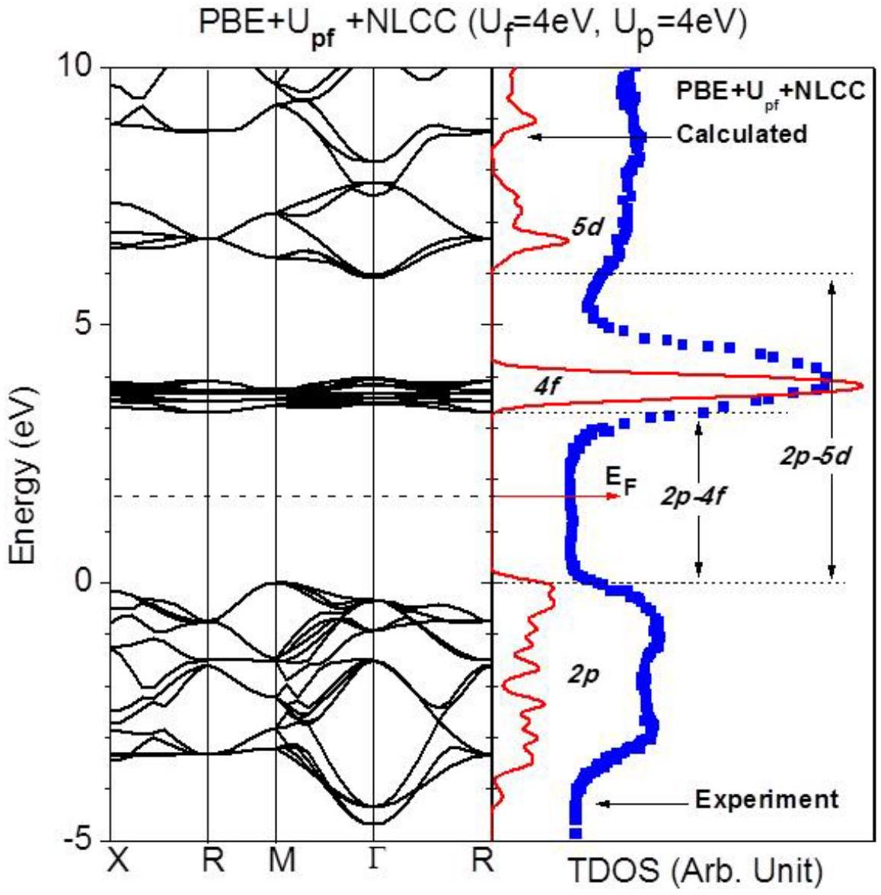
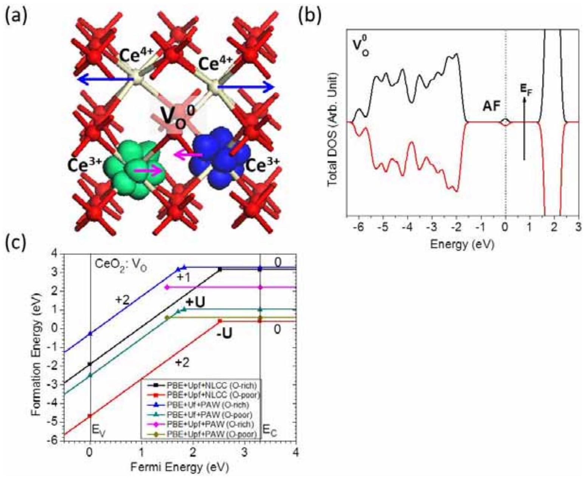
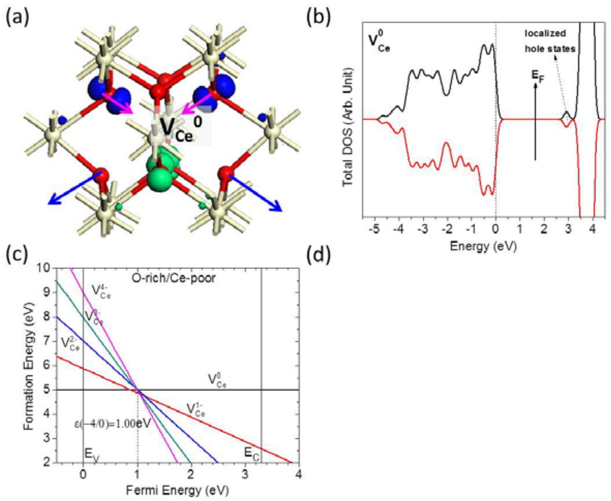
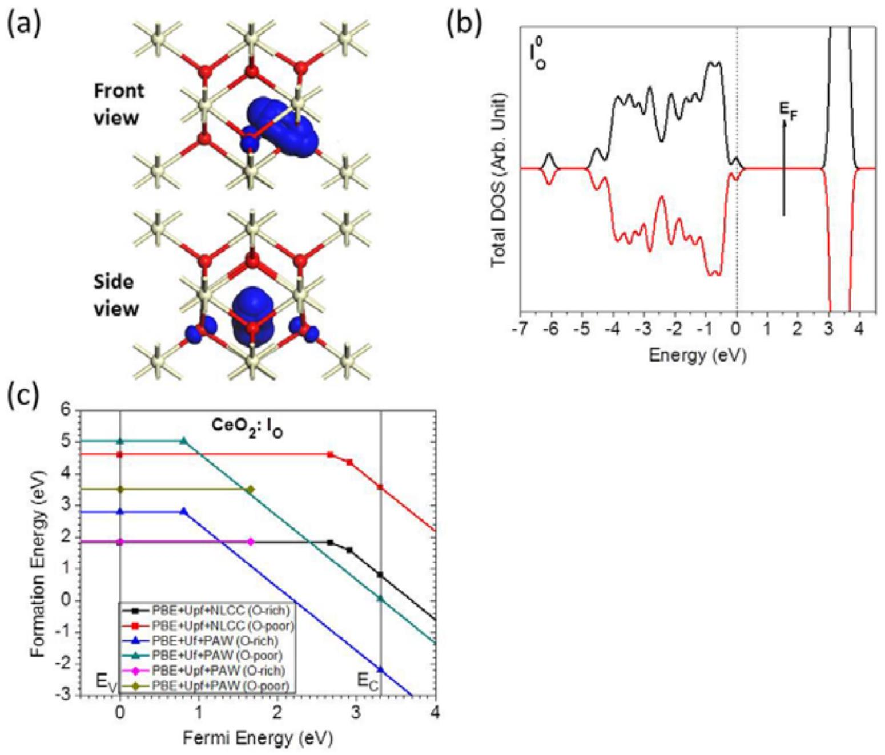
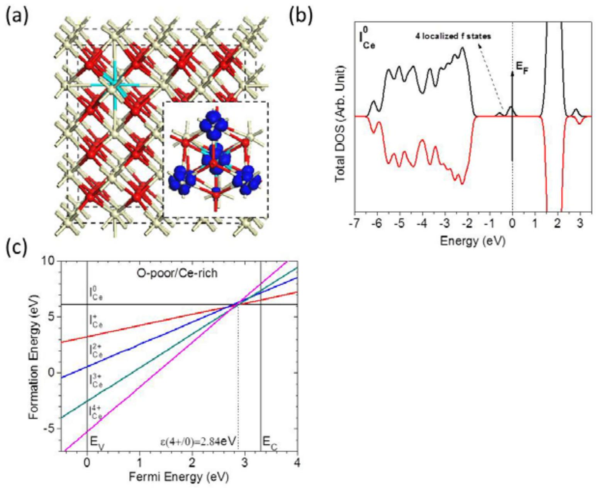
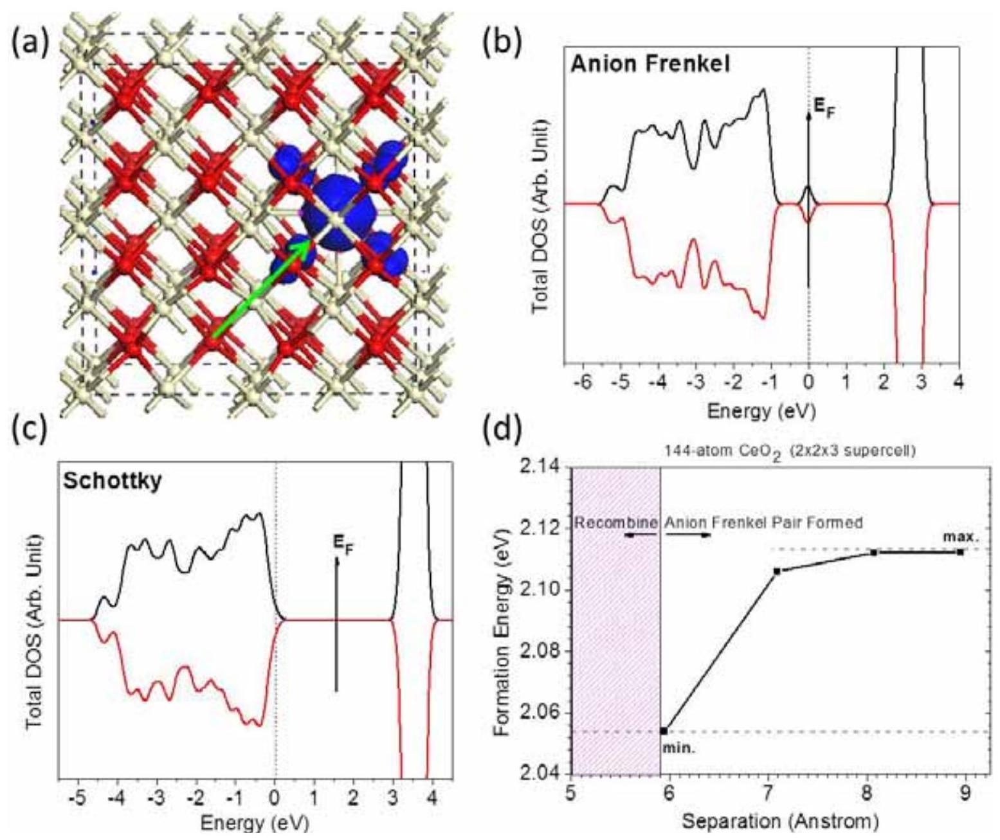
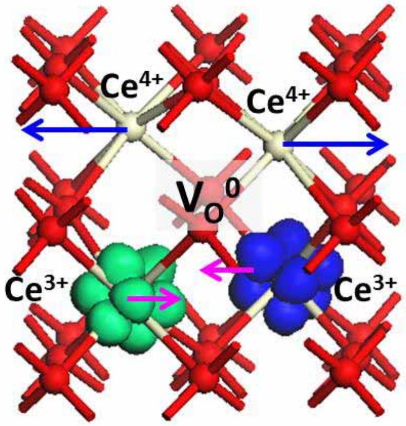

# DFT+U Study of CeO2 and Its Native Defects

**Authors:** Bolong Huang; Roland Gillen; John Robertson

**Venue:** The Journal of Physical Chemistry C 118, 24248-24256 (2014)

**DOI / identifier:** 10.1021/jp506625h

**Conversion note:** Reconverted from the original PDF using Mathpix PDF conversion (`md.zip`) on 2026-10-04, replacing the earlier PyMuPDF text extraction. Figure images are stored locally.

Bolong Huang ${ }^{1}$ †, Roland Gillen ${ }^{2}$, and John Robertson ${ }^{2 *}$

1. Department of Physics and Materials Science, City University of Hong Kong, Kowloon, Hong Kong SAR, P. R. China
2. Engineering Dept. Cambridge University, Cambridge CB3 OFA, United Kingdom
    1. *: Email: jr@eng.cam.ac.uk Tel: (+44)-01223-748-331
    2. †: Email: bolhuang@cityu.edu.hk Tel: (+852)-2784-4027

#### Abstract

: We investigated the native point defects in $\mathrm{CeO}_{2}$ by the density functional (DFT) +U method, and using a non-linear core-corrected norm-conserving Ce pseudopotential. We find the neutral oxygen vacancy $\left(\mathrm{V}_{\mathrm{O}}{ }^{0}\right)$ in $\mathrm{CeO}_{2}$ to have a very low formation energy of only 0.39eV in the O-poor limit. It is a deep donor with negative U behavior, only stable in its neutral and doubly positive states. The anion Frenkel defect is found to be the lowest energy disorder defect, with a formation energy of only 2.08eV per defect site. These low formation energies arise from the improved transferability of our Ce pseudopotential for its +3 and +4 valence states. The negative U behavior of $\mathrm{V}_{\mathrm{O}}$ leads to excellent photo-catalytic behavior, while the low formation energy of the anion Frenkel defect leads to a superior oxygen storage-and-release capability.

Keywords: Oxygen vacancy, Frenkel defect, pseudopotential transferability, oxidation catalyst

## 1. Introduction

$\mathrm{CeO}_{2}$ is an important lanthanide oxide which is widely used as an oxygen buffer in car exhaust catalysts ${ }^{1}$, as a fast ion conductor in solid state fuel cells ${ }^{2}$, as a catalyst ${ }^{3-6}$, as a high-dielectric constant gate oxide ${ }^{7}$, and in resistance random access memories (ReRAM) ${ }^{8}$. Many properties of $\mathrm{CeO}_{2}$ are determined by its intrinsic defects ${ }^{9-23}$ and the unusual behavior of the semi-core Ce 4f levels. $\mathrm{CeO}_{2}$ has a mixed valence behavior accompanied by the localization of electrons on Ce 4f states due to oxygen-related defects ${ }^{9-23}$. The oxygen vacancy is the most common defect of the $\mathrm{CeO}_{2}$ surface, as noted in both experimental ${ }^{11}$ and theoretical studies ${ }^{23}$. It is found that the structural distortion plays a key role in stabilizing the vacancy and this is related to the oxygen storage capacity of $\mathrm{CeO}_{2}{ }^{15}$. On the other hand, the disorder defects are important in oxygen ion transport ${ }^{9,10}$. It is therefore important to understand the properties and energetics of the native defects and in particular the oxygen vacancy and the structural disorder defects.

There have been numerous first-principles studies of the electronic structure of $\mathrm{CeO}_{2}{ }^{16-18,21,22,}$ ${ }^{24-29}$. It is well known that the conventional density functional theory (DFT) fails to describe well the localized 4 f orbitals due to a lack of self-interaction cancellation (SIC) in $\mathrm{DFT}^{21,22,24-29}$. There has therefore been considerable effort to correct this error. The simplest method is to use the DFT+U method, which adds an on-site repulsive potential U for the localized d and f orbitals ${ }^{30-32}$. However, this method is somewhat empirical, and further methods such as the GW method ${ }^{26,27}$ and the hybrid functionals ${ }^{23,28,29,33,34}$ can be used. However, self-consistent GW is computationally expensive. Jiang et al ${ }^{26,27}$ proposed the lower cost $\mathrm{G}_{0} \mathrm{~W}_{0}$ version, based on an initial electronic structure derived from the local density approximation (LDA) +U method. This gives a substantially improved band structure. Hybrid functionals like the Heyd-Scuseria-

Erzenhof (HSE) function or screened exchange (sX) schemes are an efficient way to improve band gaps in electronic structure calculations and to carry out geometry relaxations for defects in these systems ${ }^{23,24}$.

On the other hand, the transferability of pseudopotential is another possible source of error in such mixed valence systems, and there has been less work on this aspect. The pseudopotential tends to be calculated for a single valence state within the DFT method. It is not necessarily fully transferable. The errors arise because of the spatial overlap of the core and valence charge density. As the exchange-correlation potential is a non-linear function of the charge density, it is desirable that the core and valence charge densities are spatially separated. Otherwise, the pseudopotential is dependent on the valence configuration and spin polarization. This overlap between valence and core charge density and the non-linearity causes a systematic error in the total exchange-correlation potential. It is desirable to use a pseudopotential to restrict the basis set for computational speed, especially in defect supercell calculations. However, this source of error can lead to the use of all-electron calculations.

The electronic structure of $\mathrm{CeO}_{2}$ is still a matter of some debate. It has two gaps between 2p-4f states and 2p-5d states which must be quantified. The experimental data on the band gaps ${ }^{35-41}$ mostly have low resolution of 0.3-0.6 eV due to the lifetime broadening. To normalize the experimental values, the most reliable value for the $\mathrm{O}_{2 \mathrm{p}}-\mathrm{Ce}_{5 \mathrm{~d}}$ gap is chosen as 6eV and the $\mathrm{O}_{2 \mathrm{p}}$ - $\mathrm{Ce}_{4 \mathrm{f}}$ gap is taken from the PL measurements, which shows the higher accuracy ( 3.33 and 3.39eV above the $\mathrm{O}_{2 \mathrm{p}}$ valence band edge).

Here, we carry out DFT+U band calculations using a non-linear core corrected norm-conserving pseudopotential, which is a basis for other lanthanide materials. We then carry out calculations on the point defects of $\mathrm{CeO}_{2}$ as starting point for other lanthanide oxides and the higher actinide oxides with partially filled f-orbitals.

## 2. Non-linear core correction for 4f levels in lanthanides

In order to correct the error induced by overlaps of valence-core charge density, we choose the non-linear core correction (NLCC) method to take the core charge density into account for each atom before computing the LDA or GGA potential. For fast Fourier transform, only some of the core charge is included by the partial core correction (PCC). Following Louie et al ${ }^{42}$, the full core charge density can be replaced with a partial core charge density defined as below, for non-linear core correction:

$$
\rho_{\text {paretail }}^{o}(r)=\left\{\begin{array}{r}
A \sin (B r) / r, \text { if } r<r_{0} \\
\rho^{o}(r), \text { if } r>r_{0}
\end{array}\right.
$$

where the $\mathrm{r}_{0}$ is a radius where the core charge density is from 1 to 2 times larger than the valence charge density. A and B are determined by the value and the gradient of the core charge density at $\mathrm{r}_{0}$. By this method, the core charge is therefore retained and used to reconstruct the full exchange-correlation potential in the calculations. A similar method has been proposed by Fuchs et al ${ }^{43}$, but we focus on the theoretical prototype of NLCC used in preliminary calculations.

## 3. Calculation Setup

Our DFT+U calculation uses the CASTEP ${ }^{44}$ code. The norm-conserving pseudopotentials of Ce and O are generated by OPIUM code in the Kleinman-Bylander projector form ${ }^{45}$ and already employ non-linear partial core correction ${ }^{42}$ and scalar relativistic averaging scheme ${ }^{46}$ for spinorbital coupling effect. The RRKJ method is chosen as optimization of pseudopotentials ${ }^{47}$. The PBE functional was chosen for PBE+U calculations with a kinetic cutoff energy of 750eV, which expands the valence electrons states in a plane-wave basis set. The ensemble DFT (EDFT) method of Marzari et al ${ }^{48}$ is used for convergence. For bulk properties of $\mathrm{CeO}_{2}$, we use a $4 \times 4 \times 4$ Monkhost-Pack (MP) k-point mesh, which converges the total energy to under $5.0 \times 10^{-7} \mathrm{eV}$ per atom. The Hellmann-Feynman force on each atom was converged to lower than $0.01 \mathrm{eV} / \text{Å}$.

For defects, we use a $2 \times 2 \times 2 \mathrm{CeO}_{2}$ supercell containing 96 atoms. We select the $\left(\frac{1}{4}, \frac{1}{4}, \frac{1}{4}\right)$ special k -point ${ }^{49}$ in the simple cubic $2 \times 2 \times 2$ supercell. The geometry optimization used the Broyden-Fletcher-Goldfarb-Shannon (BFGS) algorithm through all bulk and defect supercell calculations.

We follow the Anisimov type DFT+U method ${ }^{30}$ and the self-consistently determined Hubbard U parameter $\left(\mathrm{U}_{\mathrm{f}}=4 \mathrm{eV}\right)$ for Ce 4f orbital by ab-initio linear response method of Cococcioni et al ${ }^{31,}$ ${ }^{32}$. To stabilize the hole states lying in the O 2p orbitals, we also apply a Hubbard U potential to the O 2p states ( $\mathrm{U}_{\mathrm{p}}=4 \mathrm{eV}$ ) following Lany ${ }^{50,51}$, Morgan et al ${ }^{52}$, and Keating et al ${ }^{21}$. Accordingly, both the f- and p- orbital electrons of the rare earth and oxygen should be considered when using DFT+U. Note that all of our PBE+U calculations were implemented with NLCC, and U is set to $\mathrm{U}_{\mathrm{f}}=4.0 \mathrm{eV}$ for Ce and $\mathrm{U}_{\mathrm{p}}=4.0 \mathrm{eV}$ for O, which is $\mathrm{U}_{\mathrm{pf}}$ for short.

For the calculation of defect formation energy in different charge states, the overall supercell size was kept fixed based on the relaxed neutral bulk unit cell. The defect formation energy $\left(H_{q}\right)$ at the charge state $q$ as a function of the Fermi energy ( $E_{F}$ ) and the chemical potential $\Delta \mu$ of element $\alpha$ is given by

$$
H_{q}\left(E_{F}, \mu\right)=\left[E_{q}-E_{H}\right]+q\left(E_{V}+\Delta E_{F}\right)+\sum_{\alpha} n_{\alpha}\left(\mu_{\alpha}^{0}+\Delta \mu_{\alpha}\right),
$$

where $E_{q}$ and $E_{H}$ are the total energy of a defect cell and a perfect cell, respectively, calculated of charge $q, \Delta E_{F}$ is the Fermi energy with respect to the valence band maximum, $n_{\alpha}$ is the number of atoms of element $\alpha$, and $\mu_{\alpha}^{0}$ is reference chemical potential, following Lany and Zunger ${ }^{53}$.

## 4. Results and Discussions

### 4.1 Bulk

Bulk $\mathrm{CeO}_{2}$ has the cubic fluorite structure, with lattice constant $5.411 \text{Å}^{54}$. Table 1 shows our PBE result of geometry optimization gives $5.450 \text{Å}$, with an error of $0.7 \%$. The PBE+U calculation similarly gives $5.458 \text{Å}$ with around $0.9 \%$ error, representing comparable reliability when the U parameter is introduced. The PBE+U results compare with the $5.494 \text{Å}$ found by Keating et al ${ }^{21}$ and Zacherle et al ${ }^{22}$ within GGA+U scheme. The bulk modulus of $\mathrm{CeO}_{2}$ is calculated by PBE and PBE+U. The results obtained are $\mathrm{B}_{0}=184 \mathrm{GPa}$ for PBE and $\mathrm{B}_{0}=201 \mathrm{GPa}$ for PBE+U. Though these values are smaller than the experimental value of $220 \mathrm{GPa}^{55}$, they are
improved over the $\mathrm{B}_{0}=172 \mathrm{GPa}$ (GGA) and $\mathrm{B}_{0}=181 \mathrm{GPa}$ (GGA+U) values found by Zacherle et $\mathrm{al}^{22}$. The calculated electronic density of states (DOS) with PBE+U $\left(\mathrm{U}_{\mathrm{f}}=4, \mathrm{U}_{\mathrm{p}}=4\right)$ under NLCC has a good agreement with XPS experimental data, see Fig. 1.

The band structures of $\mathrm{CeO}_{2}$ calculated from both GGA and GGA + U [see Fig. 1] methods are compared, respectively. This work found that the band gap of $\mathrm{O}_{2 \mathrm{p}}-\mathrm{Ce}_{4 \mathrm{f}}$ orbitals increases from 2.30eV in GGA to 3.30eV in GGA+U, which is very consistent with the experimental value of 3.33 eV from photoluminescence ${ }^{40}$. The secondary band gap of $\mathrm{O}_{2 \mathrm{p}}-\mathrm{Ce}_{5 \mathrm{~d}}$ orbitals also increases from 5.47eV in GGA to 5.98eV in GGA+U which is close to the optical reflectance value of $6.0 \mathrm{eV}^{39}$. The upper valence band (mainly 2 p orbitals of oxygen atoms) width increases from 3.90eV in PBE to 4.69eV in GGA+U, which matches the range of 4.5 to 5.0eV reported by Wuilloud et al ${ }^{35}$ and Mullins et al ${ }^{37}$.

For the bulk formation enthalpy, $\mu_{C e}+2 \mu_{O}=\Delta H_{f}\left(\mathrm{CeO}_{2}\right)$, the experimental formation enthalpy of $\mathrm{CeO}_{2}$ is -11.28eV at $\mathrm{T}=298 \mathrm{~K}^{56}$. Our calculations give -10.54eV by PBE and -11.50 eV by PBE+U $\left(\mathrm{U}_{\mathrm{f}}=4, \mathrm{U}_{\mathrm{p}}=4\right)$ at $\mathrm{T}=0 \mathrm{~K}$ (ground state) which agrees well with the experimental value at $\mathrm{T}=298 \mathrm{~K}^{46}$. Before we discuss the defect formation energy, the value of the chemical potential of oxygen and cerium in $\mathrm{CeO}_{2}$ is determined by the limitation of the phase boundaries between $\mathrm{CeO}_{2}$ and $\mathrm{Ce}_{2} \mathrm{O}_{3}$. The upper bound of $\mu_{O}$, which is the Ce-poor/O-rich environment, is limited by the formation of $\mathrm{O}_{2}$ molecule (gas), which means: $\mu_{O}=0 e V$ and $\mu_{C e}=-11.50 e V$. The lower bound of $\mu_{O}$, the Ce-rich/O-poor limit, is given by the formation of $\mathrm{Ce}_{2} \mathrm{O}_{3}$, or $2 \mu_{C e}+3 \mu_{O} \leq \Delta H_{f}\left(C e_{2} O_{3}\right)=-20.23 e V$, giving $\mu_{O}=-2.77 e V$ and $\mu_{C e}=-5.95 e V$.

### 4.2 Oxygen Vacancy

The neutral oxygen vacancy leaves two excess electrons which localize onto two of four adjacent Ce sites, changing their valence from $\mathrm{Ce}^{4+}$ to $\mathrm{Ce}^{3+}$. For $\mathrm{V}_{0}{ }^{0}$, after geometry relaxation, eight neighboring oxygen atoms move off their ideal lattice sites towards the vacancy site since vacancy site is an effective positive charge center, while neighboring Ce atoms move away from the vacancy with the two $\mathrm{Ce}^{4+}$ moving further. Moreover, the neighboring O atom bridging two $\mathrm{Ce}^{4+}$ moves by $0.25 \text{Å}$, while the O atom bridging two $\mathrm{Ce}^{3+}$ moves only $0.01 \text{Å}$ from our PBE+ U calculations. The four O atoms connected to one $\mathrm{Ce}^{3+}$ move toward the $\mathrm{V}_{\mathrm{O}}{ }^{0}$ by $0.15 \text{Å}$. The difference of O atoms is due to $\mathrm{Ce}^{3+}$ ions having less positive charge than $\mathrm{Ce}^{4+}$. The two $\mathrm{Ce}^{3+}$ ions move a distance of $0.13 \text{Å}$ toward to each other due to weak coupling of two unpaired electrons in 4 f states, while the two $\mathrm{Ce}^{4+}$ ions move a distance of $0.18 \text{Å}$ [Fig. 2 (a)]. This trend is absent in simple PBE calculations.

Fig. 2 (b) shows the electronic density of states (DOS) of the $\mathrm{CeO}_{2}$ with $\mathrm{V}_{\mathrm{O}}{ }^{0}$ calculated by PBE+U $\left(\mathrm{U}_{\mathrm{f}}=4 \mathrm{eV}, \mathrm{U}_{\mathrm{p}}=4 \mathrm{eV}\right)$. It can be seen that $\mathrm{O}_{2 \mathrm{p}}$ dominates the valence band and $\mathrm{Ce}_{4 \mathrm{f}}$ dominates the conduction band as the 4f band is empty. Between $\mathrm{O}_{2 \mathrm{p}}$ and $\mathrm{Ce}_{4 \mathrm{f}}$ bands, there are two gap states with spin-up and spin-down lying well inside the band gap (near the mid-gap) with antiferromagnetic arrangement. Moreover, these defect states denote the occupied $\mathrm{Ce}_{4 \mathrm{f}}$ states, indicating the occurrence of $\mathrm{Ce}^{3+}$ ions near the $\mathrm{V}_{\mathrm{O}}$ site.

For the DOS of $\mathrm{V}_{\mathrm{O}}{ }^{+}$, there is only a gap state with single peak near the mid-gap. The gap states of $\mathrm{V}_{\mathrm{O}}{ }^{0}$ are 1.55eV below the conduction band edge. The gap state of $\mathrm{V}_{\mathrm{O}}{ }^{+}$also lies near mid-gap, at about 1.05eV below the conduction band edge.

Fig. 2 (c) shows the defect formation energies of oxygen vacancy for both O-poor and O-rich conditions within different charge states by PBE+U $\left(\mathrm{U}_{\mathrm{f}}=4 \mathrm{eV}, \mathrm{U}_{\mathrm{p}}=4 \mathrm{eV}\right)$. For $\mathrm{V}_{\mathrm{O}}{ }^{0}$ in the O-rich condition, the calculated formation energy is 3.16eV, corresponding to 0.39eV for the O-poor limit. The formation of $\mathrm{V}_{\mathrm{O}}{ }^{0}$ in the O-rich condition is higher than the value of 2.22eV by Keating et al ${ }^{21}$ but closer to 3.27eV by Zacherle et al ${ }^{22}$, while our $\mathrm{V}_{0}{ }^{0}$ formation energy of 0.39 eV in the O-poor limit is lower than both 1.03 eV of Zacherle et al ${ }^{22}$ and 0.58eV of Keating et al ${ }^{21}$. The transition energy levels correspond to Fermi energies where two charge states q and q' have the same formation energies according to Eq 2. The calculated transition energy level of $\mathrm{V}_{\mathrm{O}}{ }^{0} / \mathrm{V}_{\mathrm{O}}{ }^{2+}$ by $\mathrm{PBE}+\mathrm{U}\left(\mathrm{U}_{\mathrm{f}}=4 \mathrm{eV}, \mathrm{U}_{\mathrm{p}}=4 \mathrm{eV}\right)$ is 2.53 eV , which is 0.77 eV below the conduction band minimum $\mathrm{E}_{\mathrm{C}}$. This compares to ~1.7 eV by Zacherle ${ }^{22}$, 2.0 eV by Jiang et al ${ }^{19}$ and 1.5 eV by Hellman ${ }^{20}$. The $0 /+$ transition energy level of $\mathrm{V}_{\mathrm{O}}$ is 0.97 eV below the $\mathrm{E}_{\mathrm{C}}$. However, $\mathrm{V}_{\mathrm{O}}{ }^{+}$is never the most stable charge state. The defect tends to disproportionate according to the reaction of $2 \mathrm{~V}_{\mathrm{O}}{ }^{+} \rightarrow \mathrm{V}_{\mathrm{O}}{ }^{0}+\mathrm{V}_{\mathrm{O}}{ }^{2+}$ leaving a neutral $\left(\mathrm{V}_{\mathrm{O}}{ }^{0}\right)$ and +2 charge state $\left(\mathrm{V}_{\mathrm{O}}{ }^{2+}\right)$. This corresponds to a socalled negative U defect, with $\mathrm{U}=-0.39 \mathrm{eV}$. The negative-U behavior of $\mathrm{V}_{\mathrm{O}}$ in $\mathrm{CeO}_{2}$ is in accordance with experimental phenomenon that the catalytic activity of $\mathrm{CeO}_{2}$ with $\mathrm{V}_{\mathrm{O}}$ is higher than the perfect bulk $\mathrm{CeO}_{2}$. Thus, the oxygen vacancy is a near-deep donor defect, of which $\mathrm{V}_{\mathrm{O}}{ }^{0}$ and $\mathrm{V}_{\mathrm{O}}{ }^{2+}$ are the stable states.

There has been a long debate on the ferromagnetic (FM) behavior that was observed in non-magnetic oxides, when synthesized as thin film or as nanoparticles. However, $\mathrm{CeO}_{2}$ is unusual. Castleton ${ }^{41}$ and Andersson ${ }^{17}$ both found that the antiferromagnetic (AFM) and FM configurations are degenerate with $\Delta \mathrm{E}<1 \mathrm{meV}$ in the bulk $\mathrm{CeO}_{2}$ with $\mathrm{V}_{\mathrm{O}}$. The reduced $\mathrm{CeO}_{2}$ surface has similar effects. Fabris ${ }^{57}$ found that $\mathrm{V}_{\mathrm{O}}$ causes $\mathrm{CeO}_{2}$ surface to have AFM behavior independent of the $\mathrm{V}_{\mathrm{O}}$ concentration, while Nolan ${ }^{58}$ and Han ${ }^{59}$ noted that oxygen vacancies will induce FM in $\mathrm{CeO}_{2}$.

Here, we find an AFM behavior of the neutral state of $\mathrm{V}_{\mathrm{O}}$ in $\mathrm{CeO}_{2}$ and a near degeneracy to the FM state. This is similar to the results obtained by Keating et al ${ }^{21}$, Andersson et al ${ }^{17}$ and Castleton et al ${ }^{41}$. Zhang et al ${ }^{60}$ also find that the AFM is slightly more stable than FM by 0.02 eV.

### 4.3 Cerium Vacancy

The cerium vacancy $\left(\mathrm{V}_{\mathrm{Ce}}\right)$ gives four hole states on its adjacent O sites. Fig. 3 (a) shows the relaxed structure of $\mathrm{V}_{\mathrm{Ce}}$ with four localized hole states. The defect has a quintet spin state which is slightly lower in energy than the triplet or singlet states, and also selectively localized on specific O atoms with $\mathrm{T}_{\mathrm{d}}$ symmetry. For the local structure relaxed by PBE+U ( $\mathrm{U}_{\mathrm{f}}=4 \mathrm{eV}$, $\mathrm{U}_{\mathrm{p}}=4 \mathrm{eV}$ ), the O atoms without four localized holes states uniformly move away from the $\mathrm{V}_{\mathrm{Ce}}$ site by $0.35 \text{Å}$, whereas the O atoms with localized hole states all move toward the $\mathrm{V}_{\mathrm{Ce}}$ site by $0.10 \text{Å}$. This phenomenon cannot be found by simple PBE+U without U parameters on $\mathrm{O}_{2 \mathrm{p}}$. Our results on local O atoms movement are all larger and more obvious than the results of Keating et al ${ }^{21}$.

From the electronic DOS of $\mathrm{CeO}_{2}$ with $\mathrm{V}_{\mathrm{Ce}}$ shown in Fig. 3 (b), the system shows a defect state with 0.55 eV below the conduction band minimum (CBM), which shows that the localized hole states are dominated by the empty $\mathrm{O}_{2 \mathrm{p}}$ orbitals. The calculation by PBE+U $\left(\mathrm{U}_{\mathrm{f}}=4.0 \mathrm{eV}\right.$,
$\mathrm{U}_{\mathrm{p}}=4.0 \mathrm{eV}$ ) shows the importance of including a U interaction of the O 2p states, otherwise $\mathrm{V}_{\mathrm{Ce}}$ in $\mathrm{CeO}_{2}$ would have a metallic DOS, due to the incorrect description of the hole states.

The calculated formation energies of cerium vacancy are shown in Fig. 3(c) with different charge states of $\mathrm{V}_{\mathrm{Ce}}{ }^{0}, \mathrm{~V}_{\mathrm{Ce}}{ }^{-1}, \mathrm{~V}_{\mathrm{Ce}}{ }^{-2}, \mathrm{~V}_{\mathrm{Ce}}{ }^{-3}$, and $\mathrm{V}_{\mathrm{Ce}}{ }^{-4}$. The transition energy level of 0/-4 is 1.00eV above VBM. The formation energy of $\mathrm{V}_{\mathrm{Ce}}{ }^{0}$ in the O-rich limit is 5.00eV and 10.55eV for Ce-rich. Compared to Zacherle et al ${ }^{22}$, our results gave 1.22eV and 0.15eV lower under O-rich and O-poor limit, respectively. On the other hand, Keating et al ${ }^{21}$ show very similar results under the O-rich limit, which is 4.91 eV with only 0.09 eV difference compared with ours. However, their formation energy of $\mathrm{V}_{\mathrm{Ce}}{ }^{0}$ in O-poor limit is remarkably low (8.19eV), being about 2.5eV lower than the results of Zacherle et al ${ }^{22}$ and ours. This may due to the overestimation of the $\mu_{C e}$ with larger $\mathrm{U}_{\mathrm{f}}$ and $\mathrm{U}_{\mathrm{p}}$ values.

### 4.4 Oxygen Interstitial

The local structural relaxation between oxygen interstitial $\left(\mathrm{I}_{\mathrm{O}}\right)$ and lattice oxygen sites leads to absence of hole states. The relaxed structure of the oxygen interstitial $\left(\mathrm{I}_{\mathrm{O}}\right)$ is obtained by PBE+U with $\mathrm{U}_{\mathrm{f}}=4.0 \mathrm{eV}$ and $\mathrm{U}_{\mathrm{p}}=4.0 \mathrm{eV}$. $\mathrm{I}_{\mathrm{O}}$ is found to rebond to an adjacent lattice O site with a bond length of $1.391 \text{Å}$. This is larger than the $\mathrm{O}-\mathrm{O}$ bond length $(1.217 \text{Å})$ of $\mathrm{O}_{2}$ and shows characteristics of a peroxide species. The lattice O site moves $0.071 \text{Å}$ towards the $\mathrm{I}_{\mathrm{O}}$, and the $\mathrm{I}_{\mathrm{O}}$ moves $0.88 \text{Å}$ towards the neighboring lattice O site. Fig. 4 (a) shows the localized orbitals around the oxygen interstitial site. The oxygen interstitial forming peroxide ion in closed packed metal oxides is also seen in $\mathrm{Al}_{2} \mathrm{O}_{3}, \mathrm{TiO}_{2}$ and ZnO.

In the electronic DOS of $\mathrm{I}_{\mathrm{O}}$ [in Fig. 4 (b)], there are three peaks with both spin-up and spindown, which lie in the range from -6.5 to 0eV. The $\sigma$ state of the peroxide is at -4.4eV which slightly below the lower limit of the valence band. The $\pi$ and $\pi^{*}$ states are found at -6.05 eV and 0eV, respectively.

The formation energy of $\mathrm{I}_{\mathrm{O}}$ in charge states of 0, -1, and -2 under O-rich chemical potential limit are 1.82eV, 4.49eV, and 7.40eV, respectively. The formation energy of $\mathrm{I}_{\mathrm{O}}{ }^{0}$ is about 1eV lower than the one obtained by Zacherle et al ${ }^{22}$. As seen from Fig. 4(c), the $\mathrm{I}_{\mathrm{O}}$ gives almost the same formation energy in O-rich as the Keating et al ${ }^{21}$, which supports the reliability of introducing the U on $\mathrm{O}_{2 \mathrm{p}}$. We also found the positive-U effect of between 0 and -2 states compared to -1 state, showing that the energy cost of merely introducing O cannot be fully compensated by disordering the lattice.

### 4.5 Cerium Interstitial

Interstitial Ce atom provide four excess electrons [Fig. 5 (a)] with one electron remains on the interstitial $\mathrm{Ce}\left(\mathrm{I}_{\mathrm{Ce}}\right)$ while the three others move to the neighboring cerium atoms [see right bottom of the Fig. 5 (a)]. The local structure relaxed by the PBE+U method with $\mathrm{U}_{\mathrm{f}}=4.0 \mathrm{eV}$ and $\mathrm{U}_{\mathrm{p}}=4.0 \mathrm{eV}$ shows that three of the nearest neighboring Ce atoms move $0.244 \text{Å}$ away from their original Ce lattice positions, while the remaining three nearest neighboring Ce atoms move $0.324 \text{Å}$ away from their original place. Analyzing the orbital composition, we find that, the three Ce atoms with $0.244 \text{Å}$ movement are the $\mathrm{Ce}^{3+}$ ions and the rest three Ce atoms with $0.324 \text{Å}$ movement are the $\mathrm{Ce}^{4+}$ ions.

From the electronic DOS results shown in Fig. 5 (b), the ground state electronic configuration of the $\mathrm{CeO}_{2}$ system with $\mathrm{I}_{\mathrm{Ce}}$ presents a ferromagnetic feature. There are in fact four states deep in the gap, and two states have nearly the same energy pinning of the charge neutral level (CNL) 1.45eV below the CBM. These deep levels stay 1.45eV, 1.53eV, 1.57eV and 2.03eV below the CBM with same spin-up configurations and fully occupied states, which is different from the results of Keating et al ${ }^{21}$, who reported the system as being antiferromagnetic and all defect states as being partially occupied.

The energy cost of accepting the additional Ce in $\mathrm{CeO}_{2}$ as $\mathrm{I}_{\mathrm{Ce}}$ is very high in neutral state. Under Ce-poor (or O-rich) limit, the energy is 11.69 eV for $\mathrm{I}_{\mathrm{Ce}}{ }^{0}$, and 6.14eV under Ce-rich (or O-poor) limit, shown in Fig. 5 (c). The formation energy of our $\mathrm{I}_{\mathrm{Ce}}{ }^{0}$ is around 1eV higher than those reported by Zacherle et al ${ }^{22}$ due to the difference of processing the chemical potential with different pseudopotentials and Hubbard-U parameters. However, a large difference is presented for $\mathrm{I}_{\mathrm{Ce}}{ }^{4+}$ under Ce-poor limit since the formation energy of $\mathrm{I}_{\mathrm{Ce}}{ }^{4+}$ of 5.60eV by Zacherle et al ${ }^{22}$ is about 5eV higher than ours. This may due to the errors when calculating the ionization energies with different pseudopotentials and U parameters.

### 4.6 Frenkel and Schottky Defects

We have also studied the anion Frenkel and Schottky defects, respectively. These defects are an important as they determine how $\mathrm{CeO}_{2}$ responds to disorder. The anion Frenkel defect corresponds to moving an oxygen atom from its original lattice site to leave an oxygen vacancy $\left(\mathrm{V}_{\mathrm{O}}\right)$ and create an interstitial $\left(\mathrm{I}_{\mathrm{O}}\right)$ [see Fig. 6 (a)]. From the electronic DOS calculation, it is found that there is an acceptor-like state appearing at 1.02eV above VBM [see Fig. 6 (b)]. The orbitals of the defect state are mainly dominated by $\pi$ orbitals of $\mathrm{I}_{\mathrm{O}}$ while there are no states from $\mathrm{V}_{\mathrm{O}}$. From the relaxed structure, the lattice around $\mathrm{V}_{\mathrm{O}}$ is more obviously distorted than the structure near $\mathrm{I}_{\mathrm{O}}$, since the $\mathrm{V}_{\mathrm{O}}$ localizes two electrons in the f-orbitals of adjacent Ce atoms, which cause large Coulomb repulsive interactions, while the $\pi$-orbitals around $\mathrm{I}_{\mathrm{O}}$ from the oxygen atoms will participate in new coupling interaction therefore induce less lattice distortion. Meanwhile the excess $\mathrm{O}_{2 \mathrm{p}}$ level of $\mathrm{I}_{\mathrm{O}}$ will shift to a higher energy due to the Coulomb repulsive interaction.

In the case of the Schottky defect, the structure has not been affected by the presence of the defect. Also, no gap states have been found in the electronic DOS [Fig. 6 (c)], since four holes generated by $\mathrm{V}_{\mathrm{Ce}}$ passivate the four electrons left by two $\mathrm{V}_{\mathrm{O}}$.

We found that the anion Frenkel defect can easily form with a relatively low formation energy of 2.08 eV, while the Schottky defect cost more energy (3.86eV). Note that the anion Frenkel defect is generated through formations of $\mathrm{V}_{\mathrm{O}}$ and $\mathrm{I}_{\mathrm{O}}$ with a diffusion distance. We recall that the $\mathrm{V}_{\mathrm{O}}$ has a low formation energy of 0.39eV in the O-poor limit. Therefore, we believe that the $\mathrm{V}_{\mathrm{O}}+\mathrm{I}_{\mathrm{O}}$ complex will have a similar formation energy of the anion Frenkel defect under specific the charged state and chemical potential environment. This implies the possible dynamics of oxygen assisted defects (vacancy formation, migration and etc.) in $\mathrm{CeO}_{2}$ system, which would reveal the physical nature of oxygen storage and reversible catalytic behaviors.

The anion Frenkel (a-Fr) defect is the dominant defect contributing to the ionic conductivity and diffusion of $\mathrm{CeO}_{2}$. We find it to be the lowest cost disorder defect (2.08eV in 96-atom supercell), which is consistent with $\mathrm{CaF}_{2}$ or other materials in fluorite structure. Table 2 shows
that our value of 2.08 eV is slightly higher than that found by Keating et al ${ }^{21}$ (1.98 eV) and similar to Zacherle et al ${ }^{22}$ (2.07 eV). Thus, the anion Frenkel defect will account for the high ionic conductivity of the $\mathrm{CeO}_{2}$ consistent with the experimental data of Stratton and Tuller ${ }^{10}$.

We have calculated the effect of defect pair separation on the formation energy of a-Fr pair. The formation energy converges to 2.03 eV for large supercell sizes (Fig. S1 in supplemental material). Thus, the $2 \times 2 \times 3$ supercell of 144 atoms is suitable size to model the a-Fr pair diffusions. Fig. 6 (d) also shows that $5.95 \text{Å}$ represents a cross-over separation; below this the a-Fr pair recombines, whereas above this the pair can remain separate, due to the stabilization of separate defects by lattice distortion.

With considerable efforts on verifying the results, our value for its formation energy is indeed with less error than that given by Keating et al ${ }^{21}$ because we included both the $\mathrm{U}_{\mathrm{p}}$ term on the O 2p orbitals, and a more transferable Ce pseudopotential to represent the energy difference between $\mathrm{Ce}+3$ and +4 states.

## 5. Conclusion

This work has used a corrected DFT+U method combined with partial core correction (under non-linear core correction scheme) in the pseudopotentials, which can ameliorate conventional DFT+U deficit and is remarkably close to the reported experimental results. We have used this for a systematic study of the native point defects in $\mathrm{CeO}_{2}$ system. We find that the $\mathrm{V}_{\mathrm{O}}$ has a low formation energy of 0.39 eV in the O-poor limit, accounting for the ease of reduction, and that the anion Frenkel defect is the lowest energy disorder defect, consistent with experiment (ref 37 of Zacherle ${ }^{22}$ ). This shows the importance of including both U correction on Ce 4f and O 2p stats, and having a fully transferable pseudopotential.

## Acknowledgement

All computing facilities and calculation resources receive funding from the Research Grant Council, University Grants Committee of the HKSAR government. BH would like to thank the fund support and calculations resources all supplied by the Department of Physics and Materials Science, City University of Hong Kong.

## Supporting Information Available:

To illustrate the subtle interplay between the lattice distortions and diffusion barriers of a-Fr defect pair, we further investigate the formation energy of a-Fr pair regarding to the relative separation of the defect pair. All of the calculation settings are remained unchanged except the supercell size. With extrapolated the supercell convergence (Fig. S1 in supplemental material), the more realistic value converges to 2.03 eV if the supercell size approaches to infinite large. Meanwhile, the $2 \times 2 \times 3$ supercell (144 atoms) has a suitable size to model the a-Fr pair diffusions (Fig. S1). Such investigation supports the diffusion barrier of forming a-Fr pair will be substantially overcome with the lattice distortions. It further supports our calculations to be more reliable in estimating the defect concentrations and minimum formation energy with minimum cross-over separation according to the feature shown in Fig. 6 (d).

This material is available free of charge via the Internet at http://pubs.acs.org.

## References

(1) Kašpar, J.; Fornasiero, P.; Graziani, M., Use of $\mathrm{CeO}_{2}$-Based Oxides in the Three-Way Catalysis. Catal. Today 1999, 50, 285-298.
(2) Kharton, V. V.; Marques, F. M. B.; Atkinson, A., Transport Properties of Solid Oxide Electrolyte Ceramics: A Brief Review. Solid State Ionics 2004, 174, 135-149.
(3) Deng, W.; Carpenter, C.; Yi, N.; Flytzani-Stephanopoulos, M., Comparison of the Activity of $\mathrm{Au} / \mathrm{CeO}_{2}$ and $\mathrm{Au} / \mathrm{Fe}_{2} \mathrm{O}_{3}$ Catalysts for the CO Oxidation and the Water-Gas Shift Reactions. Top. Catal. 2007, 44, 199-208.
(4) Si, R.; Flytzani-Stephanopoulos, M., Shape and Crystal-Plane Effects of Nanoscale Ceria on the Activity of $\mathrm{Au}-\mathrm{CeO}_{2}$ Catalysts for the Water-Gas Shift Reaction. Angew. Chem. Int. Ed. 2008, 47, 2884-2887.
(5) Panagiotopoulou, P.; Papavasiliou, J.; Avgouropoulos, G.; Ioannides, T.; Kondarides, D. I., Water-Gas Shift Activity of Doped $\mathrm{Pt} / \mathrm{CeO}_{2}$ Catalysts. Chem. Eng. J. 2007, 134, 16-22.
(6) Ganduglia-Pirovano, M. V.; Popa, C.; Sauer, J.; Abbott, H.; Uhl, A.; Baron, M.; Stacchiola, D.; Bondarchuk, O.; Shaikhutdinov, S.; Freund, H.-J., Role of Ceria in Oxidative Dehydrogenation on Supported Vanadia Catalysts. J. Am. Chem. Soc. 2010, 132, 2345-2349.
(7) Robertson, J., High Dielectric Constant Oxides. Eur. Phys. J-appl. Phys 2004, 28, 265-291.
(8) Liao, Z.; Gao, P.; Meng, Y.; Fu, W.; Bai, X.; Zhao, H.; Chen, D., Electrode Engineering for Improving Resistive Switching Performance in Single Crystalline $\mathrm{CeO}_{2}$ Thin Films. Solid State Electron 2012, 72, 4-7.
(9) Tuller, H. L.; Nowick, A. S., Defect Structure and Electrical Properties of Nonstoichiometric $\mathrm{CeO}_{2}$ Single Crystals. J. Electrochem. Soc. 1979, 126, 209-217.
(10) Stratton, T. G.; Tuller, H. L., Thermodynamic and Transport Studies of Mixed Oxides. The $\mathrm{CeO}_{2}$ - $\mathrm{UO}_{2}$ System. J. Chem. Soc., Faraday Trans. 2 1987, 83, 1143-1156.
(11) Esch, F.; Fabris, S.; Zhou, L.; Montini, T.; Africh, C.; Fornasiero, P.; Comelli, G.; Rosei, R., Electron Localization Determines Defect Formation on Ceria Substrates. Science 2005, 309, 752-755.
(12) Göbel, M. C.; Gregori, G.; Maier, J., Electronically Blocking Grain Boundaries in Donor Doped Cerium Dioxide. Solid State Ionics 2012, 215, 45-51.
(13) Pu, Z.-Y.; Liu, X.-S.; Jia, A.-P.; Xie, Y.-L.; Lu, J.-Q.; Luo, M.-F., Enhanced Activity for CO Oxidation over Pr- and Cu-Doped $\mathrm{CeO}_{2}$ Catalysts: Effect of Oxygen Vacancies. J. Phys. Chem. C 2008, 112, 15045-15051.
(14) Paier, J.; Penschke, C.; Sauer, J., Oxygen Defects and Surface Chemistry of Ceria: Quantum Chemical Studies Compared to Experiment. Chem. Rev. 2013, 113, 3949-3985.
(15) Skorodumova, N. V.; Simak, S. I.; Lundqvist, B. I.; Abrikosov, I. A.; Johansson, B., Quantum Origin of the Oxygen Storage Capability of Ceria. Phys. Rev. Lett. 2002, 89, 166601-1-166601-4.
(16) Skorodumova, N. V.; Ahuja, R.; Simak, S. I.; Abrikosov, I. A.; Johansson, B.; Lundqvist, B. I., Electronic, Bonding, and Optical Properties of $\mathrm{CeO}_{2}$ and $\mathrm{Ce}_{2} \mathrm{O}_{3}$ from First Principles. Phys. Rev. B 2001, 64, 115108-1-115108-9.
(17) Andersson, D. A.; Simak, S. I.; Johansson, B.; Abrikosov, I. A.; Skorodumova, N. V., Modeling of $\mathrm{CeO}_{2}, \mathrm{Ce}_{2} \mathrm{O}_{3}$, and $\mathrm{CeO}_{2-\mathrm{x}}$ in the LDA + U Formalism. Phys. Rev. B 2007, 75, 035109-1-035109-6.
(18) Loschen, C.; Carrasco, J.; Neyman, K. M.; Illas, F., First-Principles LDA + U and GGA + U Study of Cerium Oxides: Dependence on the Effective U Parameter. Phys. Rev. B 2007, 75, 035115-1-035115-8.
(19) Jiang, Y.; Adams, J. B.; van Schilfgaarde, M.; Sharma, R.; Crozier, P. A., Theoretical Study of Environmental Dependence of Oxygen Vacancy Formation in $\mathrm{CeO}_{2}$. Appl. Phys. Lett. 2005, 87, 141917-1-141917-3.
(20) Hellman, O.; Skorodumova, N. V.; Simak, S. I., Charge Redistribution Mechanisms of Ceria Reduction. Phys. Rev. Lett. 2012, 108, 135504-1-135504-4.
(21) Keating, P. R. L.; Scanlon, D. O.; Morgan, B. J.; Galea, N. M.; Watson, G. W., Analysis of Intrinsic Defects in $\mathrm{CeO}_{2}$ Using a Koopmans-Like GGA+U Approach. J. Phys. Chem. C 2011, 116, 2443-2452.
(22) Zacherle, T.; Schriever, A.; De Souza, R. A.; Martin, M., Ab Initio Analysis of the Defect Structure of Ceria. Phys. Rev. B 2013, 87, 134104-1-134104-11.
(23) Ganduglia-Pirovano, M. V.; Da Silva, J. L. F.; Sauer, J., Density-Functional Calculations of the Structure of near-Surface Oxygen Vacancies and Electron Localization on $\mathrm{CeO}_{2}$ (111). Phys. Rev. Lett. 2009, 102, 026101-1-026101-4.
(24) Hay, P. J.; Martin, R. L.; Uddin, J.; Scuseria, G. E., Theoretical Study of $\mathrm{CeO}_{2}$ and $\mathrm{Ce}_{2} \mathrm{O}_{3}$ Using a Screened Hybrid Density Functional. J. Chem. Phys. 2006, 125, 034712-1-034712-8.
(25) Da Silva, J. L. F.; Ganduglia-Pirovano, M. V.; Sauer, J.; Bayer, V.; Kresse, G., Hybrid Functionals Applied to Rare-Earth Oxides: The Example of Ceria. Phys. Rev. B 2007, 75, 045121-1-045121-10.
(26) Jiang, H.; Gomez-Abal, R. I.; Rinke, P.; Scheffler, M., Localized and Itinerant States in Lanthanide Oxides United by GW @ LDA + U. Phys. Rev. Lett. 2009, 102, 126403-1-126403-4.
(27) Jiang, H.; Rinke, P.; Scheffler, M., Electronic Properties of Lanthanide Oxides from the GW Perspective. Phys. Rev. B 2012, 86, 125115-1-125115-13.
(28) Kullgren, J.; Castleton, C. W. M.; Müller, C.; Ramo, D. M.; Hermansson, K., B3LYP Calculations of Cerium Oxides. J. Chem. Phys. 2010, 132, 054110-1-054110-12.
(29) Gillen, R.; Clark, S. J.; Robertson, J., Nature of the Electronic Band Gap in Lanthanide Oxides. Phys. Rev. B 2013, 87, 125116-1-125116-6.
(30) Anisimov, V. I.; Zaanen, J.; Andersen, O. K., Band Theory and Mott Insulators: Hubbard $U$ Instead of Stoner I. Phys. Rev. B 1991, 44, 943-954.
(31) Cococcioni, M.; de Gironcoli, S., Linear Response Approach to the Calculation of the Effective Interaction Parameters in the LDA + U Method. Phys. Rev. B 2005, 71, 035105-1-035105-16.
(32) Kulik, H. J.; Cococcioni, M.; Scherlis, D. A.; Marzari, N., Density Functional Theory in Transition-Metal Chemistry: A Self-Consistent Hubbard U Approach. Phys. Rev. Lett. 2006, 97, 103001-1-103001-4.
(33) Heyd, J.; Scuseria, G. E.; Ernzerhof, M., Hybrid Functionals Based on a Screened Coulomb Potential. J. Chem. Phys. 2003, 118, 8207-8215.
(34) Krukau, A. V.; Vydrov, O. A.; Izmaylov, A. F.; Scuseria, G. E., Influence of the Exchange Screening Parameter on the Performance of Screened Hybrid Functionals. J. Chem. Phys. 2006, 125, 224106-1-224106-5.
(35) Wuilloud, E.; Delley, B.; Schneider, W. D.; Baer, Y., Spectroscopic Evidence for Localized and Extended $f$-Symmetry States in $\mathrm{CeO}_{2}$. Phys. Rev. Lett. 1984, 53, 202-205.
(36) Allen, J. W., Valence Fluctuations in Narrow Band Oxides. J. Magn. Magn. Mater. 1985, 47-48, 168-174.
(37) Mullins, D. R.; Overbury, S. H.; Huntley, D. R., Electron Spectroscopy of Single Crystal and Polycrystalline Cerium Oxide Surfaces. Surf. Sci. 1998, 409, 307-319.
(38) Pfau, A.; Schierbaum, K. D., The Electronic Structure of Stoichiometric and Reduced $\mathrm{CeO}_{2}$ Surfaces: An XPS, UPS and HREELS Study. Surf. Sci. 1994, 321, 71-80.
(39) Marabelli, F.; Wachter, P., Covalent Insulator $\mathrm{CeO}_{2}$ : Optical Reflectivity Measurements. Phys. Rev. B 1987, 36, 1238-1243.
(40) Chai, C.; Yang, S.; Liu, Z.; Liao, M.; Chen, N., Violet/Blue Photoluminescence from $\mathrm{CeO}_{2}$ Thin Film. Chinese. Sci. Bull. 2003, 48, 1198-1200.
(41) Castleton, C. W. M.; Kullgren, J.; Hermansson, K., Tuning LDA+U for Electron Localization and Structure at Oxygen Vacancies in Ceria. J. Chem. Phys. 2007, 127, 244704-1-244704-11.
(42) Louie, S. G.; Froyen, S.; Cohen, M. L., Nonlinear Ionic Pseudopotentials in Spin-Density-Functional Calculations. Phys. Rev. B 1982, 26, 1738-1742.
(43) Fuchs, M.; Scheffler, M., Ab Initio Pseudopotentials for Electronic Structure Calculations of Poly-Atomic Systems Using Density-Functional Theory. Comput. Phys. Commun. 1999, 119, 67-98.
(44) Clark Stewart, J.; Segall Matthew, D.; Pickard Chris, J.; Hasnip Phil, J.; Probert Matt, I. J.; Refson, K.; Payne Mike, C., First Principles Methods Using CASTEP. In Z. Kristallogr., 2005,220, 567-570.
(45) Kleinman, L.; Bylander, D. M., Efficacious Form for Model Pseudopotentials. Phys. Rev. Lett. 1982, 48, 1425-1428.
(46) Grinberg, I.; Ramer, N. J.; Rappe, A. M., Transferable Relativistic Dirac-Slater Pseudopotentials. Phys. Rev. B 2000, 62, 2311-2314.
(47) Rappe, A. M.; Rabe, K. M.; Kaxiras, E.; Joannopoulos, J. D., Optimized Pseudopotentials. Phys. Rev. B 1990, 41, 1227-1230.
(48) Marzari, N.; Vanderbilt, D.; Payne, M. C., Ensemble Density-Functional Theory for Ab Initio Molecular Dynamics of Metals and Finite-Temperature Insulators. Phys. Rev. Lett. 1997, 79, 1337-1340.
(49) Probert, M. I. J.; Payne, M. C., Improving the Convergence of Defect Calculations in Supercells: An Ab Initio Study of the Neutral Silicon Vacancy. Phys. Rev. B 2003, 67, 075204-1-075204-11.
(50) Lany, S.; Zunger, A., Generalized Koopmans Density Functional Calculations Reveal the Deep Acceptor State of $\mathrm{N}_{\mathrm{o}}$ in Zno. Phys. Rev. B 2010, 81, 205209-1-205209-5.
(51) Lany, S.; Zunger, A., Polaronic Hole Localization and Multiple Hole Binding of Acceptors in Oxide Wide-Gap Semiconductors. Phys. Rev. B 2009, 80, 085202-1-085202-5.
(52) Morgan, B. J.; Watson, G. W., Intrinsic N-Type Defect Formation in $\mathrm{TiO}_{2}$ : A Comparison of Rutile and Anatase from GGA+U Calculations. J. Phys. Chem. C 2010, 114, 2321-2328.
(53) Lany, S.; Zunger, A., Assessment of Correction Methods for the Band-Gap Problem and for Finite-Size Effects in Supercell Defect Calculations: Case Studies for ZnO and GaAs. Phys. Rev. B 2008, 78, 235104-1-235104-25.
(54) Rossignol, S.; Gerard, F.; Mesnard, D.; Kappenstein, C.; Duprez, D., Structural Changes of Ce-Pr-O Oxides in Hydrogen: A Study by in Situ X-Ray Diffraction and Raman Spectroscopy. J. Mater. Chem. 2003, 13, 3017-3020.
(55) Gerward, L.; Staun Olsen, J.; Petit, L.; Vaitheeswaran, G.; Kanchana, V.; Svane, A., Bulk Modulus of $\mathrm{CeO}_{2}$ and $\mathrm{PrO}_{2}$-an Experimental and Theoretical Study. J. Alloy. Compd. 2005, 400, 56-61.
(56) Haynes, W. M., CRC Handbook of Chemistry and Physics. CRC Press: Boca Raton, FL., 2011.
(57) Fabris, S.; Vicario, G.; Balducci, G.; de Gironcoli, S.; Baroni, S., Electronic and Atomistic Structures of Clean and Reduced Ceria Surfaces. J. Phys. Chem. B 2005, 109, 22860-22867.
(58) Nolan, M.; Parker, S. C.; Watson, G. W., The Electronic Structure of Oxygen Vacancy Defects at the Low Index Surfaces of Ceria. Surf. Sci. 2005, 595, 223-232.
(59) Han, X.; Lee, J.; Yoo, H.-I., Oxygen-Vacancy-Induced Ferromagnetism in $\mathrm{CeO}_{2}$ from First Principles. Phys. Rev. B 2009, 79, 100403-1-100403-4.
(60) Zhang, C.; Michaelides, A.; King, D. A.; Jenkins, S. J., Oxygen Vacancy Clusters on Ceria: Decisive Role of Cerium $f$ Electrons. Phys. Rev. B 2009, 79, 075433-1-075433-11.

Table 1. Calculated bulk properties of $\mathrm{CeO}_{2}$ compared with results of previous other groups and experiments. We gave the error that between our PBE+ $\mathrm{U}_{\mathrm{pf}}+\mathrm{NLCC}$ calculated results and experimental values. The "*" means that we take the value of 4.5 eV as experimental VB width for error comparison.
|  | PBE-w/o-NLCC | PBE $+\mathrm{U}_{\mathrm{pf}}+$ NLCC | Keating et al Ref. 21 | Zacherle et al Ref. 22 | sX-LDA Ref. 29 | Exp. Data | Error vs. Exp. | Exp. Ref. |
| :--- | :--- | :--- | :--- | :--- | :--- | :--- | :--- | :--- |
| Lattice, $a$ (Å) | 5.45 | 5.46 | 5.49 | 5.49 | Exp. 5.411 | 5.411 | 0.9\% | 54 |
| Eg (2p-4f) (eV) | 2.30 | 3.30 | 2.51 | 2.35 | 4.2 | 3.33 | 0.9\% | 40 |
| Eg (2p-5d) (eV) | 5.47 | 5.98 | 5.30 | 5.31 | 6.5 | 6.0 | 0.3\% | 39 |
| VB width (eV) | 3.90 | 4.69 | 4.0 | 4.0 | 4.4 | 4.5-5.0 | 4.2\% * | 28, 35 |
| Formation $\Delta H_{f}(\mathrm{eV})$ | -10.54 | -11.50 | -10.50 | -11.80 |  | -11.28 | 1.9\% | 56 |
| Bulk Modulus (GPa) | 184 | 201 |  | 181 |  | 220 | 8.6\% | 55 |

Table 2. Formation energy comparison on neutral oxygen vacancy $\left(\mathrm{V}_{\mathrm{O}}\right)$ anion Frenkel, Frenkel, and Schottky defects ${ }^{21,22}$. As denoted from the table, this work shows the improvement on the defect formation energy calculation by non-linear core correction on Ce pseudopotentials.
| Unit: eV | Zacherle et al | Keating et al | this work |
| :--- | :--- | :--- | :--- |
| neutral $\mathrm{V}_{\mathrm{O}}$ (O-poor) | 1.03 | 0.58 | 0.39 |
| anion Frenkel | 2.07 | 1.98 | 2.08 |
| Frenkel | 6.23 |  | 5.80 |
| Schottky | 2.29 | 3.66 | 3.86 |

Fig. 1. The left panel is the calculated band structures of $\mathrm{CeO}_{2}$ by PBE+U with $\mathrm{U}_{\mathrm{f}}=4 \mathrm{eV}$ and $\mathrm{U}_{\mathrm{p}}=4 \mathrm{eV}$ based on NLCC. The black dashed line is the Fermi level $\left(\mathrm{E}_{\mathrm{F}}\right)$. The red solid line in the right panel is the calculated total density of states of $\mathrm{CeO}_{2}$ by non-linear core corrected PBE+U with $\mathrm{U}_{\mathrm{f}}=4 \mathrm{eV}$ and $\mathrm{U}_{\mathrm{p}}=4 \mathrm{eV}$ (shown as PBE+ $\mathrm{U}_{\mathrm{pf}}+\mathrm{NLCC}$ ), where the 2p-4f gap is 3.30eV and 2p-5d gap is 5.98eV. The zero energy is the highest occupied level. The blue dotted line denotes the experimental results re-printed and re-plotted from the literature results ${ }^{35}$. The red arrow shows the Fermi level $\left(\mathrm{E}_{\mathrm{F}}\right)$.

Fig. 2. (a) The local view of the relaxed structure of $\mathrm{CeO}_{2}$ with $\mathrm{V}_{\mathrm{O}}$ by PBE+U, the blue and green isosurfaces denotes the two electrons localized on the f-orbitals of two Ce atoms and therefore producing the gap states with spin-up and spin-down states, respectively. The $\mathrm{Ce}^{3+}$ and $\mathrm{Ce}^{4+}$ have been shown. The length of the arrows means the distance of the different displacements of Ce ions. (b) Total DOS of $\mathrm{CeO}_{2}$ with $\mathrm{V}_{\mathrm{O}}$ in neutral state. The Fermi-level is shown by the arrow. The "AF" means the anti-ferromagnetic configurations of the defect states. (c) Summary of calculations on formation energies of $\mathrm{V}_{\mathrm{O}}$ calculated by our PBE+ $\mathrm{U}_{\mathrm{pf}}$ with NLCC, $\mathrm{PBE}+\mathrm{U}_{\mathrm{pf}}$ with $\mathrm{PAW}^{21}$ and PBE $+\mathrm{U}_{\mathrm{f}}$ with PAW ${ }^{22}$ under the both O-poor and O-rich chemical potential limit.

Fig. 3. (a) The local side view of the relaxed structure of $\mathrm{CeO}_{2}$ with $\mathrm{V}_{\mathrm{Ce}}$ (the $\mathrm{V}_{\mathrm{Ce}}$ site locates in the center), the blue and green isosurfaces denotes the four holes localized on the nearest O sites, which two of them are spin-up and the other two are spin-down states, respectively. The length of the arrows means the distance of the different displacements of O ions. (b) Total DOS of $\mathrm{CeO}_{2}$ with $\mathrm{V}_{\mathrm{Ce}}$ in neutral state. The dash line at zero energy denotes as the highest occupied level. The Fermi-level is shown by the arrow. (c) Formation energy of $\mathrm{V}_{\mathrm{Ce}}$ in charge state 0, -1, -2, -3, and - 4 under the O-rich (or Ce-poor) chemical potential limit.

Fig. 4. (a) The local front-view and side view of the relaxed structure of $\mathrm{CeO}_{2}$ with $\mathrm{I}_{\mathrm{O}}$. The localized orbitals are sitting along $\mathrm{I}_{\mathrm{O}}$ and host O ions. Small $\pi$-orbitals locates the O ions next the Io. (b) Total DOS of $\mathrm{CeO}_{2}$ with $\mathrm{I}_{\mathrm{O}}$. The dash line at zero energy denotes as the highest occupied level. The Fermi-level is shown by the arrow. (c) Summary of calculations on formation energies of $\mathrm{I}_{\mathrm{O}}$ in $\mathrm{CeO}_{2}$ calculated by our PBE+ $\mathrm{U}_{\mathrm{pf}}$ with NLCC, PBE+ $\mathrm{U}_{\mathrm{pf}}$ with PAW ${ }^{21}$ and PBE+ $\mathrm{U}_{\mathrm{f}}$ with $\mathrm{PAW}^{22}$ under the both O-poor and O-rich chemical potential limit.

Fig. 5. (a) The relaxed structure of $\mathrm{I}_{\mathrm{Ce}}$ in $\mathrm{CeO}_{2}$. The light blue sphere is the $\mathrm{I}_{\mathrm{Ce}}$ atom. The right bottom figure is the local view of localized gap states orbitals induced by $\mathrm{I}_{\mathrm{Ce}}$ in $\mathrm{CeO}_{2}$. (b) Total DOS of $\mathrm{CeO}_{2}$ with $\mathrm{I}_{\mathrm{Ce}}$. The dash line at zero energy denotes as the highest occupied level. The Fermi-level is shown by the arrow. (c) Formation energy of $\mathrm{I}_{\mathrm{Ce}}$ in $\mathrm{CeO}_{2}$ under O-poor (or Ce-rich) chemical potential limit.

Fig. 6. (a) The relaxed structure of the anion Frenkel defect $\left(\mathrm{V}_{\mathrm{O}}+\mathrm{I}_{\mathrm{O}}\right)$ in $\mathrm{CeO}_{2}$. The pink sphere is $\mathrm{I}_{\mathrm{O}}$. The localized orbitals of the gap states induced by the Frenkel defect $\left(\mathrm{V}_{\mathrm{O}}+\mathrm{I}_{\mathrm{O}}\right)$ in $\mathrm{CeO}_{2}$. The light green arrow shows the formation path of the anion Frenkel defect in $\mathrm{CeO}_{2}$. (b) Total DOS of the anion Frenkel defect $\left(\mathrm{V}_{\mathrm{O}}+\mathrm{I}_{\mathrm{O}}\right)$ in $\mathrm{CeO}_{2}$. The dash line at zero energy denotes as the highest occupied level. The Fermi-level is shown by the arrow. (c) Total DOS of the Schottky defect $\left(\mathrm{V}_{\mathrm{Ce}}+2 \mathrm{~V}_{\mathrm{O}}\right)$ in $\mathrm{CeO}_{2}$. The dash line at zero energy denotes as the highest occupied level. The Fermi-level is shown by the arrow. (d) Formation energies (per-defect) of anion Frenkel (a-Fr) pair defect with related to the separation (Å) of the a-Fr pair.

Table of Content Image

