# Analysis of Intrinsic Defects in CeO2 Using a Koopmans-Like GGA+U Approach

**Authors:** Patrick R. L. Keating; David O. Scanlon; Benjamin J. Morgan; Natasha M. Galea; Graeme W. Watson

**Venue:** The Journal of Physical Chemistry C 116, 2443-2452 (2012)

**DOI / identifier:** 10.1021/jp2080034

**Conversion note:** Reconverted from the original PDF using Mathpix PDF conversion (`md.zip`) on 2026-10-04, replacing the earlier PyMuPDF text extraction. Figure images are stored locally.

Patrick R. L. Keating, David O. Scanlon,* Benjamin J. Morgan, ${ }^{\dagger}$ Natasha M. Galea, ${ }^{\ddagger}$ and Graeme W. Watson* School of Chemistry and CRANN, Trinity College Dublin, Dublin 2, Ireland

#### Abstract

We have investigated the formation of intrinsic defects in $\mathrm{CeO}_{2}$ 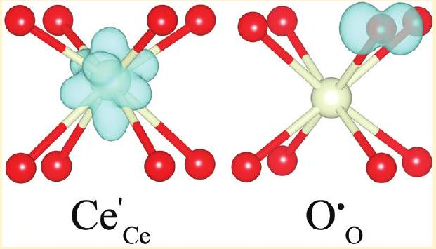 using density functional theory with the generalized gradient approximation (GGA) corrected for on-site Coulombic interactions (GGA+U). We employed an ab initio fitting procedure to determine a $U\left\{\mathrm{O}_{2 \mathrm{p}}\right\}$ value that satisfies a Koopmanslike condition and obtained a value of $U\left\{\mathrm{O}_{2 \mathrm{p}}\right\}=5.5 \mathrm{eV}$. We subsequently demonstrated that by applying GGA+U to the $\mathrm{O}_{2 \mathrm{p}}$ states, in addition to the $\mathrm{Ce}_{4 \mathrm{f}}$ states, we were able to model localized holes in addition to localized electrons, thus improving the description of $p$-type defects in $\mathrm{CeO}_{2}$. Our results show that under oxygen-poor conditions the defects with the lowest formation energy are oxygen vacancies, while oxygen interstitials, which form peroxide ions, will be more favorable under oxygenrich conditions. We carried out temperature and pressure dependence analyses to determine the relative abundance of intrinsic defects under real-world conditions and determined that oxygen vacancies will always be the dominant defect. Furthermore, we determined that at the dilute limit none of the defects studied can account for the intrinsic ferromagnetism that has been observed in nanosized $\mathrm{CeO}_{2}$.

## ■ INTRODUCTION

In the area of environmentally friendly technologies, $\mathrm{CeO}_{2}$ has emerged as an important material with many applications such as catalysis, ${ }^{1}$ solid oxide fuel cells, ${ }^{2}$ and gas sensors. ${ }^{3} \mathrm{CeO}_{2}$ is effective as a catalyst ${ }^{4-7}$ and as a support for other catalysts. ${ }^{1,8-11}$ This is due to the high thermal stability, self-decoking properties (which prevent poisoning of the catalyst), ${ }^{12,13}$ and high oxygen storage capacity (OSC) of $\mathrm{CeO}_{2}$. OSC refers to the ability of $\mathrm{CeO}_{2}$ to release oxygen under reducing conditions and absorb oxygen under oxidizing conditions, ${ }^{14-16}$ which is a result of the comparative ease of oxygen vacancy formation in $\mathrm{CeO}_{2} .{ }^{17,18}$ The ability of $\mathrm{CeO}_{2}$ to simultaneously catalyze oxidation and reduction reactions, e.g., the conversion of CO and $\mathrm{NO}_{2} / \mathrm{NO}$ to $\mathrm{CO}_{2}$ and $\mathrm{NO} / \mathrm{N}_{2}$, respectively, has been investigated through experimental ${ }^{4-7}$ and theoretical studies. ${ }^{19-24}$ Oxygen released from $\mathrm{CeO}_{2}$ will oxidize CO, and the resulting oxygen vacancies can then act as adsorption sites for $\mathrm{NO}_{2} / \mathrm{NO}$, leading to reduction of these molecules and reoxidizing $\mathrm{CeO}_{2} . \mathrm{CeO}_{2}$ catalysts have also been shown to be useful for the oxidation of hydrocarbons ${ }^{25-27}$ and for the water-gas-shift reaction ${ }^{9}$ where they supply a steady stream of oxygen to catalyze the reactions. Zhou et al. found that nanoscale $\mathrm{CeO}_{2}$, which exposes the more reducible \{100\} and $\{110\}$ surfaces, has increased catalytic activity, ${ }^{7}$ demonstrating the importance of oxygen vacancy formation with respect to catalysis. While these examples deal with oxygen vacancies on the surface, oxygen vacancy formation in the bulk plays an important role by facilitating the transport of oxygen ions to or from the surface. ${ }^{25}$
$\mathrm{CeO}_{2}$ is also a promising material for the electrolyte in intermediate temperature $(\approx 500-1000 \mathrm{~K})$ solid oxide fuel cells. ${ }^{28}$ It is generally considered that the intrinsic ionic conductivity is a result of oxygen vacancies, but work on other materials with the flourite structure has suggested that Frenkel defects could also contribute. ${ }^{29}$ However, stoichiometric $\mathrm{CeO}_{2}$ is a poor ionic conductor, displaying a conductivity of around $3.13 \times 10^{-3} \mathrm{~S} \mathrm{~cm}^{-1}$, due to a low concentration of oxygen vacancies at intermediate temperatures. ${ }^{30}$ Previous studies have shown that conductivity can be greatly increased by the introduction of dopants to create charge compensating oxygen vacancies, which can act as a pathway for ionic diffusion. ${ }^{31-43}$ The dopants that lead to the highest increase in ionic conductivity in $\mathrm{CeO}_{2}$ are Gd and Sm. ${ }^{32-34,37,41}$ It has been suggested that this is because the ionic radius of these dopants closely matches the ionic radius of the cerium ions, causing little deformation of the host lattice. ${ }^{44}$ Another method that increases ionic conductivity is codoping $\mathrm{CeO}_{2}$, ${ }^{38,39,45-50}$ where the dopants are chosen so that one will expand the crystal lattice while the other will contract it, and thus the two distortions cancel.

A controversial subject is the ferromagnetic (FM) behavior that has been observed in normally nonmagnetic oxides, including $\mathrm{CeO}_{2}$, when they are synthesized as thin films or nanoparticles. ${ }^{51-53}$ This unexpected behavior was first observed in thin films of $\mathrm{HfO}_{2}$, ${ }^{51}$ but a subsequent paper claimed that this was caused by contamination of the samples. ${ }^{52}$ Further studies have reported FM behavior in thin films of $\mathrm{TiO}_{2}$ and $\mathrm{In}_{2} \mathrm{O}_{3}{ }^{54}$ and nanoparticles of $\mathrm{Al}_{2} \mathrm{O}_{3}, \mathrm{ZnO}, \mathrm{SnO}_{2}, \mathrm{In}_{2} \mathrm{O}_{3}$, and $\mathrm{CeO}_{2}$, ${ }^{53}$ suggesting that ferromagnetism is an intrinsic property of many nanosized metal oxides.

Since FM behavior appears to be an intrinsic property, a number of native defects have been suggested as the cause of the apparent ferromagnetism in $\mathrm{CeO}_{2}$. It is thought that the two electrons localized on cerium ions after the removal of an oxygen

Received: August 19, 2011
Revised: December 13, 2011
Published: December 15, 2011
could be the cause ${ }^{55,56}$ especially when these are present on the surface. ${ }^{57}$ Experimental ${ }^{58}$ and theoretical ${ }^{59}$ studies have, however, indicated that oxygen vacancies are unlikely to be the cause of the FM behavior. Recent studies on $\mathrm{CeO}_{2}$ surfaces have claimed that it is not the concentration of surface oxygen vacancies but the ratio of $\mathrm{Ce}^{3+} / \mathrm{Ce}^{4+}$ ions on the surface that determines ferromagnetism in $\mathrm{CeO}_{2} .{ }^{60,61}$

Another possible source of FM behavior that has been suggested is cerium vacancies. ${ }^{58,56}$ While these can potentially induce a greater magnetic moment in $\mathrm{CeO}_{2}$ when compared to oxygen vacancies, previous work has suggested that the concentration of cerium vacancies would be very low, due to a high formation energy, and therefore unlikely to account for ferromagnetism. ${ }^{62,63}$

In the area of intrinsic defects, previous work has concentrated on oxygen vacancies in $\mathrm{CeO}_{2}$, with only a handful of studies having investigated the properties of other intrinsic defects. The only theoretical data on cerium vacancies by Fernandes et al., using LDA(GGA)+U calculation, predicted that these defects would be semimetallic in nature, ${ }^{56}$ contrary to similar defects in other metal oxides. ${ }^{64-66}$ The structure of Frenkel defects has been investigated, ${ }^{67,68}$ and their effect on ionic conductivity was investigated through molecular dynamics calculations, which suggested that such defects are more likely to recombine than contribute to conductivity. ${ }^{68}$ Yasunaga et al. ${ }^{63,69}$ investigated $\mathrm{CeO}_{2}$ surfaces under electron radiation, determining that oxygen and cerium interstitials were present, but their exact structure and impact on the intrinsic properties of $\mathrm{CeO}_{2}$ was not investigated.

In this paper, we employ GGA calculations with on-site Coulomb correction $(\mathrm{GGA}+U)$ to explore the properties of intrinsic defects within $\mathrm{CeO}_{2}$. Using a Koopmans-like approach, we determine a suitable $U$ value for the $\mathrm{O}_{2 \mathrm{p}}$ states. We provide information on the formation energies and also the geometry and electronic structure of each defect. Defect concentrations are then assessed as a function of temperature and oxygen partial pressure.

## ■ METHODS

Calculations were carried out with the Vienna Ab-initio Simulation Package (VASP), ${ }^{70-72}$ using the Projector Augmented Wave (PAW) ${ }^{73}$ implementation with GGA-PBE exchange correlation functionals. ${ }^{70-72}$ The energy of the 12 atom unit cell of $\mathrm{CeO}_{2}$ (spacegroup $F m \overline{3} m$ ) was determined at a series of volumes using a $4 \times 4 \times 4$ Monkhorst-Pack ${ }^{74} k$-point mesh and a 500 eV plane wave cutoff. The equilibrium structure was obtained by fitting the series of energy-volume data to the Murnaghan equation of state, thus obtaining the equilibrium lattice constant and avoiding the problem of Paulay stress. All defect calculations were based on a 2 × 2 × 2 (96 atom) expansion of the $\mathrm{CeO}_{2}$ unit cell and were performed at a 500 eV plane wave cutoff with a 2 × 2 × 2 Monkhorst-Pack $k$-point mesh. All calculations were deemed to be converged when the forces on each ion were less than $0.01 \mathrm{eV} \text{Å}^{-1}$.

Standard LDA and GGA functionals are incapable of correctly modeling systems with localized electronic defects due to the inherent self-interaction error (SIE). ${ }^{75-77}$ Skorodumova et al. tried to describe the electronic structure of $\mathrm{CeO}_{2}$ and reduced $\mathrm{CeO}_{2}$ by treating the cerium f states as part of the valence band for Ce(IV) ions and as part of the core levels, disconnected from the valence band, for Ce(III) ions. ${ }^{78,79}$ While this method was able to provide models of stoichiometric and reduced $\mathrm{CeO}_{2}$ that agreed with experimental observations, the results depended on a priori knowledge of the structure of the reduced system and therefore had no predictive power. Accurate and consistent results are obtainable by employing the LDA(GGA) + U method, ${ }^{80}$ which can approximately correct the SIE associated with LDA-(GGA) calculations. ${ }^{80-82}$ Previous theoretical work found that the expected structure of reduced $\mathrm{CeO}_{2}$ could be reproduced by introducing a value of $U\left\{\mathrm{Ce}_{4 \mathrm{f}}\right\}=5.0 \mathrm{eV}$. ${ }^{83}$ The $U$ value from different calculations is not always directly comparable, as each functional will have a different SIE and each programs' implementation of LDA(GGA)+U will differ in how they determine orbital occupations. However, subsequent studies demonstrate that values of $U\left\{\mathrm{Ce}_{46}\right\}=5.5,{ }^{84} 4.5,{ }^{85}$ and $5.0 \mathrm{eV}^{18,62,83,86,87}$ can accurately model the ground state properties of pure and reduced $\mathrm{CeO}_{2}$. Accurate descriptions of $\mathrm{CeO}_{2}$ and reduced $\mathrm{CeO}_{2}$ have also been obtained with hybrid-DFT techniques. ${ }^{88,89}$ These methods reduce the SIE error by introducing a fixed amount of nonlocal Fock exchange to the DFT exchange-correlation functionals. In this study, we employ the GGA+U method with $U\left\{\mathrm{Ce}_{4 \mathrm{f}}\right\}=5.0 \mathrm{eV}$, as this method will reduce the SIE without the high computational overhead associated with hybrid-DFT in a plane wave basis set.

Previous studies on metal oxides have shown that when employing LDA(GGA) to model O-derived $p$-type defect states, such as localized holes, it is necessary to apply an SIE correction to the $\mathrm{O}_{2 \mathrm{p}}$ states which can be accomplished using LDA(GGA) $+U .{ }^{64-66,76,90}$ Previous studies used a $U\left\{\mathrm{O}_{2 \mathrm{p}}\right\}$ value of 7 eV, ${ }^{91,92}$ but this value was derived for MgO. ${ }^{76}$ Because we expect that some of the defects we study may lead to the formation of localized holes on oxygen anions, it is necessary to determine a suitable value of $U\left\{\mathrm{O}_{2 \mathrm{p}}\right\}$ for $\mathrm{CeO}_{2}$.

To determine the $U$ value for the $\mathrm{O}_{2 \mathrm{p}}$, states we employed an ab initio fitting procedure used by Morgan and Watson, ${ }^{65}$ similar to the Koopmans-like procedure developed by Lany and Zunger. ${ }^{64}$ This method is based on the result that the energy change of a system when an electron is added or removed should be linear. ${ }^{93}$ For self-interaction free systems, the addition of an electron to a hole state (with $N$ electrons) is determined by the condition

$$
E(N+1)-E(N)=e_{i}(N)
$$

where $E(N)$ is the energy of the system with a self-trapped hole (the +1 charge state); $E(N+1)$ is the energy of the neutral system with the same structure as the $E(N)$ system; and $e_{i}(N)$ is the eigenvalue of the hole state relative to the valence band maximum (VBM). Included in the calculation of the charged cell are two corrections: a core-level alignment, as desribed in Scanlon et al., ${ }^{94}$ and a Makov-Payne image charge correction. ${ }^{95}$ When $E(N+1)-E(N)$ and $e_{i}(N)$ are plotted against $U$, we observe that at $U\left\{\mathrm{O}_{2 \mathrm{p}}\right\}=5.5 \mathrm{eV}$ the requirement of eq 1 is satisfied, indicating that the SIE of the system has been overcome (Figure 1). This suggests that the value of $U\left\{\mathrm{O}_{2 \mathrm{p}}\right\}=7 \mathrm{eV}$ that was used previously by Yeriskin and Nolan ${ }^{91,92}$ would not satisfy eq 1 and hence would overstabilize oxygen holes in $\mathrm{CeO}_{2}$.

The defect formation energies, $\Delta H_{\mathrm{f}}(\mathrm{D})$, are calculated according to the equation

$$
\Delta H_{\mathrm{f}}(\mathrm{D})=\left(E_{\mathrm{CeO}_{2}(\mathrm{D})}-E_{\mathrm{CeO}_{2}}\right)+\sum_{i} n_{i} E_{i}+n_{i} \mu_{i}
$$

where $E_{\mathrm{CeO}_{2}}$ and $E_{\mathrm{CeO}_{2}(\mathrm{D})}$ are the calculated energies of the stoichiometric and defect supercells, respectively; $n_{i}$ are the numbers of atoms of Ce and O that are added to (positive) or removed from (negative) an external atomic reservoir; $E_{i}$ are the

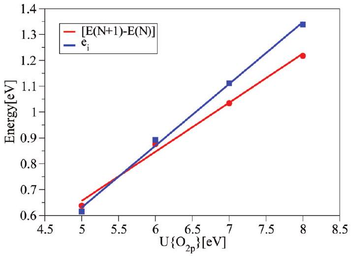
Figure 1. Variation of the electron addition energy, $E(N+1)-E(N)$ (red line, red circles), and the hole state eigenvalue (relative to the VBM), $e_{i}$ (blue line, blue squares), of the +1 charge state of $\mathrm{CeO}_{2}$, as a function of $U\left\{\mathrm{O}_{2 \mathrm{p}}\right\}$. For all calculations $U\left\{\mathrm{Ce}_{4 \mathrm{f}}\right\}=5.0 \mathrm{eV}$.

elemental energies of the species (i.e., $\mathrm{Ce}_{(\mathrm{s})}$ and $\mathrm{O}_{2(\mathrm{~g})}$ ); and $\mu_{i}$ is the chemical potential for cerium and oxygen. By varying the chemical potentials of each species, we can model specific equilibrium conditions within the global constraint of the calculated enthalpy of the host, i.e., $\mathrm{CeO}_{2}$. When $U\left\{\mathrm{Ce}_{4 f}\right\}=5.0 \mathrm{eV}$ and $U\left\{\mathrm{O}_{2 \mathrm{p}}\right\}=0 \mathrm{eV}$, hereafter denoted as $U_{\mathrm{Ce}, \mathrm{O}}=\{5.0,0\} \mathrm{eV}$, we obtain: $\mu_{\mathrm{Ce}}+2 \mu_{\mathrm{O}}=\Delta H_{\mathrm{f}}\left(\mathrm{CeO}_{2}\right)=-10.5 \mathrm{eV}$. The upper bound of $\mu_{\mathrm{O}}$, the Ce-poor/O-rich environment, is limited by the formation of $\mathrm{O}_{2(\mathrm{~g})}: \mu_{\mathrm{O}}=0 \mathrm{eV}, \mu_{\mathrm{Ce}}=-10.5 \mathrm{eV}$. The lower bound of $\mu_{\mathrm{O}}$, the Ce-rich/O-poor environment, is limited by the formation of $\mathrm{Ce}_{2} \mathrm{O}_{3}: 2 \mu_{\mathrm{Ce}}+3 \mu_{\mathrm{O}} \leq \Delta H_{\mathrm{f}}\left(\mathrm{Ce}_{2} \mathrm{O}_{3}\right)=-18.97 \mathrm{eV}$, which yields: $\mu_{\mathrm{O}}=-2.03 \mathrm{eV}, \mu_{\mathrm{Ce}}=-6.44 \mathrm{eV}$.

For calculations where $U\left\{\mathrm{Ce}_{4 \mathrm{f}}\right\}=5.0 \mathrm{eV}$ and $U\left\{\mathrm{O}_{2 \mathrm{p}}\right\}=5.5 \mathrm{eV}$, i.e., $U_{\mathrm{Ce}, \mathrm{O}}=\{5.0,5.5\} \mathrm{eV}$, the formation energies are: $\Delta H_{\mathrm{f}}$ $\left(\mathrm{CeO}_{2}\right)=-9.67 \mathrm{eV}$ and $\Delta H_{\mathrm{f}}\left(\mathrm{Ce}_{2} \mathrm{O}_{3}\right)=-17.7 \mathrm{eV}$, which sets the chemical potentials at the Ce-poor/O-rich limit as $\mu_{\mathrm{O}}=0 \mathrm{eV}$, $\mu_{\mathrm{Ce}}=-9.67 \mathrm{eV}$ and at the Ce-rich/O-poor limit to $\mu_{\mathrm{O}}=-1.64 \mathrm{eV}$, $\mu_{\mathrm{Ce}}=-6.39 \mathrm{eV}$.

The effect of temperature and pressure on the defect formation energies was estimated by considering the enthalpic and entropic contributions to the oxygen chemical potential $\mu_{\mathrm{O}}$ in the $\mathrm{O}_{2}$ gas phase. The direct effects of temperature and pressure on $\mu_{\mathrm{Ce}}, \Delta H_{\mathrm{f}}\left(\mathrm{CeO}_{2}\right)$, and $\Delta H_{\mathrm{f}}\left(\mathrm{Ce}_{2} \mathrm{O}_{3}\right)$ are neglected as these are either small $(P \Delta V$ terms $)$ or are expected to cancel as the vibrational frequencies of the reference materials will be relatively insensitive to temperature $\left(T \Delta S_{\text {vib }}\right)$. However, $\mu_{\mathrm{Ce}}$ will be affected by the condition $\mu_{\mathrm{Ce}}+2 \mu_{\mathrm{O}}=\Delta H_{\mathrm{f}}\left(\mathrm{CeO}_{2}\right)$. Because we are only concerned with the change in $\mu_{\mathrm{O}}$, we only need to take into account the affect of the partial oxygen pressure. The change to $\mu_{\mathrm{O}}$ can be expressed as ${ }^{96}$

$$
\begin{aligned}
\Delta \mu_{\mathrm{O}}(T, P)= & \frac{1}{2}\left\{C_{p}\left(T-T_{0}\right)\right. \\
& \left.-T\left[S_{0}+C_{p} \ln \frac{T}{T_{0}}\right]+k_{\mathrm{B}} T \ln \frac{P}{P_{0}}\right\}
\end{aligned}
$$

In the above equation, we used $C_{p}=(7 / 2) k_{\mathrm{B}}$ for the constantpressure specific heat capacity per diatomic molecule, derived from the ideal gas law, and the experimental value for the $\mathrm{O}_{2(\mathrm{~g})}$ standard entropy, $S_{0}=205 \mathrm{~J} \mathrm{~mol}^{-1} \mathrm{~K}^{-1}$. The reference temperature ( $T_{0}$ ) and pressure ( $P_{0}$ ) are set to 298 K and 1 atm,

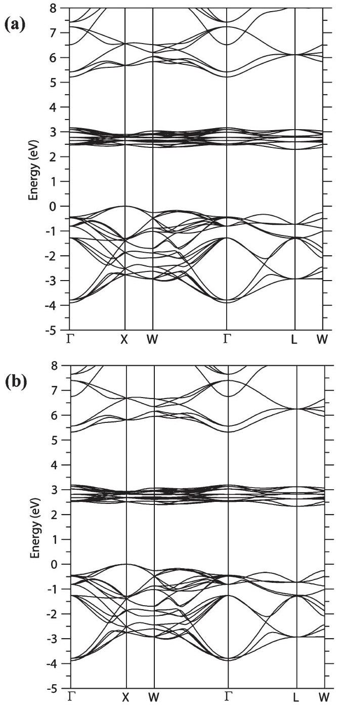
Figure 2. Band structure of pure $\mathrm{CeO}_{2}$ for (a) $U_{\mathrm{Ce}, \mathrm{O}}=\{5.0,0\} \mathrm{eV}$ and (b) $U_{\mathrm{Ce}, \mathrm{O}}=\{5.0,5.5\} \mathrm{eV}$. The VBM is set to 0 eV.

respectively (standard temperature and pressure). Once the temperature dependence of the formation energies is calculated, it is then possible to estimate the defect concentrations as a function of temperature, assuming Arrhenius-type behavior.

## ■ RESULTS

Bulk Properties. The lattice constant of $\mathrm{CeO}_{2}$ for $U_{\mathrm{Ce}, \mathrm{O}}=$ $\{5.0,0\} \mathrm{eV}\left(U_{\mathrm{Ce}, \mathrm{O}}=\{5.0,5.5\} \mathrm{eV}\right)$ was calculated to be $5.494 \text{Å}$ ( $5.477 \text{Å}$ ), which is within $1.5 \%(1.2 \%)$ of the experimental lattice constant of $5.41 \text{Å} .{ }^{97}$ The $\mathrm{Ce}-\mathrm{O}$ bond length, $2.377 \text{Å}$ $(2.372 \text{Å})$, also agrees with the experimental bond length, being within $1.5 \%(1.2 \%)$ of the recorded value of $2.343 \text{Å} .{ }^{98}$ The band structure was calculated for $U_{\mathrm{Ce}, \mathrm{O}}=\{5.0,0\} \mathrm{eV}$ and $U_{\mathrm{Ce}, \mathrm{O}}=\{5.0$, $5.5\}$ eV, and minimal differences were observed between them (Figure 2). The calculated band gap was found to be 2.45 eV (2.51 eV). These values are significantly lower than the experimentally determined band gap, values of which have been reported as $2.76,{ }^{99} 3.31,{ }^{100}$ and 3.60 eV . ${ }^{101}$ This is not unexpected as GGA is well-known to underestimate band gaps despite accurately describing the ground state properties. ${ }^{102}$ By

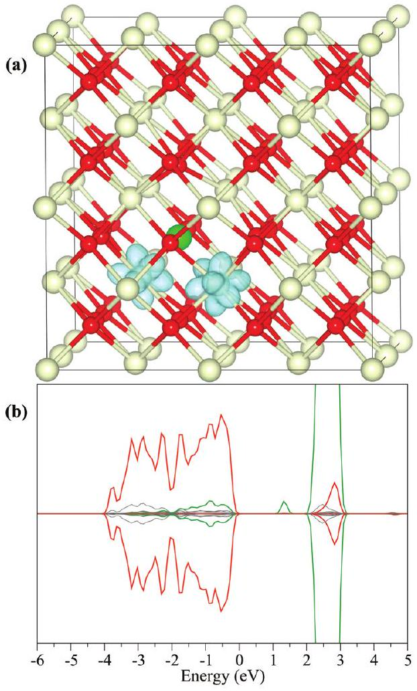
Figure 3. (a) Structure with spin-density plot and (b) the density of states of an oxygen vacancy in $\mathrm{CeO}_{2}$ with $U_{\mathrm{Ce}, \mathrm{O}}=\{5.0,5.5\} \mathrm{eV}$. Cerium atoms are represented by white spheres; oxygen atoms are represented by red spheres; and the position of the vacancy is represented by the light green sphere. The isosurface is shown in blue and is set to $0.05 \mathrm{e} / \text{Å}^{3}$. For the density of states, the $\mathrm{Ce}_{4 \mathrm{f}}$ states are represented by green lines, and the $\mathrm{O}_{2 \mathrm{p}}$ states are represented by red lines. All other states are shown in gray.

integrating the PEDOS (not shown), we found that 11.8\% (12.4\%) of the electrons in the valence band are associated with Ce states, showing that there is no significant redistribution of the electrons upon the introduction of $U\left\{\mathrm{O}_{2 \mathrm{p}}\right\}$.

Defect Structure. All calculations of defects in $\mathrm{CeO}_{2}$ were carried out using both $U_{\mathrm{Ce}, \mathrm{O}}=\{5.0,0\} \mathrm{eV}$ and $U_{\mathrm{Ce}, \mathrm{O}}=\{5.0$, 5.5\} eV. For each of the defects, we investigated several possible structures and spin states to determine the lowest energy structure.

Oxygen Vacancy. During the formation of an oxygen vacancy, two excess electrons are localized onto nearby Ce ions, reducing them from Ce(IV) to Ce(III). ${ }^{83-85,87}$ In Kröger-Vink notation, this is

$$
\mathrm{O}_{\mathrm{O}}^{x}+2 \mathrm{Ce}_{\mathrm{Ce}}^{x} \rightarrow V_{\mathrm{O}}^{\bullet \bullet}+2 \mathrm{Ce}_{\mathrm{Ce}}^{\prime}+\frac{1}{2} \mathrm{O}_{2}(\mathrm{~g})
$$

where $\mathrm{O}_{\mathrm{O}}^{x}$ represents a neutral oxygen on an oxygen lattice site; $\mathrm{Ce}_{\mathrm{Ce}}^{x}$ is a neutral cerium atom on a cerium site; $V_{\mathrm{O}}^{\bullet \bullet}$ is a doubly positively charged vacancy at an oxygen lattice site; and $\mathrm{Ce}^{\prime}{ }_{\mathrm{Ce}}$ is singly negatively charged cerium (i.e., Ce(III)) at a cerium lattice site. The excess electrons occupy previously empty 4f states on the Ce ions. This is supported by experimental studies, which have found distinctive 4f peaks deep in the band gap of reduced $\mathrm{CeO}_{2} .{ }^{14,103,104}$ For the calculations of an oxygen vacancy in $\mathrm{CeO}_{2}$, the structures obtained for the two different cases when

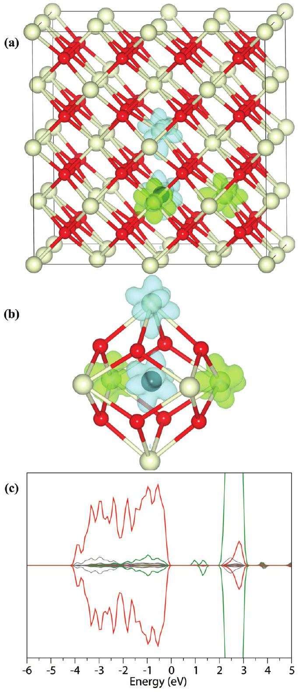
Figure 4. (a) Full simulation cell and (b) the local structure of a cerium interstitial with a partial charge-density plot of the defect peaks and (c) density of states of a cerium interstitial in $\mathrm{CeO}_{2}$ when $U_{\mathrm{Ce}, \mathrm{O}}=\{5.0,5.5\}$ eV. The cerium interstitial is represented by the black sphere; the blue isosurface represents the spin-up electrons; and the green isosurface represents the spin-down electrons. The isosurfaces are set to $0.05 \mathrm{e} / \text{Å}^{3}$.

$U_{\mathrm{Ce}, \mathrm{O}}=\{5.0,0\} \mathrm{eV}$ and $U_{\mathrm{Ce}, \mathrm{O}}=\{5.0,5.5\} \mathrm{eV}$ were found to be very similar, and hence only the latter is displayed in Figure 3. There was almost no difference in energy between the ferromagnetic and antiferromagnetic configurations (<0.1 meV), and so we have only displayed the ferromagnetic configuration of the excess electrons. The vacancy is an area of effective positive charge, hence the eight neighboring oxygen ions move off their lattice site toward the vacancy, while the neighboring Ce ions move away from the vacancy. For calculations where $U_{\mathrm{Ce}, \mathrm{O}}=\{5.0,0\} \mathrm{eV}\left(U_{\mathrm{Ce}, \mathrm{O}}=\{5.0,5.5\} \mathrm{eV}\right)$, the neighboring oxygen which is only coordinated to Ce(IV) ions moves by $0.22 \text{Å}(0.30 \text{Å})$, the oxygen ion bridging the two $\mathrm{Ce}(\mathrm{III})$ ions by $0.04 \text{Å}(0.03 \text{Å})$, and the four oxygens which are coordinated to

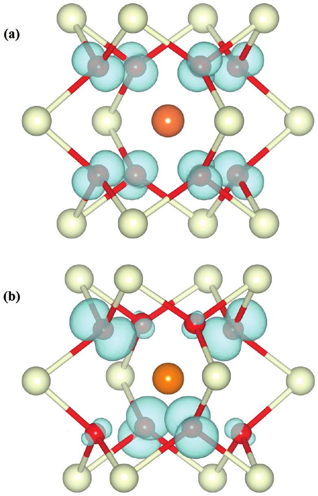
Figure 5. Local defect structure with spin-density plot of a cerium vacancy with (a) $U_{\mathrm{Ce}, \mathrm{O}}=\{5.0,0\} \mathrm{eV}$ and (b) $U_{\mathrm{Ce}, \mathrm{O}}=\{5.0,5.5\} \mathrm{eV}$. The position of the vacancy is represented by the orange sphere. The isosurface is set to $0.05 \mathrm{e} / \text{Å}^{3}$.

one $\mathrm{Ce}(\mathrm{III})$ ion by $0.19 \text{Å}(0.12 \text{Å})$, all toward the vacancy. The two Ce(III) ions move $0.09 \text{Å}$ ( $0.13 \text{Å}$ ), whereas the Ce(IV) ions move a distance of $0.16 \text{Å}(0.18 \text{Å})$. The variation in the relaxation of the oxygen ions can be related to the Ce(III) ions being less positive than the Ce(IV) ions, leading to a longer Ce(III)-O bond.

Figure 3(b) shows the electronic density of states (EDOS) for an oxygen vacancy in $\mathrm{CeO}_{2}$, with a ferromagnetic arrangement of electrons, when $U_{\mathrm{Ce}, \mathrm{O}}=\{5.0,5.5\} \mathrm{eV}$ (the differences for results with $U_{\mathrm{Ce}, \mathrm{O}}=\{5.0,0\} \mathrm{eV}$ were negligible). We can see that between the $\mathrm{O}_{2 \mathrm{p}}$ dominated valence band and the $\mathrm{Ce}_{4 \mathrm{f}}$ dominated band a new defect peak has appeared, made up of occupied $\mathrm{Ce}_{4 f}$ states, which indicates the presence of Ce(III) ions. The EDOS for the antiferromagnetic configuration displays a similar $\mathrm{Ce}_{4 \mathrm{f}}$ defect peak, albeit with one peak spin up and the other spin down. Both the position and nature of the defect peak are consistent with previous experimental ${ }^{14}$ and theoretical ${ }^{83,86,105,106}$ work.

Cerium Interstitial. The introduction of a cerium interstitial introduces four extra electrons to the system. There are two different ways for the excess electrons to localize: either the electrons localize on four of the ceria neighboring the vacancy, reducing them from Ce(IV) to Ce(III)

$$
4 \mathrm{Ce}_{\mathrm{Ce}}^{x}+\mathrm{Ce}(\mathrm{~s}) \rightarrow 4 \mathrm{Ce}_{\mathrm{Ce}}^{\prime}+\mathrm{Ce}_{i}^{\bullet \cdots}
$$

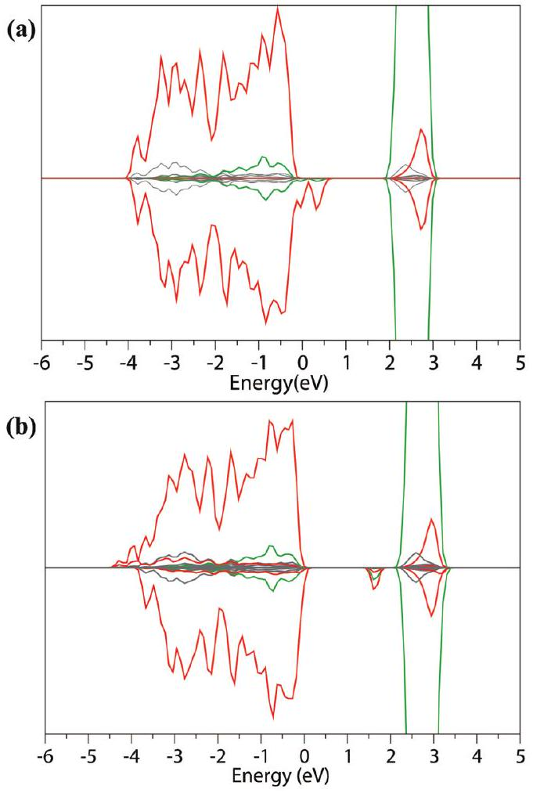
Figure 6. Density of states for a cerium vacancy with (a) $U_{\mathrm{Ce}, \mathrm{O}}=$ $\{5.0,0\} \mathrm{eV}$ and (b) $U_{\mathrm{Ce}, \mathrm{O}}=\{5.0,5.5\} \mathrm{eV}$.

or one electron remains on the interstitial ion while three of the neighboring cerium ions are reduced

$$
3 \mathrm{Ce}_{\mathrm{Ce}}^{x}+\mathrm{Ce}(\mathrm{~s}) \rightarrow 3 \mathrm{Ce}_{\mathrm{Ce}}^{\prime}+\mathrm{Ce}_{i}^{\bullet \bullet \bullet}
$$

Figure 4 shows the structure, spin density, and EDOS for the cerium interstitial when $U_{\mathrm{Ce}, \mathrm{O}}=\{5.0,5.5\} \mathrm{eV}$ (negligible differences for results with $U_{\mathrm{Ce}, \mathrm{O}}=\{5.0,0\} \mathrm{eV}$ ). The lowest energy was found when the excess electrons localize according to eq 6 in an antiferromagnetic configuration (Figure 4(b)). For $U_{\mathrm{Ce}, \mathrm{O}}=\{5.0,0\} \mathrm{eV}\left(U_{\mathrm{Ce}, \mathrm{O}}=\{5.0,5.5\} \mathrm{eV}\right)$, the singlet configuration was lower in energy than the quintet and triplet states by 240 meV (450 meV) and 90 meV (140 meV), respectively. The eight oxygen ions neighboring the interstitial ion remain on their lattice sites. The six Ce ions that neighbor the interstitial relax away from it by $0.25 \text{Å}$ for the Ce(III) ions and $0.32 \text{Å}$ for the Ce(IV) ions for both values of $U\left\{\mathrm{O}_{2 \mathrm{p}}\right\}$.

The EDOS, Figure 4(c), shows defect peaks made up of occupied $\mathrm{Ce}_{4 \mathrm{f}}$ states between the valence and conduction bands, which are due to Ce(III) ions. A partial charge analysis of the defect peaks shows that the lowest energy peak in the spin-up state is attributed to the interstitial Ce(III) ion. The remaining peaks are due to the three Ce(III) ions neighboring the interstitial, one in the spin-up state and two in the spin-down state.

Cerium Vacancy. The formation of a neutral cerium vacancy removes four electrons from the lattice. This creates holes in the valence band which are expected to localize on the $\mathrm{O}_{2 \mathrm{p}}$ states, as these states dominate the VBM. In Kröger--Vink notation this would be

$$
\mathrm{Ce}_{\mathrm{Ce}}^{x}+4 \mathrm{O}_{\mathrm{O}}^{x} \rightarrow V_{\mathrm{Ce}}^{\prime \prime \prime \prime}+4 \mathrm{O}_{\mathrm{O}}^{\bullet}+\mathrm{Ce}(\mathrm{~s})
$$

Figure 5 shows the structures of a cerium vacancy for (a) $U_{\mathrm{Ce}, \mathrm{O}}=$ $\{5.0,0\} \mathrm{eV}$ and (b) $U_{\mathrm{Ce}, \mathrm{O}}=\{5.0,5.5\} \mathrm{eV}$. Both structures are

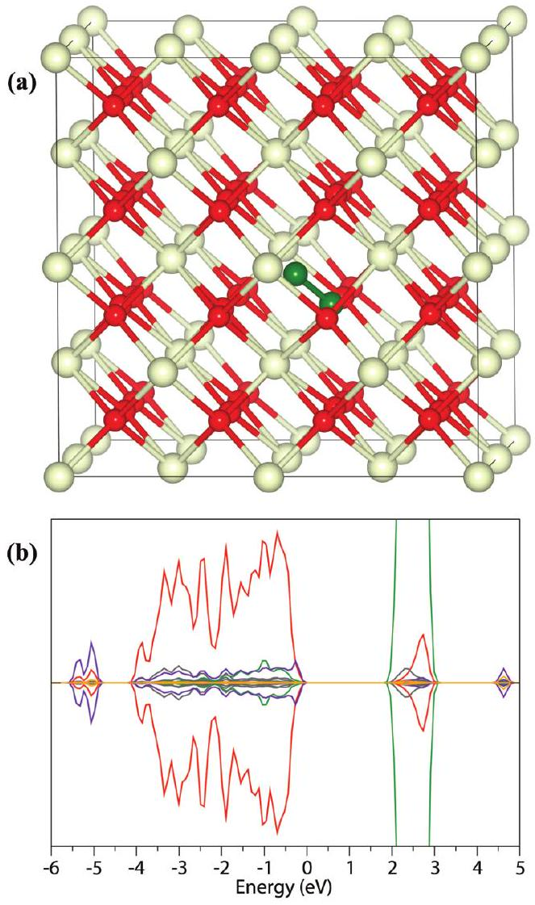
Figure 7. (a) Structure and (b) density of states of a peroxide ion in $\mathrm{CeO}_{2}$ when $U_{\mathrm{Ce}, \mathrm{O}}=\{5.0,5.5\} \mathrm{eV}$. The peroxide ion is represented by the dark green spheres. In the density of states the $\mathrm{O}_{2 \mathrm{~s}}, \mathrm{O}_{2 \mathrm{p}}$, and $\mathrm{O}_{3 \mathrm{~d}}$ states from the peroxide oxygens are represented by the blue, purple, and orange lines, respectively. The peroxide peaks have been magnified by $\times 5$ to aid clarity.

shown with the overall spin in the quintet state, as this spin configuration was found to be marginally lower in energy than the triplet or singlet states (8.5 and 11.4 meV, respectively). When $U_{\mathrm{Ce}, \mathrm{O}}=\{5.0,0\} \mathrm{eV}$, the spin density is delocalized over the eight oxygen ions neighboring the vacancy; however, when $U_{\mathrm{Ce}, \mathrm{O}}=$ \{5.0, 5.5\} eV we obtain a different picture with localized holes on four of the oxygens neighboring the vacancy. For $U_{\mathrm{Ce}, \mathrm{O}}=\{5.0,0\}$ eV the eight oxygen ions that neighbor the cerium vacancy move away from the vacancy by between 0.13 and 0.14 Å. When $U_{\mathrm{Ce}, \mathrm{O}}=$ $\{5.0,5.5\} \mathrm{eV}$, the $\mathrm{O}_{\mathrm{O}}^{x}$ ions relax away from the cerium vacancy by $0.26 \text{Å}$, whereas the $\mathrm{O}_{\mathrm{O}}^{\circ}$ ions relax toward the vacancy by $0.03 \text{Å}$ leading to an increased $\mathrm{Ce}(\mathrm{IV})-\mathrm{O}_{\mathrm{O}}^{\bullet}$ bond $(2.44 \text{Å})$ since the $\mathrm{O}_{\mathrm{O}}^{\bullet}$ ions are less negatively charged than the $\mathrm{O}_{\mathrm{O}}^{x}$ ions.

The EDOS for a cerium vacancy when $U_{\mathrm{Ce}, \mathrm{O}}=\{5.0,0\} \mathrm{eV}$ (Figure 6(a)) indicates that the cerium vacancy is semimetallic in nature, similar to the EDOS of Fernandes et al. ${ }^{56}$ However, the EDOS when $U_{\mathrm{Ce}, \mathrm{O}}=\{5.0,5.5\} \mathrm{eV}$ (Figure 6(b)) shows a defect state within the band gap primarily composed of empty $\mathrm{O}_{2 \mathrm{p}}$ orbitals from the oxygen holes, indicating that the metallic solution is a result of failing to account for the SIE. This is similar to previous studies on cation vacancies in other metal oxides with $\mathrm{O}_{2 \mathrm{p}}$ dominated valence bands that have applied corrections for the SIE. ${ }^{64-66,76,90}$

Oxygen Interstitial. It might be expected that the introduction of an oxygen interstitial would form localized holes on the

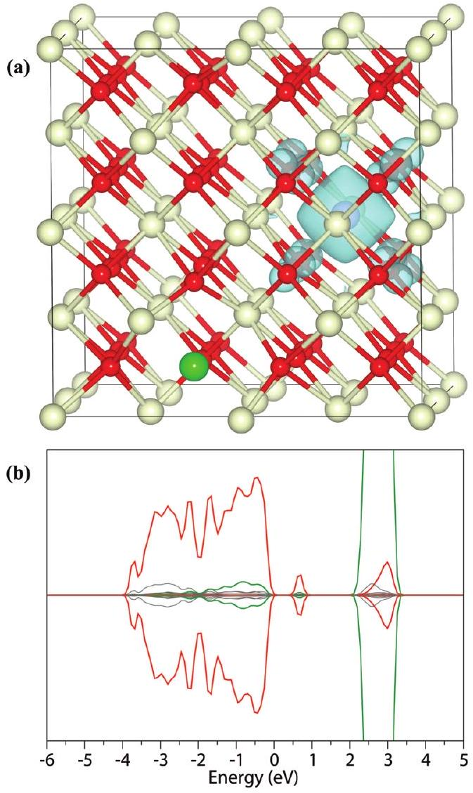
Figure 8. (a) Structure with partial charge density of the defect peaks and (b) density of states of an anion Frenkel defect in $\mathrm{CeO}_{2}$ when $U_{\mathrm{Ce}, \mathrm{O}}=\{5.0,5.5\} \mathrm{eV}$. The oxygen vacancy is represented by the light green sphere, and the oxygen interstitial is represented by the purple sphere. The isosurface is set to $0.05 \mathrm{e} / \text{Å}^{3}$.

interstitial ion and the neighboring oxygen ions

$$
\mathrm{O}_{\mathrm{O}}^{x}+\frac{1}{2} \mathrm{O}_{2}(\mathrm{~g}) \rightarrow \mathrm{O}_{\mathrm{O}}^{\bullet}+\mathrm{O}_{i}^{\prime}
$$

However, the interstitial ion could relax from its original position toward the lattice oxygen, forming a peroxide ion, and hence no holes would be observed

$$
\mathrm{O}_{\mathrm{O}}^{x}+\frac{1}{2} \mathrm{O}_{2}(\mathrm{~g}) \rightarrow\left(\mathrm{O}_{2}\right)_{\mathrm{O}}^{x}
$$

Figure 7 shows the structure of the oxygen interstitial and its EDOS for $U_{\mathrm{Ce}, \mathrm{O}}=\{5.0,5.5\} \mathrm{eV}$ (minimal differences were found with $\left.U_{\mathrm{Ce}, \mathrm{O}}=\{5.0,0\} \mathrm{eV}\right)$. When $U_{\mathrm{Ce}, \mathrm{O}}=\{5.0,0\} \mathrm{eV}\left(U_{\mathrm{Ce}, \mathrm{O}}=\right.$ \{5.0, 5.5\} eV), the interstitial ion moves $0.84 \text{Å}$ (0.80 Å) toward a lattice oxygen, which moves $0.10 \text{Å}$ ( $0.10 \text{Å}$ ) toward the interstitial position. The resulting $\mathrm{O}-\mathrm{O}$ bond length is $1.45 \text{Å}(1.48 \text{Å})$, which is characteristic of a peroxide species. The formation of a peroxide upon the introduction of an oxygen interstitial has also been observed in other close-packed metal oxides, such as $\mathrm{Al}_{2} \mathrm{O}_{3},{ }^{107}$ $\mathrm{SnO}_{2},{ }^{108} \mathrm{TiO}_{2},{ }^{65,109}$ and ZnO . ${ }^{110}$

Peaks corresponding to the peroxide (which are $\mathrm{O}_{2 \mathrm{p}}$ in nature) can be seen in the EDOS (Figure 7(b)) between -6 and 0 eV. Integrating these peaks gives approximately 10 electrons, suggesting occupation of a $\sigma$, two $\pi$, and two $\pi^{*}$ orbitals, as expected from the MO diagram of a peroxide ion. Furthermore, the peak at

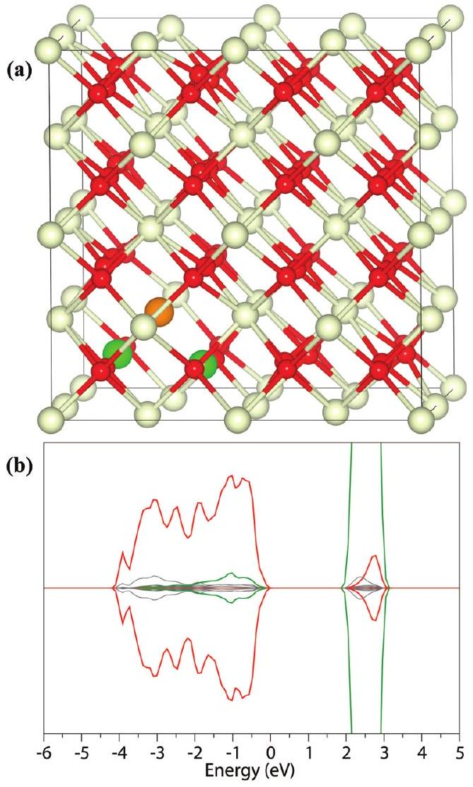
Figure 9. (a) Structure and (b) density of states of a Schottky defect in $\mathrm{CeO}_{2}$ when $U_{\mathrm{Ce}, \mathrm{O}}=\{5.0,5.5\} \mathrm{eV}$. The cerium vacancy is represented by the orange sphere, and the oxygen vacancies are represented by the light green spheres.

$\sim 4.4 \mathrm{eV}$ corresponds to the empty $\sigma^{*}$ orbital of the peroxide ion, which has been observed previously in $\mathrm{SnO}_{2} .{ }^{108}$

Anion Frenkel and Schottky Defects. In Kröger-Vink notation, an anion Frenkel defect is denoted by

$$
\mathrm{O}_{\mathrm{O}}^{x} \rightarrow V_{\mathrm{O}}^{\bullet \bullet}+\mathrm{O}_{i}^{\prime \prime}
$$

and a Schottky defect by

$$
\mathrm{Ce}_{\mathrm{Ce}}^{x}+2 \mathrm{O}_{\mathrm{O}}^{x} \rightarrow V_{\mathrm{Ce}}^{\prime \prime \prime \prime}+2 V_{\mathrm{O}}^{\bullet \bullet}
$$

The structures and EDOS for the anion Frenkel and the Schottky defects are shown in Figure 8 and Figure 9, respectively. For both of these defects, we only show the results for $U_{\mathrm{Ce}, \mathrm{O}}=$ $\{5.0,5.5\}$ eV (structures and EDOS largely unchanged when $U_{\mathrm{Ce}, \mathrm{O}}=\{5.0,0\} \mathrm{eV}$ ). Several different defect configurations were investigated to determine the lowest energy structure in each case. For the anion Frenkel defect we found that there was a minimum distance the oxygen interstitial had to be from its corresponding vacancy, below which they would spontaneously recombine. Figure 8(a) shows a stable anion Frenkel defect when the oxygen interstitial is $7.17 \text{Å}$ from the corresponding oxygen vacancy. For the Schottky defect, we found that the cerium and oxygen vacancies will form defect clusters, as shown in Figure 9-(a). The presence of a Schottky defect does not affect the EDOS with respect to the pure bulk. ${ }^{18}$ In the case of the anion Frenkel defect, a new peak appears in the band gap, made up of $\mathrm{O}_{2 \mathrm{p}}$ states with a small contribution from $\mathrm{Ce}_{4 \mathrm{f}}$ states. The charge density

Table 1. Chemical Potential Dependent Defect Formation Energies, for $U_{\mathrm{Ce}, \mathrm{O}}=\{5.0,0\} \mathrm{eV}$ and $U_{\mathrm{Ce}, \mathrm{O}}=\{5.0,5.5\} \mathrm{eV}^{a}$
|  | $U_{\mathrm{Ce}, \mathrm{O}}=\{5.0,0\} \mathrm{eV}$ |  | $U_{\mathrm{Ce}, \mathrm{O}}=\{5.0,5.5\} \mathrm{eV}$ |  |
| :--- | :--- | :--- | :--- | :--- |
|  | Ce-rich/ O-poor | Ce-poor/ O-rich | Ce-rich/ O-poor | Ce-poor/ O-rich |
| O vacancy | 0.57 | 2.60 | 0.58 | 2.22 |
| Ce interstitial | 5.96 | 10.02 | 6.03 | 9.31 |
| Ce vacancy | 10.35 | 6.29 | 8.19 | 4.91 |
| O interstitial (peroxide) | 3.76 | 1.73 | 3.50 | 1.86 |
| anion Frenkel | 3.89 | 3.89 | 3.96 | 3.96 |
| Schottky | 3.58 | 3.58 | 3.66 | 3.66 |
| ${ }^{a}$ All energies are given in eV. |  |  |  |  |

associated with the defect peak is shown in Figure 8(a) and suggests the orbitals of the $\mathrm{O}_{i}^{\prime \prime}$ atom and neighboring lattice oxygens are perturbing each other, shifting their levels to a higher energy in the density of states.

Formation Energies. The chemical-dependent defect formation energies are shown in Table 1. Under Ce-rich/O-poor conditions, the formation energy of oxygen vacancies is significantly lower than any of the other defects. However, under Ce-poor/O-rich conditions, the peroxide ion has the lowest formation energy, with oxygen vacancies having the second lowest energy. In all cases, the formation energy for cerium vacancies and cerium interstitials is much higher than the other defects.

Comparison of the results for $U_{\mathrm{Ce}, \mathrm{O}}=\{5.0,0\} \mathrm{eV}$ and $U_{\mathrm{Ce}, \mathrm{O}}=$ \{5.0, 5.5\} eV cases show only small differences in the formation energies. The exception to this is for the cerium vacancy where the formation energy is lower by 2.16 eV at the Ce-rich/O-poor limit and by 1.38 eV at the Ce-poor/O-rich when $U_{\mathrm{Ce}, \mathrm{O}}=\{5.0$, $5.5\}$ eV. This is because cerium vacancies lead to the formation of localized holes on neighboring oxygen ions. Without the correction to the $\mathrm{O}_{2 \mathrm{p}}$ states, the SIE leads to a delocalization of the charge over the oxygens, but when the SIE is counteracted a localized electronic structure is obtained.

Figure 10 show the change in concentration of the defects with temperature for $U_{\mathrm{Ce}, \mathrm{O}}=\{5.0,5.5\} \mathrm{eV}$. The oxygen partials pressures are set at $P=10^{-10}$ atm (Figure 10(a)) and $P=0.2 \mathrm{~atm}$ (Figure 10(b)) to represent defects in $\mathrm{CeO}_{2}$ under low oxygen partial pressure (e.g., SOFC anode) and high oxygen partial pressure (e.g., SOFC cathode). ${ }^{2}$ At both high and low oxygen partial pressures, the most abundant defect will be oxygen vacancies. At higher temperatures, there are small concentrations of anion Frenkel and Schottky defects, while the concentrations of cerium vacancies and cerium interstitials are negligible. Under high partial oxygen pressure, the concentration of peroxide ions is significantly higher than at low pressure; however, at the typical operating temperature of a solid oxide fuel cell $(\approx 500-1000 \mathrm{~K})$, the concentration of oxygen vacancies is far greater.

## ■ DISCUSSION

The SIE is a major obstacle to the accurate modeling of defects in solids, and its effect on $n$-type defects in $\mathrm{CeO}_{2}$ has been extensively modeled. However, the study of the SIE with respect to $p$-type defects has not received as much attention. To address this, we have employed an ab initio fitting procedure to determine a $U$ parameter for the $\mathrm{O}_{2 \mathrm{p}}$ states in $\mathrm{CeO}_{2}$. Using our derived value of $U\left\{\mathrm{O}_{2 \mathrm{p}}\right\}=5.5 \mathrm{eV}$, we were able to model localized

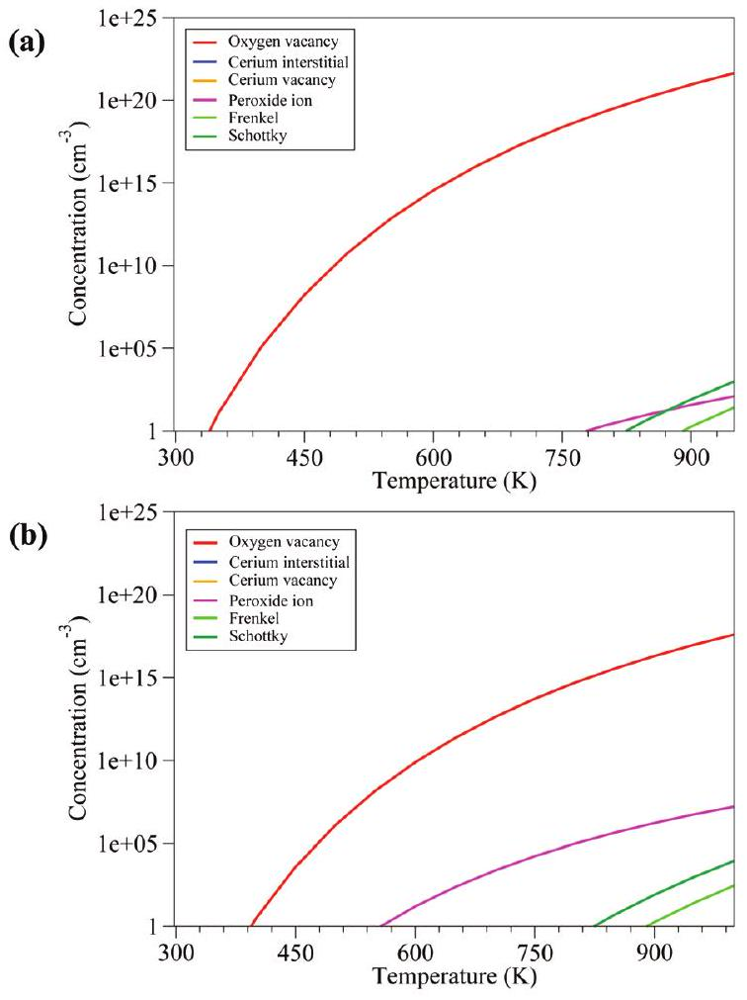
Figure 10. Temperature dependence of concentration of intrinsic defects in $\mathrm{CeO}_{2}$ at oxygen partial pressures of (a) $P=10^{-10} \mathrm{~atm}$ and (b) $P=0.2 \mathrm{~atm}$.

electron holes on the oxygen anions, yielding electronic structures similar to studies of other wide-gap metal oxides with $\mathrm{O}_{2 \mathrm{p}}$ dominated valence bands in which the SIE has been corrected. ${ }^{64-66,76}$ If $U\left\{\mathrm{O}_{2 \mathrm{p}}\right\}$ is not included when modeling cerium vacancies, the SIE leads to a delocalized defect which is semimetallic in nature. ${ }^{56}$ The $U\left\{\mathrm{O}_{2 \mathrm{p}}\right\}$ value is therefore essential for modeling defects that form localized oxygen holes in $\mathrm{CeO}_{2}$.

From our temperature dependence analyses (Figure 10), we find that the defect with the greatest concentration in $\mathrm{CeO}_{2}$ will be oxygen vacancies. In terms of catalysis, the importance of the OSC of $\mathrm{CeO}_{2}$ is well understood, as at higher temperatures there will be a high concentration of oxygen released from $\mathrm{CeO}_{2}$, allowing the catalysis of oxidation reactions, while the oxygen vacancies can act as sites for reduction reactions. ${ }^{14-18}$ Oxygen vacancies will also act as a pathway for ionic conduction by allowing neighboring oxygen ions to hop from their lattice position and fill the vacancy site. As the temperature and number of vacancies increase, ionic conductivity will also increase. Unfortunately, the formation of a neutral oxygen vacancy leads to the reduction of two Ce(IV) ions to Ce(III) which could lead to unwanted electronic conductivity, thus short-circuiting the operation of a solid oxide fuel cell. We also found that there was no energy difference between a ferromagnetic and antiferromagnetic arrangement of the excess electrons. Therefore, oxygen vacancies are unlikely to be the cause of the observed ferromagnetism in $\mathrm{CeO}_{2}$, in agreement with previous work. ${ }^{59}$

The formation energy of cerium interstitials is prohibitively high, and therefore their concentration in $\mathrm{CeO}_{2}$ is negligible, even at elevated temperatures. This is in contrast to materials such as $\mathrm{TiO}_{2}$, which can stabilize titanium interstitials at high temperatures or low partial oxygen pressures. ${ }^{90,111}$ Due to their high formation energy, cerium interstitials are unlikely to have any impact on the catalytic properties or the ionic conductivity of $\mathrm{CeO}_{2}$. Furthermore, the four Ce(III) ions created by the formation of the interstitial defect will preferentially arrange their spins in a singlet state, and therefore these defects are also unlikely to contribute to ferromagnetism.

The concentration of cerium vacancies is also predicted to be negligible in $\mathrm{CeO}_{2}$ and is therefore unlikely to contribute to catalysis or conductivity. Fernandes et al. suggested that this defect could partly account for the intrinsic ferromagnetism in $\mathrm{CeO}_{2}$ despite the low concentration due to a large magnetic moment. ${ }^{56}$ Our results show that a quintet arrangement for the oxygen holes around a cerium vacancy is indeed the most stable configuration; however, it is only lower in energy than the singlet state by 11 meV, far lower that the previously reported stabilization energy of 221 meV. ${ }^{56}$ The discrepancy between these results is most likely due to previous work not taking into account the SIE for the $\mathrm{O}_{2 \mathrm{p}}$ states and hence having stronger interactions between the spins of the electrons delocalized over the same oxygen sites.

An oxygen interstitial in ceria will move from its interstitial position, forming a peroxide ion with a neighboring lattice oxygen. At low pressures, the concentration of peroxide ions is low, but at higher pressures the concentration increases significantly. However, since oxygen interstitials are trapped as peroxide ions, they are unlikely to contribute to the OSC. Furthermore, these are unlikely to be mobile defects and will not contribute to ionic conductivity.

At elevated temperatures, there will be a small concentration of anion Frenkel defects. The results for the anion Frenkel defect agree with previous work, which has shown that they can be present within $\mathrm{CeO}_{2}{ }^{112}$ but are liable to undergo pair recombination unless the oxygen interstitials are sufficiently far from their corresponding oxygen vacancies. ${ }^{68}$ The oxygen vacancies of an anion Frenkel defect could act as pathways for ionic diffusion, but since the concentration of such defects is very low in $\mathrm{CeO}_{2}$, their contribution will be insignificant. This is in contrast to other materials with the flourite structure, such as $\mathrm{CaF}_{2}$, where Frenkel defects do contribute to ionic conductivity due to lower formation energies. ${ }^{113}$

There will be a small concentration of Schottky defects at high temperatures. It was found though that the lowest energy structure of the Schottky defect is when the oxygen vacancies and the cerium vacancy cluster together. This preference for forming clusters, together with a low concentration, suggests that Schottky defects will not significantly contribute toward the ionic conductivity of $\mathrm{CeO}_{2}$.

## ■ CONCLUSION

We have applied GGA+U to investigate the properties of intrinsic defects within $\mathrm{CeO}_{2}$. Using an ab initio fitting procedure, based on Koopmans' theorem, we have determined that a value of $U\left\{\mathrm{O}_{2 \mathrm{p}}\right\}=5.5 \mathrm{eV}$ will remove the SIE associated with the $\mathrm{O}_{2 \mathrm{p}}$ states. When this $U$ value is applied to our calculations, it is possible to model localized oxygen holes in $\mathrm{CeO}_{2}$. We have also shown that to accurately model electronic defects in $\mathrm{CeO}_{2}$ it is necessary to include $U$ on both the $\mathrm{Ce}_{4 \mathrm{f}}$ and $\mathrm{O}_{2 \mathrm{p}}$ states. This is an important result for future research on defective $\mathrm{CeO}_{2}$ where there is the possibility of forming localized holes and/or localized electrons.

We determined that oxygen vacancies will have the lowest formation energies under oxygen-poor conditions, while oxygen interstitials will have the lowest formation energy at the oxygen-rich limit. To relate these results to real world operating conditions, we carried out a temperature dependence analysis under high and low oxygen
partial pressures. Our results have shown that under these conditions oxygen vacancies will always be the most abundant defect in $\mathrm{CeO}_{2}$. Furthermore, we have demonstrated that at the dilute limit none of the considered defects studied can account for the apparent ferromagnetism observed in $\mathrm{CeO}_{2}$.

## ■ AUTHOR INFORMATION

Corresponding Author
*E-mail: scanloda@tcd.ie; watsong@tcd.ie.
Present Addresses
${ }^{+}$Department of Materials, University of Oxford, Parks Road, OX1 3PH, U.K.
${ }^{\ddagger}$ Faculty of Health, Sport and Science, University of Glamorgan, Pontypridd, CF37 1DL, U.K.

## ■ ACKNOWLEDGMENT

This work was supported by Science Foundation Ireland through the Research Frontiers Programme (grant numbers 08/ RFP/MTR1044 and 09/RFP/MTR2274). Calculations were performed on the IITAC and Lonsdale supercomputers as maintained by TCHPC and the Stokes supercomputer as maintained by ICHEC.

## ■ REFERENCES

(1) Deng, W. L.; Carpenter, C.; Yi, N.; Flytzani-Stephanopoulos, M. Top. Catal. 2007, 44, 199-208.
(2) Jacobson, A. J. Chem. Mater. 2010, 22, 660-674.
(3) Khodadadi, A.; Mohajersadeh, S. S.; Mortazavi, Y.; Miri, A. M. Sens. Actuators, B 2001, 80, 267-271.
(4) Guo, J. X.; Yuan, S. H.; Gong, M. C.; Zhang, L.; Zhang, J, L.; Zhao, M.; Chen, Y. Q. Acta Chim. Sin. 2007, 10, 937-942.
(5) Krishna, K.; Bueno-Lopez, A.; Makkee, M.; Moulijn, J. A. Top. Catal. 2007, 42-43, 221-228.
(6) Nunan, J. G.; Cohn, M. J.; Dormer, J. T. Catal. Today 1992, 14, 277-291.
(7) Zhou, K.; Wang, X.; Sun, X.; Peng, Q.; Li, Y. J. Catal. 2005, 229, 206-212.
(8) Si, R.; Flytsani-Stephanopoulos, M. Angew. Chem., Int. Ed. 2008, 47, 2884-7.
(9) Panagiotopoulou, P.; Papavasiliou, J.; Avgouropoulos, G.; Ioannides, T. Chem. Eng. J. 2007, 134, 16-22.
(10) Camellone, M. F.; Fabris, S. J. Am. Chem. Soc. 2009, 131, 10473-10483.
(11) Ganduglia-Pirovano, M. V.; Popa, C.; Sauer, J.; Abbott, H.; Uhl, A.; Baron, M.; Stacchiola, D.; Bondarchuk, O.; Shaikhutdinov, S.; Freund, H.-J. J. Am. Chem. Soc. 2010, 132, 2345-2349.
(12) Huang, T. J.; Li, J. F. J. Power Sources 2008, 181, 62-68.
(13) Huang, T. J.; Wang, C. H. Chem. Eng. J. 2007, 132, 97-103.
(14) Henderson, M. A.; Perkins, C. L.; Engelhard, M. H.; Thevuthasan, S.; F., P. C. H. Surf. Sci. 2003, 526, 1-18.
(15) Yang, Z. X.; Woo, T. K.; Baudin, M.; Hermansson, K. J. Chem. Phys. 2004, 120, 7741-7749.
(16) Andersson, D. A.; Simak, S. I.; Skorodumova, N. V.; Abrikosov, I. A.; Johansson, B. A. Appl. Phys. Lett. 2007, 90, 031909.
(17) Lavik, E. B.; Kosacki, I.; Tuller, H. L.; Chiang, Y. M.; Ying, J. Y. J. Electroceram. 1997, 1, 7-14.
(18) Nolan, M.; Fearon, J. E.; Watson, G. W. Solid State Ionics 2006, 177, 3069-3074.
(19) Nolan, M.; Parker, S. C.; Watson, G. W. Phys. Chem. Chem. Phys. 2006, 8, 216-218.
(20) Nolan, M.; Verdugo, V. S.; Metiu, H. Surf. Sci. 2008, 602, 2734-2742.
(21) Scanlon, D. O.; Galea, N. M.; Morgan, B. J.; Watson, G. W. J. Phys. Chem. C 2009, 113, 11095-11103.
(22) Azambre, B.; L., Z.; Delacroix, F.; Weber, J. V. Catal. Today 2008, 137, 278-282.
(23) Yang, Z. X.; He, B. L.; Lu, Z. S.; Hermansson, K. J. Phys. Chem. C 2010, 114, 4486-4494.
(24) Yang, Z. X.; Woo, T. K.; Hermansson, K. Surf. Sci. 2006, 600, 4953-4960.
(25) Zhao, S.; Gorte, R. J. Appl. Catal., A. 2004, 277, 129-136.
(26) Zhang, B.; Li, D.; Wang, X. Catal. Today 2010; DOI: 10.1016/j.cattod.2010.04.019.
(27) Beckers, J.; Lee, A. F.; Rothenberg, G. Adv. Synth. Catal. 2009, 351, 1557-1566.
(28) Brett, D. J. L.; Atkinson, A.; Brandon, N. P.; Skinner, S. J. Chem. Soc. Rev. 2008, 37, 1568-1578.
(29) Van Brutzel, L.; Chartier, A.; Crocombette, J. P. Phys. Rev. B 2008, 78, 024111.
(30) Basu, S.; Sujatha, D.; Maiti, H. S. Mater. Res. Soc. 2004, 19, 3162-3171.
(31) Fu, Y. P.; Tseng, C. W.; Peng, P. C. J. Eur. Ceram. Soc. 2008, 28, 85-90.
(32) Esposito, V.; Zunic, M.; Traversa, E. Solid State Ionics 2009, 180, 1069-1075.
(33) Kuharuangrong, S. J. Power Sources 2007, 171, 506-510.
(34) Rambabu, B.; Ghosh, S.; Hrudananda, J. J. Mater. Sci. 2006, 41, 7530-7536.
(35) Sen, S.; Avila-Paredes, H. J.; Kim, S. J. Mater. Chem. 2008, 18, 3915-3917.
(36) Zhu, B.; Liu, X.; Zhu, Z.; Ljungberg, R. Int. J. Hydrogen Energy 2008, 33, 3385-3392.
(37) Zha, S.; Xia, C.; Meng, G. J. Power Sources 2002, 115, 44-48.
(38) Sha, X.; Lu, Z.; Huang, X.; Miao, J.; Ding, Z.; Xin, X.; Su, W. J. Alloys Compd. 2007, 428, 59-64.
(39) Guan, X.; Zhou, H.; Liu, Z.; Wang, Y.; Zhang, J. Mater. Res. Bull. 2008, 43, 1046-1054.
(40) Cheng, C. H.; Lee, S. F.; Hong, C. W. J. Electrochem. Soc. 2007, 154, E158-E163.
(41) Inaba, H.; Sagawa, R.; Hayashi, H.; Kawamura, K. Solid State Ionics 1999, 122, 95-103.
(42) Hayashi, H.; Sagawa, R.; Inaba, R.; Kawamura, K. Solid State Ionics 2000, 131, 281-290.
(43) Nakayama, M.; Martin, M. Phys. Chem. Chem. Phys. 2009, 11, 3241-3249.
(44) Kim, D. J. J. Am. Ceram. Soc. 2005, 72, 1415-1421.
(45) Cioaterã, N.; Pârvulescu, V.; Rolle, A.; Vannier, R. N. Solid State Ionics 2009, 180, 681-687.
(46) Dikmen, S.; Aslanbay, H.; Dikmen, E.; Sahin, O. J. Power Sources 2009, 195, 2488-2495.
(47) Ferrari, V.; Llois, A. M.; Vildosola, V. J. Phys.: Condens. Matter 2010, 22, 276002.
(48) Ji, Y.; Liu, J.; He, T.; Wang, J.; Su, W. J. Alloys Compd. 2005, 389, 317-322.
(49) Kumar, V. P.; Reddy, Y. S.; Kistaiah, P.; Prasad, G.; Reddy, C. V. Mater. Chem. Phys. 2008, 112, 711-718.
(50) Zheng, Y.; Shi, Y.; Gu, H.; Gao, L.; Chen, H.; Guo, L. Mater. Res. Bull. 2009, 44, 1717-1721.
(51) Venkatesan, M.; Fitzgerald, C. B.; Coey, J. M. D. Nature 2004, 630, 630.
(52) Abraham, D. W.; Frank, M. M.; Guha, S. Appl. Phys. Lett. 2005, 87, 252502.
(53) Sundaresan, A.; Bhargavi, R.; Rangarajan, N.; Siddesh, U.; Rao, C. N. R. Phys. Rev. B 2006, 74, 161306.
(54) Hong, N. H.; Sakai, J.; Poirot, N.; Brizé, V. Phys. Rev. B 2006, 73, 132404.
(55) Han, X.; Lee, J.; Yoo, H. I. Phys. Rev. B 2009, 79, 100403.
(56) Fernandes, V.; Mossanek, J. O.; Schio, P.; Klein, J. J.; de Oliveira, A. J. A.; Ortiz, W. A.; Mattoso, N.; Varalda, J.; Schreiner, W. H.; Abbate, M.; Mosca, D. H. Phys. Rev. B 2009, 80, 035202.
(57) Ge, M. Y.; Wang, H.; Liu, E. Z.; Liu, J. F.; Jiang, J. Z.; Li, Y. K.; Xu, Z. A.; Li, H. Y. Appl. Phys. Lett. 2008, 93, 062505.
(58) Liu, Y.; Lockman, Z.; Aziz, A.; MacManus-Driscoll, J. J. Phys.: Condens. Matter 2008, 20, 165201.
(59) Keating, P. R. L.; Scanlon, D. O.; Watson, G. W. J. Phys.: Condens. Matter 2009, 21, 405502.
(60) Fernandes, V.; Schio, P.; de Oliveira, A. J. A.; Ortiz, W. A.; Fichtner, P.; Amaral, L.; Graff, I. L.; Varalda, J.; Mattoso, N.; Schreiner, W. H.; Mosca, D. H. J. Phys.: Condens. Matter 2010, 22, 6004.
(61) Li, M.; Ge, S.; Qiao, W.; Zhang, L.; Zuo, Y.; Yan, S. Appl. Phys. Lett. 2009, 94, 152511.
(62) Zhang, C.; Michaelides, A.; King, D. A.; Jenkins, S. J. J. Chem. Phys. 2008, 129, 194708.
(63) Yasunaga, K.; Yasuda, K.; Matsumura, S.; Sonoda, T. Nucl. Instrum. Methods Phys. Res., Sect. B 2008, 266, 2877-2881.
(64) Lany, S.; Zunger, A. Phys. Rev. B 2009, 80, 085202.
(65) Morgan, B. J.; Watson, G. W. Phys. Rev. B 2009, 80, 233102.
(66) Nolan, M.; Watson, G. W. J. Chem. Phys. 2006, 125, 144701.
(67) Kuznetsova, T. G.; Sadykov, V. A. Kinet. Catal. 2008, 49, 840-858.
(68) Guglielmetti, A.; Chartier, A.; van Brutzel, L.; Crocombette, J.-P.; Yasuda, K.; Meis, C.; Matsumura, S. Nucl. Instrum. Methods Phys. Res., Sect. B 2008, 266, 5120-5125.
(69) Yasunaga, K.; Yasuda, K.; Matsumura, S.; Sonoda, T. Nucl. Instrum. Methods Phys. Res., Sect. B 2006, 250, 114-118.
(70) Kresse, G.; Hafner, J. Phys. Rev. B 1994, 49, 14251-14269.
(71) Kresse, G.; Furthmuller, J. Phys. Rev. B 1996, 54, 11169-11186.
(72) Kresse, G.; Furthmuller, J. Comput. Mater. Sci. 1996, 6, 12-50.
(73) Blochl, P. E. Phys. Rev. B 1994, 50, 17953-17979.
(74) Monkhorst, H. J.; Pack, J. D. Phys. Rev. B 1976, 13, 5188-5192.
(75) Scanlon, D. O.; Walsh, A.; Morgan, B. J.; Watson, G. W. J. Phys. Chem. C 2008, 112, 9903-9911.
(76) Scanlon, D. O.; Walsh, A.; Morgan, B. J.; Nolan, M.; Fearon, J.; Watson, G. W. J. Phys. Chem. C 2007, 111, 7971-7979.
(77) Morgan, B. J.; Scanlon, D. O.; Watson, G. J. Mater. Chem. 2009, 19, 5175-5178.
(78) Skorodumova, N. V.; Ahuja, R.; Simak, S. I.; Abrikosov, I. A.; Johansson, B.; Lundqvist, B. I. Phys. Rev. B 2001, 64, 115108.
(79) Skorodumova, N. V.; Simak, S. I.; Lundqvist, B. I.; Abrikosov, I. A.; Johansson, B. Phys. Rev. Lett. 2002, 89, 166601.
(80) Dudarev, S. L.; Botton, G. A.; Savrasov, S. Y.; Humphreys, C. J.; Sutton, A. P. Phys. Rev. B 1998, 57, 1505-1509.
(81) Schick, A. B.; Pickett, W. E.; Liechtenstein, A. I. J. Electron. Spectrosc. 2001, 114, 753-758.
(82) Gavartin, J. L.; Sushko, P. V.; Shluger, A. L. Phys. Rev. B 2003, 67, 035108.
(83) Nolan, M.; Grigoleit, S.; Sayle, D. C.; Parker, S. C.; Watson, G. W. Surf. Sci. 2005, 576, 217-229.
(84) Castleton, C. W. M.; Kullgren, J.; Hermansson, K. J. Chem. Phys. 2007, 127, 244704.
(85) Fabris, S.; Vicario, G.; Balducci, G.; de Gironcoli, S.; Baroni, S. J. Phys. Chem. B 2005, 109, 22860-22867.
(86) Galea, N. M.; Scanlon, D. O.; Morgan, B. J.; Watson, G. W. Mol. Simul. 2009, 35, 577-583.
(87) Andersson, D. A.; Simak, S. I.; Johansson, B.; Abrikosov, I. A.; Skorodumova, N. V. Phys. Rev. B 2007, 75, 035109.
(88) Da Silva, J. L. F.; Ganduglia-Pirovano, M. V.; Sauer, J.; Bayer, V.; Kresse, G. Phys. Rev. B 2007, 75, 045121.
(89) Ganduglia-Pirovano, M. V.; Da Silva, J. L. F.; Sauer, J. Phys. Rev. B 2009, 102, 026101.
(90) Morgan, B. J.; Watson, G. W. J. Phys. Chem. C 2010, 114, 2321-2328.
(91) Yeriskin, I.; Nolan, M. J. Chem. Phys. 2009, 131, 244701.
(92) Yeriskin, I.; Nolan, M. J. Phys.: Condens. Matter 2010, 22, 135004.
(93) Perdew, J. P.; Ruzsinsky, A.; Csonka, G. I.; Vydrov, O.A.; Scuseria, G. E.; Staroverov, V. N.; Tao, J. Phys. Rev. A 2007, 76, 040501(R).
(94) Scanlon, D. O.; Morgan, B. J.; Watson, G. W.; Walsh, A. Phys. Rev. Lett. 2009, 103, 096405.
(95) Makov, G.; Payne, M. C. Phys. Rev. B 1995, 51, 4014-4022.
(96) Reuter, K.; Scheffler, M. Phys. Rev. B 2001, 65, 035406.
(97) Kümmerle, E. A.; Heger, G. J. Solid State Chem. 1999, 147, 485-500.
(98) Wu, Z.; Zhang, J.; Chen, X.; Chen, Z.; Sun, M.; Wu, Z.; Guo, L. Phys. Scr. 2005, T115, 902-806.
(99) Magesh, G.; Viswanathan, B.; Viswanath, R. P.; Varadarajan, T. K. V. Indian J. Chem., Sec. A 2009, 46A, 480-488.
(100) Sathyamurthy, S.; Leonard, K. J.; Davestani, R.; Paranthaman, M. P. Nanotechnology 2005, 16, 1960-1964.
(101) Debnath, S.; Islam, M. R.; Khan, M. S. R. Bull. Mater. Sci. 2007, 30, 315-319.
(102) Zhu, Y. Z.; Chen, G. D.; Ye, H.; Walsh, A.; Moon, C. Y.; Wei, S.-H. Phys. Rev. B 2008, 77, 245209.
(103) Mullins, D. R.; Radulovic, P. V.; Overbury, S. H. Surf. Sci. 1999, 429, 186-198.
(104) Mullins, D. R.; Overbury, S. H.; Huntley, D. R. Surf. Sci. 1998, 409, 307-319.
(105) Nolan, M.; Parker, S. C.; Watson, G. W. Surf. Sci. 2005, 595, 223-232.
(106) Zhang, C. J.; Michaelides, A.; King, D. A.; Jenkins, S. J. Phys. Rev. B 2009, 79, 075433.
(107) Sokol, A. A.; Walsh, A.; Catlow, C. R. A. Chem. Phys. Lett. 2010, 492, 44-48.
(108) Godinho, K. G.; Walsh, A.; Watson, G. W. J. Phys. Chem. C 2009, 113, 439-448.
(109) Na-Phattalung, S.; Smith, M. F.; Kim, K.; Du, M.-H.; Wei, S.-H.; Zhang, S. B.; Limpijumnong, S. Phys. Rev. B 2006, 73, 125205.
(110) Catlow, C. R. A.; French, S. A.; Sokol, A. A.; Al-Sunaidi, A. A.; Woodley, S. M. J. Comput. Chem. 2008, 29, 2234-2249.
(111) Nowotny, M. K.; Sheppard, L. R.; Bak, T.; Nowotny, J. J. Phys. Chem. C 2008, 112, 5275-5300.
(112) Mamontov, E.; Egami, T. J. Phys. Chem. Solids 2000, 61, 1345-1356.
(113) Catlow, C. R. A.; Norgett, M. J. J. Phys.-Paris 1973, 34, C9-45.

