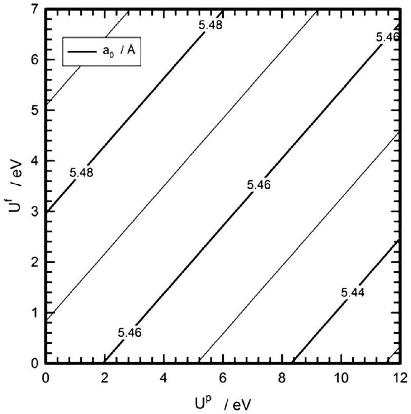
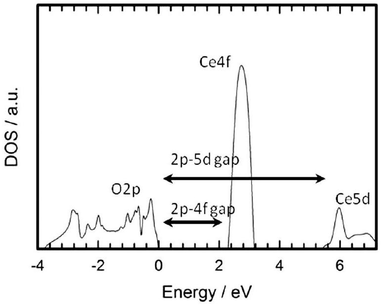
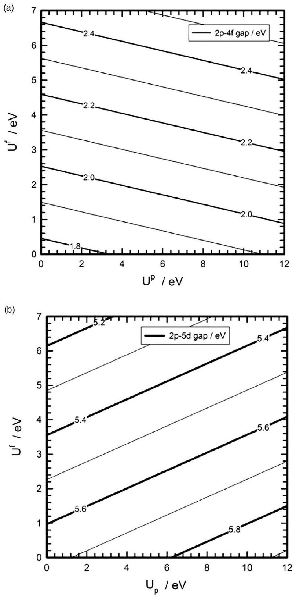
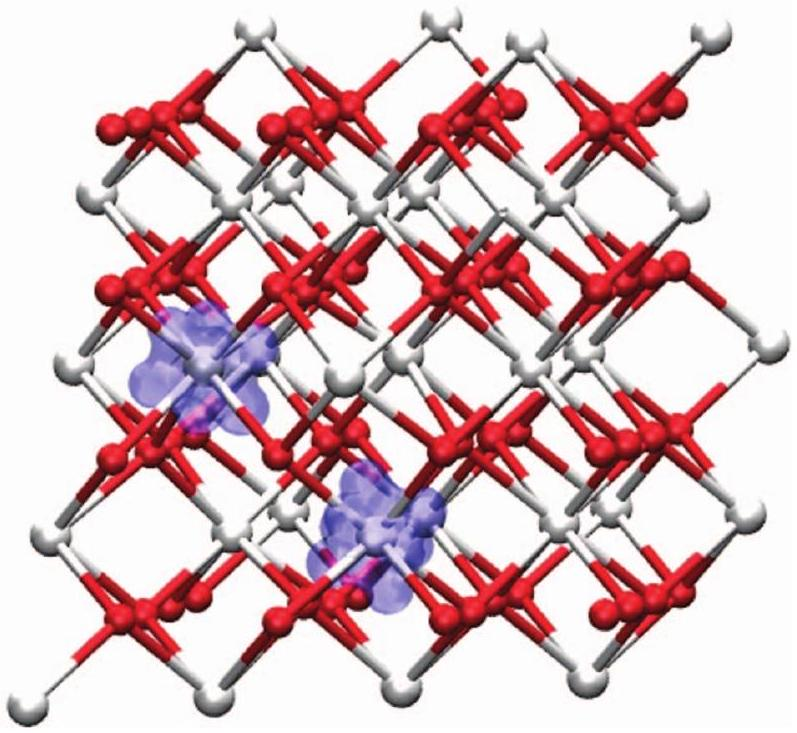

# Communication: Improving the density functional theory+U description of CeO2 by including the contribution of the O 2p electrons

**Authors:** Jose J. Plata; Antonio M. Marquez; Javier Fdez. Sanz

**Venue:** The Journal of Chemical Physics 136, 041101 (2012)

**DOI / identifier:** 10.1063/1.3678309

**Conversion note:** Reconverted from the original PDF using Mathpix PDF conversion (`md.zip`) on 2026-10-04, replacing the earlier PyMuPDF text extraction. Figure images are stored locally.

José J. Plata; Antonio M. Márquez; Javier Fdez. Sanz

## Articles You May Be Interested In

Effect of Fe doping concentration on photocatalytic performance of $\mathrm{CeO}_{2}$ from DFT insight into analysis
AIP Advances (December 2019)
The role of the cationic Pt sites in the adsorption properties of water and ethanol on the $\mathrm{Pt}_{4} / \mathrm{Pt}(111)$ and $\mathrm{Pt}_{4} / \mathrm{CeO}_{2}(111)$ substrates: A density functional theory investigation
J. Chem. Phys. (September 2016)

On the adsorption and formation of Pt dimers on the $\mathrm{CeO}_{2}(111)$ surface
J. Chem. Phys. (December 2011)

# Communication: Improving the density functional theory+U description of $\mathbf{C e O}_{\mathbf{2}}$ by including the contribution of the O 2p electrons 

José J. Plata, Antonio M. Márquez, and Javier Fdez. Sanz ${ }^{\mathbf{a})}$ Departamento de Química Física, Facultad de Química, Universidad de Sevilla, 41012 Sevilla, Spain

(Received 7 November 2011; accepted 3 January 2012; published online 23 January 2012)

#### Abstract

Density functional theory (DFT) based approaches within the local-density approximation or generalized gradient approximation frameworks fail to predict the correct electron localization in strongly correlated systems due to the lack of cancellation of the Coulomb self-interaction. This problem might be circumvented either by using hybrid functionals or by introducing a Hubbard-like term to account for the on site interactions. This latter $\mathrm{DFT}+U$ approach is less expensive and therefore more practical for extensive calculations in solid-state computational simulations. By and large, the $U$ term only affects the metal electrons, in our case the Ce $4 f$ ones. In the present work, we report a systematic analysis of the effect of adding such a $U$ term also to the oxygen $2 p$ electrons. We find that using a set of $U^{f}=5 \mathrm{eV}$ and $U^{p}=5 \mathrm{eV}$ effective terms leads to improved description of the lattice parameters, band gaps, and formation and reduction energies of $\mathrm{CeO}_{2}$. © 2012 American Institute of Physics. [doi:10.1063/1.3678309]

Cerium oxides constitute a class of materials widely used in catalysis both as support and active phases. Typical examples of industrial applications are the three-way catalysts in automotive catalytic converters, fluid-cracking catalysts in refineries, and ethylbenzene dehydrogenation in the production of styrene. ${ }^{1}$ Either $\mathrm{CeO}_{2}$ or non-stoichiometric $\mathrm{CeO}_{2-\mathrm{x}}$, hereafter referred to generically as ceria, are also an active component in a number of processes such as low-temperature CO and VOC oxidation catalysts, wet-oxidation of organic pollutants in water, hydrocarbon reforming and the water-gas-shift reaction. Although the promoting effect of ceria was initially attributed to the enhancement of the metal dispersion and the stabilization towards thermal sintering, ${ }^{2,3}$ subsequent work has shown that ceria can act as a chemically active component as well, working as an oxygen reservoir able to deliver it in the presence of reductive gases and to incorporate it upon interaction with oxidizing gases. ${ }^{4-6}$

The broad use in heterogeneous catalysis of ceria relies on its facile $\mathrm{Ce}^{3+} \leftrightarrow \mathrm{Ce}^{4+}$ redox conversion; ${ }^{7}$ however, the adequate description of the electronic configuration of $\mathrm{Ce}^{3+}$ ions constitutes a challenge in density functional based theoretical chemistry due to the strongly correlated nature of the $4 f$ electrons. Indeed, the $4 f$ electrons in $\mathrm{Ce}_{2} \mathrm{O}_{3}$ are localized and the material behaves like a typical antiferromagnetic Mott-Hubbard insulator. ${ }^{8}$ However, due to the well-known lack of cancellation of the Coulomb self-interaction, density functional theory (DFT) approaches within the local-density approximation (LDA) or generalized gradient approximation (GGA) frameworks predict metallic behavior. ${ }^{9-16}$ To circumvent this problem within the DFT framework, the use of hybrid functionals, has been recently reported using both plane waves and Gaussian-Type Orbitals (GTO) as basis set. ${ }^{13,17,18}$ Such functionals, in particular HSE, PBE0, and B1-WC, are

[^0]found to correctly reproduce lattice constants and band gaps, although its general use is limited by the high computational cost involved in extensive solid state (periodic) calculations. That is why a more pragmatic but much less computationally demanding approach that makes use of a Hubbard-like term, $U$, to account for the strong on-site Coulomb interactions is generally used in surface reactivity studies. The choice of $U$ is a subtle point, as it has to be large enough to properly localize the $4 f$ electron of $\mathrm{Ce}^{3+}$, but without introducing undesired artifacts, such as overestimated band-gaps. Usually its value is selected by fitting a given property, ${ }^{11,12}$ from linear-response calculations, ${ }^{19,20}$ or even on a self-consistent basis, ${ }^{21,22}$ although, as suggested by Castleton et al., ${ }^{15}$ the optimal $U$ value might be different for different properties under study. For instance, let us consider the case of $\mathrm{CeO}_{2}$ fluorite structure for which the experimental lattice parameter value is $a_{0} \approx 5.41 \text{Å}$ (5.406 Å (Ref. 23) or 5.411 Å (Ref. 24)). The LDA+U ( $U_{\text {eff }}$ $=5.30 \mathrm{eV}$ ) value is $a_{0}=5.40 \text{Å}$, in good agreement with the experiment, while GGA $\left(\mathrm{PBE}+\mathrm{U}, U_{\text {eff }}=4.5 \mathrm{eV}\right)($ Ref. 13 $)$ moderately overestimates it: $a_{0}=5.49 \text{Å}$. This $1.3 \%$ error of the GGA represents a 4.5\% increase in the equilibrium volume and it has been shown to be critical in the determination of the charge state of gold atoms deposited on $\mathrm{CeO}_{2}$ (111) surfaces. ${ }^{25-27}$

In spite of these limitations, the $\mathrm{DFT}+U$ is currently the method of choice in the analysis of structure and reactivity of surfaces of reducible metal oxides, in particular in ceria, where including the $U$ Ce $4 f$ term provides a consistent treatment of reduced Ce ions. The common approach to setup $\mathrm{DFT}+U$ calculations in a metal oxide is to select a $U$ parameter for the metal ( $U_{\text {eff }}=4.5-5.5 \mathrm{eV}$ in the case of Ce $4 f$ orbitals) and to perform the calculations at just a little extra cost. Yet, the price to pay concerns not only some inaccuracies in the structure but also in the energetics as will be shown later. Additional effects might be introduced, in particular the inter-site correction, or DFT+U+V approach, lately
implemented by Campo et al., ${ }^{28}$ and successfully applied to NiO among other materials. Recently Park et al., ${ }^{29}$ based on earlier ideas of Nekrasov et al., ${ }^{30}$ showed that, in the case of reduced titania, adding a correction on the oxygen $2 p$ orbitals dramatically improved the description. By employing the socalled LDA+U ${ }^{d}+U^{p}$ approach, systematic shifts for both the valence and conduction bands were observed. In the present communication, we extend these ideas to cerium oxide with the aim to estimate a set of $U_{\text {eff }}$ parameters for both the $\mathrm{Ce} 4 f$ and $\mathrm{O} 2 p$ electrons that could improve the GGA+U description of the dioxide and sesquioxide.

Periodic DFT+U calculations were carried out with the Vienna ab initio simulation package (VASP). ${ }^{31-33}$ This code solves the Kohn-Sham equations for the valence electron density within a plane wave basis set and makes use of the projector augmented wave (PAW) method to describe the interaction between the valence electrons and the atomic cores. ${ }^{34,35}$ The valence electron density is defined by the twelve ( $5 s^{2} 5 p^{6}$ $6 s^{2} 5 d^{1} 4 f^{1}$ ) electrons of each Ce atom and the six $\left(2 s^{2} 2 p^{4}\right)$ electrons of each O atom. The plane-wave expansion includes all plane waves with kinetic energy smaller than a cut-off value set to 500 eV, which ensures adequate convergence with respect to the basis set.

The GGA functional proposed by Perdew et al. (PW91) (Refs. 36 and 37) was selected. The Hubbard-like term was introduced according to the formalism due to Dudarev et al., ${ }^{38}$ which makes use of a single $U_{\text {eff }}$ parameter, hereafter denoted simply as $U^{f}$ and $U^{p}$, to design the effective values used for the Ce $4 f$ and $\mathrm{O} 2 p$ electrons, respectively. $\mathrm{CeO}_{2}$ and $\mathrm{Ce}_{2} \mathrm{O}_{3}$ were represented by minimal 1 × 1 × 1 cells. For the numerical integration within the Brillouin zone, Monkhorst-Pack generated grids of special $k$-points were used: $12 \times 12 \times 12$ for $\mathrm{CeO}_{2}$ and $12 \times 12 \times 6$ for $\mathrm{Ce}_{2} \mathrm{O}_{3}$. ${ }^{39}$

We start our analysis by exploring the behavior of the GGA $+U^{f}+U^{p}$ approach in the description of the lattice parameters in the $\mathrm{CeO}_{2}$ fluorite type structure. In a preliminary step, we examined the variations of the lattice constant $a_{0}$ when the U parameters are systematically set to $U^{f}=3,4.5$, 5,6 y 7 eV, and $U^{p}=0,3,4,5,6,7,8,9$ y 12 eV as depicted in Figure 1. In general for a given $U^{f}$, increasing $U^{p}$ leads to smaller values $a_{0}$, closer to the experimental value of $5.41 \text{Å}$. For instance, the set $U^{f}=5 \mathrm{eV}$ and $U^{p}=12 \mathrm{eV}$ (hereafter, we will denote this couple of values by just the figures, i.e., in this case: $5+12$ ) leads to $a_{0}=5.45 \text{Å}$, better than the ( $5+0$ ) result of $5.48 \text{Å}$, but still overestimated. In contrast, for a given $U^{p}$, increasing the value of $U^{f}$ also increases the lattice parameter in agreement with that observed for the case in which $U^{p}=0 .{ }^{12}$ For the sake of comparison, we have gathered in Table I a series of values from this work and other taken from the literature. Any way, the conclusion to be drawn from this systematic analysis is that the inclusion of an additional Hubbard-like on-site parameter on the $\mathrm{O} 2 p$ electrons slightly affects the $\mathrm{CeO}_{2}$ structure, and only relatively large values of $U^{p}$ are able to reduce the $a_{0}$ by a few hundredths of Å.

Let us now analyze the effect of the $U^{p}$ parameter on the band gaps of $\mathrm{CeO}_{2}$, a well-know issue as GGA approaches tend to underestimate the band gaps. In Figure 2, the DOS for $\mathrm{CeO}_{2}$ is depicted together with the gaps labeling, whose

FIG. 1. Dependency of the $\mathrm{CeO}_{2}$ lattice parameter, $a_{0}$, on the $U^{f}$ and $U^{p}$ values.

evolution against the $U$ values is plotted in Figure 3. Starting with the $2 p-4 f$ gap, one can see that for a given $U^{f}$, increasing $U^{p}$ also increases the gap. For the set (5+5) the gap is 2.3 eV, still below the experimental value that is in the 2.6-3.9 eV range. ${ }^{40}$ The behavior observed for the $2 p-5 d$ gap is essentially the same, as it rises when the value of $U^{p}$ increases. For the couple (5+5) this band gap amounts to 5.4 eV, once again smaller than the experimental value of 6-8 eV. ${ }^{40,41}$

Although the above discussion seems to suggest that the larger the $U^{p}$ value, the shorter the lattice constant of $\mathrm{CeO}_{2}$, the larger the band gaps, and consequently the better the agreement, one can wonder whether such high values are not penalizing the description of other properties that we can look at, namely its formation and reduction energies, as well as the cell parameters of $\mathrm{Ce}_{2} \mathrm{O}_{3}$. To this aim, we have first

TABLE I. Calculated and experimental lattice parameters (in Å) for $\mathrm{CeO}_{2}$ and $\mathrm{Ce}_{2} \mathrm{O}_{3}$.
| GGA $+\left(U^{f}+U^{p}\right)$ | $\mathrm{CeO}_{2}$ $\mathrm{a}_{0}$ | $\mathrm{Ce}_{2} \mathrm{O}_{3}$ |  | References |
| :--- | :--- | :--- | :--- | :--- |
|  |  | $\mathrm{a}_{0}$ | $\mathrm{c}_{0}$ |  |
| (3+0) | 5.48 | 3.92 | 6.08 | This work |
| (5+0) | 5.49 | 3.93 | 6.08 |  |
| (3+5) | 5.46 | 3.91 | 6.08 |  |
| (5+5) | 5.47 | 3.90 | 6.05 |  |
| (5+6) | 5.47 | 3.90 | 6.06 |  |
| (5+12) | 5.45 | 3.88 | 6.01 |  |
| (7+7) | 5.48 | 3.91 | 6.04 |  |
| (4.5+0) | 5.48 | 3.92 | 6.08 | [12] |
| PBE(4.5+0) |  | 3.87 | 5.93 | [14] |
| HSE | 5.41 | 3.87 | 6.06 | [13] |
| PBE0 | 5.39 | 3.87 | 6.07 | [13] |
|  | 5.40 | 3.86 | 6.04 | [18] |
| B1-WC | 5.38 | 3.84 | 5.93 | [18] |
| Experiment | 5.41 | 3.89 | 6.06 | [23 and 24] |

FIG. 2. Total density of states (DOS) for $\mathrm{CeO}_{2}$ with the definition of the band gaps. Obtained with the (5+5) set.

FIG. 3. Dependency of the $\mathrm{CeO}_{2}$ band gaps on the $U^{f}$ and $U^{p}$ values.

TABLE II. Energy (eV) of $\mathrm{CeO}_{2}$ formation and its reduction: $\mathrm{CeO}_{2} \rightarrow$ $\mathrm{Ce}_{2} \mathrm{O}_{3}+1 / 2 \mathrm{O}_{2}$.
| Method | $-\mathrm{E}_{\text {form }}$ | $\mathrm{E}_{\text {red }}$ | References |
| :--- | :--- | :--- | :--- |
| (5+0) | 9.79 | 4.83 | This work |
| (3+5) | 10.09 | 3.03 |  |
| 5+5 | 9.04 | 4.01 |  |
| 5+6 | 8.88 | 3.94 |  |
| 5+12 | 7.84 | 3.46 |  |
| PBE+U |  | 2.29 | [13] |
| PBE0 | 11.15 | 3.14-3.66 | [13 and 18] |
| Experiment | 10.44 | 3.99 | [42] |

estimated these energies for a series of $U^{f}$ and $U^{p}$ figures as reported in Table II. As can be seen, compared to the experimental formation energy of $-10.44 \mathrm{eV},{ }^{42}$ the theoretical estimates agree reasonably well, although they are quite sensitive to the $U$ parameters. At first glance, the $(3+5)$ set would be the choice, however, taking in to account the reduction energies, the (5+5) and (5+6) pairs seem to be more adequate. It is worth to note that in contrast with the behavior observed with gaps and lattice parameters, increasing $U^{p}$ beyond 5-6 eV decreases these energies, the description getting worse. We can now analyze how the variation of $U$ parameters affects the lattice constants of the sesquioxide $\mathrm{Ce}_{2} \mathrm{O}_{3}$. The trends observed are similar to those found in $\mathrm{CeO}_{2}$, thus for a given $U^{p}$ (for instance $U^{p}=0$ ) increasing values of $U^{f}$ lead to larger $a_{0}$, with $c_{0}$ practically unchanged. In contrast, for a given $U^{f}$, increasing $U^{p}$ decreases $a_{0}$. For instance, going from $(3+0)$ to (3+5) decrease $a_{0}$ from 3.92 to $3.91 \text{Å}$. Also, on going from $(5+5)$ to $(5+12) a_{0}$ decreases from 3.90 to $3.88 \text{Å}$, and $c_{0}$ from 6.05 to $6.01 \text{Å}$. Compared to the experimental values 3.89 and $6.06 \text{Å}$, it appears that the couples $(5+5)$ and $(5+6)$ perform reasonably well.

A further question that might be examined concerns the oxygen vacancy formation energy, an issue that has deserved considerable theoretical work, ${ }^{43}$ and that, besides the theoretical approach itself, needs to deal with the defect concentration. To this aim, we used a larger cell consisting of $32 \mathrm{CeO}_{2}$ units, and in this case the Brillouin zone was integrated over a $2 \times 2 \times 2$ grid of special k-points. Using the (5+5) couple, the calculations were done in two steps: in the first one, the four Ce atoms around the vacancy were kept to be symmetrically equivalent obtaining a vacancy formation energy of 3.05 eV. This delocalized structure was then allowed to relax leading to a more stable configuration in which two Ce atoms neighboring the hole were bearing one $4 f$ electron each. This localized structure was found to be more stable, the vacancy formation energy being 2.64 eV, significantly lower than that estimated by Nolan et al., ${ }^{44} 3.39$ eV, using the same functional (PW91) and also the same supercell $\left(\mathrm{Ce}_{32} \mathrm{O}_{64}\right)$, with a $U^{f}$ of 5 eV. It appears then that the use of the $U^{p}$ parameter in this case decreases this energy by a 20\%. Our value is also close to that recently reported by Kehoe et al., ${ }^{45} 2.23$ eV, using a very similar theoretical setup. It should be noted that them all are underestimated when compared with experimentally determined formation energies (3.94-4.98 eV) ${ }^{46}$ as previously reported. ${ }^{47}$ On the other hand, the spin electron density for

FIG. 4. Electron spin density of bulk $\mathrm{CeO}_{2}$ after removing an oxygen atom showing the formation of two $\mathrm{Ce}^{\text {III }}$ centers localized around the vacancy.

this localized structure is shown in Figure 4. The structure around the hole appears to be slightly distorted, with $\mathrm{Ce}^{\text {III }}-\mathrm{O}$ bond distances of $2.42 \text{Å}$, i.e., larger that the non-defective bond distance $(2.36 \text{Å})$.

In summary, the present work shows that, within the DFT+U formalism, adding a Hubbard-like parameter not only to the cerium $4 f$ electrons but also to the oxygen $2 p$ electrons leads to a moderately improved description of some critical aspects that concern structure, electronic properties, and thermochemistry of both $\mathrm{CeO}_{2}$ and $\mathrm{Ce}_{2} \mathrm{O}_{3}$.

This work has been supported by the Spanish Ministry of Science and Innovation, MICINN (Grants MAT2008-04918 and CSD2008-0023). Computational time on the Barcelona Supercomputing Center/Centro Nacional de Supercomputación is gratefully acknowledged. We thank Dr. M. Nolan for helpful discussions.

[^1]${ }^{11}$ D. A. Andersson, S. I. Simak, B. Johansson, I. A. Abrikosov, and N. V. Skorodumova, Phys. Rev. B 75, 035109 (2007).
${ }^{12}$ C. Loschen, J. Carrasco, K. Neyman, and F. Illas, Phys. Rev. B 75, 035115 (2007); Phys. Rev. B 84, 199906(E) (2011).
${ }^{13}$ J. L. F. Da Silva, M. V. Ganduglia-Pirovano, J. Sauer, V. Bayer, and G. Kresse, Phys. Rev. B. 75, 045121 (2007).
${ }^{14}$ J. L. F. Da Silva, Phys. Rev. B 76, 193108 (2007).
${ }^{15}$ C. W. M. Castleton, J. Kullgren, and K. J. Hermansson, J. Chem. Phys. 127, 244704 (2007).
${ }^{16}$ G. Kresse, P. Blaha, J. L. F. Da Silva, and M. V. Ganduglia-Pirovano, Phys. Rev. B 72, 237101 (2005).
${ }^{17}$ P. J. Hay, R. L. Martin, J. Uddin, and G. E. Scuseria, J. Chem. Phys. 125, 034712 (2006).
${ }^{18}$ J. Graciani, A. M. Márquez, J. J. Plata, Y. Ortega, N. C. Hernández, C. Zicovich-Wilson, M. Alessio, and J. F. Sanz, J. Chem. Theory Comput. 7, 56 (2011).
${ }^{19}$ S. Fabris, S. de Gironcoli, S. Baroni, G. Vicario, and G. Balducci, Phys. Rev. B 72, 237102 (2005).
${ }^{20}$ M. Cococcioni and S. de Gironcoli, Phys. Rev. B 71, 035105 (2005).
${ }^{21}$ H. J. Kulik, M. Cococcioni, D. A. Scherlis, and N. Marzari, Phys. Rev. Lett. 97, 103001 (2006).
${ }^{22}$ H. Hsu, K. Umemoto, M. Cococcioni, and R. Wentzcovitch, Phys. Rev. B 79, 125124 (2009).
${ }^{23}$ S. J. Duclos, Y. K. Vohra, A. L. Ruoff, A. Jayaraman, and G. P. Espinosa, Phys. Rev. B 38, 7755 (1988).
${ }^{24}$ L. Gerward and J. S Olsen, Powder Diffr. 8, 127 (1993).
${ }^{25}$ M. M. Branda, N. C. Hernández, J. F. Sanz, and F. Illas, J. Phys. Chem. C 114, 1934 (2010).
${ }^{26}$ N. C. Hernández, R. Grau-Crespo, N. H. de Leeuw, and J. F. Sanz, Phys. Chem. Chem. Phys. 11, 5246 (2009).
${ }^{27}$ M. M. Branda, N. J. Castellani, R. Grau-Crespo, N. H. de Leeuw, N. C. Hernandez, J. F. Sanz, K. M. Neyman, and F. Illas, J. Chem. Phys. 131, 94702 (2009).
${ }^{28}$ V. L. Campo, Jr. and M. Cococcioni, J. Phys.: Condens. Matter 22, 055602 (2010).
${ }^{29}$ S. G. Park, B. Magyari-Köpe, and Y. Nishi, Phys. Rev. B 82, 115109 (2010).
${ }^{30}$ I. A. Nekrasov, M. A. Korotin, and V. I. Anisimov, e-print arXiv:cond-mat/0009107v1.
${ }^{31}$ G. Kresse and J. Hafner, Phys. Rev. B 47, 558 (1993).
${ }^{32}$ G. Kresse and J. Hafner, Phys. Rev. B 48, 13115 (1993).
${ }^{33}$ G. Kresse and J. Hafner, Phys. Rev. B 49, 14251 (1994).
${ }^{34}$ P. Blochl, Phys. Rev. B 50, 17953 (1994).
${ }^{35}$ G. Kresse and D. Joubert, Phys. Rev. B 59, 1758 (1999).
${ }^{36}$ J. P. Perdew, J. A. Chevary, S. H. Vosko, K. A. Jackson, M. R. Pederson, D. J. Singh, and C. Fiolhais, Phys. Rev. B 46, 6671 (1992).
${ }^{37}$ J. P. Perdew, J. A. Chevary, S. H. Vosko, K. A. Jackson, M. R. Pederson, D. J. Singh, and C. Fiolhais, Phys. Rev. B 48, 4978 (1993).
${ }^{38}$ S. L Dudarev, G. A. Botton, S. Y. Savrasov, C. J. Humphreys, and A. P. Sutton, Phys. Rev. B 57, 1505 (1998).
${ }^{39}$ H. J. Monkhorst and J. D. Pack, Phys. Rev. B 13, 5188 (1976).
${ }^{40}$ E. Wuilloud, B. Delley, W. D. Schneider, and Y. Baer, Phys. Rev. Lett. 53, 202 (1984).
${ }^{41}$ F. Marabelli and P. Wachter, Phys. Rev. B 36, 1238 (1987).
${ }^{42}$ CRC Handbook of Chemistry and Physics, 9th ed., edited by D. R. Lide (CRC Press, Boca Raton, Florida, USA, 2009).
${ }^{43}$ M. V. Ganduglia-Pirovano, A. Hofmann, and J. Sauer, Surf. Sci. Rep. 62, 219-270 (2007).
${ }^{44}$ M. Nolan, J. E. Fearon, and G. W. Watson, Solid State Ion. 177, 3069 (2006).
${ }^{45}$ A. B. Kehoe, D. O. Scanlon, and G. W. Watson, Chem. Mater. 23, 4464 (2011).
${ }^{46}$ Y. M. Chiang, E. B. Lavik and D. A. Blom, Nanostruct. Mater. 9, 633 (1997).
${ }^{47}$ M. Nolan, S. Parker, and G. W. Watson, Surf. Sci. 595, 223 (2005).

[^0]:    ${ }^{\text {a })}$ Author to whom correspondence should be addressed. Electronic mail: sanz@us.es.
[^1]:    ${ }^{1}$ A. Trovarelli, Catalysis by Ceria and Related Materials (Imperial College Press, London, UK, 2002).
    ${ }^{2}$ R. Dictor and S. Roberts, J. Phys. Chem. 93, 5846 (1989).
    ${ }^{3}$ E. C. Su and W. G. Rothschild, J. Catal. 99, 506 (1986).
    ${ }^{4}$ H. C. Yao and Y. F. Yu Yao, J. Catal. 86, 254 (1984).
    ${ }^{5}$ B. Engler, E. Koberstein, and P. Schubert, Appl. Catal. 48, 71 (1989).
    ${ }^{6}$ T. Miki, T. Ogawa, M. Haneda, N. Kakuta, A. Ueno, S. Tateishi, S. Matsuura, and M. Sato, J. Phys. Chem 94, 6464 (1990).
    ${ }^{7}$ A. Trovarelli, C. de Leitenburg, M. Boaro, and G. Dolcetti, Catal. Today 50, 353 (1999).
    ${ }^{8}$ A. Prokofiev, A. Shelykh, and B. Melekh, J. Alloys Compd. 242, 41 (1996).
    ${ }^{9}$ Z. Yang, T. K. Woo, M. Baudin, and K. Hermansson, J. Chem. Phys. 120, 7741 (2004).
    ${ }^{10}$ M. Nolan, S. Grigoleit, D. C. Sayle, S. C. Parker, and G. W. Watson, Surf. Sci. 576, 217 (2005).

