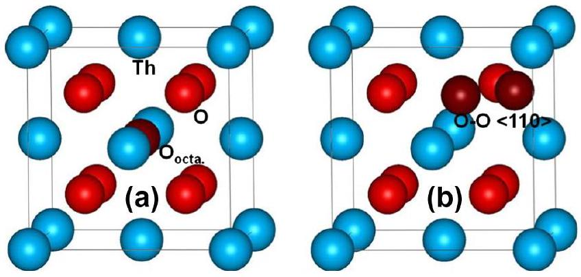
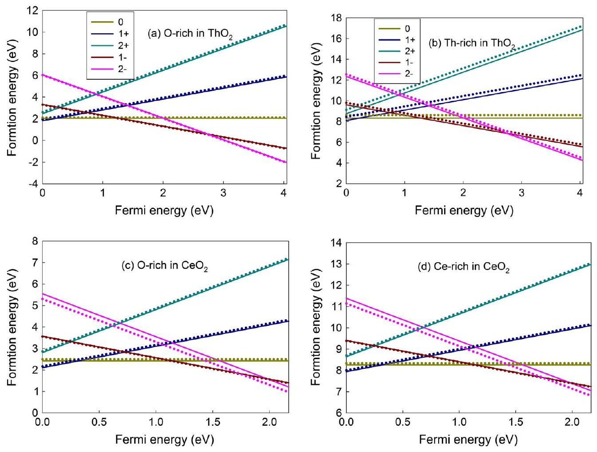
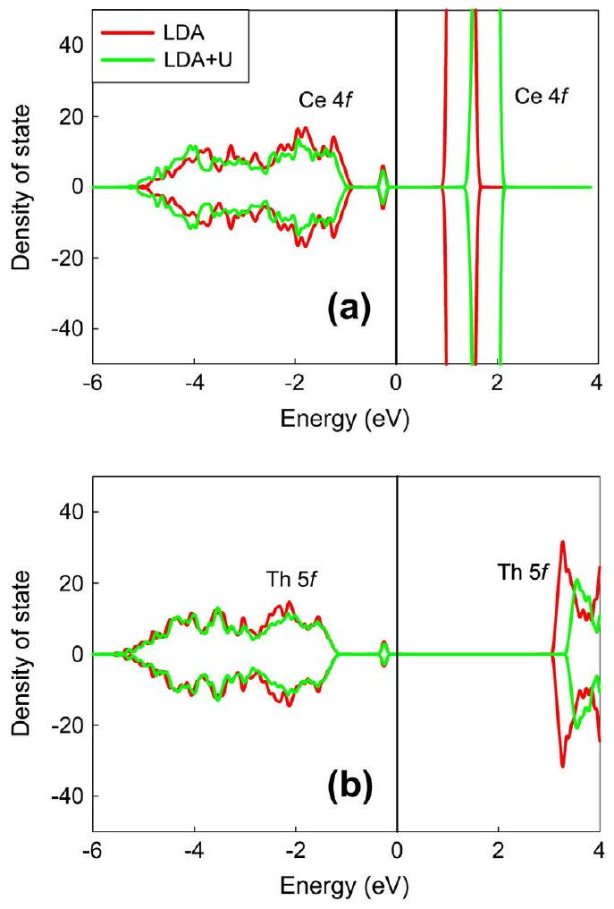
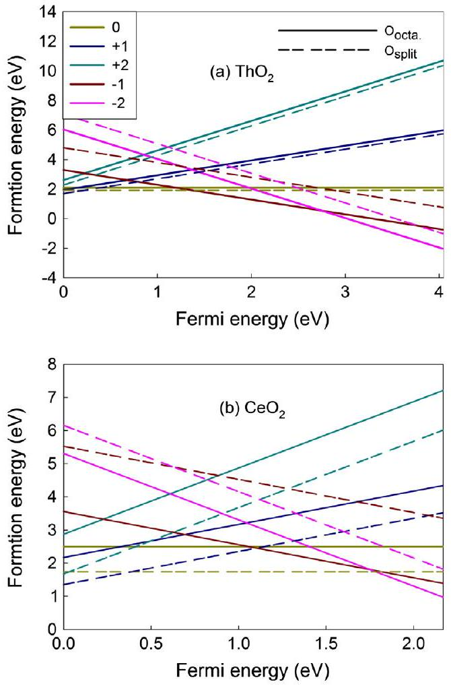
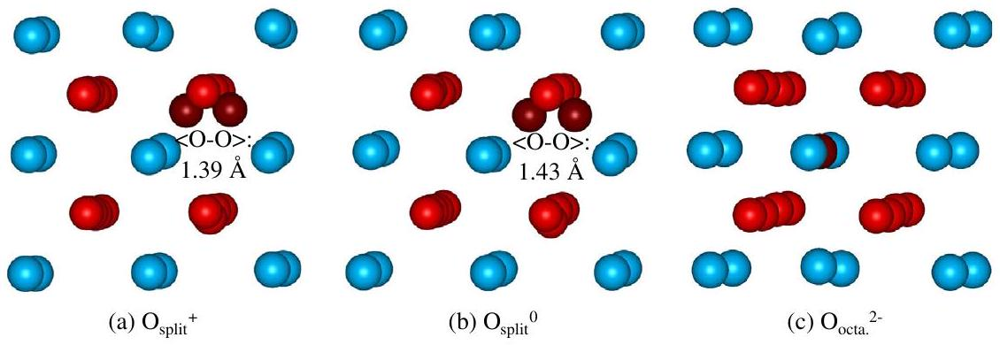
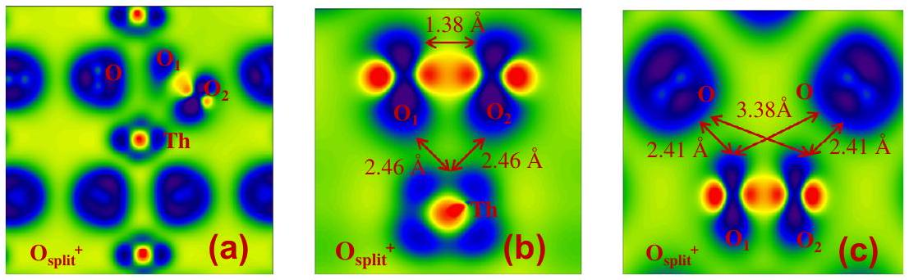
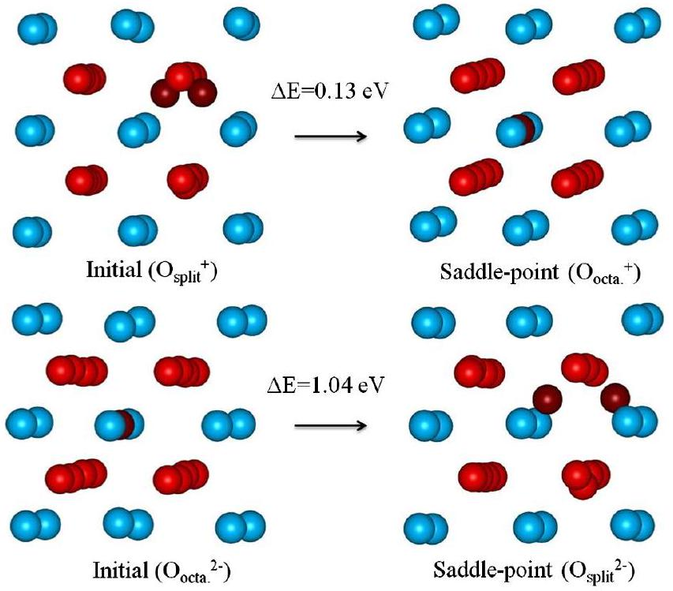

# Stability and migration of charged oxygen interstitials in $\mathrm{ThO}_{2}$ and $\mathrm{CeO}_{2}$ 

**Authors:** H. Y. Xiao; Y. Zhang; W. J. Weber

**Venue:** Acta Materialia 61, 7639-7645 (2013)

**DOI / identifier:** 10.1016/j.actamat.2013.09.001

**Conversion note:** Generated from the downloaded PDF using the Mathpix PDF conversion utility on 2026-09-02. Mathpix figure crops were downloaded into the local `images/` folder for offline use.

---

H.Y. Xiao ${ }^{\mathrm{a}, *}$, Y. Zhang ${ }^{\mathrm{b}, \mathrm{a}}$, W.J. Weber ${ }^{\mathrm{a}, \mathrm{b}}$ ${ }^{\mathrm{a}}$ Department of Materials Science \& Engineering, University of Tennessee, Knoxville, TN 37996, USA ${ }^{\mathrm{b}}$ Materials Science \& Technology Division, Oak Ridge National Laboratory, Oak Ridge, TN 37831, USA

Received 27 June 2013; received in revised form 9 August 2013; accepted 4 September 2013
Available online 30 September 2013

#### Abstract

Density functional theory calculations have been carried out to study the stability and migration of charged oxygen interstitials in $\mathrm{ThO}_{2}$ and $\mathrm{CeO}_{2}$. The calculations demonstrate that the oxygen interstitial is likely to lose electrons under $p$-type conditions and gain electrons under $n$-type conditions. Neutral $\left(\mathrm{O}_{\text {split }}^{0}\right)$ and singly positive $\left(\mathrm{O}_{\text {split }}^{+}\right) \mathrm{O}-\mathrm{O}\langle 110\rangle$ split interstitials, and doubly negative octahedral $\left(\mathrm{O}_{\text {octa. }}^{2-}\right)$ oxygen interstitial are found to be the lowest-energy configurations within a certain Fermi energy range. In both oxides, the $\mathrm{O}_{\text {split }}^{0}$ is the most mobile, and the migration energies of the split oxygen interstitials in $\mathrm{ThO}_{2}$ are lower than in $\mathrm{CeO}_{2}$, indicating higher oxygen interstitial mobility in $\mathrm{ThO}_{2}$ than in $\mathrm{CeO}_{2}$.

© 2013 Acta Materialia Inc. Published by Elsevier Ltd. All rights reserved.
Keywords: DFT; Charged defect; Oxygen interstitial; Stability and migration

## 1. Introduction

Fluorite-structured oxides such as $\mathrm{UO}_{2}, \mathrm{PuO}_{2}$ and $\mathrm{ThO}_{2}$ are important nuclear fuels in fission reactors [1,2], where they are exposed to irradiation damage from neutrons, high-energy charged particles (e.g. fission products) and alpha decay. Such irradiation damage produces atomic point defects, as well as electrons and holes that can trap point defects. The point defects contribute to the microstructural evolution in nuclear fuel, although many of these defects recombine directly at elevated temperatures [3]. The mobility of these primary radiation defects plays an important role in the microstructural evolution, and secondary diffusion-controlled reactions between defects can result in the formation of defect clusters, dislocation loops and voids. For example, the so-called Willis cluster that is formed by oxygen interstitial aggregation has been observed in $\mathrm{UO}_{2}$ experimentally [4]. Oxygen interstitial dislocation loops lying on the \{111\} plane have been observed by Yasunaga et al. [5] in $\mathrm{CeO}_{2}$ irradiated with

[^0]an electron beam. The formation of such defects may ultimately lead to the degradation of thermal and mechanical properties of nuclear materials [6]. In addition to nuclear applications, oxygen interstitial defects have been suggested to provide oxygen mobility that facilitates the oxygen storage capacity of $\mathrm{CeO}_{2}$ in catalytic converters [3,7]. Also, in systems such as $\mathrm{ThO}_{2+x}$, the anion-to-cation ratio has a strong effect on the physical and chemical properties, e.g. thermal conductivity [8]. Understanding the stability and migration of oxygen interstitials is thus of critical importance for the evaluation of material properties and performance.

In the past few decades, extensive studies of oxygen interstitial formation and transport in $\mathrm{UO}_{2}$ have been carried out [1,9-13]. $\mathrm{ThO}_{2}$ and $\mathrm{CeO}_{2}$, on the other hand, have received relatively less attention [1,14,15]. In these studies, the point defects were treated as neutral charge states. However, it is well known that point defects in semiconductors and ceramics may be electrically charged due to doping, impurities or nonstoichiometry. For example, the oxygen interstitial in $\mathrm{PuO}_{2.25}$ is found to be singly charged $\left(\mathrm{O}^{-}\right)$[16]. Under irradiation, atomic defects are produced by displaced atoms and even greater numbers of electrons
and holes are created by ionization. Thus, even if neutral defects are created under irradiation, the trapping of ionization-induced electrons and holes can result in the formation of charged defects, as in the case of yttria-stablized $\mathrm{ZrO}_{2}$ [17]. These charged defects can affect defect structure, trapping rates of electrons and holes, defect formation and migration energies [18], and the kinetics of microstructure evolution, as in the faster grain growth observed in nanocrystalline cubic $\mathrm{ZrO}_{2}$ under irradiation at cryogenic temperatures compared to higher temperatures [19]. In the case of ZnO, it has been shown that the diffusion mechanism for the oxygen interstitial is dependent on the defect charge state [20]. Other important properties, such as the luminescence quenching rates, may also be influenced by the charge state.

Recently, the charge states of defects in fluorite-structured oxides have gained increasing interest [21-24], but these studies are mainly focused on the formation of charged defects. At present, the stability and migration of charged oxygen interstitials in fluorite-structured oxides, including the migration energies and pathways, has not yet been well studied. In this study, we investigate charged oxygen interstitial formation and migration in $\mathrm{ThO}_{2}$ and $\mathrm{CeO}_{2}$. Here, $\mathrm{CeO}_{2}$ is used as a surrogate material in place of $\mathrm{PuO}_{2}$ for performance evaluation in harsh environments [25-27], because they share the same crystallographic structure, and several thermophysical and chemical properties. Our main aims are: (i) to gain fundamental insight into charged oxygen interstitial behavior in $\mathrm{ThO}_{2}$ and $\mathrm{CeO}_{2}$; (ii) to motivate experimental studies and provide support for their interpretation; and (iii) to provide physical parameters (e.g. defect configurations and energetics) for higherscale modeling of fluorite-structured oxide fuels.

## 2. Computational details

All the calculations were carried out within the density functional theory (DFT) framework using the projectoraugmented wave method, as implemented in the Vienna Ab Initio Simulation Package (VASP) [28]. The exchange-correlation effects were treated by the local-density approximation (LDA) in the Ceperley-Alder parametrization [29], with spin-polarized effects considered. Structural optimizations were carried out at variable cell shape and volume, as well as under the condition that the Hellmann-Feynman force on each atom should be smaller than $0.01 \mathrm{eV} \mathrm{A}^{-1}$. Computations were based on a $2 \times 2 \times 2$ supercell consisting of 96 atoms, with a $4 \times 4 \times 4 k$-point sampling in reciprocal space and a cutoff energy of 550 eV for the plane-wave basis set. Our previous work on oxygen vacancy formation and migration in $\mathrm{CeO}_{2}$ has shown that the Hubbard U correction for the on-site Coulomb interaction must be taken into account due to the existence of $\mathrm{Ce}^{3+}$ [30], which is consistent with other theoretical studies on reduced ceria [31-33]. In this study, plus U correction calculations were also performed to investigate if the Hubbard U correction for Th $5 f$ (or Ce $4 f$ ) electrons is necessary for $\mathrm{ThO}_{2}$ (or $\mathrm{CeO}_{2}$ ) containing an oxygen interstitial. In the LDA + U calculations, the method proposed by Dudarev et al. [34] was used, and effective U values of 4 eV for Th and 6 eV for Ce, obtained from our previous study [30], were employed. The minimum-energy pathways for oxygen interstitial migration in $\mathrm{ThO}_{2}$ and $\mathrm{CeO}_{2}$ were investigated by the climbing-image nudged elastic band method [35].

## 3. Background

For systems with charged defects, spurious electrostatic and elastic interactions between the defect and its periodic images can be large, and the system converges very slowly with respect to the supercell size. To correct the electrostatic effects on the formation energies of charged defects, several approaches have been proposed [36-40]. Here, the screened Madelung-like lattice energy of point defects proposed by Leslie and Gillan [39] is employed, i.e. $E_{\text {corr }}=\frac{q^{2} \alpha_{M}}{2 \varepsilon L}$, where $L=\Omega^{-1 / 3}$ is the linear supercell dimension, $\Omega$ is the volume of the supercell, $\varepsilon$ is the dielectric constant and $\alpha_{M}$ is the appropriate Madelung constant for the respective supercell geometry. Another correction for the charged system is the potential alignment, $\Delta V$, which is used to estimate the valence band maximum (VBM) of the defective supercell. The $\Delta V$ value is obtained by the averaged difference between the local potentials far from the defect in the defective supercell and the corresponding ones in the perfect supercell [41].The defect formation energies are defined by $E_{f}=E_{\text {def }}-E_{\text {perfect }}+n_{i} \mu_{O}+q\left(E_{F}+E_{\text {VBM }}^{\text {bulk }}+\Delta V\right)+E_{\text {corr }}$ [42], where $E_{\text {def }}$ and $E_{\text {perfect }}$ are the total energies of the supercell with and without a defect, respectively, $n_{i}$ is the number of atoms being removed or added, and $\mu_{O}$ is the chemical potential of O . The value of $\mu_{O}$ is obtained under O-rich or M-rich ( $\mathrm{M}=\mathrm{Th}$ or Ce ) conditions. Under O-rich conditions, the experimental chemical potential of $\mathrm{O}\left(\mu_{O}\right)$ from the free $\mathrm{O}_{2}$ molecule is employed [43]; under M-rich conditions, $\mu_{O}$ is obtained by $\mu_{M O_{2}}=\mu_{M}+2 \mu_{O}$, where $\mu_{M O_{2}}$ and $\mu_{M}$ are calculated from the total energies of bulk $\mathrm{MO}_{2}$ and M, respectively. The term in parentheses is the electronic chemical potential that represents the change in energy associated with charged defects. In this term, $E_{F}$ is the Fermi level in the bulk with reference to the VBM, which can vary within the band gap, $E_{V B M}^{\text {bulk }}$ is the energy of the bulk VBM, and $\Delta V$ is the electrostatic potential alignment of the defective structure. The additional charge $q$ is set by adding or removing electrons from the supercell. The last term, $E_{\text {corr }}$, is the first-order Madelung correction energy.

## 4. Results and discussion

### 4.1. Comparison of LDA + U and LDA calculations for oxygen interstitial formation

Pulsed neutron diffraction experiments performed on a nanoscale powder of $\mathrm{CeO}_{2}$ by Mamontov and Egami
revealed oxygen interstitial occupation at the octahedral site of the $\mathrm{CeO}_{2}$ [3]. Our ab initio molecular dynamics simulation of low-energy recoil events in $\mathrm{ThO}_{2}, \mathrm{CeO}_{2}$ and $\mathrm{ZrO}_{2}$ also showed that, under low-energy irradiation, oxygen interstitials generally occupy the octahedral site $\left(\mathrm{O}_{\text {octa }}\right)$. [2]. In addition to this octahedral site, the O-O<110> split interstitial $\left(\mathrm{O}_{\text {split }}\right)$ is also a possible stable defect. These two oxygen interstitial $\left(\mathrm{O}_{\text {int }}\right)$ configurations, as shown in Fig. 1, are considered as the initial configurations in the present work to study charged oxygen interstitial incorporation and migration in $\mathrm{ThO}_{2}$ and $\mathrm{CeO}_{2}$.

To investigate the effect of considering the Hubbard U correction for Th $5 f$ and Ce $4 f$ electrons on the stability of oxygen interstitial in $\mathrm{ThO}_{2}$ and $\mathrm{CeO}_{2}$, the formation energies for the octahedral oxygen interstitials with charge states varying from 2- to 2+ are first calculated by both LDA and LDA + U methods. The variation of the formation energies as a function of the Fermi level with different charge states in both oxides is shown in Fig. 2. Under both O-rich and Th-rich conditions, it appears that consideration of the Hubbard U correction for the Th $5 f$ electrons has only a small influence on the interstitial formation energies in $\mathrm{ThO}_{2}$. In $\mathrm{CeO}_{2}$, the plus U correction for the $\mathrm{Ce} 4 f$ electrons affects the $\mathrm{O}_{\text {octa. }}^{2-}$ interstitial formation under both O- and Ce-rich conditions, which narrows the stability region by ~0.25 eV. The density of state distribution for the $\mathrm{O}_{\text {octa. }}^{2-}$ interstitial in $\mathrm{CeO}_{2}$ and $\mathrm{ThO}_{2}$ obtained by both methods is further analyzed, as illustrated in Fig. 3. It turns out that the standard LDA describes well the splitting of $\mathrm{Ce} 4 f$ and Th $5 f$ electrons into occupied and unoccupied states, and LDA + U only pushes the unoccupied states to a higher energy level. This is different from the case of oxygen vacancy formation in $\mathrm{CeO}_{2}$ [30], for which the Hubbard U correction for the on-site Coulomb interaction is necessary to localize the Ce $4 f$ electrons. For the split oxygen interstitials in both oxides, the LDA + U and LDA methods also predict very similar formation energies, and the $f$ electrons are well localized under standard LDA. Consequently, the plus U correction is not considered in the subsequent calculations, and all the following results and discussions are based on standard LDA calculations.

Fig. 1. Schematic view of (a) octahedral $\left(\mathrm{O}_{\text {octa }}\right)$ and (b) split $\left(\mathrm{O}_{\text {split }}\right)$ oxygen interstitial in $\mathrm{ThO}_{2}$.

### 4.2. Stability of oxygen interstitials

The defect formation energies for octahedral and split oxygen interstitials in $\mathrm{ThO}_{2}$ and $\mathrm{CeO}_{2}$ are presented in Fig. 4a and b, respectively. Because oxygen interstitials are more favorable under O-rich conditions than Th-rich conditions, only the O-rich condition is considered here. In $\mathrm{ThO}_{2}$, it is found that the $\mathrm{O}_{\text {split }}^{+}, \mathrm{O}_{\text {split }}^{0}, \mathrm{O}_{\text {octa. }}^{-}$and $\mathrm{O}_{\text {octa. }}^{2-}$ are the lowest-energy configurations in the Fermi energy ranges 0-0.32, 0.32-1.35, 1.35-2.73 and 2.73-4.04 eV, respectively. The geometrical configurations for the $\mathrm{O}_{\text {split }}^{+}$, $\mathrm{O}_{\text {split }}^{0}$ and $\mathrm{O}_{\text {octa. }}^{2-}$ interstitials in $\mathrm{ThO}_{2}$ are shown in Fig. 5. Our calculations indicate that the stability of oxygen interstitial depends on the charge state, Fermi level and oxygen interstitial configuration. The stability of oxygen interstitial in $\mathrm{ThO}_{2}$ is found to be different from that in $\mathrm{UO}_{2}$ [21,22,44], for which the $\mathrm{O}^{2-}$ interstitial is more stable over most of the Fermi energy range. Such a discrepancy may be caused by the different interactions between the oxygen interstitial and its neighbors.

In $\mathrm{CeO}_{2}$, the $\mathrm{O}_{\text {split }}^{+}, \mathrm{O}_{\text {split }}^{0}$ and $\mathrm{O}_{\text {octa. }}^{2-}$ interstitials are the lowest-energy configurations in the Fermi energy ranges 0-0.39, 0.39-1.76 and 1.76-2.17 eV, respectively, as shown in Fig. 4b. Similar to the case of $\mathrm{ThO}_{2}$, the $\mathrm{O}_{\text {split }}^{+}$interstitial is preferred under $p$-type conditions, where the Fermi level is very close to the valence band maximum, and $\mathrm{O}_{\text {octa. }}^{2-}$ is favored under $n$-type conditions, i.e. as the Fermi level approaches the conduction band minimum. These results suggest that, in both $\mathrm{ThO}_{2}$ and $\mathrm{CeO}_{2}$, the oxygen interstitial is likely to lose electrons under $p$-type conditions and gain electrons under $n$-type conditions, behaving as a donor and acceptor defect, respectively. Erhart et al. [45] also suggested the donor- and acceptor-like characters of the oxygen interstitial atoms in ZnO. It should be pointed out that the singly positive split interstitials are only stable when the Fermi level is very close to the valence band maximum. Bader charge analysis shows that these singly positive split interstitials donate electrons to all of their first-neighboring cations, resulting in a positive charge state of the interstitials. Another finding is that the energy difference between the octahedral and split interstitials with a specific charge state is much smaller in $\mathrm{ThO}_{2}$, and that $\mathrm{O}_{\text {octa. }}^{-}$is one of the lowest-energy configurations within the Fermi energy range in $\mathrm{ThO}_{2}$ but not in $\mathrm{CeO}_{2}$. This suggests despite the fact that $\mathrm{ThO}_{2}$ and $\mathrm{CeO}_{2}$ have the same fluorite-type structure, the size and electronic configuration of the cations may significantly affect the oxygen interstitial stability.

To study the effect of charge states on the interatomic structures, the structural properties for oxygen interstitials with different charge states in both oxides have been further analyzed, as summarized in Table 1. For the octahedral interstitials, the distance between the oxygen interstitial and its neighboring lattice oxygens increases as $q$ increases from 2- to 2+. This is because in $\mathrm{MO}_{2}$ the lattice O ions are negatively charged, and the introduction of negatively or positively charged $\mathrm{O}_{\text {int }}$ will push the nearest lattice oxygens away due to the repulsive interaction, or pull the

Fig. 2. Variation of oxygen interstitial formation energies with Fermi level in (a and b) $\mathrm{ThO}_{2}$ and (c and d) $\mathrm{CeO}_{2}$ under O- and M-rich (M=Th or Ce ) conditions. Solid and dotted lines correspond to the results obtained from LDA + U and LDA calculations, respectively.

Fig. 3. Density of state for $\mathrm{O}_{\text {octa }}^{2-}$. interstitial in (a) $\mathrm{CeO}_{2}$ and (b) $\mathrm{ThO}_{2}$ obtained by LDA and LDA + U calculations. The Fermi level is set at the zero of the energy.

Fig. 4. Oxygen interstitial formation energies as a function of the Fermi energy in (a) $\mathrm{ThO}_{2}$ and (b) $\mathrm{CeO}_{2}$. Solid and dashed lines represent octahedral and split interstitials, respectively.

Fig. 5. Schematic view of geometrical configuration for (a) $\mathrm{O}_{\text {split }}^{+}$, (b) $\mathrm{O}_{\text {split }}^{0}$ and (c) $\mathrm{O}_{\text {octa }}^{2-}$ in $\mathrm{ThO}_{2}$.

Table 1
Geometrical properties for oxygen interstitial in $\mathrm{ThO}_{2}$ and $\mathrm{CeO}_{2}: d\left\langle\mathrm{O}_{\text {int }}-\mathrm{O}_{\text {int }}\right\rangle$ is the $\langle\mathrm{O}-\mathrm{O}\rangle$ bond length of the split interstitial; $d\left\langle\mathrm{O}_{\text {int }}-\mathrm{O}_{\text {lat }}\right\rangle$ is the distance between the interstitial and its neighboring lattice oxygens; and $\Delta V$ is the defect formation volume relative to the perfect volume ( $V_{0}$ ).
|  | $\mathrm{ThO}_{2}$ |  |  | $\mathrm{CeO}_{2}$ |  |  |
| :--- | :--- | :--- | :--- | :--- | :--- | :--- |
|  | $d\left\langle\mathrm{O}_{\text {int }}-\mathrm{O}_{\text {int }}\right\rangle(\AA)$ | $d\left\langle\mathrm{O}_{\text {int }}-\mathrm{O}_{\text {lat }}\right\rangle(\AA)$ | $\Delta V / V_{0}$ (\%) | $d\left\langle\mathrm{O}_{\text {int }}-\mathrm{O}_{\text {int }}\right\rangle(\AA)$ | $d\left\langle\mathrm{O}_{\text {int }}-\mathrm{O}_{\text {lat }}\right\rangle(\AA)$ | $\Delta V / V_{0}$ (\%) |
| $\mathrm{O}_{\text {split }}^{2+}$ | 1.36 | 2.38 | -0.28 | 1.31 | 2.28 | -0.41 |
| $\mathrm{O}_{\text {split }}^{+}$ | 1.38 | 2.41 | 0.22 | 1.35 | 2.35 | 0.20 |
| $\mathrm{O}_{\text {split }}^{0}$ | 1.43 | 2.47 | 0.74 | 1.39 | 2.41 | 0.93 |
| $\mathrm{O}_{\text {split }}^{-}$ | 1.99 | 2.43 | 1.24 | 1.40 | 2.42 | 1.78 |
| $\mathrm{O}_{\text {split }}^{2-}$ | 2.43 | 2.42 | 1.76 | 2.35 | 2.35 | 2.23 |
| $\mathrm{O}_{\text {octa. }}^{2+}$ | - | 2.44 | -0.90 | - | 2.36 | -1.12 |
| $\mathrm{O}_{\text {octa. }}^{+}$ | - | 2.45 | -0.39 | - | 2.37 | -0.46 |
| $\mathrm{O}_{\text {octa. }}^{0}$ | - | 2.47 | 0.14 | - | 2.40 | 0.23 |
| $\mathrm{O}_{\text {octa. }}^{-}$ | - | 2.51 | 0.69 | - | 2.43 | 0.98 |
| $\mathrm{O}_{\text {octa. }}^{2-}$ | - | 2.54 | 1.26 | - | 2.47 | 1.87 |

nearest lattice oxygens closer due to the attractive interaction, respectively. Consequently, positive oxygen interstitials cause volume compression, and neutral or negative oxygen interstitials cause volume expansion. In the case of split interstitials, the $\left\langle\mathrm{O}_{\text {int }}-\mathrm{O}_{\text {int }}\right\rangle$ distance increases as $q$ varies from 2+ to 2-; however, the distances between either $\mathrm{O}_{\text {int }}$ of the split interstitials and their neighboring lattice oxygens do not exhibit a singular change. Furthermore, the introduction of the $\mathrm{O}_{\text {split }}^{2+}$ into the system causes volume compression, and the split interstitials with other charge states cause volume swelling. Obviously, the charge states have considerable effects on the geometrical structures for both split and octahedral interstitials.

For some split interstitials in $\mathrm{ThO}_{2}$ and $\mathrm{CeO}_{2}$, it is noted that the $\left\langle\mathrm{O}_{\text {int }}-\mathrm{O}_{\text {int }}\right\rangle$ bond distance is close to that of a free $\mathrm{O}_{2}$ molecule, i.e. $1.21 \AA$. However, the O-O split interstitial interacts with its neighboring atoms, and does not form an $\mathrm{O}_{2}$ molecule. Fig. 6 shows the charge density distribution for the $\mathrm{O}_{\text {split }}^{+}$interstitial in $\mathrm{ThO}_{2}$. The $\left\langle\mathrm{Th}-\mathrm{O}_{1}\right\rangle$ and $\langle\mathrm{Th}- \left.\mathrm{O}_{2}\right\rangle$ bond lengths are each $2.46 \AA$. Each $\mathrm{O}_{\text {int }}$ in the split interstitial interacts with two lattice oxygens at bond distances of 2.41 and $3.38 \AA$, respectively. The average Bader charge of the two oxygens in the split interstitial is +0.58 |e|, as compared with the charge of ±0.16 |e| in a free $\mathrm{O}_{2}$, suggesting that the two oxygens in the split interstitial do not form a free molecule. Our theoretical prediction of the structural and electronic properties of the $\mathrm{O}_{\text {split }}^{+}$provides fundamental information for the design and interpretation of planned low-temperature irradiation experiments in these fluorite-structured oxides.

Fig. 6. Charge density distribution for $\mathrm{O}_{\text {split }}^{+}$in $\mathrm{ThO}_{2}$ projected on planes (a) containing interstitials and their first neighboring cations and anions, (b) containing interstitials and their first neighboring cations and (c) containing interstitials and their first neighboring anions.

Table 2
Energy barrier for oxygen interstitial migration in $\mathrm{ThO}_{2}$ and $\mathrm{CeO}_{2}$.
|  | $\mathrm{ThO}_{2}$ | $\mathrm{CeO}_{2}$ |
| :--- | :--- | :--- |
| $\mathrm{O}_{\text {split }}^{+}$ | 0.13 | 0.56 |
| $\mathrm{O}_{\text {split }}^{0}$ | 0.32 | 0.76 |
| $\mathrm{O}_{\text {octa. }}^{-}$ | 0.98 | - |
| $\mathrm{O}_{\text {octa. }}^{2-}$ | 1.04 | 0.80 |

### 4.3. Oxygen interstitial migration

The calculated energy barriers for oxygen interstitial migration in $\mathrm{ThO}_{2}$ and $\mathrm{CeO}_{2}$ are given in Table 2. In both oxides, the $\mathrm{O}_{\text {split }}^{+}$is the most mobile, with migration energies of 0.13 and 0.56 eV in $\mathrm{ThO}_{2}$ and $\mathrm{CeO}_{2}$, respectively. The $\mathrm{O}_{\text {split }}^{0}$ interstitials, which also have a high degree of stability, have only slightly higher migration energies. These results indicate that the oxygen split interstitial is more mobile in $\mathrm{ThO}_{2}$ than in $\mathrm{CeO}_{2}$. The activation energy for oxygen self-diffusion in $\mathrm{ThO}_{2}$, which occurs via oxygen vacancies, has been determined experimentally [1,14]; however, direct experimental measurement of oxygen vacancy and interstitial migration energies have not been reported.

As shown in Fig. 7, the saddle-point for $\mathrm{O}_{\text {split }}^{+}$migration corresponds to the oxygen interstitial occupying an octahedral site $\left(\mathrm{O}_{\text {octa. }}^{+}\right)$, which was shown to be a metastable state in Fig. 4. The distance between the $\mathrm{O}_{\text {int }}$ and its neighboring Th atoms is $2.79 \AA$, which is $0.33 \AA$ larger than that in the starting configuration, indicating that the covalency for the $\langle\mathrm{Th}-\mathrm{O}\rangle$ bond at the saddle-point is weakened. A number of theoretical studies have been performed on neutral oxygen interstitial diffusion in $\mathrm{UO}_{2}$ [11,12,46,47]. In these calculations for $\mathbf{U O}_{2}$, the direct interstitial mechanism, in which the oxygen interstitial diffuses directly from an octahedral site to another one along the 〈110〉 direction, passing through the bridge center between two neighboring lattice O atoms, and the interstitialcy mechanism, in which the

Fig. 7. Migration pathway for $\mathrm{O}_{\text {split }}^{0}$ and $\mathrm{O}_{\text {octa. }}^{2-}$ in $\mathrm{ThO}_{2}$.

migrating defect replaces one lattice atom, and the lattice atom then becomes the migrating species, have been considered [46,48]. Although different migration barrier values were obtained, these calculations suggested that the interstitialcy mechanism in $\mathrm{UO}_{2}$ is more energetically preferable than the direct interstitial mechanism. For $\mathrm{ThO}_{2}$ and $\mathrm{CeO}_{2}$, the interstitialcy mechanism is also found to be more favorable than the direct interstitial mechanism. The case of $\mathrm{O}_{\text {octa. }}^{2-}$ interstitial migration in $\mathrm{ThO}_{2}$ via the interstitialcy mechanism is illustrated in Fig. 7, where the saddle-point corresponds to the $\mathrm{O}_{\text {split }}^{2-}$ configuration. However, the energy barrier is significantly higher than that for $\mathrm{O}_{\text {split }}^{+}$ interstitial migration.

Our calculations suggest that oxygen interstitial migration in $\mathrm{ThO}_{2}$ and $\mathrm{CeO}_{2}$ is influenced by the charge state, configuration of the oxygen interstitial, and the composition of host material. In ZnO, Erhart and Albe [20] also found the $\mathrm{O}^{2-}$ interstitial migrates via a different mechanism than the $\mathrm{O}^{0}$ and $\mathrm{O}^{2+}$ interstitials. The fact that the migration barrier and pathway are strongly dependent on the charge state in some oxides suggests the possibility of using an applied electric field to affect the diffusion and to control defect concentrations [48]. The migration behavior of the oxygen interstitial in $\mathrm{ThO}_{2}$ and $\mathrm{CeO}_{2}$ generally exhibit similar characteristics, whereas the size and electronic configuration of the cations still influence the migration barriers, resulting in lower oxygen interstitial mobility in $\mathrm{CeO}_{2}$. It is expected that these results may provide some new insights for future theoretical and experimental studies of point defects behavior in fluorite-structured oxides.

## 5. Conclusions

In summary, an ab initio method based on DFT has been employed to study the stability and migration of charged oxygen interstitial in $\mathrm{ThO}_{2}$ and $\mathrm{CeO}_{2}$. It is shown that the Fermi level has a significant influence on the stability of oxygen interstitial. In $\mathrm{ThO}_{2}$, the $\mathrm{O}_{\text {split }}^{+}, \mathrm{O}_{\text {split }}^{0}, \mathrm{O}_{\text {octa }}^{-}$. and $\mathrm{O}_{\text {octa. }}^{2-}$ are the lowest-energy configurations in the Fermi energy ranges 0-0.32, 0.32-1.35, 1.35-2.73 and 2.73- 4.04 eV, respectively. In the case of $\mathrm{CeO}_{2}$, the $\mathrm{O}_{\text {split }}^{+}, \mathrm{O}_{\text {split }}^{0}$ and $\mathrm{O}_{\text {octa. }}^{2-}$ interstitials are the lowest-energy configurations in the Fermi energy ranges 0-0.39, 0.39-1.76 and 1.76-2.17 eV, respectively. These results suggest that oxygen interstitials behave as donor- and acceptor-like defects under $p$-type and $n$-type conditions, respectively. Split and octahedral interstitials with different charge states can cause local volume compression or swelling. Although the $\langle\mathrm{O}-\mathrm{O}\rangle$ bond length of split interstitial is close to that of a free $\mathrm{O}_{2}$, the two oxygens interact with their neighbors rather than forming a free $\mathrm{O}_{2}$ molecule.

In both oxides, the $\mathrm{O}_{\text {split }}^{+}$migration has the lowest migration barrier, for which the saddle-point corresponds to the oxygen interstitial occupying an octahedral site. The lowest migration energies are determined to be 0.13 eV in $\mathrm{ThO}_{2}$ and 0.56 eV in $\mathrm{CeO}_{2}$, indicative of a higher mobility for the oxygen interstitial in $\mathrm{ThO}_{2}$. Our calculations suggest
that the oxygen interstitial behavior in $\mathrm{ThO}_{2}$ and $\mathrm{CeO}_{2}$ is influenced by the charge state, interstitial configuration and composition of the host material. The stability and migration of the oxygen interstitial in both oxides generally exhibit similar characteristics; however, the migration barriers are significantly affected by cation size and electronic configuration.

## Acknowledgements

This work was supported as part of the Materials Science of Actinides, an Energy Frontier Research Center funded by the US Department of Energy, Office of Science, Office of Basic Energy Sciences. The theoretical calculations were performed using the supercomputer resources at the Environmental Molecular Sciences Laboratory located at Pacific Northwest National Laboratory, and the National Energy Research Scientific Computing Center located at Lawrence Berkeley National Laboratory.

## References

[1] Murch GE, Catlow CRA. J Chem Soc Faraday Trans II 1987;83:1157.
[2] Xiao HY, Zhang Y, Weber WJ. Phys Rev B 2012;86:054109.
[3] Mamontov E, Egami T. J Phys Chem Solids 2000;61:1345.
[4] Willis B. Acta Crystallogr A 1978;34:88.
[5] Yasunaga K, Yasuda K, Matsumura S, Sonoda T. Nucl Instrum Methods Phys Res B 2008;266:2877.
[6] Voskoboinikov RE. J Nucl Mater 1999;270:309.
[7] Mamontov E, Egami T, Brezny R, Koranne M, Tyagi S. J Phys Chem B 2000;104:11110.
[8] Arima T, Kitano K, Takemura K, Furuya H. Theor Chim Acta 2000;344:37.
[9] Ichinomiya T, Uberuaga BP, Sickafus KE, Nishiura Y, Itakura M, Chen Y, et al. J Nucl Mater 2009;384:315.
[10] Andersson DA, Espinosa-Faller FJ, Uberuaga BP, Conradson SD. J Chem Phys 2012;136:234702.
[11] Bai X-M, El-Azab A, Yu J, Allen TR. J Phys: Condens Matter 2013;25:015003.
[12] Dorado B, Garcia P, Carlot G, Davoisne C, Fraczkiewicz M, Pasquet B, et al. Phys Rev B 2011;83:035126.
[13] Dorado B, Jomard G, Freyss M, Bertolus M. Phys Rev B 2010;82:035114.
[14] Ando K, Oishi Y, Hidaka Y. J Chem Phys 1976;65:2751.
[15] Cristea P, Stan M, Ramirez JC. J Optoelectron Adv Mater 2007;9:1750.
[16] Prodan ID, Scuseria GE, Sordo JA, Kudin KN, Martin RL. J Chem Phys 2005;123:014703.
[17] Costantini J-M, Beuneu F, Morrison-Smith S, Devanathan R, Weber WJ. J Appl Phys 2011;110:123506.
[18] Seebauer EG, Kratzer MC. Charged semiconductor defects: structure, thermodynamics and diffusion (engineering materials and processes). Berlin: Springer Verlag; 2008.
[19] Zhang Y, Jiang W, Wang C, Namavar F, Edmondson PD, Zhu Z, et al. Phys Rev B 2010;82:184105.
[20] Erhart P, Albe K. Phys Rev B 2006;73:115207.
[21] Nerikar P, Watanabe T, Tulenko JS, Phillpot SR, Sinnott SB. J Nucl Mater 2009;384:61.
[22] Crocombette J-P. Phys Rev B 2012;85:144101.
[23] Aidhy DS, Wolf D, El-Azab A. Scripta Mater 2011;65:867.
[24] Garcia P, Fraczkiewicz M, Davoisne C, Carlot G, Pasquet B, Baldinozzi G, et al. J Nucl Mater 2010;400:112.
[25] Saraf LV, Wang CM, Shutthanandan V, Zhang Y, Marina O, Baer DR, et al. J Mater Res 2005;20:1295.
[26] Zhang Y, Edmondson PD, Varga T, Moll S, Namavar F, Lan C, et al. Phys Chem Chem Phys: PCCP 2011;13:11946.
[27] Xiao HY, Zhang Y, Weber WJ. Acta Mater 2012;61:467.
[28] Kresse G, Furthmüller J. Phys Rev B 1996;54:11169.
[29] Ceperley DM, Alder BJ. Phys Rev Lett 1980;45:566.
[30] Xiao HY, Weber WJ. J Phys Chem B 2011;115:6524.
[31] Andersson DA, Simak SI, Johansson B, Abrikosov IA, Skorodumova NV. Phys Rev B 2007;75:035109.
[32] Jiang H, Gomez-Abal RI, Rinke P, Scheffler M. Phys Rev Lett 2009;102:126403.
[33] Fabris S, Gironcoli Sd, Baroni S, Vicario G, Balducci G. Phys Rev B 2005;71:041102.
[34] Dudarev SL, Botton GA, Savrasov SY, Humphreys CJ, Sutton AP. Phys Rev B 1998;57:1505.
[35] Henkelman G, Uberuaga BP, Jönsson H. J Chem Phys 2000;113:9901.
[36] Komsa H-P, Rantala TT, Pasquarello A. Phys Rev B 2012;86:045112.
[37] Lany S, Zunger A. Modell Simul Mater Sci Eng 2009;17:084002.
[38] Taylor SE, Bruneval F. Phys Rev B 2011;84:075155.
[39] Leslie M, Gillan NJ. J Phys C: Solid State Phys 1985;18:973.
[40] Oba F, Choi M, Togo A, Tanaka I. Sci Technol Adv Mater 2011;12:034302.
[41] Xiao HY, Zhang YW, Weber WJ. RSC Adv 2012;2:7235.
[42] Wu J-C, Zheng J, Wu P, Xu R. J Phys Chem C 2011;115:5675.
[43] Lide DR. CRC handbook of chemistry and physics. Boca Raton, FL: CRC Press; 1999.
[44] Crocombette J-P, Torumba D, Chartier A. Phys Rev B 2011;83:184107.
[45] Erhart P, Klein A, Albe K. Phys Rev B 2005;72:085213.
[46] Gupta F, Pasturel A, Brillant G. Phys Rev B 2010;81:014110.
[47] Andersson DA, Watanabe T, Deo C, Uberuaga BP. Phys Rev B 2009;80:060101.
[48] Foster AS, Shluger AL, Nieminen RM. Phys Rev Lett 2002;89:225901.

[^0]:    * Corresponding author.
    E-mail address: hyxiao@uestc.edu.cn (H.Y. Xiao).
